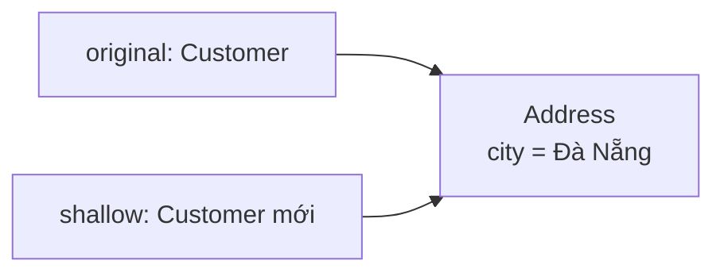
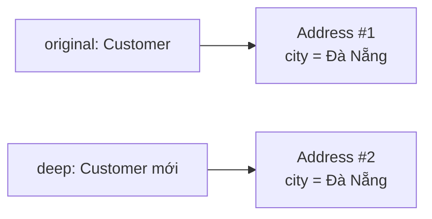

# Shallow and Deep Copying in Java

When creating a new object from an existing one, the key question is: **Does the new object share mutable child objects with the original?** This distinguishes a **shallow copy** from a **deep copy**.

An order-management program might make a copy to experiment with shipping costs. If that copy shares a mutable shipping address or product list with the original order, an operation intended to modify only the copy may accidentally change the original.

## 1. Three Commonly Confused Operations

Consider these simple classes:

```java
class Address {
    String city;

    Address(String city) {
        this.city = city;
    }
}

class Customer {
    String name;
    Address address;

    Customer(String name, Address address) {
        this.name = name;
        this.address = address;
    }
}
```

Suppose we have:

```java
Customer original = new Customer("Mai", new Address("Đà Nẵng"));
```

There are three possibilities:

| Approach | Creates a new `Customer`? | Creates a new `Address`? | Can mutable state still be shared? |
|---|:---:|:---:|:---:|
| `Customer alias = original;` | No | No | Yes, they are the very same object |
| `new Customer(original.name, original.address)` | Yes | No | Yes, they share `Address` |
| `new Customer(original.name, new Address(original.address.city))` | Yes | Yes | No, for the specific object graph in this example |

**Assigning a reference is not copying an object.** `alias = original` only copies a reference value, making both variables point to the same object.

A **shallow copy** creates a new *outer object*, but reference fields generally refer to the same nested objects. Any primitive fields receive copies of their values.

A **deep copy** creates a new outer object and also copies the child objects that must be independent, so modifying mutable data in the copy does not affect the source. The required “depth” depends on data-ownership boundaries; you need not duplicate everything the object references across the entire system.

## 2. Visualizing Reference Relationships

**Shallow copy:**



Two distinct `Customer` objects share a single `Address` object.

**Deep copy for this structure:**



The diagrams show **logical reference relationships**, not physical memory locations that the JVM must use.

## 3. Standalone Java Example: Two Copying Approaches

File `CopyDemo.java`:

```java
public class CopyDemo {
    static class Address {
        private String city;

        Address(String city) {
            this.city = city;
        }

        Address(Address source) {
            this.city = source.city;
        }

        String getCity() {
            return city;
        }

        void setCity(String city) {
            this.city = city;
        }
    }

    static class Customer {
        private String name;
        private Address address;

        Customer(String name, Address address) {
            this.name = name;
            this.address = address;
        }

        static Customer shallowCopy(Customer source) {
            return new Customer(source.name, source.address);
        }

        static Customer deepCopy(Customer source) {
            return new Customer(
                source.name,
                new Address(source.address)
            );
        }

        String getCity() {
            return address.getCity();
        }

        void moveTo(String city) {
            address.setCity(city);
        }

        Address getAddressForDemo() {
            return address;
        }
    }

    public static void main(String[] args) {
        Customer original = new Customer(
            "Mai", new Address("Đà Nẵng")
        );

        Customer shallow = Customer.shallowCopy(original);
        Customer deep = Customer.deepCopy(original);

        System.out.println(original == shallow); // false
        System.out.println(original == deep);    // false

        System.out.println(
            original.getAddressForDemo()
                == shallow.getAddressForDemo()
        ); // true

        System.out.println(
            original.getAddressForDemo()
                == deep.getAddressForDemo()
        ); // false

        original.moveTo("Hà Nội");

        System.out.println(original.getCity()); // Hà Nội
        System.out.println(shallow.getCity());  // Hà Nội
        System.out.println(deep.getCity());     // Đà Nẵng
    }
}
```

Explanation:

1. `shallowCopy` constructs a new `Customer` but passes **the same reference** from `source.address` into the constructor.
2. `deepCopy` constructs a new `Customer` **and** a new `Address` using a copy constructor.
3. After `original.moveTo("Hà Nội")`, `shallow` observes the change because it shares `Address`; `deep` remains unaffected.

In the example, copying the reference to `String name` is safe for the name's contents because `String` is immutable (its contents never change after creation). If `name` were a custom mutable object, we would need to consider copying it as well.

**Practical note:** `getAddressForDemo()` deliberately exposes a reference to demonstrate the difference. Production APIs should consider avoiding direct exposure of internal references when state independence matters.

## 4. Shallow Copies with Constructors and Object.clone()

Java has no universal `deepcopy(object)` syntax that works correctly for every object graph.

One explicit approach is to write a **copy constructor** or factory method:

```java
class Point {
    int x;
    int y;

    Point(int x, int y) {
        this.x = x;
        this.y = y;
    }

    Point(Point other) {
        this.x = other.x;
        this.y = other.y;
    }
}
```

Because `Point` has only two primitive fields, this copy constructor creates two objects with independent state. There are no references to mutable child objects that need further copying.

### Does Object.clone() Perform a Deep Copy?

**No.** The default `Object.clone()` behavior creates a new object by copying its fields; for reference fields, it copies **the reference values**. Thus, the result is generally a **shallow copy**.

An illustrative example:

```java
class Inventory implements Cloneable {
    int[] quantities;

    Inventory(int[] quantities) {
        this.quantities = quantities;
    }

    @Override
    public Inventory clone() {
        try {
            return (Inventory) super.clone();
        } catch (CloneNotSupportedException ex) {
            throw new AssertionError(ex);
        }
    }
}

Inventory a = new Inventory(new int[] {3, 5});
Inventory b = a.clone();

System.out.println(a == b);                // false
System.out.println(a.quantities == b.quantities); // true

b.quantities[0] = 99;
System.out.println(a.quantities[0]);       // 99
```

`Cloneable` is a marker interface for the `Object.clone()` mechanism; it **does not declare** a public `clone()` method itself. To deep-copy the array field, you can modify the clone after calling `super.clone()`:

```java
@Override
public Inventory clone() {
    try {
        Inventory copy = (Inventory) super.clone();
        copy.quantities = this.quantities.clone();
        return copy;
    } catch (CloneNotSupportedException ex) {
        throw new AssertionError(ex);
    }
}
```

For `int[]`, the array's `clone()` creates a new array and copies primitive values, providing sufficient independence. With `Product[]` containing mutable `Product` objects, the new array still holds references to those same `Product` instances; a deeper copy requires copying the relevant elements.

Given the special requirements and potential complexity of `Object.clone()` in inheritance hierarchies, copy constructors or specialized factories are often easier to read and verify. The right choice still depends on the class contract and the APIs involved.

## 5. List, Set, Map: Copying a Collection Does Not Necessarily Copy Its Elements

This is a very common source of Java bugs.

```java
import java.util.ArrayList;
import java.util.List;

public class ListCopyDemo {
    static class Item {
        String name;

        Item(String name) {
            this.name = name;
        }

        Item(Item source) {
            this.name = source.name;
        }
    }

    public static void main(String[] args) {
        List<Item> original = new ArrayList<>();
        original.add(new Item("Bàn phím"));

        // Danh sách mới, phần tử Item vẫn là đối tượng cũ.
        List<Item> shallow = new ArrayList<>(original);

        // Danh sách mới với từng Item được tạo mới.
        List<Item> deep = new ArrayList<>();
        for (Item item : original) {
            deep.add(new Item(item));
        }

        original.get(0).name = "Chuột";

        System.out.println(shallow.get(0).name); // Chuột
        System.out.println(deep.get(0).name);    // Bàn phím

        shallow.add(new Item("Tai nghe"));
        System.out.println(original.size());    // 1
        System.out.println(shallow.size());     // 2
    }
}
```

Distinguish **two levels of independence**:

- **Collection structure:** `new ArrayList<>(original)` creates a different list, so `add` or `remove` on the new list does not automatically change the original list's structure.
- **Element objects:** the original elements may still be shared. Modifying an `Item` object is visible through both shallowly copied lists.

The same principle applies to `new HashSet<>(source)` and `new HashMap<>(source)`: they create new containers but generally retain references to the original keys, values, or elements.

### Does List.copyOf Perform a Deep Copy?

`List.copyOf(source)` creates a list whose interface **disallows structural changes** (and rejects `null` elements). It **does not** make mutable elements immutable or produce deep copies of them:

```java
List<StringBuilder> source = new ArrayList<>();
source.add(new StringBuilder("A"));

List<StringBuilder> snapshot = List.copyOf(source);
// snapshot.add(new StringBuilder("B")); // UnsupportedOperationException

source.get(0).append("!");
System.out.println(snapshot.get(0)); // A!
```

Likewise, `Collections.unmodifiableList(source)` returns **a view that blocks modification through the view**, but it may still reflect structural changes to the underlying `source` list. To capture the structure at a particular time, copy the container and optionally wrap it as unmodifiable; isolating element state requires a separate solution.

## 6. Copying One-Dimensional and Multidimensional Arrays

### Arrays of Primitive Values

```java
int[] scores = {8, 9, 10};
int[] copied = scores.clone();

copied[0] = 0;

System.out.println(scores[0]); // 8
System.out.println(copied[0]); // 0
```

The destination array is a new object. Because its elements are `int` values, copying each primitive value provides independent array data.

### Two-Dimensional Arrays

Java represents `int[][]` as **an array containing references to inner arrays**:

```java
int[][] grid = {{1, 2}, {3, 4}};

int[][] shallow = grid.clone();
shallow[0][0] = 99;

System.out.println(grid[0][0]); // 99
```

`grid.clone()` creates only a new outer array; both outer arrays still share the same `int[]` rows.

Copy each row to make them independent:

```java
int[][] deep = new int[grid.length][];
for (int i = 0; i < grid.length; i++) {
    deep[i] = grid[i] == null ? null : grid[i].clone();
}

deep[0][0] = 7;
System.out.println(grid[0][0]); // 99
System.out.println(deep[0][0]); // 7
```

For more deeply nested arrays or mutable object elements, further copying must follow the actual structure. The `[][]` notation does not make Java deep-copy data automatically.

## 7. Deep Copying Is Copying an Object Graph

An object can refer to multiple child objects that, in turn, refer to one another. Simply invoking copy constructors recursively may therefore be insufficient.

For example:

```text
Department
  ├── leader ---> Employee #1
  └── staff[0] -> Employee #1
```

If `leader` and `staff[0]` are deep-copied into two separate new `Employee` objects, the copy loses the original relationship in which **both fields point to the same employee**.

Two graph properties matter:

1. **Shared references:** multiple paths to one source object should continue to point to the same **corresponding copy** if the contract requires preserving graph structure.
2. **Cycles:** objects may reference one another in a loop (A → B → A). Naive recursive construction can recurse indefinitely and cause `StackOverflowError`.

Graph copying commonly needs **a mapping from source objects to copied objects**, based on object identity, with each copy entered in the map **before** recursively processing child references.

### Example: Handling Cyclic References with IdentityHashMap

File `GraphCopyDemo.java`:

```java
import java.util.IdentityHashMap;
import java.util.Map;

public class GraphCopyDemo {
    static class Node {
        final String label;
        Node next;

        Node(String label) {
            this.label = label;
        }
    }

    static Node deepCopy(Node source, Map<Node, Node> seen) {
        if (source == null) {
            return null;
        }

        Node existing = seen.get(source);
        if (existing != null) {
            return existing;
        }

        Node copy = new Node(source.label);
        seen.put(source, copy); // Phải lưu trước khi đệ quy
        copy.next = deepCopy(source.next, seen);
        return copy;
    }

    static Node deepCopy(Node source) {
        return deepCopy(source, new IdentityHashMap<>());
    }

    public static void main(String[] args) {
        Node a = new Node("A");
        Node b = new Node("B");
        a.next = b;
        b.next = a; // Tạo vòng A -> B -> A

        Node copiedA = deepCopy(a);

        System.out.println(a == copiedA);          // false
        System.out.println(a.next == copiedA.next); // false
        System.out.println(copiedA.next.next == copiedA); // true
        System.out.println(copiedA.next.next == a); // false
    }
}
```

`IdentityHashMap` compares keys using **object identity (`==`)** rather than the `equals()` contract. This suits graph preservation: two distinct source objects with equal contents must still have separate copies. The algorithm works for `Node` with only a `label` that is an immutable `String` and a `next` reference; a real class might require additional copies of other mutable fields.

For very deep graphs, recursive copying can still overflow the call stack; use iterative traversal with a queue or stack if large graphs must be handled.

## 8. Defensive Copying to Protect Class State

A frequent reason to copy data is at an **API boundary**: a class receives externally mutable data but needs to keep its own state stable.

Suppose a score report only stores `int[]`:

```java
import java.util.Objects;

public final class ScoreReport {
    private final int[] scores;

    public ScoreReport(int[] source) {
        Objects.requireNonNull(source, "source");
        this.scores = source.clone(); // Sao chép khi nhận
    }

    public int[] getScores() {
        return scores.clone(); // Sao chép khi trả ra
    }

    public int total() {
        int result = 0;
        for (int score : scores) {
            result += score;
        }
        return result;
    }
}
```

Usage:

```java
int[] input = {7, 8};
ScoreReport report = new ScoreReport(input);

input[0] = 0;                  // Không làm đổi report
int[] result = report.getScores();
result[1] = 0;                 // Không làm đổi report

System.out.println(report.total()); // 15
```

**Copying on input** prevents callers from modifying data after handing it to `ScoreReport`. **Copying on output** prevents callers from changing internal data through the getter.

Because `scores` is an `int[]`, `clone()` is sufficient. With `List<MutableStudent>`, copying the list alone could expose references to individual mutable students; copy the elements as well, expose immutable DTOs, or return only calculated information.

The `final` keyword on field `scores` prevents reassignment of that field's reference; it **does not** itself prevent array-element changes. Defensive copies and restricted direct access are what protect the state in this example.

## 9. When Is Deep Copying Unnecessary?

Deep copying should not be the default for every situation. Consider **purpose**, **data ownership**, and **mutability**:

| Situation | Often reasonable choice | Reason |
|---|---|---|
| Need another name for the same object | Assign a reference | Intentional data sharing with no copy cost |
| Create a new collection while sharing immutable elements | Shallow-copy the container | Inexpensive and usually safe |
| Create a DTO independent of a mutable domain object | Deep-copy fields that must be independent | Editing the DTO does not affect source data |
| Store `int[]` in a class that protects invariants | Copy the array on input and output | Prevents unintended external changes |
| An object graph contains shared references or cycles | Controlled copying using an identity map | Preserves relationships and avoids infinite recursion |
| The object is immutable (such as `String` or `Integer`) | Sharing the reference may be safe | Its state cannot be modified |
| The object represents an external resource (socket, database connection, lock) | Redesign the contract; usually avoid deep copies | Identity and resources cannot or should not be cloned mechanically |
| A managed ORM/JPA entity | Design a separate DTO/snapshot for the specific purpose | Arbitrary entity copying can confuse identity, relationships, and persistence state |

### Costs and Limitations

Deep copying can consume **time and memory**, especially for large graphs. It also raises business questions: which fields are data owned by the object, and which merely reference an independently identified entity, shared resource, or service?

A “deeper” copy is not necessarily “more correct” if it breaks intentional sharing, duplicates business entities, or creates unwanted independent data. Conversely, shallow copying can cause side effects when callers mistakenly assume complete independence.

Specify clearly in the API **which data levels are copied, which remain shared, and who is allowed to modify them**.

## 10. Common Misconceptions

| Claim | Verdict | Explanation |
|---|---|---|
| `b = a` is a shallow copy | False | It only copies a reference value; no new object is created |
| `new ArrayList<>(oldList)` is always a deep copy | False | The new container commonly shares its elements |
| `Object.clone()` deep-copies by default | False | Copied reference fields still point to the original child objects |
| `int[].clone()` gives independent element values | True | Elements are primitives |
| `Person[].clone()` creates new `Person` copies | False | Referenced elements remain shared |
| `List.copyOf()` makes mutable elements immutable | False | It prevents modifying the collection through the result; it does not freeze elements |
| A `final` field makes a child object immutable | False | `final` only restricts reassignment of that field |
| Deep copying must copy everything unconditionally | False | Respect boundaries, identity, and shared resources |
| Naive recursive copying can fail with cyclic references | True | Track already copied objects or use a different algorithm |

## 11. Practice Exercises

### Exercise 1: Predict the Output

```java
class Category {
    String title;
    Category(String title) { this.title = title; }
}

class Product {
    Category category;
    Product(Category category) { this.category = category; }
}

Category category = new Category("Thiết bị");
Product p1 = new Product(category);
Product p2 = new Product(p1.category);

p2.category.title = "Phụ kiện";
System.out.println(p1.category.title);
System.out.println(p1 == p2);
System.out.println(p1.category == p2.category);
```

**Answer:** `Phụ kiện`, `false`, `true`. The two `Product` objects are distinct but share one `Category`. Creating the new `Product` here effectively performs a shallow copy of the `category` field.

### Exercise 2: Copy a Two-Dimensional Array

```java
int[][] a = {{1}, {2}};
int[][] b = a.clone();
b[0] = new int[] {9};
b[1][0] = 7;

System.out.println(a[0][0]);
System.out.println(a[1][0]);
```

**Answer:** `1` and `7`. Assigning `b[0]` only replaces the first row reference in outer array `b`; however, `b[1]` and `a[1]` still point to the same second row, so an element change is shared.

### Exercise 3: Design a Safe Copy Function

An `Order` contains `id: String`, `shippingAddress: Address`, and `items: List<OrderItem>`, where `Address` and `OrderItem` are mutable. You must create a copy in which users can experiment with the address and product quantities without altering the original order.

Implementation hints:

1. Create a new `Order` and retain its `id` value only if the specification permits it; if this is a business-identity entity, consider a separate ID or a DTO.
2. Create a new `Address` from the original address data.
3. Create a new `List` and new copies of each `OrderItem`; also copy mutable components owned within each item.
4. Verify using reference comparison `==` and by modifying the copy, then checking that the original order remains unchanged.

Also ask: if two original items reference the same mutable `DiscountRule` object, should the copy preserve that sharing? The answer depends on the business contract, which is why data must be considered **a graph**, not just a simple tree.

---

## Remember

- **Reference assignment:** creates no new object.
- **Shallow copy:** creates a new outer object while generally retaining references to child objects.
- **Deep copy:** creates independent child objects where required by the defined scope.
- For `clone()`, copy constructors, new containers, and `List.copyOf()`, determine precisely what level of copying each actually performs.
- Base copying decisions on data mutability, intended sharing, object identity, and API boundaries; test by modifying the copy and observing the source.
