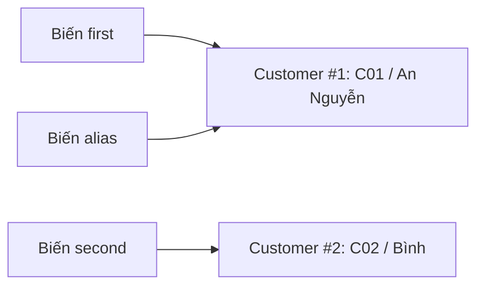
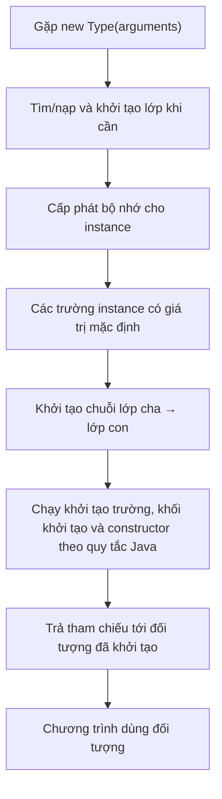

# Object Creation and Resource Allocation in Java

> **Topic:** OOP → Object Lifecycle. When you write `new Customer(...)`, the program creates a **Java object** and initializes its state. If the object works with files, sockets, or database connections, the program may also need to **allocate resources outside Java memory**. These two types of resources have different lifecycles and cleanup mechanisms.

## 1. From Classes to Objects

A **class** describes data and behavior; an **object (instance)** is an entity created from that class.

```java
public class CustomerDemo {
    static final class Customer {
        private final String id;
        private String name;

        Customer(String id, String name) {
            if (id == null || id.isBlank()) {
                throw new IllegalArgumentException("ID không hợp lệ");
            }
            if (name == null || name.isBlank()) {
                throw new IllegalArgumentException("Tên không hợp lệ");
            }
            this.id = id;
            this.name = name;
        }

        void rename(String newName) {
            if (newName == null || newName.isBlank()) {
                throw new IllegalArgumentException("Tên không hợp lệ");
            }
            this.name = newName;
        }

        String describe() {
            return id + ": " + name;
        }
    }

    public static void main(String[] args) {
        Customer first = new Customer("C01", "An");
        Customer second = new Customer("C02", "Bình");
        Customer alias = first;

        alias.rename("An Nguyễn");

        System.out.println(first.describe());  // C01: An Nguyễn
        System.out.println(second.describe()); // C02: Bình
        System.out.println(first == alias);     // true
        System.out.println(first == second);    // false
    }
}
```

In the statement `Customer first = new Customer("C01", "An");`:

- `Customer` is the **type of the reference variable**.
- `first` holds a **reference** to the object; it is not the object itself.
- `new Customer(...)` creates an instance and performs initialization.
- `"C01"` and `"An"` are arguments passed to the constructor.
- `alias = first` copies the reference; it **does not create another object**.
- `new Customer("C02", "Bình")` creates a separate instance with its own state.



**Key point:** declaring a reference variable does not automatically create an object:

```java
Customer a;              // Chỉ khai báo biến cục bộ; chưa được gán
Customer b = null;       // Có biến tham chiếu nhưng chưa trỏ tới Customer nào
Customer c = new Customer("C03", "Chi"); // Mới tạo instance
```

You cannot read `a` before assigning it because the Java compiler requires local variables to be initialized before use. Calling `b.describe()` when `b == null` throws a `NullPointerException`.

## 2. What Happens When You Call `new`?

At a conceptual level, you can think of the process as follows:



This diagram summarizes the process for learning OOP. On the JVM, class loading, class initialization, allocation optimizations, and constructor invocation follow specific rules; **do not interpret these as mandatory, distinct machine operations for every call**.

Key points to understand:

1. **Classes and objects are different:** the JVM manages class information; each ordinary use of `new` creates an instance with its own instance fields.
2. **Default state:** before initializers and constructors assign data, instance fields receive default values: numeric types get `0`, `boolean` gets `false`, and references get `null`. This **does not apply to unassigned local variables**.
3. **Constructors run during creation:** a constructor establishes valid object state and has no return type, not even `void`.
4. **Initialization follows inheritance rules:** a subclass constructor invokes the appropriate superclass constructor; each class's instance initializers execute in declaration order before that class's constructor body, following the required superclass invocation.
5. **The reference is returned by the `new` expression:** the caller uses it to invoke methods or store the object in a data structure.

### Default Values, Field Initializers, and Constructors

```java
class Device {
    int attempts;                // Mặc định 0
    boolean active;              // Mặc định false
    String label;                // Mặc định null
    int priority = 5;            // Field initializer

    Device(String label) {
        this.label = label;      // Constructor gán trạng thái
        this.active = true;
    }
}
```

After `Device d = new Device("Printer");`, the observed values are `attempts == 0`, `active == true`, `label.equals("Printer")`, and `priority == 5`. However, **do not rely on default `null` values to skip validating required data**; constructors should explicitly establish valid state.

## 3. An Object Is Usable Only After Initialization Completes

After allocation and default-value assignment, Java performs initialization according to the class and inheritance rules. A **constructor** has no return type; it sets required data and can reject invalid input by throwing an exception:

~~~java
class Order {
    private final String code;

    Order(String code) {
        if (code == null || code.isBlank()) {
            throw new IllegalArgumentException("Mã đơn không hợp lệ");
        }
        this.code = code;
    }
}
~~~

`new Order("A01")` completes and returns a reference; `new Order("")` throws an exception, so the expression does not return a successfully initialized object. If a constructor opened a file or allocated a resource before detecting the error, the application must still close any resources it owns: constructor failure **does not automatically roll back side effects**.

Every initialization path must maintain the same state contract. Checking invariants is central to *Constructors and establishing valid state*; overloads and `this(...)` are covered in *Default, parameterized, and alternative initialization approaches*.

## 4. Where Is Memory Allocated? Heap, Stack, and JVM Optimizations

In the Java conceptual model:

| Component | How to understand it | Example |
|---|---|---|
| Object/array | Has storage for its state; the JVM typically manages it on the heap | `new Customer(...)`, `new int[10]` |
| Local reference variable | Holds a reference value, not the entire object | `Customer c` in `main` |
| Instance field | Belongs to an individual instance | `this.name` |
| `static` field | Belongs to the class and is shared at class level | `static int createdCount` |
| Call stack | Relates to method-call execution contexts, local variables, return addresses, and so on | `main()` calls `rename()` |
| Resources outside the JVM heap | File descriptors, sockets, connections, native handles, and so on | Open files, DB connections |

People often say “**objects live on the heap, local variables live on the stack**” as a mental model, but this is **not an absolute physical memory-layout guarantee** of the language. The JVM's JIT compiler can optimize through escape analysis, scalar replacement, and allocation strategies; the Java specification defines observable behavior rather than mandating a particular physical memory layout.

```java
Customer c = new Customer("C04", "Dũng");
Customer alsoC = c; // Hai biến cùng tham chiếu instance
c = null;           // Chỉ bỏ tham chiếu qua biến c
// alsoC vẫn tham chiếu được Customer("C04", "Dũng")
```

Assigning `null` **does not directly delete an object**. As long as the JVM can determine that an object might still be used through a sufficient reference path, it is not eligible for reclamation. Once no reference path from any GC root reaches it, the garbage collector **may** reclaim it at a time chosen by the JVM.

## 5. Two Meanings of “Resource Allocation”

`new Customer(...)` creates a Java object, while `Files.newBufferedReader(path)` can both provide a Java object and open an operating-system-managed **file descriptor**.

| Type | Who releases it? | When? |
|---|---|---|
| Memory of an unreachable Java object | Garbage collector | At the JVM's discretion; reclamation is not immediate |
| File, socket, DB connection, native handle | The owner defined by the API contract | Explicitly call `close()` or use another appropriate management mechanism when finished |

Assigning `reader = null` does not guarantee the file is closed. Nor does `System.gc()` establish a resource-closing contract. When opening a resource, a critical design decision is **who owns it and when its use must end**. *Resource cleanup and the limits of finalizers* examines closing order, exceptions, and ownership in detail.

## 6. The Safest Approach for Closeable Resources: try-with-resources

Since Java 7, `try-with-resources` automatically invokes `close()` when execution leaves the `try` scope, even if an exception occurs. A resource declared in the parentheses must implement `AutoCloseable` (or `Closeable`).

### Runnable Example: Reading a File

```java
import java.io.BufferedReader;
import java.io.IOException;
import java.nio.charset.StandardCharsets;
import java.nio.file.Files;
import java.nio.file.Path;

public class ReadFileDemo {
    static void printFirstLine(Path path) throws IOException {
        try (BufferedReader reader =
                     Files.newBufferedReader(path, StandardCharsets.UTF_8)) {
            String line = reader.readLine();
            System.out.println(line == null ? "(file rỗng)" : line);
        } // Tự động gọi reader.close()
    }

    public static void main(String[] args) throws IOException {
        Path path = Files.createTempFile("oop-demo-", ".txt");
        try {
            Files.writeString(path, "Xin chào Java\nDòng thứ hai", StandardCharsets.UTF_8);
            printFirstLine(path); // Xin chào Java
        } finally {
            Files.deleteIfExists(path); // Dọn file tạm kể cả khi đọc lỗi
        }
    }
}
```

To run this example, save it as `ReadFileDemo.java`:

```bash
javac ReadFileDemo.java
java ReadFileDemo
```

In this example:

1. `Files.createTempFile(...)` **creates a real file on the file system**.
2. `Files.newBufferedReader(...)` opens a file-reading resource.
3. `try (reader)` gives the `try` block responsibility for closing `reader`.
4. When the `try` block ends (successfully or exceptionally), `close()` is called.
5. The `finally` block deletes the temporary file explicitly created by the program; **closing a stream and deleting a file are different operations**.

Do not mistake `newBufferedReader` for simply “creating an object”: it can also open a file and consume operating-system resources. If opening fails, the API may throw `IOException`, which the program must handle or declare.

### What Happens If an Error Occurs?

```java
try (BufferedReader reader = Files.newBufferedReader(path)) {
    throw new IOException("Lỗi xử lý");
}
```

Even if an error occurs inside the `try` body, Java still invokes `reader.close()` under try-with-resources semantics. If both the `try` body and `close()` throw exceptions, the exception from the `try` body remains the **primary exception**, while the closing exception is usually recorded as a **suppressed exception** (see `Throwable.getSuppressed()`). When multiple resources are declared in one `try`, they are closed in **reverse declaration order**.

## 7. When Object Creation Starts a Lifecycle That Requires Closing

A custom class can implement `AutoCloseable` to express responsibility for releasing resources. This illustration does not open a real socket:

~~~java
final class DemoSession implements AutoCloseable {
    private boolean closed;

    void send() {
        if (closed) throw new IllegalStateException("Đã đóng");
    }

    @Override
    public void close() {
        closed = true;
    }
}

try (DemoSession session = new DemoSession()) {
    session.send();
}
// Resource được yêu cầu đóng khi thoát try; object Java có thể còn tồn tại.
~~~

The `closed` state represents a **resource-use contract**, not evidence that the GC deleted the object. `AutoCloseable` does not require every implementation to support repeated closing safely; the example class merely records its closed state. For real resources, see *Resource cleanup and the limits of finalizers* for handling `close()` failures, suppressed exceptions, closing order, and ownership transfers.

## 8. Callers Do Not Always Invoke `new` Directly

A **static factory**, factory service, or framework can supply an object without the caller invoking its constructor directly:

| How an object is obtained | Example | Key consideration |
|---|---|---|
| Constructor | `new Customer("C01", "An")` | Normally creates a new instance |
| Factory | `List.of("A")`, `Integer.valueOf(42)` | May return an existing object; a new instance is not guaranteed on every call |
| Resource-opening API | `Files.newBufferedReader(path)` | May open a file; handle IOException and close it at the right time |
| Dependency injection | Constructor receives `Repository` | The dependency is created/supplied elsewhere |
| Deserialization/reflection | An API or framework creates an instance | Follow its specific contract; do not assume it behaves exactly like every `new` call |

*Static factory methods, Factory, and Builder* explains how to choose meaningful object-creation APIs, control implementations, and manage multiple parameters. Regardless of how an object is created, **the lifecycle of Java memory and the lifecycle of external resources must still be considered separately**.

## 9. Who Still Holds a Reference After Creation?

An object may no longer have business value but remain reachable because a registry, cache, or listener still holds a reference:

~~~java
static final List<Runnable> listeners = new ArrayList<>();

static void register(Runnable listener) {
    listeners.add(listener);
}

static void unregister(Runnable listener) {
    listeners.remove(listener);
}
~~~

This example assumes a class that already imports `java.util.List` and `java.util.ArrayList`. While `listener` remains in the long-lived list, it and the objects it references may stay retained. Registrations need an unregistration policy, and caches need limits/TTL suited to their use. Reference paths from GC roots and retention issues are covered fully in *Object lifetime, reachability, and memory reclamation*.

## 10. Distinguishing Lifecycle Events

| Event | Java object | Resource outside the JVM |
|---|---|---|
| `new`/factory returns successfully | The object can be used | May already be open, depending on the API |
| Method invocation | State may change | Data may be read or written |
| `close()` | The object may still exist | A request is made to release the resource |
| All reachable reference paths disappear | May be reclaimed by the GC | Do not rely on the GC for timely closing |
| GC runs | Memory for eligible objects is reclaimed | Does not provide deterministic resource management |

A commonly confusing example:

```java
BufferedReader reader = Files.newBufferedReader(path);
reader = null; // Không bảo đảm file đã được đóng!
```

The correct approach when this code opens and owns the reader:

```java
try (BufferedReader reader = Files.newBufferedReader(path)) {
    // Sử dụng reader
}
```

If a program continuously creates objects that become unreachable, the GC can reclaim their memory. If it continuously opens files without closing them, it can still exhaust file descriptors or system resource limits even when the heap is not full.

## 11. Common Mistakes and How to Fix Them

| Mistake | Why is it dangerous? | How to address it |
|---|---|---|
| Calling a method through a `null` reference | `NullPointerException` | Initialize correctly and check for null at API boundaries |
| Assuming that declaring a variable creates an object | A local variable may still be unassigned | Use a constructor/factory when needed |
| Assuming that `alias = original` creates a copy | Both variables refer to the same instance | Explicitly create a copy when independent state is needed |
| Opening a resource in a constructor, then throwing without closing it | Resource leak | Handle failures and call `close` according to ownership |
| Using the GC or `System.gc()` to “close” a file | No guaranteed closing time | Use try-with-resources |
| Forgetting `close()` for JDBC/file/socket resources | Finite resources remain held | Define clear ownership and closing rules |
| Closing a caller-managed resource | Breaks the caller's workflow | Agree on ownership in the API contract |
| Storing every object in a `static` collection | Reachable objects cannot be garbage-collected | Bound caches, unregister listeners, remove unused elements |
| Using an already-closed object | State/IO errors | Enforce the `closed` state and valid usage scope |

## 12. Practice Exercises

1. Write a `Student` class with `id` and `name`; use its constructor to reject an empty `id`, create two objects, introduce an alias variable, and predict the result of `==`.
2. Write `Counter` with an instance field `count` and a `static` field counting successfully created instances. Consider that its constructor might throw before incrementing the count.
3. Create a temporary file with `Files.createTempFile`, write and read a line, then ensure the stream is closed and the file is deleted even if an error occurs.
4. Write a `FakeConnection implements AutoCloseable` class that logs when it opens, performs an operation, and closes; throw a `RuntimeException` inside the `try` block to verify that `close()` still runs.
5. A service stores every `Request` object in a `static List<Request>` without removing any. Explain why the GC cannot reclaim objects that remain referenced by the list.

**Remember:** Creating a Java object means constructing an instance and initializing it into a valid state. The GC reclaims **object memory** based on reachability, while releasing **resources with explicit open/close lifecycles** must follow API ownership contracts—usually through `AutoCloseable` and `try-with-resources`.
