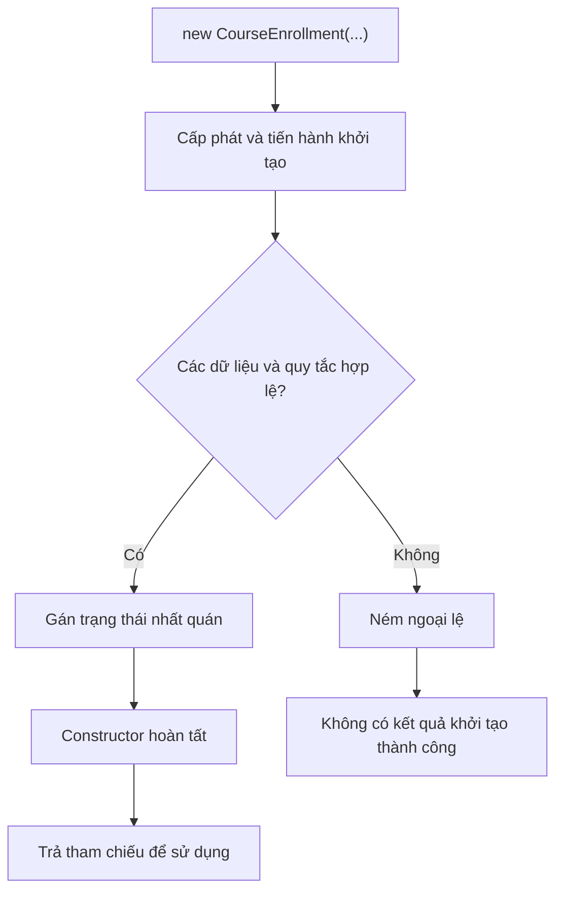

# Constructors and Establishing Valid State in Java

An object must do more than simply **get created**; it must be in a **valid state** before outside code starts using it. In Java, the **constructor** is a key place to validate input, assign fields, and enforce the rules an object must always satisfy.

For example, a course enrollment is valid only when the course code is nonempty, capacity is greater than zero, enrollment does not exceed capacity, and the enrollment list has no duplicates. If any condition is violated, the constructor should **refuse to produce a usable object** by throwing an appropriate exception.

## 1. Where Does the Constructor Fit in an Object's Lifecycle?

Consider this invocation:

```java
CourseEnrollment course = new CourseEnrollment("JAVA-01", 20);
```

Conceptually, the process is:

1. The `new` expression requests creation of an object of class `CourseEnrollment`.
2. Java allocates memory, assigns default field values, and performs initialization in the language-defined order (including superclass constructors, field/block initializers, and the constructor body).
3. The constructor receives parameters, validates conditions, and establishes initial state.
4. If initialization completes normally, the `new` expression returns a reference to the caller.
5. If the constructor throws an exception, the creation expression **does not complete normally**; the caller does not receive a result reference from that expression.



The diagram illustrates the example's validation flow; Java still determines the detailed initialization order for fields and superclasses.

**A constructor is not an ordinary method.** Its name must match the class name, it has no return type (not even `void`), and it is invoked during object creation. It can accept parameters, check conditions, assign fields, and throw exceptions.

## 2. Valid State and Class Invariants

An **invariant** is a set of conditions that must hold when an object is validly published and used.

Consider a `BankAccount` class whose balance must never be negative:

```java
class BankAccount {
    private long balance;

    BankAccount(long openingBalance) {
        if (openingBalance < 0) {
            throw new IllegalArgumentException("Số dư ban đầu không được âm");
        }
        this.balance = openingBalance;
    }

    void withdraw(long amount) {
        if (amount <= 0 || amount > balance) {
            throw new IllegalArgumentException("Số tiền rút không hợp lệ");
        }
        balance -= amount;
    }

    long getBalance() {
        return balance;
    }
}
```

Here, the invariant is `balance >= 0`. The constructor ensures it holds **after creation**, and `withdraw()` must continue to preserve it **throughout use**.

If only the constructor validates the balance, an unchecked `setBalance(-100)` setter could still break the invariant. Therefore:

- The constructor must establish a valid initial state.
- Methods that change state must preserve that validity.
- Fields should be encapsulated with `private` to prevent arbitrary external assignments.
- Not every field needs a setter. Expose only business operations the object actually permits.

Good validation is usually tied to **domain rules**: nonnegative amounts, start times before end times, nonempty identifiers, positive order quantities, or a membership list that stays within capacity.

## 3. Complete Example: Initializing Valid Course Enrollment

The example below builds an **immutable** class: the constructor validates all state, its fields are never reassigned, and adding a student produces a new object through the constructor. This makes it clear why you must **recheck the invariant** whenever new state is needed.

Put all the code below into `Main.java`. Run it with **Java 17 or Java 21**.

```java
import java.util.ArrayList;
import java.util.HashSet;
import java.util.List;
import java.util.Objects;
import java.util.Set;

final class CourseEnrollment {
    private final String courseCode;
    private final int capacity;
    private final List<String> studentEmails;

    // Constructor tiện lợi cho khóa học chưa có người đăng ký.
    CourseEnrollment(String courseCode, int capacity) {
        this(courseCode, capacity, List.of());
    }

    // Constructor thực hiện kiểm tra trạng thái đầy đủ.
    CourseEnrollment(String courseCode, int capacity, List<String> studentEmails) {
        if (courseCode == null || courseCode.isBlank()) {
            throw new IllegalArgumentException("Mã khóa học không được trống");
        }
        if (capacity <= 0) {
            throw new IllegalArgumentException("Sức chứa phải lớn hơn 0");
        }

        Objects.requireNonNull(studentEmails, "studentEmails");

        // Chụp dữ liệu đầu vào để caller không sửa được trạng thái bên trong.
        // List.copyOf cũng từ chối các phần tử null.
        List<String> copy = List.copyOf(studentEmails);

        if (copy.size() > capacity) {
            throw new IllegalArgumentException("Số học viên vượt sức chứa");
        }

        Set<String> unique = new HashSet<>();
        for (String email : copy) {
            if (email.isBlank()) {
                throw new IllegalArgumentException("Email không được trống");
            }
            if (!unique.add(email)) {
                throw new IllegalArgumentException("Email đã đăng ký trùng");
            }
        }

        // Sau khi đã kiểm tra xong, thiết lập trạng thái.
        this.courseCode = courseCode;
        this.capacity = capacity;
        this.studentEmails = copy;
    }

    CourseEnrollment withStudent(String email) {
        Objects.requireNonNull(email, "email");

        List<String> updated = new ArrayList<>(studentEmails);
        updated.add(email);

        // Constructor tiếp tục bảo vệ các invariant.
        return new CourseEnrollment(courseCode, capacity, updated);
    }

    String getCourseCode() {
        return courseCode;
    }

    int getCapacity() {
        return capacity;
    }

    int getRegisteredCount() {
        return studentEmails.size();
    }

    List<String> getStudentEmails() {
        return studentEmails;
    }
}

public class Main {
    public static void main(String[] args) {
        List<String> source = new ArrayList<>(List.of("lan@example.com"));
        CourseEnrollment first = new CourseEnrollment("JAVA-01", 2, source);

        source.add("minh@example.com"); // Sửa danh sách ngoài đối tượng
        System.out.println(first.getStudentEmails());

        CourseEnrollment second = first.withStudent("minh@example.com");
        System.out.println(first.getRegisteredCount());
        System.out.println(second.getRegisteredCount());
        System.out.println(first == second);

        try {
            new CourseEnrollment("JAVA-01", 1,
                    List.of("lan@example.com", "minh@example.com"));
        } catch (IllegalArgumentException ex) {
            System.out.println(ex.getMessage());
        }

        try {
            first.withStudent("lan@example.com");
        } catch (IllegalArgumentException ex) {
            System.out.println(ex.getMessage());
        }

        try {
            new CourseEnrollment(" ", 2);
        } catch (IllegalArgumentException ex) {
            System.out.println(ex.getMessage());
        }

        try {
            first.getStudentEmails().add("other@example.com");
        } catch (UnsupportedOperationException ex) {
            System.out.println("Không thể sửa danh sách đã trả về");
        }
    }
}
```

Compile and run:

```bash
javac Main.java
java Main
```

Output:

```text
[lan@example.com]
1
2
false
Số học viên vượt sức chứa
Email đã đăng ký trùng
Mã khóa học không được trống
Không thể sửa danh sách đã trả về
```

**Interpreting the output:**

- The constructor takes a snapshot with `List.copyOf(source)`, so adding an element to `source` does not change `first`.
- `first.withStudent(...)` invokes the constructor again to create `second`. `first` still has one enrollment and `second` has two; they are different objects.
- When enrollment exceeds capacity, an email is duplicated, or the course code is empty, the constructor throws `IllegalArgumentException`.
- The list returned by `getStudentEmails()` does not allow additions or removals, so the validated state cannot be invalidated that way.

This example compares email strings exactly and case-sensitively; that is only an illustrative rule. Real applications must define their own email normalization and comparison policy and validate other domain constraints as necessary.

## 4. Choosing the Order of Validation and Field Assignment

An easy-to-review constructor often follows this order:

1. Check `null` parameters and individual values: `courseCode`, `capacity`.
2. Normalize or copy external data when necessary.
3. Check cross-field constraints: enrollment must not exceed `capacity`.
4. Assign fields once, using the already-validated state.
5. Let the constructor finish only when all invariants hold.

This reduces the chance of putting an object into an invalid state before discovering an error. Even if a constructor throws, the object is not published through the result of `new`; however, **external effects** that happened before the exception (writing a file, sending an event, transferring money, registering a listener, etc.) **are not automatically undone by Java**. Validate first, avoid unnecessary constructor side effects, and keep lengthy business operations separate from initialization.

| Validation category | Example | Appropriate location |
| --- | --- | --- |
| Must not be `null` | Required input list | Constructor, using `Objects.requireNonNull` |
| Must not be empty | Course code, student name | Constructor, after checking `null` |
| Value range | `capacity > 0` | Constructor |
| Cross-field constraint | `students.size() <= capacity` | Constructor, after obtaining a safe list |
| Uniqueness | No duplicate emails | Constructor or a dedicated value type |
| Update rule | Cannot withdraw more than the balance | State-changing method |
| Rule involving external data | Whether the course remains open in the system | Usually a service/business workflow, before creating the appropriate object |

Not every validation belongs in a constructor. For example, checking whether a coupon is still valid in a database depends on timing, connections, and transactions. That is usually a service or factory's responsibility in coordination with infrastructure; the constructor should still defend the object's **intrinsic** invariants.

## 5. Every Constructor Path Must Preserve the Same Invariant

When supporting different input sets, overloads should **delegate** to one common validation point. In Java 17/21, a `this(...)` call must be the first constructor statement:

~~~java
class RetryPolicy {
    private final int attempts;

    RetryPolicy() {
        this(3);
    }

    RetryPolicy(int attempts) {
        if (attempts <= 0) throw new IllegalArgumentException();
        this.attempts = attempts;
    }
}
~~~

Neither construction path can produce a `RetryPolicy` with `attempts <= 0`. This illustrates constructor invariants; *Default, parameterized, and alternative initialization approaches* explains default/no-arg/parameterized constructors, overload choices, and `this(...)`/`super(...)` in greater detail.

## 6. `final`, Encapsulation, and Defensive Copies

A class with `private final` fields limits changes to its field values or references after assignment:

```java
final class Schedule {
    private final List<String> lessons;

    Schedule(List<String> lessons) {
        this.lessons = List.copyOf(lessons);
    }

    List<String> getLessons() {
        return lessons;
    }
}
```

Declaring a field `final` **does not automatically make the referenced object immutable**:

```java
class UnsafeSchedule {
    private final List<String> lessons;

    UnsafeSchedule(List<String> lessons) {
        this.lessons = lessons; // Vẫn chia sẻ list mutable với caller
    }
}
```

With `UnsafeSchedule`, the caller can modify the original list and thereby change the object's observable state. `Schedule` uses `List.copyOf()` to hold a structurally unmodifiable list unaffected by subsequent additions or removals from the input list.

**Important limitation:** `List.copyOf()` copies the list structure; it **does not deep-copy** all elements. If a list contains mutable elements such as `StringBuilder`, `Date`, or a domain object with setters, additional measures are needed for deep immutability. In the `Schedule` example, the elements are immutable `String` objects, so the approach is suitable.

Practical guidelines:

- Declare fields `private` to control state-update paths.
- Use `final` for data that should be assigned only once.
- Copy mutable inputs if the object's state must be independent of future caller changes.
- Do not expose directly modifiable references to protected internal structures.
- Expose state-changing methods only when they represent meaningful business operations.

## 7. Valid Initialization Versus “Create Now, Fix Later”

The following approaches make different guarantees about the class:

```java
// Phương án dễ tạo trạng thái chưa hợp lệ:
class UnsafeUser {
    String email;

    UnsafeUser() {
    }
}

// Có thể tạo UnsafeUser mà email == null.
```

Compare that with:

```java
final class User {
    private final String email;

    User(String email) {
        if (email == null || email.isBlank()) {
            throw new IllegalArgumentException("Email bắt buộc");
        }
        this.email = email;
    }

    String getEmail() {
        return email;
    }
}
```

With the second approach, a successfully created `User` **does not start out missing an email**. This API design eliminates many scattered checks such as `if (user.getEmail() == null)` at call sites.

A system may still need different business states, such as `DRAFT`, `PENDING`, and `ACTIVE`. These states **are not necessarily invalid**. The key is to model the valid states for each phase explicitly and prevent contradictory combinations, such as `ACTIVE` without an activation date when the policy requires one.

Some designs use static factories such as `User.registered(email)`, `Order.draft(...)`, or separate types to express initialization states. A factory is an additional design tool; the constructors it invokes must still enforce invariants according to the class's access rules and contract.

## 8. What Happens If a Constructor Throws?

For example:

```java
class Seat {
    private final int number;

    Seat(int number) {
        if (number <= 0) {
            throw new IllegalArgumentException("Số ghế phải dương");
        }
        this.number = number;
    }
}
```

```java
Seat good = new Seat(5);   // Tạo thành công
Seat bad = new Seat(-1);  // Ném IllegalArgumentException
```

On the second line, assignment to `bad` does not complete. If the code catches the exception, it can handle the error and continue execution. An exception does not turn an invalid object into a `null` value.

Common choices:

| Exception | Typical situation |
| --- | --- |
| `IllegalArgumentException` | A parameter violates the constructor contract (negative, empty, or out of range) |
| `NullPointerException` | A required parameter must not be `null`, commonly enforced with `Objects.requireNonNull` |
| Custom domain exception | Represents a specific business error consistently across an API |

Do not use `assert` instead of constructor input validation. Assertions may be disabled at runtime; class-contract validation must work independently of the `-ea` setting.

A constructor should expose failures **clearly according to its contract**. It should not swallow an exception and initialize an object with arbitrary defaults unless those defaults are defined as valid state.

## 9. Do Not Expose an Object Before Its Constructor Completes

Even correct invariant validation can fail if external code uses `this` too early. Two common paths are:

- **A superclass constructor invokes an overridden method:** Java can dispatch to the subclass override before its field initializers have run, leaving fields at their default `null`/`0` values.
- **Registering a listener or starting a task inside a constructor:** a callback or another thread may read fields before they are assigned; if the constructor later throws, a reference to the partially initialized object can remain retained.

Therefore, use non-overridable initialization helpers, validate before side effects, and register/publish the object **after the constructor completes** through appropriate synchronization. The precise superclass/subclass order is covered in *Initialization order in inheritance*; causes, callback examples, and safe publication are covered in *Preventing the use of incompletely initialized objects*.

## 10. `record` Constructors Can Also Enforce Invariants

Since Java 16, `record` provides a concise way to represent data objects. A **compact constructor** can validate and normalize parameters before Java automatically assigns them to component fields:

```java
import java.util.List;

record LessonBundle(String name, List<String> lessons) {
    LessonBundle {
        if (name == null || name.isBlank()) {
            throw new IllegalArgumentException("Tên bộ bài học không hợp lệ");
        }
        lessons = List.copyOf(lessons);
        if (lessons.isEmpty()) {
            throw new IllegalArgumentException("Cần ít nhất một bài học");
        }
    }
}
```

`name` and `lessons` are constructor parameters; inside the compact constructor, `lessons = List.copyOf(lessons)` replaces the parameter value with a protected list. After the constructor body, Java automatically assigns the processed parameters to their corresponding fields.

**Note:** Record fields are `final`, but records are not inherently deeply immutable. If a component is mutable, the constructor must still control reference sharing and mutable elements.

## 11. Checklist for Designing Good Constructors

| Review question | Expected result |
| --- | --- |
| What makes the object valid? | A clearly defined set of invariants |
| Is required data provided at creation? | No objects missing essential fields |
| Do all constructor paths follow the same rules? | Prefer delegation to shared validation |
| Are `null` or out-of-range parameters rejected? | Clear, contract-consistent errors |
| Does the object share callers' mutable collections/arrays? | Use defensive copies when protection is required |
| Can a getter expose modifiable state? | Return safe data or a controlled API |
| Does the constructor invoke overrides, publish `this`, or perform I/O too early? | Prevent use before the object is ready and hard-to-undo side effects |
| Do state-changing methods preserve invariants? | Keep the state valid throughout the object's lifetime |

## 12. Self-Check Exercises

**Exercise 1:** What happens?

```java
class Product {
    private final int quantity;

    Product(int quantity) {
        if (quantity <= 0) {
            throw new IllegalArgumentException("quantity phải dương");
        }
        this.quantity = quantity;
    }
}
// new Product(0);
```

**Answer:** If you uncomment and call `new Product(0)`, the constructor throws `IllegalArgumentException` and does not return a successfully initialized `Product` object.

**Exercise 2:** In `CourseEnrollment`, why must the three-parameter constructor check `copy.size() > capacity` even though the two-parameter constructor always passes `List.of()`?

**Answer:** Callers can invoke the three-parameter constructor directly, and `withStudent()` also uses it. Every creation path must protect the same invariant.

**Exercise 3:** What is the risk of replacing `this.studentEmails = copy;` with `this.studentEmails = studentEmails;`?

**Answer:** The mutable list passed by the caller may be modified after initialization, causing enrollment to exceed capacity or contain duplicates even though the constructor already validated it.

**Exercise 4:** Why does `private final List<String> items` not by itself guarantee the invariant “the list never changes”?

**Answer:** `final` only prevents reassigning the field; it does not prevent `items.add(...)`. You must control access to the list object and its elements if they are mutable.

**Exercise 5:** What is the risk when a superclass constructor invokes an overridable method?

**Answer:** A subclass override may execute before subclass initialization completes and read default values such as `null` or `0`.

**Remember:** A good constructor establishes **the object's state contract at successful initialization**. Define invariants, validate inputs and cross-field relationships, protect mutable input data, and publish the object only after initialization finishes. Subsequent state-changing methods must continue to uphold that contract.
