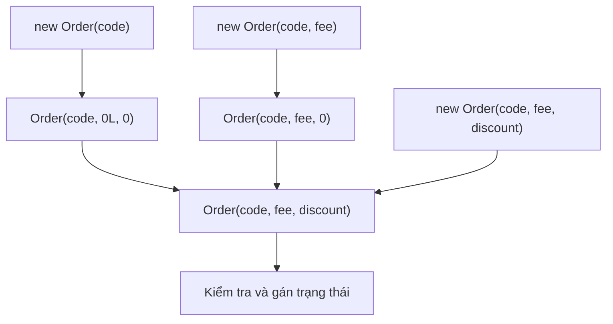

# Default, Parameterized, and Alternative Object Initialization in Java

An object is useful only when its initial state is valid. When writing classes such as `Student`, `BankAccount`, or `Order`, you must decide which data is required at creation, which data can have defaults, and when multiple object-creation approaches make sense.

In Java, the central mechanism is the **constructor**. Java also supports field initializers, initialization blocks, static factory methods, and the Builder pattern. Each addresses different needs, and they should not be treated as completely interchangeable ways to write the same thing.

## 1. What Is a Constructor?

A constructor is invoked when initializing a class instance, usually through a `new` expression:

```java
public class Student {
    private final String id;
    private final String name;

    public Student(String id, String name) {
        this.id = id;
        this.name = name;
    }

    public String getName() {
        return name;
    }

    public static void main(String[] args) {
        Student student = new Student("SV01", "An");
        System.out.println(student.getName()); // An
    }
}
```

In this example:

1. `new Student("SV01", "An")` requests creation of a `Student` object.
2. The `Student(String id, String name)` constructor receives the input data.
3. The `id` and `name` fields are assigned so the object is ready for use.
4. The `new` expression produces a reference to the object, and the `student` variable receives that reference.

**Constructor characteristics:**

- A constructor's name matches the **class name**.
- A constructor **declares no return type**, not even `void`.
- It can accept parameters, be overloaded, and have access modifiers (`public`, `protected`, package-private, or `private`).
- It cannot be declared `static`, `abstract`, or `final`; constructors are neither inherited nor overridden like methods.
- If a method has the same name as a class but declares a return type, it is still a **method**, not a constructor.

An example of **incorrect** syntax:

```java
class Product {
    // public void Product(String name) { } // Đây là method tên Product
    // public static Product() { }           // Không thể dùng static cho constructor
}
```

A constructor is a suitable place to enforce **object invariants**, such as nonnegative prices, nonempty names, and valid identifiers.

## 2. Default Constructors Versus No-Argument Constructors

These two concepts are often both called “default constructors,” but it is useful to distinguish them in Java:

| Concept | Origin | When does it exist? | Can it execute programmer-written logic? |
|---|---|---|---|
| **Default constructor** (implicitly provided) | Generated by the Java compiler | Only when the class **declares no constructors at all** | Contains no programmer-written logic; calls `super()` |
| **No-argument constructor** | Declared by the programmer | When writing `ClassName() { ... }` | Can contain initialization, validation, and assignment logic |
| **Parameterized constructor** | Declared by the programmer | When writing a constructor with at least one parameter | Uses inputs to establish the required state |

### 2.1. Compiler-Generated Default Constructor

```java
public class Book {
    String title;
    int pages;

    // Không khai báo constructor nào

    public static void main(String[] args) {
        Book book = new Book();

        System.out.println(book.title); // null
        System.out.println(book.pages); // 0
    }
}
```

Because `Book` declares no constructors, the Java compiler supplies an implicit no-argument constructor. In an ordinary class like this, you can think of it as approximately equivalent to:

```java
public Book() {
    super();
}
```

This **does not mean** every class automatically supports `new ClassName()`; once you declare any constructor, the compiler no longer inserts a no-argument constructor.

Fields receive type-specific defaults when an object is created (unless a field initializer or constructor assigns them):

| Field type | Default value |
|---|---|
| `byte`, `short`, `int`, `long` | `0` (of the appropriate type) |
| `float`, `double` | `0.0` (of the appropriate type) |
| `boolean` | `false` |
| `char` | `'\u0000'` |
| Reference types such as `String`, `List` | `null` |

**Local variables** in methods and constructors do not have a readable default-value mechanism like fields; they must be assigned before being read.

### 2.2. Explicit No-Argument Constructor

```java
public class Counter {
    private int value;

    public Counter() {
        this.value = 100;
    }

    public int getValue() {
        return value;
    }

    public static void main(String[] args) {
        Counter counter = new Counter();
        System.out.println(counter.getValue()); // 100
    }
}
```

Here, `Counter()` is **explicitly written**, so it is not a compiler-generated default constructor. A programmer-written constructor can assign nondefault values, invoke helper methods, or delegate to another constructor.

### 2.3. Declaring a Parameterized Constructor Does Not Add a No-Arg Constructor

```java
public class Device {
    private final String serial;

    public Device(String serial) {
        this.serial = serial;
    }
}

Device a = new Device("SN-001"); // Hợp lệ
// Device b = new Device();        // LỖI BIÊN DỊCH
```

Reason: the class already declares `Device(String serial)`. The compiler **will not** generate `Device()`.

If both creation paths are needed, declare both constructors:

```java
public class Device {
    private final String serial;

    public Device() {
        this("UNASSIGNED");
    }

    public Device(String serial) {
        this.serial = serial;
    }
}
```

Here, `Device()` is a programmer-declared no-argument constructor that delegates to the constructor accepting a `String`.

**Note:** If a superclass has no accessible no-argument constructor, the subclass's implicit constructor may fail to compile because subclass initialization must invoke an appropriate superclass constructor.

## 3. Parameterized Constructors: Enforcing Required Data

A parameterized constructor is appropriate when an object **must not exist in a state with missing required data**.

For example, a bank account must have an account ID and a nonnegative initial balance:

```java
import java.math.BigDecimal;
import java.util.Objects;

public class BankAccount {
    private final String accountNumber;
    private BigDecimal balance;

    public BankAccount(String accountNumber, BigDecimal openingBalance) {
        Objects.requireNonNull(accountNumber, "accountNumber");
        if (accountNumber.isBlank()) {
            throw new IllegalArgumentException("Mã tài khoản không được rỗng");
        }
        Objects.requireNonNull(openingBalance, "openingBalance");
        if (openingBalance.signum() < 0) {
            throw new IllegalArgumentException("Số dư mở tài khoản không được âm");
        }

        this.accountNumber = accountNumber;
        this.balance = openingBalance;
    }

    public BigDecimal getBalance() {
        return balance;
    }

    public static void main(String[] args) {
        BankAccount account =
                new BankAccount("ACC-01", new BigDecimal("100000"));

        System.out.println(account.getBalance()); // 100000
    }
}
```

The constructor validates input **before the object is used normally**. Using `BigDecimal` instead of `double` for money helps avoid common binary floating-point representation errors; this is an example design choice, not a mandatory rule for every kind of data.

For required properties, a parameterized constructor is often clearer than creating an empty object and waiting for a sequence of setter calls:

```java
// Dễ gây trạng thái tạm thời chưa hợp lệ nếu thiếu thao tác:
Profile profile = new Profile();
profile.setEmail("an@example.com");
// Nếu quên setUserId(), đối tượng có thể vẫn thiếu dữ liệu bắt buộc.
```

Unless an “incomplete” instance is genuinely needed, design the constructor to accept all required data.

## 4. Constructor Overloading: Multiple Ways to Initialize a Class

**Overloading** means declaring multiple constructors with the same class name but different **parameter lists** (different numbers, types, or type order). Access levels may differ, but changing only an access modifier does not create a separate overload.

For example, an order has a required code and optional shipping fees and discount:

```java
public class Order {
    private final String code;
    private final long shippingFee;
    private final int discountPercent;

    public Order(String code) {
        this(code, 0L, 0);
    }

    public Order(String code, long shippingFee) {
        this(code, shippingFee, 0);
    }

    public Order(String code, long shippingFee, int discountPercent) {
        if (code == null || code.isBlank()) {
            throw new IllegalArgumentException("Mã đơn hàng bắt buộc");
        }
        if (shippingFee < 0) {
            throw new IllegalArgumentException("Phí vận chuyển không được âm");
        }
        if (discountPercent < 0 || discountPercent > 100) {
            throw new IllegalArgumentException("Ưu đãi phải từ 0 đến 100%");
        }
        this.code = code;
        this.shippingFee = shippingFee;
        this.discountPercent = discountPercent;
    }

    public String describe() {
        return code + " | shipping=" + shippingFee
                + " | discount=" + discountPercent + "%";
    }

    public static void main(String[] args) {
        System.out.println(new Order("ORD-01").describe());
        System.out.println(new Order("ORD-02", 25000L).describe());
        System.out.println(new Order("ORD-03", 25000L, 10).describe());
    }
}
```

Output:

```text
ORD-01 | shipping=0 | discount=0%
ORD-02 | shipping=25000 | discount=0%
ORD-03 | shipping=25000 | discount=10%
```

Instead of duplicating all validation logic across three constructors, the shorter overloads **delegate** to the full constructor. This keeps validity rules in one place.

### How Java Resolves Overloads

At **compile time**, the compiler selects a matching constructor based on the argument count and types and valid conversions. If multiple overloads are equally applicable and cannot be distinguished, the call is **ambiguous**.

```java
class Message {
    Message(String text) {}
    Message(Integer code) {}
}

// new Message(null); // LỖI: null phù hợp cả String lẫn Integer
new Message((String) null); // Chọn constructor String
```

Avoid too many easily confused overloads, especially when parameters have the same type or can accept `null`.

## 5. Constructor Chaining with this() and super()

When one constructor invokes another, that is called **constructor chaining**.

- `this(...)`: invokes **another constructor in the same class**.
- `super(...)`: invokes a constructor of the **superclass**.
- In the broadly compatible pattern, an explicit constructor invocation appears at the start of the constructor body.
- You cannot directly invoke both `this(...)` and `super(...)` in the same constructor; a constructor invoked through `this(...)` continues the chain to the superclass.
- You cannot create a cycle of `this(...)` calls (for example, A calls B, and B calls A): the compiler reports an error.

Initialization flow for the `Order` example above:



### Superclass and Subclass Example

File `InheritanceInitDemo.java`:

```java
public class InheritanceInitDemo {
    static class Person {
        private final String name;

        Person(String name) {
            this.name = name;
            System.out.println("Person constructor: " + name);
        }

        String getName() {
            return name;
        }
    }

    static class Employee extends Person {
        private final String department;

        Employee(String name, String department) {
            super(name);
            this.department = department;
            System.out.println("Employee constructor: " + department);
        }

        String getDepartment() {
            return department;
        }
    }

    public static void main(String[] args) {
        Employee employee = new Employee("An", "Backend");
        System.out.println(employee.getName() + " - "
                + employee.getDepartment());
    }
}
```

Output:

```text
Person constructor: An
Employee constructor: Backend
An - Backend
```

The superclass constructor executes before the subclass constructor body. If the `Employee` constructor omits `super(name)`, the compiler attempts to insert an implicit `super()` call (which does not exist in this example), causing a compilation error.

**Do not invoke constructors directly like ordinary methods**, such as `employee.Person("An")`. Calls to `this(...)` / `super(...)` use constructor-invocation syntax with its own rules.

## 6. Constructor Chaining in Inheritance: Key Points

If `Child extends Parent`, every `Child` constructor must eventually invoke a valid `Parent` constructor (explicitly through `super(...)` or implicitly through `super()` when valid). This is still **one Child object** containing state declared by its superclass; it does not create a second `Parent` instance.

~~~java
class Parent {
    Parent() { System.out.println("Parent"); }
}
class Child extends Parent {
    Child() {
        super();
        System.out.println("Child");
    }
}
// new Child() in "Parent", rồi "Child".
~~~

The detailed initialization order also involves **static initializers**, field initializers, and instance blocks at each class level. Execution proceeds from parent to child; code that invokes an override in a parent constructor may observe subclass fields at their default values. *Initialization order in inheritance* includes a complete tracing program and distinguishes class initialization from instance initialization.

## 7. When Overloaded Constructors Become Hard to Read

Overloads work well for a few easily distinguished parameter sets. Other needs may call for **named creation methods** or a **Builder**:

~~~java
record Subscription(String plan, int months) {
    static Subscription trial() {
        return new Subscription("TRIAL", 1);
    }
    static Subscription paid(int months) {
        if (months <= 0) throw new IllegalArgumentException();
        return new Subscription("PAID", months);
    }
}

Subscription a = Subscription.trial();
Subscription b = Subscription.paid(12);
~~~

This is a **static factory**: rather than adding a confusing boolean `isTrial` to an overload, the names `trial()` and `paid(...)` express intent. A static factory can return an existing object; in this example, the `trial()` implementation creates a new instance.

If a configuration has many optional fields, a Builder collects named parameters before completing the object with `build()`, avoiding numerous same-type overloads. A Builder-designed API might offer `MailOptions.builder(sender, recipient).subject("Báo cáo").retryCount(2).build()`; Builder implementation, factories that select implementations, and the limitations of both patterns are covered in *Static factory methods, Factory, and Builder*.

Every creation path shares one requirement: **enforce invariants** before returning an object ready for use.

## 8. Comparing Initialization Approaches

| Creation approach | When it fits | Considerations |
|---|---|---|
| Compiler-generated default constructor | Simple classes without explicitly declared constructors | Does not validate data; is not generated once any constructor is declared |
| Explicit no-argument constructor | A standard initial state needs no arguments | Must not leave required data missing |
| Parameterized constructor | Required data and early validation matter | Many parameters can be confused |
| Overloaded constructors | A few sensible parameter sets exist | Prefer `this(...)` to centralize validation and avoid duplication |
| Static factory method | Meaningful creation names or flexible creation policies are needed | Is not a constructor and may return another/existing object |
| Builder | Many optional parameters, with readable call sites | Adds code and usually creates an intermediate Builder object |

**Principle:** Choose the simplest approach that lets users of the class create valid objects. Avoid creating objects that lack essential business data.

## 9. Common Mistakes

### 9.1. Assuming a Parameterized Constructor Keeps the Implicit No-Arg Constructor

```java
class Account {
    Account(String id) {}
}

// new Account(); // Lỗi: constructor Account() không tồn tại
```

Fix: explicitly declare `Account()` **if** a no-argument initialization state is valid; adding a no-arg constructor just to suppress an error is not always necessary.

### 9.2. Accidentally Assigning a Parameter to Itself

```java
class User {
    private String name;

    User(String name) {
        name = name;       // Sai logic: chỉ gán tham số cho chính nó
    }
}
```

Fix it with `this.name = name;` to distinguish the field from the parameter.

### 9.3. Failing to Assign Every Final Field

```java
class Receipt {
    private final String number;

    // Receipt() {} // Lỗi: field number chưa được gán
    Receipt(String number) {
        this.number = number;
    }
}
```

A `final` instance field without a declaration initializer must be **assigned exactly once** on every valid initialization path before the constructor completes. Constructor chaining can help avoid duplication.

### 9.4. Ambiguous Overloads

```java
class Job {
    Job(String id) {}
    Job(Integer priority) {}
}

// new Job(null); // Mơ hồ, compiler không chọn được overload
```

Avoid designing same-arity overloads that accept unrelated reference types when callers might pass `null`; use named factories or explicit casts when appropriate.

### 9.5. Making Constructors Do Too Much

Constructors that open network connections, write to databases, or perform slow tasks are often hard to troubleshoot and test. For complex resource initialization, consider a dedicated factory/service with clear failure reporting and resource cleanup. Constructors can throw exceptions, but objects should not escape before initialization completes.

### 9.6. Confusing Constructors with Setters or Reset Methods

A constructor establishes state at creation; a setter updates state **after the object already exists**. Calling a setter cannot “rerun the constructor” on an object. To obtain a new state, create a new object or define a separately validated update operation.

## 10. Self-Check

### Question 1: Which Code Compiles?

```java
class Ticket {
    Ticket(int price) {}
}

// Ticket t1 = new Ticket();   // A
Ticket t2 = new Ticket(100);  // B
```

**Answer:** Only B. Declaring `Ticket(int)` prevents the compiler from generating an implicit `Ticket()`.

### Question 2: What Is the Result of Constructor Chaining?

```java
public class ChainQuiz {
    ChainQuiz() {
        this(5);
        System.out.println("A");
    }

    ChainQuiz(int number) {
        System.out.println("B" + number);
    }

    public static void main(String[] args) {
        new ChainQuiz();
    }
}
```

**Answer:**

```text
B5
A
```

`ChainQuiz()` delegates to `ChainQuiz(int)`; the constructor accepting `int` finishes before the remaining statements in the no-argument constructor run.

### Question 3: In What Order Do Parent and Child Constructors Run?

```java
class Animal {
    Animal() {
        System.out.println("Animal");
    }
}
class Cat extends Animal {
    Cat() {
        System.out.println("Cat");
    }
}
```

For `new Cat()`, the output is:

```text
Animal
Cat
```

Because `Cat()` does not explicitly invoke `super()`, the compiler inserts an implicit `super()` call; superclass initialization precedes the subclass constructor body.

### Design Exercise

Build a `CourseEnrollment` class with:

- `studentId` and `courseId` as required, non-`null`, nonempty values.
- `semester` as an optional value defaulting to `"2026-FALL"`.
- One constructor taking all three parameters and an overload taking only two.
- Validation centralized in **one** constructor, with required fields declared `private final`.
- A `main` method demonstrating both creation paths and invalid-input checks.

Suggested signatures:

```java
CourseEnrollment(String studentId, String courseId) {
    this(studentId, courseId, "2026-FALL");
}

CourseEnrollment(String studentId, String courseId, String semester) {
    // validate rồi gán các field
}
```

Extension: if six more enrollment options are added later, consider a Builder instead of many overloads with `String` parameters whose order is easy to confuse.

---

**Remember:** Java generates an implicit **default no-argument constructor** only when a class declares no constructors. Parameterized constructors enforce required data; overloads offer multiple creation paths; `this(...)` reuses logic between constructors, and `super(...)` initializes the superclass portion. As options grow or creation acquires distinct business meaning, static factories and Builders can make APIs clearer and safer.
