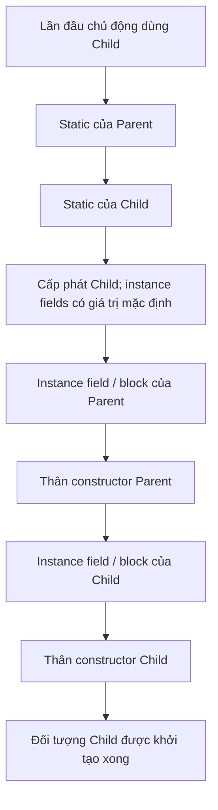
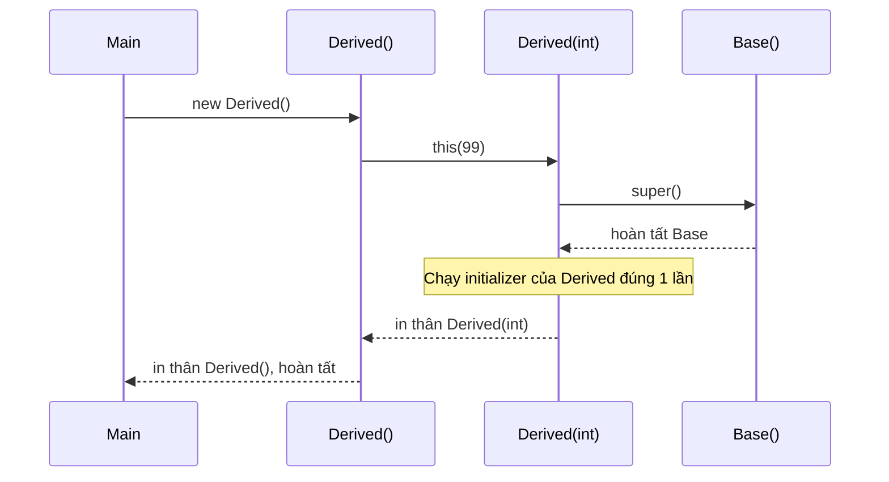

# Initialization Order in Inheritance (Java OOP)

When creating an object from a class that **inherits** from another class, Java does not execute all subclass initialization before handling the superclass. The JVM must prepare the classes, create the object, and construct the **superclass state before the subclass state** according to defined rules.

Understanding this order helps predict behavior involving `static`, field initializers, initialization blocks, constructors, `super(...)`, and `this(...)`, and avoid errors when a constructor invokes an overridable method.

> Scope: the examples work with Java 11+. “Class initialization” (`static`) and “object initialization” (instance) are different operations; the explanation below distinguishes them.

## 1. General Initialization Order for `new Child()`

Suppose `Child extends Parent` and this is the program's first active use of `Child` that requires JVM class initialization:

1. **Initialize class `Parent`**, running its static field initializers and static initialization blocks in source-code order.
2. **Initialize class `Child`**, executing the subclass's `static` initialization elements in source-code order.
3. Allocate a `Child` object and assign **default** values to all instance fields (such as `0`, `false`, and `null`). Fields declared by the superclass are part of this same object.
4. Follow the constructor chain toward the superclass. When processing `Parent` instance initialization, Java runs `Parent` instance field initializers and instance initialization blocks **in textual order**, then executes the `Parent` constructor body.
5. Return to `Child`, execute `Child` instance field initializers and instance initialization blocks **in textual order**, then execute the `Child` constructor body.

With a deeper inheritance hierarchy, the process begins at the highest ancestor and proceeds toward the concrete class named by `new`. Each class level contributes its own instance initialization.

**Two common misconceptions:**

- A class's `static` initialization normally happens **once within the class loader that initializes it**, not on every `new`. Class loading (`loading`) and class initialization (`initialization`) also do not necessarily occur at the same time.
- The superclass constructor is **invoked before subclass instance initialization**. Subclass fields already have **default** values from object allocation, but their specific initializer expressions have not yet run.

Typical order diagram:



*Constructor-call argument expressions and chains of `this(...)`/`super(...)` are evaluated when those calls are processed; this diagram focuses on the order of initialization elements and constructor bodies in ordinary examples.*

## 2. Full Example: Tracing Every Step

Create the file **`InitializationTrace.java`**:

```java
public class InitializationTrace {

    static int mark(String step) {
        System.out.println(step);
        return 1;
    }

    static class Parent {
        static int parentStatic = mark("1. Parent: static field");

        static {
            System.out.println("2. Parent: static block");
        }

        int parentValue = mark("5. Parent: instance field");

        {
            System.out.println("6. Parent: instance block");
        }

        Parent() {
            System.out.println("7. Parent: constructor");
        }
    }

    static class Child extends Parent {
        static int childStatic = mark("3. Child: static field");

        static {
            System.out.println("4. Child: static block");
        }

        int childValue = mark("8. Child: instance field");

        {
            System.out.println("9. Child: instance block");
        }

        Child() {
            super();
            System.out.println("10. Child: constructor");
        }
    }

    public static void main(String[] args) {
        System.out.println("=== ĐỐI TƯỢNG THỨ NHẤT ===");
        new Child();

        System.out.println("=== ĐỐI TƯỢNG THỨ HAI ===");
        new Child();
    }
}
```

Run:

```bash
javac InitializationTrace.java
java InitializationTrace
```

**Output:**

```text
=== ĐỐI TƯỢNG THỨ NHẤT ===
1. Parent: static field
2. Parent: static block
3. Child: static field
4. Child: static block
5. Parent: instance field
6. Parent: instance block
7. Parent: constructor
8. Child: instance field
9. Child: instance block
10. Child: constructor
=== ĐỐI TƯỢNG THỨ HAI ===
5. Parent: instance field
6. Parent: instance block
7. Parent: constructor
8. Child: instance field
9. Child: instance block
10. Child: constructor
```

Analysis:

- On the first creation, `new Child()` requires initialization of `Child`. Because `Child extends Parent`, the `static` elements of `Parent` initialize before those of `Child`. **Within each class**, static fields and `static` blocks run in declaration order.
- The instance portion of `Parent` (lines 5–7) runs before the instance portion of `Child` (lines 8–10).
- The second `new Child()` **does not print lines 1–4 again**, because the classes are already initialized. It creates a new instance, so lines 5–10 still appear.
- Both `parentValue` and `childValue` have the value `1` because `mark` returns it; the method prints a trace to make execution order easy to verify.

**Try one change:** swap the static block and static field within one class, then swap that class's instance block and instance field. The output order changes accordingly. “Superclass before subclass” does not mean field initializers always precede block initializers within a class: **source-code order matters**.

## 3. Class Initialization Versus Object Initialization

| Component | When does it run? | Class-wide or per instance? |
| --- | --- | --- |
| `static int value = ...;` | When the class is initialized | Class-wide |
| `static { ... }` | When the class is initialized | Class-wide |
| `int value = ...;` | For each object, when initialization reaches the declaring class | Per instance |
| `{ ... }` (instance initializer block) | For each object, when initialization reaches the declaring class | Per instance |
| Constructor | When constructing an object through the constructor chain | Part of object construction |
| Instance field default values | Immediately after allocation, before specific initializers | Per instance |

In Java, instance fields receive default values before constructors execute:

| Field type | Default value |
| --- | --- |
| `byte`, `short`, `int`, `long` | `0` |
| `float`, `double` | `0.0` |
| `boolean` | `false` |
| `char` | `'\u0000'` (NUL character) |
| Reference types such as `String` or `List` | `null` |

This **differs from local variables**: local variables do not receive automatically readable default values; the compiler requires assignment before reading them.

A class can be loaded or linked by the JVM **without** yet executing its `static` initializers. Accessing a `static final` *compile-time constant* may not trigger initialization of the class that defines it, because the value can be inlined at the call site. Merely mentioning a class name is therefore insufficient to guarantee execution of all static blocks.

### One `new` Still Creates a Single Object Containing Superclass State

```java
class Vehicle {
    String brand = "Generic";
}

class Car extends Vehicle {
    int doors = 4;
}

Car car = new Car();
System.out.println(car.brand); // Generic
System.out.println(car.doors); // 4
```

`Car` does not “contain a separate `Vehicle` object automatically created by `new Vehicle()`.” A `Car` object contains inherited instance components from `Vehicle` and components declared by `Car`. The constructor chain ensures they are initialized in order.

## 4. `super(...)` and Superclass Constructors

When creating `Child`, Java must execute an appropriate constructor of `Parent`. Superclass constructors **are not inherited** like ordinary methods; a subclass invokes one through `super(...)` as part of the initialization chain.

### Superclass with a No-Argument Constructor

```java
class Device {
    Device() {
        System.out.println("Device()");
    }
}

class Phone extends Device {
    Phone() {
        super(); // Gọi constructor Device()
        System.out.println("Phone()");
    }
}
```

`new Phone()` prints:

```text
Device()
Phone()
```

If you omit `super();` in this example, the Java 11 compiler inserts an implicit `super();` call at the beginning of the constructor. This **does not** mean the JVM searches for any compatible superclass constructor: the implicit call targets the **no-argument constructor**.

### Superclass with Only a Parameterized Constructor

```java
class Account {
    private final String id;

    Account(String id) {
        if (id == null || id.isBlank()) {
            throw new IllegalArgumentException("ID không hợp lệ");
        }
        this.id = id;
        System.out.println("Account: " + id);
    }

    String getId() {
        return id;
    }
}

class SavingsAccount extends Account {
    private final int interestRatePercent;

    SavingsAccount(String id, int interestRatePercent) {
        super(id); // BẮT BUỘC chỉ rõ lời gọi này trong thiết kế này
        this.interestRatePercent = interestRatePercent;
        System.out.println("SavingsAccount: " + interestRatePercent);
    }
}
```

`new SavingsAccount("SV001", 5)` prints:

```text
Account: SV001
SavingsAccount: 5
```

If `super(id)` is removed, the Java 11 compiler tries to call `super()`, but `Account` **has no** no-argument constructor, so compilation fails. Java does not automatically generate a no-argument constructor for a class that declares a parameterized constructor.

In these Java 11 examples, an explicit `super(...)` or `this(...)` constructor invocation must be the first statement in a constructor. Some newer Java versions allow more flexible constructor syntax, but constructor chaining and the need to invoke a superclass constructor remain essential to understanding initialization order.

### Arguments to `super(...)`

The arguments in `super(expression)` are evaluated to choose and pass values to the superclass constructor. Distinguish **evaluating argument expressions** from **executing the superclass constructor body**. When predicting logs, consider argument expressions with side effects separately instead of mechanically applying a simple log sequence.

A straightforward example:

```java
class Parent {
    Parent(String value) {
        System.out.println("Parent: " + value);
    }
}

class Child extends Parent {
    Child(String input) {
        super(input.trim());
        System.out.println("Child");
    }
}
```

`new Child("  hello  ")` prints `Parent: hello` followed by `Child`.

## 5. `this(...)`: Multiple Constructors in One Class

`this(...)` **invokes another constructor in the same class**. It reuses initialization logic and avoids duplicate code.

```java
public class ConstructorChainDemo {
    static class Base {
        Base() {
            System.out.println("Base constructor");
        }
    }

    static class Derived extends Base {
        int value = initialize();

        static int initialize() {
            System.out.println("Derived field initializer");
            return 10;
        }

        Derived() {
            this(99);
            System.out.println("Derived() constructor body");
        }

        Derived(int number) {
            super();
            System.out.println("Derived(int) constructor body: " + number);
        }
    }

    public static void main(String[] args) {
        new Derived();
    }
}
```

Output:

```text
Base constructor
Derived field initializer
Derived(int) constructor body: 99
Derived() constructor body
```

Explanation:

1. `Derived()` delegates initialization to `Derived(int)` through `this(99)`.
2. `Derived(int)` invokes `Base()` through `super()`.
3. After the superclass constructor finishes, `Derived` instance field initializers and instance blocks run **once**.
4. The `Derived(int)` constructor body runs, and execution returns to the `Derived()` constructor body.

The `value` field is **not** initialized twice just because the `this(...)` chain contains two constructors. Each object creation ultimately invokes the superclass constructor once along its corresponding chain.

A constructor cannot directly contain both `this(...)` and `super(...)` constructor invocations on the same initialization path; the `this(...)` chain eventually reaches a constructor that invokes `super(...)` explicitly or implicitly. Cyclic constructor calls (for example, A calls B and B calls A through `this(...)`) are compilation errors.



## 6. Important Pitfall: Invoking an Override in a Superclass Constructor

Instance methods may use **dynamic dispatch**: a call from superclass code can execute a subclass override. But while the superclass constructor is running, subclass field initializers **have not run yet**.

Examine **`OverrideDuringConstruction.java`**:

```java
public class OverrideDuringConstruction {

    static class Base {
        Base() {
            System.out.println("Base bắt đầu");
            show(); // Phương thức có thể bị override
            System.out.println("Base kết thúc");
        }

        void show() {
            System.out.println("Base.show()");
        }
    }

    static class Derived extends Base {
        private String message = "Đã sẵn sàng";

        Derived() {
            System.out.println("Derived constructor: " + message);
        }

        @Override
        void show() {
            System.out.println("Derived.show(): " + message);
        }
    }

    public static void main(String[] args) {
        new Derived();
    }
}
```

Output:

```text
Base bắt đầu
Derived.show(): null
Base kết thúc
Derived constructor: Đã sẵn sàng
```

**Why does it print `null` instead of the subclass's initialized message?**

- The object being created is a `Derived`, so `Derived.show()` is selected when `Base` invokes `show()`.
- At that point, all instance fields have default values, so `message` is `null`.
- The assignment `message = "Đã sẵn sàng"` belongs to a `Derived` initializer, which executes only **after the `Base` constructor completes**.
- The `Derived` constructor body then sees the initialized value.

If `show()` invokes `message.length()`, the program may throw `NullPointerException` before the subclass constructor completes.

### A Safer Design

Do not call an overridable method from a superclass constructor when it depends on subclass state. Instead, the superclass constructor should use its own data and suitable `private`, `final`, or `static` logic; or defer any startup step requiring the complete object until **after** the constructor returns.

Example of a superclass handling its own responsibilities:

```java
class SafeBase {
    private final String id;

    SafeBase(String id) {
        if (id == null || id.isBlank()) {
            throw new IllegalArgumentException("ID trống");
        }
        this.id = id;
        System.out.println("Base đã nhận ID: " + id);
    }

    public final String getId() {
        return id;
    }
}

class SafeDerived extends SafeBase {
    private final String message = "Đã sẵn sàng";

    SafeDerived(String id) {
        super(id);
        System.out.println("Derived: " + message);
    }
}
```

Besides avoiding overridable method calls, avoid **letting `this` escape** before the constructor completes (for example, registering a callback that another object can invoke immediately). This can also expose a partially initialized object.

## 7. Multiple Levels of Inheritance

Suppose `C extends B` and `B extends A`:

```java
public class ThreeLevels {
    static class A {
        static { System.out.println("A static"); }
        { System.out.println("A instance"); }
        A() { System.out.println("A constructor"); }
    }

    static class B extends A {
        static { System.out.println("B static"); }
        { System.out.println("B instance"); }
        B() { System.out.println("B constructor"); }
    }

    static class C extends B {
        static { System.out.println("C static"); }
        { System.out.println("C instance"); }
        C() { System.out.println("C constructor"); }
    }

    public static void main(String[] args) {
        new C();
    }
}
```

Output:

```text
A static
B static
C static
A instance
A constructor
B instance
B constructor
C instance
C constructor
```

When creating `C` the second time, the three `static` lines are not printed again. Instance initialization and constructors still run from `A` to `B` to `C`.

**Note:** Both the `static` and instance blocks in the example use valid syntax:

- `static { ... }`: a static initialization block, with no object receiver.
- `{ ... }`: an instance initialization block, executed during construction at its corresponding point in the declaring class's instance initialization.

Do not confuse “constructors run from parent to child” with “all statements in the subclass constructor run first because we called `new C()`.” The `new C()` expression selects the type to instantiate, but superclass constructor bodies complete before the subclass constructor body.

## 8. Common Mistakes About Initialization Order

| Claim or code pattern | Correct conclusion |
| --- | --- |
| “`new Child()` must run the Child constructor first because Child was requested” | Incorrect: the superclass constructor body runs before the subclass body |
| “Every `static` initializer runs when the program starts” | Incorrect: a class normally initializes when an active use requires it |
| “Every new instance reruns static blocks” | Incorrect: static initializers do not run per instance |
| “Child instance fields already have specific initialized values while the Parent constructor runs” | Incorrect in normal cases: Child fields still hold default values |
| “`super()` creates an additional Parent object” | Incorrect: it initializes the superclass portion of the same Child object |
| “Child inherits Parent constructors like methods” | Incorrect: constructors are not inherited |
| “When Parent has only a parameterized constructor, Child can omit `super(args)` and Java will find one” | Incorrect: an unmatched implicit `super()` causes a compilation error |
| “`this(...)` causes the class's field initializers to run multiple times” | Incorrect: its constructor chain initializes that class's instance portion once |
| “Calling an override in a parent constructor always sees initialized Child state” | Incorrect: the override may run before Child initializers |
| “Every field initializer in a class runs before every initializer block” | Incorrect: they execute in source-code order |
| “Accessing a primitive `static final` constant always triggers static blocks” | Not necessarily true for *compile-time constants* |

### When Initialization Fails

If a static initializer throws an uncaught exception, class initialization fails. When the failure is not an `Error`, it is usually reported as `ExceptionInInitializerError`; later attempts to use the class may encounter `NoClassDefFoundError` because the class is in an erroneous initialization state. This differs from an exception thrown by an instance constructor: the object under construction does not complete, but the class itself is not necessarily marked as having failed initialization.

When checking execution order with `System.out.println`, remember that logging itself has side effects. In production, avoid complex business logic, failure-prone environment reads, or starting threads in static initializers; handle errors at clearly defined application initialization steps.

## 9. Practice Exercises with Explanations

### Exercise 1: Predict the Order

```java
class P {
    static { System.out.print("A "); }
    { System.out.print("B "); }
    P() { System.out.print("C "); }
}
class Q extends P {
    static { System.out.print("D "); }
    { System.out.print("E "); }
    Q() { System.out.print("F "); }
}

new Q();
new Q();
```

**Answer:** `A D B C E F B C E F`. `A` and `D` print only on the first class initialization; each instance initializes the `P` portion followed by `Q`.

### Exercise 2: Superclass without a Default Constructor

```java
class Animal {
    Animal(String name) { }
}

class Cat extends Animal {
    Cat() {
        // Thiếu lời gọi constructor của Animal
    }
}
```

**Question:** Why does it fail to compile? How would you fix it?

**Answer:** Java 11 implicitly inserts `super()` into `Cat()`, but `Animal` declares only `Animal(String)`. Fix this by invoking `super("Mèo");` in `Cat()`, or add a no-argument constructor to `Animal` if that makes sense for the domain.

### Exercise 3: Field Values When a Superclass Constructor Calls an Override

```java
class A {
    A() { print(); }
    void print() { System.out.println("A"); }
}
class B extends A {
    int number = 7;
    @Override
    void print() { System.out.println(number); }
}

new B();
```

**Answer:** `0`. Dynamic dispatch selects `B.print()` while `A()` is executing, before the `number = 7` initializer runs. Moving the `print()` call until after `new B()` completes would produce `7`.

### Exercise 4: Extend the Example

Create three classes, `Person`, `Employee`, and `Manager`, with `Manager extends Employee extends Person`. Each class should have a static block, an instance field initializer, and a constructor that prints its class name. Then:

1. Create two `Manager` objects in succession.
2. Predict exactly which lines print once and which print twice.
3. Add a `Manager()` constructor using `this(String department)`; check whether `Manager` initializers run repeatedly.
4. Give `Person` only a constructor accepting `String name`; update the subclasses to pass all required data through `super(...)`.
5. Try calling an overridable `describe()` method from the `Person` constructor, and explain why its output may not yet reflect the `Manager` state.

## Remembering How to Read Constructors in an Inheritance Hierarchy

When you see `new Subclass(...)`, trace the `this(...)` and `super(...)` chain to determine **which constructors are invoked**. Then distinguish two phases: **class initialization (`static`, when needed)** and **per-instance initialization (default values, parent initializers, parent constructor body, child initializers, child constructor body)**. Take special care with overridden method calls from constructors because the object may still be incompletely initialized at that point.
