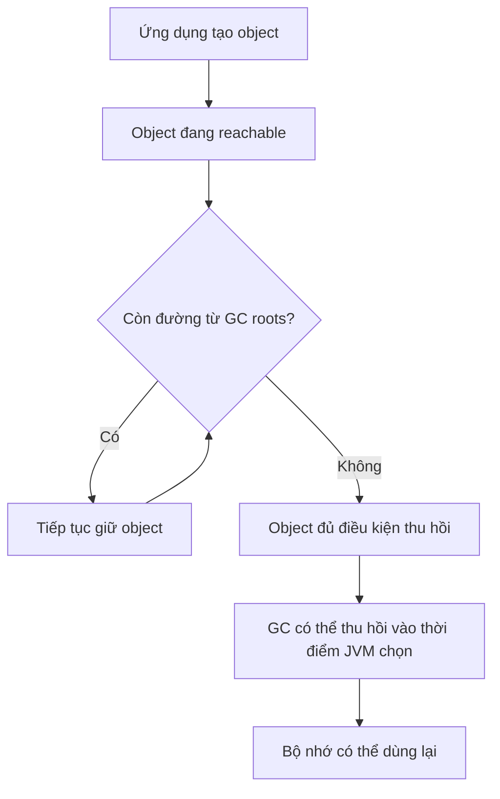
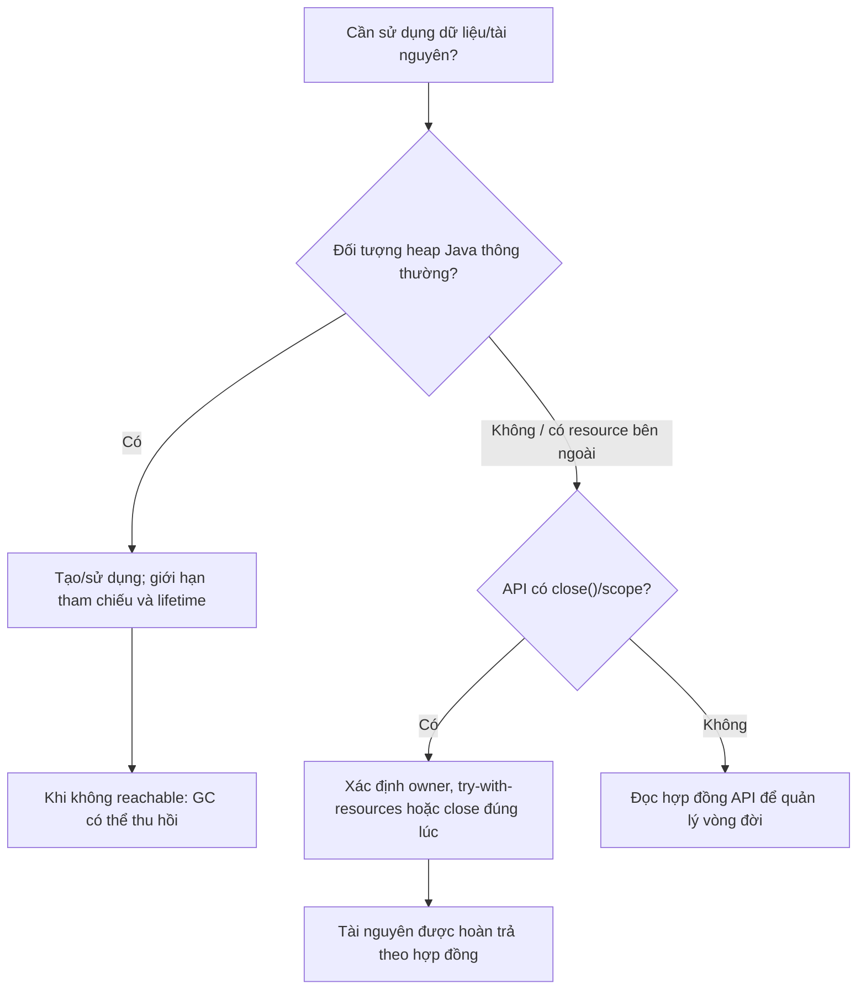

# Garbage Collection and Manual Memory Management in Java

> **OOP → Object Lifecycle.** In Java, programmers create and use objects while the **Garbage Collector (GC)** reclaims memory from objects no longer reachable by the program. However, GC **does not mean all resources are automatically released at the right time**: files, sockets, database connections, and native memory still require appropriate lifecycle management.

## 1. What Does Java Manage Automatically?

Consider this code:

```java
final class User {
    private final String name;

    User(String name) {
        this.name = name;
    }

    String name() {
        return name;
    }
}

static String loadName() {
    User user = new User("An");
    return user.name();
}
```

`new User("An")` creates an instance. While `loadName()` is running, the `user` reference can be used to access it. Once the method returns and no other references to this instance remain, it may become **eligible for garbage collection**. The JVM decides **when** and **how** to reclaim memory; there is no guarantee the object is deleted when the method ends.

Distinguish the following components:

| Component | What does it contain? | How is it managed? |
|---|---|---|
| Java heap | Many Java objects and arrays | The GC manages memory of objects that are no longer reachable |
| Thread stack | Execution frames, call information, and local variables in the JVM model | Associated with calls/threads; not an area where each variable is individually `free()`d |
| Metaspace (on modern HotSpot) | Class metadata | Managed by the JVM; may grow if too many classes/class loaders are loaded |
| Native/off-heap memory | Memory used by APIs/native code outside the Java heap | API-dependent: GC, scopes/arenas, or `close()` |
| File descriptors, sockets, DB connections | External OS/system resources | Released according to API contracts, usually through `close()` |

The model “objects on the heap, local references on the stack” is useful at first, but it **does not guarantee an absolute physical location**. The JVM may optimize allocations or replace objects with separate values while preserving equivalent observable behavior.

### How Does GC Differ from Manual Memory Management?

Languages with manual memory management let program code allocate and explicitly release memory, for example with `malloc/free` in C. Misuse can lead to **memory leaks**, **double frees**, or **use-after-free**.

For **ordinary Java heap objects**, you do not invoke `free(object)` or `delete object`. Standard Java provides no operation for programmers to force immediate reclamation of a specific object's memory.

Java programmers must still **control how many objects remain retained**, bound caches, release resources, avoid excessive allocations, and monitor memory use.

## 2. GC Uses Reachability to Determine Which Objects Are Still Needed

The GC starts from **GC roots** (references needed by executing threads, certain static/JNI/runtime references, etc.) and traverses fields and array elements to find reachable objects. Assigning `x = null` removes only **one** reference path. Another cache or callback may still retain the object.

~~~mermaid
flowchart LR
    Root["GC root"] --> Cache["Cache"]
    Cache --> Data["RequestData"]
    A["Node A"] --> B["Node B"]
    B --> A
~~~

`RequestData` is reachable through `Cache`. The pair `Node A ↔ Node B` shown without a root path can be garbage-collected despite its reference cycle: Java does not require explicit `free` calls or manually breaking every cycle. GC also does not guarantee **when** an unreachable object will actually be reclaimed.

Ordinary references are **strong references**; Java also provides `WeakReference`, `SoftReference`, and `PhantomReference` for specialized purposes. None guarantees deterministic cleanup timing. GC roots and reachability levels are explained in depth in *Object lifetime, reachability, and memory reclamation*.

## 3. How Does GC Work Conceptually?

An approachable model contains three tasks:

1. **Identify live objects:** trace from GC roots to find objects that remain reachable.
2. **Reclaim unused memory:** recover memory belonging to unreachable objects.
3. **Manage the memory layout:** some collectors move or compact objects to reduce fragmentation or improve allocation efficiency.



Many collectors are designed around the observation that many objects live only briefly. They may use **generational** collection combined with multiple collection phases. Terms such as *minor GC*, *major GC*, *full GC*, *stop-the-world*, and *concurrent marking* appear in logs and documentation, but **their precise meanings depend on the collector/JDK**.

| Concept | Practical meaning |
|---|---|
| Young generation | Where many new objects are allocated in generational collectors |
| Old generation | Often contains longer-lived objects |
| Stop-the-world (STW) | A phase that pauses application execution for necessary GC work |
| Concurrent GC | Some GC work proceeds alongside application threads |
| Compaction | Moves/consolidates live data to reduce fragmentation |

There is no single “Java GC algorithm.” For example, HotSpot offers collectors such as G1, ZGC, and Parallel GC; selection and behavior depend on JDK version, latency goals, capacity, and configuration. For OOP, focus on **reachability**, **nondeterministic reclamation timing**, and **the fact that GC cannot fix incorrect reference-retention design**.

## 4. GC Cannot Know When Data Has Lost Business Value

An unbounded cache may retain every payload long after it is useful. The objects remain reachable from the map, so the GC **does not consider them garbage**. This is a form of *logical memory leak* in Java applications:

~~~java
static final Map<String, byte[]> payloads = new HashMap<>();

static void remember(String id, byte[] data) {
    payloads.put(id, data);
}
~~~

This example belongs in a class importing `java.util.Map` and `java.util.HashMap`. If new IDs are added without limits, memory may grow with traffic. The fix is a retention policy: TTL, entry count, byte budget, removal of no-longer-needed entries, or an appropriate cache library.

GC may run frequently without reducing retained heap usage if every old object still has a strong-reference path from a root. Diagnose the problem using **heap dumps and retaining paths** rather than GC frequency alone. *Object lifetime, reachability, and memory reclamation* covers registries/caches, listeners, `ThreadLocal`, and tracing GC roots; this lesson focuses on GC mechanics and measurable memory types.

## 5. `null`, `System.gc()`, and `finalize()`: False Expectations

```java
User a = new User("An");
User b = a;

a = null;    // Không xóa object: b vẫn tham chiếu tới nó
// System.gc(); // Không phải cách đảm bảo xóa User
```

- **`a = null`** changes only variable `a`. If `b` or another reference remains, the object is still reachable.
- **`System.gc()`** requests that the JVM make an effort to run GC; it is not a command guaranteeing collection or immediate reclamation of individual objects.
- **`finalize()`** is unsuitable for resource cleanup. Finalization is deprecated for removal and has substantial reliability, security, and performance problems. Avoid it in new code.

There is no need to assign `null` to every local variable before leaving a method. Letting variables leave scope and defining clear object lifecycles is usually enough. Explicitly evicting cache entries, unregistering listeners, or ending long-lived tasks often matters more.

## 6. GC Reclaims Heap Objects; Other Resources Follow Different Contracts

A `FileInputStream` may hold an operating-system file descriptor, while a `Connection` may be managed by a connection pool. Garbage collection of the Java wrapper object **does not guarantee** these resources are returned at the right time.

| Resource to release | Appropriate mechanism | Key point |
|---|---|---|
| Memory of unreachable heap objects | JVM garbage collector | Standard Java cannot call `free(obj)` |
| File/socket/connection | Ownership-based `close()`, often via `try-with-resources` | Closing a resource does not delete the Java object |
| Scoped native/off-heap memory | API contract, such as `Arena.close()` | Follow the JDK version and ownership rules |

~~~java
try (BufferedReader reader = Files.newBufferedReader(path)) {
    System.out.println(reader.readLine());
}
~~~

This example assumes `path` is a valid `java.nio.file.Path` and that `java.io.BufferedReader` and `java.nio.file.Files` are imported. Java invokes `reader.close()` upon leaving the `try` block according to language semantics, including when reading throws an exception. For multiple resource closure, suppressed exceptions, `AutoCloseable`, `Cleaner`, and `finalize()`, see *Resource cleanup and the limits of finalizers* for full explanations and runnable examples.

## 7. When Can Java Explicitly Manage Native Memory?

Ordinary Java heap objects have no `free(object)` operation. But APIs allocating memory outside the heap may require explicit **ownership** and **lifetime** management.

A representative example in **Java 22+** is the Foreign Function & Memory API (FFM), with `Arena` and `MemorySegment`:

```java
import java.lang.foreign.Arena;
import java.lang.foreign.MemorySegment;
import java.lang.foreign.ValueLayout;

public class NativeMemoryDemo {
    public static void main(String[] args) {
        try (Arena arena = Arena.ofConfined()) {
            MemorySegment segment = arena.allocate(16);
            segment.set(ValueLayout.JAVA_INT, 0, 42);

            int number = segment.get(ValueLayout.JAVA_INT, 0);
            System.out.println(number); // 42
        } // close() trên arena giải phóng allocations thuộc arena
    }
}
```

Save as `NativeMemoryDemo.java` and compile/run with **JDK 22 or later**:

```bash
javac NativeMemoryDemo.java
java NativeMemoryDemo
```

Here:

- `arena.allocate(16)` allocates 16 bytes of native memory associated with the arena.
- `MemorySegment` represents a memory region with a defined size and access bounds; it is not an ordinary Java-heap `byte[]`.
- `Arena.ofConfined()` creates an arena with **access restricted to its owning thread**.
- When the `try` block ends, `arena.close()` releases allocations associated with the arena. Subsequent attempts to access an invalidated segment fail according to the API contract.

Version note: the FFM API was standardized in Java 22; earlier JDK releases had incubator/preview variants with different APIs and activation rules, so do not copy the Java 22 example directly into Java 17.

`ByteBuffer.allocateDirect(...)` also supports direct off-heap buffers, but **does not provide a standard `free()` method on ByteBuffer itself** for immediate programmer-controlled release. Do not use reflection or internal APIs to force buffer reclamation; when deterministic native-memory lifecycles are needed, choose an API with an explicit lifecycle contract such as FFM `Arena`, or a library designed for that purpose.

## 8. Out-of-Memory Errors Are Not Always Heap Leaks

Examples of causes to distinguish:

| Symptom or error | Possible cause | What to inspect |
|---|---|---|
| `OutOfMemoryError: Java heap space` | Heap cannot satisfy an allocation | Live objects, caches/lists, heap limits |
| `OutOfMemoryError: Metaspace` | Class metadata occupies too much native memory | Dynamic class loading, class-loader leaks |
| `OutOfMemoryError: Direct buffer memory` | Direct-buffer memory limit reached | Number and lifetime of direct buffers |
| Cannot create another native thread | Thread/native-resource exhaustion or OS limits | Thread count, thread pools, stack sizes |
| Process RSS grows while the heap is stable | Native memory, stacks, mmap, other regions | Native-memory metrics/profilers |

Exact error messages depend on the JVM, version, and failure mode; this table provides **investigation guidance**, not a definitive diagnosis.

Possible issues include:

- **Memory leak:** data is retained indefinitely and grows over time.
- **Normal memory pressure:** the application handles large data batches with a heap too small for the load; the GC can still reclaim memory.
- **Excess allocation:** too many short-lived objects increase GC frequency and CPU use.
- **Native resource leak:** file descriptors, sockets, direct/native memory, or threads are retained too long.

Do not conclude that “GC is broken” merely because process RAM grows. The JVM may **retain previously committed heap memory** for reuse; committed heap space need not be returned to the OS immediately after GC.

## 9. Monitoring Memory and GC in Real Environments

Example using a modern HotSpot/JDK:

```bash
# Chạy chương trình với giới hạn heap rõ ràng (ví dụ 256 MiB).
java -Xms64m -Xmx256m -Xlog:gc* -cp . MyApp

# Xem danh sách tiến trình Java.
jcmd -l

# Kiểm tra thông tin heap của process đang chạy.
jcmd <pid> GC.heap_info

# Thống kê loại đối tượng đang tồn tại.
jcmd <pid> GC.class_histogram

# Kiểm tra Native Memory Tracking nếu đã bật lúc khởi động.
jcmd <pid> VM.native_memory summary
```

`<pid>` is the actual process ID and must be replaced in the commands. `-Xmx` sets the **Java heap** limit; it is not a limit on total process RAM because native memory, thread stacks, metaspace, code cache, and other regions also consume memory.

To collect native-memory statistics using Native Memory Tracking (NMT) on HotSpot, enable it at startup:

```bash
java -XX:NativeMemoryTracking=summary -Xmx256m -cp . MyApp
```

Then run `jcmd <pid> VM.native_memory summary`. NMT may not account for all memory allocated by native libraries outside the JVM's tracking scope.

Other useful tools include **Java Flight Recorder (JFR)** for allocation and GC analysis, **VisualVM** for heap and reference inspection, and **heap dumps** for identifying retention paths and dominators. Heap dumps and class histograms can be costly or pause large systems, so collect them deliberately in suitable environments.

### Investigating a Suspected Leak, Step by Step

1. Measure heap use **after GC** over time at comparable traffic/load and object counts.
2. If live-object usage keeps growing, capture a heap dump or allocation profile at an appropriate time.
3. Inspect **retained size** and GC-root reference paths for memory-heavy objects.
4. Identify retaining structures: collections, singletons, caches, `ThreadLocal`, listeners, queues, and so on.
5. Fix lifecycle and data-bounding rules; retest under comparable load.

Increasing `-Xmx` may be necessary for legitimate load, but **does not fix the cause of a leak** if the program retains ever more data.

## 10. OOP Design Principles for Memory Management

- **Define resource ownership:** the class opening a file or owning a socket/connection needs clear transfer or closing rules.
- **Use `try-with-resources` for `AutoCloseable` resources:** scope-based closing is the default choice when appropriate.
- **Limit data lifetime:** caches, listeners, queues, and sessions need expiration/removal policies.
- **Do not put short-lived objects into excessively long-lived scopes:** a `static` field can retain a large reference graph.
- **Avoid keeping unnecessarily large object graphs:** removing a collection entry makes an object GC-eligible only if no other path reaches it.
- **Understand optimization goals:** many small short-lived objects are not automatically a problem; measure before optimizing.
- **Consider both heap and native memory:** GC addresses only part of resource management.



## 11. Exercises and Self-Check Questions

**Exercise 1 — reachability.** Draw reference paths from a `static Map<String, User>` to `User` objects. If a local variable becomes `null` but the `Map` still contains a `User`, can the GC collect that object? Explain using GC roots.

**Exercise 2 — reference cycles.** Create two `Node` objects pointing to each other. When neither is reachable from any GC root, does the cycle keep them alive forever?

**Exercise 3 — detecting leaks.** Change an unbounded `RequestHistory` into a cache that retains only the 50 most recent entries. Verify `size()` stays at or below 50 after 10,000 calls to `record`.

**Exercise 4 — manual management.** Write a `ReportWriter` class that owns a `BufferedWriter`, implements `AutoCloseable`, and is used inside `try-with-resources`. If construction or writing throws an exception, which resources must be closed, and who owns them?

**Exercise 5 — diagnosis.** A service has stable heap usage but increasing process RSS. List at least three areas to examine outside the heap. Why is inspecting only `-Xmx` insufficient?

### Quick Self-Check

| Statement | True/False | Explanation |
|---|---|---|
| A Java object is immediately destroyed when a local variable leaves scope | **False** | GC timing is nondeterministic; other references may remain |
| Objects in a reference cycle can never be collected | **False** | Reachability from GC roots is what matters |
| `System.gc()` guarantees immediate reclamation of an object | **False** | It merely makes a request to the JVM |
| The GC automatically closes files and sockets at the desired time | **False** | Requires closing and ownership contracts |
| An ever-growing `static List` can cause a memory leak | **True** | Its elements remain reachable |
| `try-with-resources` invokes `close()` even if the `try` body fails | **True** | This is defined by Java language syntax |

**Remember:** For Java heap memory, manage **references and usage lifecycles**, letting the GC decide when to reclaim unreachable objects. For files, sockets, database connections, and owned native-memory regions, **close or release them according to API contracts**. Distinguishing these responsibilities is fundamental to long-running Java applications.
