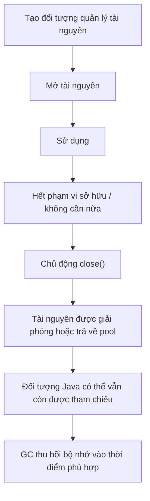

# Resource Cleanup and the Limits of Finalizers in Java

In Java, the JVM allocates and manages memory for **objects**, but many objects also represent **resources that must be released promptly**: open files, database connections, sockets, input/output streams, off-heap memory, or objects holding locks. Therefore, distinguish two activities:

- **Reclaiming object memory:** the garbage collector (GC) handles this when an object becomes unreachable under JVM rules.
- **Closing resources owned by an object:** the application must explicitly release them when finished, usually with `close()` and `try-with-resources`.

**Key message:** Java has no automatically invoked, deterministic *destructor* equivalent to C++ destructors. The old `finalize()` mechanism is unreliable for closing resources and is marked **deprecated for removal**; new Java code should avoid it.

## 1. Why Can't Garbage Collection Replace Resource Cleanup?

Consider reading a file:

```java
BufferedReader reader = Files.newBufferedReader(path);
String line = reader.readLine();
// Không đóng reader
```

The `reader` variable references a Java object, while `BufferedReader` indirectly uses operating-system resources associated with the file. When the variable is no longer used, the JVM **does not guarantee** immediate closure. Repeatedly opening files without calling `close()` can exhaust file descriptors or cause subsequent file opens to fail.

| Managed item | Example | Who is primarily responsible? | When is it released? |
| --- | --- | --- | --- |
| Java heap memory | `Customer`, `StringBuilder` objects | JVM/GC | When the JVM decides to collect unreachable objects |
| File resource | `BufferedReader`, `FileInputStream` | The code using it and the resource-owning API class | Explicitly via `close()`, ideally immediately after use |
| Database connection | JDBC `Connection`, `PreparedStatement`, `ResultSet` | Application code in coordination with driver/pool | Close at scope end; `Connection.close()` may return it to the pool |
| Network socket | `Socket` and related streams | Connection owner | Close after communication or when the request is canceled |
| Executor/thread | Executor and tasks | Component managing the lifecycle | Shut down using the appropriate API and await completion as needed; details vary by Java version |

An object may become unreferenced by business code while its OS resource has not yet been closed promptly. Conversely, a Java object **may still exist** after closing its resource and remain accessible for checking state.



The diagram illustrates the intended lifecycle. Calling `close()` can fail, and some resources have specialized semantics; successful closure must follow the specific API contract.

## 2. Standard Approach: `try-with-resources`

Since Java 7, `try-with-resources` automatically calls `close()` on resources declared inside `try (...)` when the block exits, including when the `try` body throws an exception.

```java
import java.io.BufferedReader;
import java.io.IOException;
import java.nio.charset.StandardCharsets;
import java.nio.file.Files;
import java.nio.file.Path;

class ReaderExample {
    static String readFirstLine(Path path) throws IOException {
        try (BufferedReader reader =
                 Files.newBufferedReader(path, StandardCharsets.UTF_8)) {
            return reader.readLine();
        } // reader.close() được gọi khi rời khối try
    }
}
```

`BufferedReader` is closeable. Once `readLine()` completes, a `return` statement does not skip cleanup; Java still invokes `close()` before the method actually returns its result to the caller.

If `Files.newBufferedReader(...)` cannot open a file, resource construction throws and no successfully initialized `reader` exists to close. If opening succeeds but reading fails, `try-with-resources` still performs cleanup.

**Rule:** Resources declared in `try (...)` must implement `AutoCloseable` (or `Closeable`, which extends `AutoCloseable`).

## 3. Complete Example: Managing Resource Lifecycles

The following example shows two behaviors: custom resources close **in reverse initialization order**, and file reading/writing streams close immediately after use.

Put all the code into **`Main.java`** and use Java 17 or Java 21:

```java
import java.io.BufferedReader;
import java.io.BufferedWriter;
import java.io.IOException;
import java.nio.charset.StandardCharsets;
import java.nio.file.Files;
import java.nio.file.Path;
import java.util.Objects;

public class Main {
    static final class Session implements AutoCloseable {
        private final String name;
        private boolean closed;

        Session(String name) {
            this.name = Objects.requireNonNull(name, "name");
            System.out.println("Mở " + name);
        }

        void use() {
            if (closed) {
                throw new IllegalStateException("Session đã đóng");
            }
            System.out.println("Dùng " + name);
        }

        @Override
        public void close() {
            // Đây là lựa chọn thiết kế của Session, không phải
            // lời bảo đảm áp dụng cho mọi AutoCloseable.
            if (closed) {
                return;
            }
            closed = true;
            System.out.println("Đóng " + name);
        }
    }

    public static void main(String[] args) throws IOException {
        try (Session first = new Session("A");
             Session second = new Session("B")) {
            first.use();
            second.use();
        }

        Path file = Files.createTempFile("oop-resource-", ".txt");
        try {
            try (BufferedWriter writer = Files.newBufferedWriter(
                    file, StandardCharsets.UTF_8)) {
                writer.write("Xin chào Java");
            }

            try (BufferedReader reader = Files.newBufferedReader(
                    file, StandardCharsets.UTF_8)) {
                System.out.println(reader.readLine());
            }
        } finally {
            // File tạm cũng là một tài nguyên tồn tại trên đĩa:
            // xóa khi không cần nữa, dù có lỗi đọc/ghi.
            Files.deleteIfExists(file);
        }
    }
}
```

Run:

```bash
javac Main.java
java Main
```

Output:

```text
Mở A
Mở B
Dùng A
Dùng B
Đóng B
Đóng A
Xin chào Java
```

**What happens?**

1. `Session("A")` is created first, followed by `Session("B")`.
2. Inside the `try` body, the program uses both resources.
3. When the block ends, Java automatically invokes `second.close()` before `first.close()`.
4. For the file example, the writer closes before the reader starts. After reading, the reader closes; `finally` deletes the temporary file.
5. `Session.use()` prevents operations after the resource has closed.

`Files.deleteIfExists(file)` can itself throw `IOException`; in a real application, decide how to report deletion failures, especially if an earlier read/write failure already occurred. This illustrates separate ownership scopes: **closing I/O streams** and **deleting a temporary file path** are different responsibilities.

## 4. `AutoCloseable` and `Closeable`

Two commonly used interfaces:

```java
public interface AutoCloseable {
    void close() throws Exception;
}
```

```java
public interface Closeable extends AutoCloseable {
    void close() throws java.io.IOException;
}
```

| Criterion | `AutoCloseable` | `Closeable` |
| --- | --- | --- |
| Purpose | General contract for resources that must be closed | Contract for closing I/O resources |
| Declared exception in `close()` | `Exception` | `IOException` |
| Usable in `try-with-resources`? | Yes | Yes |
| Repeated closing | Not universally guaranteed safe for every implementation | The `Closeable` contract says closing an already-closed resource has no effect |
| Examples | `java.sql.Connection`, custom lock or transaction-scope objects | `BufferedReader`, `InputStream`, `OutputStream` |

When implementing your own class, `close()` can declare no `throws` clause or a narrower exception type. For example, `Session.close()` above does not throw a checked exception.

**Idempotence note:** It is often useful to design a custom `close()` that is safe to invoke repeatedly, but `AutoCloseable` **does not require** every implementation to be idempotent. Never assume repeated closing or post-close reuse is always supported.

## 5. What Does `try-with-resources` Guarantee?

Two behaviors are especially important:

### 5.1. Closing in Reverse Order

```java
try (Resource a = openA();
     Resource b = openB();
     Resource c = openC()) {
    process(a, b, c);
}
```

Java closes resources in the order `c`, `b`, `a`. If initializing `b` fails, the already-created `a` still closes; `c` has not been created.

This is especially useful for dependent resources, such as a `ResultSet` using a `PreparedStatement` built from a `Connection`.

### 5.2. Closing Exceptions Can Be *Suppressed*

Suppose both processing and cleanup throw errors. Java must preserve the main failure instead of letting a closing error obscure it.

Save this standalone example as **`SuppressedDemo.java`**:

```java
import java.io.IOException;

public class SuppressedDemo {
    static final class FailingResource implements AutoCloseable {
        @Override
        public void close() throws IOException {
            throw new IOException("Lỗi khi đóng");
        }
    }

    public static void main(String[] args) {
        try (FailingResource resource = new FailingResource()) {
            throw new IllegalStateException("Lỗi xử lý");
        } catch (Exception ex) {
            System.out.println("Chính: " + ex.getMessage());
            for (Throwable suppressed : ex.getSuppressed()) {
                System.out.println("Kèm theo: " + suppressed.getMessage());
            }
        }
    }
}
```

Output:

```text
Chính: Lỗi xử lý
Kèm theo: Lỗi khi đóng
```

With `try-with-resources`, an exception from the `try` body is primary, and a `close()` failure is attached through `getSuppressed()`. If the `try` body succeeds but `close()` fails, the closing exception may be thrown directly.

Do not casually ignore closing errors: some APIs detect write/flush failures only during close. When logging, consider the primary exception and any suppressed exceptions to preserve diagnostic information.

## 6. Why Not Use `finalize()` as a Destructor?

Some older documentation shows a class overriding `protected void finalize() throws Throwable` from `Object`. This mechanism, called **finalization**, was once viewed as a way to perform work before object memory was reclaimed.

Avoid this in modern Java:

- You cannot know exactly **when** the JVM may run a finalizer.
- A finalizer is not guaranteed to run before the program exits; some objects may never be finalized.
- Finalizers may run on threads outside application control, complicating synchronization and error handling.
- Retaining or “resurrecting” references from a finalizer complicates lifecycles and risks performance, security, and correctness.
- `Object.finalize()` and finalization have been **deprecated for removal** in modern Java releases (JEP 421). This feature may be disabled or removed in the future.

In particular, **`System.gc()` is only a request or hint to the JVM**, not a promise of immediate collection, and certainly not a method for closing files, sockets, or connections. Never call `System.gc()` to try to force a finalizer to run.

| Mechanism | Purpose | Predictable timing? | Suitable for primary resource closure? |
| --- | --- | --- | --- |
| `try-with-resources` | Closes `AutoCloseable` on scope exit | Yes, during normal control flow or exception propagation | **Yes: preferred** |
| Explicit `close()` | Closes according to business logic | Yes, at the call | Yes, if exceptions and ownership are handled |
| `finally` | Always attempts cleanup on leaving a block | During Java control flow, except abnormal process/JVM termination | Yes, when manual cleanup is needed |
| `Cleaner` | Backup cleanup dependent on GC | No | Only as a suitable fallback, not a replacement for explicit close |
| `finalize()` | Legacy finalization mechanism | No | **Not for new code** |
| GC | Manages heap memory | No | Not a mechanism for closing business resources |

**No mechanism guarantees arbitrary Java cleanup code runs if the process is abruptly killed, power is lost, or the JVM crashes.** Therefore, most resources should be closed early at controlled business boundaries.

## 7. Is `Cleaner` a New Destructor?

`java.lang.ref.Cleaner` lets code register a cleanup action for when an object becomes eligible for collection. It can help in **certain advanced designs**, usually as a fallback for native resources that an application forgot to close.

But `Cleaner` **does not make cleanup deterministic**:

1. You cannot predict exactly when the GC will make an object eligible for cleanup.
2. Do not assume cleanup runs promptly or before process exit.
3. If the cleanup action accidentally holds a strong reference to the target object, it can prevent that object from becoming eligible for collection.
4. Cleanup code runs in a different context from business logic and needs appropriate thread-safety and exception handling.

The right model is to keep a public `close()` API for caller-controlled release; `Cleaner` is only a **fallback safety net** and should be added when genuinely needed. For ordinary JDBC connections, files, and sockets, `try-with-resources` is simpler and clearer.

## 8. Who Owns a Resource, and Who Must Close It?

A common bug is seeing that an object implements `AutoCloseable` and closing it without checking ownership.

**Ownership principle:** The component that **creates or assumes ownership** of a resource must close it at the end of the agreed usage scope. A component that only **borrows** a resource generally does not close it unless the API contract explicitly says so.

For example:

```java
class TextService {
    // Chỉ mượn reader từ caller, không nhận ownership.
    static String readOneLine(java.io.BufferedReader reader)
            throws java.io.IOException {
        return reader.readLine();
    }
}
```

The caller decides the scope:

```java
try (BufferedReader reader = Files.newBufferedReader(path)) {
    String line = TextService.readOneLine(reader);
    // Có thể tiếp tục sử dụng reader nếu cần.
}
```

If `readOneLine()` closes the reader itself, the caller will be surprised to find it can no longer read additional data.

Frameworks also coordinate resource lifecycles: for example, request, transaction, or bean resources managed by a framework may need to be closed by the container at the prescribed time. Manually calling `close()` on a container-managed resource can cause failures elsewhere. Follow the contract for the specific resource type.

## 9. Closing JDBC Connections and Nested Resources

This JDBC example illustrates the structure; running it requires a `DataSource`, a `students` table, and actual application data.

```java
import java.sql.Connection;
import java.sql.PreparedStatement;
import java.sql.ResultSet;
import java.sql.SQLException;
import javax.sql.DataSource;

class StudentRepository {
    private final DataSource dataSource;

    StudentRepository(DataSource dataSource) {
        this.dataSource = dataSource;
    }

    String findName(long id) throws SQLException {
        String sql = "SELECT name FROM students WHERE id = ?";

        try (Connection connection = dataSource.getConnection();
             PreparedStatement statement =
                 connection.prepareStatement(sql)) {
            statement.setLong(1, id);

            try (ResultSet rs = statement.executeQuery()) {
                return rs.next() ? rs.getString("name") : null;
            }
        }
    }
}
```

The connection scope is the outer `try` block. The `ResultSet` closes when the inner block finishes; then the statement and connection close when the outer block exits.

With connection pooling, `Connection.close()` usually **returns the connection to the pool** instead of immediately closing the physical TCP connection. Omitting `close()` can exhaust a connection pool even while GC operates normally.

When transactions require `commit()` or `rollback()`, **closing a connection is no substitute for proper transaction management**. Follow the driver, pool, or transaction-manager contract.

## 10. Implementing a Useful `AutoCloseable` Class

A resource-owning class should clearly define its open and closed states. Consider a wrapper around `BufferedReader`:

```java
import java.io.BufferedReader;
import java.io.IOException;
import java.nio.charset.StandardCharsets;
import java.nio.file.Files;
import java.nio.file.Path;

final class LineSource implements AutoCloseable {
    private final BufferedReader reader;
    private boolean closed;

    LineSource(Path path) throws IOException {
        this.reader = Files.newBufferedReader(
            path, StandardCharsets.UTF_8);
    }

    String nextLine() throws IOException {
        if (closed) {
            throw new IllegalStateException("LineSource đã đóng");
        }
        return reader.readLine();
    }

    @Override
    public void close() throws IOException {
        if (!closed) {
            // Đặt closed trước khi gọi xuống tài nguyên
            // để chặn thao tác qua wrapper sau yêu cầu đóng.
            closed = true;
            reader.close();
        }
    }
}
```

The caller uses it like this:

```java
try (LineSource source = new LineSource(path)) {
    String line;
    while ((line = source.nextLine()) != null) {
        System.out.println(line);
    }
}
```

This design suits **sequential** use. The `closed` field does not make the API thread-safe; concurrent calls to `nextLine()` and `close()` require synchronization or an explicit statement that concurrent use is unsupported.

When `close()` can fail, define whether retrying closure is allowed and what state follows an error. Here, the wrapper becomes **unusable** as soon as closing begins; this is a deliberate design choice, not a universal resource rule.

A `close()` call does not imply that the resource can be reused afterward. Many streams/sockets cannot be reopened on the same instance; using them again often requires **creating a new resource object**.

## 11. `finally` Versus `try-with-resources`

Before Java 7, cleanup code was commonly placed in `finally`:

```java
BufferedReader reader = null;
try {
    reader = Files.newBufferedReader(path);
    System.out.println(reader.readLine());
} finally {
    if (reader != null) {
        reader.close();
    }
}
```

This snippet illustrates manual cleanup syntax and must be placed in a method that declares or handles `IOException`. It is short but error-prone with multiple resources: you might forget a `null` check, miss closing a resource, or let a closing error hide the processing error.

For objects implementing `AutoCloseable`, prefer:

```java
try (BufferedReader reader = Files.newBufferedReader(path)) {
    System.out.println(reader.readLine());
}
```

Nevertheless, `finally` **remains useful** for cleanup actions outside the `AutoCloseable` contract, such as deleting a temporary file, restoring state, or releasing a lock through a special API. In all cases, do not assume `finally` runs despite every possible failure outside the JVM.

## 12. Common Mistakes

| Mistake | Possible consequence | Appropriate approach |
| --- | --- | --- |
| Forgetting `close()` and waiting for GC | Resources stay open; handles/pool are exhausted | `try-with-resources` |
| Overriding `finalize()` to close sockets/files | Unpredictable cleanup timing | Avoid finalization; use `close()` |
| Calling `System.gc()` after each request | No resource-closing guarantee; performance impact | Manage lifecycles explicitly |
| Closing a resource that is only borrowed | The caller cannot continue using it | Agree on ownership contracts |
| Closing only after success | Exceptions leave resources open | `try-with-resources` or suitable `finally` cleanup |
| Ignoring a failed `close()` | Missed flush/write/state-transition errors | Log errors and inspect `getSuppressed()` when needed |
| Assuming `close()` always supports repeated calls | Some APIs do not | Read resource contracts; design wrappers explicitly |
| Using a resource after closing it | `IOException` or `IllegalStateException`, depending on the API | Enforce state and valid usage scopes |
| Manually closing a transaction-manager-controlled connection | Broken transaction lifecycle | Let the container manage it according to contract |
| Assuming `Cleaner` runs before shutdown | Cleanup may be delayed or skipped | Use Cleaner only as a fallback |

## 13. Self-Check Exercises

**Question 1.** Which approach is better for a file opened inside a short method?

```java
// A
BufferedReader reader = Files.newBufferedReader(path);
return reader.readLine();

// B
try (BufferedReader reader = Files.newBufferedReader(path)) {
    return reader.readLine();
}
```

**Answer:** **B**. Java still invokes `close()` upon `return` or an exception after successful resource opening.

**Question 2.** Two resources are opened as `A`, then `B`, in the same `try (...)` declaration. In what order do they close?

**Answer:** **B then A**, because `try-with-resources` closes resources in reverse order.

**Question 3.** The `try` body throws `IllegalStateException` and `close()` throws `IOException`. Which exception is normally primary?

**Answer:** The exception from the `try` body is primary; the `close()` failure is stored by `getSuppressed()`.

**Question 4.** A pooled `Connection` has `close()` called on it. Must the physical TCP connection to the database close immediately?

**Answer:** **No.** In a pool, `close()` typically returns the connection for reuse by other requests; callers must still release their claim on it.

**Question 5.** When the GC reclaims a Java object, can we conclude that a file descriptor it once held was closed on time?

**Answer:** **No.** Resources outside heap memory require explicit cleanup; GC timing cannot be relied upon.

**Question 6.** Should `finalize()` or `Cleaner` be the primary cleanup step for network connections?

**Answer:** **No.** Prefer explicit ownership contracts, `AutoCloseable.close()`, and `try-with-resources`. `Cleaner` can be a fallback in appropriate cases, while `finalize()` should not be used in new code.

**Remember:** The GC manages **object memory**, while `close()` manages **resources with business lifecycles**. A well-designed resource-owning class defines ownership, closing time, error handling, and post-close behavior. In modern Java, use `try-with-resources` whenever an API supports `AutoCloseable`, rather than expecting a “destructor” or GC to handle it.
