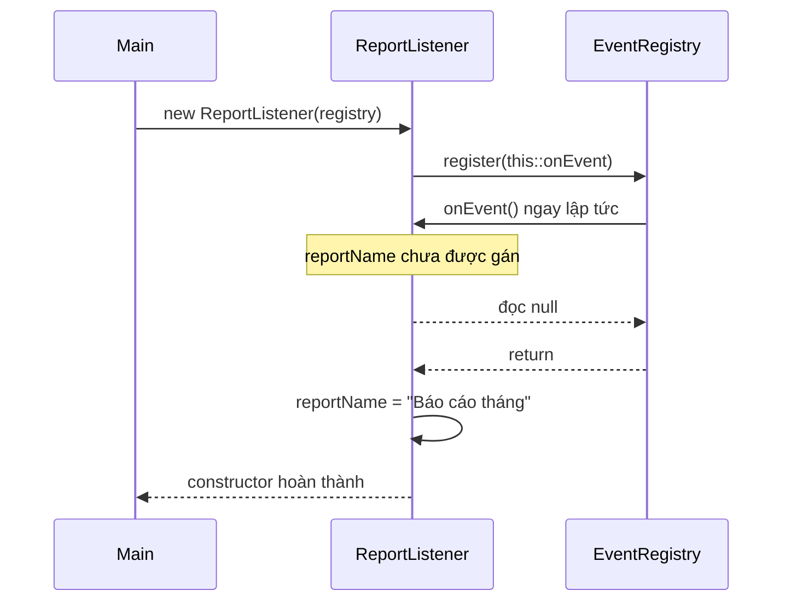
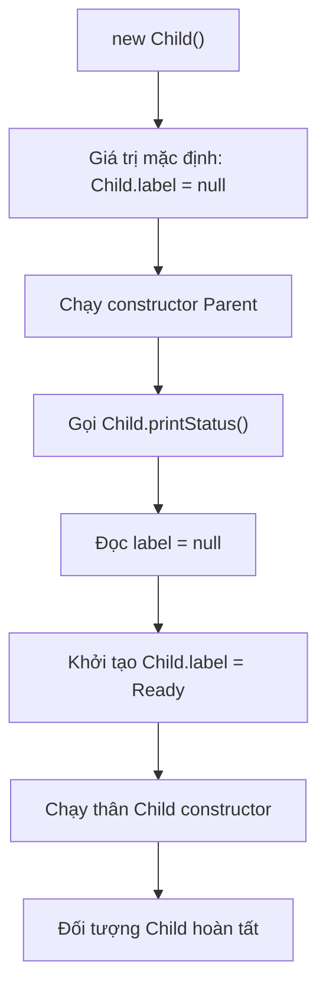
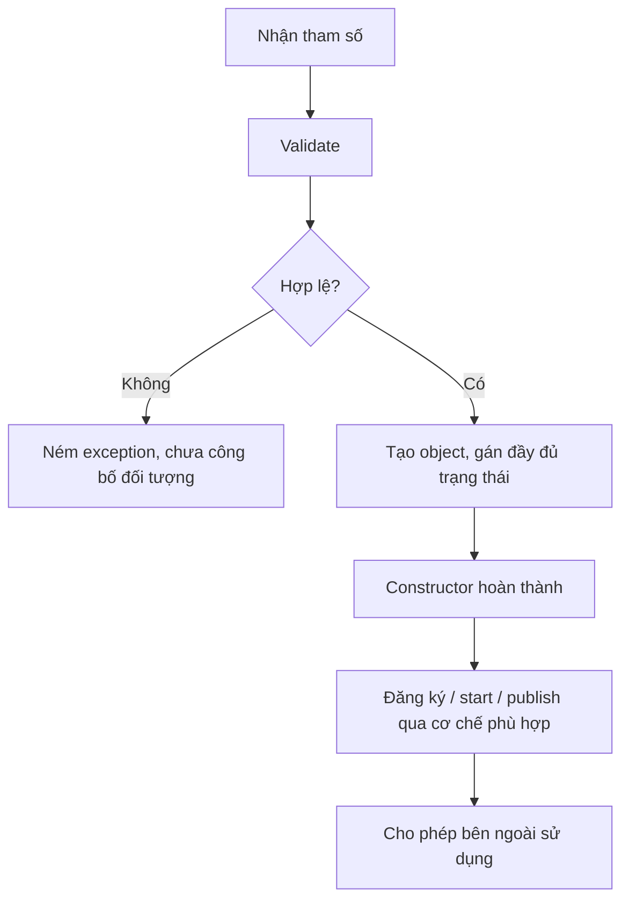

# Preventing the Use of Incompletely Initialized Objects in Java

In Java, a **constructor** establishes an object's initial state. If a reference to that object becomes externally accessible **before its constructor and the related initialization chain complete**, other code may invoke methods or read fields while the object is still partially initialized. This is commonly called **this escape** (*the `this` reference escapes during construction*).

This problem is not limited to multithreaded programs. A callback invoked immediately during listener registration can use the object too early on the same thread. Multithreaded failures are even harder to reproduce because execution timing and visibility of data across threads vary.

This lesson explains the failure scenarios, their causes, and how to design objects so they are used only when ready.

## 1. What Stages Does an Object Go Through?

During `new SomeClass(...)`, the JVM and Java language initialize the object according to Java's rules: setting default field values, executing the superclass constructor chain, running each class's field and instance initializers in the appropriate order, and executing constructor bodies.

Remember: **an object may already exist even though its constructor has not finished**. A reference to it can escape at this stage, for example through `this`.

Suppose we have this class:

```java
public final class Session {
    private final String sessionId;
    private final String owner;

    public Session(String sessionId, String owner) {
        this.sessionId = sessionId;
        this.owner = owner;
    }

    public String displayName() {
        return sessionId + " - " + owner;
    }
}
```

In ordinary use, the caller receives a reference from `new Session(...)` **only after the constructor completes successfully**. However, the constructor can leak `this` by storing it elsewhere or passing it to a callback.

### Two Distinct Risks

| Risk | What happens? | Example |
|---|---|---|
| **Premature use** | Other code accesses an object before initialization finishes | A listener is invoked immediately during registration from its constructor |
| **Unsafe publication** | Another thread receives a reference without a suitable synchronization relationship, so state visibility may not be guaranteed | Assigning the object to an ordinary shared field, then allowing another thread to read it without synchronization |

These risks are related but different. Even when reference publication is synchronized, **publishing an object before initialization finishes still allows other code to use an incomplete object**.

## 2. What Is This Escape?

Inside instance methods and constructors, `this` refers to the current object. **This escape** occurs when a reference to the object becomes accessible somewhere that can use it before construction completes.

Common ways `this` escapes include:

- Registering a listener or callback with an event bus, registry, or shared service inside a constructor.
- Storing `this` in a `static` field or a collection accessible to another component.
- Passing `this` to uncontrolled code, especially code that may invoke callbacks or retain the reference.
- Starting a thread or asynchronous task that uses `this` from a constructor.
- Exposing a lambda, method reference, or inner-class instance that captures `this`.

Passing `this` to a controlled internal helper that neither retains nor publishes the reference **does not necessarily** cause this escape. The critical question is whether the reference can be used outside the initialization boundary too early.

## 3. Deterministic Failure Example: Registering a Callback Too Early

The following example deliberately simulates a registry invoking a callback **during registration**. No extra thread is involved, so the failure is predictable.

File `UnsafeListenerDemo.java`:

```java
public class UnsafeListenerDemo {
    interface Listener {
        void onEvent();
    }

    static class EventRegistry {
        void register(Listener listener) {
            listener.onEvent(); // Callback chạy đồng bộ ngay lúc đăng ký
        }
    }

    static class ReportListener {
        private final String reportName;

        ReportListener(EventRegistry registry) {
            registry.register(this::onEvent);
            this.reportName = "Báo cáo tháng";
        }

        private void onEvent() {
            System.out.println("Tên báo cáo: " + reportName);
        }
    }

    public static void main(String[] args) {
        new ReportListener(new EventRegistry());
    }
}
```

Output:

```text
Tên báo cáo: null
```

Although `reportName` is declared `final` and assigned in the constructor, the callback runs **before the assignment**. At that point, the reference field still has its default value, `null`. If `onEvent()` invokes `reportName.length()`, the program throws `NullPointerException`.

The `final` keyword is not the problem; the problem is calling code that can observe the object before valid state has been established.

### Failure Sequence



Some libraries only store listeners and do not invoke callbacks immediately, but a risk remains if another thread publishes an event before the constructor finishes. Do not rely on an assumption that “the listener will not be called yet” unless the API guarantees it.

## 4. Fix: Finish Construction Before Registration

A clear design **separates state initialization from exposing the object to external systems**.

For example, use a static factory so callers receive the object only after creation and registration steps are complete:

```java
import java.util.Objects;

public final class SafeListenerDemo {
    interface Listener {
        void onEvent();
    }

    static class EventRegistry {
        void register(Listener listener) {
            listener.onEvent(); // Cố ý gọi ngay để kiểm chứng
        }
    }

    static final class ReportListener {
        private final String reportName;

        private ReportListener(String reportName) {
            this.reportName = Objects.requireNonNull(reportName);
            if (reportName.isBlank()) {
                throw new IllegalArgumentException("Tên báo cáo không được rỗng");
            }
        }

        static ReportListener createAndRegister(
                EventRegistry registry, String reportName) {
            Objects.requireNonNull(registry);

            ReportListener listener = new ReportListener(reportName);
            registry.register(listener::onEvent);
            return listener;
        }

        private void onEvent() {
            System.out.println("Tên báo cáo: " + reportName);
        }
    }

    public static void main(String[] args) {
        ReportListener listener = ReportListener.createAndRegister(
            new EventRegistry(), "Báo cáo tháng"
        );
        // Callback in: Tên báo cáo: Báo cáo tháng
    }
}
```

When `registry.register(...)` runs, the `ReportListener(String)` constructor has **returned successfully** and the object is valid. Even a synchronous callback from `register` sees the correct report name.

This pattern works well for attaching objects to an event bus, message handler, cache, scheduler, or plugin system.

**Registration failure note:** If `register` throws an exception, the factory does not return successfully. However, the registry might have stored the listener before throwing. Real systems must specify whether registration is atomic, how to unregister, and how to handle rollback or cleanup.

### What If a Separate Activation Step Is Required?

You can design a two-phase process:

```java
final class Consumer {
    private final String id;
    private boolean activated;

    Consumer(String id) {
        if (id == null || id.isBlank()) {
            throw new IllegalArgumentException("id không hợp lệ");
        }
        this.id = id;
    }

    void activate(EventRegistry registry) {
        if (activated) {
            throw new IllegalStateException("Đã activate");
        }
        // Chỉ đăng ký sau khi constructor hoàn thành.
        registry.register(() -> System.out.println(id));
        activated = true;
    }
}
```

The example above separates the two phases in a **sequential calling environment**. Its API is not thread-safe: if `activate` can be called concurrently or `register` invokes a reentrant callback, state/locking and failure handling need further design. A factory usually reduces the chance that callers forget to invoke `activate`.

## 5. Do Not Call Overridable Methods from Constructors

Another cause of premature use is **dynamic dispatch** while a superclass constructor is still executing. Java can invoke a subclass override **before the subclass's field initializers and constructor have finished**.

A standalone example:

```java
public class OverrideDuringConstruction {
    static class Parent {
        Parent() {
            printStatus(); // Nguy hiểm: phương thức có thể override
        }

        void printStatus() {
            System.out.println("Parent initialized");
        }
    }

    static class Child extends Parent {
        private String label = "Ready";

        Child() {
            System.out.println("Child constructor");
        }

        @Override
        void printStatus() {
            System.out.println("Child label = " + label);
        }
    }

    public static void main(String[] args) {
        new Child();
    }
}
```

Output:

```text
Child label = null
Child constructor
```

Why? During `new Child()`:

1. Instance fields receive default values (`label` is `null`).
2. The superclass constructor `Parent()` runs.
3. The `printStatus()` call is dynamically dispatched to `Child.printStatus()`.
4. The field initializer `label = "Ready"` of `Child` **has not run yet**.
5. The subclass-specific initialization in `Child` happens only after the superclass constructor finishes.

The important execution order can be visualized as follows:



### A Safer Design

- In constructors, invoke appropriate **`private`, `final`, or `static`** methods when you need to prevent subclass overrides from changing the initialization flow. `private` methods cannot be overridden; `final` methods prohibit overriding.
- Better still, validate inputs and establish required state directly through non-overridable helpers.
- If logic depends on subclass data, run it **after all constructors have completed**, through a caller-invoked method or a factory controlling the lifecycle.

For example:

```java
class Parent {
    private final String id;

    Parent(String id) {
        this.id = validate(id);
    }

    private static String validate(String id) {
        if (id == null || id.isBlank()) {
            throw new IllegalArgumentException("id không hợp lệ");
        }
        return id;
    }

    public final String getId() {
        return id;
    }
}

final class Child extends Parent {
    private final String label;

    Child(String id, String label) {
        super(id);
        this.label = java.util.Objects.requireNonNull(label);
    }

    void printStatus() {
        System.out.println(getId() + ": " + label);
    }
}

// Dùng sau khi khởi tạo hoàn tất:
Child child = new Child("C01", "Ready");
child.printStatus(); // C01: Ready
```

In this example, the superclass constructor does not invoke a method that subclasses can override; `printStatus()` runs only after `new Child(...)` completes.

## 6. Do Not Start a Thread That Uses this Inside a Constructor

A particularly dangerous mistake:

```java
class UnsafeWorker {
    private int threshold;

    UnsafeWorker() {
        new Thread(() -> System.out.println(threshold)).start();
        threshold = 10;
    }
}
```

The lambda captures an instance field, and therefore retains a reference to `this`. After `Thread.start()`, the new thread **may** run before the assignment `threshold = 10`, so it may print `0`; the result depends on scheduling. Repeated runs that always print `10` **do not prove the program is correct**.

The *happens-before* relationship from actions performed by the calling thread **before** `Thread.start()` to actions in the new thread does not guarantee that an assignment performed **after** `start()` happens before the worker reads it.

### Finish Construction Before Starting the Thread

A suitable design for background work:

```java
public final class SafeWorker {
    private final int threshold;
    private final Thread thread;

    private SafeWorker(int threshold) {
        if (threshold <= 0) {
            throw new IllegalArgumentException("threshold phải dương");
        }
        this.threshold = threshold;
        this.thread = new Thread(this::runTask, "safe-worker");
    }

    public static SafeWorker createAndStart(int threshold) {
        SafeWorker worker = new SafeWorker(threshold);
        worker.thread.start();
        return worker;
    }

    private void runTask() {
        System.out.println("Threshold = " + threshold);
    }

    public static void main(String[] args) {
        SafeWorker.createAndStart(10);
    }
}
```

When `start()` is invoked, the `SafeWorker` constructor has already returned and all fields have been initialized. Actions before `Thread.start()` *happen-before* actions in the new thread, so the thread cannot run before initialization is complete in this example.

That does not automatically make all subsequent access thread-safe. If threads read or write **shared mutable state**, suitable synchronization is still required.

In real applications, consider using **`ExecutorService`** to manage work, including lifecycle-aware shutdown and cancellation. The principle remains: **submit tasks that reference the object only after its constructor returns**, and explicitly manage resource cleanup.

## 7. Constructor Exceptions and Partially Initialized Objects

A constructor may throw an exception while validating input:

```java
public final class EmailAddress {
    private final String value;

    public EmailAddress(String value) {
        if (value == null || !value.contains("@")) {
            throw new IllegalArgumentException("Email không hợp lệ");
        }
        this.value = value;
    }

    public String value() {
        return value;
    }
}
```

If `new EmailAddress("invalid")` throws, the creation expression does not return a valid reference to the caller during normal execution.

However, if a constructor **stores `this` in a shared variable before throwing**, a reference to the partially initialized object can remain outside the constructor:

```java
import java.util.ArrayList;
import java.util.List;

class UnsafeRegistration {
    static final List<UnsafeRegistration> REGISTRY = new ArrayList<>();
    private final String value;

    UnsafeRegistration(String input) {
        REGISTRY.add(this); // Rò rỉ this
        if (input == null) {
            throw new IllegalArgumentException("input null");
        }
        this.value = input;
    }

    String value() {
        return value;
    }
}
```

In this example, `REGISTRY` illustrates premature use and **is not thread-safe**. If you call `new UnsafeRegistration(null)` and catch the exception, the registry still holds a reference to an object whose `value` field was never assigned.

Fix this by registering the object **only after successful construction**:

```java
static UnsafeRegistration createAndRegister(String input) {
    UnsafeRegistration result = new UnsafeRegistration(input);
    REGISTRY.add(result);
    return result;
}
```

When applying this fix, you must **remove `REGISTRY.add(this)` from the constructor**. In a multithreaded system, the registry also needs an appropriate synchronization strategy. If registration can fail after construction, specify how failures or unregistration are handled.

## 8. Safe Publication Requires More Than Just volatile

In multithreaded applications, even after initialization finishes, you must **publish the reference** so other threads can observe the object's state under the Java Memory Model.

### An Unsafe Publication Example

```java
class Config {
    final int port;
    int timeoutMs;

    Config(int port, int timeoutMs) {
        this.port = port;
        this.timeoutMs = timeoutMs;
    }
}

class Holder {
    Config current; // Field dùng chung, không volatile, không đồng bộ
}

// Thread A:
// holder.current = new Config(8080, 5000);

// Thread B:
// Config config = holder.current;
// if (config != null) { use(config); }
```

If two threads access `current` without a suitable *happens-before* relationship, they have a **data race**. Thread B is not guaranteed to observe the new reference at a particular time, and field values must also be considered under the Java Memory Model. A `final` field such as `port` has special guarantees when an object is properly constructed (without `this` escaping), but those guarantees do not replace safe publication and synchronization for all mutable state.

### Publishing After Initialization with volatile

```java
class Holder {
    private volatile Config current;

    void update(int port, int timeoutMs) {
        Config newConfig = new Config(port, timeoutMs);
        current = newConfig; // Volatile write sau khi constructor xong
    }

    Config current() {
        return current; // Volatile read
    }
}
```

A `volatile` write *happens-before* subsequent `volatile` reads that observe the written value according to synchronization order. State writes before publication can be observed correctly through that synchronization path.

**Important:** Applying `volatile` to a reference variable does not automatically make arbitrary changes to the object's mutable fields **after publication** safe. It also does not fix allowing `this` to escape while the constructor is still running.

Besides `volatile`, publication can use a suitable `synchronized` lock, concurrent collections with appropriate synchronization contracts, class initialization (for example, a `static final` field), or other valid synchronization mechanisms. Both reading and writing must follow **the same synchronization contract**; synchronizing only one side is insufficient.

### Comparison Table

| Scenario | Is initialization complete before use? | Is publication between threads safe? |
|---|---|---|
| Invoking a synchronous callback from a constructor before assigning fields | No | Not applicable; the failure occurs on the same thread |
| Calling `new Thread(this::task).start()` before the constructor finishes | Not guaranteed | `start()` does not protect operations performed afterward |
| A factory completes construction and then registers a callback sequentially | Yes | Synchronization is unnecessary for same-thread use; a multithreaded registry needs analysis |
| A factory completes construction and starts a thread reading the initialized state | Yes | Actions before `start()` have a happens-before relationship with the worker |
| Completing construction and assigning an ordinary shared field across threads | Yes | Not automatically |
| Completing construction and correctly publishing through `volatile` | Yes | This protocol guarantees visibility for state established before publication |

## 9. What Do final Fields Guarantee, and What Don't They?

A `final` field can only be assigned during initialization under Java's rules, expressing that the field cannot be reassigned afterward. The Java Memory Model has **final field semantics**, providing special guarantees for `final` field values when the object is properly constructed and **the `this` reference does not escape during construction**.

A simple design example:

```java
public final class PaymentRequest {
    private final String orderId;
    private final long amount;

    public PaymentRequest(String orderId, long amount) {
        if (orderId == null || orderId.isBlank()) {
            throw new IllegalArgumentException("orderId rỗng");
        }
        if (amount <= 0) {
            throw new IllegalArgumentException("amount phải dương");
        }
        this.orderId = orderId;
        this.amount = amount;
    }

    public String orderId() {
        return orderId;
    }

    public long amount() {
        return amount;
    }
}
```

Here, the object does not expose `this` from its constructor; both fields are initialized and remain unchanged. Such a design is easier to verify and reduces the need to synchronize internal state.

But remember:

- A `final` reference field only prevents **reassignment of the field**; it does not make the referenced object immutable.
- `final List<Item> items` can still contain a mutable `List` or mutable `Item` objects. For deeper immutability, control aliasing and defensive copying.
- `final` cannot fix premature callbacks that run before other fields are assigned.
- State updated after construction still requires appropriate synchronization across threads.

## 10. Factories and Immutable Objects: Reducing Risk

A useful API pattern is **validate → build complete state → return a complete object**. When data contains collection references, copying and sharing also require care.

An immutable configuration example, Java 11+:

```java
import java.util.List;
import java.util.Objects;

public final class JobConfig {
    private final String jobName;
    private final List<String> recipients;

    private JobConfig(String jobName, List<String> recipients) {
        if (jobName == null || jobName.isBlank()) {
            throw new IllegalArgumentException("jobName rỗng");
        }
        this.jobName = jobName;
        this.recipients = List.copyOf(
            Objects.requireNonNull(recipients, "recipients")
        );
    }

    public static JobConfig of(String jobName, List<String> recipients) {
        return new JobConfig(jobName, recipients);
    }

    public String jobName() {
        return jobName;
    }

    public List<String> recipients() {
        return recipients;
    }
}
```

`List.copyOf` creates or returns a list that cannot be modified through the `List` interface and rejects `null` elements. Here, elements are immutable `String` values, so the list provides no path for modifying the configuration's state. With mutable element types, `List.copyOf` **does not deep-copy** elements.

The constructor does not register events, place `this` in shared storage, or start tasks. Only after `JobConfig.of(...)` returns does the caller hold a reference to the complete object. Publishing the configuration to another thread still requires a suitable mechanism.

## 11. Constructor and Lifecycle Review Checklist

When reviewing a class with complex initialization behavior, check:

1. **Has the constructor established all required state?** Does it validate parameters and invariants before exposing the object?
2. **Can `this` escape before the constructor finishes?** Look for listener registration, callbacks, global-registry insertion, task submission, thread creation, or passing `this` to external code.
3. **Does a superclass constructor call an overridable method?** A subclass override may run before its field initializers.
4. **Can initialization fail midway?** If so, could a registry, callback, or resource already hold a reference to the failed object?
5. **How is the object published to another thread after construction?** Ensure the appropriate happens-before relationship for its use.
6. **Is mutable state shared?** Distinguish safe initialization from concurrent access throughout the lifecycle.

The steps can be organized as follows:



**This diagram does not mean every class needs a factory or event registration.** For simple data classes, a constructor that completely initializes state is sufficient; publication becomes relevant when there is external interaction or multiple threads.

## 12. Self-Check Exercises

### Exercise 1 — Predict the Output

```java
class Base {
    Base() {
        describe();
    }

    void describe() {
        System.out.println("Base");
    }
}

class Child extends Base {
    private int count = 7;

    @Override
    void describe() {
        System.out.println(count);
    }
}

// new Child();
```

**Answer: `0`.** `describe()` dynamically dispatches to the `Child` override from the `Base` constructor, while `count` still has its default value of `0`; the field initializer `count = 7` runs afterward.

### Exercise 2 — Why Isn't final Enough?

```java
class Store {
    static Store published;
    final String code;

    Store() {
        published = this;  // This escape
        code = "READY";
    }
}
```

**Question:** Can `final` guarantee that every reader of `published` sees fully initialized state?

**Answer: No.** `this` was published before the constructor completed. Other code that reads and uses it early may observe unassigned state. In addition, the `published` field is not suitably synchronized for sharing across threads. The correct approach is to complete construction and then publish using an appropriate mechanism.

### Exercise 3 — Refactor to a Factory

Given this class:

```java
class ChatConsumer {
    private final String channel;

    ChatConsumer(EventBus bus, String channel) {
        bus.subscribe(this::onMessage); // Rủi ro this escape
        this.channel = channel;
    }

    void onMessage(String message) {
        System.out.println(channel + ": " + message);
    }
}
```

Refactor it as follows:

- Make the `private` constructor accept `channel`, validate it, and assign the field.
- Define `public static ChatConsumer createAndSubscribe(EventBus bus, String channel)` to finish constructing the object before invoking `bus.subscribe(consumer::onMessage)`.
- If `subscribe` can fail or the registry requires unsubscription, add appropriate cleanup; if events are dispatched from multiple threads, `EventBus` needs clear synchronization rules.

### Exercise 4 — Identify Dangerous Behavior

Mark actions that need scrutiny when performed **inside a constructor**:

| Action | Assessment |
|---|---|
| Assigning `this.id = validatedId` | Usually safe |
| Calling `private static String normalize(String)` | Usually safe if `this` does not escape |
| `eventBus.register(this)` | Risk of this escape |
| `executor.submit(this::process)` | Risk of this escape |
| Calling an overridable `public void initialize()` | Risk of using uninitialized subclass state |
| Calling `register(instance)` after factory construction completes | Safer timing; still consider synchronization and registration failures |

---

## Key Takeaways

An object may have been allocated but **not yet fully initialized**. Prevent `this` from escaping the constructor through listeners, registries, callbacks, threads, or asynchronous tasks; avoid calling overridable methods from constructors because subclasses may not be ready. When registration or startup is required, **complete initialization first**, then activate or publish the object through a suitable mechanism. In multithreaded code, distinguish *preventing premature use* from *safe publication*: addressing both helps avoid hard-to-reproduce lifecycle bugs.
