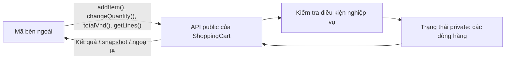
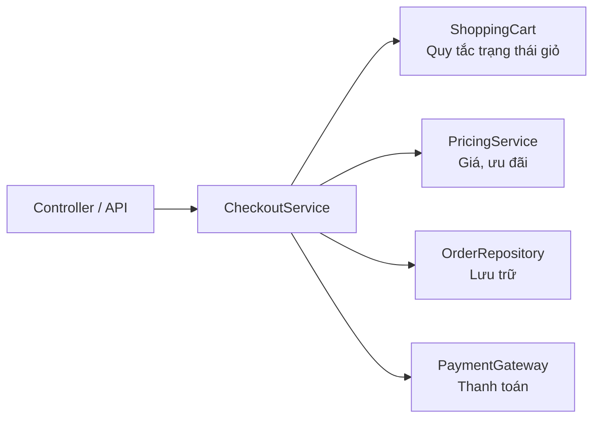

# Information hiding and object boundaries in Java OOP

## 1. Why do objects need boundaries?

When designing an object, we must decide not only **what data it stores** but also **what external code is allowed to know and do** with that data.

For example, a shopping cart contains line items, unit prices, and quantities. If external code can directly edit its list, assign negative quantities, or change prices without validation, the cart can no longer enforce its own rules. Errors may then arise anywhere the cart is used.

**Information hiding** means exposing only what a class's clients need to know while concealing implementation decisions they should not depend on. An **object boundary** defines the operations and data allowed to cross the object's interface, together with the rules governing those interactions.

Consider this diagram:



External code requests **adding an item** or **changing a quantity**; it does not need to know whether the class uses an `ArrayList`, `LinkedHashMap`, or another storage mechanism. The object retains control over when and how its valid state may change.

This is the core of **encapsulation** in OOP: keeping related state and behavior together in one class, controlling access, and preserving the object's invariants.

## 2. Distinguishing information hiding, encapsulation, and access control

These three concepts are related, but they are not identical:

| Concept | Question it addresses | Example |
| --- | --- | --- |
| **Encapsulation** | Which state and behaviors belong to the same object? | A shopping cart owns its line items and methods for adding items and changing quantities |
| **Information hiding** | Which details do clients of the class not need to know? | Hide the collection type, lookup strategy, and intermediate calculations |
| **Access control** | Which code may access which members? | `private` fields, `public` APIs, and package-private members for internal package collaboration |

`private` is an important tool, but **making fields `private` alone does not provide effective information hiding**. If a getter exposes a mutable list and a caller modifies it, the object's state is still exposed through that reference.

### Java access levels

| Modifier | Declaring class | Same package | Subclass in another package | Unrelated code in another package |
| --- | --- | --- | --- | --- |
| `private` | Yes | No | No | No |
| Unspecified (package-private) | Yes | Yes | No | No |
| `protected` | Yes | Yes | Yes, subject to Java's rules for inherited access | No |
| `public` | Yes | Yes | Yes | Yes |

The table describes access to **class members**, assuming that the enclosing class itself is accessible. For `protected`, a subclass in a different package cannot access the member arbitrarily through any superclass reference; Java imposes stricter rules in that situation.

As a general rule:
- Keep fields holding internal state `private`.
- Expose operations intended for clients as `public`.
- Keep helper logic that does not need to be exposed `private`.
- Use `protected` and package-private only when there is a clear need for extension or collaboration within a package.

Information hiding is **not** a security mechanism against someone who can execute arbitrary code or use reflection. It is an API design technique that limits dependencies between software components. Authentication, authorization, and protection of sensitive data require separate mechanisms.

## 3. Poor design: allowing external code to modify an object arbitrarily

The following example illustrates a fragile design:

```java
import java.util.ArrayList;
import java.util.List;

class BadCart {
    public List<String> productCodes = new ArrayList<>();
    public int itemCount;
}

BadCart cart = new BadCart();
cart.productCodes.add("KB01");
cart.itemCount = -100;                 // Dữ liệu không hợp lệ
cart.productCodes.clear();            // Xóa hàng mà không qua quy tắc
```

The problem goes beyond `public`. Even if the fields become `private`, callers can still modify state if a getter returns a mutable `List` directly:

```java
class LeakyCart {
    private final List<String> productCodes = new ArrayList<>();

    public List<String> getProductCodes() {
        return productCodes; // Làm lộ tham chiếu tới danh sách nội bộ
    }
}

// Mã bên ngoài:
LeakyCart cart = new LeakyCart();
cart.getProductCodes().add("KB01"); // Bỏ qua nghiệp vụ thêm sản phẩm
```

The boundary is broken because the caller can write to an object owned by the class, even though the field is declared `private`.

A better design starts by asking: *“What does a client of this class actually want to do?”* For a shopping cart, the answers are **add a valid item**, **change a quantity to a valid value**, **view the items**, and **view the total**—not “retrieve the internal collection and modify it freely.”

## 4. Complete example: a ShoppingCart that protects its own state

Design rules:

1. Each product code `sku` appears at most once in the cart.
2. `sku` is nonblank; unit prices in VND are nonnegative; quantities are positive integers.
3. The cart's total always fits within the range of `long`.
4. External code can modify the cart only through validated public methods.
5. If an operation is rejected, existing data must remain unchanged.
6. Getters return read-only snapshots without exposing mutable collections.

Create **`ShoppingCart.java`** (Java 11 or later):

```java
import java.util.ArrayList;
import java.util.LinkedHashMap;
import java.util.List;
import java.util.Map;
import java.util.Objects;

public final class ShoppingCart {
    // Quyết định lưu trữ là chi tiết nội bộ.
    private final Map<String, CartLine> lines = new LinkedHashMap<>();

    public void addItem(String sku, long unitPriceVnd, int quantity) {
        String normalizedSku = normalizeSku(sku);

        if (lines.containsKey(normalizedSku)) {
            throw new IllegalArgumentException("Sản phẩm đã có trong giỏ");
        }

        // Constructor của CartLine tự kiểm tra giá và số lượng.
        CartLine candidate = new CartLine(
                normalizedSku, unitPriceVnd, quantity);

        // Kiểm tra tràn trước khi thay đổi giỏ hàng.
        Math.addExact(totalVnd(), candidate.subtotalVnd());
        lines.put(normalizedSku, candidate);
    }

    public void changeQuantity(String sku, int newQuantity) {
        String normalizedSku = normalizeSku(sku);
        CartLine current = lines.get(normalizedSku);

        if (current == null) {
            throw new IllegalArgumentException("Không tìm thấy sản phẩm");
        }

        CartLine replacement = new CartLine(
                current.sku, current.unitPriceVnd, newQuantity);

        // Mọi phép tính/kiểm tra diễn ra trước khi thay đổi trạng thái.
        long withoutCurrent = Math.subtractExact(
                totalVnd(), current.subtotalVnd());
        Math.addExact(withoutCurrent, replacement.subtotalVnd());

        lines.put(normalizedSku, replacement);
    }

    public long totalVnd() {
        long total = 0L;
        for (CartLine line : lines.values()) {
            total = Math.addExact(total, line.subtotalVnd());
        }
        return total;
    }

    public List<CartLine> getLines() {
        // Snapshot cấu trúc; CartLine cũng bất biến.
        return List.copyOf(lines.values());
    }

    private static String normalizeSku(String sku) {
        Objects.requireNonNull(sku, "sku");
        String result = sku.strip();
        if (result.isBlank()) {
            throw new IllegalArgumentException("Mã sản phẩm không được rỗng");
        }
        return result;
    }

    // Kiểu công khai dùng để đọc một dòng hàng; không có setter.
    public static final class CartLine {
        private final String sku;
        private final long unitPriceVnd;
        private final int quantity;

        private CartLine(String sku, long unitPriceVnd, int quantity) {
            if (unitPriceVnd < 0) {
                throw new IllegalArgumentException("Đơn giá không được âm");
            }
            if (quantity <= 0) {
                throw new IllegalArgumentException("Số lượng phải dương");
            }
            this.sku = sku;
            this.unitPriceVnd = unitPriceVnd;
            this.quantity = quantity;

            // Không chấp nhận dòng hàng có thành tiền tràn long.
            Math.multiplyExact(unitPriceVnd, (long) quantity);
        }

        public String getSku() {
            return sku;
        }

        public long getUnitPriceVnd() {
            return unitPriceVnd;
        }

        public int getQuantity() {
            return quantity;
        }

        public long subtotalVnd() {
            return Math.multiplyExact(unitPriceVnd, (long) quantity);
        }
    }
}
```

### Why does this design preserve the boundary?

**The `lines` field is `private`:** callers do not need to know that the cart uses a `Map`. Choosing `LinkedHashMap` allows products to be managed by code while preserving insertion order when listing items. This is an implementation detail; however, if the API documentation promises a particular order, that order becomes part of the contract and must be maintained.

**`addItem()` and `changeQuantity()` replace unrestricted setters:** every operation that changes the cart has a clear meaning. Callers cannot insert `null` or a negative quantity directly into the internal collection.

**Validate first, update second:** `Math.multiplyExact` and `Math.addExact` detect arithmetic overflow. In the operations above, all checks that can fail run before `put`, so ordinary validation failures cannot leave the cart partially updated.

**`CartLine` is an immutable data carrier for reading:** each line item has `private final` fields containing either an immutable `String` or a primitive value, a controlled constructor, and no setters. Rather than changing the `quantity` of an existing `CartLine`, `changeQuantity()` creates a replacement and installs it only after validation.

**The getter returns a snapshot:** `List.copyOf(lines.values())` returns a list whose elements cannot be added, removed, or replaced through the returned reference; it also captures the contents at call time. Because `CartLine` objects are immutable, callers cannot indirectly modify cart fields through the elements. If the elements were mutable, `List.copyOf` alone would not perform a deep copy.

**`private static normalizeSku()`:** this is an internal processing step outside the public API. It does not depend on the state of a particular cart, so it is `static`.

### Try out the behavior

Create **`Main.java`**:

```java
import java.util.List;

public class Main {
    public static void main(String[] args) {
        ShoppingCart cart = new ShoppingCart();

        cart.addItem("KB-01", 250_000, 2);
        cart.addItem("MS-01", 100_000, 1);
        System.out.println(cart.totalVnd()); // 600000

        List<ShoppingCart.CartLine> before = cart.getLines();
        cart.changeQuantity("KB-01", 3);

        System.out.println(cart.totalVnd()); // 850000
        System.out.println(before.get(0).getQuantity()); // 2
        System.out.println(cart.getLines().get(0).getQuantity()); // 3

        try {
            cart.changeQuantity("KB-01", -5);
        } catch (IllegalArgumentException ex) {
            System.out.println("Từ chối: " + ex.getMessage());
        }
        System.out.println(cart.totalVnd()); // Vẫn 850000

        try {
            before.clear();
        } catch (UnsupportedOperationException ex) {
            System.out.println("Snapshot không cho phép sửa");
        }
    }
}
```

Run these commands from the directory containing both files:

```bash
javac ShoppingCart.java Main.java
java Main
```

Output:

```text
600000
850000
2
3
Từ chối: Số lượng phải dương
850000
Snapshot không cho phép sửa
```

Notice that the `CartLine` objects before and after the quantity change are **two different instances**. The `before` variable still shows quantity `2`, while the current cart returns `3`. The earlier snapshot remains stable and does not let the caller alter the cart's state.

Technical note: this code illustrates invariant protection **in a single-threaded program**. The cart is not designed for concurrent mutations; neither `LinkedHashMap` nor the sequence of validation and update operations is inherently safe against race conditions.

## 5. Public contracts define object boundaries

A well-designed class exposes **useful, stable behavior** without requiring external code to depend on internal details.

Compare these approaches:

| API that exposes implementation | API that hides implementation |
| --- | --- |
| `getInternalMap().put(sku, line)` | `addItem(sku, price, quantity)` |
| `setTotalVnd(value)` | `totalVnd()` computes the result from line items |
| `getMutableLines().clear()` | Provide `removeItem(sku)` when the business rules require it |
| Callers validate prices and quantities themselves | The class validates every entry point that can change state |
| Callers know about `LinkedHashMap` or element indexes | Callers know product codes and business operations |

Exposing getters and setters for every field often turns a class into a “data bag,” with its rules scattered among callers. Not every setter is wrong: a setter can be appropriate if it represents a permitted change, performs clear validation, and does not expose state. For example, `changeDisplayName(String name)` may be more suitable than a generic setter for an entire configuration object.

### Invariants: what conditions must always hold?

Trong `ShoppingCart`:

- No line item has `quantity <= 0`.
- No line item has `unitPriceVnd < 0`.
- Product codes in the cart are unique.
- The total can be represented by a `long`.
- Code outside the class cannot add a line item without validation.

Invariants are established by the constructor or the operation that creates a line item, then maintained by every state-changing method. Any future method, such as `applyDiscount()` or `removeItem()`, must also comply with the relevant rules.

This matters because **an object can be used from many places**: controllers, services, tests, or other components. If a rule exists only in a controller, another caller may bypass it. The class should enforce the core rules governing the state it owns.

## 6. Three reference leaks to watch for

A `private final` field merely hides the field name and prevents reassignment of the reference; it does not freeze the underlying mutable object. When reviewing an API, trace **reference ownership** in both directions:

| Leak path | What the caller can do | Protection strategy |
| --- | --- | --- |
| Getter exposes an internal `List`/array | `getItems().clear()` bypasses `removeItem()` | Snapshot, copy, or a narrower query API |
| Constructor retains a caller-supplied collection | Caller keeps the `input` variable and changes it after construction | Copy on input when the class needs independent ownership |
| Read-only list contains mutable elements | `getItems().get(0).setPrice(...)` | Make elements immutable or create value snapshots |

For example, `List.copyOf(items)` prevents changes to the returned list's structure but **does not deep-copy** its elements. By contrast, `Collections.unmodifiableList(items)` is only a view and still reflects changes to the original list. You must therefore decide whether callers should observe *a snapshot taken at call time* or *live data*, and whether the contained elements are safe to share.

For `ShoppingCart`, the line items are immutable `CartLine` objects, so `getLines()` can return a snapshot without exposing a way to modify the cart. Arrays, `Date` objects, and mutable object graphs require an appropriate copying strategy at each boundary.

## 7. Object boundaries also define responsibilities

Information hiding does not mean putting every responsibility into one class.

A `ShoppingCart` should enforce local rules such as positive quantities, unique product codes, and computing totals from its line items. But it does not necessarily need to perform these tasks itself:

- Fetch the latest prices from a database or pricing service.
- Validate login tokens and user permissions.
- Send email after an order is placed.
- Call a payment gateway or coordinate distributed transactions.
- Return JSON or render HTML.

Those tasks may belong to a service, repository, controller, or adapter. A good boundary means **each component owns the data and decisions for which it is responsible**, and communicates with other components through clear APIs.



In the diagram, the cart does not need to know how HTTP requests, databases, or payment systems are implemented. Likewise, other classes do not need to know whether the cart uses a `Map` or how it validates data or calculates totals. This is the benefit of maintaining clear **API boundaries** at multiple levels.

One important distinction: a `private` field can still be modified by methods in **the same class**, including through a reference to another instance of that class. The `private` access level applies to code in the declaring class; it is not restricted to a particular instance.

## 8. Good boundaries allow implementation changes with less impact on callers

Suppose a cart initially stores line items in a `List<CartLine>` but later switches to a `Map<String, CartLine>` for faster lookups by code.

If the external API is used only as follows:

```java
cart.addItem("KB-01", 250_000, 2);
cart.changeQuantity("KB-01", 3);
long total = cart.totalVnd();
```

then many internal changes will not require callers to modify their code. However, any behavior published as part of the contract—such as line-item ordering, handling duplicate codes, or exception types—must still be considered when changing the implementation.

This is commonly described as **reducing coupling** between clients and a class's internal details. Practical benefits include:
- Data structures or algorithms can be replaced more easily.
- Testing is easier because observable behavior has clear inputs, outputs, and exceptions.
- Bugs are easier to locate because state changes occur in a defined set of methods.
- External code is less likely to break invariants accidentally.

**Information hiding does not mean hiding everything.** A class that exposes no useful behavior is also difficult to use. The balance is to provide an API expressive enough for business needs while keeping unnecessary implementation decisions private.

## 9. Common mistakes when designing boundaries

| Mistake | Why it causes problems | Better approach |
| --- | --- | --- |
| Making a state field `public` | Callers can change it without validation | Use `private` fields and controlled operations |
| Adding getters/setters for every field by habit | Callers become dependent on the internal structure | Expose only the data and operations actually needed |
| Returning an internal mutable list from a getter | Callers can bypass update rules | Return an appropriate snapshot, immutable view, or copy |
| Treating a `final List<T>` as an immutable list | `final` only prevents reassignment of the reference | Examine the mutability of the collection and its elements |
| Keeping the reference to a list passed into a constructor | The caller can continue changing the data | Copy on input when independent ownership is required |
| Checking conditions after writing to fields | An exception may leave state invalid | Validate and compute first, mutate afterward |
| Putting DB queries and HTTP handling into a domain object | Responsibilities become mixed and coupling increases | Separate services, repositories, and adapters |
| Treating `private` as data security | Access modifiers do not replace authentication or authorization | Enforce security at system boundaries and appropriate layers |
| Assuming a well-designed class is automatically thread-safe | Hiding state does not provide synchronization | Design concurrency handling explicitly when state is shared across threads |

## 10. Practice and self-assessment

### Question 1: why is the following getter dangerous?

```java
public List<CartLine> getLines() {
    return internalLines;
}
```

**Hint:** If `internalLines` is a mutable `ArrayList` owned by the class, callers can invoke `clear()` or `add()` without going through business logic. If `CartLine` is mutable too, merely returning an unmodifiable view is still insufficient to prevent callers from changing its elements.

### Question 2: what makes a reasonable boundary?

Consider an account object with a `balance` field. Choose the more appropriate API:

```java
// Phương án A
account.setBalance(-500_000);

// Phương án B
account.withdraw(500_000);
```

**Explanation:** option B expresses a withdrawal operation and provides an appropriate place to check for a positive amount, sufficient funds, and other rules. An unrestricted setter usually fails to express the purpose of a state change and can violate invariants.

### Question 3: distinguish snapshots from live views

```java
List<String> source = new ArrayList<>();
source.add("A");

List<String> liveView =
        java.util.Collections.unmodifiableList(source);
List<String> snapshot = List.copyOf(source);

source.add("B");

System.out.println(liveView); // ?
System.out.println(snapshot); // ?
```

**Answer:** `liveView` prints `[A, B]` because it is a view that reflects `source`; `snapshot` prints `[A]` because it was created before `"B"` was added. Neither permits additions through its own reference, but they **have different semantics for observing changes**.

### Question 4: extend ShoppingCart

Write `removeItem(String sku)` with these requirements: normalize the code using `normalizeSku`, report an error if the code does not exist, and remove exactly one line item. Then write a program that checks the following:
1. Add two products and save a snapshot from `getLines()`.
2. Remove one product through `removeItem`.
3. Check the current line count and total.
4. Verify that the earlier snapshot still contains the line items present when it was taken.
5. Try removing a nonexistent code and verify that the cart remains unchanged.

This exercise makes you reason about **valid paths for updating state**, **public APIs**, and **observable behavior**, instead of modifying the collection directly.

## Core questions when designing a class

When reading a Java class, ask yourself: (1) what state does this object **own**; (2) which conditions must always hold; (3) who can change its state, and through which methods; (4) can its inputs or outputs leak mutable references; and (5) if the internal implementation changes, which callers would need to change?

A well-defined boundary allows an object to **protect its own state**, express behavior through a clear API, and collaborate with other components without depending on implementation details.
