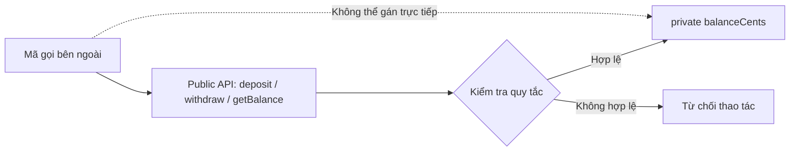
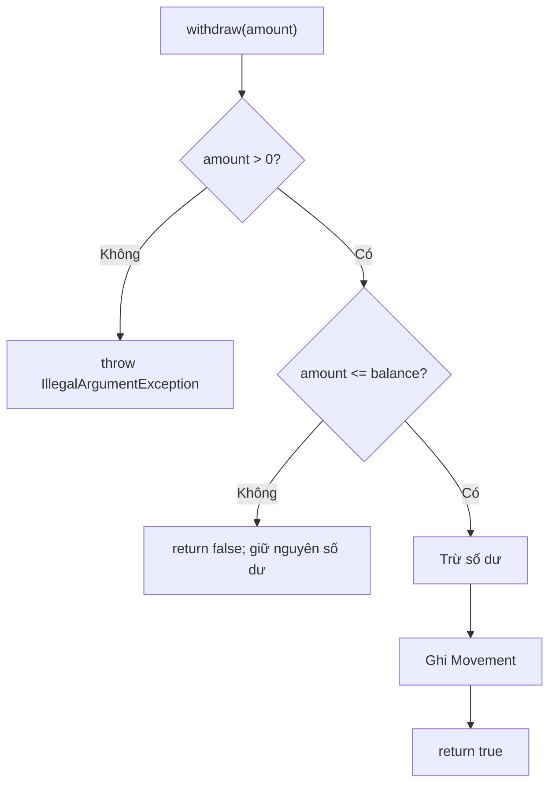
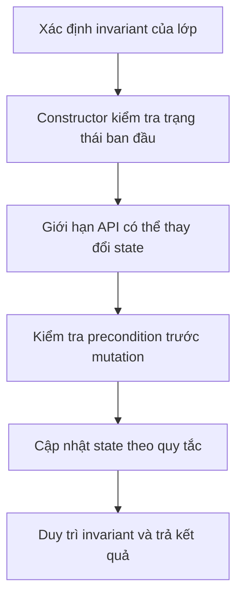

# Access control and state changes in Java

> **OOP → Encapsulation.** An object does more than store data: it must protect **the rules that must always hold** for that data. Java provides access levels (`private`, package-private, `protected`, `public`) to restrict which code can see or invoke class members. The rest is a design decision: allow state changes only through valid operations.

## 1. Why shouldn't everyone be allowed to modify fields?

Consider a simple account:

```java
class UnsafeAccount {
    public long balanceCents;
}

UnsafeAccount account = new UnsafeAccount();
account.balanceCents = 100_000;
account.balanceCents = -9_999; // Biên dịch hợp lệ nhưng vi phạm quy tắc số dư
```

A client of the class can assign any value, including a negative one, even if the application requires nonnegative balances. When many places modify state directly, the class cannot control who changes it, when, or whether the change is validated.

Encapsulation addresses this by separating:

- **Internal state**: fields managed by the object, such as `balanceCents`.
- **Public interface (public API)**: operations external code is allowed to invoke, such as `deposit(amount)`, `withdraw(amount)`, and `getBalance()`.
- **Invariants**: conditions that must hold after each valid operation, such as `balanceCents >= 0`.
- **Validation responsibility**: the class that owns the data validates it before making changes.



**Encapsulation does not mean every class needs getters and setters for every field.** If a class declares `private long balance` but exposes an unrestricted `public void setBalance(long value)`, external code can still violate business rules. What matters is **controlling the paths through which state changes**.

## 2. Java access levels

Java has four commonly used access levels for class members:

| Modifier | Within the declaring class | Other class in the same package | Subclass in another package | Unrelated class in another package |
|---|---|---|---|---|
| `private` | Yes | No | No | No |
| No modifier (**package-private**) | Yes | Yes | No | No |
| `protected` | Yes | Yes | Yes, subject to inherited-member access rules | No |
| `public` | Yes | Yes | Yes | Yes |

Example:

```java
package shop;

public class Product {
    private int stock;            // Chỉ mã có quyền private access của Product
    String internalCode;          // Package-private
    protected void validate() {}  // Cùng package và lớp con theo quy tắc protected
    public int getStock() {       // Phần API công khai
        return stock;
    }
}
```

Important distinctions:

- **`private`** restricts access according to the declaring class and the scopes Java permits, including interactions between enclosing and nested classes; it does not mean “only within one method.”
- **Package-private** means *no access modifier is specified*; it is not the `default` keyword. Classes in the same package may access the member when other access requirements are satisfied.
- **`protected`** grants access within the same package; subclasses in other packages face additional restrictions on which object references can be used to access inherited members.
- **`public`** makes members accessible to other code, provided the containing class is also accessible and any module restrictions (when using the Java Module System) permit it.
- A normal **top-level** class may be declared only `public` or package-private; `private` and `protected` do not apply directly to top-level classes.

Wider visibility creates more points of dependency. In practice, start with `private` data fields and expose only behavior that external clients actually need. There is no need to make every method `public` by default.

## 3. Controlling changes through meaningful business methods

The following complete example represents money in **cents** using `long`, avoiding the binary floating-point issues of `double` when illustrating monetary values. It is an in-memory OOP example, not a banking transaction system.

Save it as `WalletDemo.java` and run with **Java 17+**:

```java
import java.util.ArrayList;
import java.util.List;

public class WalletDemo {
    public record Movement(String type, long amountCents, long balanceAfter) {}

    public static final class Wallet {
        private final String owner;
        private long balanceCents;
        private final List<Movement> movements = new ArrayList<>();

        public Wallet(String owner, long openingBalanceCents) {
            if (owner == null || owner.isBlank()) {
                throw new IllegalArgumentException("Chủ ví không hợp lệ");
            }
            if (openingBalanceCents < 0) {
                throw new IllegalArgumentException("Số dư đầu kỳ không thể âm");
            }
            this.owner = owner;
            this.balanceCents = openingBalanceCents;
        }

        public String owner() {
            return owner;
        }

        public long balanceCents() {
            return balanceCents;
        }

        public List<Movement> history() {
            return List.copyOf(movements);
        }

        public void deposit(long amountCents) {
            requirePositive(amountCents);
            long newBalance = Math.addExact(balanceCents, amountCents);
            balanceCents = newBalance;
            movements.add(new Movement("DEPOSIT", amountCents, newBalance));
        }

        public boolean withdraw(long amountCents) {
            requirePositive(amountCents);
            if (amountCents > balanceCents) {
                return false;
            }
            balanceCents -= amountCents;
            movements.add(new Movement("WITHDRAW", amountCents, balanceCents));
            return true;
        }

        private static void requirePositive(long amountCents) {
            if (amountCents <= 0) {
                throw new IllegalArgumentException("Số tiền phải dương");
            }
        }
    }

    public static void main(String[] args) {
        Wallet wallet = new Wallet("An", 100_000);

        wallet.deposit(50_000);
        System.out.println(wallet.withdraw(20_000));  // true
        System.out.println(wallet.balanceCents());     // 130000
        System.out.println(wallet.withdraw(200_000)); // false
        System.out.println(wallet.balanceCents());     // 130000

        List<Movement> snapshot = wallet.history();
        System.out.println(snapshot.size());          // 2

        try {
            snapshot.clear();
        } catch (UnsupportedOperationException ex) {
            System.out.println("Không thể sửa lịch sử từ bên ngoài");
        }

        System.out.println(wallet.history().size());  // 2
    }
}
```

Run:

```bash
javac WalletDemo.java
java WalletDemo
```

Expected output:

```text
true
130000
false
130000
2
Không thể sửa lịch sử từ bên ngoài
2
```

### How are invariants protected?

The `Wallet` class has the invariant `balanceCents >= 0`.

| Operation | Input requirements | On success | On failure |
|---|---|---|---|
| `new Wallet(owner, opening)` | Nonblank `owner`; `opening >= 0` | Constructs a valid state | Throws `IllegalArgumentException` |
| `deposit(amount)` | `amount > 0`; addition must not overflow `long` | Increases balance and records history | Invalid input: `IllegalArgumentException`; overflow: `ArithmeticException` |
| `withdraw(amount)` | `amount > 0` | Sufficient funds: decreases balance and returns `true` | Insufficient funds: returns `false` without decreasing balance |
| `balanceCents()` | None | Returns current balance | Does not modify state |
| `history()` | None | Returns an unmodifiable list copy | External code cannot `clear()` the internal history |

State-changing methods express **the meaning of the operation**: depositing and withdrawing money. The class does not expose `setBalanceCents`, because “set an arbitrary balance” could bypass business validation and transaction history.

`Math.addExact` detects `long` overflow: if the balance is near `Long.MAX_VALUE`, addition will not silently wrap into a negative number. These checks make the API harder to misuse.

### Withdrawal flow



The diagram illustrates why **every path that changes state must pass through a valid decision**. Not every unsuccessful outcome needs to throw an exception: “insufficient funds” can be a normal business result, so this example returns `false`.

**Limitation of the example:** the operations on `Wallet` are not synchronized for concurrent threads. If multiple threads may deposit or withdraw simultaneously, mechanisms are needed to ensure atomicity and memory visibility (such as appropriate locking or transactions at the storage layer). `private` **does not make code thread-safe by itself**.

## 4. Field-name access differs from the ability to mutate a referenced object

Even when a list is `private final`, a getter that returns its `ArrayList` directly lets callers add or remove elements. This creates **a way around the validation methods**:

```java
private final List<String> members = new ArrayList<>();

public List<String> getMembers() {
    return List.copyOf(members); // Snapshot cấu trúc; String bất biến
}
```

If a constructor receives a list from outside, the class must also decide whether to copy it **when received** so the caller cannot continue modifying the same instance. When elements are mutable objects, `List.copyOf` is insufficient to protect the deeper state. These risks are part of API design even when the field's access modifier is correct.

## 5. Accessors must not undermine update rules

A getter supports **observation**; a setter is appropriate only when a property can truly change independently. For example, changing a display name may use `setDisplayName(name)` with `null`/blank-string validation. Conversely, calling `setStatus("SHIPPED")` on an unpaid order could bypass the business workflow even when the `status` field is `private`.

```java
// Trích các phương thức trong một Order có status kiểu enum.
public void pay() {
    if (status != Status.NEW) {
        throw new IllegalStateException("Chỉ đơn NEW được thanh toán");
    }
    status = Status.PAID;
}

public void ship() {
    if (status != Status.PAID) {
        throw new IllegalStateException("Chỉ đơn PAID được giao");
    }
    status = Status.SHIPPED;
}
```

`pay()` and `ship()` communicate intent and enforce checks where the data is owned. In a real application, confirming payment through an external system still requires a trustworthy service; a method name alone cannot authenticate a payment. Getter/setter naming is a Java convention, **not proof of proper encapsulation**.

## 6. Invariants must hold from construction through every operation

An object can enter an invalid state **during construction** if its constructor omits validation. Encapsulation works only when every path for creating and modifying an object preserves its rules.

For example, `Wallet` validates the opening balance in its constructor, while `deposit` and `withdraw` validate before updating the balance. This avoids negative balances along normal execution paths.

A simple design process:



| Design guideline | Reason |
|---|---|
| Keep internal data fields `private` in most cases | Prevent arbitrary direct assignments |
| Validate required data in the constructor | Ensure the object is valid from the start |
| Validate conditions in every state-changing method | Preserve invariants |
| Prefer methods named after behaviors | Limit operations performed out of sequence |
| Do not expose internal mutable collections or arrays | Prevent outside code from bypassing validation |
| Choose consistent failure results | Let callers know when an operation is rejected |
| Make objects immutable where appropriate | Reduce the number of states to manage |

### Avoiding partial changes

Suppose an operation must check several conditions:

```java
void updateLimit(long newLimit) {
    if (newLimit < 0) {
        throw new IllegalArgumentException("Giới hạn không hợp lệ");
    }
    if (newLimit < currentUsage) {
        throw new IllegalStateException(
            "Giới hạn mới thấp hơn mức đang sử dụng"
        );
    }
    limit = newLimit;
}
```

Checking before assignment prevents an invalid value from being written to `limit` before an exception is thrown. If a business operation changes **multiple objects** or writes to an external database/API, it needs an appropriate transaction/rollback mechanism; `private` and a Java method alone do not provide atomicity across resources.

## 7. Access control versus immutability

Encapsulation and immutability are related but distinct:

| Concept | Meaning | Example |
|---|---|---|
| Encapsulation | External code interacts only through permitted APIs | `Wallet.deposit()`, `Wallet.withdraw()` |
| Mutable object | State can change, but only according to its rules | `Wallet` after depositing/withdrawing |
| Immutable object | Observable state does not change after construction | `String`, a correctly designed value object |
| `final` field | Under Java's rules, the field cannot be reassigned after initialization | `private final List<String> names` |
| Unmodifiable collection | Its mutating operations cannot change the collection | Result of `List.copyOf(...)` |

`private` **does not imply immutability**; `final` **does not provide deep immutability**; and a getter is not inherently read-only if it returns a reference to a mutable object.

A simple value-object example:

```java
public record RectangleSize(int width, int height) {
    public RectangleSize {
        if (width <= 0 || height <= 0) {
            throw new IllegalArgumentException("Kích thước phải dương");
        }
    }

    public long area() {
        return (long) width * height;
    }
}
```

A `record` (Java 16+) automatically provides `private final` components and the `width()`, `height()` accessors. Its **compact constructor** validates the invariant before the record is used. With two primitive components, `RectangleSize` has immutable value state and is well suited for passing between objects.

## 8. Encapsulation within the boundaries of responsibility

Declaring fields `private` does not automatically make a design good. A class may have 20 `private` fields and 20 `public` setters, leaving external code to assemble the business logic. The rules are still scattered.

For example, a weak API makes callers validate state themselves:

```java
if (account.getBalance() >= amount) {
    account.setBalance(account.getBalance() - amount);
}
```

There are at least three problems: validation logic lives outside the class; other code can forget to validate; and the read and write steps are not atomic under concurrent access.

A behavior-oriented API such as `account.withdraw(amount)` keeps the logic inside the class that owns the data and knows its invariant. However, concurrent calls still require the method to use a suitable synchronization or transaction mechanism.

**Least visibility:** expose only what belongs to the class's contract. A helper such as `requirePositive` in `Wallet` is `private` because callers do not need to know how validation is implemented. When two classes collaborate closely in one package, package-private visibility may be more appropriate than `public`. Do not widen access merely to make a member “easy to call” if a clearer API design is available.

### Name methods by intent

| Potentially misleading name | More explicit behavioral name | When is it useful? |
|---|---|---|
| `setBalance(500)` | `deposit(500)` / `withdraw(500)` | Deposit/withdrawal rules apply |
| `setStatus(PAID)` | `pay()` | Valid state transitions are required |
| `setQuantity(q)` | `increaseStock(q)` / `reserve(q)` | Inventory constraints apply |
| `getInternalList()` | `listItems()` returns a snapshot | Data must be readable without allowing internal mutation |

Method names do not enforce rules by themselves: **implementation and testing** must ensure the behavior is correct.

## 9. Testing behavior and access boundaries

A good test verifies more than ordinary outputs. It also checks **states that must never occur** and whether calling code can interfere inappropriately.

For `Wallet`, you can verify the following cases:

| Scenario | Expected result |
|---|---|
| Construct a wallet with a negative balance | `IllegalArgumentException` |
| `deposit(0)` or `deposit(-1)` | `IllegalArgumentException`; balance unchanged |
| `deposit(Long.MAX_VALUE)` when balance is positive | `ArithmeticException`; balance unchanged |
| `withdraw(amount)` exceeds the balance | `false`; no withdrawal record is added |
| Withdraw a valid amount with sufficient funds | `true`; balance decreases correctly |
| `wallet.history().clear()` | `UnsupportedOperationException`; internal history remains intact |
| `wallet.balanceCents = -10` from external code | Compile-time error because the field is `private` |

**Distinguish compile-time access checks from user authorization.** `private`/`public` determine whether Java code can access a class member; they **do not replace authentication/authorization checks** when multiple user accounts access a service. For example, a `public withdraw(...)` method still needs the business layer or API to verify the account owner in a multiuser system.

## 10. Common mistakes to avoid

**Mistake 1 — Public mutable fields**

```java
public int stock; // Ai cũng có thể gán giá trị âm
```

Fix this with `private` fields and validated operations, such as `restock(int quantity)` and `reserve(int quantity)`.

**Mistake 2 — Private fields with unchecked setters**

```java
private int stock;
public void setStock(int stock) {
    this.stock = stock; // Vẫn có thể âm
}
```

If the business rules require nonnegative inventory, at minimum validate the value and consider a behavior-oriented API.

**Mistake 3 — Getter returns an internal mutable collection**

```java
public List<String> getNames() {
    return names; // Caller có thể add/remove bất kỳ phần tử
}
```

Fix this with a snapshot such as `List.copyOf(names)` when the elements permit it, or expose a read-only interface with a clear contract; remember that unmodifiable views and snapshots are not exactly the same.

**Mistake 4 — Assuming `final` makes the entire object immutable**

```java
private final List<String> names = new ArrayList<>();
// final ngăn: names = new ArrayList<>(); sau khi khởi tạo
// Nhưng vẫn cho phép: names.add("An");
```

Deep immutability requires considering the objects referenced by the fields as well.

**Mistake 5 — Moving read/check/write operations outside the class**

```java
if (wallet.balanceCents() >= amount) {
    // Không thể bảo đảm việc thay đổi an toàn chỉ từ bước đọc này
}
```

Move mutation logic into the method of the responsible object; under concurrency, add a suitable atomicity mechanism.

## 11. Practice exercises

1. Create an `InventoryItem` class with `private int stock` and a constructor that rejects negative stock. Write `restock(int amount)`, `reserve(int amount)`, and `getStock()`; do not expose a setter for arbitrary stock values.
2. Add a `RETURNED` state to `Order`. Define which transition from `SHIPPED` is valid, check the condition in `returnOrder()`, and update the Mermaid diagram.
3. Given a class whose constructor accepts a `List<String>` and stores the reference directly, demonstrate in code how the caller can modify the list after construction, then add a defensive copy to prevent this.
4. If `String` elements in `Team.members` were replaced with `Employee` objects having setters, would `List.copyOf` still provide sufficient encapsulation? Explain and propose a way to avoid exposing mutable objects.
5. Consider a service with two threads withdrawing from one wallet. Explain why `private balanceCents` does not prevent a race condition and what additional mechanism is needed for safe operations.

**Remember:** Good encapsulation means **hiding state that needs protection, exposing suitable behavior, validating before mutation, and preventing mutable-reference shortcuts**. A `private` field is a tool; invariants and method contracts determine whether an object can keep its state valid.
