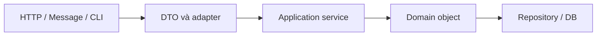

# Input validation at object boundaries in Java

In object-oriented programming (OOP), **encapsulation** involves more than making fields `private`. A class must also control **which values may enter the object** and **which state changes may occur**.

If a `BankAccount` cannot have a negative balance, or an `Enrollment` allows only 1 to 30 credits, those rules must be enforced at points where objects are created and used, even when the data does not come from a web interface.

An **object boundary** is where data or change requests cross from external code into state owned by the object: constructors, static factories, setters, business methods, methods accepting collections, and so on.

## 1. Why validate at the boundary?

Consider an unprotected class:

```java
class CourseEnrollment {
    private int credits;

    public CourseEnrollment(int credits) {
        this.credits = credits;
    }

    public void setCredits(int credits) {
        this.credits = credits;
    }

    public int getCredits() {
        return credits;
    }
}
```

Callers can create or modify the object into a meaningless state:

```java
CourseEnrollment enrollment = new CourseEnrollment(-5);
enrollment.setCredits(999);
System.out.println(enrollment.getCredits()); // 999
```

Although `credits` is `private`, the class still accepts invalid data through its public API. Thus, **`private` restricts access, while input validation protects state rules**.

A well-designed object maintains **invariants**: conditions that must hold whenever its state can legitimately be observed and used.

Example rules:

- A course code must not be `null` or blank after trimming leading and trailing whitespace.
- Credit count must be within `1..30`.
- An update must not transition the object to a state with credits outside the permitted range.

## 2. Validate in constructors and during updates

A straightforward implementation:

```java
public final class CourseEnrollment {
    private final String courseCode;
    private int credits;

    public CourseEnrollment(String courseCode, int credits) {
        this.courseCode = requireCourseCode(courseCode);
        this.credits = requireCredits(credits);
    }

    public void changeCredits(int newCredits) {
        this.credits = requireCredits(newCredits);
    }

    public String getCourseCode() {
        return courseCode;
    }

    public int getCredits() {
        return credits;
    }

    private static String requireCourseCode(String code) {
        if (code == null || code.isBlank()) {
            throw new IllegalArgumentException("Mã khóa học không được rỗng");
        }
        return code.strip();
    }

    private static int requireCredits(int value) {
        if (value < 1 || value > 30) {
            throw new IllegalArgumentException(
                "Số tín chỉ phải nằm trong khoảng 1..30"
            );
        }
        return value;
    }

    public static void main(String[] args) {
        CourseEnrollment course = new CourseEnrollment(" JAVA101 ", 3);
        System.out.println(course.getCourseCode()); // JAVA101
        System.out.println(course.getCredits());    // 3

        course.changeCredits(5);
        System.out.println(course.getCredits());    // 5

        try {
            course.changeCredits(-1);
        } catch (IllegalArgumentException ex) {
            System.out.println(ex.getMessage());
        }

        System.out.println(course.getCredits());    // 5
    }
}
```

Here, **both paths that accept data** use the same rules:

- The constructor calls `requireCourseCode` and `requireCredits` to create objects only with valid values.
- The `changeCredits` method validates the new value before assignment; if the argument is invalid, the `credits` field **remains unchanged**.

A method such as `requireCourseCode` can return a normalized value instead of merely validating and returning `void`. That ensures the stored value is exactly the one that was validated.

**Note:** `String.isBlank()` was introduced in Java 11; `String.strip()` was also introduced in Java 11. Earlier Java versions require compatible alternatives.

## 3. Categories of validation rules

Not every check serves the same purpose.

| Validation type | Example | Appropriate location |
|---|---|---|
| **Non-null** | `customerId` is required | Constructor, factory, or method accepting data |
| **Structure/format** | Nonblank product code, order code following a pattern | Value object or class that owns the property |
| **Value range** | `quantity > 0`, `discountPercent` within `0..100` | Constructor and mutators |
| **Relationships between fields** | `reservedSeats <= capacity` | Method managing both fields |
| **Current state** | A canceled order cannot be paid | Business method authorized to transition state |
| **Rules external to the object** | User ID must be unique in the DB | Service/repository and authoritative data constraints |

Distinguish:

1. **Invalid input:** the argument itself is invalid (for example, `quantity = -1`).
2. **Operation invalid for the current state:** the argument is valid but cannot be applied to this object (for example, reserving 5 seats when only 3 remain).

This distinction helps make method names, exception choices, and tests clearer.

## 4. Validate every condition before changing state

When an operation updates **multiple fields**, ensure that failed checks do not leave the object partially changed.

### A design that can leave state inconsistent

```java
class UnsafeReservation {
    private int capacity = 10;
    private int reserved = 2;

    void reconfigure(int newCapacity, int newReserved) {
        capacity = newCapacity; // Đã thay đổi trạng thái!
        if (newReserved < 0 || newReserved > newCapacity) {
            throw new IllegalArgumentException("Dữ liệu đặt chỗ sai");
        }
        reserved = newReserved;
    }
}
```

Calling `reconfigure(1, 5)` throws an exception **after** assigning `capacity = 1`, leaving `reserved = 2` greater than the new capacity. The class no longer preserves its invariant.

### Validate first, update afterward

The `Reservation.java` file can run on its own:

```java
public final class Reservation {
    private int capacity;
    private int reserved;

    public Reservation(int capacity, int reserved) {
        validateState(capacity, reserved);
        this.capacity = capacity;
        this.reserved = reserved;
    }

    public void reconfigure(int newCapacity, int newReserved) {
        validateState(newCapacity, newReserved);

        // Chỉ ghi khi mọi điều kiện đã đạt.
        this.capacity = newCapacity;
        this.reserved = newReserved;
    }

    public void reserve(int amount) {
        if (amount <= 0) {
            throw new IllegalArgumentException("Số chỗ phải dương");
        }
        if (amount > capacity - reserved) {
            throw new IllegalStateException("Không đủ chỗ trống");
        }
        reserved += amount;
    }

    private static void validateState(int capacity, int reserved) {
        if (capacity <= 0) {
            throw new IllegalArgumentException("Sức chứa phải dương");
        }
        if (reserved < 0 || reserved > capacity) {
            throw new IllegalArgumentException(
                "Số chỗ đã đặt phải thuộc 0..capacity"
            );
        }
    }

    public String summary() {
        return "capacity=" + capacity + ", reserved=" + reserved;
    }

    public static void main(String[] args) {
        Reservation r = new Reservation(10, 2);

        try {
            r.reconfigure(1, 5);
        } catch (IllegalArgumentException ex) {
            System.out.println("Từ chối: " + ex.getMessage());
        }

        System.out.println(r.summary()); // capacity=10, reserved=2

        r.reserve(3);
        System.out.println(r.summary()); // capacity=10, reserved=5
    }
}
```

**Key rule:** Perform potentially failing checks before modifying related fields if the design requires state to remain unchanged when an error occurs (*strong exception safety* at the object level).

This code assumes sequential access to the object. **Input validation does not replace multithreaded synchronization.** If multiple threads may update the same `Reservation`, validation and mutation must be coordinated using appropriate synchronization; otherwise, individually valid operations may still exceed capacity when concurrent.

## 5. Validate every state-changing path, not just setters

Sometimes a class has no setters but can still become invalid through business methods.

```java
public final class InventoryItem {
    private final String sku;
    private int stock;

    public InventoryItem(String sku, int initialStock) {
        if (sku == null || sku.isBlank()) {
            throw new IllegalArgumentException("sku rỗng");
        }
        if (initialStock < 0) {
            throw new IllegalArgumentException("Tồn kho âm");
        }
        this.sku = sku.strip();
        this.stock = initialStock;
    }

    public void receive(int amount) {
        if (amount <= 0) {
            throw new IllegalArgumentException("amount phải dương");
        }
        if (stock > Integer.MAX_VALUE - amount) {
            throw new IllegalStateException("Tràn phạm vi tồn kho");
        }
        stock += amount;
    }

    public void dispatch(int amount) {
        if (amount <= 0) {
            throw new IllegalArgumentException("amount phải dương");
        }
        if (stock < amount) {
            throw new IllegalStateException("Không đủ tồn kho");
        }
        stock -= amount;
    }

    public int getStock() {
        return stock;
    }
}
```

Here there is no `setStock(int)`. Callers can only perform **receive** or **dispatch** operations, and the object validates the meaning of each operation. This is behavioral encapsulation: the API permits only valid state transitions.

Overflow checking in `receive` is essential because, for `int`, an out-of-range sum may wrap around to a negative value **without automatically throwing an exception**. Alternatively, use `Math.addExact` and handle `ArithmeticException`.

## 6. Do not trust mutable input merely because it was validated once

A subtle bug arises when a constructor **validates an input object and then retains the reference to mutable data**. Callers can subsequently modify that data and bypass the validated API.

### Example: an array bug

```java
public class UnsafeScores {
    private final int[] scores;

    public UnsafeScores(int[] scores) {
        for (int score : scores) {
            if (score < 0 || score > 100) {
                throw new IllegalArgumentException("Điểm không hợp lệ");
            }
        }
        this.scores = scores; // Lưu tham chiếu ngoài
    }

    public int[] getScores() {
        return scores; // Trả lại tham chiếu nội bộ
    }
}
```

Because the object retains the caller's array, the requirement that scores be between 0 and 100 can be violated:

```java
int[] input = {80, 90};
UnsafeScores result = new UnsafeScores(input);

input[0] = -10;               // Đi vòng qua constructor
result.getScores()[1] = 500; // Đi vòng qua getter
```

### Defensive copying at input and output boundaries

```java
import java.util.Objects;

public final class Scores {
    private final int[] scores;

    public Scores(int[] source) {
        Objects.requireNonNull(source, "source");
        int[] candidate = source.clone();

        for (int score : candidate) {
            if (score < 0 || score > 100) {
                throw new IllegalArgumentException(
                    "Điểm phải nằm trong 0..100"
                );
            }
        }
        this.scores = candidate;
    }

    public int[] getScores() {
        return scores.clone();
    }

    public int total() {
        int total = 0;
        for (int score : scores) {
            total += score;
        }
        return total;
    }

    public static void main(String[] args) {
        int[] input = {80, 90};
        Scores result = new Scores(input);

        input[0] = -10;
        result.getScores()[1] = 500;

        System.out.println(result.total()); // 170
    }
}
```

**Copying with `clone()` before validating the copy** is also important: the data being checked is exactly what the class is about to store. If another thread can modify the array during the operation, synchronization responsibilities for the data handoff must still be defined; copying an array concurrently being modified does not inherently yield a consistent snapshot of all its values.

With `List<String>`, `List.copyOf(input)` can create an unmodifiable list via the `List` API and detach its structure from changes made through the input list. However, if the elements are mutable (for example, `List<Address>`), `List.copyOf` **does not deep-copy** them. The object must also protect mutable components it owns.

## 7. Normalize data and validate formats only as needed

Valid stored data need not match the input verbatim. For example, a course code may allow trimming surrounding whitespace:

```java
private static String normalizeCode(String input) {
    if (input == null) {
        throw new IllegalArgumentException("code không được null");
    }

    String code = input.strip();
    if (code.isEmpty()) {
        throw new IllegalArgumentException("code không được rỗng");
    }
    return code;
}
```

Some guidelines:

- **Intentional normalization:** trim whitespace or normalize codes according to the business contract. Do not automatically lowercase everything if case distinctions are meaningful.
- **Validate the value that will be stored:** if you normalize input, validate the normalized result and store only that result.
- **Avoid superficial checks:** for example, testing an email with `contains("@")` does not fully validate an email address. If the business requires a strict format, define the rules and use an appropriate solution.
- **Specific error messages:** identify the field and violated rule so the caller can correct the input, but avoid embedding sensitive data in exceptions or logs.

For Java `String`, `isBlank` recognizes whitespace according to Java's rules; `strip` handles Unicode whitespace better than `trim` in many cases. The normalization policy still needs to match the product and data type.

## 8. Value objects: keep rules with the responsible owner

If course codes appear in many places and always follow the same rule, wrap them in a **value object** rather than repeating validation in multiple classes.

Java 17+ example using a `record`:

```java
public record CourseCode(String value) {
    public CourseCode {
        if (value == null || value.isBlank()) {
            throw new IllegalArgumentException("Mã khóa học rỗng");
        }
        value = value.strip();
        if (!value.matches("[A-Z]{2,8}[0-9]{3}")) {
            throw new IllegalArgumentException(
                "Mã phải gồm 2-8 chữ in hoa và 3 chữ số"
            );
        }
    }
}
```

Usage:

```java
CourseCode code = new CourseCode(" JAVA101 ");
System.out.println(code.value()); // JAVA101

// new CourseCode("abc"); // Ném IllegalArgumentException
```

In a record's **compact constructor**, Java automatically assigns parameters to component fields after the constructor body completes normally. Therefore, reassigning the parameter `value = value.strip()` here is valid and results in the normalized value being stored.

A record can avoid repeating conditions tied to a single value. However, it is suitable only when the data model and value-object semantics fit. A record can contain references to mutable objects; using `record` alone does not provide deep immutability.

## 9. Are DTO, controller, and domain boundaries equivalent?

In Java/Spring applications, data crosses multiple boundaries:



Each boundary has its own responsibility:

| Layer/boundary | Typical validation | Purpose |
|---|---|---|
| **DTO/controller** | Required request fields, data types/formats, error responses to clients | Give users early, clear feedback |
| **Application service** | Authorization, repository data, coordinating multiple objects | Enforce conditions for use cases |
| **Domain object** | Rules that keep the object itself valid | Reject invalid creation/update paths, even when called directly |
| **Repository/DB** | Unique constraints, foreign keys, check constraints, transactional consistency | Protect data integrity across processes |

For example, with Spring Boot and Bean Validation (assuming the project includes a Jakarta Validation dependency):

```java
import jakarta.validation.constraints.Max;
import jakarta.validation.constraints.Min;
import jakarta.validation.constraints.NotBlank;

public record EnrollRequest(
    @NotBlank String courseCode,
    @Min(1) @Max(30) int credits
) {}
```

The controller can trigger validation:

```java
import jakarta.validation.Valid;
import org.springframework.web.bind.annotation.PostMapping;
import org.springframework.web.bind.annotation.RequestBody;
import org.springframework.web.bind.annotation.RestController;

@RestController
class EnrollmentController {
    @PostMapping("/enrollments")
    public void create(@Valid @RequestBody EnrollRequest request) {
        CourseEnrollment enrollment =
            new CourseEnrollment(request.courseCode(), request.credits());
        // Giao cho service/repository theo kiến trúc ứng dụng
    }
}
```

`@Valid` helps reject invalid requests at the HTTP boundary when Bean Validation is properly integrated. But a direct call such as:

```java
new CourseEnrollment("JAVA101", -3);
```

must still be rejected by the domain object, since objects may be created by message consumers, batch jobs, unit tests, or other services that **do not pass through an HTTP controller**.

**Not all validation needs to be repeated identically at every layer.** A DTO can validate input requirements; the domain must maintain invariants; and the database protects constraints requiring global consistency. Each layer enforces its own responsibilities.

## 10. Choose exceptions that express the problem

Java does not require one exception type for every validation failure, but several conventions are common and clear:

| Situation | Common exception | Example |
|---|---|---|
| Argument must not be `null` | `NullPointerException` via `Objects.requireNonNull` or `IllegalArgumentException`, depending on the API | `Objects.requireNonNull(name, "name")` |
| Argument value is invalid | `IllegalArgumentException` | `credits = -1` |
| Operation is invalid in the current state | `IllegalStateException` or a specific domain exception | Paying a canceled order |
| Index is out of bounds | `IndexOutOfBoundsException` | Invalid array/list index |
| Business-rule violation needs a structured error | Custom domain exception | `InsufficientStockException` |

A clear example:

```java
public void withdraw(long amount) {
    if (amount <= 0) {
        throw new IllegalArgumentException("Số tiền phải dương");
    }
    if (amount > balance) {
        throw new IllegalStateException("Số dư không đủ");
    }
    balance -= amount;
}
```

Here, `balance` is assumed to be a nonnegative `long` protected by its constructor. `amount <= 0` is an argument error; `amount > balance` conflicts with the account's current state. If the same information is used to produce an HTTP response, a controller/exception handler can **map the error** to an appropriate message or status without introducing an HTTP dependency into the domain object.

## 11. Input validation is different from synchronization and transactions

Boundary checks protect state **within a properly coordinated execution flow**. They do not solve every concurrency or distributed-consistency problem.

For example, two threads both perform:

```java
if (available >= 1) {
    available--;
}
```

Without synchronization, both threads may see `available = 1` and both allow a reservation. The “do not overbook” business rule can be violated even if each thread validated independently.

When state is shared concurrently, validation must be combined with suitable **locking/synchronization/atomic operations**. When state is held in a database or distributed across services, transactions, optimistic/pessimistic locking, unique constraints, or other consistency mechanisms may be required.

Similarly, a constructor can verify that `userId` is nonblank, but checking that field alone cannot establish uniqueness across the entire database. The unique constraint must be enforced at the authoritative data source.

## 12. Common mistakes

| Mistake | Why it is dangerous | Fix |
|---|---|---|
| Making a field `private` but accepting any setter value | Callers can still create invalid states | Validate every mutator or expose business operations |
| Validating only in the controller | Other construction paths can bypass the controller | Have the domain enforce its own invariant |
| Validating only in the constructor, forgetting update methods | State may be valid initially but invalid later | Reapply invariants during state changes |
| Assigning a field before validating another | Exceptions can leave state partially changed | Validate the entire proposed state before committing |
| Validating a `List`/array but retaining its mutable reference | Callers can change it after validation | Use defensive copying and control getters |
| Treating a `final` `List` as immutable | `final` does not prevent changes to referenced contents | Use immutable collections, defensive copies, or narrower APIs |
| Checking only for negative numbers and ignoring overflow | Calculations can exceed the value range | Check conditions before arithmetic or use `Math.*Exact` |
| Duplicating regex/validation logic in many places | Rules can diverge across entry points | Use value objects/helpers with a consistent contract |
| Assuming validation eliminates race conditions | Checks and updates can interleave across threads | Make operations atomic with respect to the invariant |

## 13. Self-assessment exercises

### Exercise 1 — Find the consistency bug

```java
class Account {
    private long balance = 100;

    void transferOut(long amount) {
        balance -= amount;
        if (amount <= 0 || balance < 0) {
            throw new IllegalArgumentException("Transfer không hợp lệ");
        }
    }

    long balance() {
        return balance;
    }
}
```

**Question:** After `transferOut(200)` throws an exception, what is the value of `balance`?

**Answer:** `-100`. The subtraction happens before validation. Fix this by checking `amount <= 0` and `amount > balance` **before** assigning `balance -= amount`.

### Exercise 2 — Validate relationships between fields

Given a `DateRange` class storing `LocalDate start` and `LocalDate end` with the invariant `start <= end`, design a constructor and `changeRange(start, end)` method so that:

1. `null` is rejected.
2. `start` later than `end` is rejected.
3. Invalid input leaves both previous values unchanged.

Hint:

```java
import java.time.LocalDate;
import java.util.Objects;

public final class DateRange {
    private LocalDate start;
    private LocalDate end;

    public DateRange(LocalDate start, LocalDate end) {
        changeRange(start, end);
    }

    public void changeRange(LocalDate newStart, LocalDate newEnd) {
        Objects.requireNonNull(newStart, "start");
        Objects.requireNonNull(newEnd, "end");
        if (newStart.isAfter(newEnd)) {
            throw new IllegalArgumentException("start phải <= end");
        }
        this.start = newStart;
        this.end = newEnd;
    }

    public LocalDate start() { return start; }
    public LocalDate end() { return end; }
}
```

`LocalDate` is an immutable value type, so directly returning references to `start`/`end` in this example does not expose mutable objects. For multithreaded safety, updates to both fields must still be handled as one consistent change relative to other readers.

### Exercise 3 — Where is the object boundary?

A program receives a `CreateUserRequest` through a REST API, creates a `User`, then saves it to a DB. The REST layer already uses `@NotBlank` on `username`.

**Question:** Must `username` also be validated inside `User`?

**Answer:** Yes, if “nonblank username” is an **invariant** of `User`. The `User` object may be created through paths other than REST. Meanwhile, “username unique across the system” requires a repository/DB or another suitable consistency mechanism to handle competing requests.

---

**Remember:** Protect encapsulation by **validating input at every boundary that can create or modify state**, focusing on the invariants owned by the object. Normalize and validate before storage; for updates to multiple fields, validate the entire proposed change before committing; for mutable inputs, control references through defensive copies. For rules spanning multiple objects, databases, or threads, apply mechanisms at the responsible layer.
