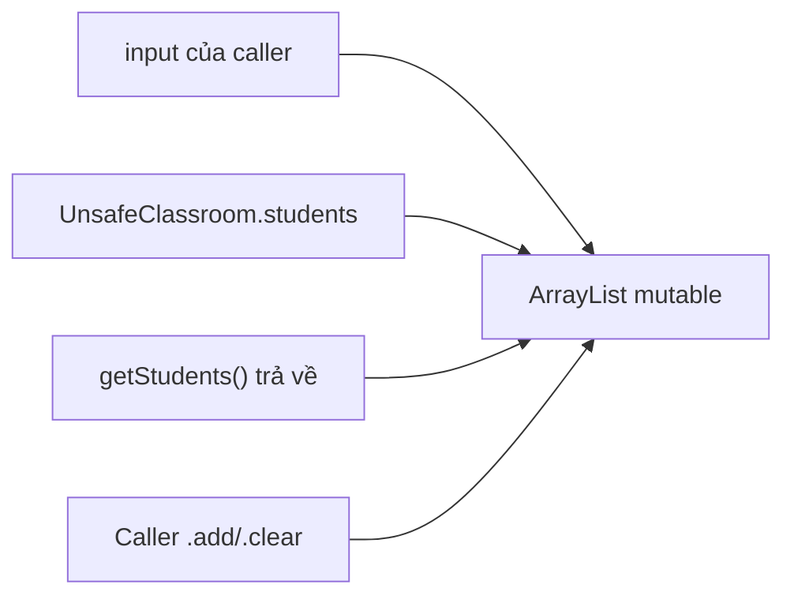

# Preventing exposure of mutable internal data in Java

In object-oriented programming, **encapsulation** means an object controls how its own state is accessed and changed. A common mistake is declaring a field `private` but returning its mutable object directly or retaining an externally supplied mutable reference.

For example, a class enforcing “student enrollment must not exceed capacity” loses control if external code can call `getStudents().add(...)` without going through its validated enrollment method.

**Lesson goal:** recognize when a reference exposes internal state, and use defensive copies, immutable values, and controlled APIs to protect object invariants.

## 1. Why can `private` still be unsafe?

Consider this class:

```java
import java.util.List;

class UnsafeClassroom {
    private final List<String> students;

    UnsafeClassroom(List<String> students) {
        this.students = students;
    }

    List<String> getStudents() {
        return students;
    }
}
```

The `students` field is `private final`, but **the list object** is still mutable. There are two ways to change the underlying data without any setter:

```java
List<String> input = new java.util.ArrayList<>(List.of("An"));
UnsafeClassroom room = new UnsafeClassroom(input);

input.add("Bình");             // Đường 1: sửa qua tham chiếu gốc
room.getStudents().clear();    // Đường 2: sửa qua tham chiếu getter trả ra

System.out.println(input);     // []
System.out.println(room.getStudents()); // []
```

The same list is referenced by `input`, the `students` field, and the result of `getStudents()`. Assigning a reference does not copy the object.



Data leaks in both directions:

- **Inbound aliasing:** a constructor or setter stores the caller's reference unchanged; the caller retains it and can modify the data later.
- **Outbound aliasing:** a getter or another method returns an internal reference directly, letting the caller modify the object through the result.

This can do more than violate business rules. When several components retain the same reference, unexpected changes can cause bugs that are difficult to reproduce.

## 2. A safe design: mutate through behavior, read through snapshots

The following class allows **controlled changes to the student list** through `enroll()`, while retaining control of every internal change. The constructor copies its input; the getter returns **a structurally unmodifiable snapshot**.

Save all the following code in **`Main.java`** and run it with Java 17 or Java 21:

```java
import java.util.ArrayList;
import java.util.Arrays;
import java.util.HashSet;
import java.util.List;
import java.util.Objects;
import java.util.Set;

final class EnrollmentBook {
    private final int capacity;
    private final List<String> students;

    EnrollmentBook(int capacity, List<String> initialStudents) {
        if (capacity <= 0) {
            throw new IllegalArgumentException("Sức chứa phải dương");
        }
        Objects.requireNonNull(initialStudents, "initialStudents");

        // 1. Sao chép tham chiếu list của caller.
        List<String> copied = new ArrayList<>(initialStudents);
        if (copied.size() > capacity) {
            throw new IllegalArgumentException("Vượt sức chứa");
        }

        // 2. Kiểm tra dữ liệu trước khi công bố đối tượng.
        Set<String> unique = new HashSet<>();
        for (String student : copied) {
            validateName(student);
            if (!unique.add(student)) {
                throw new IllegalArgumentException("Học viên trùng");
            }
        }

        this.capacity = capacity;
        this.students = copied;
    }

    void enroll(String student) {
        validateName(student);
        if (students.size() >= capacity) {
            throw new IllegalStateException("Lớp đã đủ chỗ");
        }
        if (students.contains(student)) {
            throw new IllegalArgumentException("Học viên đã tồn tại");
        }
        students.add(student);
    }

    List<String> getStudents() {
        return List.copyOf(students);
    }

    int size() {
        return students.size();
    }

    private static void validateName(String student) {
        if (student == null || student.isBlank()) {
            throw new IllegalArgumentException("Tên học viên không hợp lệ");
        }
    }
}

final class Attachment {
    private final byte[] data;

    Attachment(byte[] original) {
        this.data = Objects.requireNonNull(original, "original").clone();
    }

    byte[] getData() {
        return data.clone();
    }
}

public class Main {
    public static void main(String[] args) {
        List<String> input = new ArrayList<>(List.of("An"));
        EnrollmentBook book = new EnrollmentBook(3, input);

        input.add("Bình"); // Chỉ thay đổi input của caller
        System.out.println(book.getStudents()); // [An]

        List<String> firstSnapshot = book.getStudents();
        try {
            firstSnapshot.add("Cường");
        } catch (UnsupportedOperationException ex) {
            System.out.println("Không thể sửa snapshot");
        }

        book.enroll("Bình"); // Thay đổi qua API kiểm soát
        System.out.println(firstSnapshot);      // [An]
        System.out.println(book.getStudents()); // [An, Bình]
        System.out.println(book.size());        // 2

        byte[] original = {1, 2, 3};
        Attachment attachment = new Attachment(original);
        original[0] = 9; // Không sửa dữ liệu đã lưu
        byte[] exposed = attachment.getData();
        exposed[1] = 8;  // Không sửa dữ liệu đã lưu
        System.out.println(Arrays.toString(attachment.getData()));
    }
}
```

Run:

```bash
javac Main.java
java Main
```

Output:

```text
[An]
Không thể sửa snapshot
[An]
[An, Bình]
2
[1, 2, 3]
```

Important points about the example:

- `new ArrayList<>(initialStudents)` separates **the internal list** from the list still held by the caller.
- `List.copyOf(students)` returns a list whose structure cannot be modified and whose contents reflect the moment of the call. When `book.enroll(...)` runs, the old snapshot `firstSnapshot` still contains `[An]`.
- The students in the example are represented by immutable `String` values, so there is no additional way to modify state through individual elements.
- `Attachment` must `clone()` the array **both on input and on output**, because `byte[]` is always mutable.
- The `EnrollmentBook` class **is still mutable**: what is protected is the right to change state through a controlled API, rather than a ban on all changes.

## 3. Defensive copies at input and output boundaries

A **defensive copy** duplicates data at a trust boundary so other code cannot change state the object needs to own independently.

| Boundary | Code that can leak data | Typical protection |
| --- | --- | --- |
| Constructor accepts a list | `this.items = items;` | `this.items = List.copyOf(items);` or `new ArrayList<>(items)` |
| Setter accepts a list | `this.items = items;` | Validate and copy before storing |
| Getter returns a mutable list | `return items;` | `return List.copyOf(items);` or `new ArrayList<>(items)` |
| Constructor accepts an array | `this.bytes = bytes;` | `this.bytes = bytes.clone();` |
| Getter returns an array | `return bytes;` | `return bytes.clone();` |
| Getter returns mutable `Date` | `return createdAt;` | Return a copy via `new Date(createdAt.getTime())` or use `Instant` by design |
| Returns an internal `Map` | `return scores;` | `Map.copyOf(scores)` if the contained data is safe |
| Returns a nested mutable object | `return settings;` | An appropriate deep copy or immutable value object |

**`List.copyOf` is not the answer in every situation.** If the class needs to modify its internal collection, it can store `new ArrayList<>(input)` and make copies when returning data. If the internal collection should itself be immutable, it can store `List.copyOf(input)`. The choice depends on the behavior the class must support.

`List.copyOf`, `Set.copyOf`, and `Map.copyOf` reject `null` elements or keys/values as specified by their contracts. When `null` is valid data, choose another appropriate structure and copying strategy with a clear API contract.

## 4. An unmodifiable view is not a snapshot

Java offers several ways to return read-only data, but these two approaches have different semantics:

```java
import java.util.ArrayList;
import java.util.Collections;
import java.util.List;

List<String> backing = new ArrayList<>(List.of("A"));

List<String> view = Collections.unmodifiableList(backing);
List<String> snapshot = List.copyOf(backing);

backing.add("B");

System.out.println(view);     // [A, B]
System.out.println(snapshot); // [A]
```

| Mechanism | Can callers invoke `add/remove` through the result? | Do structural changes to the source list become visible? |
| --- | --- | --- |
| `return internalList;` | Yes, if the list is mutable | Yes; callers can also modify it directly |
| `Collections.unmodifiableList(internalList)` | No | **Yes**: it is a view backed by the original list |
| `List.copyOf(internalList)` | No | **No**: it preserves a snapshot of the contents at copy time |
| `new ArrayList<>(internalList)` | Yes, on the independent copy | **No**: modifying the copy does not affect the original list |

`Collections.unmodifiableList` is useful when the intent is to let clients **observe changing state** without modifying it through the view. However, if the requirement is “the data returned must remain stable after the call,” a snapshot is needed.

A few considerations:

- `List.copyOf` may reuse a list that is already unmodifiable, so do not assume it always creates **a new list instance**.
- Neither an unmodifiable view nor a snapshot **automatically makes mutable elements immutable**.
- `new ArrayList<>(...)` creates a structurally independent list, but the caller **is allowed to modify the copy**. This is a valid API contract when the recipient needs to work with its own data.

## 5. A list snapshot can still expose its elements

When elements are mutable, `List.copyOf` and `new ArrayList<>(...)` only copy **the structure or references**, not the state of each element:

```java
class MutableLesson {
    String title;
    MutableLesson(String title) { this.title = title; }
}

MutableLesson lesson = new MutableLesson("OOP");
java.util.List<MutableLesson> snapshot =
        java.util.List.copyOf(java.util.List.of(lesson));
lesson.title = "Đã đổi";
System.out.println(snapshot.get(0).title); // Đã đổi
```

Therefore, inspect **permissions to modify elements**, not only the container's `add/remove` operations. If a stable history or snapshot is required, convert each element into an immutable value object (such as `record Lesson(String title)` with constructor validation) or copy the mutable components that need protection. Deep copying across an object graph and immutable representations are covered in the next lesson.

## 6. Encapsulated API design: expose only necessary behavior

Instead of exposing a mutable `List<OrderLine>` that lets callers increase quantities arbitrarily, a shopping-cart class should provide operations such as:

```java
void addItem(String sku, int quantity);
void changeQuantity(String sku, int newQuantity);
void removeItem(String sku);
List<ItemView> getItems();  // ItemView là value object bất biến
```

Within each method, the class validates rules such as `quantity > 0`, unique product codes, and order limits. Getters return only data needed for display without granting callers the ability to violate business rules.

A getter does not always need to make a complete, large copy. An API may return:

- Primitive or immutable values (`int`, `String`, `LocalDate`).
- An immutable snapshot whose elements are also immutable.
- Computed results or DTOs containing only necessary data.
- A read-only view **when changes over time are intentionally acceptable**.
- An iterator or data stream with a clear contract for mutability and lifecycle.

Do not expose a `public final List<...>` field merely because it cannot be reassigned. The list itself may still allow elements to be added, removed, or modified.

## 7. Recognizing leaks by data type

| Data type | Common leak path | Observation/protection strategy |
| --- | --- | --- |
| `byte[]`, `int[]` | Constructor retains an array; getter returns it directly | `clone()` in both directions (primitive elements) |
| `MutableItem[]` | Array is cloned but elements remain shared | Inspect the state of each element too |
| `java.util.Date` | Caller invokes `setTime()` on a shared reference | Copy with `new Date(date.getTime())` or use `Instant` |
| `List<T>` | Getter returns an `ArrayList`; constructor retains the input list | Snapshot/copy with a suitable element policy |
| `Map<K,V>`, `Set<T>` | Exposes internal structures or shares mutable keys/values | `copyOf` protects only structure; nested objects still matter |

For example, `Collections.unmodifiableMap(internal)` is only a view and continues to reflect updates to the internal map. In contrast, `Map.copyOf(internal)` creates a structural snapshot under its contract but does not deep-copy keys/values. In particular, avoid changing fields involved in a key's `equals/hashCode` implementation in a `HashMap`, since lookups can break.

For legacy APIs that require `Date` or arrays, copying at boundaries is often necessary. For newer models, `Instant`, immutable value objects, and narrow query APIs usually make data ownership easier to understand.

## 8. Limits of defensive copying and common pitfalls

| Misconception | Consequence | Correct approach |
| --- | --- | --- |
| A `private` field cannot be modified externally | Mutable references can still be retained or returned | Inspect every inbound and outbound reference path |
| `final` makes data immutable | Only prevents reassignment of the variable/field | Protect the referenced object itself |
| `Collections.unmodifiableList()` creates a snapshot | Changes to the backing list remain visible | Use `List.copyOf()` when stable contents are required |
| `List.copyOf()` also copies elements | Mutable elements can still be modified | Use immutable elements or deep copies |
| Copying only in a getter | The caller can still mutate through a constructor input reference | Defend both input and output boundaries |
| Copying only in the constructor | The getter may still expose the internal mutable array/list | Do not return mutable references directly |
| Modifying a returned copy to update the object | Changes do not affect the actual state | Update through business methods |
| Calling `clone()` everywhere | Copies may be shallow or unsupported | Choose copying strategies based on the data type |
| Copying a collection while another thread modifies it | The snapshot may fail or be inconsistent | Coordinate synchronization before taking the snapshot |
| Creating a huge copy on every read | More CPU, memory, and GC pressure | Consider immutable models, views with explicit contracts, or narrow query APIs |

**Defensive copying does not make a class thread-safe by itself.** If one thread updates an `ArrayList` while another calls `List.copyOf`, race conditions, inconsistent data, or exceptions can still occur. Shared mutable state requires synchronization or appropriate data structures; snapshots must be taken under a mechanism that protects a consistent state.

A similar problem occurs when a caller modifies a collection while the constructor is copying it. If the input is shared between threads, caller and receiver must agree on synchronization and ownership rather than expecting `new ArrayList<>(input)` to resolve races automatically.

## 9. Performance costs and design decisions

Copying a list of `n` elements typically takes **O(n)** time and memory for the copied list structure. If a snapshot getter is called thousands of times on a very large collection, the cost can be significant. But abandoning defensive protection solely to reduce allocations may violate invariants and create difficult bugs.

Possible approaches:

- Capture a snapshot once at a request or transaction boundary rather than on every small read operation.
- Return the **minimum data** actually needed, such as `size()`, `containsStudent(id)`, or a precomputed DTO.
- Use immutable data models, cached snapshots updated when state changes, or persistent collections when application requirements justify them.
- Keep mutable state inside the class and use business operations for changes instead of handing the collection directly to every caller.

State protection should be **an intentional design contract**: what may the caller observe, can it retain the result, can it modify the returned data, and will older results reflect subsequent internal changes?

## 10. Testing internal-state leaks

Both directions of data leakage can be tested directly for a class such as `EnrollmentBook`:

```java
List<String> input = new ArrayList<>(List.of("An"));
EnrollmentBook book = new EnrollmentBook(2, input);

// Thử thay đổi dữ liệu caller đã đưa vào.
input.add("Bình");
if (book.size() != 1) {
    throw new AssertionError("Constructor làm lộ trạng thái");
}

// Thử thay đổi dữ liệu do getter trả về.
List<String> snapshot = book.getStudents();
try {
    snapshot.add("Cường");
    throw new AssertionError("Getter cho phép sửa snapshot");
} catch (UnsupportedOperationException expected) {
    // Đúng hợp đồng: kết quả không cho sửa cấu trúc.
}

// Thay đổi qua API chính thức không làm đổi snapshot cũ.
book.enroll("Bình");
if (!snapshot.equals(List.of("An"))) {
    throw new AssertionError("Snapshot cũ bị thay đổi");
}
```

This test code belongs inside a method such as `main`, after `EnrollmentBook` has been declared. When a field contains mutable elements, testing must go one step further: modify an **element's** fields through an external reference and verify that internal state remains protected.

## 11. Self-check questions

**1.** Does `private final List<String> students;` followed by `return students;` guarantee encapsulation?

**Answer:** No, if the list is mutable. Callers can invoke `add/remove/clear` directly through the returned reference.

**2.** A constructor uses `this.students = List.copyOf(input)` but the getter returns `students`. Is that safe?

**Answer:** It may be safe if the elements are also immutable (like `String`) and the class retains a structurally unmodifiable list. However, inspect the element objects before concluding that the class is deeply immutable.

**3.** Does `Collections.unmodifiableList(internal)` prevent someone holding `internal` from modifying it?

**Answer:** No. It only prevents mutation **through the view**; updates to the backing list remain visible in that view.

**4.** Is `byte[] getBytes() { return bytes.clone(); }` sufficient if the constructor assigns `this.bytes = input;`?

**Answer:** No. The caller still holds `input` and can modify the internal array. Copy the data on input as well.

**5.** Can a `List<MutableLesson>` copied with `List.copyOf` still have an element's title changed?

**Answer:** Yes, if outside code still holds a reference to that same `MutableLesson`. Immutable elements or a deep copy are required by the contract.

**6.** If a class must support student updates, does it have to become immutable?

**Answer:** No. The class can be mutable with encapsulated state: use `enroll/remove` to enforce rules, and return only snapshots or safe read results.

**Remember:** `private` hides a field name but **does not hide the mutable object** it references. Prevent internal data leaks by controlling references at **both input and output boundaries**, accounting for nested element state, and exposing business behavior instead of distributing mutable data structures directly.
