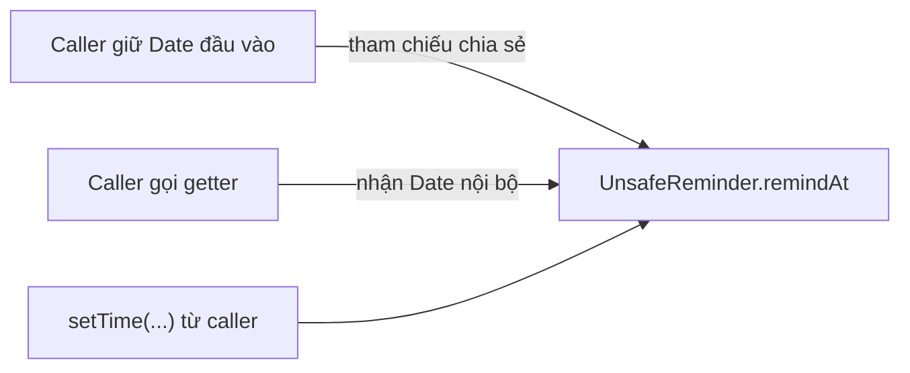
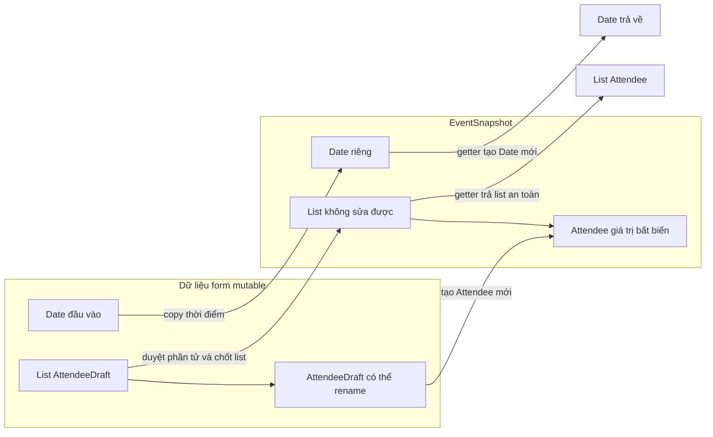

# Defensive copying and immutable representations in Java

In OOP, **encapsulation** does not stop at declaring fields `private`. If an object retains a reference to *mutable* data owned elsewhere, or exposes an internal mutable reference through a getter, external code can still violate the object's state without calling a setter.

**Defensive copying** creates copies at input/output boundaries to prevent unintended changes. An **immutable representation** stores and exposes state so that, after construction, the object's observable state remains unchanged.

The two techniques are related but distinct:

- Defensive copying controls **reference sharing** for mutable data.
- Immutable representation controls **the ability to change state**; it commonly uses immutable types, primitive values, and collection snapshots containing immutable elements.
- Some cases require a copy on **both** input and output; protecting only one direction is insufficient.
- An object with a `private final` field can still have changing observable state if that field references a mutable object.

This lesson uses Java 11+ (for `String.isBlank()` and `List.copyOf()`). The practical example captures a fixed event schedule even while the input form continues to edit the attendee list.

## 1. Why doesn't `private final` guarantee immutability?

The following example has two paths for reference “leaks”:

```java
import java.util.Date;

public final class UnsafeReminder {
    private final Date remindAt;

    public UnsafeReminder(Date remindAt) {
        this.remindAt = remindAt; // Giữ đúng đối tượng Date bên ngoài truyền vào
    }

    public Date getRemindAt() {
        return remindAt; // Trả đúng Date nội bộ ra ngoài
    }
}
```

Usage:

```java
Date supplied = new Date(1_000L);
UnsafeReminder reminder = new UnsafeReminder(supplied);

supplied.setTime(2_000L); // Sửa qua tham chiếu mà constructor nhận
System.out.println(reminder.getRemindAt().getTime()); // 2000

reminder.getRemindAt().setTime(3_000L); // Sửa qua tham chiếu getter làm lộ
System.out.println(reminder.getRemindAt().getTime()); // 3000
```

There is no `setRemindAt` method and the field is `private final`, yet the reminder time still changes. `final` only prevents reassigning the `remindAt` variable to another reference; it **does not freeze the referenced `Date` object**.

There are two paths to control:



With mutable objects, encapsulation can be broken even when the field is not directly visible.

## 2. Defensive copies in both constructor and getter

Instead of sharing the same `Date`, the class copies it when accepting input and when returning a result:

```java
import java.util.Date;
import java.util.Objects;

public final class SafeReminder {
    private final Date remindAt;

    public SafeReminder(Date remindAt) {
        Objects.requireNonNull(remindAt, "remindAt");
        this.remindAt = new Date(remindAt.getTime());
    }

    public Date getRemindAt() {
        return new Date(remindAt.getTime());
    }
}
```

Verification:

```java
Date source = new Date(1_000L);
SafeReminder reminder = new SafeReminder(source);

source.setTime(2_000L);
Date returned = reminder.getRemindAt();
returned.setTime(3_000L);

System.out.println(reminder.getRemindAt().getTime()); // 1000
```

| Boundary | Approach | Bug prevented |
| --- | --- | --- |
| **Input** | `new Date(remindAt.getTime())` | Caller modifies `source` after passing it in |
| **Output** | `return new Date(remindAt.getTime())` | Caller modifies the `Date` obtained from the getter |
| Internal state | `private final Date remindAt`; no self-mutating operation exposed | External code cannot change the captured time |

This class is **immutable in its observable behavior** if the class itself never modifies `remindAt`: every getter call reports the same instant. However, its internal representation still contains a mutable `Date`. The next section presents a simpler representation.

### Prefer truly immutable representations over repeated copying

If the goal is only to store a point in time, Java provides the immutable `Instant` type (`java.time`):

```java
import java.time.Instant;
import java.util.Objects;

public final class Reminder {
    private final Instant remindAt;

    public Reminder(Instant remindAt) {
        this.remindAt = Objects.requireNonNull(remindAt, "remindAt");
    }

    public Instant getRemindAt() {
        return remindAt; // Chia sẻ kiểu bất biến là an toàn
    }

    public Reminder reschedule(Instant newTime) {
        return new Reminder(newTime); // Trả instance mới
    }
}
```

Calling `remindAt.plusSeconds(60)` returns a new `Instant`; the previous `Instant` object is not modified. Therefore, there is no need to copy each `Instant` returned by a getter. Another option is to store `private final long epochMillis` and convert at the API boundary; a primitive `long` cannot reference mutable state.

**Principle:** prefer a suitable immutable type when available. Defensive copying remains useful when working with APIs that expose mutable types such as `Date`, arrays, or collections with mutable elements.

## 3. Shallow copies versus deep copies

Consider a list containing mutable objects:

```java
import java.util.ArrayList;
import java.util.List;

class GuestDraft {
    String name;

    GuestDraft(String name) {
        this.name = name;
    }
}

List<GuestDraft> input = new ArrayList<>();
input.add(new GuestDraft("An"));

List<GuestDraft> copy = new ArrayList<>(input);

System.out.println(input == copy);            // false
System.out.println(input.get(0) == copy.get(0)); // true

copy.get(0).name = "Bình";
System.out.println(input.get(0).name);        // Bình
```

`new ArrayList<>(input)` creates a new list but only **copies the element references**. The lists thus have separate structures but still share the first `GuestDraft` element.

| Technique | Is the container independent? | Are mutable elements independent? |
| --- | --- | --- |
| `List<T> b = a` | No | No |
| `new ArrayList<>(a)` | Yes | No |
| `List.copyOf(a)` | Semantically a structurally independent, unmodifiable snapshot | No, if elements are mutable |
| Create a new list and copy every mutable element | Yes | Yes, for elements copied correctly |
| Create a new list containing inherently immutable values | Yes | Safe to share the immutable values |

“Deep copy” does not mean Java automatically clones every reachable object. You must **identify which parts of the object graph the class owns**, which parts are mutable, and which must be separated from the caller. With cycles, shared references, external resources, or identity-bearing entities, a general deep copy can be both difficult and semantically wrong.

For example, a “deep” copy of a `BankAccount` might create two instances representing the same real account, misleadingly implying that independent balances are valid. To preserve account information at a point in time, create a **value snapshot** (account number, observed balance, timestamp) rather than duplicating the business entity.

## 4. Complete example: an event schedule with an immutable snapshot

Requirement: an event-registration form uses a mutable `Date` and a list of `AttendeeDraft` objects whose names can change. After confirmation, create an `EventSnapshot` that retains **the event time and attendees as they were at confirmation**. Subsequent changes to the form must not alter the snapshot.

Design requirements:

1. The captured event time never changes.
2. Attendees cannot be added to or removed from the list through the snapshot API.
3. Every attendee in the snapshot must also be immutable, not just the list.
4. Invalid data is rejected during construction; no partially built list remains exposed to future caller modifications.
5. The snapshot can be read without requiring callers to copy more objects.

### File `EventSnapshot.java`

```java
import java.util.ArrayList;
import java.util.Date;
import java.util.List;
import java.util.Objects;

public final class EventSnapshot {
    private final Date startsAt;
    private final List<Attendee> attendees;

    public EventSnapshot(Date startsAt, List<AttendeeDraft> drafts) {
        Objects.requireNonNull(startsAt, "startsAt");
        Objects.requireNonNull(drafts, "drafts");

        // Sao chép Date của caller trước khi giữ lại.
        Date startCopy = new Date(startsAt.getTime());

        // Sao chép *từng phần tử mutable* thành giá trị bất biến.
        List<Attendee> values = new ArrayList<>();
        for (AttendeeDraft draft : drafts) {
            Objects.requireNonNull(draft, "draft");
            values.add(new Attendee(draft.getId(), draft.getName()));
        }

        this.startsAt = startCopy;
        this.attendees = List.copyOf(values);
    }

    public Date getStartsAt() {
        return new Date(startsAt.getTime());
    }

    public List<Attendee> getAttendees() {
        // An toàn vì list không sửa được và Attendee bất biến.
        return attendees;
    }

    // Giá trị bất biến bên trong snapshot.
    public static final class Attendee {
        private final String id;
        private final String name;

        private Attendee(String id, String name) {
            this.id = requireText(id, "id");
            this.name = requireText(name, "name");
        }

        public String getId() {
            return id;
        }

        public String getName() {
            return name;
        }
    }

    // Chỉ dùng làm dữ liệu nhập, cố ý cho phép đổi tên.
    public static final class AttendeeDraft {
        private final String id;
        private String name;

        public AttendeeDraft(String id, String name) {
            this.id = requireText(id, "id");
            this.name = requireText(name, "name");
        }

        public String getId() {
            return id;
        }

        public String getName() {
            return name;
        }

        public void rename(String newName) {
            name = requireText(newName, "name");
        }
    }

    private static String requireText(String value, String field) {
        Objects.requireNonNull(value, field);
        String text = value.strip();
        if (text.isBlank()) {
            throw new IllegalArgumentException(field + " không được trống");
        }
        return text;
    }
}
```

Inspecting the structure:

- `EventSnapshot` is `final` and exposes no setters; both fields are `private final`.
- `Date` is copied in the constructor **and** getter. If only the constructor copied it but the getter returned the field, callers could still modify it; if only the getter copied it, the original input could still affect the snapshot.
- `List.copyOf(values)` creates an unmodifiable structural snapshot, while each contained `Attendee` has an immutable `String` and `final` fields.
- `AttendeeDraft` is a mutable object used during data entry. The constructor creates **a new `Attendee` for each draft** without retaining references to `AttendeeDraft`.
- `requireText` validates data during construction. External code has no way to modify the captured `id` or `name` in an `Attendee`.
- The main class does not directly expose a mutable `ArrayList`. Returning an immutable list of immutable elements is safe because callers cannot modify snapshot state through that path.

### File `Demo.java`

```java
import java.util.ArrayList;
import java.util.Date;
import java.util.List;

public class Demo {
    public static void main(String[] args) {
        Date dateFromForm = new Date(1_000L);
        EventSnapshot.AttendeeDraft an =
                new EventSnapshot.AttendeeDraft("U01", "An");

        List<EventSnapshot.AttendeeDraft> formAttendees =
                new ArrayList<>();
        formAttendees.add(an);

        EventSnapshot snapshot =
                new EventSnapshot(dateFromForm, formAttendees);

        // Form được sửa sau lúc xác nhận.
        dateFromForm.setTime(2_000L);
        an.rename("Bình");
        formAttendees.add(
                new EventSnapshot.AttendeeDraft("U02", "Chi"));

        // Caller thử sửa Date lấy từ getter.
        snapshot.getStartsAt().setTime(3_000L);

        System.out.println(snapshot.getStartsAt().getTime());
        System.out.println(snapshot.getAttendees().size());
        System.out.println(snapshot.getAttendees().get(0).getName());

        try {
            snapshot.getAttendees().clear();
        } catch (UnsupportedOperationException expected) {
            System.out.println("Không cho sửa danh sách snapshot");
        }
    }
}
```

Compile/run with JDK 11+:

```bash
javac EventSnapshot.java Demo.java
java Demo
```

Output:

```text
1000
1
An
Không cho sửa danh sách snapshot
```

The three data types behave differently:

| Data | After editing the form | Returned snapshot |
| --- | --- | --- |
| `dateFromForm` | 2000 | `getStartsAt().getTime() == 1000` |
| `an.name` | Bình | `getAttendees().get(0).getName()` is An |
| `formAttendees.size()` | 2 | `getAttendees().size()` is 1 |
| `Date` returned by getter | Caller changes it to 3000 | Next getter call still returns 1000 |
| List returned by getter | `clear()` throws an exception | Snapshot data remains unchanged |

### Data flow



The diagram illustrates data ownership; it does not represent memory addresses or the internal structure of collection classes.

## 5. How do `Collections.unmodifiableList` and `List.copyOf` differ?

Both APIs can prevent callers from modifying a list through the received reference, but **they do not protect against the same kinds of changes**.

```java
import java.util.ArrayList;
import java.util.Collections;
import java.util.List;

List<String> source = new ArrayList<>();
source.add("A");

List<String> view = Collections.unmodifiableList(source);
List<String> snapshot = List.copyOf(source);

source.add("B");

System.out.println(view);     // [A, B]
System.out.println(snapshot); // [A]
```

- `Collections.unmodifiableList(source)` creates **a view that cannot be modified through that view**, but still reflects changes made to `source`.
- `List.copyOf(source)` provides **structural snapshot semantics** at call time (it may reuse an existing unmodifiable instance). Subsequent additions/removals to the source list do not alter the result.
- **Neither automatically deep-copies mutable elements.** If the list contains `AttendeeDraft` objects, calling `rename()` on a shared element can still change data observed through the list.
- `List.copyOf` rejects `null` elements. When `null` must be retained, choose a different representation or validation policy deliberately.

For immutable `List<String>` or `List<Attendee>` data such as the example above, `List.copyOf` is a concise, safe way to expose a snapshot. With `List<MutableItem>`, elements require additional protection.

### Alternative: getters returning copies of mutable lists

If the element type cannot be replaced, you may need to copy every element on both input and output:

```java
import java.util.ArrayList;
import java.util.List;

static List<java.util.Date> copyDates(List<java.util.Date> input) {
    List<java.util.Date> result = new ArrayList<>();
    for (java.util.Date date : input) {
        result.add(new java.util.Date(date.getTime()));
    }
    return result;
}
```

When storing `private final List<Date> dates = copyDates(input)`, the getter should return `copyDates(dates)` to avoid exposing individual mutable `Date` objects. However, this design requires repeated copying and makes it easy to overlook a boundary. Switching to `List<Instant>` is simpler and makes immutability easier to maintain.

## 6. Arrays, maps, sets, and nested data

### Array

An array allows changes to individual elements or positions:

```java
public final class TagSet {
    private final String[] tags;

    public TagSet(String[] tags) {
        this.tags = tags.clone(); // Copy khi nhận
    }

    public String[] getTags() {
        return tags.clone();      // Copy khi trả
    }
}
```

With `String[]`, cloning is sufficient for this purpose because each `String` is immutable. With `Date[]`, cloning only copies **element references**, so each `Date` must also be copied if complete independence is needed. The same applies to multidimensional arrays: `matrix.clone()` creates only a new outer array.

In production classes, validate `null` and each element's invariants within the constructor; the `TagSet` example focuses on cloning behavior to make it easy to observe.

### Maps and sets

`Map.copyOf(map)` and `Set.copyOf(set)` create unmodifiable containers structurally detached from later changes to their inputs; they **do not automatically deep-copy** mutable keys, values, or elements. With `HashMap`, do not use an object as a key and then change fields involved in `equals`/`hashCode`: lookups may stop working correctly because the bucket was chosen using the old hash.

### Object graph

If an `Order` holds a `List<OrderLine>` and each `OrderLine` holds a `Product` whose price can change, copying only the `Order` and `List` does not ensure that the captured total remains fixed.

For a fixed report, store:

```java
final class OrderLineSnapshot {
    final String productCode;
    final long unitPriceVnd;
    final int quantity;

    OrderLineSnapshot(String productCode, long unitPriceVnd,
                      int quantity) {
        this.productCode = productCode;
        this.unitPriceVnd = unitPriceVnd;
        this.quantity = quantity;
    }
}
```

The fields here are primitive values or immutable `String` objects; no mutable `Product` object is retained. Production code needs additional price/quantity validation and numerical policies. The key idea is to **capture business values that must remain immutable**, rather than blindly copying the entire object graph.

## 7. Distinguishing “immutable” from “unmodifiable through one reference”

| Term | Meaning | Example |
| --- | --- | --- |
| **Mutable object** | An instance's state can change | `Date`, `ArrayList`, `StringBuilder` |
| **Immutable object** | Observable state remains unchanged after construction | `String`, `Instant`, a correctly designed snapshot |
| **Unmodifiable view** | The container cannot be modified through the view, but its source may change | `Collections.unmodifiableList(source)` |
| **Structural snapshot** | Captures a container's structure at a point in time | `List.copyOf(source)` |
| **Shallow copy** | Copies the outer container but retains element references | `new ArrayList<>(source)` |
| **Defensive copy** | Copies at boundaries to protect ownership and invariants | `new Date(input.getTime())` in a constructor/getter |
| **Deep copy of the necessary parts** | Also copies mutable internals that must be separated from external code | Convert each `AttendeeDraft` into a new `Attendee` |

A class is not automatically immutable because it is named `ImmutableSomething`, uses `final class`, declares every field `private final`, or returns an unmodifiable collection. To establish immutability, examine **every path through which a caller could modify data** and all nested mutable references.

Java 16+ provides `record` to simplify data-carrier types, but records also **do not deep-copy automatically**:

```java
// Java 16+
import java.util.List;

public record TeamSnapshot(List<String> members) {
    public TeamSnapshot {
        members = List.copyOf(members);
    }
}
```

Here the record captures the structure of a `List<String>` in its canonical constructor; its accessor returns an already unmodifiable list. Replacing `String` with a mutable object would require handling the elements and possibly customizing the constructor/accessor. `record` syntax reduces boilerplate; it does not replace data-ownership design.

## 8. Copy at the appropriate boundary

Not everything needs copying. Copies cost time and memory, especially for large object graphs or data an application **deliberately shares**. Choose according to the API contract.

| Situation | Reasonable choice |
| --- | --- |
| A field receives a mutable object that the class needs to own independently | Defensive copy in the appropriate constructor/setter |
| A getter must not expose an internal mutable object | Copy in the getter or return an immutable type |
| A list of immutable values needs a snapshot | `List.copyOf` or equivalent snapshot mechanism |
| A list with mutable elements needs an independent snapshot | Copy or convert each element into an immutable value |
| Multiple components *intentionally* share one business object | Define mutation rights, synchronization, and lifecycle; do not copy indiscriminately |
| Data is inherently immutable, such as `String` or `Instant` | Sharing references is generally safe |
| Large transactions or high-volume data | Consider copying cost and design value objects/snapshots for the necessary scope |

Distinguish **value snapshots** from **entity identity**. An immutable transaction record may store source/destination account numbers and the amount without cloning entire account objects. Copying an identity-bearing entity can create two independently changing states with the same ID, causing confusion.

## 9. Immutability and concurrency: benefits, but not a complete solution

Truly immutable objects are often easier to share between threads because their internal state cannot change after construction. Nevertheless:

- While **constructing a snapshot**, another thread modifying the `List` or individual `AttendeeDraft` objects may cause inconsistent copied data or iteration failures. Read under an appropriate lock, snapshot stable data, or coordinate access with the component that owns the data.
- If an application repeatedly replaces a `currentSnapshot` reference across threads, **publishing the new reference** still requires appropriate memory-visibility mechanisms such as `volatile`, locks, or corresponding concurrent structures. Immutable individual snapshots do not synchronize reference assignments by themselves.
- The immutability of one object does not replace database transactions when changes across several records must be atomic.

The `EventSnapshot` example assumes that another thread is not editing the form while the constructor copies it. The snapshot provides stable state **after** successful construction.

## 10. Common mistakes when assessing immutability

| Code or assumption | Risk | Remedy |
| --- | --- | --- |
| `this.date = inputDate;` | Caller can modify the internal object | Copy on input or switch to an immutable type |
| `return date;` where `date` is a `Date` | Getter exposes a mutable reference | Copy on output |
| `private final List<Item> items` | `final` does not prevent list or item mutation | Examine the mutability of both container and elements |
| `Collections.unmodifiableList(input)` | Changes to `input` remain visible through the view | Take a structural snapshot when needed |
| `List.copyOf(listOfMutableItems)` | Elements remain shared | Snapshot/copy each element |
| `array.clone()` on an array of nested objects | Copies only one array level | Copy the mutable layers that need isolation |
| Copying an entity while retaining its identity | Can create inconsistent states with duplicate IDs | Create a value snapshot instead of duplicating the entity |
| Getter returns an immutable type but constructor retains mutable data | Changes through the input reference still propagate | Defend both inbound and outbound boundaries |
| “The object is immutable, so constructing it from data being modified is safe” | May capture inconsistent state | Synchronize data reading/capture |

## 11. Applied exercises

**Exercise 1 — Fix a reference leak**

Given the class:

```java
public final class ExamSession {
    private final java.util.Date beginsAt;

    public ExamSession(java.util.Date beginsAt) {
        this.beginsAt = beginsAt;
    }

    public java.util.Date getBeginsAt() {
        return beginsAt;
    }
}
```

Rewrite its constructor and getter so the caller cannot modify `beginsAt` after construction, and reject `null`.

*Guide:* use `Objects.requireNonNull`; create `new Date(input.getTime())` at both boundaries.

**Exercise 2 — Choose the right copying depth**

Suppose you have `List<StringBuilder> notes`. You must return a snapshot that cannot be used to change the original object's note contents. Write a method that converts each `StringBuilder` into a `String` and returns `List.copyOf` of the result. Explain why `List.copyOf(notes)` alone does not satisfy the requirement.

**Exercise 3 — Understand the output**

```java
java.util.List<String> original =
        new java.util.ArrayList<>(java.util.List.of("A"));

java.util.List<String> view =
        java.util.Collections.unmodifiableList(original);
java.util.List<String> snapshot =
        java.util.List.copyOf(original);

original.add("B");

System.out.println(view);
System.out.println(snapshot);
```

**Answer:** `view` prints `[A, B]`, and `snapshot` prints `[A]`. Both may throw `UnsupportedOperationException` if a caller tries `add(...)` through them, but the view is not structurally detached from the source list.

**Exercise 4 — Design a system**

You have a mutable `Order`, and an issued invoice must remain unchanged when product prices are updated later. Identify which data should be captured in an `InvoiceSnapshot` (product code, name, price at sale time, quantity, line total, etc.), which data should be stored by reference identifier, and who is responsible for creating the snapshot from a consistent transactional state.

*Hint:* do not copy an entire mutable `Product` entity into an invoice and assume it will preserve the old price. Convert the necessary information into immutable values and finalize them within an appropriate business transaction.

### Self-check when designing a class

When a class needs to preserve stable state, ask:

1. Which state is **immutable by business rules**, and which needs controlled changes?
2. Does any field retain an external `Date`, array, collection, or mutable object?
3. Which references can callers still use to modify data **after passing it into the constructor**?
4. Does a getter return an internal mutable object directly?
5. Once a collection is snapshotted, are **its elements** truly immutable?
6. Could `Instant`, `String`, a custom value type, or a primitive replace a mutable structure?
7. Is a consistent concurrent copy and safe publication across threads needed?

**Core point:** defensive copying establishes data-ownership boundaries; immutable representations preserve an object's meaning over time. Used together at the right boundaries, they allow a Java class to maintain its invariants while providing an API that is easy to use and test.
