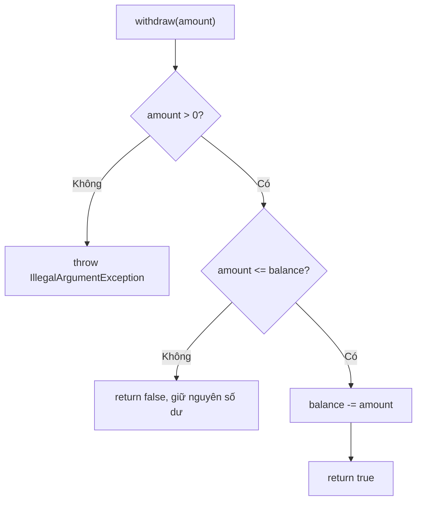
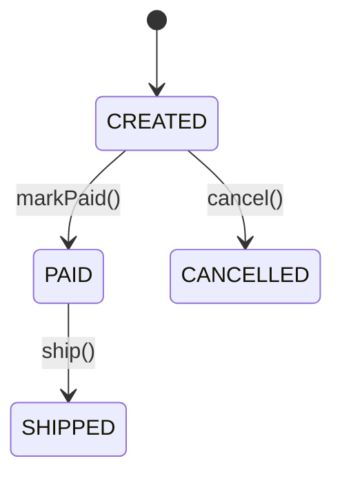

# Example: protecting account balances and order states in Java

**Topic:** OOP → Encapsulation → Example: protecting account balances and order states.

Two common object-design problems are **preventing negative account balances** and **preventing arbitrary order-state transitions**. Both require more than a `private` field: the object must validate before making changes, expose only meaningful operations, and ensure its state remains valid afterward.

## 1. The problem: external code can change state arbitrarily

Consider the initial design:

```java
class UnsafeAccount {
    public long balanceCents;
}

class UnsafeOrder {
    public String status;
}
```

Calling code can do this:

```java
UnsafeAccount account = new UnsafeAccount();
account.balanceCents = -50_000;       // Số dư âm

UnsafeOrder order = new UnsafeOrder();
order.status = "SHIPPED";             // Giao hàng dù chưa thanh toán
order.status = "SOMETHING_ELSE";      // Trạng thái không thuộc nghiệp vụ
```

These assignments are syntactically valid but violate object **invariants**:

| Object | Invariant to preserve | Example violation |
|---|---|---|
| Account | Nonnegative balance; operations use valid amounts | Withdraw more than the balance or deposit a negative amount |
| Order | State belongs to the permitted set; transitions occur in the correct sequence | Move directly from CREATED to SHIPPED |
| Both | Data changes only through validated behavior | External code assigns fields directly |

A good design lets clients **request actions** (`deposit`, `withdraw`, `markPaid`, `ship`), while objects **decide whether those actions are valid**.

## 2. Complete Java example: Account and Order

This example runs on **Java 17 or later** without external libraries. Save all the following code to `EncapsulationDemo.java`.

```java
import java.util.List;
import java.util.Objects;

public class EncapsulationDemo {

    // ---------- BẢO VỆ SỐ DƯ ----------
    public static final class Account {
        private final String accountNumber;
        private long balanceCents;

        public Account(String accountNumber, long initialCents) {
            if (accountNumber == null || accountNumber.isBlank()) {
                throw new IllegalArgumentException("Mã tài khoản không hợp lệ");
            }
            if (initialCents < 0) {
                throw new IllegalArgumentException("Số dư ban đầu không thể âm");
            }
            this.accountNumber = accountNumber;
            this.balanceCents = initialCents;
        }

        public String accountNumber() {
            return accountNumber;
        }

        public synchronized long balanceCents() {
            return balanceCents;
        }

        public synchronized void deposit(long amountCents) {
            requirePositive(amountCents);

            // Nếu cộng tràn long, Math.addExact ném ArithmeticException.
            // Phép gán chưa chạy nên số dư cũ không bị thay đổi.
            long nextBalance = Math.addExact(balanceCents, amountCents);
            balanceCents = nextBalance;
        }

        public synchronized boolean withdraw(long amountCents) {
            requirePositive(amountCents);

            if (amountCents > balanceCents) {
                return false; // Không đủ tiền: giữ nguyên số dư
            }

            balanceCents -= amountCents;
            return true;
        }

        private static void requirePositive(long amountCents) {
            if (amountCents <= 0) {
                throw new IllegalArgumentException("Số tiền phải lớn hơn 0");
            }
        }
    }

    // ---------- BẢO VỆ TRẠNG THÁI ĐƠN HÀNG ----------
    public enum OrderStatus {
        CREATED, PAID, SHIPPED, CANCELLED
    }

    // Record Java 16+: đối tượng dòng hàng chỉ có dữ liệu đọc được.
    public record OrderItem(String sku, int quantity) {
        public OrderItem {
            if (sku == null || sku.isBlank()) {
                throw new IllegalArgumentException("SKU không hợp lệ");
            }
            if (quantity <= 0) {
                throw new IllegalArgumentException("Số lượng phải dương");
            }
        }
    }

    public static final class Order {
        private final String orderId;
        private final List<OrderItem> items;
        private OrderStatus status;

        public Order(String orderId, List<OrderItem> items) {
            if (orderId == null || orderId.isBlank()) {
                throw new IllegalArgumentException("Mã đơn hàng không hợp lệ");
            }
            Objects.requireNonNull(items, "items");
            if (items.isEmpty()) {
                throw new IllegalArgumentException("Đơn hàng cần có sản phẩm");
            }

            this.orderId = orderId;
            this.items = List.copyOf(items);
            this.status = OrderStatus.CREATED;
        }

        public String orderId() {
            return orderId;
        }

        public List<OrderItem> items() {
            return items; // Danh sách không sửa được, item là record bất biến
        }

        public synchronized OrderStatus status() {
            return status;
        }

        // Chỉ gọi khi tầng nghiệp vụ đã xác thực thanh toán thành công.
        public synchronized void markPaid() {
            requireStatus(OrderStatus.CREATED, "thanh toán");
            status = OrderStatus.PAID;
        }

        public synchronized void ship() {
            requireStatus(OrderStatus.PAID, "giao hàng");
            status = OrderStatus.SHIPPED;
        }

        public synchronized void cancel() {
            requireStatus(OrderStatus.CREATED, "hủy");
            status = OrderStatus.CANCELLED;
        }

        private void requireStatus(OrderStatus expected, String action) {
            if (status != expected) {
                throw new IllegalStateException(
                    "Không thể " + action + " khi đơn ở trạng thái " + status
                );
            }
        }
    }

    public static void main(String[] args) {
        Account account = new Account("ACC-001", 100_000);
        account.deposit(50_000);

        System.out.println("Rút 25.000: " + account.withdraw(25_000));
        System.out.println("Số dư: " + account.balanceCents());
        System.out.println("Rút 200.000: " + account.withdraw(200_000));
        System.out.println("Số dư sau khi rút thất bại: " + account.balanceCents());

        try {
            account.deposit(-1);
        } catch (IllegalArgumentException ex) {
            System.out.println("Nạp tiền âm bị từ chối");
        }

        Order order = new Order(
            "ORD-001",
            List.of(new OrderItem("BOOK-JAVA", 2))
        );

        System.out.println("Trạng thái đầu: " + order.status());
        order.markPaid();
        order.ship();
        System.out.println("Trạng thái cuối: " + order.status());

        try {
            order.cancel();
        } catch (IllegalStateException ex) {
            System.out.println("Không thể hủy: " + order.status());
        }

        System.out.println("Số dòng hàng: " + order.items().size());
    }
}
```

Compile and run in the directory containing the file:

```bash
javac EncapsulationDemo.java
java EncapsulationDemo
```

Expected output:

```text
Rút 25.000: true
Số dư: 125000
Rút 200.000: false
Số dư sau khi rút thất bại: 125000
Nạp tiền âm bị từ chối
Trạng thái đầu: CREATED
Trạng thái cuối: SHIPPED
Không thể hủy: SHIPPED
Số dòng hàng: 1
```

The example simulates only **in-memory state**. The `markPaid()` operation marks a payment as having been verified externally; it **does not process a real payment** or verify a payment-gateway transaction itself.

## 3. Protecting balances through invariants and validated methods

The contract of `Account` is:

```text
Đối tượng hợp lệ: balanceCents >= 0
Tiền nạp/rút hợp lệ: amountCents > 0
```

Because the balance is `private`, the following code **does not compile** outside `Account`:

```java
Account account = new Account("ACC-002", 0);
// account.balanceCents = -10; // Lỗi: balanceCents has private access
```

External code can use only the permitted operations:

| Method | Input | Success | Rejection |
|---|---|---|---|
| `new Account(id, initial)` | Nonblank ID, nonnegative opening balance | Creates a valid object | `IllegalArgumentException` |
| `deposit(amount)` | Positive amount, addition does not overflow | Increases balance | `IllegalArgumentException` or `ArithmeticException` |
| `withdraw(amount)` | Positive amount | Sufficient funds: decreases balance, returns `true` | Insufficient funds: returns `false`, leaves balance unchanged |
| `balanceCents()` | None | Reads the current value | Grants no write access |

### Why must validation happen before assignment?

```java
public synchronized void deposit(long amountCents) {
    requirePositive(amountCents);
    long nextBalance = Math.addExact(balanceCents, amountCents);
    balanceCents = nextBalance;
}
```

This sequence provides a clear update point:

1. Reject nonpositive amounts.
2. Compute the new result using `Math.addExact`; if the sum overflows `long`, the exception occurs **before assignment**.
3. Update `balanceCents` only after all checks have succeeded.

In `withdraw`, the condition `amountCents > balanceCents` is checked before subtraction, so an excessive withdrawal cannot make the balance negative:



Returning `false` for insufficient funds is an API choice: it can be a normal business outcome. If the reason must be explicit, an enum result such as `SUCCESS` or `INSUFFICIENT_FUNDS` could replace `boolean`. Invalid input, such as a negative amount, is handled with an exception.

### Why use `long` and the smallest monetary unit?

Storing money as integer units (`balanceCents`) lets the example avoid the imprecise binary representation of many decimal values in `double`. Real systems must specify currencies, minor units, rounding, limits, and formatting; `BigDecimal` may be appropriate for the business rules. **Simply renaming `double balance` to `long balance` without currency rules is not enough.**

## 4. Protecting order state through valid transitions

An order has four states:

| State | Meaning |
|---|---|
| `CREATED` | Just created; payment not yet confirmed |
| `PAID` | Successful payment has been recorded |
| `SHIPPED` | The shipping step has been performed in this example |
| `CANCELLED` | Canceled before payment |

For this illustrative workflow, only these transitions are valid:



| Current state | Action | Next state | Result |
|---|---|---|---|
| `CREATED` | `markPaid()` | `PAID` | Valid |
| `CREATED` | `cancel()` | `CANCELLED` | Valid |
| `PAID` | `ship()` | `SHIPPED` | Valid |
| `CREATED` | `ship()` | Unchanged | `IllegalStateException` |
| `SHIPPED` | `cancel()` | Unchanged | `IllegalStateException` |
| `CANCELLED` | `markPaid()` | Unchanged | `IllegalStateException` |

The `enum` keyword restricts the set of states, preventing free-form string typos such as `"SHIPED"`. But **an enum is not enough**: exposing `setStatus(OrderStatus status)` would still let callers jump directly from `CREATED` to `SHIPPED`.

Instead, methods are named after actions:

```java
public synchronized void ship() {
    requireStatus(OrderStatus.PAID, "giao hàng");
    status = OrderStatus.SHIPPED;
}
```

Each operation reads the current state, checks it, and only then changes it. If an order is unpaid or canceled, the call is rejected without updating `status`.

Note: real systems may need refunds, returns, post-payment cancellations, or more shipping states. The diagram shows **rules defined for this example**, not a standard state list for every e-commerce application.

## 5. Preventing other access paths from breaking encapsulation

Encapsulation breaks if a getter returns an internal collection that can still be modified:

```java
class UnsafeOrder {
    private final List<String> items = new java.util.ArrayList<>();

    public List<String> items() {
        return items;
    }
}

UnsafeOrder order = new UnsafeOrder();
order.items().add(""); // Bên ngoài bỏ qua mọi validation
```

In the complete `Order` implementation, input data is copied:

```java
this.items = List.copyOf(items);
```

The `items()` result is safe to return because the list does not support mutating operations such as `add`, `clear`, or `set`. Also, `OrderItem` is a `record` with `String` and `int` components, so callers cannot mutate an element to bypass validation.

```java
List<OrderItem> source = new java.util.ArrayList<>();
source.add(new OrderItem("BOOK-JAVA", 2));

Order order = new Order("ORD-002", source);
source.clear();                    // Không xóa item đã lưu trong order
System.out.println(order.items().size()); // 1

// order.items().clear();         // Ném UnsupportedOperationException
```

**Important:** `List.copyOf` creates an unmodifiable list but provides only **shallow protection**. If elements have setters, external code may still modify an element through a shared reference. In that case, make elements immutable or defensively copy them too.

Likewise, a `private final List<T>` field does not automatically make the list contents immutable: `final` prevents reassigning the field reference, not invoking `add` or `remove` on the list.

## 6. Why do both classes use `synchronized`?

When multiple threads update an object, `private` prevents direct access **but does not eliminate race conditions**.

For example, consider a withdrawal method:

```java
if (balanceCents >= amount) {
    balanceCents -= amount;
}
```

If both threads read the old balance before either thread updates it, the result may not correspond to any valid transaction order. That is why the example uses `synchronized` methods for balance reads/writes and for order-state transitions:

```java
public synchronized boolean withdraw(long amountCents) { /* ... */ }
public synchronized long balanceCents() { /* ... */ }
public synchronized void markPaid() { /* ... */ }
```

For **the same instance**, `synchronized` ensures that only one thread at a time executes a synchronized method locking that instance. It also establishes the necessary memory-visibility relationship between lock and unlock operations. This keeps validation and state updates within those methods from overlapping on the same object.

Important limitations:

- `synchronized` on one object **does not synchronize two different instances**, even if both represent the same database account.
- Transferring money between **two accounts** or coordinating payment with **an order** requires an explicit transaction design; locking each instance is not enough to make a multi-object operation atomic.
- Multi-process or multi-server applications require storage-layer measures such as transactions, locking, optimistic versions, or suitable coordination mechanisms.
- `private/public` visibility controls access by **Java source code**, not user permissions. A withdrawal API still needs authentication and authorization at the service layer.

## 7. Handling failures: reject changes and preserve state

The example has two main categories of failure:

| Scenario | Failure signal | State afterward |
|---|---|---|
| Construct an account with a negative balance | `IllegalArgumentException` | No valid account is created |
| Deposit `0` or a negative amount | `IllegalArgumentException` | Previous balance |
| Deposit causes `long` overflow | `ArithmeticException` | Previous balance |
| Withdraw more than the balance | `false` | Previous balance |
| Ship an unpaid order | `IllegalStateException` | `CREATED` |
| Cancel a shipped order | `IllegalStateException` | `SHIPPED` |

“Leave state unchanged when an operation is rejected” makes behavior predictable and easy to test. In the two examples, validation precedes assignment, and no network/database effects are involved, so rejection is straightforward.

In a real application, however, an operation may update the database and call an external API. If part of those effects succeeds before a failure, transactions, idempotency, retries, or compensating actions may be needed. **A single Java method does not automatically roll back systems outside it.**

## 8. Testing the example with boundary cases

Besides checking the output from `main`, use the following table to try invalid cases deliberately:

| Test case | Operation | Expected result |
|---|---|---|
| Negative opening balance | `new Account("A", -1)` | Throws `IllegalArgumentException` |
| Deposit 0 | `deposit(0)` | Throws `IllegalArgumentException`; balance unchanged |
| Negative withdrawal | `withdraw(-1)` | Throws `IllegalArgumentException` |
| Withdraw exactly the balance | `withdraw(balance)` | Returns `true`; balance reaches 0 |
| Withdraw more than the balance | `withdraw(balance + 1)` without overflow | Returns `false`; balance unchanged |
| Overflowing deposit | Balance near `Long.MAX_VALUE`, then another deposit | Throws `ArithmeticException`; balance unchanged |
| Ship too early | `ship()` on a `CREATED` order | Throws `IllegalStateException` |
| Pay a canceled order | `markPaid()` on `CANCELLED` | Throws `IllegalStateException` |
| Modify the input item list | `source.clear()` after creating the order | Order still retains its items |
| Modify the returned item list | `order.items().clear()` | `UnsupportedOperationException` |

You can try a simple check directly in `main`:

```java
Account zero = new Account("ZERO", 5);
try {
    zero.withdraw(-10);
    throw new AssertionError("Phải từ chối tiền âm");
} catch (IllegalArgumentException expected) {
    if (zero.balanceCents() != 5) {
        throw new AssertionError("Số dư đã bị sửa khi thao tác thất bại");
    }
}
```

This check explicitly throws `AssertionError` in code, so it does not depend on the JVM's `-ea` option.

## 9. Exercises extending both scenarios

**Exercise 1 — Withdrawal limits.** Add `dailyWithdrawnCents` and `dailyLimitCents` to `Account`. On withdrawal, check both the balance and remaining limit; update the two fields only when all conditions are valid. Handle arithmetic when adding withdrawn amounts to prevent overflow. Write a test verifying that a rejected transaction **changes neither field**.

**Exercise 2 — Order workflow.** Add a `DELIVERED` state to the enum and a `confirmDelivery()` method, valid only from `SHIPPED`. Redraw the Mermaid diagram and call `confirmDelivery()` from `CREATED` to verify that the class rejects it.

**Exercise 3 — Cancellation after payment.** Suppose the business allows canceling `PAID` orders but requires a refund. Propose responsibilities for `Order`, the payment service, and database transactions to avoid canceling the order while refunding fails. Merely assigning `status = CANCELLED` does not mean all external effects have completed.

**Exercise 4 — API boundaries.** Explain which access paths are protected respectively by `private balanceCents`, `private status`, `List.copyOf(items)`, and the `withdraw/ship` methods. If `items` becomes a list of mutable elements, how must the design change?

---

**Conclusion:** For accounts, encapsulation **protects the balance invariant** through valid deposits and withdrawals. For orders, it **protects state transitions** through conditional operations. A `private` field prevents direct assignment, but correctness comes from **constructor validation, business-oriented methods, mutation after validation, and avoiding exposure of mutable data**.
