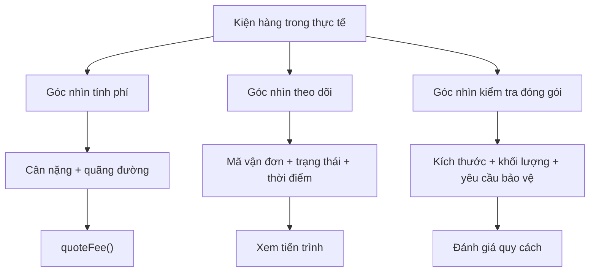
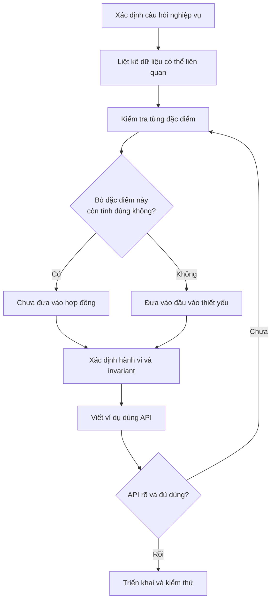

# Abstraction and Selecting Essential Characteristics in OOP (Java)

**Abstraction** is the process of identifying characteristics and behaviors **necessary for a particular purpose** while setting aside details that do not affect that purpose. In object-oriented programming, we use the resulting model to design classes, objects, interfaces, and interaction contracts.

The key point is that **no single list of "essential" characteristics is correct for every problem**. Information important to a delivery team may be entirely irrelevant to pricing or reporting.

## 1. From Real-World Objects to Software Models

Consider a **parcel** in an e-commerce system. In reality, a parcel may have dozens of attributes: tracking number, weight, dimensions, box color, pickup address, sender, recipient, carrier, status, scan history, photographs, and more.

If we are building a feature to **quote shipping fees based on weight and distance**, we may need only:

- `weightGrams`: weight in grams;
- `distanceKm`: distance in kilometers;
- the `quoteFee(...)` behavior: calculate and return an estimated fee.

Information such as box color, photographs, or the person holding the parcel **does not enter the fee calculation in this example**, so it need not appear in the pricing API.

For **shipment tracking**, however, the appropriate model differs: the tracking number, current status, and update time are essential, while weight may not be needed.

| Usage context | Essential characteristics | Behavior/question to answer | Details that can be omitted |
|---|---|---|---|
| Shipping fee estimation | Weight, distance, service policy | "What is the estimated fee?" | Box color, parcel photographs |
| Parcel tracking | Tracking number, status, update time | "Where is the parcel in the process?" | Rate calculation formula |
| Packaging inspection | Dimensions, weight, fragile-item requirements | "Does the package meet packaging specifications?" | Payment history |
| Customer support | Order ID, status, necessary contact information | "What problem is the customer experiencing?" | Internal route-optimization algorithm |

The "can be omitted" column **depends on the requirements under consideration**. If actual shipping fees include a surcharge for fragile items, the `fragile` attribute becomes an essential pricing input, and the model must change to reflect that business rule.

### Abstraction Does Not Mean Copying All of Reality

A `Shipment` class containing every piece of data that every department might use often becomes an oversized model. Instead, we can define **separate views or contracts for each need** and share data only when the design calls for it.



This diagram illustrates **analyzing requirements to choose a model**; it is not necessarily a Java class inheritance diagram.

## 2. What Questions Should Abstraction Answer?

When turning a problem-domain concept into a class or interface, answer these questions in order:

1. **What is the purpose?** What must the feature decide or calculate?
2. **What information is required for a correct result?** If this field is omitted, can the feature still work correctly?
3. **Which behaviors belong to the object's responsibilities?** For example, "quoting a fee" belongs to the pricing policy, not the UI color scheme.
4. **Which rules must always hold?** Weight must be positive, distance nonnegative, and status within the allowed set.
5. **Which details can change without API consumers needing to know?** Examples include price tables, surcharge calculations, and configuration sources.
6. **How many real use cases are currently required?** Do not preemptively create numerous class types for features that do not yet exist.

If you cannot describe **what consumers need to do with the model** clearly in a few sentences, it is usually too early to finalize its fields and methods.

## 3. Complete Java Example: Abstracting a Fee-Quotation Feature

To illustrate, we design an API that accepts only the data necessary to **estimate a shipping fee**. Two different pricing policies obey the same contract.

Illustrative rules, **not an actual carrier's rate schedule**:

- Base fee: 12.000 VND.
- Per kilometer: 1.000 VND.
- Per billable kilogram (rounding weight up to the next kilogram): 2.000 VND.
- Express delivery: a surcharge of 18.000 VND over the standard fee.

File `ShippingAbstractionDemo.java` (Java 17+):

```java
import java.util.Objects;

public class ShippingAbstractionDemo {

    // Dữ liệu tối thiểu mà phép báo phí trong ví dụ cần biết.
    record QuoteInput(int weightGrams, int distanceKm) {
        QuoteInput {
            if (weightGrams <= 0) {
                throw new IllegalArgumentException(
                    "Cân nặng phải lớn hơn 0 gram"
                );
            }
            if (distanceKm < 0) {
                throw new IllegalArgumentException(
                    "Quãng đường không được âm"
                );
            }
        }
    }

    // Hợp đồng: ai tính phí cũng phải trả về số tiền VND.
    interface ShippingPricing {
        long quoteFee(QuoteInput input);
    }

    static final class StandardPricing implements ShippingPricing {
        @Override
        public long quoteFee(QuoteInput input) {
            Objects.requireNonNull(input, "input");

            long chargedKg = ((long) input.weightGrams() + 999) / 1_000;
            return 12_000L
                + input.distanceKm() * 1_000L
                + chargedKg * 2_000L;
        }
    }

    static final class ExpressPricing implements ShippingPricing {
        private final ShippingPricing basePricing;

        ExpressPricing(ShippingPricing basePricing) {
            this.basePricing =
                Objects.requireNonNull(basePricing, "basePricing");
        }

        @Override
        public long quoteFee(QuoteInput input) {
            return Math.addExact(basePricing.quoteFee(input), 18_000L);
        }
    }

    static void printQuote(
            String serviceName,
            QuoteInput input,
            ShippingPricing pricing) {

        System.out.println(
            serviceName + ": " + pricing.quoteFee(input) + " VND"
        );
    }

    public static void main(String[] args) {
        QuoteInput input = new QuoteInput(1_500, 5);

        ShippingPricing standard = new StandardPricing();
        ShippingPricing express = new ExpressPricing(standard);

        printQuote("Tiêu chuẩn", input, standard);
        printQuote("Giao nhanh", input, express);
    }
}
```

Output:

```text
Tiêu chuẩn: 21000 VND
Giao nhanh: 39000 VND
```

Calculation explained:

- `1_500` grams is rounded up to **2 billable kg**.
- Standard fee = `12_000 + 5 × 1_000 + 2 × 2_000 = 21_000` VND.
- Express fee = `21_000 + 18_000 = 39_000` VND.

### Abstraction Decisions in the Example

| Component | Role | Why was it chosen? |
|---|---|---|
| `QuoteInput` | Holds the essential input data | The example algorithm needs only weight and distance |
| `ShippingPricing` | Pricing contract | The caller needs a fee result without knowing the specific algorithm |
| `StandardPricing` | One implementation of the contract | Contains the standard pricing formula |
| `ExpressPricing` | A surcharge policy based on another policy | Reuses the pricing behavior instead of copying the formula |
| `printQuote(...)` | Consumer of the contract | Works with `ShippingPricing` regardless of the implementation class |

`ShippingPricing` expresses **what an object can do**: quote a fee for valid input. The detailed formula lives in an implementation. If a new shipping policy is added, code calling `quoteFee` can still work with the new implementation as long as the contract stays the same.

The example uses `long` to represent **whole VND units**. In real systems, different currencies, fractional fees, or special rounding requirements may call for a dedicated money type or `BigDecimal`. Likewise, real shipping calculations may require volume, delivery zones, weight limits, and other surcharges; changing requirements should prompt corresponding changes to the input model.

**The main lesson is not the shipping formula**; it is that the API exposes only what is needed for the required behavior.

## 4. Why Not Put Every Detail in One Class?

An initial design might look like this:

```java
class EverythingShipment {
    String trackingId;
    String senderName;
    String recipientName;
    String boxColor;
    String vehicleLicense;
    int weightGrams;
    int distanceKm;
    String status;
    int retryCount;
    String supportAgent;
    // ... rất nhiều trường không cùng trách nhiệm
}
```

If the pricing API accepts an entire `EverythingShipment`, callers must understand and depend on a large model even when they only need two numbers. Later changes to unrelated operational information may also cascade into the pricing code.

A better model can separate input data **specifically for fee quotations**:

```java
record QuoteInput(int weightGrams, int distanceKm) {
    QuoteInput {
        if (weightGrams <= 0 || distanceKm < 0) {
            throw new IllegalArgumentException("Thông số không hợp lệ");
        }
    }
}
```

For tracking, we can choose a different set of characteristics:

```java
import java.time.Instant;
import java.util.Objects;

enum DeliveryStatus {
    CREATED, PICKED_UP, IN_TRANSIT, DELIVERED
}

record TrackingSnapshot(
    String trackingId,
    DeliveryStatus status,
    Instant updatedAt
) {
    TrackingSnapshot {
        if (trackingId == null || trackingId.isBlank()) {
            throw new IllegalArgumentException("Thiếu mã vận đơn");
        }
        Objects.requireNonNull(status, "status");
        Objects.requireNonNull(updatedAt, "updatedAt");
    }
}
```

These are **two separate data models for different needs**; they do not necessarily have to be subclasses of `Shipment`. In a real application, a service may retrieve data from the same business entity or storage source and construct suitable views.

Do not split classes mechanically just to reduce the field count. If a domain entity truly manages the entire delivery lifecycle, it may legitimately contain extensive information. What matters is avoiding **forcing every consumer to depend on all of its details**.

## 5. How Does Abstraction Differ from Encapsulation?

These concepts work together but are not synonymous:

| Aspect | Abstraction (*abstraction*) | Encapsulation (*encapsulation*) |
|---|---|---|
| Main question | **Which characteristics and behaviors should be visible?** | **Who can access or change state, and how?** |
| Focus | Select what matters for a purpose | Protect data and hide implementation details behind API boundaries |
| Example | `ShippingPricing.quoteFee(input)` | Keep internal fields `private` and validate input before storing it |
| Benefit | Reduce the complexity callers must understand | Preserve invariants and prevent uncontrolled state changes |

A class whose fields are all `private` can still be a **poor abstraction** if it exposes 30 getters/setters unrelated to its responsibilities.

Conversely, a small interface may express a **good abstraction**, but its implementation still needs encapsulation to prevent invalid changes to internal state.

A practical way to remember the difference:

- **Abstraction:** select *what matters and what the system can do*.
- **Encapsulation:** control *how those capabilities can be used correctly*.

## 6. Must We Use an Abstract Class or Interface to Achieve Abstraction?

**No.** Abstraction is an activity of **reasoning and model design**; `abstract class` and `interface` are language mechanisms that help express contracts or share parts of a design.

The `QuoteInput` example above is also an abstraction: the record retains only the information essential to a quotation. It does not use the `abstract` keyword.

In Java, the options include:

| Mechanism | When useful | Caution |
|---|---|---|
| Concrete class (*concrete class*) | Has a clear responsibility and a direct implementation | Still an abstraction when its model omits unnecessary details |
| `record` | Models value-like data with a compact set of components | Records are not automatically deeply immutable if their fields reference mutable objects |
| `interface` | Multiple implementations need a common behavioral contract | There is no need to create an interface for every class without a clear reason |
| `abstract class` | Intentionally combines a contract with shared behavior/state | Class inheritance creates tighter coupling; avoid using it just to "do OOP correctly" |
| Composition | Builds behavior from other objects | Can avoid complicated inheritance hierarchies |

For example, `ExpressPricing` **contains a** `ShippingPricing` instead of copying the algorithm or extending `StandardPricing`. This is composition: express delivery adds a policy on top of existing fee-quotation behavior.

**A good abstraction is not measured by the number of interfaces or inheritance layers**, but by how well the model fits the need and supports future code changes.

## 7. A Practical Process for Selecting Essential Characteristics

Suppose we need to design an "Estimated Shipping Fee" API.



A small checklist can help during analysis:

| Candidate characteristic | Affects the quotation under current requirements? | Decision |
|---|---|---|
| Weight | Yes, changes the fee according to billable kg | Keep |
| Distance | Yes, determines the fee by km | Keep |
| Box color | No | Exclude from the quotation API |
| Recipient name | Not used in the pricing formula | Exclude from the quotation API |
| Standard/express policy | Yes, affects the fee | Represent through the implementation/policy selection |
| Delivery zone | No zone-based rule exists yet | Defer; add when a requirement is confirmed |

Distinguish **essential for the current version of the problem** from **potentially important in the future**. Abstraction does not require predicting every change; when new rules arise, the model can be extended or refactored based on actual needs.

## 8. Select Behavior, Not Just Data

A common mistake is to ask only "What attributes does an object have?" and forget "What is this object responsible for doing?"

For example, consider a fee model that holds values and lets callers calculate the fee themselves:

```java
class RawRate {
    long baseFee;
    long perKm;
    long perKg;
}

// Caller phải tự biết cách tính, cách làm tròn kg,
// giới hạn đầu vào và logic phụ thu.
```

With that design, different callers may perform calculations differently, duplicating the rules and introducing errors.

A contract such as:

```java
interface ShippingPricing {
    long quoteFee(QuoteInput input);
}
```

keeps **fee-quotation behavior** with its responsible component. The caller receives a result in the specified unit rather than needing to know the internal algorithm. This is a useful abstraction when several parts of a system need quotations.

Of course, if an application uses one fixed formula in one place, a concrete class with a `quoteFee` method may be sufficient. An interface is useful when multiple implementations share the contract, policies must be replaceable, or callers should depend less on the calculation.

## 9. An Abstraction Needs a Clear Contract and Boundaries

A good name is not enough. An API must clearly specify **inputs, outputs, units, errors, and limitations**.

For `ShippingPricing.quoteFee(QuoteInput)`:

| Contract question | Decision in this example |
|---|---|
| What are the inputs? | Weight in grams and distance in km |
| Which values are valid? | Positive weight and nonnegative distance |
| What does the output mean? | Estimated fee in whole VND units |
| How is rounding performed? | Billable weight is rounded up to kilograms |
| Does the system guarantee the final actual price? | No; this is only an illustrative quotation model |
| What if `null` is passed? | The example implementation rejects it with `NullPointerException` via `Objects.requireNonNull` |

When a contract is ambiguous, API users may misunderstand it: is `weight` in grams or kilograms? Is `distance` in kilometers or meters? Does the fee include surcharges?

An **overly generic** abstraction such as `Calculator.calculate(Object input)` may force callers to cast values and guess their meaning. Names, types, and rules should convey what API users need to know.

Large applications can use specialized types (`Weight`, `Distance`, `Money`) when units and operations are complex. But introducing many new types also has a cost; do so only when they reduce errors or express important rules.

## 10. Recognizing Too Little or Too Much Abstraction

| Symptom | Problem | Possible adjustment |
|---|---|---|
| A class contains all data for several business areas | Too many responsibilities; unnecessary caller dependencies | Identify views and contracts for each use case |
| A function accepts a large entity but uses only two fields | Input data does not reflect actual needs | Consider a compact, purpose-built input type |
| Pricing formulas are duplicated across screens | Missing shared behavioral abstraction | Put pricing policy behind a responsible API |
| `interface` has only one implementation with no clear need for replacement or a contract | Possibly premature abstraction | Consider starting with a concrete class |
| `BaseAbstractManager` has many inheritance layers just to share a few lines | Inheritance introduces too much coupling | Consider composition or helper methods |
| An API uses `Object`, `Map<String,Object>` for stable data | Type contract is unclear; errors arise only at runtime | Use typed DTOs/records with validation |
| A characteristic directly affecting a rule is omitted | Incomplete model | Add data or behavior based on confirmed requirements |

The goal is to be **specific enough to avoid misunderstanding and concise enough to eliminate unnecessary details**. This is a context-dependent design choice, not a fixed formula.

## 11. Self-Check

### Exercise 1 — Select Essential Data

A system must determine **whether a movie ticket qualifies for a student discount** based on two conditions: the purchaser has valid student status, and the screening is on a discount day.

Candidate data: full name, seat number, `isStudent`, screening date, UI color, phone number.

**Suggested answer:** `isStudent` and the screening date are the two necessary factors under the stated rule. Seat number and phone number do not affect the discount decision in the current problem. An API could look like this:

```java
boolean eligibleForDiscount(boolean isStudent, java.time.LocalDate showDate);
```

If a later rule requires checking a student card's validity or screening type, the corresponding data/behavior must be added.

### Exercise 2 — Predict the Result from the Contract

With `ShippingAbstractionDemo` above:

```java
QuoteInput input = new QuoteInput(1_001, 0);
ShippingPricing pricing = new StandardPricing();
System.out.println(pricing.quoteFee(input));
```

**Answer: `16000`** because `1_001` grams is rounded up to `2` kg, so the fee is `12_000 + 0 + 2 × 2_000`. The result shows that the rounding policy is an important part of the contract even though callers do not need to calculate it themselves.

### Exercise 3 — Critique the Design

A programmer proposes this interface:

```java
interface AnythingService {
    Object execute(Object input);
}
```

**Question:** Is this interface always better than a concrete class because it is "more abstract"?

**Answer:** No. This contract is too vague: it does not specify the input type, the operation, or the meaning of its result. For quotations, `ShippingPricing.quoteFee(QuoteInput)` expresses the need much more clearly and allows the compiler to check types.

### Exercise 4 — Design It Yourself

Choose one of two use cases for the same "library book" object:

- **Book lookup:** search by title, author, and ISBN.
- **Book borrowing:** check the number of copies available for borrowing and update borrowing status.

For the chosen use case, list the **essential characteristics**, **behaviors**, and **invariants**. Then sketch a Java class or record with the smallest API that meets the requirements. Explain why some data for the other use case need not appear in this API.

---

**Remember:** Abstraction means **choosing the right characteristics and behaviors for a purpose**, rather than loading a class with as many attributes as possible or using many `abstract class` declarations. Start with the business question, identify the data needed to answer it, design behavior with a clear contract, and keep implementation details out of the API when callers do not need them.
