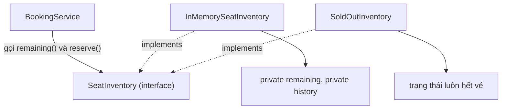

# Distinguishing Abstraction from Encapsulation in Java

**Abstraction** and **encapsulation** are both important object-oriented programming (OOP) principles, but they address different problems:

- **Abstraction (abstraction):** selects and exposes an object's **essential capabilities**, allowing consuming code to focus on *what the object can do* without depending on implementation details.
- **Encapsulation (encapsulation):** organizes data with its related operations and **controls how internal state can be accessed or modified**, allowing the object to enforce its own rules.

For example, a ticketing system needs to call `reserve(2)` without knowing whether seats are stored in a `HashMap`, a database, or another service: that is the **abstraction** perspective. The system must also prevent external code from directly changing the seat count to `-10` or bypassing availability checks: that is the goal of **encapsulation**.

These two principles often complement each other, but they **are not synonymous**. A class can use `private` for sound encapsulation without declaring an `interface`; conversely, declaring an `interface` does not guarantee that all implementations correctly protect their state.

## 1. Comparing Their Goals and Implementation

| Perspective | Abstraction | Encapsulation |
| --- | --- | --- |
| Main question | "Which **capabilities** do consumers need to know about and use?" | "Who may **read or modify state**, and through which operations?" |
| Goal | Reduce dependence on implementation details; present an understandable contract | Protect data consistency and business rules |
| What is hidden | Algorithm details, storage structures, and implementation choices outside the contract | Direct access to fields and internal structures requiring control |
| Common Java mechanisms | `interface`, `abstract class`, interface-typed parameters, compact public APIs | `private`, validated methods, defensive copying, immutable values, restricted access |
| Effect on consumers | Code calls `inventory.reserve(2)` without knowing how inventory is stored | Code cannot directly assign `inventory.remaining = -10` |
| Poor-design symptom | Business code depends on multiple concrete classes or storage details | Callers modify internal data without validation |
| Evaluation criterion | Does the contract expose all necessary capabilities while hiding irrelevant details? | Can external code violate an object's (*invariant*) through any available path? |

Avoid the assumptions that "abstraction only uses interfaces" or "encapsulation only uses private". An ordinary class with a few public methods can provide a **good abstraction**. Conversely, a `private final List<...>` field can still be modified indirectly if the class exposes the referenced mutable list.

## 2. Complete Example: Two Principles in the Same Problem

We design a seat-booking feature:

- `SeatInventory` describes the seat-inventory **contract**: check remaining seats and request a reservation.
- `InMemorySeatInventory` is one implementation that holds the seat count in a `private` field and validates requests before decrementing it.
- `SoldOutInventory` is another implementation that always reports sold out.
- `BookingService` depends only on **`SeatInventory`**, so it need not know which concrete object is underneath.

Put all the following code into **`Main.java`** and run it with Java 11 or later:

```java
import java.util.ArrayList;
import java.util.List;
import java.util.Objects;

// TRỪU TƯỢNG: mô tả hợp đồng mà code đặt vé cần.
interface SeatInventory {
    int remaining();

    // Số ghế yêu cầu phải > 0.
    // Trả true nếu giữ chỗ thành công; false nếu không đủ chỗ.
    boolean reserve(int seats);
}

// Một triển khai lưu trạng thái trong bộ nhớ.
final class InMemorySeatInventory implements SeatInventory {
    private int remaining;
    private final List<Integer> successfulReservations =
            new ArrayList<>();

    InMemorySeatInventory(int initialSeats) {
        if (initialSeats < 0) {
            throw new IllegalArgumentException(
                    "Số ghế ban đầu không được âm");
        }
        this.remaining = initialSeats;
    }

    @Override
    public int remaining() {
        return remaining;
    }

    @Override
    public boolean reserve(int seats) {
        if (seats <= 0) {
            throw new IllegalArgumentException(
                    "Số ghế đặt phải lớn hơn 0");
        }
        if (seats > remaining) {
            return false;
        }

        // ĐÓNG GÓI: chỉ logic bên trong được phép giảm số ghế.
        remaining -= seats;
        successfulReservations.add(seats);
        return true;
    }

    // Trả snapshot, không trao list mutable nội bộ cho caller.
    List<Integer> reservationHistory() {
        return List.copyOf(successfulReservations);
    }
}

// Một triển khai hợp đồng khác: địa điểm đã hết vé.
final class SoldOutInventory implements SeatInventory {
    @Override
    public int remaining() {
        return 0;
    }

    @Override
    public boolean reserve(int seats) {
        if (seats <= 0) {
            throw new IllegalArgumentException(
                    "Số ghế đặt phải lớn hơn 0");
        }
        return false;
    }
}

// Code nghiệp vụ làm việc qua kiểu trừu tượng.
final class BookingService {
    private final SeatInventory inventory;

    BookingService(SeatInventory inventory) {
        this.inventory = Objects.requireNonNull(
                inventory, "inventory");
    }

    boolean book(int seats) {
        return inventory.reserve(seats);
    }

    int availableSeats() {
        return inventory.remaining();
    }
}

public class Main {
    public static void main(String[] args) {
        InMemorySeatInventory warehouse =
                new InMemorySeatInventory(5);
        BookingService service = new BookingService(warehouse);

        System.out.println(service.book(2));          // true
        System.out.println(service.availableSeats()); // 3
        System.out.println(service.book(4));          // false
        System.out.println(service.availableSeats()); // 3

        List<Integer> snapshot = warehouse.reservationHistory();
        System.out.println(snapshot); // [2]
        try {
            snapshot.add(100);
        } catch (UnsupportedOperationException ex) {
            System.out.println("Không sửa được lịch sử bên ngoài");
        }

        // Không đổi BookingService khi đổi cách triển khai.
        BookingService soldOutService =
                new BookingService(new SoldOutInventory());
        System.out.println(soldOutService.book(1)); // false

        // warehouse.remaining = -10;
        // Dòng trên không biên dịch: remaining là private.
    }
}
```

Compile and run:

```bash
javac Main.java
java Main
```

Output:

```text
true
3
false
3
[2]
Không sửa được lịch sử bên ngoài
false
```

### Analysis: Which Part Is Abstraction?

`SeatInventory` exposes two clear capabilities: `remaining()` and `reserve(int)`. `BookingService` is written against this contract and can receive any implementation that **preserves the same semantics**: an in-memory inventory, a database-backed inventory, or a test double.

The dependency looks like this:



`BookingService` does not need `instanceof InMemorySeatInventory`, does not read the `remaining` field, and does not choose how data is stored. If a `DatabaseSeatInventory` is introduced later, we can supply the new implementation without changing the `BookingService` consumer API, as long as it satisfies the contract.

**Having an interface does not automatically make every design a good abstraction.** If an interface exposes details such as `getInternalHashMap()` or `getJdbcConnection()` in an ordinary booking API, consumers still become coupled to implementation details. Conversely, public methods of a concrete class can provide an appropriate abstraction if they hide those details well.

### Analysis: Which Part Is Encapsulation?

`InMemorySeatInventory` keeps `remaining` and `successfulReservations` inside the object. Callers cannot set `remaining = -10` or delete the history directly. Instead, they call `reserve(seats)`, where the class validates:

1. The requested number of seats must be greater than 0.
2. Reservations cannot exceed the remaining seats.
3. Only a valid request decrements `remaining` and records the reservation.

These rules are **object invariants**: `remaining` stays nonnegative, recorded reservation counts remain positive, and overbooking does not silently produce a negative balance. The constructor establishes valid initial state, and update methods preserve it.

Although the history list is `private`, the class also returns `List.copyOf(successfulReservations)` so that callers cannot modify the internal collection through a shared reference. Because `Integer` elements are immutable, the snapshot also avoids mutable-element concerns.

The example assumes sequential use. **`private` does not make a check-then-update operation safe when multiple threads book concurrently**; concurrent systems require suitable synchronization or atomic operations.

## 3. Why Do These Principles Usually Go Together Yet Remain Distinct?

Consider two independent questions about the booking class:

**Question A — Does the API hide the details?**

Business code only needs `book(2)` and `availableSeats()`. It does not need to know whether the application uses `ArrayList`, JDBC, or a distributed system. This design emphasizes **abstraction** and the ability to replace implementations.

**Question B — Is the data protected?**

If a class method exposes its internal `ArrayList` and another component calls `clear()`, state changes outside the business workflow. This concerns **encapsulation** and control of state.

These problems can occur independently:

| Situation | Abstraction | Encapsulation |
| --- | --- | --- |
| A service uses `SeatInventory`; its implementation keeps fields `private` and updates them only through a validated API | Good | Good |
| A `SimpleCounter` class has `private count` and `increment()` and is used directly in a small program | Still has an abstraction at the class API level; no separate interface | Potentially good |
| An interface returns an internal mutable collection for callers to modify freely | Uses an interface but may leak implementation details through the contract | Poor |
| A service reads a public field directly from a concrete implementation | Depends on the representation of state | Poor if state needs protection |

The distinction can be summarized in one sentence: **abstraction decides *which capabilities* an object exposes; encapsulation decides how the object maintains *control over its state*.**

Both principles involve "hiding details", however. To distinguish them, consider **why details are hidden**: to shield consumers from implementation choices behind a clear contract, or to block modifications that violate internal rules.

## 4. An `interface` Is Not Required for Abstraction

Abstraction is a **design** activity: selecting important concepts and omitting unnecessary details at a particular level of use. Java offers several supporting mechanisms:

| Mechanism | What it helps express | When appropriate |
| --- | --- | --- |
| `public` methods in ordinary classes | A set of behaviors callers are allowed to use | Simple objects that do not need multiple implementations |
| `interface` | A shared contract for different implementations | Clients should depend on capabilities rather than concrete classes |
| `abstract class` | A shared contract with common state/implementation for subclasses | Implementations genuinely share an inheritance relationship and rules |
| Value object / service API | A clearly defined domain concept | Hide calculations, validation, or storage technology |

For example, a concrete class can still expose an abstracted API:

```java
final class Thermostat {
    private int targetCelsius = 24;

    void increaseTarget() {
        if (targetCelsius >= 30) {
            throw new IllegalStateException("Đã đạt giới hạn");
        }
        targetCelsius++;
    }

    int targetCelsius() {
        return targetCelsius;
    }
}
```

The caller only needs to know `increaseTarget()` and `targetCelsius()`, without directly controlling the field or understanding the validation steps. This is a useful abstracted API **even without a separate interface or abstract class**. The `private` field and limit checks also provide encapsulation.

In Java, the `abstract` keyword has a specific syntactic meaning: an `abstract class` cannot be instantiated directly, and an `abstract` method without a body must be implemented by a concrete subclass (unless the subclass remains abstract). **Do not confuse the `abstract` keyword with the entire principle of abstraction**.

## 5. Encapsulation Is More Than Adding `private` and Getters/Setters

The following style weakens the boundary of control:

```java
class WeakAccount {
    private int balance;

    public int getBalance() {
        return balance;
    }

    public void setBalance(int balance) {
        this.balance = balance;
    }
}
```

`balance` is indeed `private`, but any caller can invoke `setBalance(-1_000)`. If the business rule requires a nonnegative balance, an unrestricted setter prevents the class from maintaining its invariant.

A more appropriate behavioral API:

```java
final class SafeAccount {
    private long balance;

    SafeAccount(long openingBalance) {
        if (openingBalance < 0) {
            throw new IllegalArgumentException("Số dư âm");
        }
        this.balance = openingBalance;
    }

    void deposit(long amount) {
        if (amount <= 0 || amount > Long.MAX_VALUE - balance) {
            throw new IllegalArgumentException("Số tiền nạp không hợp lệ");
        }
        balance += amount;
    }

    boolean withdraw(long amount) {
        if (amount <= 0) {
            throw new IllegalArgumentException("Số tiền rút phải dương");
        }
        if (amount > balance) {
            return false;
        }
        balance -= amount;
        return true;
    }

    long getBalance() {
        return balance;
    }
}
```

`SafeAccount` forces all balance changes through validated behavior. Real applications typically need more precise money units/types; `long` here illustrates only state encapsulation. The class does not guarantee thread safety.

The principle is: **allow callers to perform valid operations without giving them the ability to corrupt state arbitrarily**.

## 6. How Do Java Access Levels Relate to Encapsulation?

Java uses access modifiers to determine the visibility of classes, fields, constructors, and methods.

| Access level | Primary scope |
| --- | --- |
| `private` | Within the declaring class (subject to Java's access rules for nested classes) |
| No explicit modifier (*package-private*) | Within the same package |
| `protected` | Within the same package and through subclass relationships where Java access rules allow |
| `public` | Accessible from permitted locations; also subject to the module system when present |

Choose modifiers according to the object's contract, not just to eliminate compilation errors:

- Fields holding invariants should usually be `private`.
- The public API should expose only operations that consumers are actually allowed to perform.
- Exposing a mutable field as `protected` may let subclasses violate an invariant; consider controlled extension methods.
- `public` is not inherently wrong: public behaviors are precisely what the abstraction needs to expose.

Modifiers are **technical mechanisms**. Good encapsulation also depends on method design, enforced constraints, and how objects reference other mutable data.

## 7. Common Design Misconceptions

**Mistake 1: "An interface guarantees encapsulation."**

```java
interface Basket {
    void add(String sku);
}

class LeakyBasket implements Basket {
    public final List<String> internalItems = new ArrayList<>();

    @Override
    public void add(String sku) {
        internalItems.add(sku);
    }
}
```

This is an illustrative snippet; compiling it separately requires `import java.util.List;` and `import java.util.ArrayList;`. `Basket` provides a usage interface, but a caller holding a `LeakyBasket` reference can modify `internalItems` directly. Declaring a field `final` prevents reassignment but does not prevent changes to the `ArrayList`.

**Mistake 2: "Using `private` means abstraction is unnecessary."**

A service depending directly on `MySqlSeatInventory` may still use a well-encapsulated API, but that concrete dependency can be troublesome if the service needs to switch to PostgreSQL or use a test double. Introducing `SeatInventory` expresses a stable contract when multiple implementations are truly required. Avoid creating an interface solely because of a mechanical rule that "every class needs an interface".

**Mistake 3: "Getters are always safe because they only read."**

```java
private final List<String> names = new ArrayList<>();

List<String> getNames() {
    return names; // Trả tham chiếu mutable nội bộ.
}
```

A caller could invoke `getNames().clear()`. Return `List.copyOf(names)` for a structurally immutable snapshot, or use a read-only view if consumers are intentionally allowed to observe a changing list. For mutable elements, copying the collection is only a shallow copy.

**Mistake 4: "Hiding absolutely everything produces a good API."**

If a class does not provide operations its clients need, clients will seek workarounds: casts, reflection, direct database updates, or duplicated logic. A good abstraction must expose **enough meaningful capabilities**; good encapsulation controls important changes rather than hiding all behavior.

**Mistake 5: "A good abstraction layer automatically guarantees correct business behavior."**

`SeatInventory` describes seat-booking capabilities but does not itself enforce synchronization, persistence, or atomicity. Every implementation must preserve the promised semantics. Two concurrent requests could overbook seats without appropriate transactions or locks, even if the code correctly uses the interface.

## 8. How to Evaluate an OOP Design

When reviewing a class, answer two groups of questions:

| Abstraction questions | Encapsulation questions |
| --- | --- |
| Which capabilities do callers need? | Which states must always be valid? |
| Does the contract specify results, errors, and input conditions? | Which update paths could violate an invariant? |
| Can the implementation change without modifying business code? | Does the class expose internal arrays/lists/maps or mutable objects? |
| Does the API avoid unnecessary technology details? | Do the constructor and every mutating operation validate their conditions? |
| Are there too many interface layers with no clear value? | Are access permissions appropriately restricted? |

If a class has one stable usage pattern and implementation, a clear public API on the concrete class may suffice. If several modules share a contract and the implementation may change, an interface or abstract class often isolates dependencies more effectively.

Either way, data rules must live where they can be enforced. Do not shift responsibility for validating balances, capacity, or consistency to every external caller just because methods have good names.

## 9. Quick Exercises

**Exercise 1.** A class has a `private List<String> items` field, and its getter returns that list directly. Which principle is primarily affected?

**Answer:** **Encapsulation**: callers can modify internal data through an alias. Fix it with a suitable read-only API or defensive copy, depending on the contract.

**Exercise 2.** `BookingService` executes SQL `SELECT ... FOR UPDATE` itself to decrement the seat count. To support two storage systems without rewriting the business logic, which principle matters most?

**Answer:** **Abstraction**: define a `SeatInventory` contract and move SQL handling into the corresponding implementation. The implementation must still ensure transactions and atomicity.

**Exercise 3.** Does `interface PaymentGateway` necessarily protect payment-card data through encapsulation?

**Answer:** **No.** An interface does not determine how data is stored, protected, or exposed. Confidentiality and state control depend on the specific design and implementation.

**Exercise 4.** A `Thermostat` class declares no interface but has `increaseTarget()` and a `private targetCelsius` field. Can it demonstrate both principles?

**Answer:** **Yes.** Its two methods form an appropriately abstracted API; the private field and limit checks protect state.

**Exercise 5.** If `InMemorySeatInventory` is replaced with `SoldOutInventory` and `BookingService` requires no changes, what does that illustrate?

**Answer:** Consuming code is programmed to an **abstract contract**. Each implementation must still enforce its promised state and behavioral rules.

**Remember:** When designing OOP systems, identify **the capabilities to expose to consumers** (abstraction) and **the boundaries that control internal state** (encapsulation). Together these make code easier to understand, change, and maintain correctly, but each addresses a different design risk.
