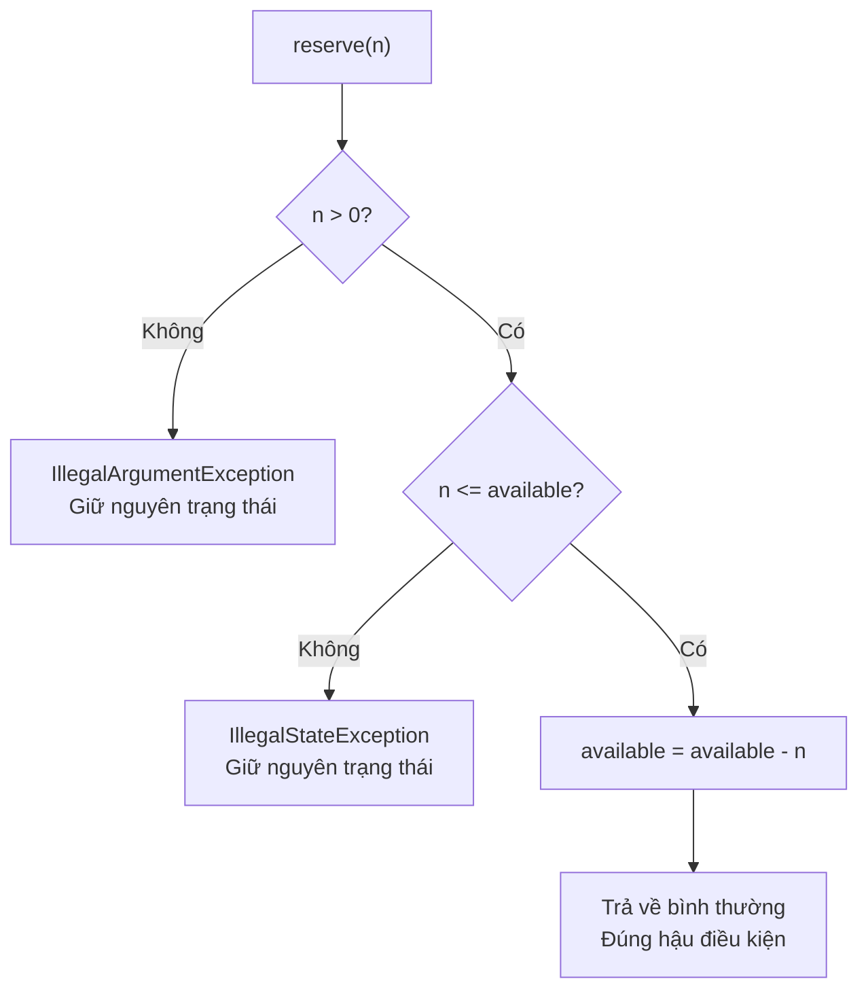

# Preconditions, Postconditions, and Behavioral Guarantees in OOP (Java)

When working with an object, the important question is not only **"What does this method do?"** but also **"What must be true before the call, and what is the caller guaranteed afterward?"**. This is the perspective of a **behavioral contract** (*behavioral contract*), often associated with *Design by Contract*.

When designing abstractions, users of an interface should be able to rely on these guarantees without knowing whether the implementation uses an array, database, or counter. If two classes advertise the same interface but follow different behavioral rules, apparently compatible types can still produce bugs.

This lesson builds a Java example of **managing available seats**. It distinguishes preconditions, postconditions, invariants, and ways to verify whether an implementation honors its contract.

## 1. Three Core Concepts

| Concept | Question to answer | Seat-reservation example |
| --- | --- | --- |
| **Precondition** (*precondition*) | What must hold **before** a valid operation? | The requested seat count is > 0 and does not exceed availability |
| **Postcondition** (*postcondition*) | If an operation **completes normally**, what must be true? | Available seats decrease by exactly the reserved count |
| **Invariant** (*invariant*) | What must always hold at valid publicly observable object states? | `0 <= available <= capacity` |

We can express this using notation resembling Hoare logic:

```text
{ P }  operation  { Q }
```

Here:

- `P` is the precondition;
- `operation` is the operation/method;
- `Q` is the postcondition when the operation finishes normally.

For example, with `reserve(2)`, if 5 seats remain before the call and the precondition holds, exactly 3 seats must remain when the method returns normally.

**Note:** The expression above does not by itself specify what happens when `P` is false or an exception occurs. To inform callers about error handling, also describe the **failure contract**: the exception type, return value, and whether object state may change.

### Invariants Differ from Local Conditions

An invariant is more than an "input validation condition". For a seat counter:

- `capacity` is the total seat count, fixed and positive.
- `available` is the available seat count, which changes after transactions.
- The `0 <= available <= capacity` invariant must hold when the object is created and after each public method finishes, including failure paths guaranteed to preserve state.

An implementation may temporarily use intermediate variables inside a method. What matters is that state observable through the API at valid observation points obeys the invariant; multithreaded models also need explicit synchronization rules.

## 2. From Business Requirements to a Contract

Suppose a room has `capacity = 10` and initially `available = 10`. Users can reserve or release seats.

| Operation | Preconditions for success | Postconditions on normal return |
| --- | --- | --- |
| `new InMemorySeatInventory(capacity)` | `capacity > 0` | `capacity() == capacity` and `available() == capacity` |
| `reserve(n)` | `n > 0` and `n <= available_before` | `available_after = available_before - n` |
| `release(n)` | `n > 0` and `n <= capacity - available_before` | `available_after = available_before + n` |
| `capacity()` | No special preconditions | Returns the unchanged total capacity |
| `available()` | No special preconditions | Returns the current available seat count without changing state |

`available_before` denotes the seat count **before** processing; `available_after` is the seat count **after** the method returns normally. Java has no special `old(...)` syntax for retrieving old state; tests usually save the pre-call value in a variable.

This is an **aggregate seat-count model**; `release(n)` means returning `n` seats already reserved in the system, without verifying who originally reserved them. To control cancellation rights for individual tickets, a booking-ID and ownership model is needed; such rights cannot be inferred from the counter alone.

## 3. Put the Guarantees in an Interface

An interface expresses **the capabilities provided and the expected guarantees**, rather than merely listing method names. Java cannot enforce all preconditions and postconditions through types, so API documentation and contract tests are essential.

File `SeatInventory.java`:

```java
/**
 * Bộ đếm số ghế cho một phòng có sức chứa cố định.
 *
 * Bất biến: capacity() > 0 và 0 <= available() <= capacity().
 * Không có bảo đảm thread-safe ở interface này.
 */
public interface SeatInventory {

    /** Tổng số ghế, không đổi trong vòng đời đối tượng. */
    int capacity();

    /** Số ghế còn có thể đặt tại thời điểm gọi. */
    int available();

    /**
     * Đặt đúng n ghế.
     *
     * Tiền điều kiện để thành công:
     * n > 0 và n <= available() trước lời gọi.
     *
     * Hậu điều kiện khi thành công:
     * available() mới = available() cũ - n;
     * capacity() không đổi.
     *
     * Khi n <= 0, ném IllegalArgumentException.
     * Khi số ghế không đủ, ném IllegalStateException.
     * Khi thất bại theo hai trường hợp này, trạng thái giữ nguyên.
     */
    void reserve(int n);

    /**
     * Trả lại đúng n ghế đã đặt (theo tổng số lượng).
     *
     * Tiền điều kiện để thành công:
     * n > 0 và n <= capacity() - available() trước lời gọi.
     *
     * Hậu điều kiện khi thành công:
     * available() mới = available() cũ + n;
     * capacity() không đổi.
     *
     * Khi n <= 0, ném IllegalArgumentException.
     * Khi trả vượt số ghế đang được đặt, ném IllegalStateException.
     * Khi thất bại theo hai trường hợp này, trạng thái giữ nguyên.
     */
    void release(int n);
}
```

This example deliberately **specifies both successful outcomes and common failure cases**. A caller knows that:

- Calling `reserve(3)` is valid when at least 3 seats remain.
- On success, *exactly 3 seats* are deducted; decrementing only 1 does not count as success.
- If the request is invalid or seats are insufficient, the method throws the specified exception and **does not partially deduct seats**.
- Total capacity does not change.

That is the meaning of a **behavioral guarantee**. A declaration like `void reserve(int n);` does not convey these rules on its own.

## 4. Java Implementation That Honors the Contract

File `InMemorySeatInventory.java`:

```java
public final class InMemorySeatInventory implements SeatInventory {
    private final int capacity;
    private int available;

    public InMemorySeatInventory(int capacity) {
        if (capacity <= 0) {
            throw new IllegalArgumentException(
                    "capacity phải lớn hơn 0");
        }

        this.capacity = capacity;
        this.available = capacity;
    }

    @Override
    public int capacity() {
        return capacity;
    }

    @Override
    public int available() {
        return available;
    }

    @Override
    public void reserve(int n) {
        requirePositive(n);

        if (n > available) {
            throw new IllegalStateException("Không đủ ghế");
        }

        // Mọi kiểm tra đã thành công mới thay đổi trạng thái.
        available -= n;
    }

    @Override
    public void release(int n) {
        requirePositive(n);

        int reserved = capacity - available;
        if (n > reserved) {
            throw new IllegalStateException(
                    "Số ghế trả vượt số đã đặt");
        }

        available += n;
    }

    private static void requirePositive(int n) {
        if (n <= 0) {
            throw new IllegalArgumentException(
                    "Số ghế phải lớn hơn 0");
        }
    }
}
```

Because `capacity > 0`, `0 <= available <= capacity`, and `n` have been validated, subtraction and addition in this **single-threaded** implementation remain within valid `int` bounds:

- `reserve` subtracts only when `n <= available`, so the result cannot become negative.
- `release` adds only when `n <= capacity - available`, so the result cannot exceed `capacity`.
- In ordinary exception branches, the `available` field has not yet been modified.

### Run the Example

File `Main.java`:

```java
public class Main {
    public static void main(String[] args) {
        SeatInventory seats = new InMemorySeatInventory(10);

        seats.reserve(3);
        System.out.println(seats.available()); // 7

        seats.release(1);
        System.out.println(seats.available()); // 8

        try {
            seats.reserve(9);
        } catch (IllegalStateException ex) {
            System.out.println("Bị từ chối: " + ex.getMessage());
        }

        System.out.println(seats.available()); // Vẫn là 8
        System.out.println(seats.capacity());  // 10
    }
}
```

Run using JDK 11 or later (this example also works on many older JDKs):

```bash
javac SeatInventory.java InMemorySeatInventory.java Main.java
java Main
```

Output:

```text
7
8
Bị từ chối: Không đủ ghế
8
10
```

The `seats` object is declared using an **interface type**, while its actual type is `InMemorySeatInventory`. Callers use the **contract** without needing to know where the `available` field is stored.

### Seat-Reservation Validation Diagram



Performing checks **before making changes** ensures that normal failures do not leave an object partially updated.

## 5. Preconditions: Caller Responsibilities and Callee Validation

A useful way to think about them:

- **Caller** is responsible for requesting behavior within the valid domain advertised by the contract.
- **Callee** (the implementing object) is responsible for satisfying postconditions when a valid call completes normally.
- The contract may require the callee to **validate and reject** certain invalid calls; do not assume every invalid input throws a particular exception unless the API documentation promises it.

For example, `reserve(3)` with 5 seats remaining is a valid call. If an implementation leaves 4 seats, that is an **implementation bug** even without an exception. Conversely, `reserve(8)` with 5 seats remaining violates the success precondition; in this example API, the additional contract requires an `IllegalStateException` and unchanged state.

**Do not use `assert` as the sole mechanism for validating public API input:**

```java
// Không phù hợp làm bảo vệ duy nhất của API public:
assert n > 0;
```

Java assertions are usually **disabled by default** unless enabled with `-ea`. Assertions are suitable for detecting internal assumptions during development and testing; for important API inputs, use reliable runtime checks such as:

```java
if (n <= 0) {
    throw new IllegalArgumentException("n phải dương");
}
```

Similarly, `Objects.requireNonNull(value, "value")` helps ensure a reference parameter is not `null`, but it does not validate every business rule, such as whether "a quantity falls within the allowed range".

## 6. Postconditions Must Be Specific and Verifiable

Consider this vague description:

> "When a reservation succeeds, the seat count is updated."

This is insufficient: increased or decreased? By how many? Does it affect capacity?

A better contract states:

```text
Trước reserve(n):
    1 <= n <= available_before

Sau khi trả về bình thường:
    available_after == available_before - n
    capacity_after == capacity_before
```

If a method also returns a result, postconditions can specify **the relationship between that result and the state**:

```java
/**
 * Thử đặt n ghế.
 * Yêu cầu: n > 0.
 *
 * Trả true nếu đã đặt thành công và available giảm đúng n.
 * Trả false nếu không đủ ghế và available giữ nguyên.
 */
boolean tryReserve(int n);
```

Compared with `reserve(n)`, `tryReserve(n)` treats insufficient seats as **a normal result (`false`)**. This is a **different contract**, not an arbitrary way to express the same behavior. Whether to return `boolean`, a dedicated result type, or throw an exception depends on the application; the API, implementation, and callers must agree.

### Postconditions Are More Than Return Values

In addition to results, behavioral guarantees may cover:

- Which fields/objects may change and which must remain unchanged.
- Which data is persisted or which events have been emitted, if specified by the API.
- The observable order of operations (if it is actually part of the contract).
- Exceptions and side effects on failure.
- Timing, ordering, or thread-safety conditions **if explicitly documented**.

Do not promise guarantees that were never designed, such as "successfully persisted to the database" when a method has only updated an in-memory field.

## 7. Object Invariants: Guarantees Throughout the Lifecycle

For `SeatInventory`:

```text
I: capacity > 0
   0 <= available <= capacity
```

To preserve `I`, examine **both the constructor and every state-changing method**.

| Phase | What must be proved |
| --- | --- |
| Constructor | The completed object satisfies `I` |
| Successful `reserve(n)` | If `I` holds before the call and the precondition is satisfied, `I` still holds afterward |
| Successful `release(n)` | If `I` holds before the call and the precondition is satisfied, `I` still holds afterward |
| Rejected operation | State remains unchanged under the contract and therefore still satisfies `I` |
| Getter | Does not make changes that violate `I` |

Invariants become difficult to guarantee if external code can modify fields directly:

```java
// Thiết kế không nên cho phép:
inventory.available = -100;
```

Thus `private`, a validating constructor, and a rule-enforcing API all help protect invariants. This is a direct connection between **encapsulation** and **abstraction**: implementation details are hidden, while consumers see stable guarantees.

## 8. Contracts and Substitutability (Liskov Substitution Principle)

Abstraction is useful only if one implementation can replace another **without violating client expectations**.

Suppose `SeatInventory` guarantees that `reserve(1)` succeeds whenever at least 1 seat is available. An implementation that "only accepts reservations of at least 2 seats" while still claiming to implement `SeatInventory` has **strengthened the precondition** beyond what the contract allows.

Counterexample (Java code illustrating an incorrect design):

```java
public final class BatchOnlySeatInventory implements SeatInventory {
    private final SeatInventory delegate;

    public BatchOnlySeatInventory(int capacity) {
        this.delegate = new InMemorySeatInventory(capacity);
    }

    public int capacity() {
        return delegate.capacity();
    }

    public int available() {
        return delegate.available();
    }

    public void reserve(int n) {
        if (n < 2) { // SAI hợp đồng: loại cả reserve(1) hợp lệ
            throw new IllegalArgumentException("Phải đặt ít nhất 2 ghế");
        }
        delegate.reserve(n);
    }

    public void release(int n) {
        delegate.release(n);
    }
}
```

If consumers only know the `SeatInventory` type, they are entitled to write:

```java
SeatInventory seats = new BatchOnlySeatInventory(10);
seats.reserve(1); // Theo hợp đồng interface là hợp lệ.
```

But the class above throws an exception and therefore **violates the guarantee**, even though the code compiles.

Principles for subtype design:

| Aspect | When replacing an implementation with a subtype or another implementation |
| --- | --- |
| Preconditions | Must not be **stronger** than the original contract for valid client calls |
| Postconditions | Must not be **weaker** than the original guarantee |
| Invariants | Must still preserve the contract's observable invariants |
| Failure results | Must honor the documented failure guarantees |
| Side effects | Must not introduce effects that conflict with the contract |

An implementation may support **additional** inputs if existing calls still work, or provide **stronger guarantees** on success while preserving the common guarantees. It must not silently reject a case that the interface declares valid.

If a rule genuinely requires "reservations in batches of at least 2 seats", design a clear **separate contract** or have a dedicated business service validate that policy before using the counter. Do not impose undisclosed additional requirements on implementations of the same interface.

## 9. Contract Tests Independent of Implementation Details

A test that only checks "whether the method was called" will miss postcondition violations. Compare **state before and after** and behavior on invalid input.

Create `ContractTest.java` without any external library:

```java
public class ContractTest {

    public static void main(String[] args) {
        // Có thể đổi sang một implementation hợp lệ khác.
        SeatInventory seats = new InMemorySeatInventory(5);

        check(seats.capacity() == 5, "Sai capacity ban đầu");
        check(seats.available() == 5, "Sai available ban đầu");

        int before = seats.available();
        seats.reserve(2);

        check(seats.available() == before - 2,
                "Sai hậu điều kiện reserve");
        check(seats.capacity() == 5,
                "reserve làm đổi capacity");

        before = seats.available();
        seats.release(1);

        check(seats.available() == before + 1,
                "Sai hậu điều kiện release");

        int preserved = seats.available();
        try {
            seats.reserve(99);
            throw new AssertionError(
                    "Phải từ chối yêu cầu đặt vượt số ghế");
        } catch (IllegalStateException expected) {
            // Đúng kiểu ngoại lệ đã hứa
        }
        check(seats.available() == preserved,
                "Thất bại mà số ghế lại thay đổi");

        try {
            seats.reserve(0);
            throw new AssertionError("reserve(0) phải bị từ chối");
        } catch (IllegalArgumentException expected) {
            // Đúng kiểu ngoại lệ đã hứa
        }
        check(seats.available() == preserved,
                "reserve(0) không được thay đổi số ghế");

        try {
            seats.release(99);
            throw new AssertionError(
                    "Phải từ chối trả vượt số ghế đã đặt");
        } catch (IllegalStateException expected) {
            // Đúng kiểu ngoại lệ đã hứa
        }
        check(seats.available() == preserved,
                "release lỗi nhưng làm đổi số ghế");

        check(seats.available() >= 0
                        && seats.available() <= seats.capacity(),
                "Bất biến số ghế bị phá vỡ");

        System.out.println("PASS: Hợp đồng được giữ");
    }

    private static void check(boolean ok, String message) {
        if (!ok) {
            throw new AssertionError(message);
        }
    }
}
```

Compile and run:

```bash
javac SeatInventory.java InMemorySeatInventory.java ContractTest.java
java ContractTest
```

Output:

```text
PASS: Hợp đồng được giữ
```

In real projects, these checks can be converted to **JUnit** tests and applied to multiple implementations through a factory. These are **contract tests**: they check whether an implementation honors an interface's promises, regardless of data storage.

### How Can Tests Be Extended?

- Verify that the constructor rejects `capacity = 0` or negative capacity.
- Reserve exactly all remaining seats (a boundary case), then verify `available() == 0`.
- Release all reserved seats and verify `available() == capacity()`.
- Generate multiple valid reserve/release sequences and check the invariant after each step.
- Run the same checks against new database-backed or distributed implementations, while separately specifying any documented differences in network errors or transaction guarantees.

These sample tests **do not prove correctness for every input**; they cover representative and boundary scenarios. Design can combine generated tests (*property-based testing*) with invariant-based reasoning for greater confidence.

## 10. Important Limits of Behavioral Contracts

### Exceptions and State After Failure

In this example, invalid requests or insufficient availability must leave state unchanged. This is a strong guarantee: **no partial update** on known failure paths.

Another method may promise only that "the object remains valid" after an error, even if some state has changed. If the application requires identical state after every failure, document that requirement and design accordingly (for example, transactions/rollbacks for multistep operations). **Do not assume every exception automatically rolls everything back.**

### Synchronous and Asynchronous Interfaces

If `reserve` merely enqueues a request, the postcondition "seats have been decremented" **does not automatically hold when the method returns**. An asynchronous API may promise "the request was accepted for processing", with the actual seat-update guarantee tied to a later completion result. Specify the contract according to when the result can truly be guaranteed.

### Multithreading: Avoid Unsynchronized Check-Then-Act

The current `InMemorySeatInventory` is **not thread-safe**. If two threads both call `reserve(1)` with only one seat remaining, both may pass the availability check before updating state. A race condition may violate the invariant or postcondition.

If seats can be reserved concurrently in one process, protect **the entire check-and-update operation** with suitable synchronization. In this simple example, reading and writing methods could be declared `synchronized` to use the same monitor, with the multithreading contract defined explicitly. Across processes or machines, JVM-level `synchronized` does not replace locking, transactions, or consistency mechanisms at shared storage.

In particular, avoid relying on:

```java
if (seats.available() >= 1) {
    seats.reserve(1);
}
```

as a success guarantee in a concurrent environment. Another thread may book the last seat between `available()` and `reserve(1)`. Let **the reservation method perform validation and updates atomically** under the promised concurrency model.

### Annotations Do Not Automatically Enforce Documentation

`@NotNull`, validation annotations, and contract specifications can help tools, frameworks, and static analyzers, but **they do not automatically ensure that all callers are validated** without suitable enforcement. Java also has no built-in `requires`/`ensures` syntax that automatically applies to every interface.

For every important constraint, identify where checks actually execute (constructor, method, validator, transaction boundary) and where the contract is documented.

## 11. Practice: Find Contract Violations

**Exercise 1 — Incorrect Postcondition**

```java
public void reserve(int n) {
    if (n <= 0) {
        throw new IllegalArgumentException();
    }
    if (n > available) {
        throw new IllegalStateException();
    }
    available--; // Sai khi n > 1
}
```

Why is this wrong? Although `reserve(3)` succeeds, the seat count decreases by only 1, violating the `available_after = available_before - 3` postcondition. Correct it to `available -= n`.

**Exercise 2 — Broken Invariant**

```java
public void release(int n) {
    if (n <= 0) {
        throw new IllegalArgumentException();
    }
    available += n; // Chưa kiểm tra n <= capacity - available
}
```

If only one seat is reserved but `release(3)` is called, availability may exceed capacity. Add a `n > capacity - available` check before incrementing and report `IllegalStateException`.

**Exercise 3 — Strengthened Precondition**

An implementation of `SeatInventory` allows reservations of at least 5 seats only. With 10 seats remaining, `reserve(2)` is valid under the interface but rejected by this class. Identify the violated principle and propose moving the minimum-reservation rule into a separate policy.

**Exercise 4 — Designing a New Method**

Add a contract for:

```java
boolean tryReserve(int n);
```

Requirements: `n > 0`; if enough seats remain, return `true` and subtract exactly `n`; if insufficient, return `false` and preserve state; if `n <= 0`, throw `IllegalArgumentException` without changing state. Implement it and test all three paths.

**Exercise 5 — A Derived Property**

Add `int reserved()` without storing a new field. Define the getter's postcondition as `reserved() == capacity() - available()`. Explain why this value is derived and test that `reserved() + available()` always equals `capacity()` in valid states.

## Checklist for Writing Behavioral Contracts

Before publishing an interface or important method, ask:

1. Which parameter, current-state, permission, or resource requirements are **preconditions**?
2. Which specific relationships among previous values, subsequent values, and return results express the **postconditions**?
3. Which **invariants** must constructors and mutating methods always maintain?
4. When a precondition fails or an operation cannot complete, how far do **error types and remaining-state guarantees** extend?
5. Does any implementation strengthen the interface's preconditions or weaken its guarantees, undermining substitutability?
6. Does the contract apply **when the method returns immediately**, when an asynchronous task completes, or after a transaction commits?
7. Are thread-safety, durability, and side-effect guarantees documented accurately for the implementation?
8. Are tests reusable across implementations to protect these guarantees?

**Remember:** A good abstraction makes a verifiable promise. Preconditions define valid requests; postconditions specify guaranteed results; invariants keep objects consistent; failure contracts and substitutability let API consumers predict behavior without inspecting implementation source.
