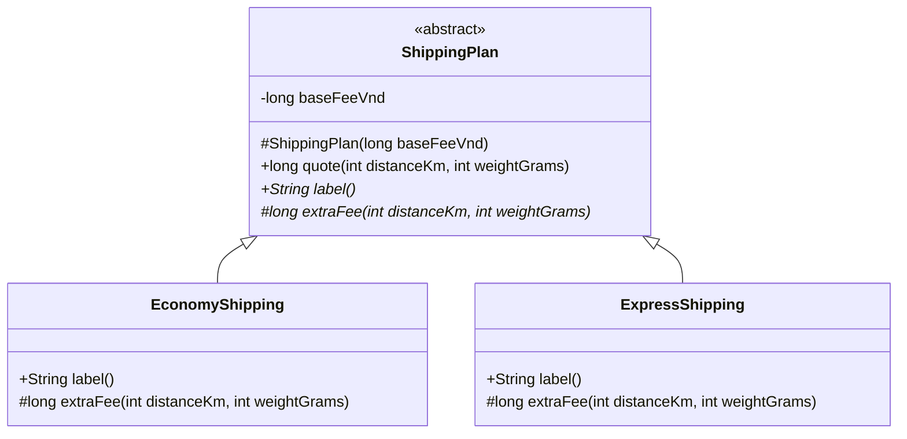
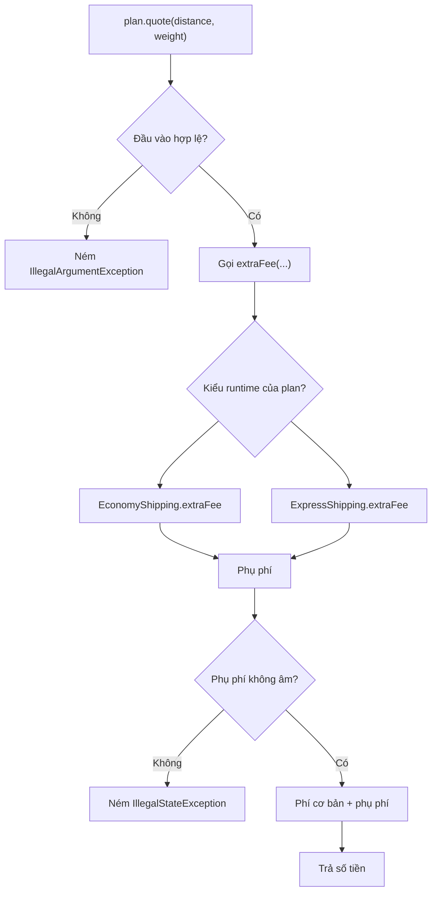

# Abstract Classes and Abstract Methods in Java

> **OOP → Abstraction.** When several objects share a common nature and workflow but require different steps for each type, Java lets us define an **abstract class** (`abstract class`) as a foundation and **abstract methods** (`abstract method`) as extension points subclasses must implement. Consumers need only know the shared contract; each subclass provides its specific behavior.

## 1. What Problem Do Abstract Classes Solve?

Suppose a system supports two shipping methods: economy and express. Both must:

- Accept valid distance and weight inputs.
- Include a base fee.
- Calculate a surcharge according to the service's policy.
- Return the total shipping fee.

Duplicating the entire workflow in each class makes shared validation steps prone to inconsistencies or omissions. An abstract class can define a consistent workflow and require subclasses to calculate only the variable surcharge.



In the diagram, `*` marks abstract methods according to this lesson's annotation convention.

An **abstract class** is declared with the `abstract` keyword. It cannot be instantiated directly with `new`, but variables of the abstract class type can refer to subclass instances.

An **abstract method** declares only a name, parameters, return type, and access rules; it **has no method body**. A concrete subclass (`concrete class`) must provide an appropriate implementation if it inherits an abstract method that remains unimplemented.

## 2. Basic Syntax

```java
abstract class Shape {
    private final String color;

    protected Shape(String color) {
        this.color = color;
    }

    public String color() {           // Phương thức thường, có thân
        return color;
    }

    public abstract double area();    // Chỉ có khai báo, kết thúc bằng ;
}

final class Circle extends Shape {
    private final double radius;

    Circle(String color, double radius) {
        super(color);                 // Gọi constructor của lớp cha
        if (radius <= 0) {
            throw new IllegalArgumentException("Bán kính phải dương");
        }
        this.radius = radius;
    }

    @Override
    public double area() {
        return Math.PI * radius * radius;
    }
}
```

Usage:

```java
Shape shape = new Circle("Đỏ", 2.0);
System.out.println(shape.color());  // Đỏ
System.out.println(shape.area());   // 12.566370614359172

// Shape invalid = new Shape("Xanh"); // Lỗi biên dịch
```

The `Shape` class provides `color` state, a constructor, the concrete `color()` method, and the abstract `area()` requirement. `Circle` inherits the shared behavior and must implement the area calculation.

**Do not confuse the following:**

| Syntax | Valid? | Meaning |
|---|---|---|
| `abstract class Shape { ... }` | Yes | A base class that cannot be instantiated directly |
| `abstract double area();` | Yes, inside an abstract class | A contract without an implementation |
| `double area() { return 0; }` | Yes | A concrete method with a body |
| `abstract double area() { return 0; }` | No | `abstract` methods cannot have bodies |
| `new Shape(...)` when `Shape` is abstract | No | Cannot instantiate an abstract class directly |
| `Shape s = new Circle(...)` | Yes | Polymorphism: a parent-typed reference refers to a subclass object |

An abstract class **may have no abstract methods at all**. The `abstract` keyword still prevents direct instantiation, usually to indicate that the class should only serve as a base class.

## 3. Complete Practical Example: Calculating Shipping Fees

Save as `AbstractClassDemo.java` and run with **Java 17+**:

```java
import java.util.List;

public class AbstractClassDemo {

    static abstract class ShippingPlan {
        private final long baseFeeVnd;

        protected ShippingPlan(long baseFeeVnd) {
            if (baseFeeVnd < 0) {
                throw new IllegalArgumentException("Phí cơ bản không thể âm");
            }
            this.baseFeeVnd = baseFeeVnd;
        }

        // Quy trình chung; final để lớp con không bỏ qua bước kiểm tra.
        public final long quote(int distanceKm, int weightGrams) {
            if (distanceKm <= 0 || weightGrams <= 0) {
                throw new IllegalArgumentException(
                    "Khoảng cách và khối lượng phải dương"
                );
            }

            long extra = extraFee(distanceKm, weightGrams);
            if (extra < 0) {
                throw new IllegalStateException("Phụ phí không thể âm");
            }

            return Math.addExact(baseFeeVnd, extra);
        }

        public abstract String label();

        // Mỗi phương án tự định nghĩa cách tính phụ phí.
        protected abstract long extraFee(int distanceKm, int weightGrams);
    }

    static final class EconomyShipping extends ShippingPlan {
        EconomyShipping() {
            super(10_000); // Phí cơ bản 10.000 VND
        }

        @Override
        public String label() {
            return "Tiết kiệm";
        }

        @Override
        protected long extraFee(int distanceKm, int weightGrams) {
            // 1.000 VND mỗi km
            return Math.multiplyExact(1_000L, distanceKm);
        }
    }

    static final class ExpressShipping extends ShippingPlan {
        ExpressShipping() {
            super(20_000); // Phí cơ bản 20.000 VND
        }

        @Override
        public String label() {
            return "Hỏa tốc";
        }

        @Override
        protected long extraFee(int distanceKm, int weightGrams) {
            // 2.000 VND mỗi km, cộng 3.000 VND mỗi kg (làm tròn lên).
            long feeByDistance = Math.multiplyExact(2_000L, distanceKm);
            long billedKg = (weightGrams - 1L) / 1_000L + 1L;
            long feeByWeight = Math.multiplyExact(3_000L, billedKg);
            return Math.addExact(feeByDistance, feeByWeight);
        }
    }

    public static void main(String[] args) {
        List<ShippingPlan> plans = List.of(
            new EconomyShipping(),
            new ExpressShipping()
        );

        for (ShippingPlan plan : plans) {
            System.out.println(
                plan.label() + ": " + plan.quote(5, 1_500) + " VND"
            );
        }

        // ShippingPlan plan = new ShippingPlan(10_000); // Không hợp lệ
    }
}
```

Run in the directory containing the file:

```bash
javac AbstractClassDemo.java
java AbstractClassDemo
```

Output:

```text
Tiết kiệm: 15000 VND
Hỏa tốc: 36000 VND
```

The actual calculations:

| Plan | Base fee | Surcharge | Total |
|---|---:|---:|---:|
| Economy | 10.000 VND | 5 km × 1.000 = 5.000 VND | **15.000 VND** |
| Express | 20.000 VND | 5 km × 2.000 + 2 kg × 3.000 = 16.000 VND | **36.000 VND** |

Distance and weight are validated once in the base class. For example, calling `quote(0, 1500)` is rejected with `IllegalArgumentException` before calculating any surcharge.

`Math.multiplyExact` and `Math.addExact` detect `long` overflow by throwing `ArithmeticException`, preventing silently nonsensical fees from excessively large inputs. This is an illustrative in-memory pricing model, not a complete representation of actual rate rules.

### Why Are `abstract` and `final` Used Together Here?

`ShippingPlan` is `abstract` so concrete classes can extend it. Inside it, `quote(...)` is a **concrete** method marked `final`: no subclass can override the entire validation and fee-summing workflow.

In contrast, `extraFee(...)` is **abstract**: each shipping method must implement its own surcharge calculation.



This is a form of the **Template Method** pattern: the parent class retains the algorithm skeleton, while subclasses implement a variable step. Consequently, code calling `plan.quote(...)` need not know the internal pricing algorithm for each shipping method.

## 4. Polymorphism Through Abstract-Class References

```java
ShippingPlan plan = new ExpressShipping();
long fee = plan.quote(5, 1_500);
```

The `plan` variable has the **reference type** `ShippingPlan`, while the actual instance is `ExpressShipping`.

- Calling code may use only members accessible through the `ShippingPlan` type.
- When `quote` calls `extraFee`, Java chooses an implementation based on the **actual object type** (`ExpressShipping`), through dynamic dispatch.
- Replacing it with `new EconomyShipping()` causes the same `quote` call to use Economy's surcharge logic without changing the consuming code.

The key point: the `abstract` keyword does not create polymorphism by itself; **inheritance and overriding instance methods** enable runtime implementation selection. An abstract class explicitly expresses required behaviors and shared functionality.

Code should depend on the contract:

```java
static void printQuote(ShippingPlan plan) {
    System.out.println(plan.label() + ": " + plan.quote(3, 2_000));
}
```

If an `OvernightShipping extends ShippingPlan` is introduced later, it only needs to implement any remaining abstract methods. `printQuote` needs no additional `if` or `switch` chain to inspect each plan's name.

## 5. Abstract-Class Constructors Still Run

An abstract class cannot be instantiated directly, **but it may have a constructor** to initialize shared state when a subclass is created.

In the example:

```java
protected ShippingPlan(long baseFeeVnd) {
    if (baseFeeVnd < 0) {
        throw new IllegalArgumentException("Phí cơ bản không thể âm");
    }
    this.baseFeeVnd = baseFeeVnd;
}
```

`EconomyShipping()` calls `super(10_000)`. The parent constructor initializes `baseFeeVnd`, after which subclass initialization continues. If the parent constructor throws, the subclass instance is not created successfully.

Related rules:

1. **Constructors cannot be declared `abstract`**, because they need bodies and cannot be overridden like instance methods.
2. If the parent has no no-argument constructor, a subclass must call an appropriate constructor through `super(...)`.
3. An abstract-class constructor can be `protected` for subclass use; it need not be public just because the class has a public API.
4. **Avoid calling overridable methods from constructors**. When a parent constructor executes, subclass-specific fields may not yet be fully initialized; such polymorphic calls can produce state errors.

Example of a risk:

```java
abstract class Base {
    Base() {
        initialize(); // Không nên: gọi phương thức override quá sớm
    }
    protected abstract void initialize();
}

final class Child extends Base {
    private String name = "Ready";

    @Override
    protected void initialize() {
        // Có thể thấy name == null vì initializer của Child chưa chạy.
        System.out.println(name);
    }
}
```

Let constructors initialize the state they own. Invoke extensibility hooks only after the object has been fully initialized.

## 6. Rules for Overriding Abstract Methods

An abstract method has only a declaration:

```java
protected abstract long extraFee(int distanceKm, int weightGrams);
```

A concrete subclass implements it:

```java
@Override
protected long extraFee(int distanceKm, int weightGrams) {
    return Math.multiplyExact(1_000L, distanceKm);
}
```

Core rules:

| Situation | Result |
|---|---|
| A concrete class inherits an abstract method without implementing it | Compilation error |
| The subclass remains `abstract` and does not implement the method | Valid; a further subclass must implement it |
| Overrides with the same name, parameters, and a compatible return type | Valid |
| Changes parameters to a different signature | Overloading, not an implementation of the required override |
| Reduces visibility from `protected` to `private` | Invalid |
| Uses `@Override` with a signature that does not actually override | The compiler reports an error, helping detect mistakes |

Java permits **covariant return types (covariant return type)** for reference types: a parent method can return `Animal` while an overriding method returns `Dog extends Animal`. Return types cannot be arbitrarily changed to unrelated primitive types.

An abstract method cannot be `private`, `static`, or `final`, because a subclass must **override** it. An `abstract` class also cannot be declared `final`: one modifier requires inheritance to complete behavior, while the other prohibits it.

### When a Subclass Remains Abstract

```java
abstract class Document {
    abstract String render();
}

abstract class PrintableDocument extends Document {
    void printInfo() {
        System.out.println("Document có thể được in");
    }
    // Chưa cần implement render() vì lớp này vẫn abstract.
}

final class Invoice extends PrintableDocument {
    @Override
    String render() {
        return "Hóa đơn";
    }
}
```

`Invoice` is concrete, so it must implement `render()`. The intermediate `PrintableDocument` class can add shared behavior while leaving rendering to a further subclass.

## 7. How Does an Abstract Class Differ from an Interface?

Both help **hide implementation details behind a contract**, but their use cases differ.

| Criterion | `abstract class` | `interface` |
|---|---|---|
| Common role | Base class sharing state and implementation | Capability/behavior contract |
| Instance fields | Can have them, including `private`, mutable fields, or `final` | No instance fields; declared fields are `public static final` constants |
| Constructor | Exists and is invoked through subclass constructors | No instance constructors |
| Methods with bodies | Supported | Can have `default`, `static`, and certain supporting `private` methods |
| Abstract methods | Optional | Ordinary instance methods without bodies are implicitly `public abstract` |
| Inheritance in a class | A class directly `extends` only one superclass | A class may `implements` multiple interfaces |
| Appropriate when | Objects belong to one family and share data and workflows | Different object families share a capability |

Example of a capability independent of class family:

```java
interface Trackable {
    String trackingCode();
}

final class Parcel implements Trackable {
    private final String code;

    Parcel(String code) {
        this.code = code;
    }

    @Override
    public String trackingCode() {
        return code;
    }
}
```

If the goal is only to state that an object can provide a tracking code, an interface is often simpler. If shipping plans genuinely share base fees, validation workflows, constructors, and total-fee logic, an abstract class such as `ShippingPlan` is justified.

An interface and abstract class are not always both needed. Add an abstraction layer only when it expresses a useful contract and reduces dependence on concrete details.

## 8. Common Mistakes

**Mistake 1 — Trying to Instantiate an Abstract Class**

```java
abstract class Vehicle {
    abstract void move();
}

// Vehicle v = new Vehicle(); // Không thể khởi tạo lớp abstract
```

A concrete class is needed to implement the behavior:

```java
class Bicycle extends Vehicle {
    @Override
    void move() {
        System.out.println("Đạp xe");
    }
}

Vehicle v = new Bicycle(); // Hợp lệ
v.move();                  // Đạp xe
```

**Mistake 2 — Missing `@Override` or Using the Wrong Signature**

```java
abstract class Processor {
    abstract void process(String value);
}

// Sai: process(int) không implement process(String).
// class MyProcessor extends Processor {
//     void process(int value) {}
// }
```

A concrete class must implement the **exact signature** with appropriate visibility. Use `@Override` for a compiler check.

**Mistake 3 — Putting Everything in the Abstract Base Class**

If two object types happen to share a method name but not its meaning or rules, forcing both into one abstract class creates an artificial inheritance relationship. Prefer a meaningful **"is-a" relationship**; for independent capabilities, consider interfaces or composition.

**Mistake 4 — Exposing Too Much Mutable State from the Base Class**

```java
abstract class BadPlan {
    protected long fee; // Lớp con có thể đổi tùy ý, bỏ qua validation
}
```

Prefer `private` and provide the necessary `protected` methods, rather than letting subclasses modify fields the base class is responsible for protecting.

**Mistake 5 — Allowing Subclasses to Override the Entire Shared Workflow**

When a parent must enforce a mandatory validation step, consider marking the workflow method `final` and exposing only suitable `abstract` hooks, such as `quote` and `extraFee` in the example.

## 9. Practice Exercises

**Exercise 1 — Payroll System.** Create `abstract class Employee` with `private final String id`, a constructor validating the ID, a concrete `id()` method, and `public abstract long monthlyPay()`. Implement `FullTimeEmployee` with fixed pay and `HourlyEmployee` with hourly pay. Create a `List<Employee>`, iterate, and print pay polymorphically.

**Exercise 2 — Protecting the Workflow.** Put the nonnegative-work-hours validation step in a concrete `final` parent method if every employee requires the rule. Decide which step should be abstract and which must not be modified by subclasses.

**Exercise 3 — Multilevel Inheritance.** Create `abstract class Media` with `abstract int durationSeconds()`, add an intermediate abstract class `AudioMedia`, and then create a concrete `PodcastEpisode`. Identify which classes may omit method implementations and explain why.

**Exercise 4 — Choosing an Appropriate Mechanism.** A system has `Invoice`, `Order`, and `Shipment`, all of which need `exportCsv()` but share no state or workflow. Would you choose an interface or abstract class? Explain based on shared state/implementation and the single-inheritance limitation.

**Quick self-check:**

- Can `ShippingPlan plan` be declared? **Yes**, because it is a reference type.
- Can you write `new ShippingPlan(...)`? **No**, because the class is abstract.
- Can an abstract class have constructors, fields, and methods with bodies? **Yes**.
- Must an abstract class declare at least one abstract method? **No**.
- Can a concrete class inherit an abstract method without implementing it? **No**, unless a suitable implementation is inherited from another class.
- Can `abstract` and `final` be used together on the same method? **No**.

**Remember:** An **abstract class** holds shared elements and establishes a rule framework for a family of objects; an **abstract method** specifies what subclasses must implement. Inheritance, `@Override`, and polymorphism let callers use a stable contract while concrete subclasses provide their own behaviors.
