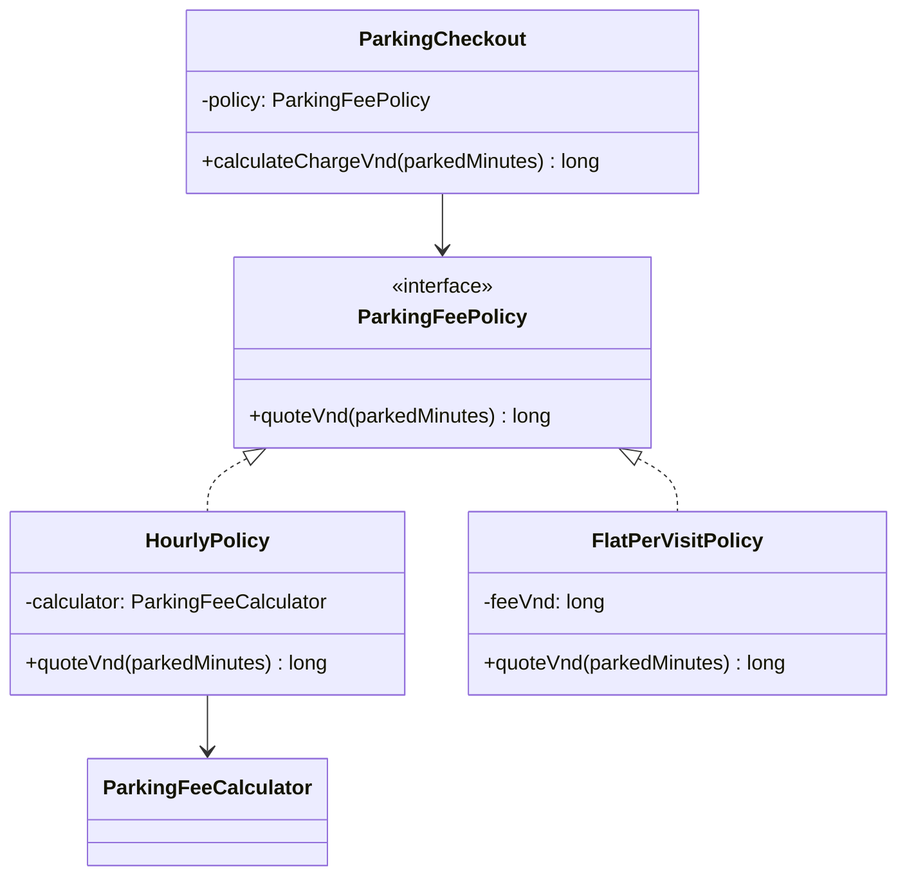
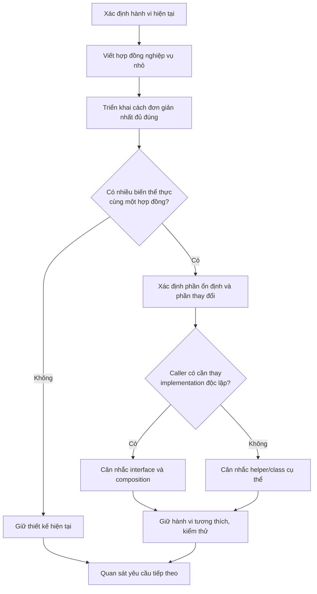

# Choosing the Right Level of Abstraction in Java OOP

A good OOP design does not necessarily have many `interface`, `abstract class`, or inheritance layers. The value of **abstraction** lies in selecting the right amount of information and behavior for consumers to solve the problem.

With **too little** abstraction, business rules are scattered across the codebase and callers must understand formulas and implementation details. With **too much** abstraction, a simple requirement can bring a maze of interfaces, intermediate classes, and hard-to-follow configuration.

The **right level of abstraction** makes responsibilities clear, hides details likely to change, and keeps usage straightforward, while keeping design costs proportional to actual needs.

## 1. Recognizing Three Levels of Design

Suppose a parking lot charges according to these rules:

- The first 15 minutes are free.
- After 15 minutes, every **started hour** costs 5.000 VND.
- Parking duration must be nonnegative, and calculations must detect overflow instead of silently wrapping.

The same requirement can be modeled at different levels:

| Design approach | Symptom | Consequence |
|---|---|---|
| **Too low** | Every screen calculates `minutes`, rounds hours, and multiplies rates | Duplicated rules and inconsistent calculations |
| **Appropriate initially** | One `ParkingFeeCalculator` class with a `calculateVnd(...)` method | API users supply time and get a fee |
| **Too high for the requirement** | Creates `AbstractFeeFactory`, `GenericRateResolver<T>`, and a multilevel hierarchy for one fixed formula | More concepts to understand without a clear benefit |

Abstraction here does not mean choosing between "having a class" and "having an interface". Even a **concrete class with a domain-specific method** provides a useful abstraction.

## 2. Start with a Small, Clear, Sufficient Contract

When an application has **one pricing policy**, we can start with a concrete class.

File `ParkingFeeCalculator.java`:

```java
public final class ParkingFeeCalculator {
    private static final long FREE_MINUTES = 15;
    private static final long MINUTES_PER_HOUR = 60;
    private static final long PRICE_PER_HOUR_VND = 5_000;

    /**
     * Tính phí bằng VND.
     * parkedMinutes: thời gian gửi tính theo phút nguyên, >= 0.
     * Sau 15 phút miễn phí, làm tròn thời gian tính cước lên từng giờ.
     */
    public long calculateVnd(long parkedMinutes) {
        if (parkedMinutes < 0) {
            throw new IllegalArgumentException(
                "Thời gian gửi không được âm"
            );
        }

        if (parkedMinutes <= FREE_MINUTES) {
            return 0;
        }

        long chargedMinutes = parkedMinutes - FREE_MINUTES;

        // Tránh (chargedMinutes + 59) có thể tràn long.
        long fullHours = chargedMinutes / MINUTES_PER_HOUR;
        long extraHour = chargedMinutes % MINUTES_PER_HOUR == 0 ? 0 : 1;
        long chargedHours = fullHours + extraHour;

        return Math.multiplyExact(chargedHours, PRICE_PER_HOUR_VND);
    }

    public static void main(String[] args) {
        ParkingFeeCalculator pricing = new ParkingFeeCalculator();

        System.out.println(pricing.calculateVnd(15)); // 0
        System.out.println(pricing.calculateVnd(16)); // 5000
        System.out.println(pricing.calculateVnd(75)); // 5000
        System.out.println(pricing.calculateVnd(76)); // 10000
    }
}
```

Run:

```bash
javac ParkingFeeCalculator.java
java ParkingFeeCalculator
```

Why is this an appropriate level of abstraction?

1. **The method name communicates behavior**: `calculateVnd` returns a fee in VND.
2. **Just enough input**: under the stated policy, only parking duration in minutes is needed; callers need not supply license plates, vehicle owners, or colors.
3. **Details stay inside**: callers need not know the free period, hour rounding, or rate multiplication.
4. **Invariants are protected**: negative duration is rejected, and calculations use `Math.multiplyExact` to detect overflow through `ArithmeticException` rather than returning an incorrect result.
5. **No unnecessary intermediaries**: with no competing algorithms to substitute yet, an interface is not needed.

Here, `long` represents whole VND units. A dedicated `Money` type may make sense for systems supporting multiple currencies, exchange rates, or complex rounding rules; for a fixed VND fee it is not yet required.

### Behavioral Boundaries Matter More Than Class Counts

A less abstract approach leaves the calculations to callers:

```java
// Minh họa thiết kế không nên lặp ở nhiều caller.
long chargeable = Math.max(0, minutes - 15);
long hours = chargeable / 60 + (chargeable % 60 == 0 ? 0 : 1);
long fee = hours * 5_000L;
```

If this logic appears in the UI, API, reports, and batch jobs, each component must know the same rule. Even a change to the free period risks leaving one component outdated.

`ParkingFeeCalculator.calculateVnd(...)` provides an appropriately scoped **responsibility boundary**: callers know *they request a fee*, while the calculator knows *how to calculate it*.

## 3. Raise the Abstraction Level When the Problem Has Multiple Policies

Later, requirements change: the system manages **multiple parking lots**. Some charge by the hour, while others use **a flat 3.000 VND fee per visit**. The same checkout feature must support policies configured for each lot.

This is a **real variation point**: the pricing algorithm can change while checkout behavior remains the same. Now a shared interface has a clear purpose.

File `ParkingEvolutionDemo.java` (in the same directory as `ParkingFeeCalculator.java`):

```java
import java.util.Objects;

public class ParkingEvolutionDemo {

    interface ParkingFeePolicy {
        long quoteVnd(long parkedMinutes);
    }

    static final class HourlyPolicy implements ParkingFeePolicy {
        private final ParkingFeeCalculator calculator =
            new ParkingFeeCalculator();

        @Override
        public long quoteVnd(long parkedMinutes) {
            return calculator.calculateVnd(parkedMinutes);
        }
    }

    static final class FlatPerVisitPolicy implements ParkingFeePolicy {
        private final long feeVnd;

        FlatPerVisitPolicy(long feeVnd) {
            if (feeVnd < 0) {
                throw new IllegalArgumentException("Phí phải không âm");
            }
            this.feeVnd = feeVnd;
        }

        @Override
        public long quoteVnd(long parkedMinutes) {
            if (parkedMinutes < 0) {
                throw new IllegalArgumentException(
                    "Thời gian gửi không được âm"
                );
            }
            return feeVnd;
        }
    }

    static final class ParkingCheckout {
        private final ParkingFeePolicy policy;

        ParkingCheckout(ParkingFeePolicy policy) {
            this.policy = Objects.requireNonNull(policy, "policy");
        }

        long calculateChargeVnd(long parkedMinutes) {
            return policy.quoteVnd(parkedMinutes);
        }
    }

    public static void main(String[] args) {
        ParkingCheckout garageA =
            new ParkingCheckout(new HourlyPolicy());

        ParkingCheckout garageB =
            new ParkingCheckout(new FlatPerVisitPolicy(3_000));

        System.out.println(garageA.calculateChargeVnd(76)); // 10000
        System.out.println(garageB.calculateChargeVnd(76)); // 3000
    }
}
```

Run:

```bash
javac ParkingFeeCalculator.java ParkingEvolutionDemo.java
java ParkingEvolutionDemo
```

The resulting architecture:



**Key point:** `ParkingCheckout` uses the `ParkingFeePolicy` contract without knowing which lot uses which formula. The policy is supplied from outside (*constructor-level dependency injection*), so lots A and B can be configured or policies replaced without modifying checkout logic.

In the first version, an interface offered no clear benefit. With two policies and a shared checkout flow, the interface reduces dependence on concrete implementations.

The condition for raising abstraction **is not** "two classes exist, so an interface is mandatory". Ask instead: **Is there a stable contract that multiple implementations must satisfy, with callers benefiting from ignorance of implementation details?**

## 4. Avoid Overly Generic Abstractions

We could turn the fee-quotation problem into a general-purpose abstraction framework such as:

```java
// Ví dụ minh họa thiết kế quá tổng quát đối với yêu cầu này:
interface UniversalOperation<I, C, R> {
    R execute(I input, C context);
}

interface GenericRule<T> {
    boolean matches(T data);
}

abstract class AbstractRateEngine<I, C, R> {
    abstract R run(I input, C context);
}
```

These definitions are **syntactically valid**, but if all we need is parking-fee calculation, they force readers to learn many extra concepts without directly expressing the business meaning.

Compare that with:

```java
interface ParkingFeePolicy {
    long quoteVnd(long parkedMinutes);
}
```

the second contract clearly communicates:

- The object is responsible for **parking fees**.
- The input is the **parking duration in minutes**.
- The result is the **amount in VND**.
- Callers need not cast `Object` or understand an arbitrary `context` structure.

**Generics do not automatically make a good abstraction.** They are valuable when multiple problems genuinely share an algorithmic structure and safe type reuse is needed. When examples only "look similar" by name, an overly generic framework can obscure real business differences.

### Signs That Abstraction Is Too High

- Readers must open 5–7 files just to find the fee calculation.
- Adding a simple policy requires a factory, registry, handler, context, and configuration without a business justification.
- Methods accept `Object`, `Map<String, Object>`, or parameters with unclear units, then perform runtime casts.
- Many classes merely forward calls to the next class without validating, transforming, or protecting any responsibility.
- The public API exposes infrastructure details from a general framework even though its consumers do not need them.
- Concepts exist solely because "we might need them someday".

A high level of abstraction **can still be justified** if the system is genuinely an engine applying dynamically configured rules across hundreds of business cases. But that is **a different problem** requiring its own contracts, data, and operational requirements.

## 5. Avoid Abstraction That Is Too Low

At the opposite extreme, code can be so tightly coupled to details that callers end up performing the domain's responsibilities.

For example, a fee-quotation service might return rate parameters and let callers calculate:

```java
class ParkingRateData {
    long freeMinutes = 15;
    long pricePerHour = 5_000;
}

// UI, REST controller, export CSV và batch job
// tự tính số giờ, tiền, kiểm tra đầu vào...
```

Consumers may round differently or skip overflow checks. In that case, even if every field is `private` with getters, the model still **fails to abstract the necessary behavior**.

Good designs tend to expose meaningful business operations, such as `calculateVnd(parkedMinutes)`, instead of requiring every caller to perform each algorithmic step.

Do not interpret this as a rule that "every calculation requires a new class". Adding two simple values does not require an `AdditionService`. Introduce an abstraction when **business rules, responsibilities, or changes should be centralized**.

## 6. Criteria for Choosing an Abstraction Level

Evaluate a design using the following criteria.

| Criterion | Practical question | Good sign |
|---|---|---|
| **Domain language** | Do class and method names accurately communicate their purpose? | `ParkingFeePolicy` and `quoteVnd` are clearer than `UniversalProcessor` |
| **One clear responsibility** | Which rule changes would require this class to change? | Pricing policies change in the policy; checkout handles checkout |
| **Real variation points** | Which different implementations are actually in use? | An interface appears when checkout genuinely needs to switch policies |
| **Contract stability** | Which changes less: inputs/outputs or the algorithm? | `quoteVnd(minutes)` remains stable while the formula changes |
| **Cost of understanding and navigation** | How many classes must be read to modify a rule? | The change location can be found from a domain-specific name |
| **Testability** | Can the rule be checked without starting the whole system? | Call the calculator/policy directly with known inputs |
| **Dependencies** | Do callers know implementation details? | Checkout depends on an interface when it needs multiple policy options |
| **Practical extensibility** | Would adding a requested variant require edits everywhere? | Add an implementation and change configuration in the right place |

There is no absolute scoring scale. When two designs both solve the problem, prefer **fewer concepts** until new variation or reuse needs are demonstrated.

## 7. Abstract by Responsibility, Not Technical Naming

Another mistake is to add generic layers just to make a class diagram "look good":

```text
BaseComponent
  └── AbstractComponent
        └── CommonComponent
              └── ParkingComponent
```

This hierarchy does not explain "why these classes must inherit" or "which behaviors they share". Inheritance also introduces coupling: a subclass depends on its parent's behavior and contract, while many variations can be implemented more simply with composition.

In the fee example, `ParkingCheckout` **contains** a `ParkingFeePolicy`. This clearly represents "checkout uses a policy" instead of forcing checkout to become a kind of policy.

Consider **composition** when behavior needs to be selected at runtime, and **inheritance** when there is a genuine *is-a* relationship with a substitutable contract and tangible benefits from the hierarchy.

Abstraction is also distinct from **encapsulation**:

- Abstraction determines **which capabilities callers need to see**.
- Encapsulation determines **how state and details are controlled**.

These principles complement each other. Making every field `private` does not automatically provide an appropriate abstraction if the API still requires callers to understand the pricing formula.

## 8. Adjusting the Abstraction Level as Requirements Change

Let designs evolve based on evidence rather than predicting every future feature.



### A Safe Refactoring Process

1. **Document current behavior.** For example, specify the fees for 0, 15, 16, 75, and 76 minutes, and ensure negative input is rejected.
2. **Locate duplication or variation.** If checkout uses two different algorithms, there is a reason for a shared contract.
3. **Extract a narrow interface.** Include only behaviors that every implementation can meaningfully provide; avoid "unsupported" methods or casts.
4. **Move calculations behind the interface while preserving results.** Run the same business test cases before and after refactoring.
5. **Reduce caller dependencies.** Inject the policy into checkout through its constructor or configure it at the composition root.
6. **Reassess complexity.** If the class count increases dramatically without improving caller code or flexibility, consider narrowing or removing intermediate layers.

Important test cases for `ParkingFeeCalculator`:

| Parked minutes | Expected result | Meaning |
|---:|---:|---|
| 0 | 0 | No parking time still yields a nonnegative fee |
| 15 | 0 | Exactly the free-period threshold |
| 16 | 5.000 | First billable hour begins |
| 75 | 5.000 | Exactly 60 minutes after the free period |
| 76 | 10.000 | Next billable hour begins |
| -1 | Exception | Reject invalid data |

As the design changes, these tests help verify that the new abstraction **does not unintentionally change the existing rules**.

## 9. Debatable Design Decisions

**"Must every class have an interface?"** No. Interfaces help when there is a shared contract, multiple implementations, an external API, or a clear substitution/testing need. A small concrete class is often simpler if there is only one implementation.

**"Should two similar code snippets always be consolidated immediately?"** Not necessarily. Syntactically similar code may change for different reasons and belong to separate responsibilities. Premature consolidation can create shared functions full of conditionals. Distinguish **actual duplication of algorithms and business rules** from accidental resemblance.

**"Do more generics always improve reuse?"** No. Generics improve type safety when suited to the problem, but an overly generic interface can erase domain meaning. Reuse is valuable only when it reduces the cost of understanding and changing the system.

**"Does abstraction mean hiding all information?"** No. An API still needs to express everything callers must know: input units, valid ranges, output meaning, and possible errors. Hiding these produces an ambiguous contract.

**"Does failing to introduce an abstraction early violate SOLID?"** No. Design principles support context-dependent decisions; they do not demand that every class depend on a dedicated interface from day one. Separating stable and variable behavior when needed is a responsible application of these principles.

## 10. Self-Check Exercises

### Exercise 1: Is the Design Under- or Over-Abstracted?

You are asked to build a program that sends internal email through one fixed provider. The proposed design includes `EmailProviderFactory`, `AbstractEmailAdapter`, `DefaultEmailAdapter`, `GenericMessageBus`, and `EmailBridge`; all lead to a single email-sending call.

**Hint:** This is probably excessive abstraction for the current requirements. Start with an `EmailSender.send(message)` API and a concrete implementation if sufficient, and explicitly decide where authentication, retries, and error handling belong. If multiple providers later need to be substituted by the same caller, consider a contract supporting multiple implementations.

### Exercise 2: Predict the Result

Using `ParkingFeeCalculator` from section 2:

```java
ParkingFeeCalculator calculator = new ParkingFeeCalculator();
System.out.println(calculator.calculateVnd(135));
```

**Answer: `10000`.** After the first 15 free minutes, 120 billable minutes remain, exactly two hours. The hour-rounding contract stays inside the calculator, so callers do not repeat its algorithm.

### Exercise 3: When to Choose an Interface

A new conference-registration system initially verifies tickets only using QR codes. Six months later, corporate clients request OTP verification, while both must support `verify(ticket, proof)` and return a verification result.

Explain when to consider a `TicketVerifier` contract, which code would use it, and what information its API should expose. Note that if QR and OTP use different evidence types, design a strongly typed input contract; do not use `Object proof` merely to appear "generic".

### Exercise 4: Choose a Sufficient Model

A small scheduling app stores appointments with only start and end timestamps. The current requirements are to validate `start < end` and display the duration.

Propose a `record Appointment(LocalDateTime start, LocalDateTime end)` with a compact constructor that validates its input and a `duration()` method. Explain why `IAppointment`, `AbstractAppointment`, or a strategy registry is unnecessary without genuine variants.

---

**Remember:** The right abstraction level is **sufficient to centralize responsibilities, protect contracts, and reduce needless dependencies** while staying easy to read and modify. Start from concrete needs and the smallest API that solves the problem; raise the abstraction level when real variations or coordination needs emerge, and verify that the evolution preserves business behavior.
