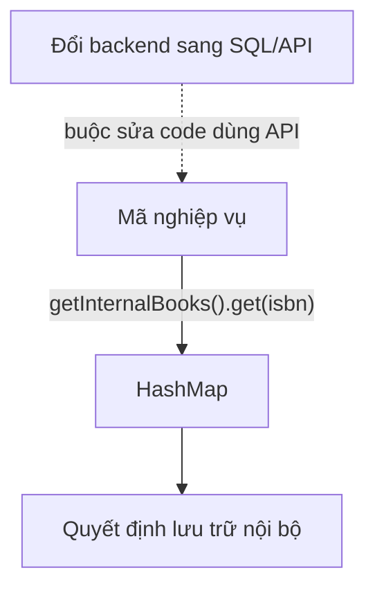
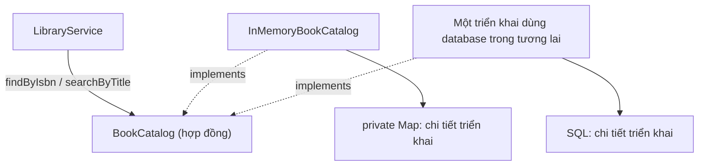

# Leaking Implementation Details Through Public Interfaces (Leaky Abstraction) in Java

In OOP, **abstraction** helps consumers focus on an object's **contract and necessary behavior** instead of understanding its entire implementation. **Leaking implementation details through public interfaces** (*leaky abstraction*) occurs when information that should stay inside a class or module appears in its API or observable behavior, forcing external code to understand, depend on, or handle it.

For example, the business needs to "find a book by ID", but an API requires callers to access a book `HashMap`, remember its key structure, and check for `null` themselves. When the storage changes to a database, that old contract becomes an obstacle.

> Not every technical detail is a "leak". A file-handling API **may legitimately** accept `Path` or throw `IOException`. The question is which details belong to the API user's **intentional contract** and which are unnecessary internal decisions.

## 1. Identifying a Leaky API

Suppose a class stores books in memory:

```java
import java.util.HashMap;

record Book(String isbn, String title) {}

class LeakyBookStore {
    private final HashMap<String, Book> books = new HashMap<>();

    void add(Book book) {
        books.put(book.isbn(), book);
    }

    // Trả trực tiếp kiểu lưu trữ và dữ liệu bên trong.
    HashMap<String, Book> getInternalBooks() {
        return books;
    }
}
```

The consumer is forced to deal with internal details:

```java
LeakyBookStore store = new LeakyBookStore();
store.add(new Book("J-01", "Java OOP"));

Book found = store.getInternalBooks().get("J-01");
store.getInternalBooks().clear(); // Bỏ qua toàn bộ quy tắc của store!
```

There are **two related but distinct problems** here:

1. **Leaky abstraction:** the API requires callers to know the data lives in a `HashMap<String, Book>` and to call `get()`. If the backend changes to SQL queries, callers cannot use the same contract without code changes.
2. **Broken encapsulation:** the getter returns the actual mutable `HashMap` reference; callers can invoke `clear()`, `put()`, or `remove()` without going through business rules.

An API can leak implementation details **even when the data cannot be modified**: for example, returning a copy of a `HashMap` on every call still reveals the storage type and makes callers implement lookup themselves.



Remember: **good abstraction hides changeable decisions that callers need not know while exposing enough semantics for callers to perform their work correctly**.

## 2. Fixing the API with a Domain-Oriented Contract

Instead of asking "Which data structure currently holds the data?", consumers should ask "Can I find this book?" and "Which books match this keyword?".

A clear contract might be:

```java
interface BookCatalog {
    Optional<Book> findByIsbn(String isbn);
    List<Book> searchByTitle(String keyword, int limit);
}
```

In this contract:

- `findByIsbn` returns `Optional.empty()` when a book is absent.
- `searchByTitle` returns at most `limit` books whose titles contain the keyword; the result list is intended for reading only.
- Callers need not know whether the search uses a `Map`, SQL, a cache, or HTTP.
- `Optional` and `List` are general Java types selected for **result semantics**; the API does not force callers to use a specific collection implementation.

### Complete Compilable Example

Save everything into **`Main.java`** and run with Java 17 or Java 21:

```java
import java.util.ArrayList;
import java.util.HashMap;
import java.util.List;
import java.util.Locale;
import java.util.Map;
import java.util.Objects;
import java.util.Optional;

record Book(String isbn, String title) {
    Book {
        if (isbn == null || isbn.isBlank()) {
            throw new IllegalArgumentException("ISBN không được trống");
        }
        if (title == null || title.isBlank()) {
            throw new IllegalArgumentException("Tiêu đề không được trống");
        }
    }
}

interface BookCatalog {
    Optional<Book> findByIsbn(String isbn);

    // Kết quả có tối đa limit phần tử; limit phải dương.
    // Trong ví dụ, so khớp không phân biệt chữ hoa/chữ thường.
    List<Book> searchByTitle(String keyword, int limit);
}

final class InMemoryBookCatalog implements BookCatalog {
    // Quyết định lưu trữ này không xuất hiện trong BookCatalog.
    private final Map<String, Book> books = new HashMap<>();

    InMemoryBookCatalog(List<Book> initialBooks) {
        Objects.requireNonNull(initialBooks, "initialBooks");

        for (Book book : List.copyOf(initialBooks)) {
            if (books.putIfAbsent(book.isbn(), book) != null) {
                throw new IllegalArgumentException(
                        "Trùng ISBN: " + book.isbn());
            }
        }
    }

    @Override
    public Optional<Book> findByIsbn(String isbn) {
        validateIsbn(isbn);
        return Optional.ofNullable(books.get(isbn));
    }

    @Override
    public List<Book> searchByTitle(String keyword, int limit) {
        if (keyword == null || keyword.isBlank()) {
            throw new IllegalArgumentException("Từ khóa không hợp lệ");
        }
        if (limit <= 0) {
            throw new IllegalArgumentException("Giới hạn phải dương");
        }

        String needle = keyword.toLowerCase(Locale.ROOT);
        List<Book> result = new ArrayList<>();

        // Sắp xếp để thứ tự kết quả ổn định, không phụ thuộc HashMap.
        books.values().stream()
                .filter(book -> book.title()
                        .toLowerCase(Locale.ROOT).contains(needle))
                .sorted((a, b) -> a.isbn().compareTo(b.isbn()))
                .limit(limit)
                .forEach(result::add);

        return List.copyOf(result);
    }

    private static void validateIsbn(String isbn) {
        if (isbn == null || isbn.isBlank()) {
            throw new IllegalArgumentException("ISBN không hợp lệ");
        }
    }
}

final class LibraryService {
    private final BookCatalog catalog;

    LibraryService(BookCatalog catalog) {
        this.catalog = Objects.requireNonNull(catalog, "catalog");
    }

    void printBook(String isbn) {
        String title = catalog.findByIsbn(isbn)
                .map(Book::title)
                .orElse("Không tìm thấy");
        System.out.println(title);
    }

    void printMatches(String keyword, int limit) {
        for (Book book : catalog.searchByTitle(keyword, limit)) {
            System.out.println(book.isbn() + ": " + book.title());
        }
    }
}

public class Main {
    public static void main(String[] args) {
        BookCatalog catalog = new InMemoryBookCatalog(List.of(
                new Book("J-01", "Java OOP"),
                new Book("S-02", "Spring Data"),
                new Book("J-03", "Advanced Java")
        ));
        LibraryService service = new LibraryService(catalog);

        service.printBook("S-02");
        service.printBook("UNKNOWN");
        service.printMatches("java", 2);

        List<Book> snapshot = catalog.searchByTitle("java", 10);
        try {
            snapshot.clear();
        } catch (UnsupportedOperationException ex) {
            System.out.println("Kết quả không thể bị sửa từ caller");
        }
    }
}
```

Run:

```bash
javac Main.java
java Main
```

Output:

```text
Spring Data
Không tìm thấy
J-01: Java OOP
J-03: Advanced Java
Kết quả không thể bị sửa từ caller
```

### What Has Improved?



`LibraryService` depends only on the `BookCatalog` contract. Replacing `InMemoryBookCatalog` with a database-backed implementation can leave business code unchanged **if** the new implementation preserves the same input conditions, result semantics, ordering, limits, and error policy.

Returning `List.copyOf(result)` prevents callers from modifying the result collection. Because `Book` is a record containing two immutable `String` values, its elements expose no mutable state. Records containing `List`, arrays, or mutable objects require further protection; neither `record` nor `List.copyOf` automatically performs a deep copy.

Note: `BookCatalog` is a read API. The example deliberately exposes no operation to add, modify, or delete books externally. If writes are needed, design separate domain operations with data-integrity rules instead of exposing an internal `Map` for arbitrary caller changes.

## 3. Common Forms of Leakage in Java Applications

Leaks are not limited to returning collections. They may appear through **data types, exceptions, resource lifetimes, operation ordering, and hidden behavior**.

| Potentially leaky API | What must the caller know? | A more suitable contract |
| --- | --- | --- |
| `HashMap<String, Book> getBooks()` | Storage structure and key conventions | `Optional<Book> findByIsbn(String)` |
| `ResultSet findStudent(long id)` | JDBC, row cursors, and open connections | `Optional<Student> findById(long)` |
| `EntityManager getManager()` | JPA's persistence mechanism | Domain query/operation methods |
| `boolean createOrder(Map<String,Object> rawRow)` | Column names or physical record structure | `createOrder(CreateOrderCommand command)` |
| `void updateCacheKey(String redisKey)` | Redis key conventions | `invalidateProduct(ProductId id)` |
| `void setBalanceField(long rawValue)` | Balance-state storage details | `deposit(amount)`, `withdraw(amount)` |
| Returns an ORM entity with a lazy association to the web layer | Session lifetime and lazy-loading rules | A materialized DTO or an appropriate query |
| Throws raw SQL query errors from a domain API | Driver/database details and error interpretation | Domain-meaningful errors that preserve the original cause |
| Returns a `Stream` still tied to an open DB connection | Connection lifetime and responsibility for closing the stream | Return materialized results or document that the stream must be closed |

These are **warning signs**, not absolute prohibitions. If you are building a low-level JDBC library for database developers, returning a `ResultSet` or accepting a `Connection` may be a legitimate contract. The key question is: *Does the consumer genuinely need that detail to fulfill their responsibility?*

## 4. Data API Example: When `SQLException` Crosses the Wrong Boundary

Suppose an application service needs to check whether a book exists:

```java
// Ví dụ thể hiện sự phụ thuộc không cần thiết vào JDBC:
interface LeakyAvailability {
    boolean isAvailable(String isbn) throws java.sql.SQLException;
}
```

A controller or pricing class using this interface must handle `SQLException` even though it only cares whether "the book is available". The API reveals that the implementation may currently use a relational database and makes switching backends harder.

A domain-oriented contract could be:

```java
interface BookAvailability {
    boolean isAvailable(String isbn);
}

// Ví dụ lỗi do ứng dụng định nghĩa:
class CatalogUnavailableException extends RuntimeException {
    CatalogUnavailableException(String message, Throwable cause) {
        super(message, cause);
    }
}
```

A JDBC adapter can catch `SQLException` and throw `CatalogUnavailableException` with the **original cause** for diagnosis. Callers must distinguish `false` (lookup succeeded, but the book is absent) from **system failure** (lookup could not complete). Do not turn every exception into `false` because that distorts the result's meaning.

Example error translation:

```java
// Trong một JDBC adapter thực tế:
try {
    // Thực hiện truy vấn
} catch (java.sql.SQLException ex) {
    throw new CatalogUnavailableException(
            "Tạm thời không kiểm tra được danh mục", ex);
}
```

This snippet illustrates **error handling**, not a complete, standalone compilable class. In production code, put it inside the JDBC adapter method and specify which errors can be retried, which represent invalid requests, and which should be reported to users.

There is also no need to hide every technical exception behind one generic exception. The contract should preserve enough meaning for callers to make correct decisions (for example, invalid input, conflicts, missing data, or unavailable services) without requiring driver names or vendor-specific SQL knowledge.

## 5. Leaks Through Execution Timing and Resource Lifetimes

Suppose a repository returns a `Stream<Book>` that still requires an open `ResultSet` and `Connection` to read each element. Callers think they are working with a plain Java collection, but traversing the stream outside a closed transaction fails. The leaked detail is the **lifecycle requirement** of the persistence mechanism.

Two approaches are valid, depending on requirements:

**Read a moderate amount and return independent results:**

```java
List<Book> findRecentBooks(int limit);
```

The implementation queries, converts data into `Book` objects, closes resources, and returns a list with a clear contract.

**Use true streaming for large datasets:**

```java
// Hợp đồng phải nói rõ caller sở hữu Stream và cần đóng.
java.util.stream.Stream<Book> streamRecentBooks();
```

For streaming, document that callers use `try-with-resources` when the stream owns resources needing closure; avoid access depending on a session that "happens to be open". Returning a `Stream` **does not guarantee** its connection closes after traversal; closure depends on how the adapter implements `onClose` and on the API contract.

Beyond data types, order-of-operation constraints can leak:

- Call `connect()` before `find()`, even though connection setup belongs to the adapter.
- Call `flush()` after every update to make data "really" persist, though API consumers only need to save an order.
- Know to call `initializeLazyFields()` before serializing a DTO.

A good API attempts to **manage internal constraints within its own responsibility** or make genuinely necessary constraints explicit in a contract, instead of allowing callers to discover them indirectly through runtime failures.

## 6. Avoid Accidentally Exposing the Data Model

Some APIs expose neither `HashMap` nor JDBC, yet still reveal **table structure, infrastructure field names, or data-join strategies**:

```java
// Hợp đồng buộc caller biết cột storage và giá trị mã hóa:
Map<String, Object> loadRow(String tableName, long primaryKey);

// Hợp đồng hướng nghiệp vụ:
Optional<OrderSummary> findOrderSummary(OrderId orderId);
```

The second example uses domain types such as `OrderId` and `OrderSummary`. Consumers need not know whether data comes from one table, several tables, a cache, or HTTP. Each domain type needs a clear definition: what an order represents, what each field means, and whether an empty result is possible.

In Spring applications, the adapter may need `JpaRepository`, but services/controllers need not all depend directly on entities, lazy proxies, and `EntityManager`. This **does not mean an additional interface is always required**. Introduce abstraction boundaries where they protect real changes or divide actual responsibilities.

### Are `Page` / `Pageable` Always Leaks?

No. If the contract is for paginated search and consumers understand ordering, page numbers, and page sizes, **pagination is a real business or product requirement**. However, forcing a core API to depend on `org.springframework.data.domain.Page` may be unnecessary when some callers need to work outside Spring.

An independent result type may be appropriate when the module boundary truly requires it:

```java
record SearchPage<T>(
        List<T> items, long totalItems, int page, int pageSize) {
    SearchPage {
        items = List.copyOf(items);
        if (totalItems < 0 || page < 0 || pageSize <= 0) {
            throw new IllegalArgumentException("Thông số trang không hợp lệ");
        }
    }
}
```

But do not introduce a new `SearchPage` solely to "avoid using Spring" when the whole system intentionally uses Spring Data and the existing contract fits. **Abstraction is about choosing valuable boundaries**, not about the number of wrapper layers.

## 7. Implementation Details Can Also Leak Through Behavior

An API declared with general-purpose types is not necessarily independent of its implementation. For example:

```java
List<Book> searchByTitle(String keyword);
```

Without further contractual guarantees, callers can easily come to rely on incidental current behavior:

- **Ordering:** results from `HashMap.values()` have no guaranteed order. Switching to PostgreSQL or changing traversal can reorder elements.
- **Case sensitivity:** one backend matches `"java"` and `"Java"` while another does not.
- **Pagination:** one implementation silently limits results to 100, while another returns everything.
- **Data freshness:** a cache may lag behind updates, while a direct query may return newer data.
- **Exceptions:** "not found" returns `null` in one implementation but throws in another.
- **Cost:** an operation that looks like an in-memory lookup actually sends HTTP requests in every loop iteration.

For an abstraction to be dependable, **define observable behavior**: input conditions, missing-result semantics, ordering, limits, duplicate handling, errors, and meaningful performance constraints. You need not document each implementation step, only what callers must be able to rely on.

For example, this lesson specifies that `searchByTitle("java", 10)` performs case-insensitive matching and sorts by ISBN in ascending order. Future adapters must preserve that behavior; they cannot return arbitrary ordering and claim that "returning a `List<Book>` is enough".

**Do not hide distributed-system realities:** a remote service has timeouts, network failures, and latency that an ordinary in-memory access does not. An interface cannot erase these characteristics. Its contract should express timeouts, retries, or possible errors to the extent callers need to know them, avoiding false expectations that all implementations behave like in-memory ones.

## 8. Refactoring an API That Leaks

Suppose a system has many callers using `getInternalBooks().get(isbn)`. Improve it in the following order:

1. **List the behaviors callers actually need:** lookup by ISBN, existence checks, title search, statistics, and whether direct data modification is truly necessary.
2. **Define contracts around those needs:** `findByIsbn`, `searchByTitle`, and `addBook` if updates belong to the API. Specify results and errors.
3. **Implement the contract over the current structure:** keep the `HashMap` private and move lookup/validation logic inside.
4. **Migrate callers to the new API:** have them request behaviors instead of manipulating raw data.
5. **Stop exposing the old access path** once callers have migrated and version compatibility permits; public libraries may need a `@Deprecated` period and migration policy.
6. **Test the contract across multiple implementations or an independent fake:** callers should not need to cast to `InMemoryBookCatalog`.

Avoid rushing into an overly generic interface such as:

```java
interface Repository {
    Object execute(String command, Object[] arguments);
}
```

This API no longer exposes `HashMap` but **loses business semantics**, pushing parsing, casting, and error checks onto callers. This is not a good abstraction. A contract should be specific enough for consumers to work correctly without knowing internal details.

If there is no actual requirement to change the implementation, a concrete class with a clear public API can still be an entirely appropriate abstraction. An `interface` is not mandatory for every class.

## 9. Checklist for Reviewing Public Interfaces

| Question | Sign that adjustment may be needed |
| --- | --- |
| Does the method name describe behavior the caller needs? | `getRawRows`, `getInternalMap`, or `executeSql` in a domain API |
| Do parameter/result types expose a framework or backend? | The controller needs an `EntityManager` or `ResultSet` |
| Can callers unintentionally modify internal state? | A getter exposes a mutable `List` or array owned by the class |
| Are "not found" and "system error" results unambiguous? | One `null` represents several situations |
| Are there hidden timing or call-order requirements? | A transaction must be manually opened to read a supposedly complete DTO |
| Are callers relying on behavior the contract does not promise? | Depending on `HashMap` iteration order |
| Does changing the implementation require caller changes? | Callers use a concrete class, SQL, or cache key instead of the contract |
| Is the API too abstract to convey meaning? | `Object execute(...)`, forcing callers to cast everywhere |
| Does the API enforce business constraints? | Callers bypass validation by modifying raw data |
| Does this boundary actually need separating? | Extra intermediary classes do nothing but forward the same calls |

**Do not equate "hiding everything" with good abstraction.** Choices that affect consumer behavior (such as search ordering, pagination, query failures, and permissions to change data) must be described clearly. Hide implementation details unnecessary to use the contract.

## 10. Self-Check Exercises

**Question 1.** What is wrong with `Map<String, Product> getInternalCache()` in a sales service?

**Answer:** Callers learn the cache structure and key conventions and may modify its contents if the map is mutable. Replacing the cache with a different system then affects callers. Consider `Optional<Product> findProduct(String id)` or a meaningful domain operation.

**Question 2.** Does replacing a returned `HashMap` with `Collections.unmodifiableMap(internal)` completely eliminate abstraction leaks?

**Answer:** **Not necessarily.** The view prevents modification through that reference but still requires callers to understand maps and keys; changes to the backing map are also reflected in the view. Preventing mutation and hiding implementation structure are distinct concerns.

**Question 3.** Is an API declaring `readFile(Path path) throws IOException` necessarily a leaky abstraction?

**Answer:** **Not necessarily.** When the public purpose is direct file operations, `Path` and `IOException` legitimately belong to the contract. But if an API such as `getCustomerProfile()` requires callers to know JSON file paths and handle file errors, that may be an unnecessary leak.

**Question 4.** Two `BookCatalog` implementations differ in case sensitivity during search. Can they safely substitute for each other?

**Answer:** If the contract requires case-insensitive matching, the other implementation violates it. Good abstraction requires **behavioral** compatibility, not just compatible method signatures.

**Question 5.** Does wrapping a `findById()` in an interface with `HashMap` automatically guarantee thread safety and transactions?

**Answer:** **No.** An interface only expresses a contract; atomicity, visibility, and transactions are implementation responsibilities and must be specified when callers rely on them.

**Question 6.** Why shouldn't every API become `Object execute(String command)` in an attempt to hide implementation details completely?

**Answer:** Because callers must then understand command strings, parse data, and cast values, moving the details to consumers while obscuring the type contract and semantics.

**Remember:** Evaluate an abstraction by **what external code needs to know to use it correctly** and **how much implementation changes affect that code**. A good API exposes behavior, data, and errors at the level consumers need while keeping storage, framework, and internal state details with their owner. Do not hide observable properties that callers truly need to rely on.
