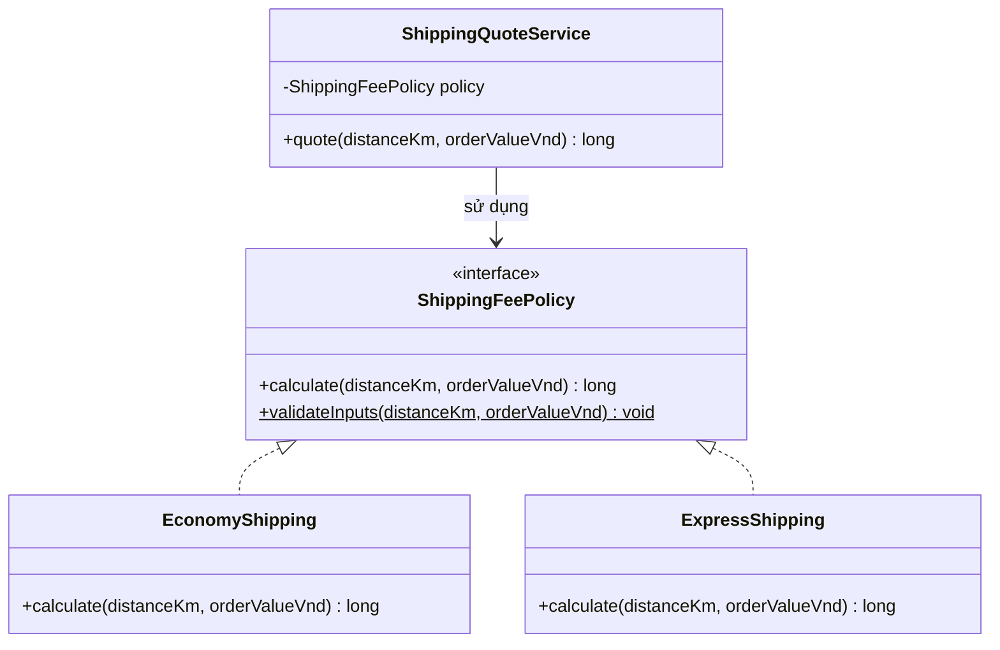
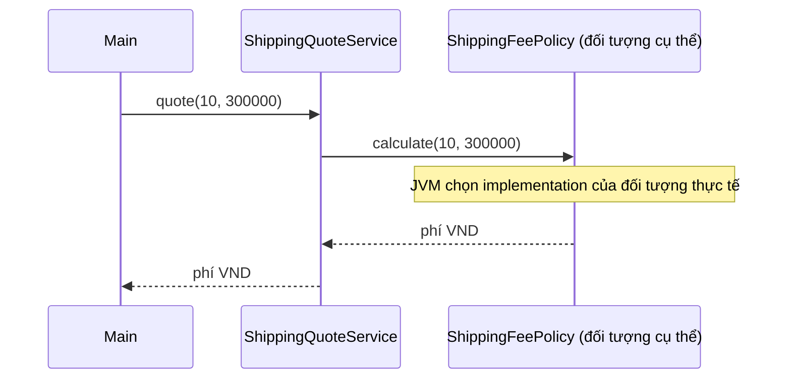

# Declaring and implementing interfaces in Java

In object-oriented programming, **an interface** describes the behaviors that an object type promises to provide. A class **implements an interface** (*implements*) by writing code for the methods in that contract.

For example, a sales system may have several ways to calculate shipping fees. The checkout service only needs to ask “what is the delivery fee for this distance and order value?” It does not need to know whether the fee comes from an economy or express shipping policy. An interface separates **what the caller needs** from **how each class calculates it**.

This lesson uses Java 11 or later, with `.java` files that can be compiled directly.

## 1. Basic syntax

Declare an interface:

```java
public interface Greeter {
    String greet(String name);
}
```

Declare an implementing class:

```java
public final class VietnameseGreeter implements Greeter {
    @Override
    public String greet(String name) {
        return "Xin chào, " + name;
    }
}
```

Usage:

```java
Greeter greeter = new VietnameseGreeter();
System.out.println(greeter.greet("Lan")); // Xin chào, Lan
```

Key elements to understand:

| Syntax | Meaning |
| --- | --- |
| `interface Greeter` | Declares an interface type named `Greeter` |
| `String greet(String name);` | Method signature; here it is an abstract method without a body |
| `class VietnameseGreeter implements Greeter` | Declares a class that promises to implement the interface |
| `@Override` | Requests a compiler check that the method actually overrides/implements an inherited method |
| `public String greet(...)` | Provides the method body; `public` is required because the interface contract is public |
| `Greeter greeter = new VietnameseGreeter()` | An interface-typed variable holds a reference to a concrete implementing object |

In an interface, an ordinary instance method without a body, such as `greet` above, **is implicitly `public abstract`**. Therefore:

```java
String greet(String name);
```

is equivalent to:

```java
public abstract String greet(String name);
```

An implementing class must use a `public` method; it cannot reduce access to `protected`, package-private, or `private`.

Key point: **an interface is a data type**, but you cannot instantiate it directly using `new Greeter()`. Instead, create an object from a concrete implementing class (or a suitable anonymous class/expression) and store its reference using the interface type.

## 2. Real-world problem: changing shipping fee calculations

Suppose an order can be quoted under two policies:

- **Economy:** a base fee of 10.000 VND plus 2.500 VND per km; shipping is free when the goods are worth at least 500.000 VND.
- **Express:** a base fee of 20.000 VND plus 5.000 VND per km; no free-shipping threshold based on order value.

Distance is a nonnegative whole number of kilometers, and order value is a nonnegative integer amount in VND. When large values would overflow `long` arithmetic, the example reports an error instead of returning an incorrect fee.

We want checkout logic to avoid an `if (shippingType.equals(...))` chain that decides every formula itself. Instead, the checkout service **depends on an interface**.

### Step 1: define the contract in `ShippingFeePolicy.java`

```java
/**
 * Chính sách tính phí giao hàng.
 *
 * distanceKm >= 0 và orderValueVnd >= 0.
 * Kết quả là số tiền nguyên VND không âm.
 * Với đầu vào âm, ném IllegalArgumentException.
 * Nếu tính phí bị tràn long, có thể ném ArithmeticException.
 */
public interface ShippingFeePolicy {

    long calculate(int distanceKm, long orderValueVnd);

    // Phương thức static dùng chung để kiểm tra đầu vào.
    static void validateInputs(int distanceKm, long orderValueVnd) {
        if (distanceKm < 0 || orderValueVnd < 0) {
            throw new IllegalArgumentException(
                    "Quãng đường và giá trị đơn không được âm");
        }
    }
}
```

Here `calculate(...)` is an **extension point**: each policy supplies its own formula, but all policies must satisfy the stated input and output rules. `validateInputs(...)` is a `static` method on the interface itself; implementing classes can call it directly through `ShippingFeePolicy.validateInputs(...)`.

From a design perspective, shared logic does not always belong in an interface. In this example, validating the two parameters is part of the shared contract, so a short `static` method demonstrates a capability of modern Java interfaces.

### Step 2: implement the economy policy

File `EconomyShipping.java`:

```java
public final class EconomyShipping implements ShippingFeePolicy {

    private static final long FREE_SHIPPING_FROM_VND = 500_000L;
    private static final long BASE_FEE_VND = 10_000L;
    private static final long PER_KM_VND = 2_500L;

    @Override
    public long calculate(int distanceKm, long orderValueVnd) {
        ShippingFeePolicy.validateInputs(distanceKm, orderValueVnd);

        if (orderValueVnd >= FREE_SHIPPING_FROM_VND) {
            return 0L;
        }

        long distanceFee =
                Math.multiplyExact(PER_KM_VND, (long) distanceKm);
        return Math.addExact(BASE_FEE_VND, distanceFee);
    }
}
```

`EconomyShipping` uses `implements ShippingFeePolicy`. The compiler verifies that the class provides `calculate(int, long)` with a compatible return type. The formula and internal constants belong to the concrete class; an interface-typed caller need not know them.

### Step 3: implement the express policy

File `ExpressShipping.java`:

```java
public final class ExpressShipping implements ShippingFeePolicy {

    private static final long BASE_FEE_VND = 20_000L;
    private static final long PER_KM_VND = 5_000L;

    @Override
    public long calculate(int distanceKm, long orderValueVnd) {
        ShippingFeePolicy.validateInputs(distanceKm, orderValueVnd);

        long distanceFee =
                Math.multiplyExact(PER_KM_VND, (long) distanceKm);
        return Math.addExact(BASE_FEE_VND, distanceFee);
    }
}
```

Both classes **satisfy the same signature** but implement different behavior. This enables polymorphism: a `policy.calculate(...)` call executes the method of the concrete class referenced by `policy`.

### Step 4: let the service use the interface instead of a concrete class

File `ShippingQuoteService.java`:

```java
import java.util.Objects;

public final class ShippingQuoteService {
    private final ShippingFeePolicy policy;

    public ShippingQuoteService(ShippingFeePolicy policy) {
        this.policy = Objects.requireNonNull(policy, "policy");
    }

    public long quote(int distanceKm, long orderValueVnd) {
        return policy.calculate(distanceKm, orderValueVnd);
    }
}
```

`ShippingQuoteService` does not construct `new EconomyShipping()` or `new ExpressShipping()` internally. The policy object is passed through its constructor. This is a simple example of **constructor-based dependency injection**: a higher-level component receives a dependency through an abstraction. No framework is required to use this design.

### Step 5: run the complete example

File `Main.java`, in the same directory as the four files above:

```java
public class Main {
    public static void main(String[] args) {
        ShippingFeePolicy economyPolicy = new EconomyShipping();
        ShippingFeePolicy expressPolicy = new ExpressShipping();

        ShippingQuoteService economyQuote =
                new ShippingQuoteService(economyPolicy);
        ShippingQuoteService expressQuote =
                new ShippingQuoteService(expressPolicy);

        System.out.println(economyQuote.quote(10, 300_000));
        System.out.println(economyQuote.quote(10, 600_000));
        System.out.println(expressQuote.quote(10, 300_000));

        try {
            expressQuote.quote(-1, 300_000);
        } catch (IllegalArgumentException ex) {
            System.out.println("Từ chối: " + ex.getMessage());
        }
    }
}
```

Run from a terminal:

```bash
javac ShippingFeePolicy.java EconomyShipping.java ExpressShipping.java ShippingQuoteService.java Main.java
java Main
```

Output:

```text
35000
0
70000
Từ chối: Quãng đường và giá trị đơn không được âm
```

Explaining the output:

| Policy | Distance | Order value | Returned fee |
| --- | ---: | ---: | ---: |
| Economy | 10 km | 300.000 VND | 10.000 + 2.500 × 10 = **35.000 VND** |
| Economy | 10 km | 600.000 VND | **0 VND** (qualifies for free shipping) |
| Express | 10 km | 300.000 VND | 20.000 + 5.000 × 10 = **70.000 VND** |

The service only knows `ShippingFeePolicy`. To add a third policy, create another class implementing the same interface and pass it to the service; no change to the fee calculation inside `ShippingQuoteService` is required.

## 3. Understanding polymorphic dispatch through interfaces



The dashed line with a hollow triangle represents a **realization/implements** relationship. `ShippingQuoteService` collaborates with `ShippingFeePolicy` through a field whose type is the interface.

Execution flow:



In a particular call, `policy` may refer to an `EconomyShipping` or `ExpressShipping` object. At runtime Java selects **the instance method implementation** based on the actual object type. The compiler still uses **the declared reference type** to determine which methods may be called.

For example:

```java
ShippingFeePolicy policy = new EconomyShipping();
long fee = policy.calculate(8, 200_000); // Hợp lệ

// policy.onlyEconomyFeature(); // Không hợp lệ nếu method
// này không được khai báo trong ShippingFeePolicy.
```

If you need behavior available only on a concrete class, consider whether a separate contract would be appropriate. Repeatedly downcasting from an interface to its implementation often indicates that the abstraction does not fit the client.

## 4. Rules for declaring and implementing interfaces

### Abstract methods must be implemented

```java
interface Printer {
    void print(String text);
    int pagesPrinted();
}
```

A **concrete** class declaring `implements Printer` must provide every abstract method that has not already been inherited from another source:

```java
class ConsolePrinter implements Printer {
    private int pages;

    @Override
    public void print(String text) {
        System.out.println(text);
        pages++;
    }

    @Override
    public int pagesPrinted() {
        return pages;
    }
}
```

If `pagesPrinted()` is missing, the concrete class will not compile. An `abstract` class may implement only part of the contract and leave the rest for subclasses:

```java
abstract class BasePrinter implements Printer {
    @Override
    public int pagesPrinted() {
        return 0;
    }
    // Chưa định nghĩa print(String): được phép vì class abstract.
}
```

Note that `pagesPrinted()` in `BasePrinter` returns a fixed `0` solely to illustrate syntax; a real implementation should return the accurate page count required by its contract.

### Access levels cannot be narrowed

```java
interface Task {
    void execute(); // implicit public abstract
}

class MyTask implements Task {
    @Override
    public void execute() { // Bắt buộc public
        System.out.println("Thực hiện");
    }
}
```

Writing `void execute()` without `public` when implementing the method causes a compile error because it attempts to reduce the access level of a `public` method.

### Method signatures must be compatible

An implementation must match the method name and parameter list, and its return type must be compatible, including the **covariant return type** rules for reference types. Declaring an overload with different parameters does not implement the required method.

```java
interface Parser {
    String parse(String input);
}

class TrimParser implements Parser {
    @Override
    public String parse(String input) {
        return input.trim();
    }

    // Đây là overload, không phải cách thay thế parse(String).
    public String parse(int value) {
        return Integer.toString(value);
    }
}
```

`@Override` is very useful: if you mistakenly write `parse(Object)` instead of `parse(String)`, the compiler reports that no matching method exists to override.

## 5. Interfaces may also declare methods with bodies

In the main `ShippingFeePolicy` example, `calculate(int,long)` is an **abstract** method that concrete classes must implement, whereas `static validateInputs(...)` already has a body and is called through the interface name. Modern Java also permits:

~~~java
interface NamedTask {
    String name();                        // public abstract

    default String describe() {           // Java 8+
        return "Task: " + name();
    }

    static boolean isValid(String value) { // Java 8+
        return value != null && !value.isBlank();
    }

    private String normalized() {         // Java 9+
        return name().strip();
    }
}
~~~

`default` provides instance behavior that may be inherited or overridden; `static` cannot be called as an instance method; and `private` is a helper inside the interface (unused in this example). Every field declared directly in an interface is implicitly `public static final`, with no per-instance state. For the **complete** rules on modifiers, fields, default-method conflicts, and language compatibility, see *Default members and language-specific limitations*.

## 6. Using `implements` for multiple interfaces still creates only one object

A class can accept several contracts through a comma-separated list:

~~~java
interface Printable { void print(); }
interface Exportable { String export(); }

class Report implements Printable, Exportable {
    public void print() { System.out.println("In báo cáo"); }
    public String export() { return "report"; }
}

Report report = new Report();
Printable printer = report;
Exportable exporter = report;
~~~

The interface variables `printer` and `exporter` both refer to **the same** `Report` object; they create no additional instances, and each exposes only the API of its corresponding role. An interface may also `extends` multiple interfaces, whereas a Java class may directly `extends` only one class.

When unrelated interfaces declare the same default method, Java has explicit rules for resolving the conflict; it does not choose randomly. The *One object implementing multiple interfaces* lesson traces state changes through multiple references and examines method collisions.

## 7. How interfaces and abstract classes differ in design

| Requirement | Interface | Abstract class |
|---|---|---|
| Expose an API to unrelated class types | Declare a contract through `implements` | Constrain types to an inheritance family |
| Combine multiple roles | Allow a class to `implements` multiple interfaces | A class has only one direct superclass |
| Share constructors, instance fields, or base algorithms | No constructors or instance fields | Supports shared state and implementation |

For example, `ShippingQuoteService` only cares about `ShippingFeePolicy`; it does not need to know whether policies share a superclass. If a family of policies genuinely shares a base formula and configuration state, it may extend an abstract class that `implements ShippingFeePolicy`, while independent policies can still `implements` the interface directly. The *Choosing an interface or an abstract class* lesson provides a complete example of this choice and composition.

## 8. Checking the contract across implementations

Although `EconomyShipping` and `ExpressShipping` both compile, the program may still be wrong if an implementation returns a negative fee or ignores the requirement for nonnegative inputs. The compiler checks **signatures**; business constraints must be upheld through code and testing.

File `ContractCheck.java`:

```java
public class ContractCheck {
    public static void main(String[] args) {
        ShippingFeePolicy[] policies = {
            new EconomyShipping(),
            new ExpressShipping()
        };

        for (ShippingFeePolicy policy : policies) {
            long fee = policy.calculate(10, 300_000);
            if (fee < 0) {
                throw new AssertionError("Phí giao hàng bị âm");
            }

            boolean rejected = false;
            try {
                policy.calculate(-1, 300_000);
            } catch (IllegalArgumentException expected) {
                rejected = true;
            }

            if (!rejected) {
                throw new AssertionError("Không từ chối quãng đường âm");
            }
        }

        require(
                new EconomyShipping().calculate(10, 300_000) == 35_000,
                "Sai phí Economy");
        require(
                new EconomyShipping().calculate(10, 600_000) == 0,
                "Sai điều kiện miễn phí");
        require(
                new ExpressShipping().calculate(10, 300_000) == 70_000,
                "Sai phí Express");

        System.out.println("PASS: Các implementation giữ hợp đồng");
    }

    private static void require(boolean condition, String message) {
        if (!condition) {
            throw new AssertionError(message);
        }
    }
}
```

Run:

```bash
javac ShippingFeePolicy.java EconomyShipping.java ExpressShipping.java ContractCheck.java
java ContractCheck
```

Output:

```text
PASS: Các implementation giữ hợp đồng
```

In real projects, these checks can become JUnit tests run against several implementations. **Using the same behavioral tests** helps detect a new class that implements the correct signature but violates a rule clients depend on.

### Common compilation errors to recognize

| Code or scenario | Problem | Fix |
| --- | --- | --- |
| `new ShippingFeePolicy()` | An interface cannot be instantiated directly | Use `new EconomyShipping()` or another implementation |
| A class implements the interface but omits `calculate` | The concrete class has not fulfilled the contract | Implement the required method or declare the class `abstract` |
| `long calculate(...)` without `public` | Attempts to reduce the access level of an interface method | Add `public` |
| Writing `calculate(long, long)` instead of `calculate(int, long)` | An overload with a different signature does not implement the required method | Match the parameter type list exactly |
| Calling `policy.specialFeature()` when it is not in the interface | The declared variable type does not expose that method | Redesign the contract or use the appropriate type when genuinely necessary |
| Calling `policy.validateInputs(...)` | A static method is not an inherited instance method | Use `ShippingFeePolicy.validateInputs(...)` |
| Two conflicting default methods | No unique implementation can be selected | Override the method and resolve the conflict |
| Using an interface as mutable field storage | Interface fields are always `public static final` constants | Keep state in a suitable class or object |

## 9. Organizing files in real projects

The example places all classes in one directory without package declarations so beginners can compile them with `javac`. Larger applications should use clear package structures. For example:

```text
src/main/java/com/example/shipping/
├── ShippingFeePolicy.java
├── EconomyShipping.java
├── ExpressShipping.java
└── ShippingQuoteService.java
```

Each file would begin with `package com.example.shipping;`. `Main` or a REST controller in another package uses the interface through the corresponding `import`. With Spring, a bean from an implementing class can be injected into the service through a constructor, but **a Java interface itself does not depend on Spring**. If several beans implement the same interface, configuration must specify which implementation is selected; that is the DI mechanism's responsibility, not an automatic decision made by Java interfaces.

A useful design is to make domain/service code depend on **small, purpose-specific interfaces** instead of combining unrelated operations into a “super-interface.” If a client only calculates fees, it should not also need to know about order storage, email delivery, and parcel tracking.

## 10. Practice on your own

**Exercise A — change the formula without changing the service.** Create `SameDayShipping implements ShippingFeePolicy` with a fee of 35.000 VND + 7.000 VND per km and no free shipping. Preserve input validation. Pass it to `ShippingQuoteService` and calculate the fee for 4 km. **Expected result: 63.000 VND**.

**Exercise B — predict the compilation error.**

```java
interface Reader {
    String read();
}

class FileReaderExample implements Reader {
    String read() {
        return "data";
    }
}
```

Where is the error? The method in `Reader` is implicitly `public`, but `FileReaderExample.read()` has no modifier and is therefore package-private. Change it to `public String read()` and consider adding `@Override`.

**Exercise C — an interface with multiple methods.** Define `Resizable` with `void resize(int width, int height)` and `int area()`. Implement `Rectangle` with positive width and height; `area()` should return the area without changing state. Decide explicitly how to handle overflow when multiplying `int` values.

**Exercise D — multiple interfaces.** Write `interface Identifiable { String id(); }` and `interface Printable { void print(); }`; create an `Invoice` class that implements both. Use two interface-typed variables to invoke their respective behaviors on the same object.

**Exercise E — default methods.** Define `interface Named { String name(); default String displayName() { return name().trim(); } }`. Implement one class that uses the default method and another that overrides it. Observe how clients invoke `displayName()` through a `Named` variable.

## Key points when reading or designing interfaces

A good interface answers: **“Which behaviors must an implementing object provide, and what are the valid inputs and expected results?”** When implementing an interface, check method signatures, `public` access, business guarantees, and failure cases. When using one, create an implementing object and interact through **the interface type** to reduce coupling to internal details.

Three essential lines:

```java
interface Action { void run(); }       // Khai báo hợp đồng
class Job implements Action {          // Thực hiện hợp đồng
    @Override public void run() { System.out.println("Run"); }
}
```

And:

```java
Action action = new Job(); // Biến theo interface, đối tượng theo class
action.run();              // Gọi implementation của Job
```

Once you understand that **`interface` declares the contract**, **`implements` supplies the behavior**, and **an interface-typed variable enables polymorphic calls**, you can add new implementations without changing how clients use the application.
