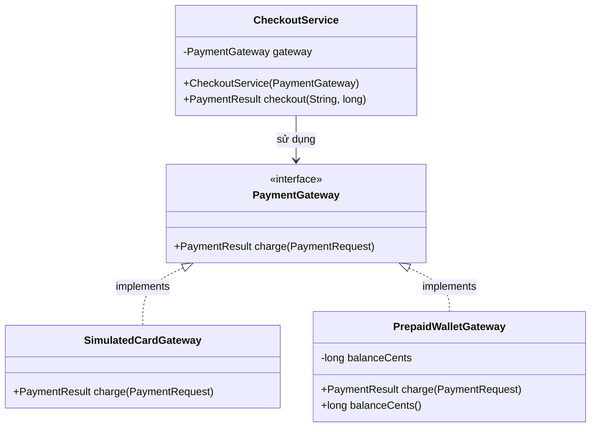
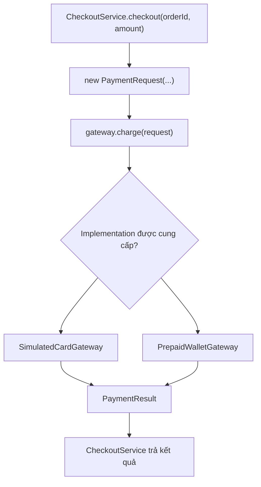

# Programming to interfaces in Java

> **Topic:** OOP → Interfaces. When a component only needs to know **a capability or contract** of another component, make it depend on an `interface` instead of a concrete implementing class. Business logic can then work with multiple implementations, switch underlying technologies, and use fakes in tests without changing its core logic.

## 1. The problem with depending directly on concrete classes

Suppose `CheckoutService` processes payments through a card gateway:

```java
class CardGateway {
    boolean charge(long amountCents) {
        // Ví dụ mô phỏng, không kết nối cổng thanh toán thật.
        return true;
    }
}

class CheckoutService {
    private final CardGateway gateway = new CardGateway();

    boolean checkout(long amountCents) {
        return gateway.charge(amountCents);
    }
}
```

Here `CheckoutService` constructs and depends directly on `CardGateway`. To use a prepaid wallet, simulate payment errors in tests, or change providers, we would usually have to modify `CheckoutService` or add `if` branches to choose a gateway.

**The principle of programming to interfaces:** instead of knowing *who* processes a payment, `CheckoutService` only needs to know *how to request a payment*.

```java
interface PaymentGateway {
    PaymentResult charge(PaymentRequest request);
}
```

The interface specifies **the behavior consumers may rely on**. Different classes can `implements PaymentGateway` and decide how to perform the operation.

## 2. How interface consumers and implementations relate



The arrow from `CheckoutService` to `PaymentGateway` represents **a dependency on an abstraction**. Gateway classes are **implementations** of the contract. `CheckoutService` does not need casts or `instanceof` checks to decide which class receives a request.

Three common roles:

| Role | In this example | Responsibility |
|---|---|---|
| Interface | `PaymentGateway` | Declares the payment operation |
| Consumer | `CheckoutService` | Coordinates checkout using the shared contract |
| Implementing classes | `SimulatedCardGateway`, `PrepaidWalletGateway` | Provide specific payment mechanisms |

The contract is more than **a method signature**. It should explain parameter meaning, return values, failure cases, side effects, and whether an operation may be repeated.

## 3. Complete Java example: switch implementations without modifying CheckoutService

Create `InterfaceProgrammingDemo.java` (Java 17 or later):

```java
import java.util.Objects;

public class InterfaceProgrammingDemo {

    public record PaymentRequest(String orderId, long amountCents) {
        public PaymentRequest {
            if (orderId == null || orderId.isBlank()) {
                throw new IllegalArgumentException("Mã đơn hàng không hợp lệ");
            }
            if (amountCents <= 0) {
                throw new IllegalArgumentException("Số tiền phải dương");
            }
        }
    }

    public record PaymentResult(boolean successful, String description) {
        public PaymentResult {
            Objects.requireNonNull(description, "description");
        }
    }

    public interface PaymentGateway {
        PaymentResult charge(PaymentRequest request);
    }

    // Implementation A: giả lập một cổng thẻ luôn trả thành công.
    public static final class SimulatedCardGateway implements PaymentGateway {
        @Override
        public PaymentResult charge(PaymentRequest request) {
            Objects.requireNonNull(request, "request");
            return new PaymentResult(true, "Thẻ mô phỏng: " + request.orderId());
        }
    }

    // Implementation B: ví trả trước có số dư được quản lý trong bộ nhớ.
    public static final class PrepaidWalletGateway implements PaymentGateway {
        private long balanceCents;

        public PrepaidWalletGateway(long openingBalanceCents) {
            if (openingBalanceCents < 0) {
                throw new IllegalArgumentException("Số dư không thể âm");
            }
            this.balanceCents = openingBalanceCents;
        }

        @Override
        public synchronized PaymentResult charge(PaymentRequest request) {
            Objects.requireNonNull(request, "request");

            if (request.amountCents() > balanceCents) {
                return new PaymentResult(false, "Ví không đủ số dư");
            }

            balanceCents -= request.amountCents();
            return new PaymentResult(true, "Ví đã trừ tiền");
        }

        public synchronized long balanceCents() {
            return balanceCents;
        }
    }

    // Lớp nghiệp vụ chỉ phụ thuộc vào PaymentGateway.
    public static final class CheckoutService {
        private final PaymentGateway gateway;

        public CheckoutService(PaymentGateway gateway) {
            this.gateway = Objects.requireNonNull(gateway, "gateway");
        }

        public PaymentResult checkout(String orderId, long amountCents) {
            PaymentRequest request = new PaymentRequest(orderId, amountCents);
            return gateway.charge(request);
        }
    }

    public static void main(String[] args) {
        CheckoutService cardCheckout =
            new CheckoutService(new SimulatedCardGateway());

        PrepaidWalletGateway wallet = new PrepaidWalletGateway(50_000);
        CheckoutService walletCheckout = new CheckoutService(wallet);

        PaymentResult card = cardCheckout.checkout("ORD-01", 120_000);
        PaymentResult walletOk = walletCheckout.checkout("ORD-02", 30_000);
        PaymentResult walletFail = walletCheckout.checkout("ORD-03", 30_000);

        System.out.println("CARD: " + card.successful());
        System.out.println("WALLET 1: " + walletOk.successful());
        System.out.println("WALLET 2: " + walletFail.successful());
        System.out.println("WALLET BALANCE: " + wallet.balanceCents());
    }
}
```

Compile and run:

```bash
javac InterfaceProgrammingDemo.java
java InterfaceProgrammingDemo
```

Expected output:

```text
CARD: true
WALLET 1: true
WALLET 2: false
WALLET BALANCE: 20000
```

`CheckoutService` has **one** constructor accepting `PaymentGateway` and **one** `checkout` code path. Whether supplied a card or wallet gateway, it calls `gateway.charge(request)`. The actual invocation reaches the implementation belonging to the supplied object.

In this example, `SimulatedCardGateway` always succeeds to illustrate replacing implementations; it is **not** a real card integration. `PrepaidWalletGateway` manages state within one instance and synchronizes debits using `synchronized`. Real payment systems also require authentication, idempotency, transactions, durable storage, and handling of uncertain external results.

### Declared types and runtime objects

```java
PaymentGateway gateway = new SimulatedCardGateway();
PaymentResult result =
    gateway.charge(new PaymentRequest("ORD-04", 10_000));
```

- The **declared** type of `gateway` is `PaymentGateway`: callers can rely only on members exposed by this contract.
- The **actual object** is a `SimulatedCardGateway`: its class supplies the instance-method implementation.
- Replacing it with `new PrepaidWalletGateway(50_000)` is also type-correct because that class `implements PaymentGateway`.
- Java selects the instance-method implementation using **the object's runtime type**, a form of polymorphism.



The step of **supplying an implementing object** determines the behavior. An `interface` does not itself choose which gateway to create, connect to external services, or handle configuration.

## 4. Constructor-based dependency injection

In the example, `CheckoutService` receives a `PaymentGateway` from outside:

```java
public CheckoutService(PaymentGateway gateway) {
    this.gateway = Objects.requireNonNull(gateway, "gateway");
}
```

This is **constructor injection**: the dependency is supplied when creating `CheckoutService`, so the class does not need to write `new SimulatedCardGateway()` internally.

The implementation can be selected in the application bootstrap component (*composition root*):

```java
PaymentGateway selected = new SimulatedCardGateway();
// Hoặc: new PrepaidWalletGateway(50_000);

CheckoutService service = new CheckoutService(selected);
```

You do not need Spring or a DI library for this technique. A DI framework can configure and supply objects, but the **design principle** remains that business code receives a previously created abstraction.

| Design | Consequence |
|---|---|
| Creating `new CardGateway()` inside `CheckoutService` | Ties the business class to one implementation and its construction |
| Constructor accepts a concrete `CardGateway` | Allows injection from outside but still depends on one class |
| Constructor accepts `PaymentGateway` | Accepts any implementation honoring the contract |
| Creating an interface merely to wrap a simple helper with no need for substitution | Adds structure without a clear benefit |

**Dependency Inversion Principle (DIP)** concerns the direction of dependencies between high-level logic and implementation details: both should rely on suitable abstractions. **Dependency Injection (DI)** is a way to *supply* those dependencies. The concepts are related but distinct.

## 5. Testing without a real payment service

A practical benefit of programming to interfaces is that we can replace the gateway with a simple **fake** to verify consumer logic.

Suppose we still use the `PaymentGateway`, `PaymentRequest`, `PaymentResult`, and `CheckoutService` types defined inside `InterfaceProgrammingDemo`. We can write a separate test class named `CheckoutContractCheck.java` in the same directory:

```java
public class CheckoutContractCheck {
    static final class RecordingGateway
            implements InterfaceProgrammingDemo.PaymentGateway {

        InterfaceProgrammingDemo.PaymentRequest lastRequest;
        int calls;

        @Override
        public InterfaceProgrammingDemo.PaymentResult charge(
                InterfaceProgrammingDemo.PaymentRequest request) {
            calls++;
            lastRequest = request;
            return new InterfaceProgrammingDemo.PaymentResult(true, "fake-ok");
        }
    }

    public static void main(String[] args) {
        RecordingGateway fake = new RecordingGateway();
        InterfaceProgrammingDemo.CheckoutService checkout =
            new InterfaceProgrammingDemo.CheckoutService(fake);

        InterfaceProgrammingDemo.PaymentResult result =
            checkout.checkout("ORDER-T1", 25_000);

        if (!result.successful()
                || fake.calls != 1
                || !fake.lastRequest.orderId().equals("ORDER-T1")
                || fake.lastRequest.amountCents() != 25_000) {
            throw new AssertionError("Hợp đồng checkout không đúng");
        }

        System.out.println("PASS");
    }
}
```

Run after creating both files:

```bash
javac InterfaceProgrammingDemo.java CheckoutContractCheck.java
java CheckoutContractCheck
```

Result: `PASS`.

Here, the fake lets us observe that `CheckoutService` supplies the correct `orderId` and `amountCents`, calls `charge` only once, and forwards the result to its caller. No network, credentials, or payment account is needed.

**Limitation:** this test proves how `CheckoutService` interacts with the interface; it **does not** prove that the real payment integration is correct. Each real implementation still needs its own tests; a simulation must not conceal transaction errors, timeouts, or uncertain payment states.

## 6. An interface is a behavioral contract, not merely a signature

An interface may compile correctly while implementations behave inconsistently if the contract is unclear.

For `PaymentGateway.charge`, for example, define:

| Aspect | Contract question to answer |
|---|---|
| Input | Must the amount be positive? Is `orderId` required? |
| Result | What does `successful=false` mean? |
| Errors | How are timeouts, invalid parameters, and technical failures reported? |
| Side effects | Does a call debit funds, persist state, or publish an event? |
| Repeated calls | If the same `orderId` is submitted again, could the payment be charged twice? |
| Concurrency | Is the gateway safe to share across multiple threads? |
| Lifecycle | Does an implementation own connections, threads, or resources that must be closed? |

In the example code, the request validates its data, and the `successful` result distinguishes success from failure in a simplified way. This is not a production payment design. A real payment API usually needs transaction identifiers/idempotency keys, a distinction between `DECLINED` and `UNKNOWN`, and care not to treat timeouts as definite failures or retry charges indiscriminately.

**Replacing implementations** is valuable when each implementation preserves **the semantics expected by interface consumers**. If one gateway can charge twice for the same request while another cannot, identical Java signatures do not make them interchangeable in every context. This is the practical side of the Liskov Substitution Principle (LSP).

## 7. Languages support different interface features but do not generate implementations automatically

Java interfaces may contain `public abstract` methods, `default` methods (Java 8+), `static` methods (Java 8+), and `private` helpers (Java 9+). A class can implement multiple interfaces; fields declared in an interface are always `public static final`, not instance state.

The `PaymentGateway` example only needs the abstract `charge` method because each gateway must define its payment workflow. A default `charge` that pretends to succeed would **hide missing implementations** and make the contract more dangerous. Reasonable default methods are usually derived from existing interface behavior rather than fabricating business success.

If two unrelated interfaces have default methods with the same signature, an implementing class may need to override the method to resolve the conflict. The *Default members and language-specific limitations* lesson covers syntax, precedence, and version-specific restrictions; the next lesson explores objects fulfilling multiple roles.

## 8. Programming to interfaces in Java libraries

A familiar example is declaring variables using collection interfaces:

```java
import java.util.ArrayList;
import java.util.LinkedList;
import java.util.List;

List<String> names = new ArrayList<>();
names.add("An");
names.add("Bình");

names = new LinkedList<>(names);
System.out.println(names.size()); // 2
```

`names` has the declared type `List<String>`, so code uses operations from the `List` contract whether the implementation is `ArrayList` or `LinkedList`.

However, **not all implementations have the same performance or additional behavior**: some lists are immutable, while others have different random-access characteristics. Choose implementations according to actual requirements.

API signatures should also express the minimum requirements:

```java
static void printAll(Iterable<String> values) {
    for (String value : values) {
        System.out.println(value);
    }
}
```

If only iteration is needed, `Iterable<String>` may express the requirement better than `ArrayList<String>`. If indexed access and a known size are needed, `List<String>` is more suitable.

However, **do not automatically generalize every type to `Object` or `Iterable`**: an overly broad contract leaves callers and implementers without enough information. Choose an abstraction **focused enough in responsibility and strong enough to capture business semantics**.

## 9. When should you introduce your own interface?

A dedicated interface adds value when:

- Multiple implementations share the same business meaning.
- A dependency forms an infrastructure boundary likely to change, such as notifications, storage, payments, or data synchronization.
- Business code needs independent tests using fakes, stubs, or spies.
- Multiple developers collaborate against a stable contract.
- A high-level module should not import library or connection details from a low-level module.

Conversely, if there is only a small helper with no meaningful substitution contract, creating numerous `IXxx` and `XxxImpl` types only adds files and layers. Interfaces should arise from **what their actual consumers need**, not from a habit of giving every class an interface.

### Common design mistakes

| Mistake | Consequence | Fix |
|---|---|---|
| A service creates `new ConcreteGateway()` internally | Cannot replace the gateway through injection | Accept `PaymentGateway` in the constructor |
| API unnecessarily returns a concrete implementation type | Exposes structural details | Return a suitable interface or domain type |
| Uses `instanceof` to choose a gateway | The service knows and branches on every implementation | Move the varying behavior into interface implementations |
| Overly large interface with unrelated methods | Implementers are forced to support unnecessary operations | Split into clear, focused contracts (ISP) |
| An implementation violates interface semantics | Errors surface only when switching implementations | Document the contract and run contract tests |
| Creates interfaces only to follow a code template | Adds complexity without value | Start from substitution needs or dependency boundaries |
| Treats an interface as a transaction manager | Data may still become inconsistent when implementations change | Design transactions, error handling, and idempotency separately |

## 10. Practice exercises

**Exercise 1 – Sending notifications.** Define `NotificationSender` with `void send(String destination, String message)`. Write `ConsoleSender` and `InMemorySender` implementations, then create `OrderNotifier` that accepts `NotificationSender` through its constructor. Use a fake to verify that a notification with the correct content was sent.

**Exercise 2 – Replacing the gateway.** Add `RejectAllGateway` that returns `PaymentResult(false, "...")` for all requests. Create a new `CheckoutService` instance with that gateway without modifying any code inside `CheckoutService`.

**Exercise 3 – Repeated-call contracts.** Change the payment interface to accept an `idempotencyKey` and design a simulated implementation that stores results by key. Show that two requests with the same key do not charge twice. Describe the risk of keeping the key cache only in RAM.

**Exercise 4 – Choosing an abstraction.** A method only needs to read string elements from a data structure. Should it accept `ArrayList<String>`, `List<String>`, `Collection<String>`, or `Iterable<String>`? Explain which capability it actually requires.

**Exercise 5 – DI versus interfaces.** Can constructor injection use a concrete class? Yes. When is adding an interface beneficial? Answer in terms of implementation substitution and dependency scope.

**Key takeaway:** Programming to interfaces keeps business logic focused on **the contract it needs**, while other classes handle implementation details. The key practice is to choose **the right abstraction, the right owner of dependencies, and the right semantics when substituting implementations** — rather than adding an interface for every class.
