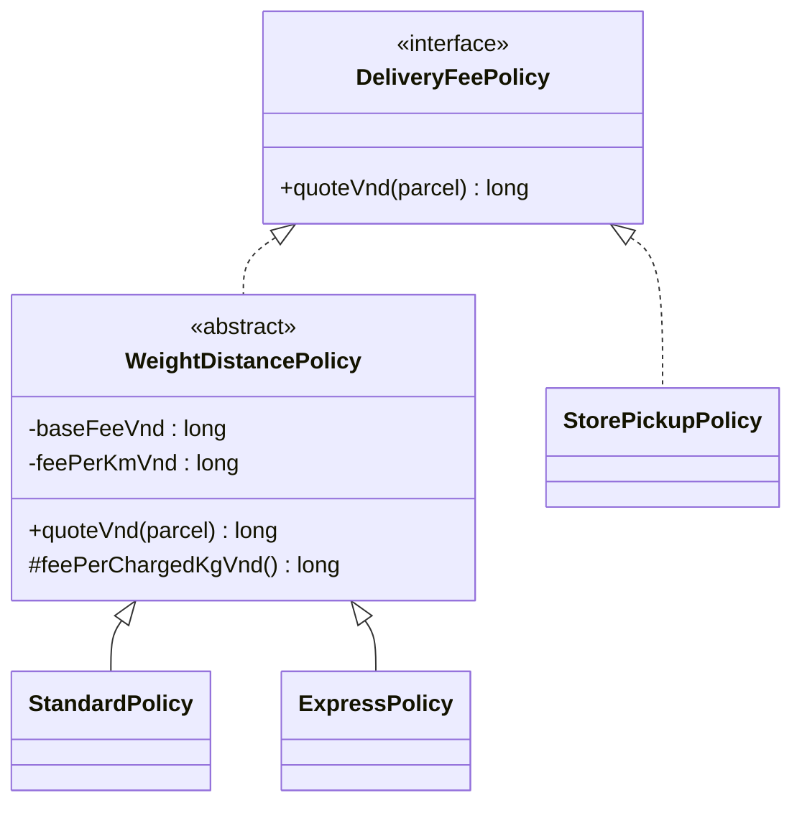
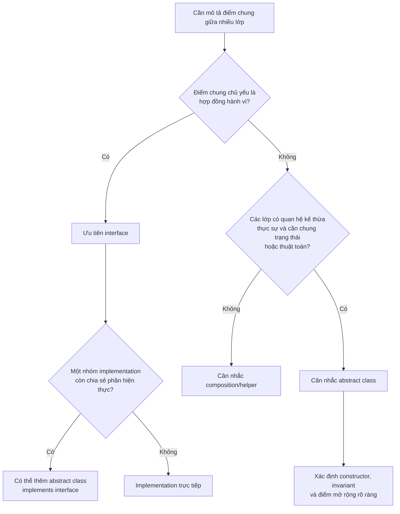

# Choosing an interface or an abstract class in Java

When several objects provide similar behavior, Java can describe what they share using an **`interface`** or an **`abstract class`**. Both support polymorphism (*polymorphism*), but address different design needs:

- **Interfaces** are appropriate when defining **a behavioral contract** that classes can implement even if they do not share an inheritance hierarchy.
- **Abstract classes** are appropriate when subclasses genuinely belong to **a class family** and need to inherit **shared state, constructors, or portions of implemented algorithms**.

These options can **work together**: an abstract class may `implements` an interface and share implementation among some subclasses. Start with responsibilities and business relationships instead of adding architectural layers for their own sake.

## 1. Comparing their nature and language limitations

| Criterion | `interface` | `abstract class` |
|---|---|---|
| Main purpose | Declare the contract/capability an object provides | Define a common foundation for related subclasses |
| Declaration | `interface FeePolicy { ... }` | `abstract class BasePolicy { ... }` |
| Relationship to concrete classes | `implements` | `extends` |
| How many can one class use? | Implement multiple interfaces | Directly extend at most **one** class |
| Constructors | **No constructors** | Has constructors, often used to initialize shared state |
| Instance state | Cannot declare ordinary instance fields | Can have instance fields, including `private final` |
| Directly declared fields | Implicitly `public static final` | Can be instance/static fields with suitable access modifiers |
| Methods with bodies | Supports `default`, `static`, and `private` (depending on Java version) | Supports ordinary methods, `static`, `final`, `private`, and more |
| Abstract methods | Bodyless methods are implicitly `public abstract` (apart from special cases involving `private`/`static`/`default`) | May declare `abstract` methods with suitable accessibility, but not `private` |
| Conceptual relationship | Expresses “**what an object can do**” | Expresses “**a specialized kind of the base class**” and reuses common functionality |
| API evolution | Adding an abstract method may force implementers to update; `default` may ease evolution | Changing inherited state or behavior can directly affect subclasses |

Key points: **interfaces are not limited to abstract methods**, and **abstract classes need not declare abstract methods**. An abstract class can still be marked `abstract` solely to prevent direct instantiation.

Neither an interface nor an abstract class can be instantiated directly with `new`:

```java
interface Exporter {
    void export();
}

abstract class AbstractExporter {
    abstract void export();
}

// new Exporter();         // Lỗi biên dịch
// new AbstractExporter(); // Lỗi biên dịch
```

But an instance of a concrete implementing/extending class can be created, including an anonymous class that supplies all required methods.

## 2. The deciding question: contract or shared state?

Suppose a system needs to calculate **shipping fees**. Every strategy can answer the same question:

> What is the estimated shipping fee in VND for a parcel with a specified weight and distance?

Some fee calculations depend on weight and distance; others may waive fees for store pickup. From the quote consumer's perspective, what matters is **having one consistent operation to call**.

We can define:

```java
interface DeliveryFeePolicy {
    long quoteVnd(Parcel parcel);
}
```

This interface does not require every fee policy to inherit the same algorithm or hold the same state. It only requires each policy to return a fee quote according to the contract.

If **two policies both use base fee + distance + billable kilograms**, however, duplicating that calculation may justify a shared abstract class. A **store pickup** policy can implement the interface directly without inheriting the weight-based fee formula.

This is a case where combining `interface` and `abstract class` serves a clear business need.

## 3. Complete Java example: an interface defines the contract, an abstract class shares the algorithm

File `DeliveryFeeDemo.java` (Java 17+):

```java
import java.util.Objects;

public class DeliveryFeeDemo {

    // Dữ liệu cần thiết cho bài toán báo phí trong ví dụ.
    record Parcel(int weightGrams, int distanceKm) {
        Parcel {
            if (weightGrams <= 0) {
                throw new IllegalArgumentException(
                    "Cân nặng phải lớn hơn 0 gram"
                );
            }
            if (distanceKm < 0) {
                throw new IllegalArgumentException(
                    "Quãng đường không được âm"
                );
            }
        }
    }

    // Hợp đồng chung: không áp đặt cách tính.
    interface DeliveryFeePolicy {
        long quoteVnd(Parcel parcel);
    }

    // Nền tảng chia sẻ thuật toán cho các cách tính theo cân nặng.
    static abstract class WeightDistancePolicy
            implements DeliveryFeePolicy {

        private final long baseFeeVnd;
        private final long feePerKmVnd;

        protected WeightDistancePolicy(
                long baseFeeVnd, long feePerKmVnd) {

            if (baseFeeVnd < 0 || feePerKmVnd < 0) {
                throw new IllegalArgumentException(
                    "Các mức phí không được âm"
                );
            }

            this.baseFeeVnd = baseFeeVnd;
            this.feePerKmVnd = feePerKmVnd;
        }

        @Override
        public final long quoteVnd(Parcel parcel) {
            Objects.requireNonNull(parcel, "parcel");

            // Làm tròn lên kg tính cước, tránh phép cộng int bị tràn.
            long chargedKg = ((long) parcel.weightGrams() + 999L) / 1_000L;

            long rate = feePerChargedKgVnd();
            if (rate < 0) {
                throw new IllegalStateException(
                    "Đơn giá theo kg không hợp lệ"
                );
            }

            long distanceFee =
                Math.multiplyExact(feePerKmVnd, parcel.distanceKm());
            long weightFee = Math.multiplyExact(rate, chargedKg);

            return Math.addExact(
                Math.addExact(baseFeeVnd, distanceFee),
                weightFee
            );
        }

        // Điểm khác biệt được lớp con quyết định.
        protected abstract long feePerChargedKgVnd();
    }

    static final class StandardPolicy extends WeightDistancePolicy {
        StandardPolicy() {
            super(10_000L, 1_000L);
        }

        @Override
        protected long feePerChargedKgVnd() {
            return 2_000L;
        }
    }

    static final class ExpressPolicy extends WeightDistancePolicy {
        ExpressPolicy() {
            super(18_000L, 1_500L);
        }

        @Override
        protected long feePerChargedKgVnd() {
            return 4_000L;
        }
    }

    // Một chính sách khác hẳn: không cần kế thừa thuật toán trên.
    static final class StorePickupPolicy implements DeliveryFeePolicy {
        @Override
        public long quoteVnd(Parcel parcel) {
            Objects.requireNonNull(parcel, "parcel");
            return 0L;
        }
    }

    static void show(
            String name, DeliveryFeePolicy policy, Parcel parcel) {
        System.out.println(name + ": " + policy.quoteVnd(parcel) + " VND");
    }

    public static void main(String[] args) {
        Parcel parcel = new Parcel(1_200, 5);

        show("Tiêu chuẩn", new StandardPolicy(), parcel);
        show("Giao nhanh", new ExpressPolicy(), parcel);
        show("Nhận tại cửa hàng", new StorePickupPolicy(), parcel);
    }
}
```

Run:

```bash
javac DeliveryFeeDemo.java
java DeliveryFeeDemo
```

Output:

```text
Tiêu chuẩn: 19000 VND
Giao nhanh: 33500 VND
Nhận tại cửa hàng: 0 VND
```

Calculations in this example:

- `1_200` grams is rounded up to **2 billable kg**.
- Standard = `10_000 + 5 × 1_000 + 2 × 2_000 = 19_000` VND.
- Express = `18_000 + 5 × 1_500 + 2 × 4_000 = 33_500` VND.
- Store pickup: free under the example's rules.

These illustrative formulas demonstrate OOP design; they do not represent any carrier's actual rates.

### Relationship diagram



The example shows two levels of responsibility:

**`DeliveryFeePolicy` defines the contract.** Fee-quoting code only knows a `DeliveryFeePolicy` variable and calls `quoteVnd(...)`. The calculation may use standard, express, or store pickup. The caller does not need `instanceof` checks to classify a policy and compute its fee.

**`WeightDistancePolicy` shares part of the implementation.** It owns the base rate and per-kilometer rate, validates the constructor, rounds billable weight, checks the result, and exposes a `feePerChargedKgVnd()` extension point. Its subclasses `StandardPolicy` and `ExpressPolicy` only supply the varying parts.

The `quoteVnd` method in the abstract class is marked `final` so subclasses cannot accidentally break the shared validation and fee-calculation flow; subclasses customize only the defined extension point. This is a simple *Template Method* pattern. The abstract `feePerChargedKgVnd()` method is only called while quoting a fee, **not from the constructor** before subclass initialization completes.

`StorePickupPolicy` is not a kind of weight-based fee policy. Forcing it to `extends WeightDistancePolicy` and return 0 from calculation steps would impose an artificial inheritance relationship. Implementing the interface directly models the business domain more accurately.

## 4. Differences that actually affect the decision

### 4.1. Multiple roles do not require a shared superclass

~~~java
interface Printable { void print(); }
interface Archivable { void archive(); }

class Invoice implements Printable, Archivable {
    public void print() { System.out.println("In hóa đơn"); }
    public void archive() { System.out.println("Lưu hóa đơn"); }
}
~~~

`Invoice` can fulfill **two independent capabilities** without being forced into a superclass containing both. If it truly belongs to a `Document` family with shared state, it may still `extends Document implements Printable, Archivable`. Java allows a class to directly `extends` **one** superclass, while interfaces may `extends` multiple interfaces. The *One object implementing multiple interfaces* lesson focuses on reference variables, signature conflicts, and shared-state interactions across roles.

### 4.2. When you need constructors and shared state

An interface has no constructor and cannot hold ordinary instance fields. Consider this declaration:

```java
interface Limits {
    int MAX_RETRIES = 3; // Mặc nhiên public static final
}
```

It does not mean each implementation owns a separate `MAX_RETRIES`. This is a **static constant** associated with the interface.

If subclasses genuinely need shared base state and uniform initialization, an abstract class provides a constructor and controls the fields:

```java
abstract class BaseProcessor {
    private final int maxRetries;

    protected BaseProcessor(int maxRetries) {
        if (maxRetries < 0) {
            throw new IllegalArgumentException("maxRetries âm");
        }
        this.maxRetries = maxRetries;
    }

    protected final int maxRetries() {
        return maxRetries;
    }

    public abstract void process();
}
```

Note: using an abstract class **only to share a few lines of code** can create unnecessary inheritance coupling. A helper class or an injected object composed into the class through **composition** may be better, especially when classes need to reuse an algorithm without belonging to one inheritance family.

### 4.3. `default` methods share behavior, not state

~~~java
interface Named {
    String name();

    default String displayName() {
        return "[" + name() + "]";
    }
}
~~~

A class implementing `Named` can use `displayName()` without rewriting it because the default behavior is derived from the contract's `name()` method. But an interface still **has no instance fields or constructors**. When a shared algorithm needs configuration fields, invariants, and extension points for a class family, consider an abstract class or composition. The *Default members and language-specific limitations* lesson explains modifiers and the rules for combining default methods in detail.

## 5. Conflicting `default` methods can make combining roles more costly

If two **unrelated** interfaces both declare `default String label()`, a class implementing both cannot let Java arbitrarily choose. It must override `label()` to define consistent behavior and may explicitly call `A.super.label()` or `B.super.label()` when legal.

Conversely, when a superclass has a concrete instance method with a compatible signature, the class implementation generally takes precedence over the interface default. This is a limitation of sharing behavior across interfaces, but does not automatically justify replacing them with one abstract class: the decision still depends on the need for **shared state/constructors**. The dedicated *Default members and language-specific limitations* lesson provides runnable Java examples for each resolution rule.

## 6. Choose based on business relationships and sources of change

A decision-making approach suitable for design reviews:



Practical questions to ask:

1. **What does the caller need?** If the caller only needs to call `send()`, `quoteVnd()`, or `save()`, start with a concise behavioral contract, regardless of the implementing object's type.
2. **Is there shared state?** If common constructors must validate configuration, and fields and parts of the algorithm are shared, an abstract class is valuable.
3. **Is there a genuine “is-a” relationship?** A `StandardPolicy` may be a specialization of `WeightDistancePolicy`. A `StorePickupPolicy` is not, even though both return a fee.
4. **Does the class need to extend another superclass?** If so, binding it to a new abstract class may be impossible because Java supports only one superclass. Interfaces combine more flexibly.
5. **Which behaviors actually vary?** Abstractions should reflect current needs or justified expectations of change, rather than adding layers before responsibilities are known.

## 7. When should composition replace an abstract class?

Suppose two very different classes both need an identifier-validation algorithm. They do not belong to the same business family, so forcing both to `extends AbstractValidatorUser` just to reuse validation code is artificial.

An independent helper object can be **composed** into each class:

```java
import java.util.Objects;

final class CodeValidator {
    String requireValid(String code) {
        Objects.requireNonNull(code, "code");
        if (code.isBlank()) {
            throw new IllegalArgumentException("Code không được rỗng");
        }
        return code.strip();
    }
}

final class GiftVoucher {
    private final String code;

    GiftVoucher(String code, CodeValidator validator) {
        this.code = validator.requireValid(code);
    }
}

final class EventTicket {
    private final String code;

    EventTicket(String code, CodeValidator validator) {
        this.code = validator.requireValid(code);
    }
}
```

`GiftVoucher` and `EventTicket` reuse `CodeValidator` without inheriting from each other. When common validation rules apply, composition permits reuse without consuming a class's inheritance relationship.

Depending on problem scale, a `static` utility method or `Code` value object may be simpler than injecting a separate validator. **Not every shared feature requires an interface or abstract class.**

## 8. Common design mistakes

| Problematic design | Why it may be unsuitable | Improvement |
|---|---|---|
| Creating an interface for every class, even with only one implementation and no contract requirement | Adds files and layers without clear benefits | Start with a concrete class; extract an interface when a real need arises |
| Putting every implementation under one large abstract class | Subclasses become coupled to irrelevant data and behaviors | Use small capability-based interfaces; share implementation through composition or an abstract base for the appropriate family |
| Using an interface as a collection of constants | Repurposes a behavioral contract for an unrelated goal | Use a dedicated constants class or enum |
| Creating an `abstract class` with only one abstract method and no shared state/logic | May impose an unnecessary single-inheritance restriction | Consider an interface |
| Adding many `default method` declarations with simulated state through getters | Couples the contract to details and increases conflicts | Move the algorithm to a component or shared base class for a true class family |
| Letting subclasses change every step of the base algorithm freely | May break invariants and produce inconsistent results | Keep stable algorithm steps `final` and expose only necessary extension points |
| Failing to ensure that implementations honor one contract | Callers need concrete type checks, losing polymorphism | Specify input conditions, outputs, failures, and shared rules |

A good interface means more than “methods with the same name.” If `quoteVnd` in policy A returns **VND** but policy B returns **thousands of VND**, they share a signature but still **violate the semantic contract**. To use polymorphism correctly, every implementation must honor the caller's expectations: units, valid ranges, failures, and published rules.

## 9. Check your understanding

**Exercise 1 — Which should you choose?**

An application exports reports to CSV and PDF. The outputs differ, but callers only need `export(report)` without knowing the specific format.

**Hint:** A `ReportExporter` interface naturally expresses the contract. Add an abstract class only if there is genuinely useful common processing to share, such as naming files or validating inputs across a group of exporters.

**Exercise 2 — What happens?**

```java
interface A {
    default String description() {
        return "A";
    }
}

interface B {
    default String description() {
        return "B";
    }
}

class C implements A, B {
    // Chưa override description()
}
```

**Answer:** Class `C` fails to compile due to a conflict between two default methods; it must define `description()` to resolve the conflict.

**Exercise 3 — Why do abstract classes have constructors?**

The `StandardShipping` and `ExpressShipping` classes both require a valid `regionCode` and share an algorithm for handling delivery regions. Design `abstract class RegionShipping` to accept a region code in its constructor, assign it to a `private final` field, implement part of the logic, and leave a `protected abstract` method for subclasses to calculate the surcharge.

**Hint:** An abstract class fits when both classes genuinely belong to the same policy family and share invariants/algorithms. If other policies must also be used through the same service, `RegionShipping implements ShippingPolicy` can define the shared base, while policies without region-based shipping can implement `ShippingPolicy` directly.

**Exercise 4 — Can a class implement multiple interfaces?**

```java
interface Searchable {
    void search();
}

interface Auditable {
    void audit();
}

class CatalogService implements Searchable, Auditable {
    public void search() {
        System.out.println("Searching");
    }

    public void audit() {
        System.out.println("Audit logged");
    }
}
```

**Answer:** Valid. `CatalogService` implements two contracts. Because interface methods are `public`, implementing methods must also be `public`; narrower access is not allowed.

---

**Remember:** Choose an **`interface`** to describe **a contract/capability implemented by multiple kinds of objects**. Choose an **`abstract class`** when there is **a meaningful inheritance family** requiring **shared constructors, state, or algorithms**. The two can be combined; prefer **composition** when you only need to reuse functionality among unrelated classes. The final criteria are a clear API, faithful domain modeling, and ease of change.
