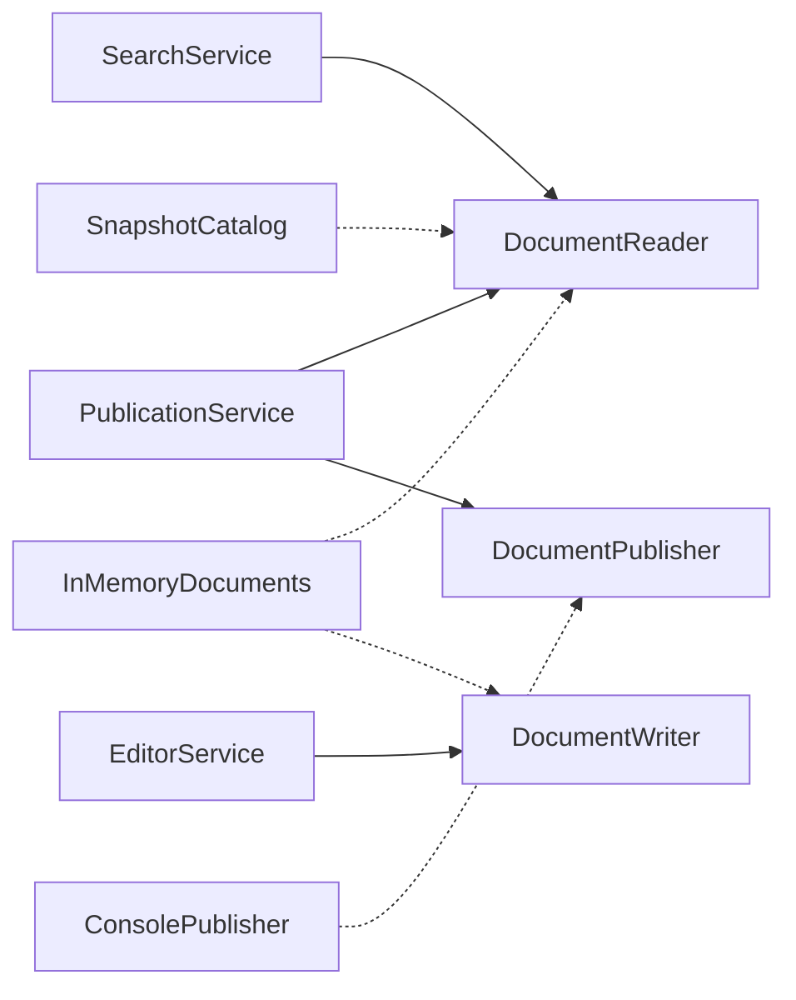

# Small interfaces and role segregation in Java

In OOP design, an `interface` describes **a usage contract**: what external code may ask an object to do. Packing too many unrelated capabilities into one interface forces classes and services to know about or implement methods unrelated to their responsibilities.

**The Interface Segregation Principle (ISP)**, one of the SOLID principles, says in practical terms: **clients should not be forced to depend on methods they do not use**.

In Java, a “client” may be a service class, a module, an object depending on an interface, or a class required to `implements` it. The usual solution is to split a broad contract into **smaller interfaces grouped by role or consumer need**. “Small” refers to *responsibility*, not a rigid rule requiring one method per interface.

## 1. Signs that an interface is too broad

Suppose a document-management application declares:

```java
interface DocumentManager {
    String read(String id);
    void save(String id, String content);
    void delete(String id);
    void publish(String id);
}
```

A search tool only needs `read()`. A published document archive allows reading only, yet implementing `DocumentManager` would also require providing `save()`, `delete()`, and `publish()`:

```java
final class ReadOnlyArchive implements DocumentManager {
    @Override
    public String read(String id) {
        return "Nội dung từ kho lưu trữ";
    }

    @Override
    public void save(String id, String content) {
        throw new UnsupportedOperationException("Chỉ đọc");
    }

    @Override
    public void delete(String id) {
        throw new UnsupportedOperationException("Chỉ đọc");
    }

    @Override
    public void publish(String id) {
        throw new UnsupportedOperationException("Không hỗ trợ");
    }
}
```

This is a **design smell**: the interface exposes capabilities that some conforming objects cannot provide. Callers may assume an operation is valid, only to receive an `UnsupportedOperationException` at runtime.

The problem also affects clients. If `SearchService` receives a `DocumentManager`, changes to publishing, deleting, or writing may affect the search code even though it never uses those operations. Changes to a broad interface also force many implementations and test fakes/mocks to be updated.

## 2. Segregate by capabilities clients actually need

Instead of one all-encompassing contract, define independent roles:

```java
interface DocumentReader {
    Optional<Document> findById(String id);
}

interface DocumentWriter {
    void save(Document document);
}

interface DocumentPublisher {
    void publish(Document document);
}
```

Each service only accepts a type expressing its required capability:

| Client or implementation | Depends on / implements | Reason |
| --- | --- | --- |
| `SearchService` | `DocumentReader` | Only searches documents |
| `EditorService` | `DocumentWriter` | Only saves drafts |
| `PublicationService` | `DocumentReader` and `DocumentPublisher` | Finds documents and then publishes them |
| `InMemoryDocuments` | `DocumentReader`, `DocumentWriter` | Supports both reading and writing |
| `SnapshotCatalog` | `DocumentReader` | Read-only data |
| `ConsolePublisher` | `DocumentPublisher` | Only performs publishing |

A class **may implement multiple small interfaces** when it really provides multiple capabilities. ISP does not require one class per interface.



Solid arrows show client dependencies; dashed arrows show classes realizing contracts. `SearchService` does not need to know whether its data source allows modifications.

## 3. Runnable Java example: reading, writing, and publishing documents

Put all of the following code in **`Main.java`** and compile with **Java 17 or Java 21**.

```java
import java.util.HashMap;
import java.util.List;
import java.util.Map;
import java.util.Objects;
import java.util.Optional;

// Value object đơn giản: các thành phần đều là String bất biến.
record Document(String id, String title, String content) {
    Document {
        if (id == null || id.isBlank()) {
            throw new IllegalArgumentException("ID không hợp lệ");
        }
        if (title == null || title.isBlank()) {
            throw new IllegalArgumentException("Tiêu đề không hợp lệ");
        }
        Objects.requireNonNull(content, "content");
    }
}

// Chỉ mô tả khả năng đọc.
interface DocumentReader {
    Optional<Document> findById(String id);
}

// Chỉ mô tả khả năng ghi.
interface DocumentWriter {
    void save(Document document);
}

// Vai trò công bố tài liệu ra một kênh.
interface DocumentPublisher {
    void publish(Document document);
}

// Một lớp có thể cung cấp cả hai khả năng đọc và ghi.
final class InMemoryDocuments implements DocumentReader, DocumentWriter {
    private final Map<String, Document> documents = new HashMap<>();

    @Override
    public Optional<Document> findById(String id) {
        Objects.requireNonNull(id, "id");
        return Optional.ofNullable(documents.get(id));
    }

    @Override
    public void save(Document document) {
        Objects.requireNonNull(document, "document");
        documents.put(document.id(), document);
    }
}

// Kho dữ liệu chỉ đọc: không có save(), delete() hay publish().
final class SnapshotCatalog implements DocumentReader {
    private final Map<String, Document> snapshot;

    SnapshotCatalog(Map<String, Document> source) {
        this.snapshot = Map.copyOf(
                Objects.requireNonNull(source, "source"));
    }

    @Override
    public Optional<Document> findById(String id) {
        Objects.requireNonNull(id, "id");
        return Optional.ofNullable(snapshot.get(id));
    }
}

// Một triển khai công bố đơn giản phục vụ ví dụ.
final class ConsolePublisher implements DocumentPublisher {
    @Override
    public void publish(Document document) {
        Objects.requireNonNull(document, "document");
        System.out.println("Xuất bản: " + document.title());
    }
}

// Client chỉ phụ thuộc vào khả năng đọc.
final class SearchService {
    private final DocumentReader reader;

    SearchService(DocumentReader reader) {
        this.reader = Objects.requireNonNull(reader, "reader");
    }

    String findTitle(String id) {
        return reader.findById(id)
                .map(Document::title)
                .orElse("Không tìm thấy");
    }
}

// Client chỉ phụ thuộc vào khả năng ghi.
final class EditorService {
    private final DocumentWriter writer;

    EditorService(DocumentWriter writer) {
        this.writer = Objects.requireNonNull(writer, "writer");
    }

    void saveDraft(Document document) {
        writer.save(document);
    }
}

// Client cần hai vai trò, nên khai báo rõ hai phụ thuộc.
final class PublicationService {
    private final DocumentReader reader;
    private final DocumentPublisher publisher;

    PublicationService(DocumentReader reader,
                       DocumentPublisher publisher) {
        this.reader = Objects.requireNonNull(reader, "reader");
        this.publisher = Objects.requireNonNull(publisher, "publisher");
    }

    boolean publishById(String id) {
        Optional<Document> found = reader.findById(id);
        if (found.isEmpty()) {
            return false;
        }
        publisher.publish(found.get());
        return true;
    }
}

public class Main {
    public static void main(String[] args) {
        InMemoryDocuments storage = new InMemoryDocuments();
        EditorService editor = new EditorService(storage);
        SearchService search = new SearchService(storage);

        editor.saveDraft(
                new Document("DOC-1", "Java ISP", "Nội dung bài học"));

        System.out.println(search.findTitle("DOC-1"));

        PublicationService publication =
                new PublicationService(storage, new ConsolePublisher());
        System.out.println(publication.publishById("DOC-1"));

        System.out.println(search.findTitle("UNKNOWN"));

        Map<String, Document> source = new HashMap<>();
        source.put("PUB-1",
                new Document("PUB-1", "Bản đã duyệt", "Nội dung"));
        DocumentReader readOnlyCatalog = new SnapshotCatalog(source);
        source.clear(); // Không thay đổi dữ liệu đã chụp.
        SearchService archiveSearch = new SearchService(readOnlyCatalog);

        System.out.println(archiveSearch.findTitle("PUB-1"));
    }
}
```

Run:

```bash
javac Main.java
java Main
```

Output:

```text
Java ISP
Xuất bản: Java ISP
true
Không tìm thấy
Bản đã duyệt
```

**Design explanation:**

1. `SearchService` knows `DocumentReader`, not `save()` or `publish()`. We can supply `InMemoryDocuments` or `SnapshotCatalog` without changing service code.
2. `EditorService` accepts `DocumentWriter` without needing search or publishing methods.
3. `PublicationService` needs **two capabilities**, so it depends on two interfaces. A client can certainly use multiple interfaces; “segregation” does not prohibit combining them.
4. `SnapshotCatalog` only implements `DocumentReader`, so it does not need to throw `UnsupportedOperationException` for unsupported write/delete operations.
5. `Map.copyOf(source)` protects the snapshot from structural changes to the external map. The `Document` values in this example contain immutable `String` components. If map values are mutable objects, consider deep copies or safer value objects.

Misuse of roles is caught early by the compiler. The example below is **intentionally invalid**:

```java
DocumentReader catalog = new SnapshotCatalog(Map.of());
// new EditorService(catalog); // Lỗi biên dịch:
// EditorService cần DocumentWriter, catalog chỉ có kiểu DocumentReader.
```

If a concrete object truly supports both reading and writing, callers can hold references through the appropriate interfaces. This design constrains access **at the type-level API**, but does not replace authentication and authorization in a real system.

## 4. Does ISP mean “one method per interface”?

An interface may reasonably have several methods when they serve **one cohesive role**.

For example:

```java
interface DocumentReader {
    Optional<Document> findById(String id);
    List<Document> findByTitle(String keyword);
    boolean existsById(String id);
}
```

All three methods support **document lookup**. If data-reading clients regard these as one meaningful set of behaviors, the interface may be well designed. Conversely, if clients only use independent subsets and contract changes force unrelated dependencies, further segregation may help.

Useful criteria for splitting an interface:

- Do the methods address the same **client need or role**?
- Do different client groups require different subsets of methods?
- Must an implementation provide meaningless methods or only throw `UnsupportedOperationException`?
- Does a change in behavior group A force changes in clients/implementations that only use group B?
- Does the interface name express a clear capability (`Reader`, `Writer`, `Publisher`) or just a generic concept (`Manager`, `EverythingService`)?

**Do not count methods mechanically.** Two unrelated methods may form a poor interface; five methods supporting one coherent contract may be perfectly appropriate.

## 5. Combining roles when genuinely necessary

Java lets one interface extend multiple other interfaces:

```java
interface DocumentEditor extends DocumentReader, DocumentWriter {
    // Có thể thêm hành vi thực sự thuộc vai trò biên tập.
}
```

`DocumentEditor` represents a role combining reading and writing. It is useful when a client or implementation group **truly requires both** as one contract.

However, two points matter:

- A class declaring `InMemoryDocuments implements DocumentReader, DocumentWriter` **does not automatically become a `DocumentEditor`**. To use the combined type, the class must declare `implements DocumentEditor` (or a subclass/adapter must correctly implement that interface).
- A read-only client should still accept `DocumentReader`. Do not change every parameter to `DocumentEditor` just because a combined interface exists.

Not every possible combination of capabilities necessarily exists. For example, a read-only store may support `DocumentReader` without `DocumentWriter`; a publisher may accept a `Document` without being able to search for data.

## 6. ISP and related OOP principles

| Principle | Core question | Relationship to small interfaces |
| --- | --- | --- |
| **ISP** — Interface Segregation Principle | Does a client depend on unused methods? | Split contracts according to actual consumer needs |
| **SRP** — Single Responsibility Principle | Does a module/class have one main reason to change? | Often supports similar divisions but applies to module/class responsibilities |
| **DIP** — Dependency Inversion Principle | Does business logic depend on stable contracts or implementation details? | Role-based interfaces provide suitable abstractions for dependency injection |
| **LSP** — Liskov Substitution Principle | Does an implementation honor promised contract behavior? | Avoid forcing implementations to offer meaningless operations and then throw unspecified errors |

One way to think about it: **SRP separates responsibilities**, **ISP shapes contract surfaces for clients**, **DIP directs clients toward contracts**, and **LSP requires implementations to honor contract semantics**.

For example, `ReadOnlyArchive` implements a `DocumentManager` exposing `save()` but always throws `UnsupportedOperationException`. That directly indicates poor ISP adherence and may violate substitutability if the `save()` contract promises that every implementation can save.

## 7. Segregating interfaces without splitting implementation classes

It is a misconception that splitting interfaces means splitting one class into many classes or services.

In fact, `InMemoryDocuments` in the example remains **one class** providing two roles. Interface segregation mainly improves **client dependency relationships**:

```java
final class SearchService {
    private final DocumentReader reader;
    // ...
}
```

If the search code is written as follows, it depends on more capabilities than it needs:

```java
// Mẫu phụ thuộc rộng không cần thiết:
final class SearchServiceTooBroad {
    private final InMemoryDocuments storage;

    SearchServiceTooBroad(InMemoryDocuments storage) {
        this.storage = storage;
    }
}
```

Now only an `InMemoryDocuments` or its subclass can be passed (and this class is `final`, so it has no subclasses); another read-only data source is hard to substitute. Using `DocumentReader` expresses the requirement and permits independent implementations.

However, **creating an interface is not always necessary**. In a small application, if a concrete type is a stable contract without distinct roles, depending directly on a class may be simpler. ISP guides organization *when interfaces already exist*; it does not require “one interface per class.”

## 8. Smaller roles make testing easier

A service depending only on `DocumentReader` can be tested with a tiny fake; there is no need to initialize a repository, connect to a database, or simulate write/delete/publish methods.

The following snippet assumes `Document`, `DocumentReader`, and `SearchService` are defined as in the main example; put it inside a method or test:

```java
DocumentReader fake = id -> {
    if ("DOC-1".equals(id)) {
        return Optional.of(new Document("DOC-1", "Bản mẫu", ""));
    }
    return Optional.empty();
};

SearchService service = new SearchService(fake);

if (!"Bản mẫu".equals(service.findTitle("DOC-1"))) {
    throw new AssertionError("Tìm tiêu đề sai");
}
if (!"Không tìm thấy".equals(service.findTitle("UNKNOWN"))) {
    throw new AssertionError("Xử lý tài liệu vắng mặt sai");
}
```

`DocumentReader` has only one abstract method, so it is a **functional interface** and can be implemented with the lambda above. If multiple abstract methods are added to `DocumentReader` later, that lambda will stop compiling: a practical reason to consider compatibility when expanding a contract.

Testing is not the only reason to split interfaces. The main value is that client code only sees the capabilities it needs; easier fakes are a side benefit.

## 9. Common mistakes when applying ISP

| Mistake | Why is it a problem? | How to address it |
| --- | --- | --- |
| A `SuperService` interface combines reading, writing, exporting reports, and sending email | Clients depend on unused roles | Split according to client needs |
| Unsupported methods only `throw UnsupportedOperationException` | The API promises a capability the implementation cannot provide | Do not implement absent capabilities, or explicitly define optional support |
| Creating a separate interface for every individual getter | Adds types without meaningful boundaries | Group methods by cohesive roles instead of method count |
| A client needs `read` but accepts `DocumentEditor` | The client also depends on write access | Accept `DocumentReader` |
| Using an empty `default` method to conceal unsupported features | The operation appears to succeed but does nothing | Use defaults only when their behavior satisfies the contract |
| One interface changes constantly, forcing many mock updates | The contract may be too broad or unstable | Analyze affected client groups and split when justified |
| Splitting signatures while ignoring semantics | Implementations may violate expectations | Document preconditions, results, errors, ordering, and consistency |
| Treating interfaces as security authorization | Callers may bypass the type boundary using another API | Enforce authorization in business/infrastructure layers as well |
| Generating interfaces mechanically | Makes navigation difficult and adds unnecessary forwarding layers | Split only at boundaries with genuine needs |

**On `default` methods:** default methods are valid Java features, useful for behavior derived from an existing contract. However, adding `default void publish() { }` to a shared interface merely so every implementation “compiles” hides different support capabilities instead of fixing an overly broad contract.

## 10. Refactoring an overly broad interface

Suppose a system uses a large `DocumentManager` in many places:

1. **Identify which methods each client group actually calls.** For example, search services only call `read`, editors only call `save`, and publishers only call `publish`.
2. **Identify stable roles.** Group methods with consistent meanings for consumers; avoid dividing by a mechanical count.
3. **Create small interfaces with clear contracts.** For example, `DocumentReader`, `DocumentWriter`, and `DocumentPublisher` with specified input, result, and failure rules.
4. **Have implementations declare only the capabilities they provide.** Read-only classes need not implement write/delete operations.
5. **Move clients to the narrowest suitable dependency.** The `SearchService` constructor accepts `DocumentReader` instead of `DocumentManager`.
6. **Verify behavior and run tests.** Substitute an implementation and check that clients still satisfy the contract; for public libraries, plan API compatibility before removing the old interface.

An existing interface does not need to be deleted immediately when many clients use it. Migrate clients incrementally, use adapters at boundaries, and retire the broad contract when dependencies are gone and versioning permits.

## 11. Self-check exercises

**Question 1.** A `ReportService` only exports CSV, but its constructor accepts `OfficeSuite` with `exportCsv()`, `sendEmail()`, and `manageUsers()`. What is wrong?

**Answer:** The client depends on unused capabilities. Define a `CsvExporter` role and require only that interface.

**Question 2.** `ReadOnlyArchive` must implement `save()` and then throws `UnsupportedOperationException`. What should be reconsidered?

**Answer:** Separate `Reader` and `Writer` so the read-only store only implements reading. If optional support is explicitly part of the contract, document and handle it separately rather than surprising callers.

**Question 3.** An `interface UserReader` declares `findById`, `findByEmail`, and `existsById`. Does having three methods violate ISP?

**Answer:** You cannot tell from method count alone. Determine whether the methods form one cohesive lookup role matching client needs.

**Question 4.** Can a class `implements DocumentReader, DocumentWriter` and still satisfy ISP?

**Answer:** Yes. Clients still receive only the interface required for their role. Segregation does not prevent a class from providing multiple roles.

**Question 5.** If `SearchService` only receives `DocumentReader`, has the system completely prevented data modification?

**Answer:** No. The Java reference type only limits the capabilities exposed through that reference. Real authorization, updates in other modules, and security boundaries still need to be enforced properly.

**Remember:** Design interfaces around **consumer roles**, keep related capabilities together in one contract, and make each client depend only on the methods it needs. Sensible segregation reduces coupling, avoids “unsupported” methods, and makes implementations easier to substitute and test — while keeping APIs clear and avoiding excessive, meaningless interfaces.
