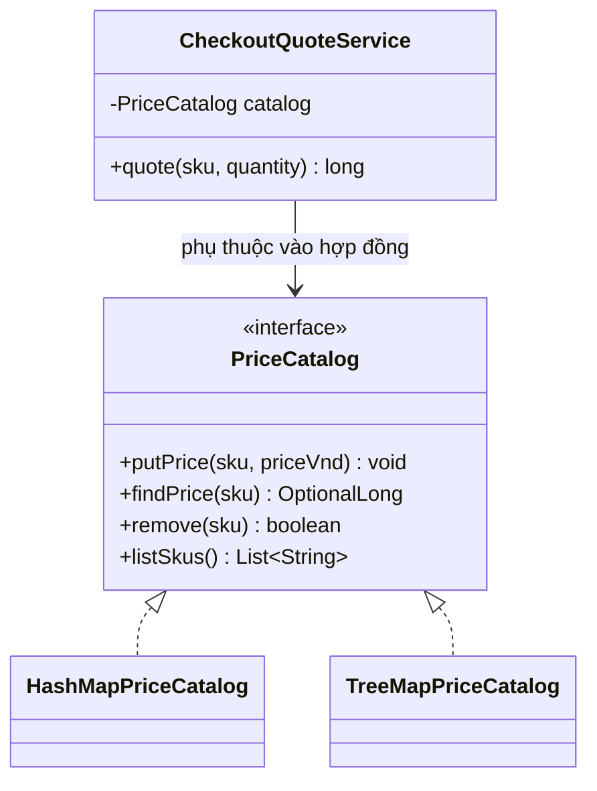
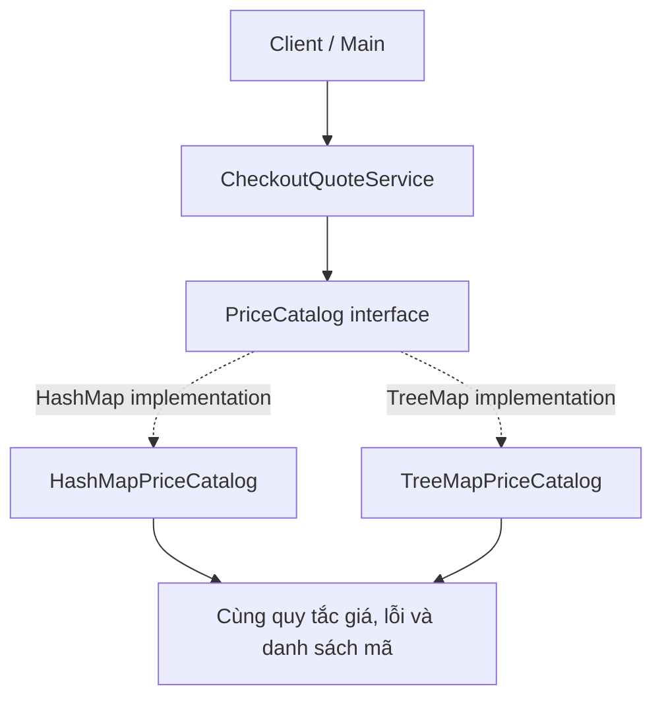

# Replacing implementations while preserving contracts in Java OOP

An interface lets client code depend on **promised behavior** instead of directly depending on internal algorithms or data structures. This allows us to switch implementations (*implementation*) while the rest of the program continues to work correctly.

Safe substitution requires more than “two classes both `implements` the same interface.” They must preserve **the behavioral contract**: the meaning of operations, input rules, results, state, errors, and published observable guarantees.

Running example: a retail system needs to look up product prices by SKU. The first version stores prices in a `HashMap`; another uses a `TreeMap`. The checkout quotation service should not need to know which structure is being used.

## 1. What does “replacing an implementation” mean?

Suppose the program has this dependency:

```java
HashMapPriceCatalog catalog = new HashMapPriceCatalog();
CheckoutQuoteService checkout = new CheckoutQuoteService(catalog);
```

The client currently knows the concrete `HashMapPriceCatalog` class. A more flexible design declares the dependency using an interface:

```java
PriceCatalog catalog = new HashMapPriceCatalog();
CheckoutQuoteService checkout = new CheckoutQuoteService(catalog);
```

When a different storage mechanism is needed:

```java
PriceCatalog catalog = new TreeMapPriceCatalog();
CheckoutQuoteService checkout = new CheckoutQuoteService(catalog);
```

The actual object changes, but **the constructor and logic of `CheckoutQuoteService` require no changes**. This is *polymorphism* and *programming to interfaces* in practice.



Substitution must preserve what the client is entitled to expect:

| Contract aspect | Requirement to preserve |
| --- | --- |
| Signature | `findPrice(String)` returns `OptionalLong` |
| Valid input | An SKU contains 3–12 uppercase letters/digits |
| Data semantics | Prices may be 0, but must never be negative |
| Result | A missing SKU returns `OptionalLong.empty()` |
| Updates | `putPrice` overwrites the previous price for the same SKU |
| Ordering | `listSkus()` returns codes in ascending lexicographic order |
| Mutability | The returned list is an unmodifiable snapshot |
| Errors | Invalid SKUs or negative prices are rejected according to the promised rules |

These requirements are **not fully enforced by the compiler** merely because a class uses `implements`. They require clear documentation and tests for each implementation.

## 2. Define the contract before choosing a data structure

Create **`PriceCatalog.java`**:

```java
import java.util.List;
import java.util.OptionalLong;

/**
 * Bảng giá theo SKU, chạy trong bộ nhớ trong ví dụ này.
 *
 * Hợp đồng:
 * - SKU hợp lệ: 3..12 ký tự A-Z hoặc 0-9, giữ nguyên chữ hoa.
 * - Giá là số nguyên VND không âm; giá 0 là hợp lệ.
 * - Không có SKU trùng: putPrice ghi đè giá cũ.
 * - Không có SKU: findPrice trả OptionalLong.empty().
 * - listSkus trả snapshot không sửa được, sắp xếp tăng dần.
 * - Tham số không hợp lệ: IllegalArgumentException.
 * - Không cam kết an toàn khi nhiều luồng truy cập đồng thời.
 */
public interface PriceCatalog {

    void putPrice(String sku, long priceVnd);

    OptionalLong findPrice(String sku);

    /** true nếu thực sự xóa một SKU đã tồn tại. */
    boolean remove(String sku);

    List<String> listSkus();

    static void requireSku(String sku) {
        if (sku == null || !sku.matches("[A-Z0-9]{3,12}")) {
            throw new IllegalArgumentException(
                    "SKU phải gồm 3-12 ký tự A-Z hoặc 0-9");
        }
    }

    static void requirePrice(long priceVnd) {
        if (priceVnd < 0) {
            throw new IllegalArgumentException(
                    "Giá VND không được âm");
        }
    }
}
```

The two `static` methods in the interface only share example input-validation logic. They are invoked through `PriceCatalog` and **are not instance methods that implementations override**.

We deliberately make the contract precise enough for different storage strategies to behave identically from the client's perspective. For example, a `HashMap` should not return arbitrary order while a `TreeMap` returns sorted order, since that would change printed price lists solely because the implementation changed.

## 3. Implementation A: storing prices with HashMap

Create **`HashMapPriceCatalog.java`**:

```java
import java.util.ArrayList;
import java.util.Collections;
import java.util.HashMap;
import java.util.List;
import java.util.Map;
import java.util.OptionalLong;

public final class HashMapPriceCatalog implements PriceCatalog {
    private final Map<String, Long> prices = new HashMap<>();

    @Override
    public void putPrice(String sku, long priceVnd) {
        PriceCatalog.requireSku(sku);
        PriceCatalog.requirePrice(priceVnd);
        prices.put(sku, priceVnd);
    }

    @Override
    public OptionalLong findPrice(String sku) {
        PriceCatalog.requireSku(sku);
        Long value = prices.get(sku);
        return value == null
                ? OptionalLong.empty()
                : OptionalLong.of(value);
    }

    @Override
    public boolean remove(String sku) {
        PriceCatalog.requireSku(sku);
        return prices.remove(sku) != null;
    }

    @Override
    public List<String> listSkus() {
        List<String> result = new ArrayList<>(prices.keySet());
        Collections.sort(result);
        return List.copyOf(result);
    }
}
```

`HashMap` does not guarantee key iteration order. Because the contract requires sorted codes, this implementation must **sort them itself** before returning the list.

`List.copyOf` creates an unmodifiable snapshot; modifying the catalog afterward does not change the returned list. Here its elements are immutable `String` values, so mutable element objects cannot leak through it.

An important detail: when a price is 0, `prices.get(sku)` returns `Long.valueOf(0)`, not `null`. Therefore `OptionalLong.of(0)` still indicates **an existing SKU with a price of 0 VND**. Do not test `value == 0` to infer that an SKU is missing.

## 4. Implementation B: storing prices with TreeMap

Create **`TreeMapPriceCatalog.java`**:

```java
import java.util.ArrayList;
import java.util.List;
import java.util.NavigableMap;
import java.util.OptionalLong;
import java.util.TreeMap;

public final class TreeMapPriceCatalog implements PriceCatalog {
    private final NavigableMap<String, Long> prices = new TreeMap<>();

    @Override
    public void putPrice(String sku, long priceVnd) {
        PriceCatalog.requireSku(sku);
        PriceCatalog.requirePrice(priceVnd);
        prices.put(sku, priceVnd);
    }

    @Override
    public OptionalLong findPrice(String sku) {
        PriceCatalog.requireSku(sku);
        Long value = prices.get(sku);
        return value == null
                ? OptionalLong.empty()
                : OptionalLong.of(value);
    }

    @Override
    public boolean remove(String sku) {
        PriceCatalog.requireSku(sku);
        return prices.remove(sku) != null;
    }

    @Override
    public List<String> listSkus() {
        return List.copyOf(new ArrayList<>(prices.navigableKeySet()));
    }
}
```

`TreeMap` maintains keys in their natural `String` order. Because SKUs use only uppercase letters and digits, this matches the ascending-order requirement in the example.

The classes differ in **how they organize data**:

| Detail | `HashMapPriceCatalog` | `TreeMapPriceCatalog` |
| --- | --- | --- |
| Internal structure | Hash table | Ordered search tree |
| Typical lookup/insertion/deletion | Close to `O(1)` on average (not an absolute guarantee) | `O(log n)` |
| Traversing codes in order | Must sort before returning | Keys are already maintained in order |
| `listSkus()` | `O(n log n)` due to sorting in the general case | `O(n)` to create the snapshot |
| Type seen by clients | `PriceCatalog` | `PriceCatalog` |

These complexities are general algorithmic characteristics; real timing also depends on data, the VM, and the runtime environment. **Performance may differ**, but promised outputs and rules must remain unchanged.

## 5. The service depends only on the interface

Create **`CheckoutQuoteService.java`**:

```java
import java.util.NoSuchElementException;
import java.util.Objects;

public final class CheckoutQuoteService {
    private final PriceCatalog catalog;

    public CheckoutQuoteService(PriceCatalog catalog) {
        this.catalog = Objects.requireNonNull(catalog, "catalog");
    }

    public long quote(String sku, int quantity) {
        if (quantity <= 0) {
            throw new IllegalArgumentException(
                    "Số lượng mua phải lớn hơn 0");
        }

        long priceVnd = catalog.findPrice(sku)
                .orElseThrow(() -> new NoSuchElementException(
                        "Không tìm thấy SKU: " + sku));

        return Math.multiplyExact(priceVnd, (long) quantity);
    }
}
```

The service knows **the `PriceCatalog` abstraction** and its promised behavior; it does not manipulate `HashMap`, `TreeMap`, or concrete implementation names directly. Its constructor receives the dependency from outside, a simple form of *constructor injection* that needs no framework.

`Math.multiplyExact` throws `ArithmeticException` if multiplying a price by its quantity exceeds the `long` range, preventing silent overflow and incorrect quotations.

The service can rely on these contractual outcomes:

- A price of 0 remains valid, so a free order has a total of 0.
- A missing SKU produces `OptionalLong.empty()`, and the service explicitly throws `NoSuchElementException`.
- The catalog rejects malformed SKUs with `IllegalArgumentException`.
- No implementation-specific branches are required.

### Run two implementations without changing the service

Create **`Main.java`**:

```java
public class Main {
    public static void main(String[] args) {
        // java Main       -> HashMap
        // java Main tree  -> TreeMap
        PriceCatalog catalog =
                args.length > 0 && args[0].equals("tree")
                ? new TreeMapPriceCatalog()
                : new HashMapPriceCatalog();

        catalog.putPrice("MS02", 250_000);
        catalog.putPrice("KB01", 150_000);

        CheckoutQuoteService checkout =
                new CheckoutQuoteService(catalog);

        System.out.println(catalog.listSkus());
        System.out.println(checkout.quote("KB01", 3));

        catalog.putPrice("KB01", 175_000);
        System.out.println(checkout.quote("KB01", 3));

        System.out.println(catalog.remove("MS02"));
        System.out.println(catalog.listSkus());
    }
}
```

Compile:

```bash
javac PriceCatalog.java HashMapPriceCatalog.java TreeMapPriceCatalog.java CheckoutQuoteService.java Main.java
```

Run each version:

```bash
java Main
java Main tree
```

**Both runs produce the same output:**

```text
[KB01, MS02]
450000
525000
true
[KB01]
```

Switching storage mechanisms changes only **the configuration/object-creation point**; `CheckoutQuoteService` continues to behave as before.



This is the practical meaning of **replacing an implementation while preserving its contract**. Storage changes, but clients still interact with the same business capability.

## 6. Testing the contract against multiple implementations

Checking compilation alone is insufficient. Java verifies that a class provides compatible method signatures; it **does not prove** that `listSkus()` sorts correctly, `putPrice()` overwrites prices, or `findPrice()` distinguishes “missing” from “priced at 0”.

One approach is to run **the same test suite** against different implementations. Create **`PriceCatalogContractTest.java`**:

```java
import java.util.List;
import java.util.OptionalLong;

public class PriceCatalogContractTest {
    public static void main(String[] args) {
        verify(new HashMapPriceCatalog());
        verify(new TreeMapPriceCatalog());
        System.out.println("PASS: cả hai cách thực hiện giữ hợp đồng");
    }

    static void verify(PriceCatalog catalog) {
        check(catalog.listSkus().isEmpty(),
                "Catalog mới phải rỗng");

        check(catalog.findPrice("KB01").equals(OptionalLong.empty()),
                "SKU không có phải trả OptionalLong.empty()");

        // Thêm ngược thứ tự để phát hiện thứ tự liệt kê sai.
        catalog.putPrice("MS02", 200_000);
        catalog.putPrice("KB01", 100_000);
        catalog.putPrice("FR03", 0);

        check(catalog.listSkus()
                        .equals(List.of("FR03", "KB01", "MS02")),
                "SKU phải được sắp xếp tăng dần");

        check(catalog.findPrice("FR03").getAsLong() == 0,
                "Giá 0 vẫn là SKU tồn tại");

        // Snapshot giữ nguyên sau khi catalog bị thay đổi.
        List<String> before = catalog.listSkus();
        catalog.remove("MS02");
        check(before.equals(List.of("FR03", "KB01", "MS02")),
                "Snapshot không được đổi");

        expect(UnsupportedOperationException.class,
                () -> before.add("NEW1"));

        // Cập nhật SKU cũ không tạo bản ghi trùng.
        catalog.putPrice("KB01", 125_000);
        check(catalog.findPrice("KB01").getAsLong() == 125_000,
                "putPrice phải ghi đè giá cũ");
        check(catalog.listSkus().equals(List.of("FR03", "KB01")),
                "Không được sinh mã trùng");

        check(!catalog.remove("MS02"),
                "Xóa mã đã vắng mặt phải trả false");
        check(catalog.remove("FR03"),
                "Xóa mã tồn tại phải trả true");

        // Hai implementation phải từ chối cùng đầu vào sai.
        expect(IllegalArgumentException.class,
                () -> catalog.putPrice("bad", 10));
        expect(IllegalArgumentException.class,
                () -> catalog.putPrice("AA01", -1));
        expect(IllegalArgumentException.class,
                () -> catalog.findPrice(null));
        expect(IllegalArgumentException.class,
                () -> catalog.remove("!"));

        check(catalog.listSkus().equals(List.of("KB01")),
                "Lỗi input không được phá dữ liệu đã có");
    }

    static void expect(Class<? extends RuntimeException> type,
                       Runnable action) {
        try {
            action.run();
        } catch (RuntimeException ex) {
            if (type.isInstance(ex)) {
                return;
            }
            throw new AssertionError(
                    "Sai loại ngoại lệ: " + ex.getClass().getName(), ex);
        }
        throw new AssertionError("Thiếu ngoại lệ " + type.getName());
    }

    static void check(boolean passed, String message) {
        if (!passed) {
            throw new AssertionError(message);
        }
    }
}
```

Run:

```bash
javac PriceCatalog.java HashMapPriceCatalog.java TreeMapPriceCatalog.java PriceCatalogContractTest.java
java PriceCatalogContractTest
```

Expected output:

```text
PASS: cả hai cách thực hiện giữ hợp đồng
```

The tests cover several contract requirements: initial state, ordering, snapshots, price 0, overwrites, deletion, and validation. They do not mathematically prove correctness in every case; a larger system can use JUnit parameterized tests and add edge cases.

**Key point:** the test accepts a `PriceCatalog` parameter. To test a new implementation, create another object and invoke `verify(...)`. Avoid copying near-identical tests for each class, since they can diverge into inconsistent definitions of the contract.

## 7. When does a class compile while still violating its contract?

Consider this class:

```java
import java.util.List;
import java.util.OptionalLong;

public final class BrokenCatalog implements PriceCatalog {
    @Override
    public void putPrice(String sku, long priceVnd) {
        // Không lưu gì: vi phạm ý nghĩa của putPrice.
    }

    @Override
    public OptionalLong findPrice(String sku) {
        return OptionalLong.of(0); // Mọi SKU đều được báo có giá 0.
    }

    @Override
    public boolean remove(String sku) {
        return true; // Ngay cả khi SKU không tồn tại.
    }

    @Override
    public List<String> listSkus() {
        return List.of();
    }
}
```

This class **may compile** because it provides the methods required by `PriceCatalog`. But it violates the behavioral contract: after `putPrice("KB01", 100_000)`, the price should be retrievable as 100.000; a missing SKU must return `OptionalLong.empty()`; and `remove` should return true only when an entry was actually removed.

There are therefore two separate layers of verification:

| Verification layer | Supporting tool | Example |
| --- | --- | --- |
| **Type compatibility** | Java compiler | Required methods, parameters, return types, and access levels |
| **Behavioral compatibility** | Specification, tests, reasoning, and runtime observation | Correct overwrites, errors, and sorted results |

An implementation or subclass can pass the first layer and fail the second.

## 8. Connection to the Liskov Substitution Principle (LSP)

**The Liskov Substitution Principle**, in practical terms, says that when client code follows the contract of an abstract type, replacing its current object with a valid subtype or implementation must not undermine the correctness that the client relies on.

Applied to `PriceCatalog`:

- **Do not strengthen preconditions:** if the interface accepts SKU `"KB01"`, an implementation cannot arbitrarily require at least 8 characters and then reject `"KB01"`.
- **Do not weaken postconditions:** when `putPrice("KB01", 100_000)` completes, the new price must be retrievable; an implementation cannot delay the update for several seconds if the current contract guarantees immediate effect.
- **Preserve invariants:** stored amounts are `long >= 0` and there is only one current price for each SKU.
- **Preserve documented error and side-effect guarantees:** do not silently delete the entire catalog because a request was rejected.
- **Preserve observable properties:** the code list is sorted, unmodifiable, and a snapshot.

These requirements go beyond matching method names. If the rules genuinely differ, **define another interface or a separate business policy** rather than claiming the same contract and surprising clients.

### What *may* differ?

Between implementations, details **not fixed by the contract** may vary:

- Data structures, algorithms, and caching strategies.
- Memory usage, lookup costs, and internal organization.
- Technical logs outside the public API.
- How validation is implemented, provided the observable inputs and errors still match the contract.

Conversely, if an API promises thread safety, durable storage, or atomic operations, a replacement must preserve those guarantees too. They **are no longer optional implementation details**.

## 9. Keep the substitution point outside business logic

If an implementation is constructed directly inside `CheckoutQuoteService`:

```java
// Thiết kế gắn chặt, khó đổi:
public CheckoutQuoteService() {
    this.catalog = new HashMapPriceCatalog();
}
```

then the service must change when switching to `TreeMapPriceCatalog`. Depending on an interface in a field is insufficient if the constructor still chooses the concrete class.

A better approach:

```java
public CheckoutQuoteService(PriceCatalog catalog) {
    this.catalog = java.util.Objects.requireNonNull(catalog);
}
```

The application setup code (*composition root*) selects the implementation and **injects the dependency** into the service. A real application using a dependency injection framework can choose the bean through configuration, but the Java design principle is the same.

Distinguish between:

- **Switching implementations at the next startup:** change configuration/object creation and inject the new object into the service; the quoting algorithm does not change.
- **Switching implementations dynamically while running:** decide how references, old state, data migration, and concurrency are handled. Changing a configuration variable alone does not make already constructed objects adopt a new implementation.

In this example, both catalogs start empty. Moving from an existing populated catalog to another requires **migrating existing data** in a way that preserves the contract. Simply replacing `new HashMapPriceCatalog()` with `new TreeMapPriceCatalog()` does not transfer prices stored in the old object.

## 10. Replacing storage with a database, HTTP service, or cache

Replacing a `HashMap` with a database-backed repository may sound like a simple storage change. But latency, transactions, network failures, and concurrency can **change observable contract behavior**.

For example:

| Implementation change | Contract question to resolve |
| --- | --- |
| Database | Does `putPrice` return after the write is committed or merely after the command is sent? |
| Cache | Can `findPrice` return stale values after an update? For how long? |
| HTTP | How are network failures represented as exceptions? Are requests retried? |
| Distributed storage | Are your own writes immediately visible, or is consistency eventually achieved? |
| Multiple threads | Are concurrent updates serialized, or how are conflicts handled? |
| Immutable copy | At which moment is the snapshot taken? Does it update when the source changes? |

If an API promises “after `putPrice` completes, `findPrice` returns the new price,” an implementation with stale caching or asynchronous writes **cannot claim equivalent substitutability** unless it provides a mechanism meeting that requirement.

When product requirements change, you may need to **revise the contract explicitly** (for example, adopt `CompletionStage`, declare I/O errors, or introduce version control). Do not conceal meaningful differences behind an unchanged interface signature and call the implementations compatible.

## 11. Checklist for evaluating a new implementation

Before replacing a running implementation, check these questions:

1. **Same signature:** are names, parameters, return types, and access levels compatible?
2. **Same input domain:** are previously valid inputs still accepted?
3. **Same result semantics:** do return values, state, and observed order meet the same guarantees?
4. **Same failure behavior:** do exceptions, rollback/state preservation, and null/empty values match the documentation?
5. **Same invariants:** do state-changing methods leave the object in a valid state?
6. **Same published guarantees:** have thread safety, atomicity, durability, or consistency weakened?
7. **State migration:** does replacing an implementation containing existing data require migration?
8. **Testing:** does the same contract-test suite pass for every implementation?

### Practice exercises

**Exercise 1.** Create `LinkedHashMapPriceCatalog implements PriceCatalog`. Use `LinkedHashMap` to preserve insertion order, but `listSkus()` must still **sort codes in ascending order** to honor the contract. Run `PriceCatalogContractTest.verify(...)` against the new class.

**Exercise 2.** Modify `TreeMapPriceCatalog` to return its keys in descending order. Does the code still compile? Yes. Is it behaviorally compatible? **No**, because it violates the ordering guarantee of `listSkus()`.

**Exercise 3.** Suppose a valid SKU can have a price of 0. If an implementation writes `if (value == 0) return OptionalLong.empty();`, how could that break quotation logic? Write a test proving that a price of 0 and a “missing code” are different states.

**Exercise 4.** If you want to use `CheckoutQuoteService` with a database-backed catalog, specify at least four additional guarantees concerning data-access errors, consistency after updates, commit timing, and concurrency before deciding whether the existing interface can be reused.

**Key takeaway:** an interface provides **a substitution point**, but consistent behavioral contracts make substitution safe. Clients should depend on abstractions, implementations should fulfill their promises, and a shared test suite should verify those promises.
