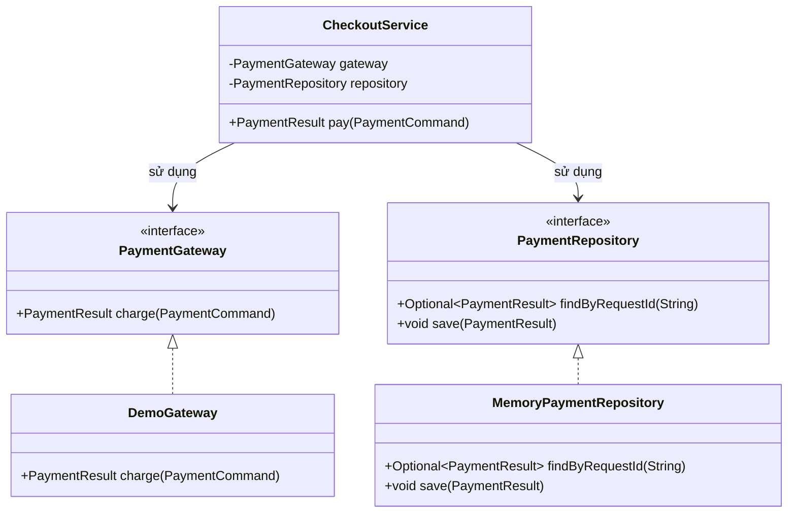

# Designing payment or storage interfaces in Java

**Topic:** OOP → Interfaces → Designing payment or storage interfaces.

When implementing payments, business code usually needs to **submit charge requests** and **store transaction results**. These are two distinct capabilities. They can be described by two focused interfaces: `PaymentGateway` for processing payments and `PaymentRepository` for retrieving/storing data. Clients know only **the contracts**; external API calls and database writes belong to implementing classes.

This lesson uses Java 17 and a **simulated** payment processor that runs without external accounts or services.

## 1. Start with responsibilities, not library names

A design tied directly to implementation details might look like this:

```java
class CheckoutService {
    // Mã nghiệp vụ tự quyết định cách thanh toán và nơi lưu dữ liệu.
    private final VendorCardClient cardClient = new VendorCardClient();
    private final SqlPaymentDao dao = new SqlPaymentDao();

    void checkout(/* ... */) {
        // ... gọi cardClient rồi ghi dao
    }
}
```

`VendorCardClient` and `SqlPaymentDao` are **illustrative names**, not classes built into the JDK. This design makes it difficult to switch providers, move storage, or test failure scenarios because `CheckoutService` is directly tied to concrete implementations.

Before writing code, identify the contracts:

| Component | Question to answer | What the contract should express |
|---|---|---|
| Payments | How do we submit a charge request and receive its result? | `PaymentGateway.charge(...)` |
| Storage | How do we find a result by request ID and save a new one? | `PaymentRepository.findByRequestId(...)`, `save(...)` |
| Business logic | Who validates requests, coordinates operations, and determines the result? | `CheckoutService.pay(...)` |
| Application composition | Who constructs the actual gateway and repository? | Application bootstrap code / dependency injection |

Both interfaces support **separating dependencies**, but should not be combined into one huge `PaymentManager`: changing storage does not necessarily require changing payment processing.



Arrows from `CheckoutService` to interfaces show **the source-code dependency direction**. The current implementations can be replaced with gateway or database adapters without changing `CheckoutService` method signatures.

## 2. Design data crossing interface boundaries

A good interface is more than a method name. Inputs and outputs should express business requirements and limit invalid states.

For example:

```java
public enum PaymentStatus {
    APPROVED, DECLINED
}

public record PaymentCommand(
        String requestId,
        String orderId,
        long amountCents
) {
    public PaymentCommand {
        if (requestId == null || requestId.isBlank()) {
            throw new IllegalArgumentException("Thiếu mã yêu cầu");
        }
        if (orderId == null || orderId.isBlank()) {
            throw new IllegalArgumentException("Thiếu mã đơn hàng");
        }
        if (amountCents <= 0) {
            throw new IllegalArgumentException("Số tiền phải dương");
        }
    }
}

public record PaymentResult(
        String requestId,
        String orderId,
        long amountCents,
        PaymentStatus status,
        String providerReference
) {}
```

Specifically:

- `requestId` identifies **one logical payment request**; the system needs a policy for duplicate submissions.
- `orderId` identifies the order the request belongs to.
- `amountCents` is an integer amount in an **assumed minor currency unit** to avoid floating-point errors in this example. Real monetary systems need explicit currency, scale, and rounding rules.
- `PaymentStatus` uses an enum rather than an arbitrary string such as `"SUCCESSS"`.
- `providerReference` is a reference identifier from the transaction processor; the simulation generates its own value.

`record` has been a stable Java feature since Java 16, and works well for modeling shallowly immutable data containing primitive/`String`/`enum` components. It also generates `equals`, `hashCode`, `toString`, and accessors.

Real payment boundaries may need additional statuses such as `PENDING`, `UNKNOWN`, and `REFUNDED`, plus error codes. The two statuses here suffice for teaching interface design; they **do not cover every real payment system**.

## 3. Complete example you can compile and run

Save the following as **`PaymentInterfacesDemo.java`**. All types are nested inside one outer class so the example runs independently.

```java
import java.util.Map;
import java.util.Objects;
import java.util.Optional;
import java.util.concurrent.ConcurrentHashMap;

public class PaymentInterfacesDemo {

    enum PaymentStatus {
        APPROVED, DECLINED
    }

    record PaymentCommand(
            String requestId, String orderId, long amountCents) {

        PaymentCommand {
            if (requestId == null || requestId.isBlank()) {
                throw new IllegalArgumentException("requestId không hợp lệ");
            }
            if (orderId == null || orderId.isBlank()) {
                throw new IllegalArgumentException("orderId không hợp lệ");
            }
            if (amountCents <= 0) {
                throw new IllegalArgumentException("Số tiền phải dương");
            }
        }
    }

    record PaymentResult(
            String requestId,
            String orderId,
            long amountCents,
            PaymentStatus status,
            String providerReference) {

        PaymentResult {
            Objects.requireNonNull(requestId);
            Objects.requireNonNull(orderId);
            Objects.requireNonNull(status);
            Objects.requireNonNull(providerReference);
        }
    }

    // Giao diện #1: thực hiện thanh toán.
    interface PaymentGateway {
        PaymentResult charge(PaymentCommand command);
    }

    // Giao diện #2: lưu và tìm kết quả thanh toán.
    interface PaymentRepository {
        Optional<PaymentResult> findByRequestId(String requestId);
        void save(PaymentResult result);
    }

    // Mô phỏng: duyệt giao dịch <= 100.000 cents.
    static final class DemoGateway implements PaymentGateway {
        private int chargeCalls;

        @Override
        public PaymentResult charge(PaymentCommand command) {
            Objects.requireNonNull(command, "command");
            chargeCalls++;

            PaymentStatus status = command.amountCents() <= 100_000
                    ? PaymentStatus.APPROVED
                    : PaymentStatus.DECLINED;

            String reference = status == PaymentStatus.APPROVED
                    ? "DEMO-" + command.requestId()
                    : "DECLINED";

            return new PaymentResult(
                    command.requestId(),
                    command.orderId(),
                    command.amountCents(),
                    status,
                    reference
            );
        }

        int chargeCalls() {
            return chargeCalls;
        }
    }

    // Bộ lưu trữ trong bộ nhớ; mất dữ liệu khi ứng dụng kết thúc.
    static final class MemoryPaymentRepository implements PaymentRepository {
        private final Map<String, PaymentResult> records =
                new ConcurrentHashMap<>();

        @Override
        public Optional<PaymentResult> findByRequestId(String requestId) {
            Objects.requireNonNull(requestId, "requestId");
            return Optional.ofNullable(records.get(requestId));
        }

        @Override
        public void save(PaymentResult result) {
            Objects.requireNonNull(result, "result");

            PaymentResult existing =
                    records.putIfAbsent(result.requestId(), result);

            if (existing != null && !existing.equals(result)) {
                throw new IllegalStateException(
                        "requestId đã có kết quả khác"
                );
            }
        }
    }

    // Mã nghiệp vụ chỉ phụ thuộc vào hai interface.
    static final class CheckoutService {
        private final PaymentGateway gateway;
        private final PaymentRepository repository;

        CheckoutService(
                PaymentGateway gateway,
                PaymentRepository repository) {
            this.gateway = Objects.requireNonNull(gateway, "gateway");
            this.repository = Objects.requireNonNull(
                    repository, "repository"
            );
        }

        // synchronized chỉ khóa trên CHÍNH instance service này.
        synchronized PaymentResult pay(PaymentCommand command) {
            Objects.requireNonNull(command, "command");

            Optional<PaymentResult> previous =
                    repository.findByRequestId(command.requestId());

            if (previous.isPresent()) {
                PaymentResult saved = previous.get();

                // Không cho dùng lại requestId với nội dung khác.
                if (!saved.orderId().equals(command.orderId())
                        || saved.amountCents() != command.amountCents()) {
                    throw new IllegalArgumentException(
                            "requestId đã dùng cho yêu cầu khác"
                    );
                }
                return saved;
            }

            PaymentResult result = gateway.charge(command);

            if (!result.requestId().equals(command.requestId())
                    || !result.orderId().equals(command.orderId())
                    || result.amountCents() != command.amountCents()) {
                throw new IllegalStateException(
                        "Gateway trả kết quả không khớp yêu cầu"
                );
            }

            repository.save(result);
            return result;
        }
    }

    public static void main(String[] args) {
        DemoGateway gateway = new DemoGateway();
        PaymentRepository repository = new MemoryPaymentRepository();

        CheckoutService checkout =
                new CheckoutService(gateway, repository);

        PaymentCommand request1 =
                new PaymentCommand("REQ-01", "ORDER-01", 50_000);

        PaymentResult first = checkout.pay(request1);
        PaymentResult repeated = checkout.pay(request1);

        PaymentResult rejected = checkout.pay(
                new PaymentCommand("REQ-02", "ORDER-02", 150_000)
        );

        System.out.println("REQ-01: " + first.status());
        System.out.println("REQ-01 lặp: " + repeated.status());
        System.out.println("REQ-02: " + rejected.status());
        System.out.println("Số lần gọi gateway: " + gateway.chargeCalls());
        System.out.println(
                "Có lưu REQ-01: " +
                repository.findByRequestId("REQ-01").isPresent()
        );
    }
}
```

Run:

```bash
javac PaymentInterfacesDemo.java
java PaymentInterfacesDemo
```

Output:

```text
REQ-01: APPROVED
REQ-01 lặp: APPROVED
REQ-02: DECLINED
Số lần gọi gateway: 2
Có lưu REQ-01: true
```

**Explanation:** `checkout.pay(...)` is called three times, but the second call reuses `REQ-01` and retrieves the result from the repository. Within **the same running `CheckoutService` instance and the same in-memory data**, the gateway receives only two new requests.

Real payment systems must not treat this code as a production safeguard against duplicate charges: if the process crashes after the gateway charges a payment but before `repository.save`, a retry may submit another charge. Proper protection requires gateway-enforced idempotency, durable state, and recovery mechanisms.

## 4. What each interface represents

### `PaymentGateway`: the external-system boundary

```java
interface PaymentGateway {
    PaymentResult charge(PaymentCommand command);
}
```

This interface deliberately says nothing about URLs, JSON, HTTP libraries, tokens, or provider names. Those details belong in concrete adapters.

A future real implementation might look like this:

```java
final class ExternalPaymentGateway implements PaymentGateway {
    private final ExternalPaymentClient client;

    ExternalPaymentGateway(ExternalPaymentClient client) {
        this.client = client;
    }

    @Override
    public PaymentResult charge(PaymentCommand command) {
        // 1. Ánh xạ PaymentCommand sang request của nhà cung cấp.
        // 2. Gửi request với idempotency key.
        // 3. Ánh xạ response và lỗi về hợp đồng ứng dụng.
        // Đây là phác thảo adapter; chưa có ExternalPaymentClient thật.
        throw new UnsupportedOperationException("Chưa tích hợp");
    }
}
```

The code above is **a design sketch**, not part of the standalone runnable example. A real implementation must define behavior for timeouts, connection failures, declines, unknown outcomes, asynchronous payments, and retries. Never assume every exception means “no money was charged.”

### `PaymentRepository`: the persistence boundary

```java
interface PaymentRepository {
    Optional<PaymentResult> findByRequestId(String requestId);
    void save(PaymentResult result);
}
```

Business logic only needs to **find by ID** and **save results**. It does not depend on JDBC, JPA, MongoDB, or a specific table structure.

| Implementation | Storage mechanism | Appropriate use |
|---|---|---|
| `MemoryPaymentRepository` | `ConcurrentHashMap` in RAM | Demos and simple tests |
| `JdbcPaymentRepository` | SQL and JDBC | Applications requiring durable data |
| `JpaPaymentRepository` | ORM/JPA | Projects already using JPA, entities, and transactions |
| `RemotePaymentRepository` | Storage API in another service | A separate-service architecture when justified |

The last three implementation names describe possible designs; they are **not implemented in this example**. Moving from RAM to a database requires maintaining `findByRequestId`/`save` semantics and handling uniqueness, transactions, and race conditions.

A critical principle: `Optional.empty()` means “not found”; it **must not mask a database connection failure** by returning `Optional.empty()`. Infrastructure errors should be reported accurately so callers can distinguish “no data” from “unable to query.”

## 5. Constructor injection: supplying implementations externally

```java
CheckoutService checkout =
        new CheckoutService(
                new DemoGateway(),
                new MemoryPaymentRepository()
        );
```

`CheckoutService` receives its dependencies through the constructor. It neither knows nor needs to know how those objects are created.

This is **Dependency Injection (DI)** performed manually. Spring is not required. With a DI framework, application configuration chooses the beans rather than explicitly calling `new`; the contracts stay the same.

Keep these distinctions in mind:

- **Interfaces** define behaviors an implementation must support.
- **Dependency Injection** is a mechanism for supplying dependencies to components that need them.
- **The Dependency Inversion Principle (DIP)** directs high-level logic to depend on suitable abstractions instead of implementation details.

Constructors can inject concrete classes too, so **DI does not automatically imply using interfaces**. Interfaces are useful when a boundary has multiple implementations or when tests need isolated dependencies.

## 6. Testing CheckoutService with a fake gateway

To test coordination logic, we can implement a tiny `PaymentGateway` fake and reuse `MemoryPaymentRepository`. Put the following code in **`CheckoutServiceCheck.java`** alongside `PaymentInterfacesDemo.java`:

```java
public class CheckoutServiceCheck {

    static final class FakeGateway
            implements PaymentInterfacesDemo.PaymentGateway {
        int calls;

        @Override
        public PaymentInterfacesDemo.PaymentResult charge(
                PaymentInterfacesDemo.PaymentCommand command) {
            calls++;
            return new PaymentInterfacesDemo.PaymentResult(
                    command.requestId(),
                    command.orderId(),
                    command.amountCents(),
                    PaymentInterfacesDemo.PaymentStatus.APPROVED,
                    "FAKE-" + command.requestId()
            );
        }
    }

    public static void main(String[] args) {
        FakeGateway fake = new FakeGateway();
        var repository =
                new PaymentInterfacesDemo.MemoryPaymentRepository();
        var checkout =
                new PaymentInterfacesDemo.CheckoutService(fake, repository);

        var request = new PaymentInterfacesDemo.PaymentCommand(
                "REQ-TEST", "ORDER-TEST", 25_000
        );

        var first = checkout.pay(request);
        var second = checkout.pay(request);

        if (first.status() !=
                    PaymentInterfacesDemo.PaymentStatus.APPROVED
                || !first.equals(second)
                || fake.calls != 1
                || repository.findByRequestId("REQ-TEST").isEmpty()) {
            throw new AssertionError("CheckoutService sai hợp đồng");
        }

        try {
            checkout.pay(new PaymentInterfacesDemo.PaymentCommand(
                    "REQ-TEST", "ORDER-KHAC", 25_000
            ));
            throw new AssertionError(
                    "Phải từ chối requestId trùng nội dung khác"
            );
        } catch (IllegalArgumentException expected) {
            // Hành vi đúng.
        }

        if (fake.calls != 1) {
            throw new AssertionError("Gateway bị gọi lại ngoài ý muốn");
        }

        System.out.println("PASS");
    }
}
```

Run:

```bash
javac PaymentInterfacesDemo.java CheckoutServiceCheck.java
java CheckoutServiceCheck
```

Expected output:

```text
PASS
```

The fake records how often it is called so we can verify that checkout skips the gateway when a request already has a stored result. This test checks **business logic with a fake**, not the correctness of an external payment system.

Other tests can cover a gateway returning a different `orderId` from the request, repository save failures, or reusing a `requestId` with a different amount.

## 7. What a payment contract must specify

The signature `PaymentResult charge(PaymentCommand)` only defines data types. A real system needs additional rules:

| Aspect | Question to answer |
|---|---|
| Input | Which amount unit and currency are used, and what is the scope of `requestId`? |
| Success | When is money considered successfully charged? |
| Decline | Does `DECLINED` mean no money was collected or merely that payment has not been confirmed? |
| Timeout | If no response arrives, might the funds already have been debited? |
| Idempotency | Does resubmitting the same `requestId` create another charge? |
| Retry | Which failures may be retried automatically? |
| Persistence | Which results must be stored durably before reporting success? |
| Concurrency | Can multiple instances process the same request concurrently? |
| Security | Who is authorized to initiate payment for an order? |

**In particular:** `synchronized` on `CheckoutService.pay` only serializes calls on **one specific service object**. It does not lock other instances, processes, or databases. `ConcurrentHashMap` makes individual map operations safer under concurrency, but **does not turn the “look up → charge → save” sequence into an atomic transaction**.

A possible production approach is:

1. Enforce a unique `requestId` constraint in durable storage, or maintain a request record with an explicit state.
2. Send an **idempotency key** to the payment provider according to its contract.
3. Persist transaction states/receipts, distinguishing definitive outcomes from pending or unknown results.
4. Design recovery for process crashes or network failures between steps, with controlled retries and reconciliation when necessary.
5. Avoid naively holding long-running database locks across slow network calls; choose a suitable transaction/state-machine strategy.

These requirements belong to business and infrastructure design; declaring an `interface` does not solve them automatically.

## 8. Avoid interfaces that are too broad or tied to technology

The following interface exposes SQL details to all business code:

```java
interface BadPaymentStore {
    java.sql.ResultSet runSql(String rawSql) throws java.sql.SQLException;
}
```

It forces every caller to know the table structure, queries, and `ResultSet` lifecycle. This is too low-level an abstraction if the goal is simply to find and save payments.

An interface closer to the business requirements:

```java
interface PaymentRepository {
    Optional<PaymentResult> findByRequestId(String requestId);
    void save(PaymentResult result);
}
```

The implementation can then use SQL internally without forcing callers to manage connections or know the database.

Likewise, avoid bundling too many unrelated behaviors together:

```java
interface EverythingPayment {
    void charge();
    void saveToDatabase();
    void sendEmail();
    void printReceipt();
    void exportCsv();
}
```

A class that only stores transactions would be forced to know about email, printing, and CSV exports. Split contracts by **actual responsibilities** as advised by the Interface Segregation Principle (ISP). However, one interface per method is unnecessary when related behaviors serve the same cohesive responsibility.

### Guidelines for choosing interfaces or abstract classes

| Requirement | Usually appropriate |
|---|---|
| Different payment adapters need the same charging contract | `interface PaymentGateway` |
| Different storage solutions provide the same data operations | `interface PaymentRepository` |
| A family of implementations shares state, constructors, and a common workflow | Consider an `abstract class` |
| One small algorithm with no need for substitution or a meaningful boundary | A simple class may be enough without an interface |

Base the choice on **what clients actually use**. Do not create interfaces merely because a class name has the suffix `Impl` or a design template demands an interface for every class.

## 9. Practice exercises

**Exercise 1 — change storage.** Write `FilePaymentRepository implements PaymentRepository` or sketch `JdbcPaymentRepository`. Change only the setup in `main` and keep `CheckoutService` unchanged. Specify how to persist idempotency keys and prevent duplicate writes.

**Exercise 2 — add a gateway.** Implement `RejectAllGateway implements PaymentGateway` that always returns `DECLINED`. Confirm checkout still works without editing business logic.

**Exercise 3 — test an abnormal result.** Write a fake gateway that returns a `PaymentResult` with a different `orderId` from the request. Predict the exception thrown by `CheckoutService` and verify that the repository did not save that result.

**Exercise 4 — failure between steps.** Simulate a gateway returning APPROVED while the repository throws an error during `save`. Was the payment already charged? Is calling `charge` again safe? Propose an idempotency and durable-state strategy.

**Exercise 5 — select the smallest contract.** A screen only needs to read payment status and must not initiate charges. Should it receive `PaymentGateway`, `PaymentRepository`, or a read-only query interface? Explain using least-privilege and single-responsibility principles.

**Remember:** Design payment and storage interfaces around **stable business contracts and clear responsibility boundaries**. `PaymentGateway` abstracts provider communication; `PaymentRepository` abstracts storage; `CheckoutService` coordinates through these abstractions. This makes substitutions and testing easier, but real payment correctness still depends on idempotency, error handling, transactions, and durable storage.
