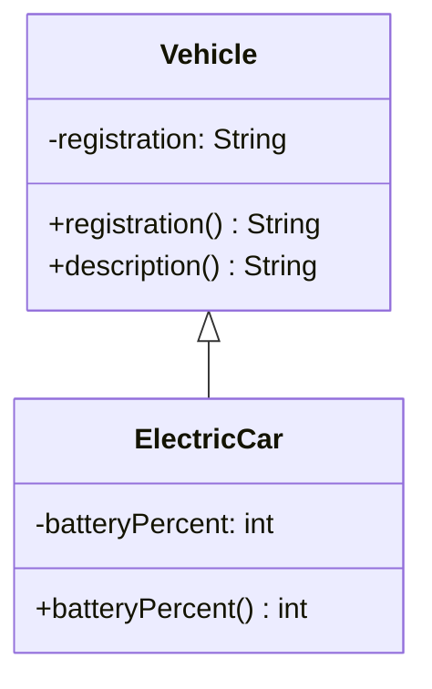
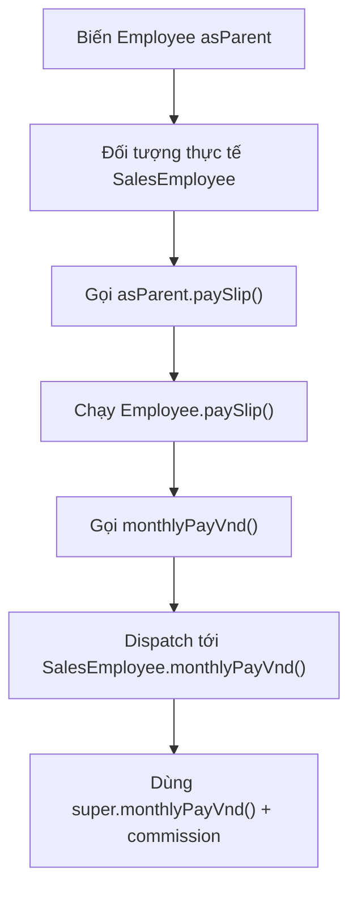

# Inheriting State and Behavior in Java OOP

**Inheritance** lets a subclass (*subclass*) extend a superclass (*superclass*), use its accessible members, and define additional state or behavior. Java declares this relationship with `extends`.

When people say “a subclass inherits state and behavior,” distinguish these two aspects:

- **State:** object data represented by fields. A subclass object contains state declared by its superclass plus fields declared by the subclass itself.
- **Behavior:** methods provided by the superclass. A subclass can use inherited methods, add new ones, or **override** (*override*) an overridable instance method.

Inheritance does not create separate “parent” and “child” objects and link them together. `new Child(...)` creates **one object** whose runtime type is `Child`; its superclass and subclass portions are initialized through the constructor chain.

## 1. Syntax and the Is-a Relationship

```java
class Vehicle {
    private final String registration;

    Vehicle(String registration) {
        this.registration = registration;
    }

    public String registration() {
        return registration;
    }

    public String description() {
        return "Phương tiện " + registration;
    }
}

class ElectricCar extends Vehicle {
    private final int batteryPercent;

    ElectricCar(String registration, int batteryPercent) {
        super(registration); // Khởi tạo phần lớp cha
        this.batteryPercent = batteryPercent;
    }

    public int batteryPercent() {
        return batteryPercent;
    }
}
```

An `ElectricCar` **is a kind of** `Vehicle`: `ElectricCar extends Vehicle` expresses the *is-a* relationship. An `ElectricCar` object has registration data managed by `Vehicle` and its own battery level. It can also use the `description()` and `registration()` methods from `Vehicle`.

```java
ElectricCar car = new ElectricCar("EV-001", 87);

System.out.println(car.registration());   // EV-001
System.out.println(car.description());    // Phương tiện EV-001
System.out.println(car.batteryPercent()); // 87
```

Class diagram:



The arrow from `ElectricCar` to `Vehicle` denotes **inheritance**; it does not imply that an independent `Vehicle` object exists alongside the `ElectricCar` object.

Java permits a class to directly extend **at most one superclass**. An ordinary class without `extends` implicitly has `Object` as its superclass (except `Object` itself). A class can still implement multiple interfaces using `implements`, but that is not multiple inheritance of state from several superclasses.

## 2. Inherited State: Superclass Fields Reside in the Subclass Object

A common misconception: the subclass contains superclass-declared state, but **not every superclass field is directly accessible from subclass code**.

For a `private` field:

```java
class Account {
    private long balance;

    Account(long openingBalance) {
        if (openingBalance < 0) {
            throw new IllegalArgumentException("Số dư ban đầu âm");
        }
        this.balance = openingBalance;
    }

    public final long balance() {
        return balance;
    }

    protected final void credit(long amount) {
        if (amount <= 0) {
            throw new IllegalArgumentException("Số tiền phải dương");
        }
        balance = Math.addExact(balance, amount);
    }
}

class RewardAccount extends Account {
    RewardAccount(long openingBalance) {
        super(openingBalance);
    }

    public void receiveReward(long rewardVnd) {
        credit(rewardVnd); // Dùng hành vi có kiểm tra của lớp cha
    }

    // Không thể viết: balance += rewardVnd;
    // Vì Account.balance là private.
}
```

`Account.balance` remains part of a `RewardAccount` object's state even though subclass code **cannot directly access** the field named `balance`. The superclass controls balance changes through `credit(...)`, preventing the subclass from duplicating validation rules.

An example of usage:

```java
RewardAccount account = new RewardAccount(100_000);
account.receiveReward(20_000);

System.out.println(account.balance()); // 120000
```

**Do not change all superclass fields to `protected` merely to make them available to subclasses.** Direct subclass writes may prevent the superclass from preserving invariants. Prefer `private` fields with meaningful, validating `protected` or `public` methods.

### How Do Access Levels Affect Inheritance?

| Superclass declaration | Can subclass code use it? | Notes |
|---|---|---|
| `public` instance method/field | Yes, where the superclass is accessible | Beware of public mutable fields |
| `protected` instance method/field | Yes, under Java's `protected` access rules | Across packages, qualifier expressions have additional restrictions |
| Package-private (no modifier) | Only within the same package | Unsuitable for direct cross-package subclass access |
| `private` field/method | Not directly from subclass code | Private superclass state remains in the subclass object and can be accessed through valid APIs |
| `public final` instance method | Usable but **not overridable** | The superclass fixes this implementation |
| Constructor | **Not inherited** | The subclass declares its own constructor and invokes the superclass constructor via `super(...)` |

In Java language terms, **private members are not inherited as directly usable subclass members**. Do not interpret that to mean “private superclass fields are absent from subclass objects.”

## 3. Inherited Behavior: Reuse, Addition, and Override

Suppose a sales employee earns base pay plus commission. All employees have identifiers and a shared pay-slip format, but their earnings formulas may differ.

This **standalone runnable Java example** demonstrates three kinds of behavior:

1. **Inherit unchanged** `id()`.
2. **Override** `monthlyPayVnd()`.
3. **Add** `commissionVnd()`.

File `InheritanceDemo.java`:

```java
public class InheritanceDemo {

    static class Employee {
        private final String id;
        private final long basePayVnd;

        Employee(String id, long basePayVnd) {
            if (id == null || id.isBlank()) {
                throw new IllegalArgumentException("Mã nhân viên rỗng");
            }
            if (basePayVnd < 0) {
                throw new IllegalArgumentException("Lương cơ bản âm");
            }

            this.id = id.strip();
            this.basePayVnd = basePayVnd;
        }

        // Phương thức kế thừa được, nhưng không cho override.
        public final String id() {
            return id;
        }

        // Lớp con có thể định nghĩa cách tính riêng.
        public long monthlyPayVnd() {
            return basePayVnd;
        }

        // Hành vi chung: gọi phương thức có thể override.
        public String paySlip() {
            return id() + ": " + monthlyPayVnd() + " VND";
        }
    }

    static final class SalesEmployee extends Employee {
        private final long commissionVnd;

        SalesEmployee(
                String id, long basePayVnd, long commissionVnd) {
            super(id, basePayVnd);

            if (commissionVnd < 0) {
                throw new IllegalArgumentException("Hoa hồng âm");
            }
            this.commissionVnd = commissionVnd;
        }

        @Override
        public long monthlyPayVnd() {
            return Math.addExact(
                super.monthlyPayVnd(), commissionVnd
            );
        }

        public long commissionVnd() {
            return commissionVnd;
        }
    }

    public static void main(String[] args) {
        Employee regular = new Employee("E01", 12_000_000L);
        SalesEmployee sales =
            new SalesEmployee("S01", 10_000_000L, 3_000_000L);

        System.out.println(regular.paySlip());
        System.out.println(sales.paySlip());

        Employee asParent = sales;
        System.out.println(asParent.monthlyPayVnd());
        System.out.println(asParent.id());
    }
}
```

Run with JDK 11+:

```bash
javac InheritanceDemo.java
java InheritanceDemo
```

Output:

```text
E01: 12000000 VND
S01: 13000000 VND
13000000
S01
```

Analysis:

- `SalesEmployee` **does not redeclare** `id()` or `paySlip()`; these are reused from `Employee`.
- `SalesEmployee.monthlyPayVnd()` overrides the superclass method. `@Override` asks the compiler to check that the signature actually overrides a method.
- `super.monthlyPayVnd()` calls the `Employee` calculation and adds commission. `super` does not name a separate superclass object.
- `Math.addExact` throws `ArithmeticException` if the sum overflows `long`, preventing a silent incorrect result.
- `commissionVnd()` is specific to `SalesEmployee`; a reference with **declared type `Employee`** cannot directly call this method.

This example illustrates a simple earnings model, not the full payroll, tax, or commission rules of a real business.

## 4. Polymorphism: Method Behavior Depends on the Runtime Object Type

Consider these two lines:

```java
Employee asParent =
    new SalesEmployee("S02", 8_000_000L, 1_500_000L);

System.out.println(asParent.monthlyPayVnd()); // 9500000
```

The variable `asParent` has the **declared type** `Employee`, but the actual object comes from `new SalesEmployee(...)`. For an overridden instance method, Java uses **dynamic dispatch** to invoke the version corresponding to runtime type `SalesEmployee`.

That is why `Employee.paySlip()` can call `monthlyPayVnd()` without knowing the concrete subclass: when invoked on a `SalesEmployee`, it still selects the override.



However, **the declared type still limits which methods are callable at compile time**:

```java
Employee employee =
    new SalesEmployee("S03", 5_000_000L, 2_000_000L);

employee.monthlyPayVnd();   // Hợp lệ
// employee.commissionVnd(); // Lỗi biên dịch
```

If subclass-specific behavior is truly needed, reconsider the variable type or API. Downcast only for a clear design reason when the runtime type is known; avoid replacing polymorphism everywhere with chains of `instanceof` checks and casts.

## 5. Superclass State Is Initialized Before Subclass-Specific State

A subclass constructor must invoke a superclass constructor, but **constructors are not inherited** as methods. For example:

~~~java
class Parent {
    Parent(String code) {
        System.out.println("Parent: " + code);
    }
}
class Child extends Parent {
    Child() {
        super("A01");
        System.out.println("Child");
    }
}
~~~

`new Child()` prints `Parent: A01` followed by `Child`. If the superclass has only parameterized constructors, you cannot omit `super("A01")` and expect the compiler to call a nonexistent `Parent()`.

Subclass field initializers and instance blocks run **after** the superclass constructor's portion. Therefore, a superclass constructor should not invoke overridable methods: dispatch may reach subclass code while its fields are still `null` or `0`. The details of `this(...)`, static initialization, initializer order, and constructor failure are demonstrated through a separate tracing program in the constructor-chain lesson.

## 6. Fields Are State; They Are Not Dynamically Dispatched Like Methods

**Overriding** replaces an instance method implementation according to the runtime type. **Overloading** uses the same name with different parameter lists and is primarily resolved at compile time. **Field hiding** occurs when a subclass declares a field with the same name; field access depends on the expression's type, not runtime object dispatch.

~~~java
class Parent {
    String label = "parent";
    String label() { return "parent-method"; }
}
class Child extends Parent {
    String label = "child"; // Field hiding.
    @Override String label() { return "child-method"; }
}

Parent value = new Child();
System.out.println(value.label);   // parent
System.out.println(value.label()); // child-method
~~~

Both `label` fields coexist in one `Child` object, making it easy to confuse which data is being read. In real designs, keeping fields `private` and exposing suitable APIs is usually safer. Similarly, a same-signature `static` method is *hidden*, not an overridden instance method; invoke static methods through class names to avoid confusing them with dynamic dispatch.

## 7. Rules That Method Overrides Must Respect

Valid overriding involves more than “writing a method with the same name.”

| Rule | What to remember |
|---|---|
| Method must be overridable | You cannot override `private`, `final`, or `static` methods as instance-method overrides |
| Parameter list | Requires the appropriate matching signature; a different parameter list creates an **overload** |
| Return type | A **covariant** return type is permitted when applicable; arbitrary changes are not |
| Visibility | An override cannot reduce its inherited method's access level |
| Checked exceptions | An override cannot declare new or broader checked exceptions beyond what the superclass method permits |
| Behavioral contract | Must preserve expectations clients rely on through the superclass type |

For example, when a superclass exposes a method:

```java
class Parent {
    public Number amount() {
        return 1;
    }
}

class Child extends Parent {
    @Override
    public Integer amount() {
        return 2;
    }
}
```

`Integer` is a subtype of `Number`, so the return type here is **validly covariant**.

In contrast:

```java
class WrongChild extends Parent {
    // @Override
    // protected Integer amount() { return 3; }
    // Sai vì giảm quyền truy cập public xuống protected.
}
```

More important than syntax is **substitutability**: if a caller works correctly with `Parent`, supplying a `Child` should not unexpectedly violate guarantees made by `Parent`. For example, if `Employee.monthlyPayVnd()` promises nonnegative earnings, a subclass should not arbitrarily return a negative number to signal an error.

## 8. Inheriting State Can Create Tight Coupling

When subclasses depend on superclass internals, superclass changes may break subclasses even when the public API looks unchanged. This is a form of the **fragile base class** problem.

A risky design example:

```java
class MutableBalance {
    protected long balance; // Mọi subclass được phép sửa trực tiếp

    void deposit(long amount) {
        balance += amount; // Chưa kiểm tra dữ liệu hoặc tràn số
    }
}

class SpecialBalance extends MutableBalance {
    void applyBonus(long bonus) {
        balance += bonus; // Đi vòng qua mọi quy tắc mà cha có thể đặt ra
    }
}
```

The subclass directly depends on the `balance` field. If the superclass later adds balance limits, audit logging, or business validation, `SpecialBalance` may continue bypassing those rules.

A better design:

- Keep fields `private`.
- Offer a meaningful `protected final` method, such as `creditValidated(...)`, when subclasses genuinely need an extension point.
- Define **permitted customization points** with protected methods or interfaces that have clear contracts.
- Avoid invoking overridden methods during construction.
- Do not let subclasses rely on field layouts or internal call order unless explicitly guaranteed.

This does not mean every `protected` field is wrong, but consider the coupling costs it imposes on the hierarchy.

## 9. Shared State Belongs in a Superclass Only for a Genuine Is-a Relationship

`SalesEmployee extends Employee` is a sensible business specialization if sales employees honor the shared employee contract. By contrast, an `OrderService` **uses** a `PaymentGateway`; it is not a kind of gateway. To process payments, keep a `PaymentGateway` collaborator:

~~~java
interface PaymentGateway {
    void charge(long amountVnd);
}
final class OrderService {
    private final PaymentGateway gateway;
    OrderService(PaymentGateway gateway) {
        this.gateway = java.util.Objects.requireNonNull(gateway);
    }
    void pay(long amountVnd) {
        if (amountVnd <= 0) {
            throw new IllegalArgumentException("Số tiền phải dương");
        }
        gateway.charge(amountVnd);
    }
}
~~~

**Composition** makes it easier to replace gateways or combine components without inventing a superclass relationship. Inheritance directly couples subclasses to superclass contracts and extension points; composition connects collaborators through fields/interfaces. Decide based on semantic substitutability, not just the number of lines reused.

## 10. Inheritance Design Review Checklist

Before making one class `extends` another, check:

1. **Is there a genuine is-a relationship?** Can a subclass replace its superclass without violating the contract?
2. **Which state belongs to the superclass?** Are common fields initialized and controlled there?
3. **Which methods should be inherited unchanged?** Avoid overriding when the superclass behavior is already correct.
4. **Which methods require overrides?** Is there a clear business reason and an `@Override` annotation?
5. **Are extension points safe?** Are suitable `final` or `protected` methods used to preserve invariants?
6. **Is the constructor chain correct?** Does `super(...)` receive valid data without exposing a partially initialized object?
7. **Would composition be simpler?** Avoid excessive inheritance merely to reuse a few functions.
8. **Do tests verify behavior through superclass references?** Check dynamic dispatch and substitutability.

## 11. Self-Check Exercises

### Exercise 1 — Predict the Result

```java
class Animal {
    String sound() {
        return "unknown";
    }

    String describe() {
        return "Sound: " + sound();
    }
}

class Cat extends Animal {
    @Override
    String sound() {
        return "meow";
    }
}

Animal a = new Cat();
System.out.println(a.describe());
```

**Answer:** `Sound: meow`. The `describe()` method is inherited from `Animal`, but its call to `sound()` dispatches to `Cat.sound()`.

### Exercise 2 — Can a Subclass See Every Field?

```java
class Base {
    private int secret = 7;

    public int secret() {
        return secret;
    }
}

class Derived extends Base {
    int read() {
        // return secret; // Lỗi biên dịch
        return secret();
    }
}
```

**Answer:** `return secret()` is valid because it invokes the superclass's public method. `return secret` is invalid because `secret` is a private field of `Base`.

### Exercise 3 — Find the Non-Override

```java
class Base {
    void print(int value) {
        System.out.println("Base " + value);
    }
}

class Derived extends Base {
    void print(String value) {
        System.out.println("Derived " + value);
    }
}
```

**Answer:** `Derived.print(String)` is an **overload**, not an override of `Base.print(int)`. The subclass can invoke both methods with their respective argument types.

### Exercise 4 — Design a Validated Subclass

Create `StudentAccount extends Account` with the following requirements:

- `Account` holds a `private long balance` that cannot become negative.
- `Account` provides `public final long balance()` and a protected method for valid credit operations.
- `StudentAccount` has a `private final String universityCode` validated in its constructor.
- `receiveScholarship(long amount)` credits money through the superclass API, not by modifying a field directly.
- Write a test: create `StudentAccount`, receive a scholarship, check the balance, and attempt an invalid amount.

As you solve it, ensure **the superclass still protects shared state**, while the subclass adds only specialized information and behavior.

---

**Remember:** Inheritance lets a subclass **contain state declared in its superclass** and **reuse or override behavior** under Java's access, constructor, and overriding rules. A subclass instance remains **one object**. Encapsulate shared data, distinguish method overriding from field hiding, honor superclass contracts, and inherit only when the *is-a* relationship truly applies.
