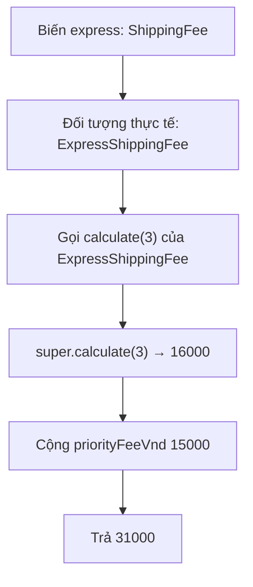
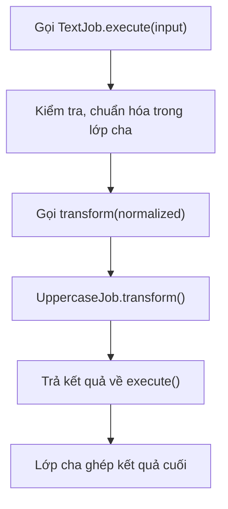

# Extending Superclass Behavior in Java

When a subclass inherits from a superclass using `extends`, it can **reuse existing behavior** and add specialized behavior. One important technique is **method overriding**: the subclass provides a new implementation of an overridable instance method declared by its superclass.

For example, a shipping system has a base fee calculation. Priority shipping still uses that calculation but adds a surcharge. Rather than copy the entire formula into the subclass, call `super.calculate(...)` to reuse the superclass behavior and then add the specialized part.

This lesson focuses on **extending superclass behavior**, what `super` means, which methods can be overridden, how to protect shared rules, and when composition may be preferable to inheritance.

## 1. Inheritance, Overriding, and Behavior Extension

A subclass declares:

```java
class Parent {
    void greet() {
        System.out.println("Xin chào");
    }
}

class Child extends Parent {
    @Override
    void greet() {
        super.greet();
        System.out.println("Rất vui được gặp bạn");
    }
}
```

When executed:

```java
new Child().greet();
```

Output:

```text
Xin chào
Rất vui được gặp bạn
```

How it works:

1. `Child extends Parent`: `Child` is a subclass of `Parent`.
2. `@Override` confirms that `Child.greet()` overrides an overridable superclass method. The compiler reports incompatible signatures.
3. `super.greet()` invokes **the superclass implementation** of that method.
4. The subclass performs its additional step after calling `super.greet()`.

If a subclass **does not override**, it may call the inherited method directly (subject to access rules). If it overrides but **does not call `super`**, it replaces that method's entire behavior and must independently uphold the superclass contract.

| Situation | Result |
| --- | --- |
| No override of `greet()` | `Child` uses the behavior inherited from `Parent` |
| Override and call `super.greet()` | Run the superclass behavior, then the additional behavior |
| Override without calling `super.greet()` | Execute only the subclass implementation |
| Declare `greet(String name)` instead of `greet()` | Usually **overloading** (another method with different parameters), not overriding `greet()` |
| Use `super.greet()` outside an appropriate instance method/constructor | Invalid; `super` requires a subclass context |

**Important:** “Extension” does not always mean adding statements after `super`. It may require actions **before**, **after**, or **around** superclass behavior (validation, timing, logging, enriching results). The appropriate order follows the actual contract.

## 2. Complete Java Example: Priority Shipping

Save all the following code in **`Main.java`** and run it with Java 17 or Java 21.

```java
import java.util.List;

class ShippingFee {
    private final long baseFeeVnd;

    ShippingFee(long baseFeeVnd) {
        if (baseFeeVnd < 0) {
            throw new IllegalArgumentException("Phí cơ bản không được âm");
        }
        this.baseFeeVnd = baseFeeVnd;
    }

    public long calculate(int distanceKm) {
        if (distanceKm <= 0) {
            throw new IllegalArgumentException("Quãng đường phải dương");
        }

        long distanceFee = Math.multiplyExact(2_000L, distanceKm);
        return Math.addExact(baseFeeVnd, distanceFee);
    }

    public String label() {
        return "Giao tiêu chuẩn";
    }
}

final class ExpressShippingFee extends ShippingFee {
    private final long priorityFeeVnd;

    ExpressShippingFee(long baseFeeVnd, long priorityFeeVnd) {
        super(baseFeeVnd);

        if (priorityFeeVnd < 0) {
            throw new IllegalArgumentException("Phụ phí không được âm");
        }
        this.priorityFeeVnd = priorityFeeVnd;
    }

    @Override
    public long calculate(int distanceKm) {
        // Giữ kiểm tra và công thức chuẩn của lớp cha.
        long standardFee = super.calculate(distanceKm);

        // Phần mở rộng dành riêng cho giao ưu tiên.
        return Math.addExact(standardFee, priorityFeeVnd);
    }

    @Override
    public String label() {
        return super.label() + " + ưu tiên";
    }
}

public class Main {
    public static void main(String[] args) {
        ShippingFee normal = new ShippingFee(10_000);
        ShippingFee express = new ExpressShippingFee(10_000, 15_000);

        List<ShippingFee> options = List.of(normal, express);
        for (ShippingFee option : options) {
            System.out.println(
                option.label() + ": " + option.calculate(3) + " VND"
            );
        }

        try {
            express.calculate(0);
        } catch (IllegalArgumentException ex) {
            System.out.println("Lỗi: " + ex.getMessage());
        }
    }
}
```

Compile and run:

```bash
javac Main.java
java Main
```

Output:

```text
Giao tiêu chuẩn: 16000 VND
Giao tiêu chuẩn + ưu tiên: 31000 VND
Lỗi: Quãng đường phải dương
```

For a distance of 3 km:

- Standard fee: `10_000 + 2_000 × 3 = 16_000` VND.
- Priority fee: `16_000 + 15_000 = 31_000` VND.
- The subclass does not duplicate validation of `distanceKm > 0`. When `ExpressShippingFee.calculate(0)` calls `super.calculate(0)`, the superclass exception still applies.

`Math.addExact` and `Math.multiplyExact` detect `long` overflow (by throwing `ArithmeticException`) instead of silently producing an incorrect fee. The example uses them to demonstrate integer safety while keeping the formula simple.

### Which Responsibilities Belong to the Superclass and Subclass?

| Component | `ShippingFee` | `ExpressShippingFee` |
| --- | --- | --- |
| Base fee | `private baseFeeVnd` field | Inherits behavior using the field but cannot directly access the `private` field |
| Base fee calculation | `calculate(distanceKm)` | Uses `super.calculate(distanceKm)` |
| Priority surcharge | None | `private priorityFeeVnd` field |
| Total fee calculation | Returns standard fee | Overrides `calculate()` to add the surcharge |
| Display name | `label()` | Overrides and appends a description |
| Initialization | `ShippingFee(long)` | `ExpressShippingFee(long, long)` calls `super(...)` |

The subclass extends both **existing behavior** and **its own state**; it does not duplicate every superclass field as a separate field.

## 3. Polymorphism: A Superclass Reference Can Invoke Subclass Methods

Both variables in the example have declared type `ShippingFee`:

```java
ShippingFee normal = new ShippingFee(10_000);
ShippingFee express = new ExpressShippingFee(10_000, 15_000);
```

But calling `express.calculate(3)` executes the **`ExpressShippingFee` override**, because the runtime object is an `ExpressShippingFee`.



Choosing an **overridden instance method** based on the runtime object is called *dynamic dispatch*. It lets the same `option.calculate(distance)` call work with multiple subclasses of `ShippingFee`.

Remember that a variable's declared type still determines **which methods are callable at compile time**. If `ExpressShippingFee` has a method absent from `ShippingFee`, a `ShippingFee express` reference cannot directly call it without a valid cast. Polymorphism does not add subclass-specific APIs to the superclass type.

## 4. Two Uses of `super` Serve Different Purposes

In the example, `super(baseFeeVnd)` **initializes the superclass portion** when creating `ExpressShippingFee`, whereas `super.calculate(distanceKm)` executes **the superclass method implementation** on the current object:

~~~java
ExpressShippingFee(long base, long priority) {
    super(base); // Chọn constructor cha.
    if (priority < 0) throw new IllegalArgumentException();
    this.priorityFeeVnd = priority;
}

@Override
public long calculate(int km) {
    return Math.addExact(super.calculate(km), priorityFeeVnd);
}
~~~

Constructors cannot be overridden. In Java 17/21, an explicit `super(...)` or `this(...)` invocation must be the first constructor statement, and the compiler inserts `super()` when neither is written. Constructor chaining and field-initializer order are covered separately in the subclass initialization lesson.

**Subtle point:** `super.calculate()` selects the superclass method body at that call site; if that body invokes an overridable instance hook, the hook still dispatches to the subclass implementation. Do not treat `super` as bypassing every subclass behavior.

## 5. Do Not Confuse Override, Overload, and Static Hiding

| Mechanism | How to identify it | How implementation is chosen |
| --- | --- | --- |
| **Overriding** | Compatible instance-method signature in the subclass, usually marked `@Override` | Runtime type |
| **Overloading** | Same method name, different parameter lists | Signature selected at compile time |
| **Static method hiding** | Subclass declares a static method with the same valid signature | Class/expression type, not the runtime instance |
| **Field hiding** | Subclass declares a field with the same name | Static type/access context |

~~~java
class Base {
    String sound() { return "base"; }
}
class Child extends Base {
    @Override String sound() { return "child"; }
    String sound(int volume) { return "volume=" + volume; } // Overload.
}

Base value = new Child();
System.out.println(value.sound()); // child
// value.sound(2); // Không biên dịch: Base không có sound(int).
~~~

In particular, **static methods are not overridden**. Do not mark a same-named static method with `@Override`; for runtime polymorphism, use instance methods with an appropriate contract.

## 6. Requirements for Valid Method Overriding

- The superclass method must be an overridable instance method; `private`, `final`, and `static` do not participate in instance overriding.
- Names and parameter lists must match the overridden signature. Changing `int` to `long` creates an overload, which `@Override` helps catch.
- Return types must be compatible; Java permits **covariant returns** for suitable reference subtypes.
- Access cannot be reduced; if a superclass method is `public`, the subclass method must also be `public`.
- Checked exceptions cannot be broadened beyond the superclass method contract; unchecked exceptions are not restricted the same way syntactically but must still honor behavioral expectations.

A syntactically valid override can still violate business rules by skipping input validation, changing invariants, or surprising callers using the superclass type. When subclasses must not replace an entire workflow, make the coordinating method `final` and expose appropriate hooks, as in the **Template Method** example below.

## 7. When Should You Call `super`, and When Should You Not?

Java **does not require** an overriding method to invoke `super.method()`. The decision depends on the *behavioral contract*.

### When `super` Is Appropriate

When the subclass adds one rule while preserving the superclass's basic implementation. In the shipping example, the priority surcharge is added after `super.calculate(distanceKm)`.

### When `super` Is Not Required

When the contract permits replacing the entire algorithm. For example, a superclass may define basic drawing behavior while a subclass provides a completely different drawing implementation that still satisfies the same contract.

### What to Consider Before Calling It

- Calling `super` twice may duplicate side effects if the superclass method modifies state or invokes an external API.
- Calling `super` before or after extra operations changes the order of side effects, validation, and errors.
- Omitting `super` may accidentally bypass validation, audit history, or maintenance of superclass invariants.
- If `super.method()` throws, later statements will not execute unless the code explicitly catches or handles the error.
- `super` selects the parent implementation at that point; it does not “freeze” all subsequent dynamic calls. If the superclass implementation invokes another overridable method, that call may still dispatch to the subclass.

Do not impose a rule that “every override must call `super`.” Read the superclass's published contract and design extension points accordingly.

## 8. Safe Extensions with Template Method

Overriding an entire business operation can let subclasses accidentally skip essential steps, such as input validation. **Template Method** puts the main workflow in a `final` method; subclasses extend only the specified step through a `protected` hook.

A standalone example saved as **`TemplateDemo.java`**:

```java
import java.util.Locale;
import java.util.Objects;

abstract class TextJob {
    // Trình tự chung do lớp cha kiểm soát; lớp con không override.
    public final String execute(String input) {
        Objects.requireNonNull(input, "input");

        String normalized = input.trim();
        if (normalized.isEmpty()) {
            throw new IllegalArgumentException("Nội dung không được trống");
        }

        String transformed = transform(normalized);
        return "Đã xử lý: " + transformed;
    }

    // Điểm mở rộng mà lớp con phải cung cấp.
    protected abstract String transform(String normalized);
}

final class UppercaseJob extends TextJob {
    @Override
    protected String transform(String normalized) {
        return normalized.toUpperCase(Locale.ROOT);
    }
}

public class TemplateDemo {
    public static void main(String[] args) {
        TextJob job = new UppercaseJob();
        System.out.println(job.execute("  java oop  "));
    }
}
```

Run `javac TemplateDemo.java` and `java TemplateDemo`:

```text
Đã xử lý: JAVA OOP
```

In this design:

1. `execute()` enforces the workflow: check `null`, normalize input, reject empty data, and produce the result.
2. `final` prevents subclasses from overriding `execute()` and accidentally bypassing shared steps.
3. `transform()` is the explicit extension point; subclasses change the transformation algorithm without altering the input contract of `execute()`.



Template Method fits subclasses that share an **invariant processing order** but vary a few steps. Avoid applying it for a single simple statement or when the variations do not form a sound inheritance relationship.

## 9. Extend Behavior After Construction Completes

While `super(...)` is running, subclass-specific fields may still hold default values. If a superclass constructor invokes an overridable method, Java still dispatches to the subclass override:

~~~java
class Parent {
    Parent() { show(); }
    void show() { System.out.println("parent"); }
}
class Child extends Parent {
    String label = "Sẵn sàng";
    @Override void show() { System.out.println(label); }
}
// new Child() in null, vì initializer label chưa chạy.
~~~

This follows from **initialization order**, not a random bug or race condition. Subclass hooks should be invoked only after the object is fully initialized. The constructor-chain lesson traces this order alongside static blocks, instance blocks, and constructor exceptions.

## 10. When Inheritance Is Not a Good Fit

Inheritance makes sense when a subclass really is **a specialized kind of its superclass** and preserves its contract. If you only need to add an optional feature (logging, metrics, retries, caching, or a surcharge), **composition/decorators** may be more flexible:

```java
interface PriceCalculator {
    long calculate(int quantity);
}

final class SurchargeCalculator implements PriceCalculator {
    private final PriceCalculator delegate;
    private final long surcharge;

    SurchargeCalculator(PriceCalculator delegate, long surcharge) {
        this.delegate = java.util.Objects.requireNonNull(delegate);
        if (surcharge < 0) {
            throw new IllegalArgumentException("Phụ phí âm");
        }
        this.surcharge = surcharge;
    }

    @Override
    public long calculate(int quantity) {
        return Math.addExact(delegate.calculate(quantity), surcharge);
    }
}
```

This illustrates **composable components**: `SurchargeCalculator` holds another `PriceCalculator` and adds a fee. When combining variations, you do not necessarily need a hierarchy such as `ExpressInternationalDiscountedShipping`.

Comparison:

| Criterion | `extends` / override | Composition / delegate |
| --- | --- | --- |
| Relationship | `is-a`: a subclass is a kind of superclass | `has-a`: an object contains/references another component |
| Reusing behavior | Invoke an inherited method or `super.method()` | Invoke `delegate.method()` |
| Extension points | Designed by the superclass; may be constrained by `protected` / `final` | Determined by interfaces and delegate objects |
| Combining features | May require many subclasses and complex combinations | Multiple wrappers are often easier to combine |
| Primary risk | Tight coupling to superclass contracts and details | Additional objects/delegation and the need for appropriate lifecycle management |

Composition is not always superior: when a genuine hierarchy exists, variations share many fixed rules, and the superclass exposes clear hooks, inheritance is entirely reasonable. Choose based on domain relationships and contract stability.

## 11. Common Mistakes and Fixes

| Mistake | What happens | Fix |
| --- | --- | --- |
| Calling `calculate(...)` instead of `super.calculate(...)` inside an override | May recurse indefinitely (`StackOverflowError`) | Call `super.calculate(...)` when the superclass implementation is needed |
| Omitting `@Override` while changing parameter types | Creates an overload instead of an override | Add `@Override` for compiler checks |
| Subclass skips validation guaranteed by the superclass | Object may violate the contract | Retain validation or put the shared workflow into a `final` method |
| Overriding a `final` or `private` method | Not permitted under Java override rules | Use the superclass's designated extension point |
| Confusing `static` hiding with overriding | Dispatch depends on class/reference type, not runtime instance polymorphism | Use instance methods for dynamic dispatch |
| Superclass invokes an overridden hook from its constructor | Subclass executes before initialization completes | Do not call overridable methods from constructors |
| Subclass directly modifies mutable `protected` superclass fields | Superclass invariants can break | Keep fields `private` and provide controlled methods/hooks |
| Using `extends` to reuse only a few lines | Feature composition becomes difficult; weak `is-a` relationship | Consider composition/delegation |

## 12. Self-Check

**Question 1.** In `ExpressShippingFee.calculate()`, why call `super.calculate(distanceKm)` instead of `calculate(distanceKm)`?

**Answer:** `super` selects the superclass implementation. Calling `calculate(...)` without `super` inside the override typically invokes the same subclass method again and causes recursion.

**Question 2.** After `ShippingFee shipping = new ExpressShippingFee(10000, 15000);`, which method runs when `shipping.calculate(3)` is called?

**Answer:** `ExpressShippingFee.calculate()`, because this is an overridden instance method dispatched according to the object's actual runtime type.

**Question 3.** Can a subclass override a constructor?

**Answer:** No. Constructors are not inherited. A subclass invokes a superclass constructor through `super(...)` during initialization.

**Question 4.** How do `protected abstract String transform(...)` and `public final String execute(...)` divide responsibilities in Template Method?

**Answer:** `execute()` preserves the fixed workflow and invariants; `transform()` lets subclasses implement controlled variations.

**Question 5.** Should the superclass declare `protected List<Order> orders` so subclasses can modify it freely?

**Answer:** Not if the superclass must protect data consistency. Keeping the field `private` and exposing clearly contracted operations/hooks is usually safer.

**Question 6.** Is inheritance always the easiest way to combine logging, caching, and retry behavior in many combinations?

**Answer:** No. Composition/decorators can combine capabilities more flexibly and reduce the number of subclasses.

**Remember:** To extend superclass behavior, use `extends` when the `is-a` relationship and inheritance contract are valid, `@Override` to replace or augment implementations, `super.method()` to reuse superclass behavior, and `super(...)` to initialize the superclass portion. To protect a workflow against subclass bypass, design a `final` template method with an explicit `protected` extension point.
