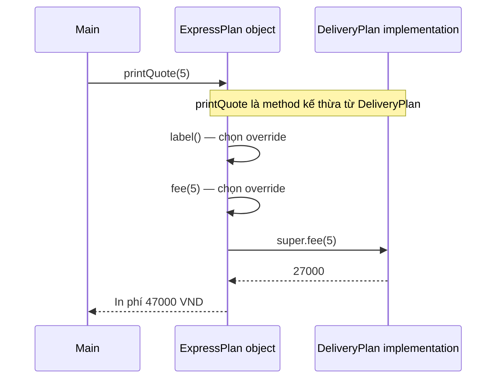

# Method Overriding and Invoking Superclass Behavior in Java

**Method overriding** allows a subclass to provide its own implementation of an **inheritable instance method** declared by a superclass, while callers still interact through the superclass contract. When a subclass wants to **preserve part of the superclass's processing and then add behavior**, Java offers `super.method(...)`.

Distinguish two questions:

- **Overriding:** “Which method runs when the actual object is a subclass instance?”
- **Calling `super`:** “Inside a subclass method, how can we invoke the appropriate inherited superclass version instead of recursively calling our own override?”

This lesson uses Java 11 or later and illustrates shipping-fee calculations for standard and express delivery. The example is contained in **one Java file** so it can be compiled, executed, and checked immediately.

## 1. Recognizing Overriding with a Minimal Example

```java
class Notification {
    public void send() {
        System.out.println("Gửi thông báo thông thường");
    }
}

class EmailNotification extends Notification {
    @Override
    public void send() {
        System.out.println("Gửi qua email");
    }
}
```

When called:

```java
Notification message = new EmailNotification();
message.send(); // Gửi qua email
```

The variable `message` has the **declared type** `Notification`, but the actual object is created by `new EmailNotification()`. Because `send()` is an overridden instance method, Java selects the version belonging to the object's **actual runtime class**. This is **dynamic method dispatch**, a form of polymorphism.

`@Override` is not what makes the JVM dispatch an override; it is an annotation that **asks the compiler to verify the overriding intent**. A wrong name or signature is caught early.

### Overriding Versus Declaring Another Method

Two methods with the same name are not necessarily overrides. To override, a subclass method must match the inherited method's signature under Java's rules: name and parameter types must correspond, and the return type must also be compatible.

```java
class Parent {
    public void process(String text) {
        System.out.println("Parent: " + text);
    }
}

class Child extends Parent {
    @Override
    public void process(String text) {
        System.out.println("Child: " + text);
    }

    public void process(int count) {
        System.out.println("Count: " + count);
    }
}
```

Here, `process(String)` is an **override**, while `process(int)` is an **overload** (same name, different parameters). You cannot use `@Override` on `process(int)` in this example because the superclass has no matching method to override.

## 2. Complete Example: Extending Superclass Behavior with `super`

Requirements:

- **Standard delivery:** a base fee of 12.000 VND plus 3.000 VND per km.
- **Express delivery:** preserve the standard calculation and add a priority surcharge of 20.000 VND.
- Distance must be a nonnegative integer; if a `long` fee calculation overflows, throw `ArithmeticException` rather than returning a wrong value.
- A superclass `printQuote` method should use the result of the subclass-overridden `fee` method.

File **`OverrideAndSuperDemo.java`**:

```java
public class OverrideAndSuperDemo {

    static class DeliveryPlan {
        private static final long BASE_VND = 12_000L;
        private static final long PER_KM_VND = 3_000L;

        public String label() {
            return "Giao thường";
        }

        public long fee(int distanceKm) {
            if (distanceKm < 0) {
                throw new IllegalArgumentException(
                        "Quãng đường không được âm");
            }
            long distanceFee =
                    Math.multiplyExact(PER_KM_VND, (long) distanceKm);
            return Math.addExact(BASE_VND, distanceFee);
        }

        // Không override ở lớp con, nhưng gọi các method có thể override.
        public void printQuote(int distanceKm) {
            System.out.println(
                    label() + " (" + distanceKm + " km): "
                    + fee(distanceKm) + " VND");
        }
    }

    static final class ExpressPlan extends DeliveryPlan {
        private static final long PRIORITY_VND = 20_000L;

        @Override
        public String label() {
            return "Giao nhanh (nền: " + super.label() + ")";
        }

        @Override
        public long fee(int distanceKm) {
            // Gọi lại toàn bộ logic kiểm tra và tính phí của lớp cha.
            long standardFee = super.fee(distanceKm);
            return Math.addExact(standardFee, PRIORITY_VND);
        }
    }

    public static void main(String[] args) {
        DeliveryPlan standard = new DeliveryPlan();
        DeliveryPlan express = new ExpressPlan();

        standard.printQuote(5);
        express.printQuote(5);

        System.out.println(standard.fee(5)); // 27000
        System.out.println(express.fee(5));  // 47000

        try {
            express.fee(-1);
        } catch (IllegalArgumentException ex) {
            System.out.println("Từ chối: " + ex.getMessage());
        }
    }
}
```

Compile and run:

```bash
javac OverrideAndSuperDemo.java
java OverrideAndSuperDemo
```

Expected output:

```text
Giao thường (5 km): 27000 VND
Giao nhanh (nền: Giao thường) (5 km): 47000 VND
27000
47000
Từ chối: Quãng đường không được âm
```

At 5 km, the standard fee is 12.000 + 3.000 × 5 = **27.000 VND**. Express delivery reuses the superclass calculation and adds 20.000, producing **47.000 VND**.

### Why Is `super.fee(distanceKm)` Important?

Inside `ExpressPlan.fee`:

```java
@Override
public long fee(int distanceKm) {
    long standardFee = super.fee(distanceKm);
    return Math.addExact(standardFee, PRIORITY_VND);
}
```

`super.fee(distanceKm)` selects the `fee` implementation in superclass `DeliveryPlan`, performing both **distance validation** and **base fee calculation** before the subclass adds its surcharge. If you write:

```java
@Override
public long fee(int distanceKm) {
    return Math.addExact(fee(distanceKm), PRIORITY_VND); // SAI
}
```

then `fee(distanceKm)` without `super` invokes `ExpressPlan.fee` again on the same object, recursively invoking itself and causing **recursion without a terminating condition**, usually ending in `StackOverflowError`. Not every same-named method call is an error; this specific call recurses without a base case.

Note that `super.fee` **does not create another superclass object**. It operates on the current `ExpressPlan` object, but selects the superclass implementation at that call site.

## 3. Polymorphism Still Occurs Inside Superclass Methods

Interestingly, `printQuote` **is not overridden** in this example. Nevertheless, its body calls:

```java
public void printQuote(int distanceKm) {
    System.out.println(
            label() + " (" + distanceKm + " km): "
            + fee(distanceKm) + " VND");
}
```

When `express.printQuote(5)` runs on an actual `ExpressPlan` object:

1. `printQuote` in `DeliveryPlan` runs because the subclass does not override it.
2. The `label()` call inside `printQuote` dynamically dispatches to `ExpressPlan.label()`.
3. The `fee(5)` call dynamically dispatches to `ExpressPlan.fee(5)`.
4. Within `ExpressPlan.fee(5)`, `super.fee(5)` runs `DeliveryPlan` logic before the subclass adds its surcharge.



The diagram represents the call flow; it **does not** imply that a separate `DeliveryPlan` object is created.

This illustrates the power of overriding: a superclass can define a common workflow that invokes overridable “extension points,” letting subclasses change them without rewriting the whole process. However, invoking overridable methods from a **superclass constructor** is dangerous because subclass field initializers may not have run yet.

## 4. `super.method()` Versus `super(...)`

Both use the `super` keyword but serve different purposes:

| Syntax | Purpose | Where is it used? |
| --- | --- | --- |
| `super.method(args)` | Invokes an accessible instance method implementation from the superclass | In a subclass instance context where access is allowed |
| `super(args)` | Invokes the superclass constructor in the object-construction chain | In a subclass constructor |
| `this.method(args)` or `method(args)` | Invokes a method on the current object, possibly dynamically dispatched | In an instance context |
| `this(args)` | Invokes another constructor of the same class | In a constructor under constructor-invocation rules |
| `super.field` | Accesses an accessible superclass field when necessary to disambiguate names | In an instance context |

In Java 11, an explicit `super(args)` or `this(args)` must be the first constructor statement. `super.method(args)` is an ordinary method call and **has no such first-statement requirement**.

Constructor example:

```java
class Vehicle {
    private final String code;

    Vehicle(String code) {
        this.code = code;
    }

    public String code() {
        return code;
    }
}

class Car extends Vehicle {
    Car(String code) {
        super(code); // Constructor của Vehicle
    }

    @Override
    public String code() {
        return "CAR-" + super.code(); // Method của Vehicle
    }
}
```

The result of `new Car("42").code()` is `"CAR-42"`.

A superclass method invoked via `super` may itself call another method using polymorphism. `super` selects **the version at the initial call site**; it does not force every nested call to use only superclass implementations.

## 5. Rules for Valid Overriding

### Matching Names and Parameters; Compatible Return Types

```java
class Document {
    public Document copy() {
        return new Document();
    }
}

class PdfDocument extends Document {
    @Override
    public PdfDocument copy() {
        return new PdfDocument();
    }
}
```

This demonstrates a **covariant return type**: the subclass method may return a more specific reference type because `PdfDocument` is a subtype of `Document`.

If the superclass returns `int`, the subclass cannot change that to `long` when overriding the same signature: primitive return types must obey Java's compatibility rules. An overload also cannot be distinguished solely by a different return type.

### Access Visibility Cannot Be Reduced

```java
class BaseService {
    protected void execute() {
        System.out.println("Base");
    }
}

class PublicService extends BaseService {
    @Override
    public void execute() { // protected -> public: hợp lệ
        System.out.println("Child");
    }
}
```

If the superclass declares `public void execute()`, the subclass cannot override it with `protected void execute()` or package-private access. If the superclass method is `protected`, the subclass may retain `protected` or widen access to `public`.

### Checked Exceptions Cannot Be Arbitrarily Broadened

```java
import java.io.IOException;
import java.io.FileNotFoundException;

class FileSource {
    public String read() throws IOException {
        return "data";
    }
}

class LocalFileSource extends FileSource {
    @Override
    public String read() throws FileNotFoundException {
        return "local";
    }
}
```

`FileNotFoundException` is a subtype of `IOException`, so the subclass declaration is valid. If the superclass declares no checked exception, its override cannot introduce a new incompatible checked exception. For **unchecked exceptions** such as `IllegalArgumentException`, Java does not impose the same `throws` declaration restrictions, although the subclass should still honor the superclass's behavioral contract.

### `@Override` Detects Signature Mistakes

```java
class BaseReport {
    public void export(String format) {}
}

class CsvReport extends BaseReport {
    // Ví dụ SAI nếu dùng @Override:
    // @Override
    // public void export(Object format) {}
}
```

`export(Object)` is an overload with different parameters; it does not replace `export(String)`. `@Override` makes the compiler report the mismatch instead of letting a programmer mistakenly believe overriding succeeded.

## 6. Which Methods Cannot Be Overridden Normally?

| Method type/characteristic | Actual behavior |
| --- | --- |
| Inheritable non-`final` instance method | Can be overridden when signature, access, return type, and exception rules are met |
| `final` instance method | **Cannot be overridden**; used to lock down behavior at that level |
| `static` method | Not overridden; a same-named/signature subclass declaration is **method hiding** |
| `private` method | Not inherited and therefore cannot be overridden; a same-named subclass method is separate |
| Constructor | Not an inherited method, so cannot be overridden |
| Abstract method | A concrete subclass must implement it if no suitable inherited implementation exists |
| Interface default method | Implementing classes may override it; an appropriate default can be invoked using `InterfaceName.super.method()` |

### `static`: Method Hiding Versus Overriding

```java
class Animal {
    static String category() {
        return "Động vật";
    }

    String sound() {
        return "Âm thanh chung";
    }
}

class Dog extends Animal {
    static String category() {
        return "Chó";
    }

    @Override
    String sound() {
        return "Gâu";
    }
}

Animal a = new Dog();

System.out.println(Animal.category()); // Động vật
System.out.println(Dog.category());    // Chó
System.out.println(a.sound());         // Gâu
```

`category()` is static; invoking it through the class name makes method hiding clear. It does not use dynamic dispatch like `sound()`. The `@Override` annotation cannot be applied to `Dog.category()`.

### `private`: No Inherited Method to Override

```java
class Parent {
    private void audit() {
        System.out.println("Audit nội bộ Parent");
    }

    public void run() {
        audit(); // Luôn là logic private của Parent
    }
}

class Child extends Parent {
    public void audit() {
        System.out.println("Audit của Child");
    }
}
```

`new Child().run()` prints `"Audit nội bộ Parent"`. `Child.audit()` is a new method, not an override of `Parent.audit()`, because the superclass's `private` method is not inherited. Same-named methods do not make the call inside `Parent.run()` dynamically dispatch to the subclass method.

### `final`: Prohibiting Overriding

```java
class Transaction {
    public final void validateId() {
        System.out.println("Kiểm tra ID cố định");
    }
}

class Payment extends Transaction {
    // Không hợp lệ:
    // @Override public void validateId() {}
}
```

Marking a method `final` prevents subclasses from replacing its implementation. This can preserve a mandatory workflow step. However, `final` is not a substitute for a well-designed behavioral contract.

## 7. `super`, Field Hiding, and Dynamic Dispatch

Fields do not behave like overridden methods. If a superclass and subclass declare fields with identical names, field access is determined by the **compile-time type** and access context.

```java
class Parent {
    public String name = "Parent";

    public String getName() {
        return name;
    }
}

class Child extends Parent {
    public String name = "Child";

    @Override
    public String getName() {
        return name;
    }

    public String parentField() {
        return super.name;
    }
}

Parent value = new Child();

System.out.println(value.name);               // Parent
System.out.println(value.getName());          // Child
System.out.println(((Child) value).parentField()); // Parent
```

This is **field hiding**, not field polymorphism. Same-named fields are two separate state slots within one object, often causing confusion. In production code, prefer `private` fields and a suitable API over intentionally repeating field names to change behavior.

`super.name` selects an accessible field declared in the superclass; it is not syntax for “calling a getter.”

## 8. Reuse Superclass Behavior or Replace It Entirely?

There are two common overriding strategies:

**Option A — replace the behavior completely**

```java
class TextFormatter {
    public String format(String text) {
        return text.trim();
    }
}

class UppercaseFormatter extends TextFormatter {
    @Override
    public String format(String text) {
        return text.strip().toUpperCase(java.util.Locale.ROOT);
    }
}
```

Here, the subclass defines entirely new behavior without invoking `super.format(...)`. Note that `trim` and `strip` treat some Unicode whitespace characters differently, so a contract requiring precise normalization needs a consistent rule. This demonstrates that **syntactically valid overriding may not preserve the behavioral contract**.

**Option B — preserve the superclass step and add behavior**

```java
class CheckedFormatter extends TextFormatter {
    @Override
    public String format(String text) {
        if (text == null) {
            throw new IllegalArgumentException("text không được null");
        }
        String base = super.format(text);
        return "[" + base + "]";
    }
}
```

The subclass reuses superclass normalization and adds brackets. The supertype contract must permit this new formatting. If clients require the **original trimmed string**, adding brackets could violate the contract even though the code runs.

Before overriding, ask: **Which extension points does the superclass permit?** If a change violates published input conditions, outputs, or invariants, use a different interface or strategy rather than a subclass that breaks the contract.

### Connection to the Liskov Substitution Principle

If `Parent` accepts `process(1)` and promises a valid result, `Child` must not unexpectedly reject `1` just to impose stricter rules. Under the Liskov Substitution Principle (LSP), a subclass should not:

- **Strengthen preconditions** for calls valid under the superclass.
- **Weaken postconditions** promised by the superclass.
- **Violate invariants** or add side effects inconsistent with observable guarantees.
- **Change error semantics** when they are part of the published contract.

An overridden method may call `super.method(...)` yet violate LSP if added logic corrupts its result. Conversely, an entirely replaced method can be valid if the contract remains intact.

## 9. When `super` Is Not the Best Choice

Calling `super.method()` is valuable when a subclass genuinely **extends** superclass behavior. Avoid using `super` solely to save code duplication when the business inheritance relationship is wrong.

For example, an `AuditEmailSender extends EmailSender` class written only to reuse email-sending code and add logging can become fragile when the superclass changes. When the requirement is to wrap behavior, **composition/decorators** often express it better: `AuditedSender` holds a `Sender` and invokes `delegate.send(...)` while logging according to its contract.

```java
interface Sender {
    void send(String message);
}

class AuditedSender implements Sender {
    private final Sender delegate;

    AuditedSender(Sender delegate) {
        this.delegate = java.util.Objects.requireNonNull(delegate);
    }

    @Override
    public void send(String message) {
        delegate.send(message);
        System.out.println("Đã yêu cầu gửi");
    }
}
```

Here, `delegate.send(...)` **delegates to another object**, whereas `super.send(...)` invokes an implementation in the inheritance chain of **the same current object**. The two approaches differ in both structure and purpose.

With a hierarchy `A <- B <- C`, `C.foo()` invokes `super.foo()` to find the appropriate superclass implementation starting at `B`. Ordinary Java has no `super.super.foo()` syntax for skipping a level directly. If `B.foo()` needs `A` behavior, `B` itself decides whether to invoke `super.foo()`.

## 10. Beware of Overridable Calls from Superclass Constructors

The following example compiles but is error-prone:

```java
public class ConstructorTrap {
    static class Parent {
        Parent() {
            show(); // Gọi phương thức có thể override
        }

        void show() {
            System.out.println("Parent.show");
        }
    }

    static class Child extends Parent {
        private String value = "Đã sẵn sàng";

        Child() {
            System.out.println("Child constructor");
        }

        @Override
        void show() {
            System.out.println("Child.show: " + value);
        }
    }

    public static void main(String[] args) {
        new Child();
    }
}
```

Output:

```text
Child.show: null
Child constructor
```

Why it happens:

1. When creating `Child`, Java allocates an object and gives fields their default values.
2. The `Parent` constructor executes **before** `Child` instance/field initializers.
3. A call to `show()` from `Parent` still uses **dynamic dispatch** to `Child.show()`.
4. At this point, `Child.value` is `null`; the assignment `"Đã sẵn sàng"` has not occurred.

If `Child.show()` calls `value.length()`, it may throw `NullPointerException`. Therefore, **avoid invoking overridable methods from constructors** when they depend on unfinished subclass state. Superclass constructors should use only safely controlled data and behavior; run operations requiring a complete object after initialization.

## 11. Verify Overriding with a Small Program

The following **`OverrideCheck.java`** demonstrates declared and runtime types and can compile independently:

```java
public class OverrideCheck {
    static class Base {
        int compute(int x) {
            return x * 2;
        }

        String type() {
            return "Base";
        }
    }

    static final class Derived extends Base {
        @Override
        int compute(int x) {
            return super.compute(x) + 5;
        }

        @Override
        String type() {
            return "Derived";
        }
    }

    public static void main(String[] args) {
        Base base = new Base();
        Base childAsBase = new Derived();

        require(base.compute(3) == 6, "Base.compute sai");
        require(childAsBase.compute(3) == 11,
                "Override hoặc super.compute sai");

        require("Base".equals(base.type()), "Sai Base.type");
        require("Derived".equals(childAsBase.type()),
                "Không có dynamic dispatch");

        System.out.println("PASS: overriding và super hoạt động");
    }

    static void require(boolean condition, String error) {
        if (!condition) {
            throw new AssertionError(error);
        }
    }
}
```

Run:

```bash
javac OverrideCheck.java
java OverrideCheck
```

Output:

```text
PASS: overriding và super hoạt động
```

This is a conceptual check. In larger projects, use JUnit to test **behavior and contracts**, not merely whether a superclass method was called. Subclass code can compile and log expected messages yet violate business rules at edge cases.

## 12. Common Mistakes

| Code or claim | Problem | Fix |
| --- | --- | --- |
| Treating `super.method()` as a separate superclass object | Incorrect: it is still the same subclass object | Understand `super` as selecting inherited implementation |
| Calling `method()` from an override to reach the superclass version | May recursively call the same override | Use `super.method()` to select the superclass version |
| Placing `@Override` on an overload with different parameters | Does not override the superclass method | Match the signature or omit the annotation when overloading intentionally |
| Reducing `public` to `protected` | Compilation error | Preserve or widen access |
| Overriding a `final` method | Compilation error | Use a different permitted extension point |
| Assuming `static` methods are polymorphic | Static methods are hidden, not dynamically dispatched | Call static methods through class names |
| Assuming superclass `private` methods can be overridden | Private methods are not inherited | Use `protected`/`public` APIs if extension is truly needed |
| Calling `super.foo()` when `foo` is only abstract with no suitable body | No implementation exists for such a call | Implement it in the subclass or redesign the inheritance chain |
| Overriding to reject inputs permitted by the superclass | May violate LSP | Preserve the valid domain or define a separate contract |
| Calling overridable methods from constructors | Subclass fields may be uninitialized | Defer calls until after construction |
| Assuming same-named fields override one another | Field hiding depends on static types | Avoid name collisions; use methods for polymorphism |

## 13. Practice Exercises

**Exercise 1 — predict the output**

```java
class A {
    String name() { return "A"; }
}
class B extends A {
    @Override
    String name() { return super.name() + "B"; }
}
class C extends B {
    @Override
    String name() { return super.name() + "C"; }
}

A ref = new C();
System.out.println(ref.name()); // ?
```

**Answer:** `ABC`. The first call dispatches to `C.name()`, then `C` calls `B.name()`, `B` calls `A.name()`, and their strings are combined in order.

**Exercise 2 — distinguish overriding and overloading**

```java
class Printer {
    void print(String s) { System.out.println("P:" + s); }
}
class ColoredPrinter extends Printer {
    void print(Object s) { System.out.println("C:" + s); }
}

Printer p = new ColoredPrinter();
p.print("hello"); // ?
```

**Answer:** `P:hello`. The subclass `print(Object)` is an overload; it does not override the superclass `print(String)`. The compiler selects the signature from the **static type** of the expression and argument types; runtime dispatch applies to the selected instance method only when a valid override exists.

**Exercise 3 — extend the delivery plan**

Add `DiscountedExpressPlan` through suitable inheritance or composition, subtracting 5.000 VND from the express fee (never below 0). If inheriting, note that `ExpressPlan` is currently `final`, so you must deliberately redesign extension points or use composition. Justify your choice by **contract semantics**, not lines of reused code.

**Exercise 4 — protect the superclass rule**

Given a superclass `calculatePrice` method that rejects negative prices, the subclass must add a surcharge without bypassing validation. Override using `super.calculatePrice(...)` and add the surcharge with overflow checks. Test negative inputs, ordinary prices, and prices near the `long` limit.

### Remember

- **Overriding** changes an inherited instance method's implementation while clients may still use the superclass type.
- **Dynamic dispatch** selects the override according to the actual object type.
- **`super.method(...)`** invokes a superclass implementation from the subclass to reuse and extend behavior; **`super(...)`** is a constructor invocation with distinct syntax and meaning.
- Correct signatures are only **syntactic correctness**. A sound design also preserves behavioral contracts, valid state, and client expectations.
