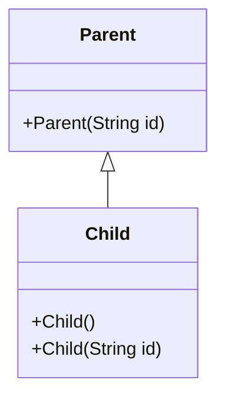
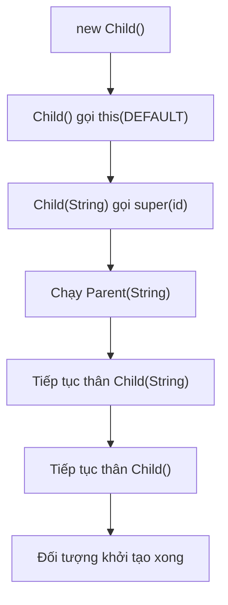
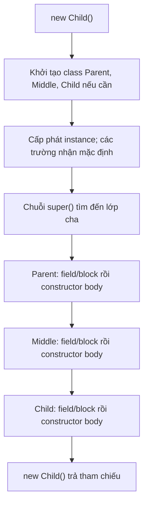

# Subclass Initialization and the Superclass Constructor Chain in Java

> **OOP → Inheritance.** Creating a subclass object requires Java to initialize its inherited superclass state before completing subclass state. Understanding **constructor chaining**, `super(...)`, `this(...)`, and initializer execution order explains why a program may print output in an order that seems opposite to the location of `new Child()`.

## 1. Start with the Call `new Child()`

Suppose we have this inheritance relationship:



A `Child` object **also contains state defined by `Parent`**. Before the `Child` constructor completes, the `Parent` constructor must execute as part of the initialization chain.

A simple example:

```java
public class ConstructorChainDemo {
    static class Parent {
        Parent(String id) {
            System.out.println("Parent: " + id);
        }
    }

    static final class Child extends Parent {
        Child() {
            this("DEFAULT");
            System.out.println("Child()");
        }

        Child(String id) {
            super(id);
            System.out.println("Child(String): " + id);
        }
    }

    public static void main(String[] args) {
        new Child();
    }
}
```

Save as `ConstructorChainDemo.java` and run:

```bash
javac ConstructorChainDemo.java
java ConstructorChainDemo
```

Output:

```text
Parent: DEFAULT
Child(String): DEFAULT
Child()
```

Although execution begins with `new Child()`, it passes through `Child()` to delegate to `Child(String)` and then calls `Parent(String)`. The **constructor bodies** execute from the superclass downward before returning to the delegating constructor through `this(...)`.



Important distinction: Java does not create three separate objects for `Child()`, `Child(String)`, and `Parent(String)`. This constructor chain initializes **one Child object**.

## 2. What Do `super(...)` and `this(...)` Do?

| Syntax | Purpose | Example |
|---|---|---|
| `super(args)` | Selects and invokes a constructor of the **direct superclass** | `super(id)` |
| `this(args)` | Delegates to another constructor in the **same class** | `this("DEFAULT")` |
| No explicit invocation | Compiler implicitly adds `super()` when valid | Constructor without `super(...)` |
| `super.someMethod()` | Invokes a superclass method implementation | Not a constructor invocation |
| `this.someMethod()` | Invokes a method on the current object | Not a constructor invocation |

In **Java 17**, an explicit `this(...)` or `super(...)` constructor invocation must be the **first statement**. You cannot invoke both directly in one constructor because each constructor has only one valid initialization delegation path.

```java
class Base {
    Base(int code) {
        System.out.println("Base " + code);
    }
}

class Derived extends Base {
    Derived() {
        this(10);             // Chuyển sang constructor khác của Derived
    }

    Derived(int code) {
        super(code);          // Gọi constructor của Base
        System.out.println("Derived " + code);
    }
}
```

`Derived()` delegates through `this(10)`; `Derived(int)` invokes `super(code)`. That chain reaches the superclass constructor. If `this(...)` invocations form a cycle, Java reports a recursive-constructor-invocation compilation error.

**Constructors are not ordinary methods:** they have no return type, are not inherited, and cannot be overridden. A subclass may declare a constructor with the same parameter list as a superclass constructor, but they are independent constructors.

### Common Error: No No-Argument Superclass Constructor

```java
class Parent {
    Parent(String id) {}
}

class Child extends Parent {
    Child() {
        // Trình biên dịch ngầm thử super(), nhưng Parent() không tồn tại.
    }
}
```

The example above **does not compile**. Once `Parent(String)` is declared, Java does not automatically add `Parent()`. Fix this by selecting the existing constructor:

```java
class Child extends Parent {
    Child() {
        super("C-001");
    }
}
```

Alternatively, add `Parent()` if it genuinely fits the superclass's initialization contract.

The superclass constructor must be **accessible** to the subclass. A normal subclass cannot directly invoke a `private` superclass constructor. `protected` is often appropriate when a class is designed for inheritance and subclasses need to invoke its constructor.

## 3. Full Initialization Order: Static, Instance Fields, Blocks, and Constructors

This is the most easily misunderstood part. Consider three inheritance levels: `Parent → Middle → Child`.

Save the **complete** example as `InitializationOrderDemo.java` (Java 17+):

```java
public class InitializationOrderDemo {
    private static void log(String text) {
        System.out.println(text);
    }

    private static int init(String label, int value) {
        log(label);
        return value;
    }

    static class Parent {
        static {
            log("Parent: static block");
        }

        private final int parentValue =
                init("Parent: instance field", 10);

        {
            log("Parent: instance block");
        }

        Parent(String source) {
            log("Parent: constructor, value=" + parentValue
                    + ", source=" + source);
        }
    }

    static class Middle extends Parent {
        static {
            log("Middle: static block");
        }

        private final int middleValue =
                init("Middle: instance field", 20);

        {
            log("Middle: instance block");
        }

        Middle() {
            super("Middle");
            log("Middle: constructor, value=" + middleValue);
        }
    }

    static final class Child extends Middle {
        static {
            log("Child: static block");
        }

        private final int childValue =
                init("Child: instance field", 30);

        {
            log("Child: instance block");
        }

        Child() {
            super();
            log("Child: constructor, value=" + childValue);
        }
    }

    public static void main(String[] args) {
        log("main: before new");
        new Child();
        log("main: after new");
    }
}
```

Compile and run:

```bash
javac InitializationOrderDemo.java
java InitializationOrderDemo
```

Exact output for this run:

```text
main: before new
Parent: static block
Middle: static block
Child: static block
Parent: instance field
Parent: instance block
Parent: constructor, value=10, source=Middle
Middle: instance field
Middle: instance block
Middle: constructor, value=20
Child: instance field
Child: instance block
Child: constructor, value=30
main: after new
```

### Why Does This Order Occur?

There are **two distinct processes**:

**A. Class initialization (`static`) on first active use**

Before creating `Child`, the JVM must ensure the classes in its superclass chain are initialized. If they have not been initialized previously, static initializers execute from superclass to subclass:

```text
Parent static → Middle static → Child static
```

Within **the same class**, static field initializers and static initialization blocks run in declaration order. Class initialization normally occurs **once per class initialization in the relevant class loader**, not each time `new` is used.

**B. Per-instance initialization**

After allocation and default-value assignment to instance fields, the constructor chain delegates from subclass toward superclass. As each class's initialization executes, the observable order is:

```text
Parent instance fields/blocks → Parent constructor body
→ Middle instance fields/blocks → Middle constructor body
→ Child instance fields/blocks → Child constructor body
```

Within **each class**, instance field initializers and instance initialization blocks run interleaved in **source declaration order**, after the superclass constructor completes and before that class's constructor body.

Do not assume that *all* field initializers across every class run before *all* initialization blocks. Their order interleaves according to declarations within each class.



The diagram describes observable behavior for learning Java. The JVM may optimize physical allocation, but must preserve Java's required initialization semantics.

## 4. Default Values Exist Before Field Initializers

Java allocates an object and initializes instance fields to defaults before running initialization logic:

| Instance field type | Default value before initialization |
|---|---|
| `byte`, `short`, `int`, `long` | `0` (of the appropriate type) |
| `float`, `double` | `0.0` |
| `boolean` | `false` |
| `char` | Character `'\\u0000'` |
| Reference types (`String`, `List`, objects...) | `null` |

For example:

```java
class Counter {
    int count;              // Mặc định 0
    String label = "Ready"; // Field initializer thay null bằng "Ready"

    Counter() {
        count = 1;          // Constructor body thay 0 bằng 1
    }
}
```

After `new Counter()`, `count == 1` and `label.equals("Ready")` hold.

**Do not infer that local variables also receive readable defaults:** local variables in methods must be assigned before being read, or compilation fails.

Subclass fields also receive default values before the superclass constructor executes. This matters particularly when a superclass constructor invokes a method overridden by the subclass.

## 5. Risk: Superclass Constructors Calling Overridable Methods

This is an important technical hazard. When a superclass constructor invokes an instance method overridden by a subclass, **dynamic dispatch still occurs**: subclass code may run before subclass fields receive their explicit initializer values.

A standalone example saved as `ConstructorOverrideTrap.java`:

```java
public class ConstructorOverrideTrap {
    static class Parent {
        Parent() {
            System.out.println("Parent sees: " + description());
        }

        String description() {
            return "Parent";
        }
    }

    static final class Child extends Parent {
        private String name = "Ready";

        @Override
        String description() {
            return name;
        }
    }

    public static void main(String[] args) {
        Child child = new Child();
        System.out.println("After construction: " + child.description());
    }
}
```

Output:

```text
Parent sees: null
After construction: Ready
```

Reason:

1. `new Child()` starts the constructor chain.
2. `Parent()` executes **before** the `name = "Ready"` field initializer of `Child`.
3. `Parent()` invokes `description()`, but Java dispatches to `Child.description()`.
4. At that point, `name` still holds its default `null`; only when `Child` initialization resumes does the field receive `"Ready"`.

If `description()` called `name.length()` then, it could throw `NullPointerException`.

**Design rule:** avoid invoking overridable methods from constructors. Constructors should establish state owned by their own class; invoke extension hooks after full object initialization, or design appropriate non-overridable initialization helpers.

## 6. Does `this(...)` Rerun Subclass Field Initializers?

**No.** When one constructor delegates to another **in the same class** using `this(...)`, that class's instance initializers **do not run again**. They execute once for the object being created.

Example:

```java
public class SameClassChainDemo {
    static class Item {
        int quantity = initialize();

        private int initialize() {
            System.out.println("field initializer");
            return 1;
        }

        Item() {
            this(5);
            System.out.println("Item()");
        }

        Item(int amount) {
            // super() ngầm định ở đây
            quantity = amount;
            System.out.println("Item(int)");
        }
    }

    public static void main(String[] args) {
        Item item = new Item();
        System.out.println(item.quantity);
    }
}
```

Output:

```text
field initializer
Item(int)
Item()
5
```

`this(5)` does not create another object; it delegates to a constructor that shares the initialization path. If every constructor delegation reran field initializers, the result would contradict Java semantics.

Note: `this(...)` can execute multiple **constructor bodies** within a class as delegation returns, but it does not allocate an object multiple times.

## 7. Exceptions During the Constructor Chain

A constructor can reject input or fail during initialization.

```java
class Parent {
    Parent(int initial) {
        if (initial < 0) {
            throw new IllegalArgumentException("initial phải không âm");
        }
    }
}

class Child extends Parent {
    private final String name = createName();

    static String createName() {
        System.out.println("Child field initialized");
        return "OK";
    }

    Child(int initial) {
        super(initial);
        System.out.println("Child constructor body");
    }
}
```

If `new Child(-1)` is called, `Parent(-1)` throws `IllegalArgumentException`, so the `name = createName()` field initializer and `Child` constructor body **do not execute**.

This leads to a practical rule: if construction opens a resource (file, socket, connection) and a later step can fail, explicitly design cleanup along the failure path. Java **does not automatically call `close()` on a partially constructed object**.

A failed static initializer is a **class initialization** error, different from an instance-constructor error. The JVM marks class initialization failures according to specific rules, and subsequent uses may throw `NoClassDefFoundError`. Avoid excessive I/O or hard-to-reverse side effects inside static initializers.

## 8. Constructor Chaining Versus Method Overriding

| Mechanism | How is it selected? | When does it matter? |
|---|---|---|
| `this(...)` | Constructor overload in the same class, resolved from argument types at compile time | During object creation |
| `super(...)` | Direct superclass constructor, selected by parameters and accessibility | During superclass initialization |
| Method overriding | Instance implementation selected by the object's runtime type | During method invocation |
| `super.method()` | Invokes the corresponding superclass implementation | During method execution |
| Static initializer | JVM activates it when the class initializes according to Java semantics | Usually before the first instance creation |

Constructors cannot be overridden. A constructor has the class's name because of object-initialization syntax, not because it uses polymorphic dispatch like an instance method.

Nor must every constructor explicitly write `super()`: if it begins with neither `this(...)` nor `super(...)`, Java 17 implicitly adds `super()` **only when** an accessible no-argument superclass constructor exists.

## 9. Practical Guidelines for Safe Inheritance Hierarchies

1. **Make superclass constructors responsible for superclass state.** If a superclass requires `id`, pass and validate `id` through `super(id)`. The subclass then validates its own fields.
2. **Avoid overridable calls from constructors.** Do not make superclass constructors depend on uninitialized subclass data.
3. **Keep constructors simple.** Establish clear invariants; limit I/O, event emission, or premature publication of `this`.
4. **Use `this(...)` to reduce duplicate initialization logic.** Centralize validation in a primary constructor instead of repeating it across overloads.
5. **Do not assume a superclass has a default constructor.** Read constructor signatures and access levels before writing `extends`.
6. **Keep shared behavior in the superclass with proper ownership.** Do not inherit just to reuse a few lines when the is-a relationship is wrong.
7. **Test failure paths as well.** A failed superclass constructor prevents subclass initialization; do not leave earlier-opened resources unreleased.

## 10. Self-Check Exercises

**Exercise 1 — predict the output:**

```java
class A {
    A() { System.out.print("A "); }
}

class B extends A {
    B() { System.out.print("B "); }
}

class C extends B {
    C() { System.out.print("C "); }
}

// new C(); sẽ in gì?
```

**Answer:** `A B C ` because superclass constructors must complete before the subclass constructor body.

**Exercise 2 — fix the compilation error.** Write `Person` with only a `Person(String name)` constructor. Write `Student extends Person`, initially omitting `super(name)` to observe the failure. Then fix the `Student(String name, int grade)` constructor and validate `grade`.

**Exercise 3 — order of fields and initializer blocks.** Create `Base` and `Derived`, each with a field initializer, instance block, and constructor printing its step. Predict the six lines when `new Derived()` runs, then verify.

**Exercise 4 — early overriding hazard.** Modify `ConstructorOverrideTrap` so `Parent` does not invoke `description()` in its constructor. Move the call to `main` after construction and compare the output.

**Exercise 5 — `this(...)` cycle.** Try two constructors, `Example()` and `Example(int)`, each delegating to the other. Explain the compilation error and fix the chain to end in a constructor that invokes `super(...)`.

**Exercise 6 — failure case.** In the `Parent/Child` example in Section 7, predict whether `Child field initialized` appears for `new Child(-1)`. Explain from the constructor chain.

**Remember:** With `new Child()`, Java initializes the superclass and completes its instance initialization before the subclass instance initialization. `super(...)` invokes a superclass constructor, `this(...)` chains constructors within one class, and **each class's field initializers/instance blocks execute in declaration order before its constructor body**. In particular, superclass constructors should not invoke methods overridable by subclasses because subclass fields may not be ready.
