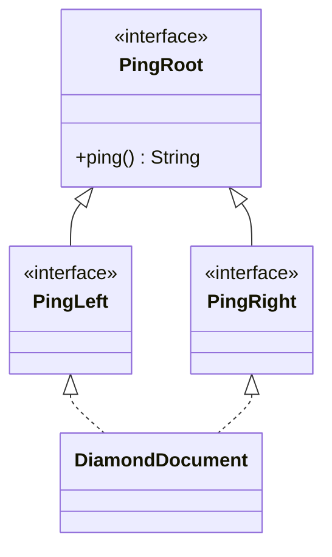
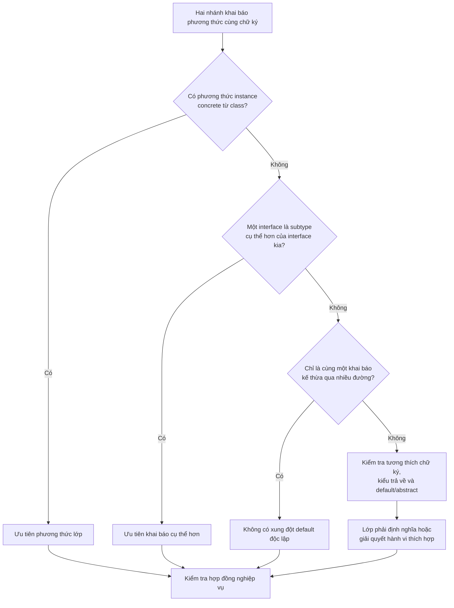

# Single Inheritance, Multiple Inheritance, and Behavior Conflicts in Java

In OOP, an object sometimes needs several capabilities: an invoice may **export PDF**, **export CSV**, and **log actions**; a device may **print** and **scan**. This raises questions about how many classes Java can inherit, how many interfaces it can combine, and which method executes when multiple branches define the same behavior.

**Key conclusion:** A Java class has **one direct superclass** (single inheritance with `extends`), but may **implement multiple interfaces**. An interface may `extends` several other interfaces. Since Java 8, interfaces may contain `default method` implementations, so combining interfaces can introduce **behavior conflicts** resolved by Java's rules or an explicit class override.

## 1. Single Inheritance: At Most One Direct Superclass

A simple example:

```java
class Document {
    private final String id;

    Document(String id) {
        this.id = id;
    }

    public String id() {
        return id;
    }

    public String summary() {
        return "Document " + id;
    }
}

class Invoice extends Document {
    private final long amountVnd;

    Invoice(String id, long amountVnd) {
        super(id);  // Gọi constructor của Document
        if (amountVnd < 0) {
            throw new IllegalArgumentException("Số tiền âm");
        }
        this.amountVnd = amountVnd;
    }

    public long amountVnd() {
        return amountVnd;
    }
}
```

`Invoice extends Document` means an invoice is modeled as a kind of document. An `Invoice` instance contains state managed by `Document` and state declared by `Invoice`; it also uses inherited `id()` and `summary()`.

```java
Invoice invoice = new Invoice("INV-01", 100_000L);

System.out.println(invoice.id());         // INV-01
System.out.println(invoice.summary());    // Document INV-01
System.out.println(invoice.amountVnd());  // 100000
```

**Java does not allow a class to directly extend two classes:**

```java
class Printer {}
class Scanner {}

// Sai cú pháp Java:
// class MultiFunction extends Printer, Scanner {}
```

Java allows only one superclass name after `extends` in a class declaration. An inheritance chain may still have several levels, such as `Object -> Document -> Invoice`. “Single inheritance” does not mean the whole hierarchy contains only two classes.

### Why Doesn't Java Support Multiple Class Inheritance?

Suppose both `Printer` and `Scanner` declare a `status` field, constructors requiring input, and a `reset()` method. If one class inherited directly from both, it would need answers to these questions:

- Which state should be stored, and which portion should be initialized first?
- If both superclasses define `reset()`, which implementation should execute?
- If both ancestry branches inherit the same root class, should its state exist once or multiple times?

These issues are associated with the **diamond problem** (*diamond problem*) in languages permitting multiple inheritance of implementation/state from classes. Java avoids this kind of multiple class inheritance and offers interfaces for combining behavioral contracts.

## 2. A Class Can Implement Multiple Interfaces

Interfaces represent **capabilities and contracts** rather than requiring inheritance of instance state from a superclass.

```java
interface Printable {
    void print();
}

interface Scannable {
    String scan();
}

class OfficeMachine implements Printable, Scannable {
    @Override
    public void print() {
        System.out.println("Printing");
    }

    @Override
    public String scan() {
        return "Scanned document";
    }
}
```

`OfficeMachine` implements both contracts. Interfaces have no constructors or ordinary instance fields; interface fields are implicitly `public static final`, meaning interface constants rather than per-instance data.

A class can also **extend a superclass and implement multiple interfaces**:

```java
class Asset {
    private final String assetCode;

    Asset(String assetCode) {
        this.assetCode = assetCode;
    }

    public String assetCode() {
        return assetCode;
    }
}

class NetworkPrinter extends Asset implements Printable, AutoCloseable {
    NetworkPrinter(String assetCode) {
        super(assetCode);
    }

    @Override
    public void print() {
        System.out.println("Printing from " + assetCode());
    }

    @Override
    public void close() {
        System.out.println("Release printer resource");
    }
}
```

`NetworkPrinter` inherits only class `Asset` but provides the `Printable` and `AutoCloseable` capabilities. This is **multiple inheritance of types/contracts**, not multiple class inheritance.

An interface may itself inherit **multiple interfaces**:

```java
interface Searchable {
    void search(String keyword);
}

interface Auditable {
    void audit(String action);
}

interface SearchableAndAuditable extends Searchable, Auditable {
    // Kết hợp hai hợp đồng.
}
```

A concrete class implementing `SearchableAndAuditable` must supply all required abstract methods unless it inherits suitable implementations.

## 3. When Do Multiple Interfaces Conflict?

With abstract-only interfaces, multiple contracts requesting a compatible signature can often be satisfied with **one implementation**:

```java
interface Notifier {
    void send(String message);
}

interface Dispatcher {
    void send(String message);
}

class EmailWorker implements Notifier, Dispatcher {
    @Override
    public void send(String message) {
        System.out.println("Email: " + message);
    }
}
```

Both interfaces request `send(String)` returning `void`; neither provides competing implementation code. `EmailWorker` needs only one method to satisfy both.

If two interfaces instead impose **incompatible requirements**, such as the same signature with incompatible return types, no valid Java class can implement both:

```java
interface StringReader {
    String read();
}

interface IntegerReader {
    Integer read();
}

// Sai: Không thể cung cấp một phương thức read() không tham số
// có kiểu trả về vừa là String vừa là Integer:
// class BrokenReader implements StringReader, IntegerReader {}
```

Java **method signatures** are not distinguished solely by return type. You cannot declare two argument-free `read()` methods differing only in return type.

The more obvious behavior conflicts occur with **`default method`** implementations.

## 4. Default Methods: Built-In Interface Behavior

Since Java 8, an interface can provide a default implementation:

```java
interface PdfExportable {
    default String render() {
        return "Nội dung PDF";
    }
}

interface CsvExportable {
    default String render() {
        return "Nội dung CSV";
    }
}
```

A class implementing both of these interfaces faces a question: which `render()` implementation should a call use?

```java
// Không biên dịch: hai default method độc lập cùng chữ ký.
// class Report implements PdfExportable, CsvExportable {}
```

Java does not choose one at random. The class must provide an explicit implementation:

```java
class Report implements PdfExportable, CsvExportable {
    @Override
    public String render() {
        return PdfExportable.super.render()
            + "\n---\n"
            + CsvExportable.super.render();
    }
}
```

`InterfaceName.super.method()` invokes the `default` implementation of an **appropriate direct superinterface** in the implementing class. In this example, `Report` combines both results. In real systems, concatenating PDF and CSV is just an illustration of **conflict resolution**; exports are often better modeled as separately named operations or strategies.

The central point is that **a class must define the intended business behavior when default implementations disagree**.

## 5. Three Rules for Choosing Methods

### Rule A — A Concrete Class Instance Method Takes Precedence

If a superclass has a concrete instance method with the same signature as an interface default method, **the class method** is selected.

```java
class BaseLabel {
    public String label() {
        return "Từ superclass";
    }
}

interface Labeled {
    default String label() {
        return "Từ interface";
    }
}

class LabeledDocument extends BaseLabel implements Labeled {
    // Không cần override label()
}

LabeledDocument doc = new LabeledDocument();
System.out.println(doc.label()); // Từ superclass
```

This is often called **class wins**: a method inherited from a class takes precedence over a competing interface default method. This reduces surprises when default methods are added to interfaces that existing classes already implement.

Do not overgeneralize it into “every superclass method wins” regardless of abstract/concrete status and access. If the superclass declares a corresponding **abstract** method, a concrete subclass may still need to provide an implementation.

### Rule B — The More Specific Interface Takes Precedence

When one interface extends another and overrides its default method, the **more specific subinterface** implementation is selected.

```java
interface Named {
    default String name() {
        return "Named";
    }
}

interface DetailedNamed extends Named {
    @Override
    default String name() {
        return "DetailedNamed";
    }
}

class DetailedReport implements Named, DetailedNamed {
    // Không cần override: DetailedNamed cụ thể hơn.
}

System.out.println(new DetailedReport().name()); // DetailedNamed
```

These are not two equally ranked default methods: `DetailedNamed` is a subtype of `Named`, so the more specific implementation determines the result.

### Rule C — Unrelated Peer Default Methods Require Conflict Resolution

When a class inherits two same-signature default methods from unrelated interfaces with no precedence relationship, the compiler requires an explicit resolution:

```java
interface A {
    default String status() {
        return "A";
    }
}

interface B {
    default String status() {
        return "B";
    }
}

class C implements A, B {
    @Override
    public String status() {
        return A.super.status() + " + " + B.super.status();
    }
}

System.out.println(new C().status()); // A + B
```

A class may instead provide a wholly new implementation without calling either default:

```java
@Override
public String status() {
    return "C tự định nghĩa trạng thái";
}
```

The correct choice depends on the business contract. **The point of overriding is not merely to make code compile**, but to deliberately define behavior.

## 6. Complete Java Example: Multiple Interfaces and Three Behavior-Selection Scenarios

Save as `InheritanceConflictDemo.java`:

```java
public class InheritanceConflictDemo {

    static class Document {
        private final String id;

        Document(String id) {
            if (id == null || id.isBlank()) {
                throw new IllegalArgumentException("id không hợp lệ");
            }
            this.id = id;
        }

        public String label() {
            return "Document: " + id;
        }
    }

    interface PdfPrintable {
        default String render() {
            return "PDF";
        }
    }

    interface CsvExportable {
        default String render() {
            return "CSV";
        }
    }

    interface Auditable {
        void audit(String event);
    }

    // Hai default method cùng chữ ký, phải override.
    static final class Invoice extends Document
            implements PdfPrintable, CsvExportable, Auditable {

        Invoice(String id) {
            super(id);
        }

        @Override
        public String render() {
            return PdfPrintable.super.render()
                + " | "
                + CsvExportable.super.render();
        }

        @Override
        public void audit(String event) {
            System.out.println("Audit " + label() + ": " + event);
        }
    }

    // Phương thức lớp thắng default method của interface.
    static class BaseTitle {
        public String title() {
            return "Từ class";
        }
    }

    interface TitleProvider {
        default String title() {
            return "Từ interface";
        }
    }

    static final class TitleDocument
            extends BaseTitle implements TitleProvider {
    }

    // Subinterface cụ thể hơn có ưu tiên.
    interface RootTag {
        default String tag() {
            return "Root";
        }
    }

    interface SpecificTag extends RootTag {
        @Override
        default String tag() {
            return "Specific";
        }
    }

    static final class TaggedDocument
            implements RootTag, SpecificTag {
    }

    // Hai đường kế thừa cùng MỘT default method gốc.
    interface PingRoot {
        default String ping() {
            return "PONG";
        }
    }

    interface PingLeft extends PingRoot {}
    interface PingRight extends PingRoot {}

    static final class DiamondDocument
            implements PingLeft, PingRight {
        // Không có hai implementation độc lập.
    }

    public static void main(String[] args) {
        Invoice invoice = new Invoice("INV-01");

        System.out.println(invoice.label());
        System.out.println(invoice.render());
        invoice.audit("created");

        System.out.println(new TitleDocument().title());
        System.out.println(new TaggedDocument().tag());
        System.out.println(new DiamondDocument().ping());
    }
}
```

Run with JDK 11+:

```bash
javac InheritanceConflictDemo.java
java InheritanceConflictDemo
```

Output:

```text
Document: INV-01
PDF | CSV
Audit Document: INV-01: created
Từ class
Specific
PONG
```

Explanation:

| Output line | Reason |
|---|---|
| `Document: INV-01` | `Invoice` inherits the concrete superclass method `label()` |
| `PDF | CSV` | `Invoice` explicitly overrides `render()` to resolve independent default implementations |
| `Audit ...` | `Invoice` implements the abstract method from `Auditable` |
| `Từ class` | The concrete `BaseTitle` method takes precedence over `TitleProvider.default title()` |
| `Specific` | `SpecificTag` is more specific than `RootTag` |
| `PONG` | Both `PingLeft` and `PingRight` inherit **one** original default method from `PingRoot`, not two separate implementations |

### Subtle Point: A Diamond Does Not Always Create a Conflict

Diagram:



Neither `PingLeft` nor `PingRight` **overrides `ping()` independently**; both inherit the same declaration from `PingRoot`, so `DiamondDocument` has no conflict to resolve.

If `PingLeft` and `PingRight` **each declared a distinct default override of `ping()`**, `DiamondDocument` would inherit two equally ranked implementations and must override explicitly.

A diamond only describes the type relationship; **whether a conflict exists depends on the methods actually inherited and precedence rules**.

## 7. Conflicts Also Arise from Names and Contracts, Not Just Default Methods

### 7.1. Colliding Constant Names

Interface fields are `public static final`. If two interfaces define constants with the same name, a class implementing both must qualify the reference to disambiguate:

```java
interface PdfConfig {
    String FORMAT = "pdf";
}

interface CsvConfig {
    String FORMAT = "csv";
}

class ExportJob implements PdfConfig, CsvConfig {
    public String formats() {
        // return FORMAT; // Mơ hồ
        return PdfConfig.FORMAT + "," + CsvConfig.FORMAT;
    }
}
```

Constants and fields do not participate in runtime polymorphism. **Field hiding/name ambiguity** differs from overriding instance methods.

### 7.2. Interface Static Methods

Static methods are invoked through **interface names**; implementing classes do not inherit interface static methods as instance-callable methods:

```java
interface Formats {
    static String normalize(String format) {
        return format.strip().toLowerCase();
    }
}

String result = Formats.normalize(" PDF "); // pdf
```

Two same-named static methods on different interfaces do not create a dynamic-dispatch conflict because each is invoked through its own interface name.

### 7.3. Matching Signatures with Different Semantic Contracts

Suppose one `MetersProvider` interface defines `double distance()` in **meters** while another `KilometersProvider` declares `double distance()` in **kilometers**. Their signatures are syntactically compatible, but one method implementation cannot safely fulfill conflicting unit contracts.

Even when Java permits one method to implement both signatures, this **does not guarantee compatible business contracts**.

Instead, use distinct names such as `distanceMeters()` / `distanceKilometers()`, explicit unit types, or an adapter rather than forcing one override to mean two things.

## 8. A Decision Process for Behavior Conflicts

A flowchart can guide the analysis:



This is a **design-reading and review process** for common situations, not a substitute for every Java compile-time rule (including generics, erasure, override-equivalence, abstract methods, and covariant return types).

One useful practice is to **add `@Override` whenever you intentionally implement or override behavior**; the compiler will catch many signature mistakes.

## 9. When to Use Interfaces, Class Inheritance, or Composition

The ability to combine multiple interfaces does not mean this is always the best design.

| Requirement | Often suitable choice | Why? |
|---|---|---|
| Subclass really is a more specific kind of superclass | `extends` one class | Specializes state and behavior under the *is-a* relationship |
| A type needs multiple independent capabilities | `implements` multiple interfaces | Combines contracts without multiple inheritance of instance state |
| Several implementations share an API but no state | Interface | Callers interact through consistent behavior |
| A family of classes shares state, constructors, and algorithms | Consider an abstract superclass | Shares controlled implementation |
| Strategies need to be combined/swapped at runtime | Composition/delegation | Avoids forcing the current class to inherit an implementation |
| Two interfaces use the same operation name for different meanings | Separate contracts or an adapter | Avoids forcing one method to serve contradictory responsibilities |

### Example: Composition Instead of Attempting Multiple Class Inheritance

An invoice must export PDF and CSV. Rather than attempting `Invoice extends PdfWriter, CsvWriter` (invalid), let the invoice **use** export strategies:

```java
interface Exporter {
    String export(String content);
}

final class PdfExporter implements Exporter {
    @Override
    public String export(String content) {
        return "PDF: " + content;
    }
}

final class CsvExporter implements Exporter {
    @Override
    public String export(String content) {
        return "CSV: " + content;
    }
}

final class InvoiceService {
    public String exportInvoice(
            String invoiceText, Exporter exporter) {
        return exporter.export(invoiceText);
    }
}
```

Here, `InvoiceService` is not a subtype of `PdfExporter` or `CsvExporter`. It **delegates work** to the appropriate object. A small behavioral interface can support many implementations, and adding another format need not alter the inheritance hierarchy of `InvoiceService`.

For real PDF/CSV exports, implementations should return byte streams, files, or other properly contracted results rather than the example's prefixed strings.

Composition is especially useful when behavior providers have **their own state and constructors**, which Java cannot inherit from multiple classes at once.

## 10. Common Misconceptions

| Claim | True/False | Explanation |
|---|---|---|
| Java permits a class to extend two classes | **False** | Only one direct superclass |
| Java permits a class to implement multiple interfaces | **True** | Combines multiple contracts |
| An interface can extend multiple interfaces | **True** | Multiple interface inheritance |
| Every interface only has abstract methods | **False** | May have default, static, or private methods depending on Java version |
| Two interfaces declaring compatible abstract methods always conflict | **False** | One implementation may satisfy both |
| Two independent default methods with matching signatures are chosen randomly | **False** | Resolution rules apply; an override is often required |
| Two paths to one shared default method always create a diamond error | **False** | There are not two independent implementations in that case |
| A concrete superclass method usually outranks an interface default | **True** | Class precedence rule |
| A subinterface's overriding default usually outranks the superinterface's default | **True** | More specific type takes precedence |
| Implementing multiple interfaces also inherits multiple instance states | **False** | Interfaces have no instance fields/constructors |
| `InterfaceName.super.method()` can invoke every interface method | **False** | Only appropriate default implementations in valid contexts; not arbitrary abstract/static methods |

## 11. Practice Exercises

### Exercise 1 — Does the Program Compile?

```java
interface Left {
    default String run() {
        return "L";
    }
}

interface Right {
    default String run() {
        return "R";
    }
}

class Combined implements Left, Right {
}
```

**Answer:** **No.** `Combined` must override `run()` to resolve two independent same-signature default methods. One implementation can be selected:

```java
@Override
public String run() {
    return Left.super.run();
}
```

### Exercise 2 — Class or Interface?

```java
class Parent {
    public String code() {
        return "P";
    }
}

interface Code {
    default String code() {
        return "I";
    }
}

class Child extends Parent implements Code {
}

System.out.println(new Child().code());
```

**Answer:** `P`, because `Parent` has a concrete instance method that takes precedence over the `Code` default.

### Exercise 3 — Is There a Diamond Conflict?

```java
interface Root {
    default int value() {
        return 1;
    }
}

interface A extends Root {}
interface B extends Root {}
class C implements A, B {}

System.out.println(new C().value());
```

**Answer:** It compiles and prints `1`. `A` and `B` do not define competing implementations; both inherit the same one from `Root`.

### Exercise 4 — Choose a Design

A `SmartDevice` needs to **charge its battery**, **provide GPS positioning**, and **play music**. Three classes already exist: `BatteryManager`, `GpsEngine`, and `MusicPlayer`, each with its own state and constructor.

**Question:** Should you declare `SmartDevice extends BatteryManager, GpsEngine, MusicPlayer`?

**Hint:** Java does not allow that. Consider capability interfaces (`Chargeable`, `Locatable`, `Playable`), while `SmartDevice` **contains** instances of `BatteryManager`, `GpsEngine`, and `MusicPlayer` and delegates operations. This combines behaviors without multiple inheritance of state.

---

**Remember:** Java uses **single inheritance for classes**, but permits **multiple interface implementations** and **interfaces extending multiple interfaces**. Interface default methods share behavior but introduce conflict rules: **concrete class methods take precedence; more specific interfaces take precedence; independent competing defaults need explicit resolution**. Do not just make the code compile: verify compatible business semantics and use **composition** to coordinate multiple stateful components.
