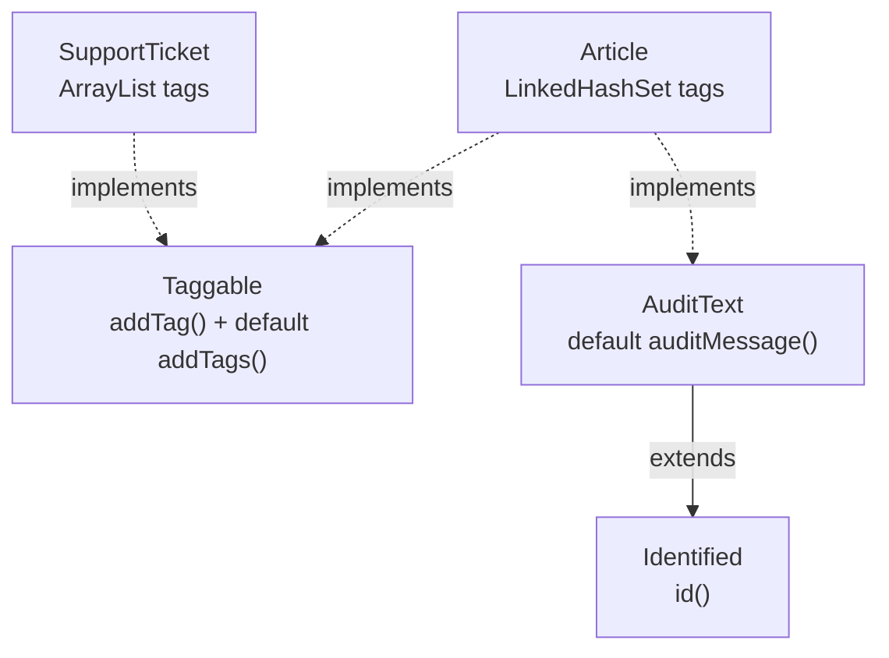

# Mixins, Traits, and Language-Specific Behavior Reuse

In object-oriented programming, a common need is for **classes from unrelated inheritance branches to share behavior**. For example, both `Article` and `SupportTicket` may need to add several tags, even though they do not share a business superclass.

**Mixins** and **traits** organize such shared capabilities. However, these terms are not identical language keywords with universal syntax:

- A **mixin** usually denotes a unit of behavior that can be “mixed into” another class without forcing all participants into one inheritance tree.
- A **trait** usually represents a language construct describing a set of capabilities/methods, sometimes with default implementations; composition, state, and conflict rules depend on the language.
- **Java** has no dedicated `mixin` or `trait` keyword. Java uses **interfaces with `default method`** implementations (since Java 8) to share some behavior and **composition/delegation** to reuse state and more complex algorithms.

The key lesson is **reusing behavior without inventing an artificial `is-a` relationship**, while understanding the limitations of each mechanism rather than calling every inheritance technique a mixin.

## 1. Why Isn't Inheriting a Superclass Enough?

Java lets a class directly `extends` **one superclass**, but it may `implements` **multiple interfaces**:

```java
class BaseEntity {}

interface Searchable {}
interface Exportable {}

class Article extends BaseEntity implements Searchable, Exportable {}
```

Suppose the application also has `SupportTicket extends TicketBase`. Both `Article` and `SupportTicket` need `addTags(...)`, but forcing them to inherit `TaggableBase` could violate the single-superclass limit and create a hierarchy unrelated to the domain.

One solution is to define a **small capability** in an interface and let each class implement it with its own state. A `default method` can offer a shared workflow using the interface's abstract operations.

## 2. Java: Reusing Behavior Through Interface Default Methods

For example, `Taggable` declares a basic `addTag(String)` operation and adds shared `addTags(List<String>)` behavior:

```java
interface Taggable {
    void addTag(String tag);

    default void addTags(List<String> tags) {
        for (String tag : tags) {
            addTag(tag);
        }
    }
}
```

`addTags()` is a reusable implementation. Implementing classes need only define how to add **one tag** under their own rules. The default method invokes `addTag()` through ordinary dispatch, thereby using the runtime object's implementation.

This resembles a **behavior-providing mixin**: the interface need not know whether tags are stored in an `ArrayList`, a `Set`, or another data source.

However, a Java interface **cannot hold per-instance fields** that give each object its own `List`. Interface fields are implicitly interface-level constants/variables (`public static final`), not independent mutable state in each instance.

## 3. Complete Example: Shared Behavior Across Unrelated Domain Classes

Save the following code as **`Main.java`** and run with Java 17 or Java 21.

```java
import java.util.ArrayList;
import java.util.LinkedHashSet;
import java.util.List;
import java.util.Objects;
import java.util.Set;

// Một khả năng dùng chung; không sở hữu trạng thái instance.
interface Taggable {
    void addTag(String tag);

    default void addTags(List<String> tags) {
        Objects.requireNonNull(tags, "tags");
        for (String tag : tags) {
            addTag(tag); // Gọi implementation của đối tượng hiện tại.
        }
    }
}

// Cung cấp dữ liệu tối thiểu để hành vi khác sử dụng.
interface Identified {
    String id();
}

// Một cách thực hiện mặc định dựa trên hợp đồng Identified.
interface AuditText extends Identified {
    default String auditMessage(String action) {
        if (action == null || action.isBlank()) {
            throw new IllegalArgumentException("Hành động không hợp lệ");
        }
        return "[" + id() + "] " + action;
    }
}

final class Article implements Taggable, AuditText {
    private final String id;
    private final Set<String> tags = new LinkedHashSet<>();

    Article(String id) {
        if (id == null || id.isBlank()) {
            throw new IllegalArgumentException("ID bài viết không hợp lệ");
        }
        this.id = id;
    }

    @Override
    public String id() {
        return id;
    }

    @Override
    public void addTag(String tag) {
        if (tag == null || tag.isBlank()) {
            throw new IllegalArgumentException("Thẻ không được trống");
        }
        tags.add(tag); // Set loại bỏ thẻ trùng.
    }

    List<String> tagsSnapshot() {
        return List.copyOf(tags);
    }
}

final class SupportTicket implements Taggable {
    private final List<String> tags = new ArrayList<>();

    @Override
    public void addTag(String tag) {
        if (tag == null || tag.isBlank()) {
            throw new IllegalArgumentException("Thẻ không được trống");
        }
        tags.add(tag); // Ticket cho phép ghi nhận thẻ lặp lại.
    }

    List<String> tagsSnapshot() {
        return List.copyOf(tags);
    }
}

public class Main {
    public static void main(String[] args) {
        Article article = new Article("ART-7");
        article.addTags(List.of("java", "oop", "java"));

        SupportTicket ticket = new SupportTicket();
        ticket.addTags(List.of("urgent", "support", "urgent"));

        System.out.println(article.tagsSnapshot());
        System.out.println(ticket.tagsSnapshot());
        System.out.println(article.auditMessage("đã xuất bản"));
    }
}
```

Compile and run:

```bash
javac Main.java
java Main
```

Output:

```text
[java, oop]
[urgent, support, urgent]
[ART-7] đã xuất bản
```

**Analysis:**

1. Both `Article` and `SupportTicket` inherit `addTags()` from `Taggable` without duplicating the loop in two classes.
2. `Article.addTag()` uses `LinkedHashSet` to remove duplicate tags while preserving insertion order. `SupportTicket.addTag()` uses `ArrayList` and permits duplicates.
3. Each class owns and protects its state through `private` fields; `Taggable` does not know their storage structures.
4. `Article` also implements `AuditText`. Its `auditMessage()` uses `id()` supplied by `Article`; `SupportTicket` has no obligation to support auditing.
5. `List.copyOf(...)` prevents callers from mutating the structure of returned lists. With immutable `String` elements, there is also no in-place element mutation.



### An Immediate Limitation

`Taggable.addTags()` invokes `addTag()` repeatedly; **it does not guarantee atomicity**. If three tags are requested and the third is invalid, the first two may already have been added. To achieve “all or nothing,” the implementing class must redesign validation and updates or override `addTags()` to fulfill that contract.

That is why a `default method` can share implementation code while **not automatically guaranteeing all business semantics** for every implementing class.

## 4. Default-Method Mixins Must Handle Conflicts

If two **independent** interfaces both provide `default String greet()`, a class implementing both must explicitly define the result:

~~~java
interface ShortGreeting {
    default String greet() { return "Xin chào"; }
}
interface FriendlyGreeting {
    default String greet() { return "Chào bạn!"; }
}
final class Greeter implements ShortGreeting, FriendlyGreeting {
    @Override
    public String greet() {
        return ShortGreeting.super.greet()
                + " / " + FriendlyGreeting.super.greet();
    }
}
~~~

`new Greeter().greet()` returns `"Xin chào / Chào bạn!"`. Omitting the override causes a default-method conflict at compile time. `InterfaceName.super.method()` invokes a valid default implementation within the interface-inheritance context; it cannot invoke arbitrary abstract or static methods.

Java also prefers concrete instance methods from a **class** over interface defaults and prefers a **more specific** interface when there is a subtype relationship. Two paths to **the same** inherited default method generally do not create independent conflicts. **Single inheritance, multiple inheritance, and behavior conflicts** contains a complete table and runnable verification; here, the important point is that mixin-style defaults share behavior while adding obligations to maintain compatible contracts.

## 5. `default` Does Not Give Java Multiple Class Inheritance

A Java interface can contain:

- Abstract methods, such as `void addTag(String tag)`.
- `default` methods with bodies that provide implementations.
- `static` methods, invoked through the interface name.
- `private` helper methods that reuse code **within the same interface** (since Java 9).
- Constant fields implicitly declared `public static final` (even if the modifiers are omitted).

But Java interfaces **cannot define separate per-instance fields**. They also have no constructors like ordinary classes, and Java does not permit one class to `extends` two superclasses directly.

Moreover, interfaces cannot provide `default` methods overriding `Object` methods such as `equals(Object)`, `hashCode()`, and `toString()`. These are core object contracts; implement any alternate behavior in an appropriate class.

Default methods therefore offer **contract-based behavior sharing**, especially when shared behavior can be expressed through abstract operations or other public interface methods. They are not a place to hide application-wide mutable state.

## 6. Traits and Mixins Across Languages

These terms have different origins and rules. The following table gives a design-level comparison without treating one language as universal.

| Language/mechanism | How behavior is reused | State and conflict resolution |
| --- | --- | --- |
| **Java** — interface `default` | Classes implement multiple interfaces and inherit default methods | No interface instance fields; Java defines precedence and requires overrides for conflicts |
| **Scala** — `trait` | Classes combine multiple traits, which may include implementations and state | Linearization and method-resolution rules; traits can declare fields, and composition order matters |
| **Rust** — `trait` | Defines shared behavior implemented for types (`impl Trait for Type`), possibly with default methods | Traits do not inject instance fields into structs; Rust has method resolution, associated types, and coherence rules |
| **Kotlin** — `interface` | Interfaces can have methods with bodies; classes can implement multiple interfaces | No backing fields for interface properties; implementation conflicts require explicit resolution |
| **Python** — mixins via multiple inheritance | A mixin class provides methods for reuse and combination through inheritance | Uses method resolution order (MRO), often with cooperative `super()` in multiple inheritance |
| **Ruby** — modules | `include`/`prepend` adds modules to the method lookup chain | Ancestor-chain lookup; modules can work with instance state |
| **C++** — multiple inheritance / CRTP | Mixin classes/templates can add behavior | Inheritance, name lookup, and diamond rules differ from Java; ownership and ambiguity need careful design |

For example, a **Rust trait** commonly defines required methods and can provide defaults, while a struct's own definition specifies its fields. A **Scala trait** may contain state and combine implementations through linearization. Claims such as “traits never have state” or “mixins always copy methods into classes” are too broad across languages.

When reading documentation for a particular language, ask: *Does this mechanism contain instance state, support multiple superclasses, decide method precedence in a particular way, and what does `super` mean?*

## 7. When Should Java Use Default Methods, Abstract Classes, or Composition?

All three can enable code reuse, but they model different relationships.

| Technique | Prefer it when | Limits and risks |
| --- | --- | --- |
| Interface + `default` | Unrelated classes share a **capability** whose common behavior uses a small contract | No instance state; potential default-method conflicts or unsuitable default behavior |
| Abstract class | Genuine `is-a` relationship, shared rules, and instance fields managed by the superclass | Java has one direct superclass; subclasses are coupled to the hierarchy |
| Composition/delegation | Reuse an algorithm or stateful collaborator that may be replaced/combined at runtime | Requires managing delegate instances and forwarding calls |
| Utility `static` | Pure algorithm with no object contract | Does not express replaceable capability via interface dispatch |

Example of delegation for auditing:

```java
interface AuditSink {
    void record(String message);
}

final class ConsoleAuditSink implements AuditSink {
    @Override
    public void record(String message) {
        System.out.println(message);
    }
}

final class ArticleService {
    private final AuditSink auditSink;

    ArticleService(AuditSink auditSink) {
        this.auditSink = java.util.Objects.requireNonNull(auditSink);
    }

    void publish(String articleId) {
        // Thực hiện quy trình xuất bản ...
        auditSink.record("Đã xuất bản " + articleId);
    }
}
```

Here, `ArticleService` **contains an `AuditSink`** rather than inheriting from `AuditableBase` or putting I/O inside a default method. `ConsoleAuditSink` can be replaced with an adapter that logs to files, databases, or an event system without changing `ArticleService`.

If shared logic **needs resources, transactions, configured dependencies, or lifecycle-aware state**, composition is usually clearer than a Java mixin with shared `static` fields.

## 8. Designing Useful Default-Method Contracts

Two mistaken assumptions are common.

**Mistake A: All behavior belongs in interface defaults.**

```java
interface PaymentAction {
    default void charge(long amount) {
        // Không nên đặt logic tài chính giả định ở đây chỉ để
        // mọi triển khai khỏi phải viết một phương thức bắt buộc.
    }
}
```

An empty method can mislead callers into thinking a payment succeeded. When implementations have different calculations or safety guarantees, leave `charge()` abstract and require each class to meet the contract.

**Mistake B: A default implementation is automatically safe.**

```java
interface MutableAccess {
    List<String> internalTags();

    default void append(String tag) {
        internalTags().add(tag);
    }
}
```

This design forces implementations to expose a mutable collection through `internalTags()`. Callers can bypass `append()` and mutate `internalTags()` directly. The main example's `Taggable` contract offers better encapsulation: it requires only the **behavior** `addTag()` and lets each class keep its data `private`.

When designing a default method:

1. Describe the method's **semantics**, including valid parameters, results, and errors.
2. Implement only behavior that is correct for **every** compliant implementation.
3. Call primitive operations supplied by the implementing class instead of requiring getters that expose mutable state.
4. Define partial-completion behavior: a default method may offer no transaction or atomicity guarantee.
5. Do not assume default methods automatically provide synchronization or thread safety.
6. When adding defaults to an existing interface, check for **signature conflicts** with other implemented interfaces or classes.

Adding a `default method` can evolve an API without forcing every existing implementation to supply a new method in ordinary cases, but **compatibility is not guaranteed**: another default or an existing contract may cause compilation errors or behavioral changes.

## 9. Mistakes to Avoid

| Mistake | Consequence | Appropriate fix |
| --- | --- | --- |
| Treating a Java interface as a class with instance state | Trying to declare a field such as `private List<String> tags` in an interface | Put state in implementing classes or a delegate |
| Two interfaces define the same-signature default | Class fails to compile without resolving the conflict | Override explicitly, optionally invoking `Interface.super.method()` |
| Overriding a default but forgetting business rules | Implementations produce inconsistent results | Define contracts and shared tests |
| Calling `this.addTags(...)` inside the `addTags()` override | May recursively invoke itself | Use `Taggable.super.addTags(...)` when valid and intentionally preserving the default behavior |
| Storing mutable state in an interface field | It is actually a shared `public static final` reference | Use a `private` instance field on the implementing class |
| Replacing every composition use case with interface defaults | Pulls I/O, databases, and stateful services into contracts | Delegate to lifecycle-aware components |
| Assuming Scala traits, Rust traits, and Java defaults are identical | Misunderstands state, linearization, and method resolution | Learn each language's specific rules |
| Sharing side-effecting defaults with no defined operation order | Partial success becomes hard to predict | Define transaction and error semantics precisely |

## 10. Self-Check

**Question 1.** Why can `Article` and `SupportTicket` share `Taggable.addTags()` without sharing a business superclass?

**Answer:** Both classes implement `Taggable`; the default method invokes `addTag()` supplied by each class and does not depend on storage details or a shared state-owning superclass.

**Question 2.** If `ShortGreeting` and `FriendlyGreeting` both define `default String greet()`, does a class implementing both automatically use `ShortGreeting`?

**Answer:** No. Without a suitable precedence relationship, two conflicting defaults require the class to override `greet()` and explicitly define behavior.

**Question 3.** Can `private int count;` be declared as an instance field in a Java interface?

**Answer:** No. Interface fields always have `public static final` semantics; interfaces do not declare individual instance fields.

**Question 4.** Default `addTags()` invokes `addTag()` three times, and the third invocation throws. Are the first two tags guaranteed to be rolled back?

**Answer:** No. The sample default method implements no rollback. Atomicity requires additional contracts and an appropriate implementation.

**Question 5.** Should a file-writing, connection-owning `AuditSink` be moved into an interface default solely to reuse code?

**Answer:** Usually not. A component with its own state, resource lifetime, and ownership fits composition/delegation better, such as injecting an `AuditSink` into the consuming object.

**Question 6.** Can we assume that Rust traits and Scala traits have identical state and method-resolution behavior?

**Answer:** No. The shared term “trait” hides different language rules: Rust defines behavior and implementations for types; Scala supports mixins/linearization and allows traits to carry state.

**Remember:** Reuse only behavior that is **genuinely shared by contract**; do not force unrelated classes into a superclass just to reduce code. In Java, interface `default` methods suit shared behavior without per-instance state; use composition for resource-owning or stateful dependencies. When working with mixins or traits in other languages, always check each language's composition and conflict-resolution rules.
