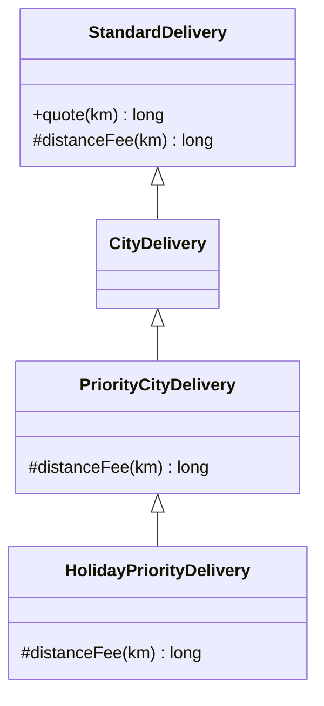
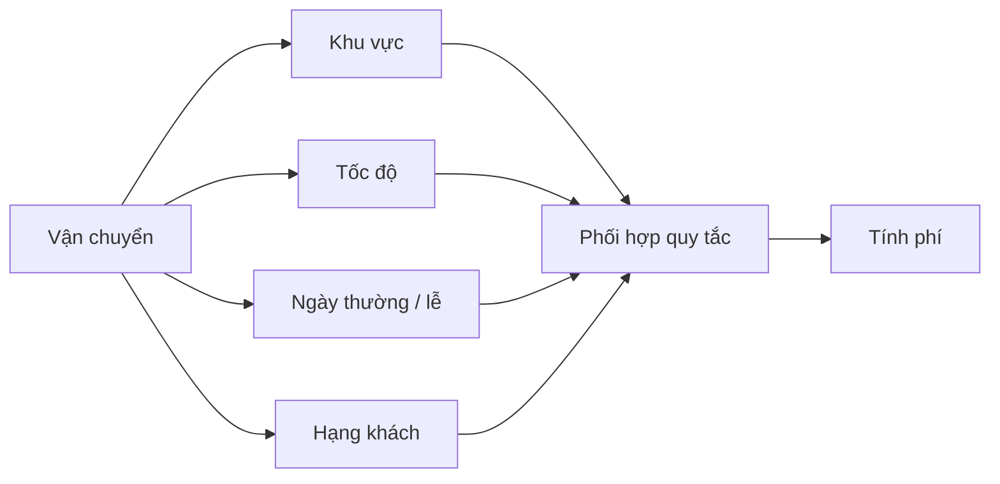
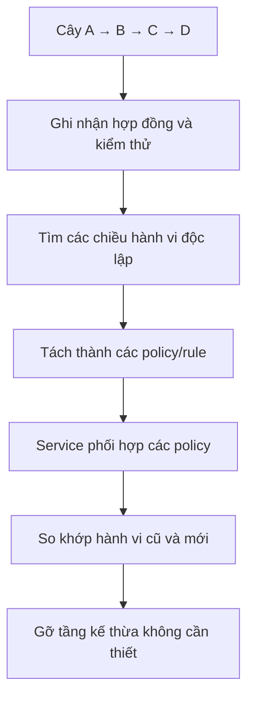

# Limitations and Costs of Deep Inheritance Hierarchies in Java

> **OOP → Inheritance.** Inheritance (`extends`) lets a subclass reuse and specialize superclass behavior. But when a class sits beneath many levels—`A → B → C → D → E`—understanding and modifying it becomes increasingly costly: behavior is scattered, superclass changes affect many subclasses, and tests must cover interactions across levels. This lesson separates **design/maintenance costs** from **runtime costs** and explains when composition is appropriate.

## 1. What Is a “Deep Inheritance Hierarchy”?

Consider a shipping-fee calculation system:



`HolidayPriorityDelivery` has three direct and indirect ancestors. To determine the result of `quote(3)`, a reader must trace methods across several classes:

- `StandardDelivery.quote` determines the overall calculation.
- `StandardDelivery.distanceFee` calculates the default distance charge.
- `PriorityCityDelivery.distanceFee` invokes `super.distanceFee` and adds a priority fee.
- `HolidayPriorityDelivery.distanceFee` again invokes `super.distanceFee` and adds a holiday surcharge.

More levels of **overrides and calls back to superclass implementations** make it harder to infer behavior from a single file.

**Depth** is the number of levels on a path from a class to an ancestor, not the number of sibling subclasses. A hierarchy with one parent and ten immediate children remains **shallow**; a chain `A → B → C → D → E` is deep.

## 2. Runnable Java Example: The Comprehension Cost of Multiple Override Levels

Save the following code as `DepthCostDemo.java` (Java 17+):

```java
import java.util.List;
import java.util.Objects;

public class DepthCostDemo {

    // Tầng 1: quy tắc tính tổng và phí khoảng cách mặc định.
    static class StandardDelivery {
        private final long baseFeeVnd;

        StandardDelivery(long baseFeeVnd) {
            if (baseFeeVnd < 0) {
                throw new IllegalArgumentException("Phí cơ bản không thể âm");
            }
            this.baseFeeVnd = baseFeeVnd;
        }

        public final long quote(int distanceKm) {
            if (distanceKm <= 0) {
                throw new IllegalArgumentException("Khoảng cách phải dương");
            }
            long extra = distanceFee(distanceKm);
            if (extra < 0) {
                throw new IllegalStateException("Phụ phí không thể âm");
            }
            return Math.addExact(baseFeeVnd, extra);
        }

        protected long distanceFee(int km) {
            return Math.multiplyExact(2_000L, km);
        }
    }

    // Tầng 2: dùng cùng phí cơ bản của giao hàng nội thành.
    static class CityDelivery extends StandardDelivery {
        CityDelivery() {
            super(10_000L);
        }
    }

    // Tầng 3: thêm phí ưu tiên.
    static class PriorityCityDelivery extends CityDelivery {
        @Override
        protected long distanceFee(int km) {
            return Math.addExact(super.distanceFee(km), 5_000L);
        }
    }

    // Tầng 4: thêm phí ngày lễ.
    static final class HolidayPriorityDelivery extends PriorityCityDelivery {
        @Override
        protected long distanceFee(int km) {
            return Math.addExact(super.distanceFee(km), 3_000L);
        }
    }

    // Phương án composition: mỗi thành phần phí là một quy tắc riêng.
    @FunctionalInterface
    interface FeeRule {
        long calculate(int distanceKm);
    }

    static final class QuoteService {
        private final long baseFeeVnd;
        private final List<FeeRule> rules;

        QuoteService(long baseFeeVnd, List<FeeRule> rules) {
            if (baseFeeVnd < 0) {
                throw new IllegalArgumentException("Phí cơ bản không thể âm");
            }
            this.baseFeeVnd = baseFeeVnd;
            this.rules = List.copyOf(
                Objects.requireNonNull(rules, "rules")
            );
        }

        long quote(int distanceKm) {
            if (distanceKm <= 0) {
                throw new IllegalArgumentException("Khoảng cách phải dương");
            }
            long total = baseFeeVnd;
            for (FeeRule rule : rules) {
                long fee = rule.calculate(distanceKm);
                if (fee < 0) {
                    throw new IllegalStateException("Phụ phí không thể âm");
                }
                total = Math.addExact(total, fee);
            }
            return total;
        }
    }

    public static void main(String[] args) {
        StandardDelivery deep = new HolidayPriorityDelivery();

        QuoteService composed = new QuoteService(
            10_000L,
            List.of(
                km -> Math.multiplyExact(2_000L, km),
                km -> 5_000L,
                km -> 3_000L
            )
        );

        System.out.println("Inheritance: " + deep.quote(3));
        System.out.println("Composition: " + composed.quote(3));
    }
}
```

Run:

```bash
javac DepthCostDemo.java
java DepthCostDemo
```

Output:

```text
Inheritance: 24000
Composition: 24000
```

For 3 km, both designs calculate **10.000 base fee + 6.000 distance fee + 5.000 priority fee + 3.000 holiday surcharge = 24.000 VND**.

The difference is **where rules live** and **how extensions work**:

| Goal | Deep inheritance hierarchy | Composition |
|---|---|---|
| Find the priority-fee calculation | Trace to `PriorityCityDelivery` | Find the priority-fee rule in the configuration list |
| Add a holiday surcharge | Introduce a subclass, override, and invoke `super` | Add one `FeeRule` |
| Combine priority and holiday fees in another order | May need further subclass variants | Reorder or recombine rules |
| Share input validation | Superclass `quote` | `QuoteService.quote` |
| Test fee categories independently | May require the whole class chain | Test each `FeeRule` independently |
| Risk from relying on `super` | Higher with numerous override levels | Lower because rules are separate |

**Composition is not automatically better in every case**: if a class family genuinely has an is-a relationship, shared state, and few variants, shallow inheritance may be simpler. The goal is to reduce unnecessary dependencies, not to eliminate every `extends`.

## 3. Cost One: Implicit Dependencies and the Fragile Base Class

Subclasses are written against current superclass behavior. If a superclass changes when it invokes an overridable `protected` method, subclass behavior can change without editing any subclass source.

For example:

```java
class BaseFormatter {
    String format(String value) {
        return decorate(value);
    }

    protected String decorate(String value) {
        return "[" + value + "]";
    }
}

class UpperFormatter extends BaseFormatter {
    @Override
    protected String decorate(String value) {
        return super.decorate(value.toUpperCase());
    }
}
```

If `BaseFormatter.format` later invokes `decorate` twice, `UpperFormatter` is affected as well. The subclass depends on an **implicit convention about when, how often, and in what order** the superclass invokes that hook.

Across multiple levels, these dependencies can form a chain:

```text
HolidayPriorityDelivery
  → PriorityCityDelivery.distanceFee
    → StandardDelivery.distanceFee
```

Changing the formula in `StandardDelivery` affects subclasses relying on `super.distanceFee`. That may be desirable, but subclasses assuming the previous formula may fail unexpectedly.

This is often called the **fragile base class problem**: changing a base class can break derived classes even when API signatures remain unchanged.

Ways to reduce risk:

- Document which methods are **extension points** intended for subclass overriding.
- Define hook contracts: input conditions, return values, number and order of invocations, side effects, and exceptions.
- Mark essential workflow-coordinating methods `final` if subclasses must not replace the whole algorithm.
- Keep internal fields `private` where possible; use intentionally designed `protected` APIs rather than allowing direct modification.
- Test affected implementations whenever a base class changes.

## 4. Cost Two: Constructors Depending on Leaf-Class Behavior

In a deep hierarchy, an ancestor constructor may invoke a method overridden by a leaf class before that leaf's field initializers have run. For example:

~~~java
class Base {
    Base() { System.out.println("Base sees: " + display()); }
    String display() { return "base"; }
}
class Middle extends Base {
    @Override String display() { return "middle"; }
}
class Leaf extends Middle {
    String label = "READY";
    @Override String display() { return label; }
}
// new Leaf() in "Base sees: null".
~~~

Java dynamically dispatches to `Leaf.display()` from `Base()` even while `Leaf.label` holds its default `null`. More intermediate classes make it harder to trace the call site and selected implementation; an override invoking `label.toUpperCase()` would throw `NullPointerException`.

Constructors should establish state belonging to their declaring class, without calling overridable hooks or exposing `this` prematurely. The lesson **Subclass initialization and the superclass constructor chain** explains static/instance initializers and constructor chaining; this section emphasizes **how the impact expands with depth**.

## 5. Cost Three: Class Explosion from Combining Variants

Suppose a shipping service supports independent dimensions:

- Region: local or intercity.
- Speed: standard or express.
- Timing: regular days or holidays.
- Customer: regular or member.

If every combination becomes a subclass, the theoretical number of variants is:

\[
2 \times 2 \times 2 \times 2 = 16
\]

Adding one property with 3 variants increases the possible combinations to:

\[
16 \times 3 = 48
\]

Not every theoretical combination must be implemented, but the number can grow rapidly. Class names like `HolidayExpressMemberIntercityDelivery` suggest the design is mixing **many independent dimensions of change** into one hierarchy.



Here, composition is usually reasonable: separate `DistanceFeePolicy`, `SpeedSurcharge`, `HolidaySurcharge`, and `MembershipDiscount` into clear strategies/rules, then combine them in a service.

**Note:** application order may matter, such as applying a 10% discount before or after a surcharge. Composition does not resolve that automatically; the service must define ordering, rounding, error handling, and contract checks.

## 6. Cost Four: Harder Testing and Impact Prediction

A small superclass change can affect all descendants, including branches the developer did not realize were involved.

| Change type | What needs review? |
|---|---|
| Add input validation in the superclass | Do subclasses pass valid data and handle new exceptions? |
| Change the invocation of a `protected` hook | Do overrides in every branch still preserve semantics? |
| Modify superclass state representation | Do subclasses depend on old fields or logic? |
| Add an overload or change visibility | Could it make calls ambiguous or break subclass APIs? |
| Change a superclass constructor | Are `super(...)` chains and subclass invariants still valid? |

Each path through multiple class levels adds a testing context. This does not require testing impossible combinations; it means **the regression scope may be much wider than the edited file**.

Use **contract tests** for base behavior and key implementations:

```java
static void assertQuote(DepthCostDemo.StandardDelivery plan,
                        int distanceKm,
                        long expected) {
    long actual = plan.quote(distanceKm);
    if (actual != expected) {
        throw new AssertionError(
            "Expected " + expected + " but was " + actual
        );
    }
}

// Gọi trong cùng package với DepthCostDemo:
assertQuote(new DepthCostDemo.HolidayPriorityDelivery(), 3, 24_000);
```

This snippet uses nested package-private types from `DepthCostDemo` and illustrates a check in the same package; `assertQuote` must be inside a class to compile. Real projects can use JUnit parameterized tests across implementations.

With composition, you can test each rule separately (distance fees, holiday surcharges) and add coordination tests for `QuoteService`. Isolation often makes faults easier to pinpoint than tracing the entire hierarchy.

## 7. Runtime Cost: Does Deeper Always Mean Slower?

**Do not assume deeper inheritance automatically slows a program down.** Separate the following cost categories:

| Cost category | What may increase? | Does it always occur? |
|---|---|---|
| Understanding/maintenance | Tracing many overrides, constructors, state slots, and inheritance branches | Often increases with multi-level dependencies |
| Testing/regression | More descendants affected by superclass changes | Depends on design and branch count |
| Class/object initialization | More constructors, initializers, and instance fields to process | Depends on classes and executed code |
| Object memory | Inherited and newly declared instance fields occupy the object | Depends on field layout; not one separate object per level |
| Method calls | Multiple chained `super.method()` calls may execute | Depends on code; the JIT can inline and optimize |
| Class metadata | More classes may need loading and management | Yes, but measure the magnitude |

Java uses **dynamic dispatch** for overridable instance methods. Modern JVM/JIT compilers can inline calls with predictable targets even in inheritance hierarchies and optimize from runtime profiles. There is no rule that “adding one level of `extends` increases every call by X milliseconds.”

On the other hand, if an override invokes `super` through many levels and each adds computation or I/O, the total executed work **does increase**. That is the cost of **executed logic**, not an unconditional penalty for the `extends` keyword.

When evaluating performance:

1. Identify the actual hot path to optimize.
2. Use a profiler or a properly warmed-up benchmark (such as JMH for Java microbenchmarks).
3. Compare latency, throughput, allocations, and GC before and after changes.
4. Prefer maintainability unless evidence identifies the inheritance hierarchy as a performance bottleneck.

Avoid timing a bare microbenchmark loop and inferring performance directly: the JVM can eliminate work with no observable effect.

## 8. When Is Inheritance Still Reasonable?

A hierarchy is usually appropriate when:

- A stable **is-a** relationship genuinely exists: every `Circle` is a `Shape`.
- Subclasses honor superclass contracts and are substitutable at call sites (**Liskov Substitution Principle — LSP**).
- Shared behavior or state is clear, rather than just a few utility lines.
- Extension points are documented and tested, without excessive dependence on ancestor internals.
- The hierarchy is shallow, with superclass changes seldom forcing descendants to reinterpret their contracts.

For example, `abstract class Shape` with `abstract double area()` and immediate subclasses `Circle` and `Rectangle` can be easy to understand. There is no need to replace a simple, semantically correct hierarchy with numerous strategies and factories merely to avoid inheritance.

### Signs That an Existing Hierarchy Needs Review

- Each new feature tends to require a subclass with an ever-longer name.
- Most overrides merely invoke `super.method()` and add or subtract a little logic.
- Base-class changes break unrelated branches.
- Many subclasses override methods with empty implementations or throw `UnsupportedOperationException`.
- Tests for leaf classes require extensive ancestor-state setup.
- Subclasses read or mutate numerous `protected` fields that the superclass should protect.
- The code repeatedly uses `instanceof` checks or casts to identify subclass types and handle each separately.

These are **signals worth investigating**, not conclusive evidence. Some fixed classification hierarchies still suit inheritance.

## 9. Reducing Depth While Preserving Behavior

The safest starting point is the **observable contract**, not immediately removing `extends`.

1. **List existing supported cases:** shipping types, input parameters, outputs, exceptions, and side effects.
2. **Capture current behavior in tests:** especially important leaf classes and edge cases.
3. **Separate independent dimensions of change:** for example, distance, holiday, and priority fees into `FeeRule` or dedicated interfaces.
4. **Move coordination into a service/composer:** centralize input validation, rule order, and overflow handling.
5. **Migrate call sites incrementally at boundaries:** retain adapters for legacy APIs when needed, rather than replacing everything at once.
6. **Compare old and new results on domain cases:** only then remove intermediate classes that add no value.



You can use **composition + interface** for configurable behavior while retaining a **shallow abstract class** when a shared algorithm structure is genuinely needed. These techniques are not mutually exclusive.

## 10. Using `final` and `sealed` to Control Inheritance

When arbitrary subclassing is undesirable, extension can be restricted:

```java
final class FixedPolicy {
    // Không class nào được extends FixedPolicy.
}
```

Since Java 17, `sealed` allows a class or interface to specify its permitted direct subtypes:

```java
sealed interface DeliveryMode
        permits Economy, Express {
}

record Economy() implements DeliveryMode {
}

record Express() implements DeliveryMode {
}
```

`Economy` and `Express` are records and therefore implicitly `final`; they can implement the sealed interface under Java's rules. The example assumes suitable types in the same file/package. Direct subclasses of sealed classes/interfaces must use `final`, `sealed`, or `non-sealed` as applicable.

`sealed` is useful when the variant set is genuinely bounded. It identifies valid subtypes but **does not shorten an already-deep hierarchy**; use it to control extension intentionally. `final` suits classes not designed to serve as superclasses.

## 11. Practice Exercises

**Exercise 1 — trace the calls.** For `DepthCostDemo`, draw the method sequence executed by `new HolidayPriorityDelivery().quote(4)`. Calculate the result and identify potential overflow points.

**Exercise 2 — change the rule.** Change the priority surcharge to 7.000 VND. Compare which code must change in inheritance and composition designs; explain why line count alone does not determine design quality.

**Exercise 3 — add a variant.** A shipping type requires a peak-hour surcharge but no holiday surcharge. Design a composition version combining distance, peak-hour, and priority fees without extending a long subclass chain.

**Exercise 4 — constructor pitfall.** Move the `Base → Middle → Leaf` example from Section 4 into a `main` class and explain why it prints `Base sees: null`; then fix it to invoke `display()` only after construction finishes.

**Exercise 5 — review a real hierarchy.** Choose an inheritance hierarchy in your Java project: is the is-a relationship valid, how many levels and overrides invoke `super`, which descendants would a superclass change affect, and should any independent dimensions be extracted?

**Remember:** The greatest limitation of deep inheritance is **interclass coupling and the cost of reasoning about behavior**, not an automatic JVM “speed penalty.” Keep inheritance for clear is-a relationships; when features vary independently or override chains become unmanageable, use **composition, interfaces, and small rules** to reduce dependency.
