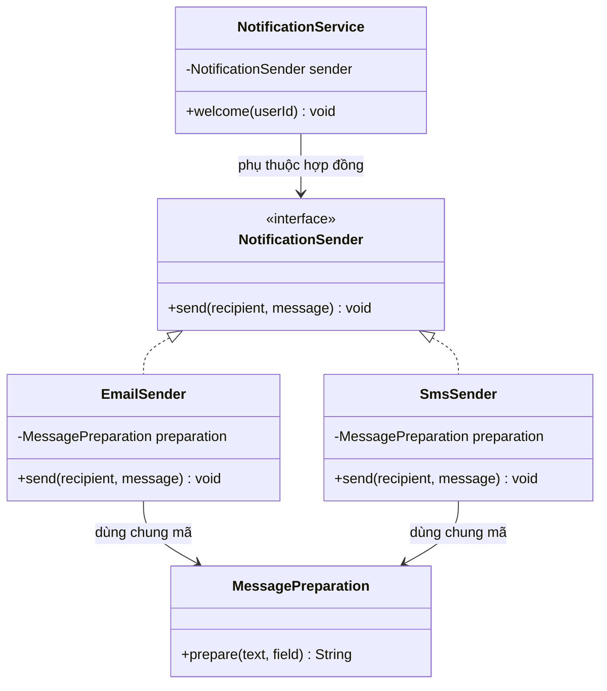

# Distinguishing code inheritance from subtyping in Java

In Java OOP, two ideas are often conflated: **code inheritance (implementation inheritance / code reuse)** and **subtyping**. They often arise together when using `extends`, but address different questions:

- **Code inheritance:** “How can we reuse existing program logic and avoid duplicating algorithms or common processing?”
- **Subtyping:** “Can an object of this type be used in place of another abstraction while still fulfilling its contract?”

This distinction matters because **reusing code does not imply behavioral substitutability**. A subclass may inherit methods and compile correctly while violating expectations that client code places on its superclass.

This lesson focuses on Java mechanisms, illustrated using interfaces, `extends`, `implements`, delegation through composition, and the Liskov Substitution Principle (LSP).

## 1. Two distinct design dimensions

| Perspective | Code inheritance | Subtyping |
| --- | --- | --- |
| Purpose | Reuse common logic or structure | Allow an object to be used under a broader type contract |
| Question | “What code can be reused?” | “Can A be replaced by B while the client remains correct?” |
| Typical mechanism | `extends`, a base class, or **composition/delegation** for reuse without inheritance | `extends` a class, `implements` an interface, `extends` an interface |
| Client concern | Implementation details and maintenance cost | Methods, preconditions/postconditions, invariants, and failure behavior |
| Risk | Tight coupling between subclass and superclass details | Contract violations despite compatible signatures |
| When to prefer it | There is genuinely shared processing to reuse | Types need to be interchangeable under a contract |

**In Java language terms:** when `Child extends Parent`, `Child` is a *nominal subtype* of `Parent` and may inherit applicable members from its parent. You cannot use `extends` to “reuse code without creating any subtype relationship whatsoever.” When the sole goal is algorithm reuse, composition/delegation usually expresses the intent more accurately.

When `Worker implements Runnable`, `Worker` is a subtype of `Runnable` even though the interface primarily specifies behavioral signatures. In principle, subtyping need not originate from inheriting **implementation source code** from a superclass. Modern Java interfaces can also contain `default` methods, so it would be inaccurate to say interfaces never contain code.

Three concepts should therefore be distinguished:

1. **Subtyping in Java's type system:** the compiler allows a `Child` reference to be used as `Parent` or as an implemented interface.
2. **Implementation inheritance:** the subclass inherits applicable code from its superclass (and may override members where permitted).
3. **Behavioral subtyping:** substituting objects does not violate guarantees that clients are entitled to rely on; this is the core of LSP.

The first two are supported by language mechanisms. The third requires **design, explicit contracts, and testing**.

## 2. Subtyping: callers rely on contracts

For example, `NotificationSender` represents the business capability of sending notifications:

```java
// NotificationSender.java
public interface NotificationSender {

    /**
     * Gửi một thông báo tới người nhận.
     * recipient và message phải khác null, không được rỗng/trắng.
     * Đầu vào sai: IllegalArgumentException.
     *
     * Ví dụ học tập dùng thao tác in ra console.
     * Khi hoàn thành bình thường, phát ra đúng một dòng thông báo.
     */
    void send(String recipient, String message);
}
```

A client component knows only `NotificationSender`:

```java
// NotificationService.java
import java.util.Objects;

public final class NotificationService {
    private final NotificationSender sender;

    public NotificationService(NotificationSender sender) {
        this.sender = Objects.requireNonNull(sender, "sender");
    }

    public void welcome(String userId) {
        sender.send(userId, "Chào mừng bạn đến hệ thống!");
    }
}
```

`NotificationService` does not need to know whether the message is delivered by email or SMS. Any object implementing that interface can be passed to its constructor. This is **subtyping used through polymorphism**.

The deciding factor is not whether implementations share code. They must accept the input domain promised by the interface, report failures consistently, and produce the documented effects. If the SMS implementation arbitrarily rejects every string longer than 20 characters while the shared contract imposes no such limit, it can no longer substitute for every valid client.

## 3. Reusing code with composition without inheriting another class

Both notification channels need text normalization and validation. That work can live in a **helper object** instead of forcing email and SMS implementations to inherit from a common superclass merely to reuse processing.

### Shared processing helper

```java
// MessagePreparation.java
public final class MessagePreparation {

    public String prepare(String text, String field) {
        if (text == null || text.isBlank()) {
            throw new IllegalArgumentException(
                    field + " không được trống");
        }
        return text.strip();
    }
}
```

### Two implementations using the same helper

```java
// EmailSender.java
public final class EmailSender implements NotificationSender {
    private final MessagePreparation preparation;

    public EmailSender(MessagePreparation preparation) {
        this.preparation = java.util.Objects.requireNonNull(
                preparation, "preparation");
    }

    @Override
    public void send(String recipient, String message) {
        String to = preparation.prepare(recipient, "recipient");
        String body = preparation.prepare(message, "message");
        System.out.println("[EMAIL] " + to + ": " + body);
    }
}
```

```java
// SmsSender.java
public final class SmsSender implements NotificationSender {
    private final MessagePreparation preparation;

    public SmsSender(MessagePreparation preparation) {
        this.preparation = java.util.Objects.requireNonNull(
                preparation, "preparation");
    }

    @Override
    public void send(String recipient, String message) {
        String to = preparation.prepare(recipient, "recipient");
        String body = preparation.prepare(message, "message");
        System.out.println("[SMS] " + to + ": " + body);
    }
}
```

Try them through the interface:

```java
// Main.java
public class Main {
    public static void main(String[] args) {
        MessagePreparation preparation = new MessagePreparation();

        NotificationService emailService = new NotificationService(
                new EmailSender(preparation));
        NotificationService smsService = new NotificationService(
                new SmsSender(preparation));

        emailService.welcome("an@example.test");
        smsService.welcome("0900000000");
    }
}
```

Compile and run the files from the same directory:

```bash
javac NotificationSender.java NotificationService.java MessagePreparation.java EmailSender.java SmsSender.java Main.java
java Main
```

Output:

```text
[EMAIL] an@example.test: Chào mừng bạn đến hệ thống!
[SMS] 0900000000: Chào mừng bạn đến hệ thống!
```

**Analysis:**

- `EmailSender` and `SmsSender` are both **subtypes of `NotificationSender`** because they declare `implements`.
- Both classes reuse `MessagePreparation.prepare(...)` through **composition/delegation**.
- There is no `EmailSender extends SmsSender` or `EmailSender extends MessagePreparation` relationship. Sharing a helper does not imply that “email is an SMS” or “email is a text normalizer.”
- `NotificationService` depends on an interface type and can therefore accept either implementation. Substitutability comes from the interface contract, not from the fact that both classes use the same helper.
- In the console example, both enforce the same preconditions; their output channel labels differ, but each still satisfies the promise to “emit one line.”

The diagram clearly distinguishes **implements** from **has-a / uses-a**:



If normalization later changes, the sender classes retain their respective relationships. If a new notification channel is added, a new implementation can be created without changing `NotificationService`.

## 4. `extends` often combines code inheritance and subtyping

`extends` can be appropriate when a subclass **truly is a valid specialization** of its superclass and the shared implementation provides a stable foundation.

```java
abstract class AbstractReport {
    public final String render() {
        String title = title();
        String body = body();

        return "=== " + title + " ===\n" + body;
    }

    protected abstract String title();
    protected abstract String body();
}

final class SalesReport extends AbstractReport {
    @Override
    protected String title() {
        return "Báo cáo bán hàng";
    }

    @Override
    protected String body() {
        return "Doanh thu: 1.000.000 VND";
    }
}
```

Usage:

```java
AbstractReport report = new SalesReport();
System.out.println(report.render());
```

Output:

```text
=== Báo cáo bán hàng ===
Doanh thu: 1.000.000 VND
```

Here:

- `SalesReport extends AbstractReport` creates **a subtype relationship**: an `AbstractReport` variable can hold a `SalesReport`.
- `SalesReport` **inherits the `render()` implementation** from `AbstractReport`.
- `render()` is `final` to preserve the shared processing sequence. The subclass fills in the extension points `title()` and `body()`, reducing the risk of accidentally changing the output format.
- This is a simple **Template Method** pattern. If all reports in this family follow the same format, inheritance has a clear rationale.

However, **the fact that `render()` is reusable is not enough to conclude that every printable object should inherit from `AbstractReport`**. An invoice, receipt, or shipping label may require a different contract, even if all can “produce a display string.”

### Why can extends create tight coupling?

A subclass may depend on method call order, fields/protected APIs, validation steps, and internal superclass assumptions. Changes to superclass methods can unintentionally alter subclass behavior. Composition keeps reuse at an object boundary and usually reduces dependence on a large superclass's internals.

This does not mean composition is always better than extends; choose based on **the meaning of the relationship**, the contract to preserve, and the degree of control over extension points.

## 5. Brief counterexample: a nominal subtype that cannot substitute

The mathematical statement “a square is a rectangle” does not suffice to establish that `Square extends Rectangle` is **behaviorally valid**. Suppose `Rectangle` allows `setWidth(w)` and `setHeight(h)` to modify its dimensions **independently**, while `Square` requires equal dimensions. Both sets of promises cannot hold together.

~~~java
// Ý tưởng tối giản: Rectangle có hai setter độc lập.
// Square extends Rectangle và override setWidth/setHeight
// để cập nhật cả hai chiều giữ hình vuông.
// Đây là mô hình CỐ Ý SAI về hợp đồng.
void resize(Rectangle shape) {
    shape.setWidth(5);   // Đúng hợp đồng Rectangle: height không đổi
    shape.setHeight(4);  // Đúng hợp đồng Rectangle: width vẫn là 5
    System.out.println(shape.area()); // Kỳ vọng 20
}
~~~

If the runtime object is a `Square` and each setter updates both dimensions, the final result becomes `4 × 4 = 16`, not the validly expected `5 × 4 = 20`. The `extends` declaration lets the code compile through nominal subtyping; **the compiler does not check setter postconditions automatically**.

| Observation | Conclusion |
| --- | --- |
| `Square` inherits implementation and has compatible signatures | Java provides a subtype and potential code reuse |
| The client relies on two independent setters | `Square` violates the contract |
| Only `area()` and immutable shape data are required | `Rectangle` and `Square` can implement a smaller `Shape` abstraction |

The **rectangle and square counterexample** lesson provides two executable Java programs, detailed comparisons of fixes, postconditions, and contract tests for this scenario. Here, the takeaway is that *code inheritance and syntactic subtyping do not establish business-level substitutability*.

## 6. LSP: the boundary between type compatibility and behavioral compatibility

The Liskov Substitution Principle can be understood practically as follows:

> Code written correctly against the supertype contract must remain correct when given a valid subtype object, without special branches just to avoid problems introduced by the subtype.

A behavioral subtype must preserve guarantees that clients may rely on:

| Aspect | Requirement for a subtype | Violation example |
| --- | --- | --- |
| **Preconditions** | Do not arbitrarily **strengthen** requirements for valid calls | Parent accepts positive integers; child accepts only values of at least 100 |
| **Postconditions** | Do not **weaken** promised results | Parent promises a sorted list; child returns arbitrary order |
| **Invariants** | Do not violate observable state rules | Parent promises a nonnegative balance; child permits negative values |
| **Failures** | Preserve published failure guarantees | Parent promises no mutation on failure; child leaves a partial update |
| **Side effects** | Do not add effects forbidden by the contract | Getter promises read-only access; child deletes a record |
| **Timing/concurrency rules** | Preserve guarantees when they are part of the contract | API promises completion before return; child only schedules an async job |

LSP **does not** require every implementation to return the same specific result in every situation. If `Shape.area()` promises only the accurate area of **the represented shape**, different shapes may return different numbers as long as each implementation honors the meaning and constraints of its contract.

Nor is every behavioral difference in an override a violation: polymorphism exists precisely to support different concrete behaviors **within a shared contract**.

### Contract tests for detecting violations

For an important interface, you can run **the same test suite** against every implementation:

```java
static void verifyShape(Shape shape) {
    long first = shape.area();
    long second = shape.area();

    if (first <= 0 || first != second) {
        throw new AssertionError("Vi phạm hợp đồng Shape bất biến");
    }
}
```

This sample test checks only a few observable conditions; a complete area-formula test would need cases with known dimensions, boundary tests, and the actual contract. With JUnit, the same test can accept factories for different implementations.

If a `Rectangle` test includes “`setWidth` leaves `getHeight` unchanged,” the earlier `Square` implementation will fail. Do not remove the condition from the test just to preserve an existing inheritance hierarchy; reconsider the subtype relationship.

## 7. Can interfaces provide inherited default behavior?

Yes. Since Java 8, interfaces may declare `default method`:

```java
interface Named {
    String name();

    default String displayName() {
        return name().strip();
    }
}

final class Customer implements Named {
    private final String name;

    Customer(String name) {
        this.name = name;
    }

    @Override
    public String name() {
        return name;
    }
}
```

`Customer` is a subtype of `Named` and inherits the default `displayName()` implementation. This demonstrates:

- An interface defines subtyping/contracts, but **can also contribute code**.
- A subtype relationship does not mean “all methods must be written from scratch by the implementing class.”
- Adding a `default` method requires checking compatibility with existing methods and Java's conflict-resolution rules.

Do not equate “code inheritance” exclusively with the `extends` keyword. Java classes can reuse interface default methods, inherit code from abstract superclasses, or reuse logic through delegation **without being a subtype of the delegated object**.

## 8. Why is “is-a” only an initial check?

The question “Is X a Y?” (*is-a*) can help evaluate inheritance, but natural language can be misleading. “A square is a rectangle” is mathematically true yet insufficient to guarantee that **a `Square` object can replace a `Rectangle` with two independent setters**.

Ask more specific questions:

1. Does the subtype support every operation that clients may validly invoke on the supertype?
2. Does the subtype impose stricter preconditions?
3. Do its results, state, and failure behavior satisfy the supertype contract?
4. Must the subtype violate its own invariants to support a supertype operation?
5. Is the goal simply to reuse a few lines of processing, or must clients genuinely view the object as the supertype?

If the goal is logic reuse and the subtype contract is unclear, consider **composition**:

```java
final class CsvExporter {
    private final TextEscaper escaper;

    CsvExporter(TextEscaper escaper) {
        this.escaper = escaper;
    }

    String exportCell(String text) {
        return escaper.escape(text);
    }
}

final class TextEscaper {
    String escape(String text) {
        return "\"" + text.replace("\"", "\"\"") + "\"";
    }
}
```

`CsvExporter` **uses** `TextEscaper`; it is not a kind of `TextEscaper`. This reuses escaping logic without introducing a semantically incorrect subtype relationship.

## 9. Important details of Java's type system

### Subclasses and interfaces both allow reference assignment

```java
class Animal { }
class Cat extends Animal { }

interface RunnableTask {
    void run();
}
class Job implements RunnableTask {
    @Override
    public void run() { }
}

Animal animal = new Cat();          // Hợp lệ
RunnableTask task = new Job();      // Hợp lệ
Object any = new Job();             // Object là kiểu cha của class
```

This assignment illustrates **declared subtyping**. It does not by itself prove that the subclass fulfills every business contract.

### A class can extend another class and implement an interface

```java
interface Auditable {
    void audit();
}

abstract class BaseEntity {
    private final String id;

    protected BaseEntity(String id) {
        this.id = id;
    }

    public final String getId() {
        return id;
    }
}

final class Invoice extends BaseEntity implements Auditable {
    Invoice(String id) {
        super(id);
    }

    @Override
    public void audit() {
        System.out.println("Audit invoice " + getId());
    }
}
```

`Invoice` is a subtype of both `BaseEntity` and `Auditable`. It inherits the superclass's `getId()` code but implements `audit()` itself. A Java class can directly `extends` only **one class**, but it can `implements` multiple interfaces.

### Generic types do not automatically follow element subtyping

```java
List<Cat> cats = new ArrayList<>();
// List<Animal> animals = cats; // Không biên dịch
```

Although `Cat extends Animal`, `List<Cat>` is **not** a subtype of `List<Animal>` because ordinary Java generic type parameters are *invariant*. If an API only needs to read elements as `Animal`, it can use `List<? extends Animal>`, subject to the corresponding restrictions on adding elements.

This shows why you must follow **the specific type-system rules**, rather than infer subtyping by intuition.

## 10. When should each design be chosen?

| Primary need | Potentially suitable design | Reason |
| --- | --- | --- |
| Different service implementations need the same API | Interface with classes that `implements` it | Clear subtyping and substitutability |
| Two classes need the same algorithm but represent different concepts | Composition/delegation | Reuse code without forcing an `is-a` relationship |
| A family of classes truly shares a contract and process | Abstract superclass with controlled extension points | Combines subtyping with reuse of the implementation framework |
| Add functionality around an existing object | Decorator/composition | Wrap behavior without depending on inheritance |
| Many objects need to share simple utility processing | Appropriate helper or utility | No need to create a superclass solely for a few methods |
| Parent contract does not suit the proposed subtype | Extract a smaller shared interface or redesign the abstraction | Avoid violating LSP |

Do not choose inheritance merely to reduce the line count. A design with less duplicated code but the wrong contract often costs more to repair and maintain than a design with properly separated responsibilities.

## 11. Reasoning exercises

**Exercise 1 — subtyping and code reuse.** Given `interface Payable` with `long amountVnd()`, the `Invoice` and `Refund` classes both `implements Payable` but use different algorithms. Are both subtypes of `Payable`? Yes. Must both inherit code from the same superclass? No.

**Exercise 2 — replacing a shared operation.** Both `JsonExporter` and `XmlExporter` need to normalize filenames. Write `FilenameValidator` and inject it into both. Explain why `JsonExporter extends FilenameValidator` does not describe their business relationship correctly.

**Exercise 3 — checking LSP.** `ReadableFile` promises that `read()` returns all contents without modifying the file. A subtype overrides `read()` to delete the file after returning its contents. The method signature is valid, but it violates the promise of **no state changes**. Propose a separate design for “read then delete.”

**Exercise 4 — rectangles.** Refactor `RectanglePitfall` into two immutable classes implementing `Shape`. Write a client that totals the areas of a `List<Shape>` without `instanceof Rectangle` or `instanceof Square`.

**Exercise 5 — choosing inheritance.** `CachedPriceRepository` wants to reuse lookup logic from `DatabasePriceRepository` but needs caching while ensuring a price updated through `updatePrice` is immediately visible. Consider a wrapper implementing the repository interface and cache invalidation before choosing `extends` or composition. Explain what would cause either solution to violate the observable contract.

### Design checklist

Before writing `extends`, ask whether the subclass can replace the superclass in **every valid call**. Do subclass invariants conflict with the superclass API? If the goal is only to reuse processing, could you keep a helper object instead of inheriting? Should the shared element be **a contract** or merely **an algorithm detail**?

**Key message:** in Java, `extends` a class both establishes subtyping and may inherit code, but **behavioral compatibility** is what makes that subtype relationship safe. `implements` declares a contract; composition/delegation lets code be reused without imposing a subtype relationship. Good design follows what clients may legitimately expect, not merely how many lines of code can be shared.
