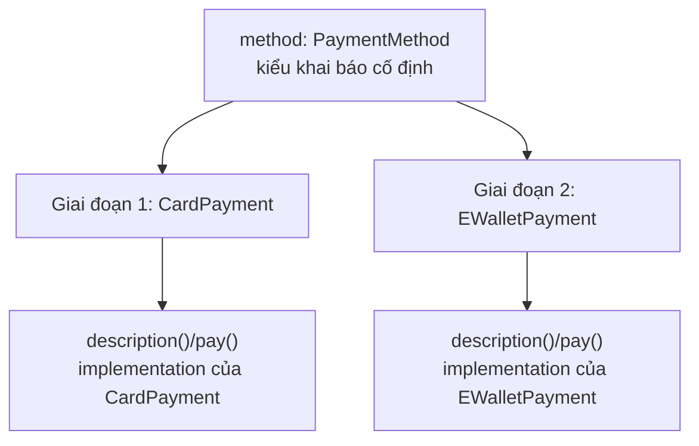

# Declared types and runtime object types in Java

In Java, a reference variable may be declared using **a superclass** or **an interface**, while the referenced object is an instance of **a specific subclass**. This underpins polymorphism and contract-based object substitutability.

For example:

```java
Animal animal = new Dog();
```

Two pieces of information must remain distinct:

- **Declared type** (*declared type*, often the *static type* of the variable expression): `Animal`.
- **Actual type** (*runtime type*, *dynamic type*) of the object referenced: `Dog`.

The types can differ without conflict: `Dog` must be a compatible subtype of `Animal` for this assignment to be legal.

## 1. Two types govern two different things

| Aspect | Declared type | Runtime type |
|---|---|---|
| Determined by | Variable/parameter declaration or expression type at compile time | The class of the object actually created and referenced at runtime |
| Example `Animal a = new Dog();` | `Animal` | `Dog` |
| Which operations can be invoked directly through the variable? | Primarily the type known by the compiler | Does not expose subclass-only methods through the superclass API |
| Which overridden instance-method implementation runs? | Determines which signature can be called | Selects the implementation through runtime dynamic dispatch |
| Can it change when the variable is reassigned? | No; the declaration fixes it | The referenced object may change |
| Does it exist if the variable is `null`? | Yes | No object exists, so no runtime class |

For example:

```java
Animal current = new Dog();
current = new Cat(); // Hợp lệ nếu Cat extends Animal
// current vẫn có kiểu khai báo Animal.
```

Meanwhile, **the runtime type of each object does not transform** from `Dog` into `Cat`. Reassignment merely makes `current` point to **a different object**.

> Remember: a reference variable has a **declared type**; the referenced object has a **runtime class**. The same variable can successively refer to different objects of compatible subtypes.

## 2. Standalone example: one interface, multiple runtime types

We will build payment functionality whose processing code depends only on a common contract: an object can describe the payment method and confirm a payment request.

File `DeclaredRuntimeTypeDemo.java` (Java 17+):

```java
import java.util.Objects;

public class DeclaredRuntimeTypeDemo {

    interface PaymentMethod {
        String description();
        String pay(long amountVnd);
    }

    static final class CardPayment implements PaymentMethod {
        private final String lastFourDigits;

        CardPayment(String lastFourDigits) {
            if (lastFourDigits == null
                    || !lastFourDigits.matches("[0-9]{4}")) {
                throw new IllegalArgumentException(
                    "Phải cung cấp đúng 4 chữ số cuối"
                );
            }
            this.lastFourDigits = lastFourDigits;
        }

        @Override
        public String description() {
            return "Thẻ ****" + lastFourDigits;
        }

        @Override
        public String pay(long amountVnd) {
            requirePositive(amountVnd);
            return "Thanh toán qua thẻ: " + amountVnd + " VND";
        }

        public String lastFourDigits() {
            return lastFourDigits;
        }
    }

    static final class EWalletPayment implements PaymentMethod {
        private final String walletId;

        EWalletPayment(String walletId) {
            this.walletId = Objects.requireNonNull(walletId, "walletId");
            if (walletId.isBlank()) {
                throw new IllegalArgumentException("Mã ví rỗng");
            }
        }

        @Override
        public String description() {
            return "Ví " + walletId;
        }

        @Override
        public String pay(long amountVnd) {
            requirePositive(amountVnd);
            return "Thanh toán qua ví: " + amountVnd + " VND";
        }
    }

    private static void requirePositive(long amountVnd) {
        if (amountVnd <= 0) {
            throw new IllegalArgumentException("Số tiền phải dương");
        }
    }

    static void checkout(PaymentMethod method, long amountVnd) {
        System.out.println(method.description());
        System.out.println(method.pay(amountVnd));
    }

    public static void main(String[] args) {
        PaymentMethod method = new CardPayment("1234");

        System.out.println(method.description());
        System.out.println(method.getClass().getSimpleName());
        checkout(method, 50_000L);

        method = new EWalletPayment("WALLET-7");
        System.out.println(method.description());
        System.out.println(method.getClass().getSimpleName());
        checkout(method, 30_000L);

        if (method instanceof CardPayment card) {
            System.out.println(card.lastFourDigits());
        } else {
            System.out.println("Không phải CardPayment");
        }
    }
}
```

Run:

```bash
javac DeclaredRuntimeTypeDemo.java
java DeclaredRuntimeTypeDemo
```

Output:

```text
Thẻ ****1234
CardPayment
Thẻ ****1234
Thanh toán qua thẻ: 50000 VND
Ví WALLET-7
EWalletPayment
Ví WALLET-7
Thanh toán qua ví: 30000 VND
Không phải CardPayment
```

### Analyzing each stage

**Initially:**

```java
PaymentMethod method = new CardPayment("1234");
```

- `PaymentMethod` is the **declared type** of `method`.
- `CardPayment` is the object's **runtime type**.
- The compiler accepts `method.description()` and `method.pay(...)` because both methods belong to the `PaymentMethod` contract.
- The implementation executed is the `CardPayment` version.

**Later:**

```java
method = new EWalletPayment("WALLET-7");
```

- The declared type of `method` **remains** `PaymentMethod`.
- The object referenced by `method` is now an `EWalletPayment`.
- The same calls to `method.description()` and `method.pay(...)` now dispatch to the `EWalletPayment` implementation.

The `checkout(PaymentMethod, long)` function needs no `if/else` to determine whether the object is a card or wallet. This is **interface-based polymorphism**: the calling pattern stays stable even as runtime types and implementations differ.

This example simulates payment behavior without connecting to real payment systems.

## 3. How declared types, objects, and method calls relate



The diagram shows **two consecutive moments**, not that a variable can point to two objects simultaneously.

Two decisions must be distinguished:

1. **Compile time:** For the expression `method.pay(50000)`, which signature can be called based on the **static type** known by the compiler?
2. **Runtime:** For an overridden/implemented instance method, which method body executes based on the object's **actual type**?

This distinction is especially useful with superclasses, interfaces, dependency injection, and collections whose elements are exposed through a parent type.

## 4. Why can't subclass-specific methods be called?

```java
PaymentMethod payment = new CardPayment("5678");

// System.out.println(payment.lastFourDigits());
// LỖI BIÊN DỊCH: PaymentMethod không khai báo lastFourDigits().
```

Even though **we know from the `new` expression** that the object is a `CardPayment`, the compiler checks `payment.lastFourDigits()` against **the declared type of `payment`**. The `PaymentMethod` interface has no such method.

If the method truly belongs only to `CardPayment`, use a variable of that type:

```java
CardPayment card = new CardPayment("5678");
System.out.println(card.lastFourDigits()); // 5678
```

Or check the runtime type before using the specialized capability:

```java
PaymentMethod payment = new CardPayment("5678");

if (payment instanceof CardPayment card) {
    System.out.println(card.lastFourDigits()); // 5678
}
```

This is **pattern matching for instanceof** (standard since Java 16 and usable in Java 17). The pattern variable `card` can be used only where the compiler knows the test has succeeded.

**Design consideration:** If many callers need to check `instanceof CardPayment` to process payments, consider whether the action belongs in **the shared `PaymentMethod` contract**. Avoid excessive downcasting as a replacement for polymorphism, but do not put card-specific details into an interface if other payment methods have no equivalent meaning.

## 5. Two reference conversions viewed through declared/runtime types

```java
CardPayment card = new CardPayment("1234");
PaymentMethod payment = card;             // Upcast tự động
CardPayment same = (CardPayment) payment; // Downcast thành công
System.out.println(card == same);         // true
```

**Upcasting** allows a broader type through `extends` or `implements` without changing the runtime class or creating a new object. **Downcasting** requires verifying that the actual object belongs to the requested subtype:

```java
PaymentMethod payment = new EWalletPayment("WALLET-7");
if (payment instanceof CardPayment card) {
    System.out.println(card.lastFourDigits());
} else {
    System.out.println("Không phải CardPayment");
}
```

If `(CardPayment) payment` is attempted while the runtime object is an `EWalletPayment`, the JVM throws `ClassCastException`. Casting `null` to a compatible reference type returns `null`, but calling a method afterward still throws `NullPointerException`. The **Upcasting** lesson explains multiple views of one object; the **Downcasting and type checking** lesson covers `instanceof`, pattern variables, `getClass()`, and type erasure. Here, remember only that **declared type limits the API, and runtime type determines overrides**.

## 6. Overriding uses runtime types, while overloading is resolved at compile time

This is particularly easy to confuse in Java: **overriding** and **overloading** both involve method names, but selection rules differ.

File `DispatchRulesDemo.java`:

```java
public class DispatchRulesDemo {

    static class Animal {
        String sound() {
            return "Unknown";
        }
    }

    static class Dog extends Animal {
        @Override
        String sound() {
            return "Woof";
        }
    }

    static void inspect(Animal animal) {
        System.out.println("Overload: Animal");
    }

    static void inspect(Dog dog) {
        System.out.println("Overload: Dog");
    }

    public static void main(String[] args) {
        Animal declaredAsAnimal = new Dog();
        Dog declaredAsDog = new Dog();

        System.out.println(declaredAsAnimal.sound());
        inspect(declaredAsAnimal);
        inspect(declaredAsDog);
        inspect((Dog) declaredAsAnimal);
    }
}
```

Output:

```text
Woof
Overload: Animal
Overload: Dog
Overload: Dog
```

Explanation:

- `declaredAsAnimal.sound()` executes `Dog.sound()`, because `sound()` is an **overridden instance method** and the runtime object is a `Dog`.
- `inspect(declaredAsAnimal)` selects the overload accepting `Animal`, because overload resolution uses the argument's **expression type**, known to the compiler as `Animal`.
- `inspect(declaredAsDog)` selects the overload accepting `Dog`.
- `inspect((Dog) declaredAsAnimal)` selects the overload accepting `Dog`, because the cast expression has **static type `Dog`** and must also pass the appropriate runtime cast check.

Distinguish **overload signature selection** from **overridden implementation selection**. If the selected overload is itself an overridden instance method, Java may still dynamically dispatch the implementation of that signature.

### Quick comparison

| Scenario | Primarily determined by | Example |
|---|---|---|
| Checking which methods a variable may invoke | Static type of the expression | `Animal a` cannot call a method found only in `Dog` |
| Selecting an overload (`foo(Animal)` versus `foo(Dog)`) | Static argument type and overload rules | `foo(a)` with `Animal a = new Dog()` selects the `Animal` overload |
| Selecting an overridden instance-method implementation | Runtime type of the receiver | `a.sound()` invokes `Dog.sound()` |
| Accessing a field | Static type of the receiving expression | Fields are not dynamically dispatched |
| Selecting a static method | Static resolution by declared/expression type | Static methods do not override by runtime type |

## 7. Fields and static methods do not use dynamic dispatch

An overridden instance method is selected by runtime class; **fields** with the same name are selected according to the expression's static type, while **static methods** are resolved by type/class at compile time.

```java
class Base {
    String label = "Base";
    String label() { return "Base method"; }
    static String category() { return "Base static"; }
}
class Derived extends Base {
    String label = "Derived";
    @Override String label() { return "Derived method"; }
    static String category() { return "Derived static"; }
}

Base value = new Derived();
System.out.println(value.label);       // Base
System.out.println(value.label());     // Derived method
System.out.println(Base.category());   // Base static
System.out.println(Derived.category());// Derived static
```

These are **field hiding** and **static method hiding**, not polymorphic overriding. Prefer class names when calling static methods and avoid same-named fields in class hierarchies. The next section uses these differences to explain mistakes in expressions involving overloads and overrides.

## 8. Null has no object runtime type

```java
PaymentMethod method = null;

System.out.println(method instanceof CardPayment); // false

// method.description(); // Ném NullPointerException
// method.getClass();    // Ném NullPointerException
```

The variable `method` still has declared type `PaymentMethod`, but currently **references no object**, so there is no runtime class to inspect.

Do not call `method.getClass()` merely to decide business behavior when polymorphism already provides a shared contract. `getClass()` is useful for debugging or checking exact runtime classes; in some frameworks, the runtime class may be a framework-created proxy/subclass instead of the domain class name you expect.

### Runtime type is not “the type of a primitive value”

Primitive variables also have compile-time types (`int`, `double`, `boolean`), but they do not hold object references like a `PaymentMethod` variable. This discussion of `getClass()` and declared versus actual type primarily concerns **reference variables and objects**.

## 9. Uses in collections, APIs, and dependency injection

### Collections of supertypes

```java
import java.util.ArrayList;
import java.util.List;

List<Animal> animals = new ArrayList<>();
animals.add(new Dog());
animals.add(new Cat());

for (Animal animal : animals) {
    System.out.println(animal.sound());
}
```

Suppose `Cat extends Animal` and overrides `sound()`. The loop behaves as follows:

- The loop variable `animal` always has declared type `Animal`.
- Each element may be a `Dog` or `Cat` object.
- `animal.sound()` dispatches to the corresponding runtime class.

However, `List<Dog>` cannot be assigned to `List<Animal>` merely because `Dog extends Animal`:

```java
List<Dog> dogs = new ArrayList<>();
// List<Animal> all = dogs; // Lỗi biên dịch
```

Java generics are **invariant** by default: allowing the assignment would let you insert a `Cat` into a `List<Dog>`. When only reading subclass objects as supertypes, use `List<? extends Animal>` subject to its write restrictions.

Do not confuse **the runtime type of an element** with **the generic type argument** of a collection. Because of *type erasure*, calling `getClass()` on an `ArrayList<String>` does not reveal `String` as runtime generic parameter metadata of that instance.

### APIs accepting interfaces

A service may declare a dependency:

```java
final class CheckoutService {
    private final PaymentMethod paymentMethod;

    CheckoutService(PaymentMethod paymentMethod) {
        this.paymentMethod =
            java.util.Objects.requireNonNull(paymentMethod);
    }

    String charge(long amountVnd) {
        return paymentMethod.pay(amountVnd);
    }
}
```

In practice, `CheckoutService` may accept `CardPayment`, `EWalletPayment`, or another implementation fulfilling the contract. It **does not need** the actual type to call `pay(...)`. This is the design advantage of declaring dependencies using **a suitable abstract type**.

The same applies to dependency injection in Spring: fields or constructor parameters often use interface types, while the container supplies a concrete implementation. The key is not that “Spring changes the variable's type,” but that **the variable retains its interface type and references a runtime object of the provided implementation**.

## 10. When to cast and when to redesign a contract

A valid downcast is not automatically a good design. Consider:

```java
void process(PaymentMethod method) {
    if (method instanceof CardPayment card) {
        System.out.println(card.lastFourDigits());
    } else if (method instanceof EWalletPayment) {
        System.out.println("Ví điện tử");
    }
}
```

This is reasonable if the feature **actually** needs card-only data, such as displaying the last four digits. But if the intent is simply to show **a payment-method description**, prefer the contract:

```java
void showPayment(PaymentMethod method) {
    System.out.println(method.description());
}
```

Decision guidelines:

| If you need to… | You should generally… |
|---|---|
| Perform a behavior meaningful for every implementation | Declare it on the interface/superclass and invoke it polymorphically |
| Use capabilities specific to one subtype | Check with `instanceof` or use the subtype within the proper scope |
| Repeat a chain of `instanceof` cases to select the same business action | Consider replacing it with a polymorphic method |
| Create an object from different sources with one shared API | Declare variables/parameters using a superclass or interface |
| Use only `CardPayment` and its card-specific API | Declare `CardPayment` directly; do not upcast merely “for OOP” |

**Principle:** a declared type should express **the capabilities the caller needs**, not necessarily the concrete class used to construct the object.

## 11. Common misunderstandings

| Statement | True/false | Explanation |
|---|---|---|
| `Animal a = new Dog()` makes the object become an `Animal` | False | The object remains a runtime `Dog` |
| Every `Dog` method is callable through an `Animal` variable | False | The compiler allows only methods valid for the static type |
| `a.sound()` invokes the `Dog` override when `a` references a `Dog` | True | Dynamic dispatch of an instance method |
| Downcasting changes the object's runtime class | False | It checks and changes the reference expression's type only |
| An invalid cast may throw `ClassCastException` | True | When the runtime type is incompatible |
| Overloads are chosen entirely by the argument's runtime class | False | Overload resolution uses the expression's compile-time type |
| Subclass fields override superclass fields | False | Fields can be hidden, not dynamically dispatched |
| Static methods are overridden like instance methods | False | Static method hiding/lexical resolution |
| A `null` variable loses its declared type | False | It retains its declared type; no runtime object exists |
| `List<Dog>` is a subtype of `List<Animal>` | False | Generic collections are invariant by default |

## 12. Self-assessment exercises

### Exercise 1 — What is printed?

```java
class Shape {
    String draw() { return "Shape"; }
}

class Circle extends Shape {
    @Override
    String draw() { return "Circle"; }

    int radius() { return 5; }
}

Shape shape = new Circle();
System.out.println(shape.draw());
// System.out.println(shape.radius()); // Có biên dịch không?
```

**Answer:** Prints `Circle` because the instance method uses the runtime override. `shape.radius()` **does not compile** because `Shape` has no `radius()` method. You can check `shape instanceof Circle circle` and then invoke `circle.radius()`.

### Exercise 2 — Reassign a reference: which type changes?

```java
Shape current = new Circle();
current = new Shape();
System.out.println(current.draw());
```

**Answer:** Prints `Shape`. The variable `current` always has declared type `Shape`; before reassignment it refers to a `Circle`, and afterward to a new `Shape`.

### Exercise 3 — Overload or override?

```java
class Animal {}
class Dog extends Animal {}

static void show(Animal a) {
    System.out.println("Animal");
}

static void show(Dog d) {
    System.out.println("Dog");
}

Animal animal = new Dog();
show(animal);
```

**Answer:** Prints `Animal`. The two `show(...)` methods are overloads; the compiler chooses using the declared type of expression `animal`, not the `Dog` object behind that reference.

### Exercise 4 — Identify an invalid cast

```java
PaymentMethod payment = new EWalletPayment("WALLET-9");
CardPayment card = (CardPayment) payment;
```

**Answer:** It compiles because the type relationships permit attempting a cast from an interface to an implementation class, but throws `ClassCastException` at runtime because the actual object is an `EWalletPayment`. Check the type first or avoid downcasting if the shared contract suffices.

---

**Remember:** In `Parent p = new Child()`, **`Parent` is the declared type of the variable and `Child` is the object's actual type**. The declared type limits members and overloads available to the compiler; the runtime type determines which overridden instance-method implementation executes. Upcasting does not change the object, downcasting does not create a new one and may fail. APIs based on interfaces/superclasses support polymorphism, while `instanceof` and casts should be used only for genuinely subtype-specific behavior.
