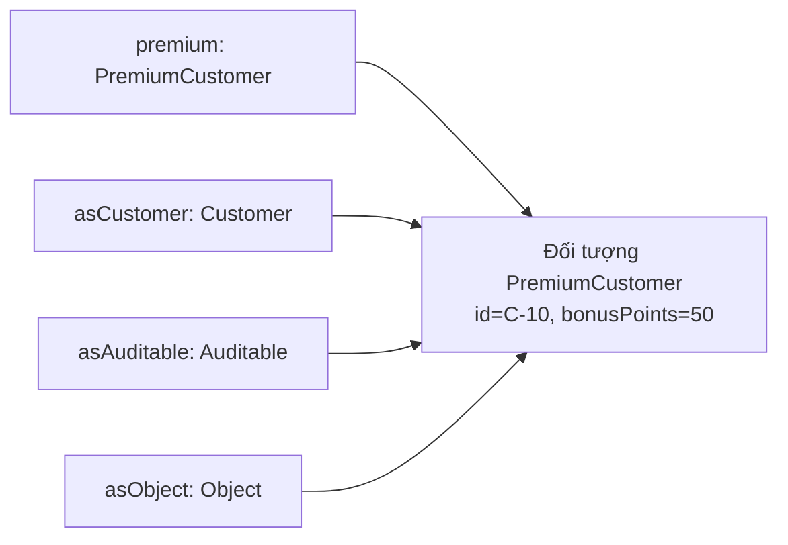
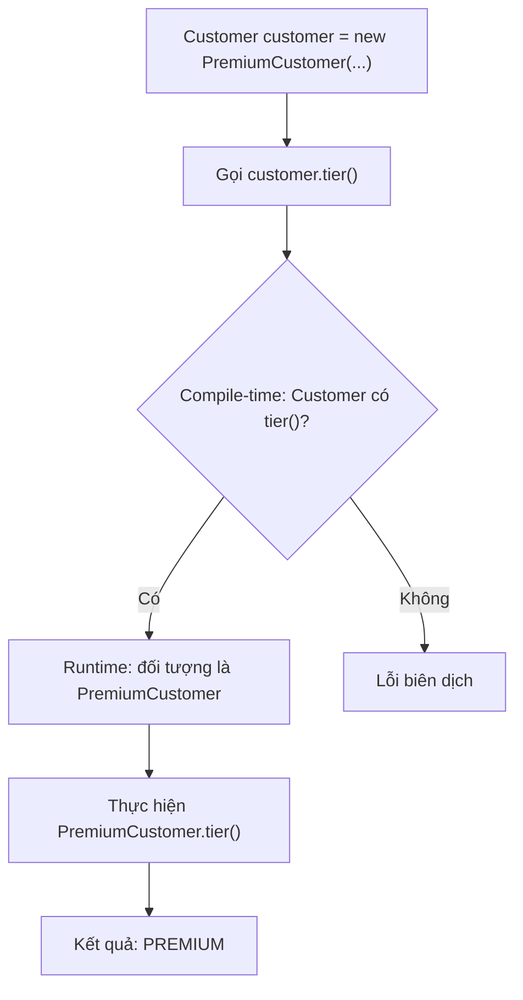

# Upcasting from a subtype to a supertype in Java

In Java, **a subtype** (*subtype*) may be used where a program expects **a supertype** (*supertype*), provided a valid class inheritance or interface implementation relationship exists. Converting a subtype reference to a supertype is called **upcasting**.

```java
class Animal {}
class Dog extends Animal {}

Dog dog = new Dog();
Animal animal = dog;  // Upcasting ngầm định: Dog -> Animal
```

The assignment **does not create an additional `Animal` object** or turn `Dog` into a different object. Both `dog` and `animal` refer to **the same `Dog` object**, but the compiler checks operations permitted on `animal` against its declared type `Animal`.

This is the basis of **polymorphism**: the same code works with a supertype or interface while receiving different implementations from concrete objects.

## 1. When is upcasting allowed?

In Java, subtype/supertype relationships commonly arise through `extends` and `implements`:

```java
class Vehicle {}

class Car extends Vehicle {}

interface Insurable {}

class Taxi extends Car implements Insurable {}
```

A `Taxi` object can be viewed through these types:

```java
Taxi taxi = new Taxi();
Car asCar = taxi;
Vehicle asVehicle = taxi;
Insurable asInsurable = taxi;
Object asObject = taxi;
```

All these assignments are valid. `Taxi` inherits from `Car`, `Car` inherits from `Vehicle`, ordinary class objects ultimately have `Object` in their inheritance tree, and `Taxi` implements `Insurable`.

A single object can have **multiple reference types**. Upcasting normally requires no explicit cast syntax:

```java
Vehicle a = taxi;           // Nên dùng: rõ ràng, ngắn gọn
Vehicle b = (Vehicle) taxi; // Hợp lệ nhưng cast này không cần thiết
```

A valid conversion to a supertype does not erase subclass data. The supertype merely **limits the members visible at compile time through that reference**.

## 2. Practical example: regular and Premium customers

Put all the following code in **`Main.java`** and compile with Java 17 or Java 21.

```java
import java.util.List;
import java.util.Objects;

interface Auditable {
    String auditLabel();
}

class Customer {
    private final String id;

    Customer(String id) {
        if (id == null || id.isBlank()) {
            throw new IllegalArgumentException("Mã khách hàng không hợp lệ");
        }
        this.id = id;
    }

    public String id() {
        return id;
    }

    public String tier() {
        return "STANDARD";
    }

    public String greeting() {
        return "Xin chào " + id;
    }
}

final class PremiumCustomer extends Customer implements Auditable {
    private int bonusPoints;

    PremiumCustomer(String id, int bonusPoints) {
        super(id);
        if (bonusPoints < 0) {
            throw new IllegalArgumentException("Điểm thưởng không được âm");
        }
        this.bonusPoints = bonusPoints;
    }

    @Override
    public String tier() {
        return "PREMIUM";
    }

    @Override
    public String greeting() {
        return "Ưu tiên cho " + id();
    }

    public void addPoints(int points) {
        if (points <= 0) {
            throw new IllegalArgumentException("Điểm cộng phải dương");
        }
        bonusPoints = Math.addExact(bonusPoints, points);
    }

    public int points() {
        return bonusPoints;
    }

    @Override
    public String auditLabel() {
        return id() + ":" + tier();
    }
}

public class Main {
    public static void main(String[] args) {
        PremiumCustomer premium = new PremiumCustomer("C-10", 40);

        // Cùng một đối tượng, nhìn qua ba kiểu tham chiếu.
        Customer asCustomer = premium;
        Auditable asAuditable = premium;
        Object asObject = premium;

        System.out.println(asCustomer.id());
        System.out.println(asCustomer.tier());
        System.out.println(asCustomer.greeting());
        System.out.println(asAuditable.auditLabel());
        System.out.println(asCustomer == premium);
        System.out.println(asObject.getClass().getSimpleName());

        premium.addPoints(10);
        System.out.println(premium.points());

        // Lặp qua các đối tượng khác loại nhưng có chung kiểu cha.
        List<Customer> customers = List.of(
                premium,
                new Customer("C-20")
        );

        for (Customer customer : customers) {
            System.out.println(customer.id() + " -> " + customer.tier());
        }
    }
}
```

Run:

```bash
javac Main.java
java Main
```

Output:

```text
C-10
PREMIUM
Ưu tiên cho C-10
C-10:PREMIUM
true
PremiumCustomer
50
C-10 -> PREMIUM
C-20 -> STANDARD
```

### Why does the output look this way?

**One object, multiple references:**



- `asCustomer == premium` returns `true` because both references point to the same object.
- `asObject.getClass().getSimpleName()` returns `PremiumCustomer` because the runtime object is still a `PremiumCustomer`, not a `Customer` copy.
- `premium.addPoints(10)` updates the same object referenced by `asCustomer`.
- `asCustomer.tier()` returns `PREMIUM` because Java dispatches the **overridden** `tier()` method in the subclass.
- A `List<Customer>` loop can process both `Customer` and `PremiumCustomer` through a shared contract.

Two aspects must be kept separate:

| Concept | In `Customer asCustomer = premium;` |
| --- | --- |
| Declared reference type (*compile-time type*) | `Customer` |
| Actual object type (*runtime class*) | `PremiumCustomer` |
| Members callable at compile time | Members accessible through the `Customer` contract |
| Executed version of an overridden instance method | Determined by actual object: `PremiumCustomer` |
| Is a copy created or subclass data sliced off? | **No** |
| Does the reference share state with the original variable? | **Yes** |

## 3. Upcasting limits the visible API without removing subclass behavior

In the example:

```java
PremiumCustomer premium = new PremiumCustomer("C-10", 40);
Customer customer = premium;
```

Through `customer`, we can call methods exposed by `Customer`:

```java
customer.id();
customer.tier();
customer.greeting();
```

But the following **does not compile**:

```java
// customer.addPoints(10); // Customer không khai báo addPoints()
// customer.points();      // Customer không khai báo points()
```

The object has not lost its `bonusPoints` field; instead, the compiler cannot guarantee that **every `Customer`** has capabilities specific to `PremiumCustomer`.

Similarly:

```java
Auditable auditable = premium;
auditable.auditLabel(); // Hợp lệ

// auditable.tier();     // Không biên dịch: Auditable không khai báo tier()
```

The `Auditable` interface provides **another view** of the same object, exposing only the capability needed for auditing.

The design benefit: a service processing customers generally needs only `Customer`, while an auditing service might need only `Auditable`. Neither depends on Premium-specific methods.

## 4. Dynamic dispatch: overridden methods use the actual object

Suppose:

```java
Customer customer = new PremiumCustomer("C-11", 0);
String tier = customer.tier();
```

Method selection involves two stages:

1. **Compile time:** Java checks whether `Customer` exposes an accessible, valid `tier()` method.
2. **Runtime:** For an overridden instance-method call, Java selects the implementation of the actual `PremiumCustomer` object.



This enables general-purpose functions:

```java
static void printTier(Customer customer) {
    System.out.println(customer.tier());
}
```

`printTier(new Customer("C-1"))` and `printTier(new PremiumCustomer("C-2", 10))` both compile but may print different results. This is polymorphism through a superclass.

**Not every Java member is dispatched by runtime type.** `static` methods, field access, and **overload** resolution follow other rules, as discussed next.

## 5. What upcasting does not change

With `Customer asCustomer = premium`, the object remains a `PremiumCustomer`, and overridden instance methods such as `tier()` still select `PremiumCustomer.tier()`. But not every language construct is resolved according to runtime type:

| Expression | Compiler/runtime choice |
| --- | --- |
| `asCustomer.tier()` | Method exposed by the `Customer` API; overridden implementation dispatched based on the object |
| `asCustomer.someField` | Field selected by the **static type** if accessible; fields are not overridden |
| `Printer.print(asCustomer)` with overloads `print(Customer)` and `print(PremiumCustomer)` | Selects `print(Customer)` by compile-time argument type |
| `SomeType.staticMethod()` | Static methods are not dynamically dispatched by the object |

```java
class Parent {
    String description() { return "Parent"; }
}
class Child extends Parent {
    @Override String description() { return "Child"; }
}
Parent ref = new Child();
System.out.println(ref.description()); // Child
```

To benefit from polymorphism, expose shared behavior through superclass/interface methods; avoid field hiding and too many overloads dependent on concrete types. The **declared/runtime type** lesson explains overload selection and field hiding in depth.

## 6. Upcasting to interfaces is especially useful at module boundaries

Suppose a payment-processing class implements several capabilities:

```java
interface PaymentProcessor {
    boolean pay(long amount);
}

interface RefundProcessor {
    boolean refund(long amount);
}

final class CardGateway implements PaymentProcessor, RefundProcessor {
    @Override
    public boolean pay(long amount) {
        return amount > 0;
    }

    @Override
    public boolean refund(long amount) {
        return amount > 0;
    }
}
```

The same object can be viewed through two interface types:

```java
CardGateway gateway = new CardGateway();
PaymentProcessor payments = gateway;
RefundProcessor refunds = gateway;

System.out.println(payments.pay(100));  // true
System.out.println(refunds.refund(100)); // true
```

A service that only collects payments can accept `PaymentProcessor` instead of depending directly on `CardGateway`. This reduces coupling between modules, makes adapters easier to replace, and avoids giving clients an unnecessarily broad API.

However, **upcasting is not a security authorization mechanism**. It restricts which methods can be invoked through a reference type at compile time; it does not disable other APIs or access provided through other paths. Real payment systems still need authorization, transactions, idempotency, and failure contracts.

## 7. Why does the reverse direction require checking?

```java
Customer base = new PremiumCustomer("C-30", 10);
PremiumCustomer premium = (PremiumCustomer) base; // Hợp lệ
System.out.println(premium.points());             // 10
```

If replaced with `new Customer("C-30")`, casting to `PremiumCustomer` throws `ClassCastException`: **not every Customer is a PremiumCustomer**. Use `instanceof PremiumCustomer p` (Java 16+) before calling `p.points()` when the runtime type is not guaranteed.

This is an important limit of upcasting: viewing an object as its parent does not discard subclass state, but subclass-only APIs require a valid subtype reference. The **Downcasting and type checking** lesson explores checks, `getClass()` versus `instanceof`, `null`, and generic erasure in more depth.

## 8. Upcasting and `null`

A reference conversion does not check that an object exists:

```java
PremiumCustomer premium = null;
Customer customer = premium; // Hợp lệ
System.out.println(customer == null); // true
```

No `PremiumCustomer` is created here. Assigning `null` is valid for a reference type, but calling `customer.tier()` throws `NullPointerException`.

Every `PremiumCustomer` is a `Customer`, but not every `Customer` is a `PremiumCustomer`. Subtyping is directional: converting **up to a supertype** is usually implicit; converting **down to a subtype** requires a runtime type check.

## 9. Upcasting in collections and generics: a common confusion

Assigning a subtype element to a supertype variable is valid:

```java
PremiumCustomer premium = new PremiumCustomer("C-50", 5);
Customer customer = premium;
```

But `List<PremiumCustomer>` is **not** a subtype of `List<Customer>`:

```java
List<PremiumCustomer> premiumList = List.of(premium);

// Không biên dịch:
// List<Customer> customers = premiumList;
```

Java generics are **invariant** in their type arguments by default. If the assignment were allowed, code could insert an ordinary `Customer` into a list whose owner expects only `PremiumCustomer` objects.

For reading through a supertype, use an upper-bounded wildcard:

```java
List<? extends Customer> customers = premiumList;

for (Customer c : customers) {
    System.out.println(c.tier());
}

// customers.add(new Customer("C-60")); // Không biên dịch
```

`? extends Customer` permits reading elements as `Customer`, but forbids adding an arbitrary `Customer` to that list (except `null` under special rules).

If you need a separate list truly typed `List<Customer>`, create one from the elements:

```java
List<Customer> separate = new java.util.ArrayList<>(premiumList);
separate.add(new Customer("C-60")); // Hợp lệ trên list riêng
```

The new list has an **independent structure**, but its `premium` element still refers to the same shared object and is not cloned.

**Distinction:** `PremiumCustomer -> Customer` is a reference-type conversion for **one element**; no equivalent automatic conversion applies to **generic type arguments of the entire collection**.

## 10. When should upcasting be used?

| Requirement | Approach | Benefit |
| --- | --- | --- |
| Function processes many subclasses | `Customer` parameter | Share logic and use polymorphism |
| Service needs a small capability | `PaymentProcessor` parameter | Hide concrete adapters and avoid needless dependencies |
| Collection contains varied objects from one hierarchy | `List<Customer>` holding multiple subtypes | Iterate/process through a common API |
| Change implementation without changing clients | Interface-typed variables, fields, and parameters | Reduce coupling to concrete classes |
| Test with a stub/fake | Pass another implementation of the interface | No dependency on the real implementation required |
| Need subtype-only operations | Reconsider the contract or check before downcasting | Avoid unsafe casts when a better polymorphic design exists |

You do not need supertype variables everywhere. If code truly requires every capability specific to `PremiumCustomer`, declaring a `PremiumCustomer` variable may be clearer. **Upcasting is useful when it reflects the actual responsibility of client code.**

## 11. Common mistakes

| Incorrect assumption | Reality |
| --- | --- |
| `Customer x = premium;` creates a new `Customer` | No; both references point to the same `PremiumCustomer` object |
| Upcasting removes subclass fields and methods | No; the object remains unchanged, only the API visible through the reference differs |
| Every call after upcasting uses the superclass version | Overridden instance methods still dispatch by runtime class |
| Any `Customer` variable can be cast to `PremiumCustomer` | False; downcasting requires an actual object of the target subtype |
| The reference type determines `getClass()` | `getClass()` reflects the object's actual class |
| `List<PremiumCustomer>` works directly as `List<Customer>` | False due to generic invariance; use wildcards where appropriate |
| An interface-typed variable fully blocks access to other APIs | No; it limits method calls through that reference type, not a security boundary |
| Upcasting makes checking subclass contracts unnecessary | Subtypes must still fulfill the semantics promised by supertypes to be substitutable |

## 12. Self-assessment exercises

**Question 1.** How many `Dog` objects does the following code create?

```java
Dog d = new Dog();
Animal a = d;
Object o = a;
```

**Answer:** One `Dog` object; all three variables `d`, `a`, and `o` reference it.

**Question 2.** If `Customer c = new PremiumCustomer("P-1", 0);` calls `c.tier()`, what does it return?

**Answer:** `PREMIUM`, because `tier()` is an overridden instance method in `PremiumCustomer`.

**Question 3.** Why does `c.points()` fail to compile even if the actual object is Premium?

**Answer:** `Customer` does not expose `points()`. The compiler checks the reference type's API; if the specialized capability is truly required, redesign the contract or check and downcast.

**Question 4.** Is `PremiumCustomer p = (PremiumCustomer) new Customer("C-1");` valid?

**Answer:** The cast syntax may compile because the classes are related by inheritance, but runtime execution throws `ClassCastException`: the actual object is only a `Customer`.

**Question 5.** Can `List<PremiumCustomer>` be assigned directly to `List<Customer>`?

**Answer:** No. Java generics are invariant; when only reading through the supertype, use `List<? extends Customer>`.

**Question 6.** In `Base b = new Derived();`, why can `b.describe()` and `b.label` retrieve values from different classes?

**Answer:** Overridden instance methods dispatch based on **the actual object**, while field access is resolved according to **the reference type**.

**Remember:** Upcasting **changes the type through which a reference is viewed**, without transforming or copying the object. Java checks callable methods against the supertype; overridden instance methods still execute according to the actual subtype at runtime. Use upcasting where a shared contract is needed to exploit polymorphism, reduce concrete dependencies, and avoid unnecessary downcasts.
