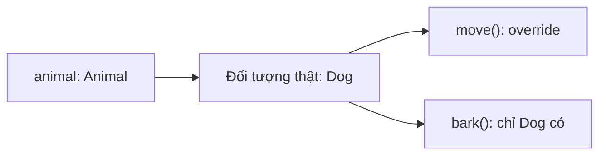
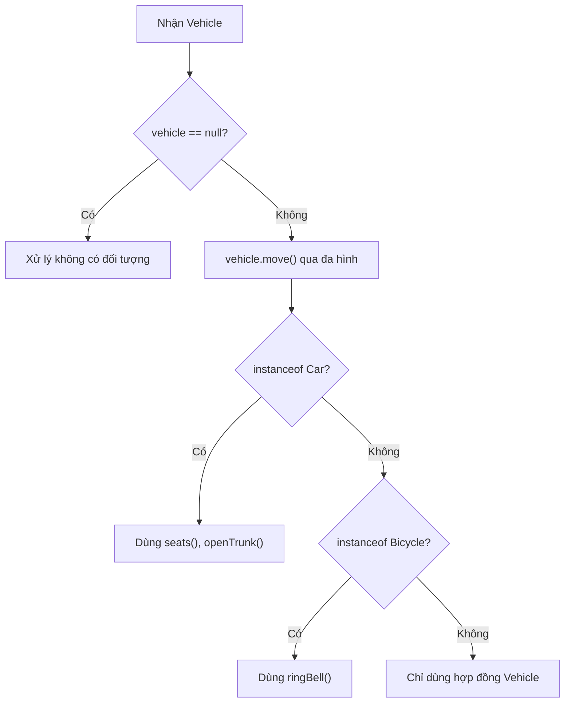

# Downcasting and type checking in Java

**Topic:** OOP → Subtyping → Downcasting and type checking.

In OOP, a variable can be declared using a superclass or interface while referencing **an actual subtype object**. This supports polymorphism but raises a question: how can a subclass-only method be used without an invalid cast? The answer involves **upcasting**, **downcasting**, the `instanceof` operator, and `ClassCastException`.

## 1. Declared type versus runtime type

```java
class Animal {
    void move() {
        System.out.println("Di chuyển");
    }
}

class Dog extends Animal {
    @Override
    void move() {
        System.out.println("Chạy");
    }

    void bark() {
        System.out.println("Gâu gâu");
    }
}

Animal animal = new Dog();
animal.move();          // Chạy
// animal.bark();       // Lỗi biên dịch: Animal không khai báo bark()
```

| Concept | Example | Effect |
|---|---|---|
| Declared/compile-time type | `Animal` | Determines which members the compiler permits through the variable |
| Actual/runtime type | `Dog` | Determines the implementation of overridden instance methods |
| Subtype relationship | `Dog extends Animal` | Allows a `Dog` where an `Animal` is expected |

**Important:** `animal.move()` invokes `Dog.move()` through polymorphic dispatch even when the variable is declared `Animal`. No downcast is needed for Java to select the correct implementation of a method already in the supertype contract.



A reference variable does not contain a copy of an object. `Animal animal = new Dog()` creates only **one** `Dog` object.

## 2. Upcasting: from a subtype to a supertype

```java
Dog dog = new Dog();
Animal animal = dog;             // Upcasting ngầm định
Animal explicit = (Animal) dog;  // Hợp lệ nhưng không cần thiết
```

Every `Dog` is an `Animal` under inheritance, so the assignment needs no cast. After upcasting:

- The object **is still a Dog**, not transformed into an Animal.
- Methods declared only on `Dog` cannot be called directly through an `Animal` variable.
- Overridden `Animal` methods execute the implementation of the actual object.

Assigning an object to an interface it implements is another conversion to an abstraction:

```java
interface RunnableJob {
    void execute();
}

class EmailJob implements RunnableJob {
    @Override
    public void execute() {
        System.out.println("Sending email");
    }
}

RunnableJob job = new EmailJob();
job.execute(); // Sending email
```

This is commonly used to reduce dependencies on concrete classes.

## 3. Downcasting: from a supertype to a subtype

```java
Animal animal = new Dog();

Dog dog = (Dog) animal; // Thành công vì runtime object là Dog
dog.bark();             // Gâu gâu
```

Downcasting requires the **target type in parentheses**. The compiler allows a cast attempt when the type relationship could permit it, but the JVM still checks the actual object at runtime.

```java
class Cat extends Animal {}

Animal animal = new Cat();
Dog dog = (Dog) animal; // ClassCastException
```

The fact that both `Dog` and `Cat` inherit from `Animal` does not make a `Cat` usable as a `Dog`.

| Scenario | Java behavior |
|---|---|
| `Animal a = new Dog();` | Valid upcast |
| `Dog d = (Dog) a;` when a references Dog | Valid downcast |
| `Dog d = (Dog) a;` when a references Cat | May compile; runtime throws `ClassCastException` |
| `Dog d = (Dog) null;` | Succeeds; d receives `null` |
| `Integer i = (Integer) text;` when `text` is declared `String` | Compilation error because the concrete types are incompatible |

A cast **does not create, copy, or change the runtime type of an object**. It only checks whether the current reference can be viewed as the target type.

## 4. Safe checks with `instanceof`

With traditional syntax:

```java
static void handle(Animal animal) {
    if (animal instanceof Dog) {
        Dog dog = (Dog) animal;
        dog.bark();
    }
}
```

`instanceof` returns `true` when the reference is not `null` and the runtime object is compatible with the target type, **including subclasses of that type**.

Since **Java 16**, pattern matching for `instanceof` is available:

```java
static void handle(Animal animal) {
    if (animal instanceof Dog dog) {
        dog.bark(); // Không cần (Dog) animal nữa
    }
}
```

The pattern variable `dog` is usable only where the compiler knows that the check succeeded. For example, with flow scoping:

```java
static void check(Animal animal) {
    if (!(animal instanceof Dog dog)) {
        return;
    }
    dog.bark(); // Hợp lệ: đi đến đây nghĩa là kiểm tra đã thành công
}
```

You cannot use `dog` arbitrarily after an `if` when a control-flow path exists where `instanceof` was false.

### How does `instanceof` handle null?

```java
Animal a = null;

System.out.println(a instanceof Dog); // false
Dog d = (Dog) a;                       // Hợp lệ: d == null

// d.bark();    // NullPointerException
// a.getClass(); // NullPointerException
```

Casting `null` to a valid reference type does not cause `ClassCastException`. Invoking a method through a `null` reference still causes `NullPointerException`.

## 5. Complete example: vehicles with subtype-specific capabilities

Suppose all vehicles can move, but cars can open a trunk and bicycles can ring a bell. Save the following program as **`SubtypeCheckDemo.java`** and run it with Java 17 or later.

```java
public class SubtypeCheckDemo {
    static abstract class Vehicle {
        private final String code;

        protected Vehicle(String code) {
            if (code == null || code.isBlank()) {
                throw new IllegalArgumentException("Mã không hợp lệ");
            }
            this.code = code;
        }

        String code() {
            return code;
        }

        abstract String move();
    }

    static class Car extends Vehicle {
        private final int seats;

        Car(String code, int seats) {
            super(code);
            if (seats <= 0) {
                throw new IllegalArgumentException("Số chỗ phải dương");
            }
            this.seats = seats;
        }

        int seats() {
            return seats;
        }

        String openTrunk() {
            return "Mở cốp " + code();
        }

        @Override
        String move() {
            return "Ô tô " + code() + " di chuyển";
        }
    }

    static final class ElectricCar extends Car {
        ElectricCar(String code, int seats) {
            super(code, seats);
        }

        @Override
        String move() {
            return "Xe điện " + code() + " di chuyển";
        }
    }

    static final class Bicycle extends Vehicle {
        Bicycle(String code) {
            super(code);
        }

        String ringBell() {
            return "Chuông " + code();
        }

        @Override
        String move() {
            return "Xe đạp " + code() + " di chuyển";
        }
    }

    static void inspect(Vehicle vehicle) {
        if (vehicle == null) {
            System.out.println("Không có phương tiện");
            return;
        }

        // Không cần cast: move() đã thuộc hợp đồng Vehicle.
        System.out.println("MOVE: " + vehicle.move());

        if (vehicle instanceof Car car) {
            System.out.println("SEATS: " + car.seats());
            System.out.println(car.openTrunk());
        } else if (vehicle instanceof Bicycle bicycle) {
            System.out.println(bicycle.ringBell());
        }
    }

    public static void main(String[] args) {
        Vehicle first = new ElectricCar("EV-01", 5);
        Vehicle second = new Bicycle("BK-02");
        Vehicle none = null;

        System.out.println(first instanceof Car);
        System.out.println(first instanceof ElectricCar);
        System.out.println(first instanceof Bicycle);
        System.out.println(none instanceof Car);
        System.out.println(first.getClass() == Car.class);

        inspect(first);
        inspect(second);
        inspect(none);

        try {
            Bicycle wrong = (Bicycle) first;
            System.out.println(wrong.ringBell());
        } catch (ClassCastException ex) {
            System.out.println("Downcast sai: ClassCastException");
        }
    }
}
```

Run:

```bash
javac SubtypeCheckDemo.java
java SubtypeCheckDemo
```

Output:

```text
true
true
false
false
false
MOVE: Xe điện EV-01 di chuyển
SEATS: 5
Mở cốp EV-01
MOVE: Xe đạp BK-02 di chuyển
Chuông BK-02
Không có phương tiện
Downcast sai: ClassCastException
```

Explanation:

1. `first` is declared `Vehicle`, but the actual object is `ElectricCar`.
2. `ElectricCar extends Car`, so `first instanceof Car` is `true`.
3. `first.move()` invokes the override in `ElectricCar` without a cast.
4. `first.getClass() == Car.class` is `false` because the **exact** runtime class is `ElectricCar`.
5. Casting `first` to `Bicycle` is incompatible at runtime, so the JVM throws `ClassCastException`.



The diagram shows that **only subtype-specific behaviors** require type checks. `move()` is common behavior and should be invoked through the abstraction.

## 6. Are `getClass()` and `instanceof` equivalent?

**No.** They answer different questions.

| Expression | Question | For an `ElectricCar` object |
|---|---|---|
| `v instanceof Car` | Is the object a Car or a subtype of Car? | `true` |
| `v instanceof ElectricCar` | Is the object an ElectricCar or a compatible subtype? | `true` |
| `v.getClass() == Car.class` | Is the exact runtime class Car? | `false` |
| `v.getClass() == ElectricCar.class` | Is the exact runtime class ElectricCar? | `true` |
| `v == null` | Is there no object? | `false` |

Use `instanceof` when subtypes should be accepted; use an exact `getClass()` check only when the requirement genuinely demands one runtime class. Unlike `instanceof`, calling `getClass()` on `null` throws `NullPointerException`.

When the target type is stored in a `Class<?>` object, you can use:

```java
Class<?> expected = Car.class;
Object object = new ElectricCar("EV-09", 4);

System.out.println(expected.isInstance(object)); // true
```

`Class.isInstance()` is useful when the target type is determined dynamically; `instanceof` is easier to read when the type is fixed in source code.

## 7. Type checking through interfaces

Downcasting is not limited to classes related through `extends`. An object may implement an additional interface representing an optional capability:

```java
interface Printable {
    void print();
}

interface Downloadable {
    void download();
}

final class Report implements Printable, Downloadable {
    @Override
    public void print() {
        System.out.println("In báo cáo");
    }

    @Override
    public void download() {
        System.out.println("Tải báo cáo");
    }
}

class InterfaceExample {
    static void handle(Printable printable) {
        printable.print();

        if (printable instanceof Downloadable downloadable) {
            downloadable.download();
        }
    }

    public static void main(String[] args) {
        handle(new Report());
    }
}
```

A `Printable` variable does not allow direct calls to `download()`. But when the actual object supports `Downloadable`, pattern matching makes that capability available inside the corresponding branch.

When **every object** passed to a method must support downloading, consider changing the parameter contract rather than checking types everywhere. `instanceof` is most appropriate for optional capabilities supported only by some implementations.

## 8. Compile-time errors versus `ClassCastException`

`ClassCastException` is a `RuntimeException`: the cast can be attempted at compile time, but the object is incompatible at runtime.

```java
Object value = "hello";
Integer number = (Integer) value; // ClassCastException
```

Here `value` is declared `Object`, which is broad enough for the compiler to permit a cast attempt to `Integer`. But the actual object is a `String`.

By contrast:

```java
String value = "hello";
// Integer number = (Integer) value; // Lỗi biên dịch
```

Because `String` and `Integer` are both concrete classes without a suitable subtype relationship, the compiler can determine that the cast cannot succeed.

Do not use `try/catch (ClassCastException)` as a substitute for designing correct type conditions. In ordinary code, `instanceof` or a better abstraction usually conveys intent more clearly.

## 9. An important exception: generics and type erasure

Java does not retain complete generic type arguments for `instanceof` checks at runtime.

```java
import java.util.List;

Object value = List.of("A", "B");

if (value instanceof List<?> elements) {
    System.out.println(elements.size()); // 2
    Object first = elements.get(0);
    System.out.println(first);            // A
}

// Không hợp lệ:
// if (value instanceof List<String> strings) { ... }
```

`List<?>` can test **whether an object is a List**. It does not establish that its elements are `String`, `Integer`, or any other specific type.

A cast such as `(List<String>) value` can produce an **unchecked cast** warning; because of type erasure, the JVM cannot verify every element type at that cast site. A failure may occur later when an element is read and the compiler inserts a cast.

When handling untrusted data, validate the structure and element contents instead of suppressing unchecked-cast warnings without evidence.

## 10. When should downcasting be avoided?

Consider this code:

```java
if (animal instanceof Dog dog) {
    System.out.println(dog.sound());
} else if (animal instanceof Cat cat) {
    System.out.println(cat.sound());
}
```

If every `Animal` should have a `sound()` capability, make it part of the shared contract instead of checking each subtype:

```java
abstract class Animal {
    abstract String sound();
}

final class Dog extends Animal {
    @Override
    String sound() {
        return "Gâu";
    }
}

final class Cat extends Animal {
    @Override
    String sound() {
        return "Meo";
    }
}

class SoundDemo {
    static void play(Animal animal) {
        System.out.println(animal.sound());
    }

    public static void main(String[] args) {
        play(new Dog()); // Gâu
        play(new Cat()); // Meo
    }
}
```

When a new subclass is added, `play` does not need another `else if` branch: dynamic dispatch selects the correct behavior.

| Need | Usually appropriate approach |
|---|---|
| Shared behavior of all subtypes | Method on the superclass/interface with overrides |
| Only some objects have a special capability | A dedicated capability interface or checked `instanceof` |
| Need an API available only on one subtype | Safe downcasting when genuinely required |
| Code has many `instanceof` checks for the same action | Reevaluate the polymorphic model |
| Need the exact runtime class, excluding subtypes | `getClass()` when specifically required |

Downcasting is **a tool**, not a goal. If you must use it repeatedly for common behavior, the abstraction may need redesign.

## 11. Practice exercises

1. Create `Animal animal = new Dog()`. Predict `animal instanceof Animal`, `animal instanceof Dog`, `animal instanceof Cat`, and `animal.getClass() == Animal.class`, then explain.
2. Create a `List<Animal>` containing `Dog` and `Cat`. Write a loop that calls `bark()` only for `Dog`, using `instanceof Dog dog` to avoid `ClassCastException`.
3. Use `if (!(animal instanceof Dog dog)) return;`, explain why `dog` is available after the `if`, and contrast this with a branch without `return`.
4. Design a `Refundable` interface with `refund()`; only some `PaymentMethod` types implement it. Write a method accepting `PaymentMethod` that invokes `refund()` when supported.
5. Refactor code that uses `instanceof` to calculate fees for each `Order` type into polymorphism using `calculateFee()` on a superclass or interface.
6. Explain why `List<?>` can be tested with `instanceof` while `List<String>` cannot be used directly that way, and describe the danger of unchecked casts.

**Remember:** Upcasting lets a subtype object be used through a supertype contract; downcasting is valid only when the **runtime object** is compatible with the target type. Use `instanceof` before accessing subtype-specific APIs, and favor **polymorphism** when behavior belongs to the shared contract.
