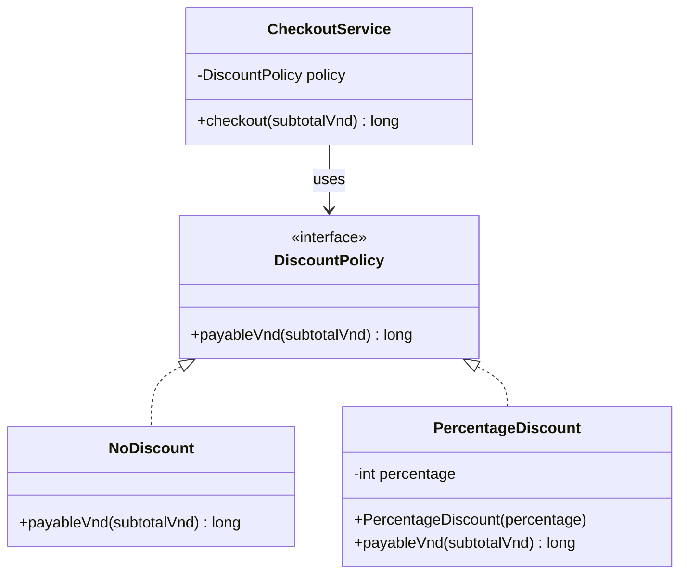
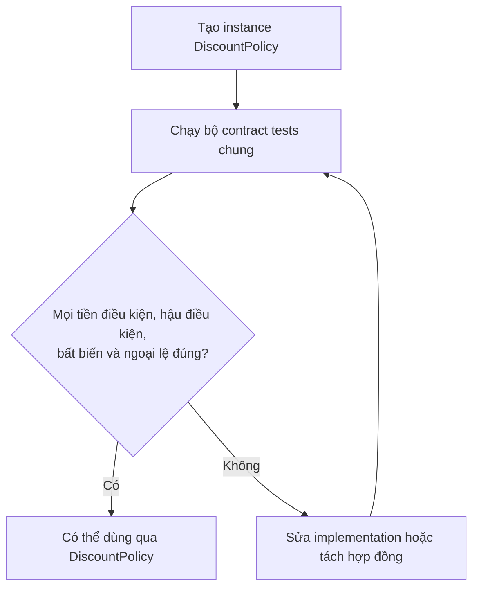

# Preserving contracts when extending types in Java OOP

## 1. When can a subtype replace its supertype?

Suppose a checkout service accepts a `DiscountPolicy` to calculate how much a customer pays. Initially, the application uses a no-discount policy; later it substitutes a 20% discount. If the service can use both **without changing calls, adding unexpected checks, or getting results that violate its rules**, the design is on the right track.

In OOP, a “subtype” (*subtype*) is not merely about Java permitting `extends` or `implements`. More crucially, **a subtype object must preserve the behavioral promises** that code using the supertype relies on.

This is the spirit of the **Liskov Substitution Principle (LSP)**:

> Wherever a program expects an object of type T, it should be able to use an object of a subtype of T while preserving the correctness properties guaranteed by T.

Specifically, if client code correctly follows the supertype contract, replacing one valid implementation with another must not break those guarantees.

### What does a type's (*contract*) include?

Method signatures alone are insufficient:

| Component | Question to answer |
| --- | --- |
| **Precondition** | What must callers ensure before invoking a method? |
| **Postcondition** | What does the method guarantee if it completes normally? |
| **Invariant** | Which conditions must always hold in the object's observable state? |
| **Exceptions and failure behavior** | Which inputs are rejected and which failures can occur? |
| **Side effects** | What is the call allowed to modify? |
| **Meaning of behavior** | What does “save,” “withdraw,” or “calculate price” actually mean? |

A subclass may **compile successfully** yet violate the contract by changing business semantics or adding an unannounced restriction on callers of the supertype.

## 2. Three most important rules

Suppose `Child` is a subtype of `Parent`, both exposing `operate(x)`.

**(1) Do not increase input requirements.** A subtype must not impose **stronger preconditions** than its parent. If the parent accepts all nonnegative integers, the child cannot arbitrarily reject `0` or values below some threshold.

**(2) Do not reduce output guarantees.** A subtype must not offer **weaker postconditions**. If the parent guarantees a result within a valid range, the child must stay within it. It may offer stronger guarantees as long as the common contract is met.

**(3) Preserve invariants and observable guarantees.** If an object promises nonnegative balances or a method promises not to mutate inputs, the child must not violate that rule. Unexpected exceptions, unwanted state changes, or silently omitted operations may also break the contract.

Summary:

| Aspect | What a subtype should do | Violation example |
| --- | --- | --- |
| Preconditions | Preserve requirements or allow *more* inputs when appropriate | Parent accepts 0; child requires at least 500.000 |
| Postconditions | Preserve guarantees or provide *stronger* ones | Parent returns an amount no greater than original; child charges more |
| Invariants | Preserve all promised invariants | A method makes balance negative despite a prohibition |
| Exceptions | Do not introduce rejections for calls that are valid under the contract | Throws `UnsupportedOperationException` when the method should work |
| Side effects | Respect documented effect boundaries | Pure calculation unexpectedly deletes data |

“Accepting more inputs” does not permit arbitrary changes to how invalid inputs are handled. If the contract specifies an exception type for an invalid case, implementations must also honor it.

## 3. Defining a clear contract: DiscountPolicy

Consider an interface calculating amounts due after discounts. Agree on the following first:

- `payableVnd(subtotalVnd)` accepts **every nonnegative `long`**, including `0`.
- Negative inputs are rejected with `IllegalArgumentException`.
- On normal completion, the result is **nonnegative and no greater than `subtotalVnd`**.
- Results use **integer VND units**; percentage discounts round the discounted amount down to the nearest whole VND.
- The call performs only calculations and does not modify an order, account, or other state.

Two valid implementations may produce **different results**. LSP does not require all subtypes to return identical results; it requires them to honor **published guarantees**.



`CheckoutService` knows only `DiscountPolicy`. It does not need to determine whether the internal object is a `NoDiscount` or `PercentageDiscount` before calling the method.

## 4. Complete runnable Java example

Create **`DiscountDemo.java`** (JDK 11 or later):

```java
import java.util.Objects;

interface DiscountPolicy {
    /**
     * Contract:
     * - subtotalVnd >= 0: trả kết quả trong [0, subtotalVnd].
     * - subtotalVnd < 0: ném IllegalArgumentException.
     * - Không sửa trạng thái bên ngoài.
     */
    long payableVnd(long subtotalVnd);

    static void requireValidSubtotal(long subtotalVnd) {
        if (subtotalVnd < 0) {
            throw new IllegalArgumentException(
                    "Tổng tiền ban đầu không được âm");
        }
    }
}

final class NoDiscount implements DiscountPolicy {
    @Override
    public long payableVnd(long subtotalVnd) {
        DiscountPolicy.requireValidSubtotal(subtotalVnd);
        return subtotalVnd;
    }
}

final class PercentageDiscount implements DiscountPolicy {
    private final int percentage;

    PercentageDiscount(int percentage) {
        if (percentage < 0 || percentage > 100) {
            throw new IllegalArgumentException(
                    "Phần trăm giảm phải từ 0 đến 100");
        }
        this.percentage = percentage;
    }

    @Override
    public long payableVnd(long subtotalVnd) {
        DiscountPolicy.requireValidSubtotal(subtotalVnd);

        // Tính floor(subtotal * percentage / 100)
        // mà không nhân trực tiếp subtotal * percentage,
        // vì phép nhân đó có thể tràn long.
        long discountedVnd =
                (subtotalVnd / 100) * percentage
                + ((subtotalVnd % 100) * percentage) / 100;

        return subtotalVnd - discountedVnd;
    }
}

final class CheckoutService {
    private final DiscountPolicy policy;

    CheckoutService(DiscountPolicy policy) {
        this.policy = Objects.requireNonNull(policy, "policy");
    }

    long checkout(long subtotalVnd) {
        DiscountPolicy.requireValidSubtotal(subtotalVnd);

        long payable = policy.payableVnd(subtotalVnd);

        // Phòng vệ tại biên tích hợp nếu có implementation lỗi.
        if (payable < 0 || payable > subtotalVnd) {
            throw new IllegalStateException(
                    "DiscountPolicy đã vi phạm hợp đồng");
        }
        return payable;
    }
}

public class DiscountDemo {
    private static void verifyContract(DiscountPolicy policy) {
        long[] inputs = {0L, 105L, 1_000L, Long.MAX_VALUE};

        for (long input : inputs) {
            long actual = policy.payableVnd(input);
            if (actual < 0 || actual > input) {
                throw new AssertionError(
                        "Kết quả ngoài hợp đồng: " + actual);
            }
        }

        try {
            policy.payableVnd(-1);
            throw new AssertionError(
                    "Lẽ ra phải từ chối số tiền âm");
        } catch (IllegalArgumentException expected) {
            // Đúng loại ngoại lệ đã cam kết.
        }
    }

    public static void main(String[] args) {
        CheckoutService regular =
                new CheckoutService(new NoDiscount());
        CheckoutService promotion =
                new CheckoutService(new PercentageDiscount(20));

        System.out.println(regular.checkout(1_000));   // 1000
        System.out.println(promotion.checkout(1_000)); // 800
        System.out.println(promotion.checkout(105));   // 84

        verifyContract(new NoDiscount());
        verifyContract(new PercentageDiscount(20));
        verifyContract(new PercentageDiscount(100));

        System.out.println("Contract tests: PASS");
    }
}
```

Run:

```bash
javac DiscountDemo.java
java DiscountDemo
```

Expected output:

```text
1000
800
84
Contract tests: PASS
```

### Why is this valid type extension?

`NoDiscount` and `PercentageDiscount` both `implements DiscountPolicy` and use `@Override` to implement the same public behavior.

When `CheckoutService` receives a `DiscountPolicy`, Java uses **runtime polymorphism (dynamic dispatch)** to invoke `payableVnd` on the actual object. Although calculations differ, both preserve the common preconditions and postconditions.

For example, with 105 VND and a 20% discount:
- Discount amount: round down `105 × 20 / 100 = 21` VND.
- Amount payable: `105 - 21 = 84` VND.

The code formula splits multiplication into quotient and remainder over 100 to avoid overflow when `subtotalVnd` approaches `Long.MAX_VALUE`. For `percentage` from 0 to 100, the discount cannot exceed the original amount, so the final subtraction is valid.

### Constructors have contracts distinct from methods

`new PercentageDiscount(120)` is invalid because the percentage exceeds 100. This **does not** “strengthen the precondition for `payableVnd`.” It is the **construction contract**: a `PercentageDiscount` instance exists in a valid state only if its constructor succeeds.

After successful construction, `payableVnd` must still accept **every nonnegative subtotal** without introducing another threshold.

## 5. Precondition violation: a subtype adds a new restriction

Consider another implementation:

```java
final class WrongMinimumDiscount implements DiscountPolicy {
    @Override
    public long payableVnd(long subtotalVnd) {
        DiscountPolicy.requireValidSubtotal(subtotalVnd);

        if (subtotalVnd < 500_000) {
            throw new IllegalStateException(
                    "Chỉ xử lý đơn từ 500.000 VND");
        }

        return subtotalVnd - 100_000;
    }
}
```

This **compiles** because it correctly implements the signature `long payableVnd(long)`. However, it violates the contract because `DiscountPolicy` promises to accept every subtotal from `0` upward.

`CheckoutService` may legitimately call `checkout(100_000)`. With `NoDiscount` or `PercentageDiscount`, it succeeds. With `WrongMinimumDiscount`, it throws `IllegalStateException` instead. The client needs a subtype-specific condition, breaking substitutability.

**The correct solution depends on business requirements:**

- If a small order does not qualify for a promotion, return **the original subtotal** rather than reject the calculation.
- If a transaction truly requires a minimum of 500.000 VND and must reject smaller orders, model it under **a different contract** instead of claiming it is a `DiscountPolicy` with the broader contract.

Example: return the original amount for orders below the threshold:

```java
final class MinimumOrderPromotion implements DiscountPolicy {
    @Override
    public long payableVnd(long subtotalVnd) {
        DiscountPolicy.requireValidSubtotal(subtotalVnd);

        if (subtotalVnd < 500_000) {
            return subtotalVnd; // Hợp lệ: không giảm, không ném lỗi
        }

        return subtotalVnd - 100_000;
    }
}
```

Both branches return values in `[0, subtotalVnd]`. This kind of policy accepts **the entire input domain** promised by the interface, making it substitutable for other policies.

## 6. Postcondition violation: returning a result that breaks guarantees

An implementation that unexpectedly applies a surcharge in a discount system:

```java
final class WrongSurcharge implements DiscountPolicy {
    @Override
    public long payableVnd(long subtotalVnd) {
        DiscountPolicy.requireValidSubtotal(subtotalVnd);
        return Math.addExact(subtotalVnd, 1_000);
    }
}
```

With `subtotalVnd = 10_000`, the result is `11_000`, greater than the input amount. The method has the right name, parameter type, and return type but **violates the postcondition** of `DiscountPolicy`.

If the application needs both surcharges and discounts, define another contract such as `PriceAdjustment`, with result ranges, fee handling, and overflow behavior clearly specified. Do not force fundamentally different behavior into a “discount” contract.

In `CheckoutService`, checking the returned value can catch some integration bugs. But **defensive checks in the caller do not make a nonconforming implementation a valid behavioral subtype**. If it modifies state before returning, a post-call check cannot automatically undo those changes.

## 7. Invariants and exceptions are also part of the contract

Suppose a base class `BankAccount` promises:
- The balance is nonnegative.
- `withdraw(amount)` accepts every `amount > 0` that does not exceed the balance.
- After a successful withdrawal, the balance decreases by **exactly `amount`**.
- Insufficient funds leave the balance unchanged.

A subclass that silently deducts another fee without updating the contract, or refuses withdrawals below a threshold despite sufficient funds, may break client logic.

Consider a check in a program:

```java
long before = account.getBalanceVnd();
account.withdraw(100_000);

long after = account.getBalanceVnd();
if (after != before - 100_000) {
    throw new AssertionError("Sai hợp đồng rút tiền");
}
```

The check is valid **if** the caller ensured sufficient funds and the supertype promised to deduct exactly the requested amount. If the subtype deducts 101.000 VND because of a fee, the postcondition is violated.

Conversely, if the contract **from the outset** allows withdrawals to incur published fees, its results and validation must follow that broader contract. Differences in outputs do not automatically establish an LSP violation; compare them against **the supertype's actual promises**.

### Checked and unchecked exceptions

Java checks some override constraints at compile time:

- An overriding method may not declare **broader checked exceptions** than the overridden method permits in that inheritance path.
- However, Java still allows throwing a `RuntimeException` such as `UnsupportedOperationException` from a call the supertype promises will succeed.

Thus, **compile-time compatibility alone does not imply behavioral compatibility**. A contract should document when an operation may be rejected, which exceptions represent business failures, and what observable effects occur on failure.

In particular, when an interface explicitly declares an operation **optional**, an implementation that does not support it may still conform. For example, some mutating operations in Java Collections are specified as optional, so an unmodifiable list is not automatically an LSP violation just because it throws `UnsupportedOperationException` on addition. Always read the relevant API contract.

## 8. The extends declaration alone cannot “upgrade” a subtype relationship

A familiar design example:

```java
class Bird {
    void fly() {
        System.out.println("Bay trên trời");
    }
}

class Penguin extends Bird {
    @Override
    void fly() {
        throw new UnsupportedOperationException(
                "Chim cánh cụt không bay được");
    }
}
```

In biological classification, a penguin is a bird. But if `Bird.fly()` promises that **every bird can fly**, then `Penguin` cannot substitute for `Bird` in a client that calls `fly()`. This signals that **the class model defines overly broad shared behavior**.

An alternative design:

```java
interface Bird {
    void eat();
}

interface Flyable {
    void fly();
}

final class Sparrow implements Bird, Flyable {
    @Override
    public void eat() {
        System.out.println("Ăn hạt");
    }

    @Override
    public void fly() {
        System.out.println("Chim sẻ bay");
    }
}

final class Penguin implements Bird {
    @Override
    public void eat() {
        System.out.println("Ăn cá");
    }
}
```

Now clients that only need “birds that can eat” use `Bird`, while clients requiring flight use `Flyable`. `Penguin` makes no promises it cannot fulfill.

Lesson: **an “is-a” relationship in the real world is not sufficient to choose inheritance**. A type should be a subtype of another only if it can preserve the behavior that clients of the supertype may legitimately expect.

Not every method needs its own interface; divide roles based on actual shared capabilities and contracts.

## 9. Why does Java catch certain signature overrides but not all violations?

Java helps check **type compatibility**:

```java
class Parent {
    Number value() {
        return 1;
    }
}

class Child extends Parent {
    @Override
    Integer value() {
        return 2;
    }
}
```

This illustrates **covariant return types**: `Integer` is a subtype of `Number`, so Java permits replacing a `Number` return type with `Integer` in an override.

In contrast, Java **does not** allow overriding a method merely by changing its parameter type:

```java
class Parent {
    void process(Number value) {}
}

class Child extends Parent {
    // Đây là overload, KHÔNG phải override:
    void process(Integer value) {}
}
```

When a variable of declared type `Parent` invokes `process` with a `Number`, adding a `process(Integer)` overload in `Child` does not override `process(Number)`. `@Override` makes the compiler report an error if you intended an override but the signature does not match.

Java also checks details such as visibility (overrides may not narrow accessibility) and checked exceptions. But the compiler **cannot prove** that methods always return valid ranges, avoid silently deleting data, or refrain from strengthening preconditions.

Both are therefore needed:
1. **Valid types and signatures** so Java permits substitution.
2. **Preserved behavioral contracts** so clients continue to behave correctly.

## 10. Testing the shared contract across all implementations

A practical approach is to write tests using **a supertype/interface** and execute the same test suite against **each implementation**.

For example, the earlier `verifyContract(DiscountPolicy policy)` checks:
- `0` is a valid input.
- Both small and typical amounts are handled.
- The extreme value `Long.MAX_VALUE` does not invalidate result bounds.
- Negative input is rejected with the required exception type.
- Results remain within `[0, subtotalVnd]`.

Tests can also verify more specific guarantees such as no side effects or no mutation of external objects, when these are part of the contract. Observable properties beyond return values need matching state checks or mock dependencies.



Additional important boundaries include discount rates of `0%` and `100%`, subtotals not divisible by 100, and values near `Long.MAX_VALUE`. JUnit tests may use abstract base test classes or parameterized tests; either approach aims to **run the same promised behavior against interchangeable objects**.

However, tests exercise only selected scenarios and do not prove correctness for *every* input. Combine them with algorithm reasoning, invariants, and data-range validation.

## 11. Where should a violated subtype contract be fixed?

Do not immediately add `instanceof` chains or `if (policy instanceof ...)` to every caller. That makes clients dependent on concrete types and loses the benefit of polymorphism.

Options include:

| Scenario | Appropriate response |
| --- | --- |
| Subtype adds requirements absent from the contract | Remove the extra restriction from the shared method or define a specialized contract |
| Two behaviors have different meanings | Define interfaces expressing their capabilities: `DiscountPolicy`, `SurchargePolicy`… |
| Supertype promises too many operations that some subtypes cannot support | Narrow or split contracts by actual capabilities |
| Subtype uses a different algorithm but preserves guarantees | Keep the shared interface; use polymorphism or Strategy |
| Behavioral variants depend on state | Describe state rules in the shared contract or coordinate via an appropriate service |
| Many callers need the same special-case checks | Revisit the contract instead of requiring callers to know the concrete implementation |

**Design principle:** model subtypes based on **behaviors they can guarantee**, not merely names or similarities in data.

## 12. Self-assessment exercises

**Exercise 1 — predict:** With the example `DiscountPolicy`, what does `PercentageDiscount(25).payableVnd(1_000)` return? May `payableVnd(0)` be rejected?

*Answer:* Returns `750`; `0` is valid input and the result must be `0`.

**Exercise 2 — find the violation:** Consider this new implementation:

```java
final class WrongPolicy implements DiscountPolicy {
    @Override
    public long payableVnd(long subtotalVnd) {
        if (subtotalVnd <= 0) {
            throw new IllegalArgumentException("Phải > 0");
        }
        return subtotalVnd / 2;
    }
}
```

*Hint:* The supertype accepts `0`, but the new type rejects `0`. Its postcondition might be valid for positive values, but it has strengthened the precondition.

**Exercise 3 — fix the implementation:** Write `FixedPolicy` instead of `WrongPolicy`, accept all `subtotalVnd >= 0`, throw `IllegalArgumentException` for negative inputs, and return a result in `[0, subtotalVnd]`. Run `verifyContract` against it.

**Exercise 4 — design:** An `Account` has `withdraw` and promises that all positive withdrawals not exceeding the balance succeed. The system adds an account whose balance can be viewed but from which funds cannot be withdrawn. Should `ReadOnlyAccount extends Account` override `withdraw` to throw? Why? Try splitting `BalanceReadable` and `Withdrawable` to represent the actual capabilities.

**Exercise 5 — discuss:** If every `DiscountPolicy` implementation may return more than the subtotal to apply surcharges, what must change? Is renaming the method sufficient, or must the contract, tests, and `CheckoutService` usage also change?

## Checklist for designing or reviewing subtypes

- Does the supertype/interface accurately describe valid inputs?
- Does the subtype reject a case the supertype promises to handle?
- Does its result preserve every supertype postcondition?
- Do observable state and exceptions honor the guarantees?
- Must clients inspect concrete classes with `instanceof` to use it safely?
- Can **the same contract tests** run against all implementations?
- Does inheritance reflect **substitutability**, or merely similar names/data?

**Conclusion:** Correct type extension requires more than inheriting members or compiling an `@Override` method. A subtype must **preserve its supertype contract**: add no unexpected requirements for valid inputs, weaken no output guarantees, violate no invariants, and introduce no unpromised effects. Only then can polymorphism extend application behavior without rewriting code that depends on the abstraction.
