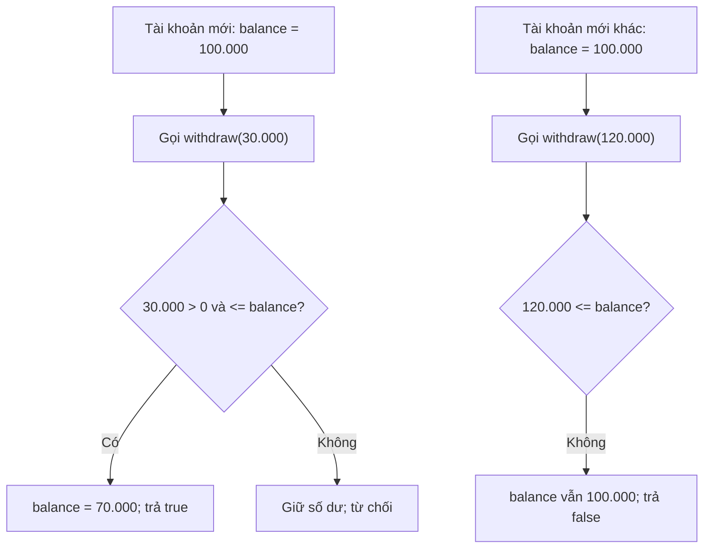
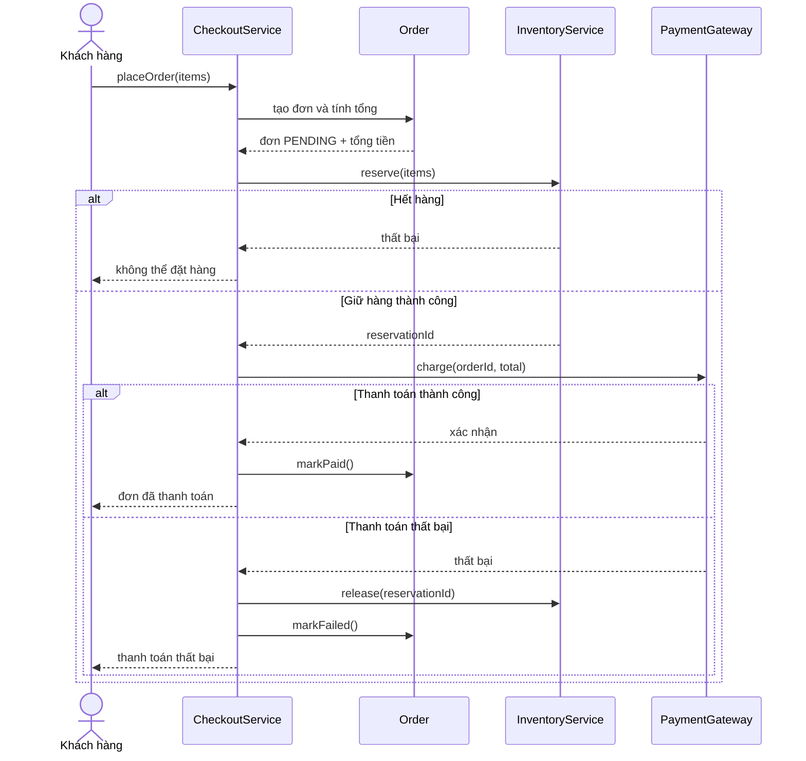

# OOP là gì và bài toán tổ chức chương trình?

Khi một chương trình chỉ có vài chục dòng, chúng ta thường dễ biết dữ liệu nằm ở đâu, hàm nào xử lý việc gì và phải sửa chỗ nào khi yêu cầu thay đổi. Nhưng hãy tưởng tượng một ứng dụng có tài khoản, đơn hàng, kho hàng, thanh toán, nhiều người cùng phát triển và hàng trăm yêu cầu mới. Câu hỏi khó dần không còn là “viết vòng lặp thế nào?” mà là **“tổ chức chương trình ra sao để dữ liệu, hành vi và quy tắc nghiệp vụ có chỗ đứng rõ ràng?”**

**Lập trình hướng đối tượng (Object-Oriented Programming, OOP)** là một cách tư duy và tổ chức chương trình quanh các **đối tượng**. Mỗi đối tượng đại diện cho một thực thể hoặc khái niệm có trách nhiệm cụ thể; nó có thể giữ trạng thái, thực hiện hành vi và phối hợp với đối tượng khác để hoàn thành công việc.

Bài này tập trung vào hai câu hỏi: **OOP là gì?** Và **vấn đề tổ chức chương trình nào khiến OOP trở nên hữu ích?** Các kỹ thuật như kế thừa, đa hình hay SOLID sẽ được nhắc đến khi cần, chưa phải trọng tâm.

## 1. Vì sao “tổ chức chương trình” lại là một bài toán?

Giả sử bạn viết tính năng rút tiền. Khi mới bắt đầu, bài toán có vẻ đơn giản:

1. Đọc số dư hiện tại.
2. Nhận số tiền muốn rút.
3. Kiểm tra số tiền hợp lệ và số dư đủ.
4. Trừ tiền nếu được phép.
5. Trả kết quả.

Nếu chương trình chỉ xử lý một tài khoản, vài hàm và biến có thể đã đủ. Nhưng hệ thống lớn hơn sẽ xuất hiện thêm yêu cầu: có hàng nghìn tài khoản; cần lịch sử giao dịch; giới hạn rút theo ngày; khóa tài khoản; phân quyền; cảnh báo giao dịch bất thường; nhiều giao dịch đồng thời; cần kiểm thử và thay đổi quy tắc mà không phá tính năng cũ.

Những thách thức đáng chú ý là:

| Vấn đề | Dấu hiệu trong mã nguồn | Hậu quả có thể gặp |
|---|---|---|
| Dữ liệu và thao tác bị tách rời | Nhiều nơi cùng sửa trực tiếp `balance` | Một nơi quên kiểm tra, dữ liệu trở nên không hợp lệ |
| Trách nhiệm phân tán | Quy tắc rút tiền nằm rải rác ở controller, service, utility | Sửa một nghiệp vụ phải tìm và cập nhật nhiều nơi |
| Phụ thuộc chằng chịt | Đổi cách thanh toán kéo theo sửa nhiều phần không liên quan | Khó thay đổi, dễ phát sinh lỗi ngoài ý muốn |
| Khó hiểu luồng xử lý | Không rõ ai được phép làm gì với dữ liệu | Người mới khó đọc, khó bảo trì |
| Khó kiểm thử | Một hàm ôm đọc dữ liệu, tính toán, ghi DB và gửi thông báo | Muốn kiểm thử một quy tắc phải dựng cả hệ thống |

**OOP đưa ra một hướng tổ chức:** xác định những đối tượng mang trách nhiệm trong bài toán, giao cho chúng hành vi thích hợp và để chúng cộng tác thông qua các giao diện/phương thức rõ ràng. OOP **không tự động** giải quyết mọi vấn đề ở bảng trên; thiết kế đối tượng vẫn có thể tệ nếu phân chia trách nhiệm sai.

## 2. “Đối tượng” thực sự là gì?

Hãy xét một tài khoản ngân hàng, ở góc nhìn mô hình phần mềm:

- **Định danh (identity):** đó là tài khoản nào, ví dụ mã nghiệp vụ `ACC-01`.
- **Trạng thái (state):** số dư, trạng thái hoạt động, hạn mức... tại thời điểm hiện tại.
- **Hành vi (behavior):** nạp tiền, rút tiền, khóa tài khoản... đi kèm các điều kiện được phép thực hiện.
- **Trách nhiệm (responsibility):** duy trì những quy tắc thuộc về tài khoản, chẳng hạn không cho số dư âm theo chính sách được chọn.

Ví dụ: tài khoản `ACC-01` có số dư 100.000 đồng. Khi được yêu cầu rút 30.000 đồng, nó kiểm tra yêu cầu và chuyển số dư thành 70.000 đồng. Nếu yêu cầu rút 120.000 đồng ngay từ trạng thái 100.000 đồng, nó từ chối và giữ nguyên 100.000 đồng.

**Đối tượng không chỉ là “một túi dữ liệu”.** Một đối tượng được thiết kế tốt còn định nghĩa những thao tác hợp lệ đối với dữ liệu mà nó chịu trách nhiệm. Đồng thời, không phải đối tượng nào cũng có trạng thái thay đổi: đối tượng giá trị bất biến, ví dụ một `Money` đại diện cho số tiền và đơn vị tiền tệ, cũng hoàn toàn phù hợp với OOP.

### Phân biệt class và object

| Khái niệm | Vai trò | Ví dụ |
|---|---|---|
| `class` (lớp) | Bản mô tả cấu trúc và hành vi chung | `BankAccount` |
| `object` (đối tượng) | Một thể hiện được tạo từ lớp, tồn tại tại thời điểm chạy | Tài khoản A và tài khoản B |
| Thuộc tính / field | Dữ liệu thuộc về thể hiện hoặc lớp tùy cách khai báo | `balance` của một tài khoản |
| Phương thức / method | Hành vi mà đối tượng hoặc lớp cung cấp | `withdraw(amount)` |
| Tham chiếu / reference | Giá trị trong Java dùng để trỏ tới đối tượng | `accountA` |

Hai tài khoản được tạo từ cùng một lớp có thể có **số dư khác nhau**. Mỗi đối tượng có trạng thái riêng nếu trạng thái đó được lưu bằng instance field. “Định danh nghiệp vụ” như `accountNumber` cũng khác với “identity của object” trong Java: hai object có thể mang cùng một mã nếu chương trình cho phép tạo như vậy.

## 3. Cách tiếp cận thủ tục và chỗ dễ phát sinh lỗi tổ chức

Có thể tổ chức chương trình bằng dữ liệu và các hàm tách riêng. Ví dụ minh họa sau cố ý để dữ liệu mở:

```java
class AccountData {
    String accountNumber;
    long balance;
}

class AccountFunctions {
    static boolean withdraw(AccountData account, long amount) {
        if (amount <= 0 || amount > account.balance) {
            return false;
        }
        account.balance -= amount;
        return true;
    }
}

// Trong cùng package:
AccountData account = new AccountData();
account.balance = 100_000;
AccountFunctions.withdraw(account, 30_000); // còn 70_000

account.balance = -999_000; // vẫn sửa được, bỏ qua quy tắc rút tiền
```

Ở đây, `withdraw` có kiểm tra, nhưng biến `balance` vẫn có thể bị sửa trực tiếp từ nơi khác trong cùng package. Khi chương trình lớn, ta khó bảo đảm **mọi nơi sửa số dư đều tuân theo cùng một quy tắc**. Đây là vấn đề của **thiết kế ví dụ này**, không phải chứng minh rằng mọi chương trình lập trình thủ tục đều thiếu an toàn: cách tiếp cận thủ tục vẫn có thể bảo vệ dữ liệu bằng hàm, module, kiểu dữ liệu bất biến và kiểm soát quyền truy cập.

Hướng tổ chức bằng đối tượng là đặt dữ liệu cần bảo vệ và những hành vi duy trì quy tắc của nó vào cùng một nơi chịu trách nhiệm.

## 4. Một ví dụ Java OOP chạy được

Tạo file `Main.java` như sau (Java 11+):

```java
public class Main {
    static final class BankAccount {
        private final String accountNumber;
        private long balance;

        public BankAccount(String accountNumber, long openingBalance) {
            if (accountNumber == null || accountNumber.isBlank()) {
                throw new IllegalArgumentException("Account number is required");
            }
            if (openingBalance < 0) {
                throw new IllegalArgumentException("Opening balance cannot be negative");
            }
            this.accountNumber = accountNumber;
            this.balance = openingBalance;
        }

        public String getAccountNumber() {
            return accountNumber;
        }

        public long getBalance() {
            return balance;
        }

        public void deposit(long amount) {
            requirePositive(amount);
            balance = Math.addExact(balance, amount);
        }

        public boolean withdraw(long amount) {
            requirePositive(amount);
            if (amount > balance) {
                return false;
            }
            balance -= amount;
            return true;
        }

        private void requirePositive(long amount) {
            if (amount <= 0) {
                throw new IllegalArgumentException("Amount must be positive");
            }
        }
    }

    public static void main(String[] args) {
        BankAccount a = new BankAccount("ACC-01", 100_000);
        System.out.println(a.getBalance()); // 100000

        boolean success = a.withdraw(30_000);
        System.out.println(success);         // true
        System.out.println(a.getBalance()); // 70000

        BankAccount b = new BankAccount("ACC-02", 100_000);
        boolean rejected = b.withdraw(120_000);
        System.out.println(rejected);        // false
        System.out.println(b.getBalance()); // 100000

        b.deposit(5_000);
        System.out.println(b.getBalance()); // 105000
    }
}
```

Lệnh chạy:

```bash
javac Main.java
java Main
```

Ở ví dụ này:

- `private long balance`: bên ngoài không thể viết `a.balance = -10` bằng lời gọi Java thông thường; việc thay đổi phải đi qua các phương thức mà lớp cho phép.
- `withdraw`: kiểm tra số tiền trước khi thay đổi số dư. Nếu tiền không đủ, trả `false` và **không sửa trạng thái**.
- `deposit`: kiểm tra số dương; `Math.addExact` báo lỗi khi phép cộng `long` tràn số, tránh tạo số dư sai do overflow.
- `accountNumber`: được gán khi tạo và không có phương thức thay đổi; ở ví dụ này nó là thông tin định danh nghiệp vụ bất biến.
- `a` và `b`: là hai đối tượng riêng; thao tác trên `a` không làm số dư của `b` thay đổi.

### Đọc mã như một chuỗi nguyên nhân → kết quả



**Chú ý:** hai nhánh bắt đầu từ **hai tài khoản mới có số dư 100.000**, nên không được lẫn trạng thái. Nếu thử rút 120.000 *sau khi* đã rút 30.000 trên cùng tài khoản `a`, nó cũng thất bại, nhưng số dư lúc đó giữ nguyên ở **70.000**, không quay về 100.000.

Mô hình này cho thấy giá trị của việc để một đối tượng **chịu trách nhiệm giữ trạng thái hợp lệ**, đồng thời thể hiện giới hạn: `BankAccount` minh họa logic trong bộ nhớ của một tiến trình, **chưa** phải một hệ thống chuyển tiền an toàn. Với nhiều luồng hoặc nhiều máy chủ cùng cập nhật, ta còn cần giao dịch cơ sở dữ liệu, khóa/kiểm soát đồng thời, chống xử lý trùng, bảo mật, kiểm toán... `private` không tự làm mã trở nên thread-safe.

## 5. OOP tổ chức *cả chương trình* như thế nào?

Một lớp `BankAccount` chưa thể hiện hết ý tưởng. Giả sử ứng dụng bán hàng có yêu cầu: khách đặt mua hai sản phẩm, hệ thống phải kiểm tra giá, hàng còn, ghi đơn hàng và yêu cầu thanh toán.

Nếu mọi bước đều nằm trong một hàm khổng lồ như `processEverything()`, hàm đó rất dễ phình ra: truy vấn dữ liệu, tính tổng, kiểm tra kho, gọi cổng thanh toán, ghi log, gửi email... Khi thêm “thanh toán khi nhận hàng” hay “hủy đơn”, ta lại phải chỉnh một hàm có quá nhiều lý do để thay đổi.

Thay vào đó, ta có thể giao việc theo trách nhiệm:

| Thành phần | Trách nhiệm chính | Không nên tự ôm |
|---|---|---|
| `Order` | Quản lý các dòng hàng, trạng thái đơn, các chuyển trạng thái hợp lệ | Gọi HTTP đến cổng thanh toán |
| `OrderItem` | Giữ sản phẩm, số lượng, đơn giá tại thời điểm đặt | Cập nhật toàn bộ tồn kho |
| `InventoryService` | Kiểm tra/đặt giữ hàng theo quy tắc kho | Quyết định trạng thái thanh toán |
| `PaymentGateway` | Hợp đồng gửi yêu cầu thanh toán và nhận kết quả | Sửa trực tiếp số lượng hàng |
| `CheckoutService` | Điều phối những bước tạo đơn, giữ hàng, yêu cầu thanh toán | Chứa toàn bộ quy tắc nội bộ của mọi đối tượng |

Một luồng tương tác có thể được diễn đạt như sau:



Sơ đồ diễn tả **trách nhiệm và thông điệp** giữa các đối tượng; đây là mô hình giảng giải, chưa xử lý chi tiết timeout, lỗi mạng hoặc hoàn tiền. Trong hệ thống thực, bước `charge` có thể thành công nhưng phản hồi thất lạc; do đó cần trạng thái bền vững, idempotency, xử lý lại có kiểm soát và cơ chế đối soát/bù trừ trước khi coi luồng là hoàn chỉnh.

Ở đây, `CheckoutService` **biết phải nhờ ai làm việc gì**. `Order` tự giữ luật của trạng thái đơn; kho chịu trách nhiệm giữ hàng; `PaymentGateway` là một hợp đồng giao tiếp. Mỗi thành phần có một lý do chính để thay đổi, vì vậy người đọc tìm đúng chỗ nhanh hơn.

Cũng cần phân biệt **đối tượng có trách nhiệm** với **việc tạo thật nhiều class**. Nếu một chức năng chỉ là phép cộng đơn giản, tách thành bảy lớp và mười interface sẽ gây khó hiểu hơn là giúp ích.

## 6. “Các đối tượng phối hợp” nghĩa là gì?

Trong Java, đối tượng thường làm việc với nhau thông qua **lời gọi phương thức**. Ví dụ khái niệm:

```java
interface PaymentGateway {
    PaymentResult charge(String orderId, long amount);
}

class CheckoutService {
    private final PaymentGateway paymentGateway;

    CheckoutService(PaymentGateway paymentGateway) {
        this.paymentGateway = paymentGateway;
    }

    PaymentResult requestPayment(String orderId, long amount) {
        if (amount <= 0) {
            throw new IllegalArgumentException("Amount must be positive");
        }
        return paymentGateway.charge(orderId, amount);
    }
}

// PaymentResult là kiểu kết quả do ứng dụng định nghĩa.
// Đoạn này minh họa cách phối hợp, không phải file Java độc lập.
```

`CheckoutService` cần khả năng “thu tiền”, nên nó phụ thuộc vào hợp đồng `PaymentGateway`. Một lớp có thể triển khai cổng thanh toán thật; một lớp khác có thể giả lập kết quả để kiểm thử. Điều này giúp giảm mức phụ thuộc vào chi tiết cụ thể.

Đây là một lợi ích lớn của OOP khi xây dựng hệ thống: **thay đổi một cách thực hiện mà giảm nhu cầu sửa mã đang sử dụng nó**. Nhưng việc chọn interface phải có lý do, ví dụ tồn tại nhiều cách thực hiện, cần thay thế khi kiểm thử hoặc cần giữ ranh giới phụ thuộc; không nhất thiết mỗi class đều phải có interface tương ứng.

## 7. OOP khác lập trình thủ tục ở điểm nào?

So sánh nên tập trung vào **cách phân chia và quản lý trách nhiệm**, thay vì nói một bên “cũ” hay “dở”:

| Câu hỏi | Cách tổ chức theo thủ tục / hàm | Cách tổ chức theo đối tượng |
|---|---|---|
| Tư duy chủ đạo | Những bước/hàm nào biến đầu vào thành kết quả? | Những đối tượng nào chịu trách nhiệm và cần trao đổi gì? |
| Dữ liệu và hành vi | Có thể đặt trong những module/hàm riêng | Thường gom trạng thái và hành vi liên quan vào đối tượng |
| Điểm mạnh tự nhiên | Luồng xử lý tuyến tính, thuật toán, biến đổi dữ liệu | Mô hình có trạng thái và quy tắc, cộng tác giữa thành phần |
| Kiểm soát thay đổi | Qua module, hợp đồng hàm, kiểu dữ liệu | Qua ranh giới đối tượng, phương thức, giao diện |
| Rủi ro khi áp dụng kém | Hàm quá dài, trạng thái dùng chung tùy tiện | Class quá lớn, quan hệ chằng chịt, nhiều tầng không cần thiết |

Hai cách có thể **kết hợp trong cùng ứng dụng**: một đối tượng `Order` dùng một hàm thuần để tính thuế; service gọi phương thức của object; một pipeline xử lý dữ liệu có thể dùng hàm/stream thay vì dựng đối tượng cho từng bước. Java hỗ trợ lập trình hướng đối tượng nhưng bản thân việc viết code Java không bảo đảm thiết kế đã mang tư duy OOP tốt.

### Một tình huống so sánh rất thực tế

Khi có thay đổi “không được rút tiền nếu tài khoản bị khóa”, tư duy OOP gợi ý đặt quy tắc ở `BankAccount.withdraw()` hoặc một thành phần nghiệp vụ chịu trách nhiệm rõ ràng. Giao diện web, ứng dụng di động và tác vụ nền đều gọi vào cùng hành vi; như vậy tránh mỗi phía tự viết một bản kiểm tra khác nhau.

Nếu vì tiện mà ba controller tự truy cập database rồi trừ số dư, việc đã tạo class `BankAccount` không giúp ích bao nhiêu: **quy tắc vẫn phân tán**. Giá trị đến từ thiết kế và kỷ luật sử dụng ranh giới đối tượng, không đến từ tên lớp.

## 8. Làm thế nào để tìm ra đối tượng từ yêu cầu?

Đừng vội nhìn danh từ nào trong câu cũng tạo một class. Hãy bắt đầu bằng hành vi và quy tắc thực tế.

**Ví dụ yêu cầu:** “Khách có thể hủy đơn khi đơn chưa giao cho đơn vị vận chuyển; nếu đã giao thì không thể hủy trực tiếp.”

Ta có thể tự hỏi theo thứ tự:

1. **Thông tin gì cần được giữ?** Một đơn hàng có mã, các món hàng và trạng thái như `CREATED`, `PAID`, `SHIPPED`, `CANCELLED`.
2. **Quy tắc nào phải luôn đúng?** Khi đã `SHIPPED`, lệnh `cancel()` thông thường không được chuyển thẳng sang `CANCELLED`.
3. **Ai nên chịu trách nhiệm bảo vệ quy tắc?** `Order` là ứng viên tự nhiên vì nó nắm trạng thái và quyết định chuyển trạng thái hợp lệ.
4. **Cần hợp tác với ai?** `OrderService` có thể lấy đơn từ kho lưu trữ; một cơ chế vận chuyển hoặc hoàn tiền có quy tắc của riêng nó.
5. **Phần nào phải thay đổi độc lập?** Nếu thay nhà vận chuyển, không nên bắt `Order` viết lại toàn bộ logic HTTP.

Phác thảo rất ngắn:

```java
enum OrderStatus { CREATED, PAID, SHIPPED, CANCELLED }

class Order {
    private OrderStatus status = OrderStatus.CREATED;

    void cancel() {
        if (status == OrderStatus.SHIPPED) {
            throw new IllegalStateException("Shipped order cannot be cancelled here");
        }
        if (status == OrderStatus.CANCELLED) {
            return; // ví dụ chọn hành vi gọi lặp không làm thay đổi trạng thái
        }
        status = OrderStatus.CANCELLED;
    }
}
```

Đây chỉ là mô hình một quy tắc nhỏ. Trong sản phẩm thật, việc hủy có thể bị giới hạn ở những trạng thái cụ thể hơn; hoàn tiền, hoàn kho, lịch sử sự kiện và quyền của người thao tác là các trách nhiệm cần phân tích riêng. Điểm cần nhớ: **quy tắc trạng thái có “nhà” để ở**, người khác gọi `cancel()` thay vì tự sửa `status` tùy ý.

## 9. OOP liên quan đến encapsulation, abstraction, inheritance, polymorphism thế nào?

OOP thường được giới thiệu qua “bốn tính chất”. Chúng là những công cụ để xây dựng và mở rộng thiết kế, nhưng **định nghĩa OOP chỉ bằng cách thuộc tên bốn tính chất là chưa đủ**.

| Ý tưởng | Trả lời câu hỏi nào? | Liên hệ trong bài |
|---|---|---|
| **Encapsulation (đóng gói)** | Ai được quyền thay đổi dữ liệu, qua thao tác gì? | `balance` là `private`; rút tiền qua `withdraw()` |
| **Abstraction (trừu tượng hóa)** | Bên ngoài cần biết điều gì, có thể bỏ qua chi tiết gì? | Người gọi chỉ cần biết `withdraw(amount)` trả thành công hay thất bại |
| **Inheritance (kế thừa)** | Khi nào có quan hệ kiểu cha–con phù hợp để tái sử dụng/mở rộng? | Chưa cần dùng cho ví dụ tài khoản; không phải lúc nào cũng nên kế thừa |
| **Polymorphism (đa hình)** | Làm sao nhiều cách thực hiện dùng chung một hợp đồng? | Các triển khai khác nhau của `PaymentGateway` |

**Đóng gói và trừu tượng hóa không đồng nghĩa.** `private` giúp giới hạn truy cập là một kỹ thuật đóng gói; chọn một giao diện nhỏ gọn, che đi cách thực hiện là quyết định trừu tượng hóa. Bản thân một class có nhiều `private` field nhưng toàn bộ nghiệp vụ lại ở controller cũng chưa thể xem là thiết kế trách nhiệm tốt.

## 10. Khi nào OOP có ích, khi nào không nên cố ép?

OOP đặc biệt có ích khi chương trình có **nhiều thực thể tương tác, trạng thái và quy tắc thay đổi theo thời gian**, nhiều nhóm phát triển cần thống nhất ranh giới; hoặc khi có những hành vi cần triển khai theo nhiều cách.

Ngược lại, một script chuyển đổi CSV, phép tính số học thuần túy, xử lý hàng loạt theo pipeline hoặc chương trình nhỏ đôi khi được diễn đạt rõ ràng hơn bằng hàm và cấu trúc dữ liệu đơn giản. Không có luật nào buộc mọi xử lý phải tạo object mới. Nhiều ứng dụng thực tế dùng phối hợp hướng đối tượng, thủ tục và hàm.

Một số dấu hiệu nên xem lại thiết kế:

- **God object:** một class làm mọi thứ từ nghiệp vụ đến SQL, HTTP, gửi mail.
- **Anemic domain model:** object chủ yếu chỉ có getter/setter, còn quy tắc duy trì trạng thái chạy rải rác ở những nơi khác. Với DTO hoặc dữ liệu truyền tải, object chỉ chứa dữ liệu có thể vẫn hoàn toàn hợp lý.
- **Lạm dụng kế thừa:** cố dùng quan hệ `extends` chỉ để tái sử dụng vài dòng code, làm lớp con phụ thuộc nặng vào lớp cha.
- **Quá nhiều lớp trung gian:** một thao tác đơn giản phải đi qua hàng loạt interface, manager, helper mà không có ranh giới thực sự.
- **Bỏ quên concurrency và persistence:** tưởng rằng giấu field hoặc dùng `synchronized` trong một object sẽ tự bảo vệ dữ liệu giữa nhiều instance ứng dụng.

Trong **Spring Boot**, `@Service`, `@Controller`, `@Repository` là những vai trò thường gặp khi tổ chức ứng dụng. Chúng có thể sử dụng OOP, nhưng việc gắn annotation không tự biến một class thành mô hình nghiệp vụ tốt. Chẳng hạn controller nên tiếp nhận/kiểm tra dữ liệu ở biên và gọi vào các thành phần phụ trách nghiệp vụ; đối tượng miền có thể giữ quy tắc chuyển trạng thái. Với JPA, transaction và optimistic/pessimistic locking cần được cân nhắc riêng cho cập nhật đồng thời.

## 11. Tự kiểm tra cách hiểu

Hãy thử trả lời trước khi xem gợi ý:

**Tình huống A.** Một class `Wallet` có `public long balance` và một phương thức `withdraw()` rất chặt chẽ. Mọi nơi vẫn có thể viết `wallet.balance = -1`. Có vấn đề gì?  
**Gợi ý:** lớp chưa bảo vệ được quy tắc số dư vì còn đường sửa trạng thái bỏ qua hành vi kiểm tra.

**Tình huống B.** Hai đối tượng `BankAccount` cùng có `balance = 100000`. Chúng có nhất thiết là cùng một đối tượng không?  
**Gợi ý:** không. Giá trị trạng thái bằng nhau không đồng nghĩa cùng identity/tham chiếu; cũng không có nghĩa mã tài khoản nghiệp vụ trùng nhau.

**Tình huống C.** Mỗi lần thêm phương thức thanh toán mới, developer phải sửa hàng loạt nhánh `if/else` trong `CheckoutService`. Có hướng thiết kế nào cần xem xét?  
**Gợi ý:** xác định hợp đồng thanh toán chung và phân tách phần triển khai cụ thể nếu hệ thống thực sự cần nhiều phương thức thanh toán.

**Tình huống D.** Một class `Order` vừa tính tổng tiền, gọi ngân hàng qua HTTP, gửi email, thực thi câu lệnh SQL, ghi log, vừa quản lý kho. Có lợi vì “mọi thứ ở cùng một object” không?  
**Gợi ý:** không; đóng gói tốt còn cần **phân chia trách nhiệm đúng**, để thay đổi một phần ít kéo theo những phần khác.

## 12. Nhớ điều gì sau bài này?

OOP là một cách **chia hệ thống thành những đối tượng có trạng thái/hành vi và trách nhiệm rõ ràng, phối hợp với nhau qua hợp đồng**. Nó hữu ích vì khi dự án phát triển, ta cần biết **dữ liệu do ai quản lý, quy tắc ở đâu, ai có thể yêu cầu thao tác nào, và thay đổi chỗ này sẽ ảnh hưởng tới những chỗ nào**.

Để thực hành, hãy lấy một nghiệp vụ quen thuộc như tài khoản hoặc đơn hàng, ghi ra 3 thứ: **trạng thái phải giữ, hành vi hợp lệ, quy tắc không được vi phạm**. Sau đó thử viết một class bảo vệ được các quy tắc đó và kiểm tra trạng thái trước/sau từng lời gọi. Khi thêm đối tượng thứ hai, hãy xác định rõ thông điệp và trách nhiệm của từng bên. Đó là bước đầu chuyển từ “viết code cho chạy” sang **thiết kế một chương trình có thể hiểu, kiểm thử và thay đổi được**.