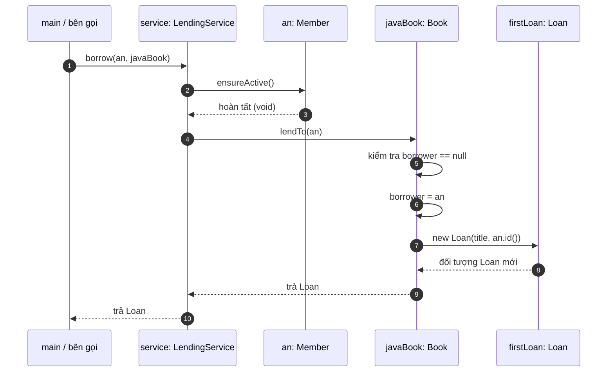
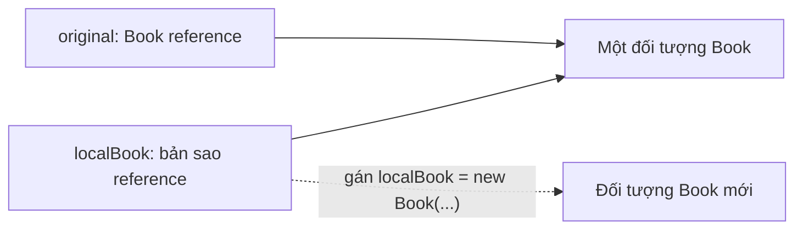
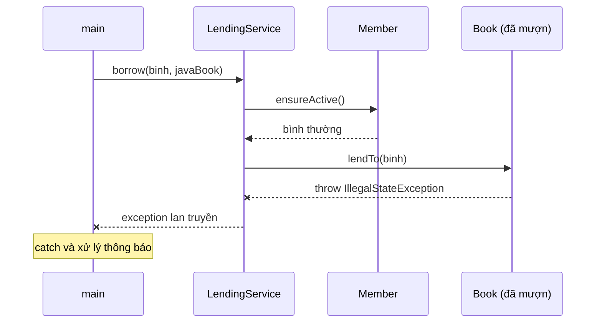

# Tương tác giữa đối tượng và lời gọi phương thức trong OOP

Giả sử một bạn đọc đến thư viện và nói: “Tôi muốn mượn cuốn sách này”. Ở đời thực, bạn đọc không tự vào hệ thống đổi trạng thái sách thành “đã mượn”. Thủ thư tiếp nhận yêu cầu, kiểm tra tư cách bạn đọc, kiểm tra sách còn sẵn và ghi nhận lần mượn.

Trong chương trình hướng đối tượng cũng vậy: **một đối tượng thường không tự làm tất cả mọi việc**. Nó sử dụng những đối tượng khác bằng cách **gọi phương thức** để yêu cầu chúng thực hiện phần việc thuộc trách nhiệm của chúng.

Ví dụ, `LendingService` nhận yêu cầu mượn sách, hỏi `Member` xem thành viên có được phép mượn không, rồi yêu cầu `Book` ghi nhận người mượn và nhận về `Loan` (phiếu mượn). Đó là một **cuộc tương tác giữa các đối tượng**.

Bài học này giúp bạn đọc một dòng Java như `book.lendTo(member)` và hiểu điều gì đang diễn ra: **ai gọi, ai nhận, truyền thông tin gì, phương thức chạy ở đâu, trả lại điều gì, trạng thái có thể thay đổi ra sao và khi có lỗi thì chuyện gì xảy ra**.

## 1. Tương tác giữa đối tượng là gì?

Trong OOP, **tương tác giữa đối tượng (object interaction)** là việc các đối tượng phối hợp để thực hiện một hành vi hoặc một quy trình. Một đối tượng có thể gọi phương thức của đối tượng khác để hỏi thông tin, yêu cầu kiểm tra, thay đổi trạng thái hoặc thực hiện một tác vụ.

Hãy hình dung:

```text
Người dùng
   |
   | Yêu cầu mượn sách
   v
LendingService
   |                       |
   | ensureActive()        | lendTo(member)
   v                       v
 Member                   Book
                           |
                           | tạo phiếu mượn
                           v
                          Loan
```

Không phải mũi tên nào cũng là một luồng mạng. Với Java thông thường, `member.ensureActive()` là **một lời gọi phương thức trực tiếp trong cùng tiến trình**, thực hiện đồng bộ trên luồng hiện tại. Từ “gửi thông điệp” thường dùng trong mô tả OOP mang tính **khái niệm**: đối tượng A yêu cầu đối tượng B làm việc qua giao diện công khai của B. Nó không nhất thiết có nghĩa là gửi Kafka message, HTTP request hay chạy bất đồng bộ.

### Bốn yếu tố của một lời gọi

Xét:

```java
Loan loan = book.lendTo(member);
```

| Thành phần | Trong ví dụ | Ý nghĩa |
|---|---|---|
| **Bên gọi (caller)** | Đoạn mã đang chạy trong `LendingService` | Nơi phát sinh yêu cầu |
| **Bên nhận (receiver / target object)** | Đối tượng mà biến `book` đang tham chiếu | Đối tượng thực thi hành vi `lendTo` |
| **Phương thức + đối số** | `lendTo(member)` | Hành vi được yêu cầu và dữ liệu đầu vào |
| **Kết quả (result)** | Một đối tượng `Loan` được gán vào `loan` | Giá trị trả lại sau khi chạy thành công |

Nếu phương thức không thể hoàn thành và ném exception thì dòng gán kết quả **không hoàn tất**. Tùy thiết kế, một phương thức cũng có thể thay đổi trạng thái mà không trả về giá trị (kiểu `void`), hoặc chỉ đọc dữ liệu mà không thay đổi gì.

## 2. Một ví dụ Java hoàn chỉnh: hệ thống mượn sách tối giản

Bốn vai trò xuất hiện trong quy trình:

- `Member` biết thông tin và trạng thái hoạt động của thành viên.
- `Book` biết cuốn sách hiện đang được ai mượn.
- `LendingService` điều phối thao tác mượn.
- `Loan` là kết quả ghi nhận thông tin của lần mượn, dùng `record` bất biến trong ví dụ.

Tạo file `Main.java` sau (Java 17 trở lên):

```java
import java.util.Objects;

public class Main {

    static final class Member {
        private final String id;
        private final boolean active;

        Member(String id, boolean active) {
            if (id == null || id.isBlank()) {
                throw new IllegalArgumentException("Member id is required");
            }
            this.id = id;
            this.active = active;
        }

        String id() {
            return id;
        }

        void ensureActive() {
            if (!active) {
                throw new IllegalStateException("Member is inactive");
            }
        }
    }

    static final class Book {
        private final String title;
        private Member borrower; // null nghĩa là chưa có người mượn

        Book(String title) {
            if (title == null || title.isBlank()) {
                throw new IllegalArgumentException("Title is required");
            }
            this.title = title;
        }

        boolean isAvailable() {
            return borrower == null;
        }

        Loan lendTo(Member member) {
            Objects.requireNonNull(member, "member");

            if (borrower != null) {
                throw new IllegalStateException("Book is already borrowed");
            }

            borrower = member;
            return new Loan(title, member.id());
        }
    }

    record Loan(String bookTitle, String memberId) {}

    static final class LendingService {
        Loan borrow(Member member, Book book) {
            Objects.requireNonNull(member, "member");
            Objects.requireNonNull(book, "book");

            member.ensureActive();
            return book.lendTo(member);
        }
    }

    public static void main(String[] args) {
        Member an = new Member("M01", true);
        Member binh = new Member("M02", true);
        LendingService service = new LendingService();
        Book javaBook = new Book("Java căn bản");

        // Lần 1: mượn thành công.
        Loan firstLoan = service.borrow(an, javaBook);
        System.out.println(firstLoan.bookTitle()
                + " -> " + firstLoan.memberId());
        System.out.println(javaBook.isAvailable());

        // Lần 2: thử mượn chính cuốn sách đó.
        try {
            service.borrow(binh, javaBook);
        } catch (IllegalStateException e) {
            System.out.println(e.getMessage());
        }
        System.out.println(javaBook.isAvailable());

        // Trường hợp độc lập: thành viên không hoạt động.
        Member inactive = new Member("M03", false);
        Book otherBook = new Book("Clean Code");
        try {
            service.borrow(inactive, otherBook);
        } catch (IllegalStateException e) {
            System.out.println(e.getMessage());
        }
        System.out.println(otherBook.isAvailable());
    }
}
```

Chạy với:

```bash
javac Main.java
java Main
```

Kết quả dự kiến:

```text
Java căn bản -> M01
false
Book is already borrowed
false
Member is inactive
true
```

Các lời gọi mượn trên cùng `javaBook` **chia sẻ trạng thái của một đối tượng sách**. Sau lần mượn đầu tiên, `javaBook` không còn sẵn; lần mượn thứ hai ném lỗi và người mượn ban đầu được giữ nguyên. Trường hợp thành viên `inactive` sử dụng **một đối tượng `otherBook` mới**, nên sách đó vẫn sẵn sau khi bị từ chối.

Đây là mô hình trong bộ nhớ để học tương tác. Chưa có cơ sở dữ liệu, xử lý trả sách, giao dịch, phân quyền hay đảm bảo an toàn khi nhiều luồng cùng mượn một sách.

## 3. Theo dõi chính xác một lời gọi diễn ra thế nào

Dòng quan trọng nhất ở `main` là:

```java
Loan firstLoan = service.borrow(an, javaBook);
```

Hãy lần theo các bước:

1. `main` đang giữ ba **tham chiếu**: `service` trỏ tới một `LendingService`, `an` trỏ tới một `Member`, `javaBook` trỏ tới một `Book`.
2. Java thực thi lời gọi `borrow(an, javaBook)` trên đối tượng được tham chiếu bởi `service`. Giá trị các đối số được chuyển cho tham số `member` và `book` của phương thức.
3. Trong `borrow`, câu lệnh `member.ensureActive()` gọi phương thức **của chính đối tượng thành viên `an`**. Đối tượng này kiểm tra trạng thái `active` và trở về bình thường vì thành viên đang hoạt động.
4. `book.lendTo(member)` gọi `lendTo` trên **chính đối tượng `javaBook`**. Cuốn sách thấy `borrower == null`, nên gán `borrower = member`.
5. `Book` tạo một `Loan` chứa tên sách và mã thành viên, rồi trả về cho `LendingService`.
6. `LendingService` dùng `return` chuyển tiếp kết quả về `main`; `main` nhận được tham chiếu tới `Loan` và gán vào `firstLoan`.



Sơ đồ này mô tả thứ tự gọi, xử lý và trả kết quả. Mỗi đối tượng **chịu trách nhiệm cho trạng thái của chính nó**, ví dụ thành viên kiểm tra `active`, sách kiểm tra `borrower`.

### Ai đang chạy code tại từng thời điểm?

Khi đang ở thân phương thức `LendingService.borrow`, biến `this` tham chiếu tới đối tượng `service`. Khi nhảy vào `Member.ensureActive`, `this` trở thành đối tượng `an`. Khi vào `Book.lendTo`, `this` là `javaBook`.

```java
// Trong Book:
Loan lendTo(Member member) {
    // "this" là đối tượng Book đang được gọi.
    // "member" là tham chiếu tới đối tượng Member được truyền vào.
    // ...
}
```

Vì thế, `this.borrower` và `member.id()` truy cập **hai đối tượng khác nhau**. `this` không phải là “đối tượng khởi đầu cả quy trình”; nó là đối tượng nhận **lời gọi phương thức hiện tại**.

## 4. Phân biệt biến tham chiếu và đối tượng thực sự

Trong Java, với các kiểu tham chiếu như `Book`, `Member`, `Loan`, biến chứa **tham chiếu**, không chứa nguyên bản toàn bộ đối tượng.

```java
Book first = new Book("Java căn bản");
Book second = first;

System.out.println(first == second); // true
```

`first` và `second` trỏ tới **cùng một đối tượng `Book`**. Nếu một lời gọi hợp lệ qua `first` làm thay đổi đối tượng, thì đọc trạng thái qua `second` cũng thấy sự thay đổi đó.

```java
Book a = new Book("Java căn bản");
Book b = new Book("Java căn bản");

System.out.println(a == b); // false
```

Hai sách có cùng tên vẫn có thể là **hai đối tượng độc lập**. Biểu thức `==` trên tham chiếu kiểm tra chúng có trỏ tới cùng một object hay không. Nó không tự động so sánh nội dung. Nếu muốn so sánh giá trị theo nghiệp vụ, cần quy tắc `equals()` thích hợp; không nên đánh đồng “tên sách giống nhau” với “cùng bản sao sách”.

### Java truyền tham số theo giá trị, kể cả tham chiếu

Đây là điểm dễ nhầm khi thấy lời gọi phương thức làm thay đổi đối tượng.

```java
static void reassign(Book localBook) {
    localBook = new Book("Sách khác");
}

static void borrowThroughReference(Book localBook, Member member) {
    localBook.lendTo(member);
}
```

Với `reassign(original)`, phương thức nhận **bản sao giá trị tham chiếu**, rồi đổi biến cục bộ `localBook` sang đối tượng mới; biến `original` của bên gọi vẫn trỏ tới sách ban đầu. Với `borrowThroughReference(original, member)`, cả `localBook` và `original` cùng trỏ tới một sách, nên `lendTo` làm đổi **trạng thái đối tượng chung**. Điều này vẫn đúng với nguyên tắc **Java luôn truyền tham số theo giá trị (pass-by-value)**.



Sau phép gán ở dòng nét đứt, `localBook` trỏ tới object mới trong phạm vi phương thức, còn `original` vẫn trỏ tới object cũ.

## 5. Đọc cú pháp lời gọi phương thức

Nhìn vài dòng quen thuộc:

```java
book.isAvailable();
book.lendTo(member);
member.ensureActive();
String id = member.id();
Loan loan = service.borrow(member, book);
```

| Cú pháp | Cách đọc | Điều cần quan sát |
|---|---|---|
| `book.isAvailable()` | Hỏi sách còn sẵn không | Trả `boolean`; chỉ đọc trạng thái trong ví dụ |
| `book.lendTo(member)` | Yêu cầu sách ghi nhận thành viên mượn | Trả `Loan`; thay đổi trạng thái sách |
| `member.ensureActive()` | Yêu cầu thành viên tự kiểm tra điều kiện | `void`; có thể ném exception |
| `member.id()` | Lấy mã thành viên | Trả `String`; không đổi trạng thái |
| `service.borrow(member, book)` | Yêu cầu service điều phối mượn | Gọi tiếp các đối tượng khác; trả `Loan` |

Một lời gọi nhìn chung có dạng:

```java
receiver.methodName(argument1, argument2);
```

- **Receiver**: đối tượng bên nhận mà biểu thức bên trái dấu chấm đánh giá ra.
- **Tên phương thức**: hành vi cần thực hiện.
- **Đối số (arguments)**: giá trị được bên gọi cung cấp ở vị trí lời gọi.
- **Tham số (parameters)**: các biến được khai báo tại định nghĩa phương thức để nhận các giá trị đó.
- **Kiểu trả về (return type)**: quy định phương thức có thể trả loại giá trị nào; `void` là không trả giá trị.

Ví dụ phân biệt argument/parameter:

```java
// "member" là parameter trong khai báo:
Loan lendTo(Member member) { /* ... */ }

// "an" là argument ở chỗ gọi:
Loan loan = javaBook.lendTo(an);
```

Tên `an` và `member` không cần giống nhau. Điều cần phù hợp là kiểu đối số và chữ ký phương thức theo quy tắc của Java.

Một lời gọi cũng có thể **không viết tường minh receiver** khi gọi phương thức instance trong cùng class, ví dụ trong `Book` có `isAvailable()`; Java hiểu tương đương `this.isAvailable()` khi không có xung đột tên. Còn lời gọi như `Math.max(4, 7)` là **phương thức static** qua tên lớp: không có đối tượng `Math` cụ thể làm receiver.

## 6. Lời gọi có thể trả kết quả, đổi trạng thái hoặc phát sinh lỗi

### Trường hợp A — chỉ trả về thông tin

```java
boolean available = javaBook.isAvailable();
```

Theo cách chúng ta đã viết, phương thức này **không sửa** trạng thái của sách, chỉ đọc `borrower`. Những phương thức có tính quan sát thường mang tên `get...`, `is...`, `find...`, `calculate...`, nhưng **tên gọi không tự bảo đảm không có side effect**. Phải xem hợp đồng và cách triển khai.

### Trường hợp B — thay đổi trạng thái, có trả kết quả

```java
Loan loan = javaBook.lendTo(an);
```

Nếu sách còn sẵn, `borrower` được gán sang `an` và trả về `Loan`. Có hai điều khác nhau:

- **Side effect:** đối tượng `javaBook` đã đổi trạng thái.
- **Return value:** bên gọi nhận về một đối tượng `Loan` để sử dụng tiếp.

Giá trị `Loan` được trả về **không phải chính đối tượng `Book`**, và nó không tự biến mất khi phương thức `lendTo` kết thúc. Nếu bên gọi còn giữ tham chiếu, đối tượng `Loan` còn có thể được sử dụng sau đó. Dữ liệu trong `record Loan` là thông tin của lần mượn đã tạo; nó không tự động cập nhật theo mọi thay đổi tương lai của cuốn sách.

### Trường hợp C — kiểm tra và trả `void`

```java
an.ensureActive();
```

Khi thành viên hoạt động, phương thức hoàn thành bình thường, không trả một giá trị Java cụ thể. `void` **không có nghĩa** là không làm gì: một `void` method có thể ghi trạng thái, gửi sự kiện, ghi log hoặc ném lỗi.

### Trường hợp D — lời gọi ném exception

```java
service.borrow(binh, javaBook); // sách đã có người mượn
```

`Book.lendTo` kiểm tra `borrower != null` rồi `throw new IllegalStateException(...)`. Vì vậy `lendTo` không chạy tới `return new Loan(...)`, `LendingService.borrow` cũng không có giá trị hợp lệ để trả về. Exception lan ngược tới `main`; khối `catch` bắt lỗi và chương trình tiếp tục.



**Exception không tự hoàn tác mọi side effect đã xảy ra trước đó.** Ví dụ nếu `LendingService` đã gọi hai phương thức sửa hai đối tượng, sau đó lời gọi thứ ba ném lỗi, hai thay đổi đầu vẫn có thể tồn tại. Với dữ liệu lưu trong database, tính nguyên tử phụ thuộc vào transaction và cấu hình thực tế. Đừng hiểu `throw` là “rollback tất cả”.

## 7. Lời gọi nối tiếp, gọi lồng nhau và call stack

Trong `LendingService.borrow`, trước khi tạo được phiếu mượn, chương trình gọi tiếp `Member.ensureActive` rồi `Book.lendTo`. Đó là **gọi lồng nhau (nested calls)**: một phương thức chưa kết thúc đã gọi phương thức khác.

Hình dung call stack khi đang thực thi `Book.lendTo`:

```text
       Đỉnh stack — lời gọi đang chạy
       +-----------------------------+
       | Book.lendTo(member)         |
       +-----------------------------+
       | LendingService.borrow(...)  |
       +-----------------------------+
       | Main.main(args)             |
       +-----------------------------+
       Đáy stack
```

Mỗi lời gọi thông thường tạo một *stack frame* để giữ ngữ cảnh thực thi như biến cục bộ và vị trí trở về (chi tiết do JVM thực hiện). Khi `lendTo` hoàn thành, lời gọi trở về `borrow`; khi `borrow` hoàn thành, nó trở về `main`.

Điều này giải thích vì sao:

- Sau khi `member.ensureActive()` kết thúc, `borrow` tiếp tục ở câu lệnh tiếp theo.
- Sau `return book.lendTo(member)`, kết quả của `lendTo` trở thành kết quả của `borrow`.
- Khi exception không được xử lý ở tầng trong, JVM tháo các frame liên quan và tìm nơi bắt exception phù hợp.

Mỗi phương thức có thể được nhiều nơi gọi; **thứ tự thực thi thực tế được quyết định bởi luồng gọi**, không phải bởi thứ tự các class nằm trong file.

## 8. Phương thức là một hợp đồng giữa các đối tượng

Nếu `LendingService` muốn yêu cầu `Book` cho mượn, nó cần biết **cách gọi và hành vi được cam kết**. Đó là *method contract*.

Với:

```java
Loan lendTo(Member member)
```

Một hợp đồng rõ ràng nên trả lời:

| Thành phần hợp đồng | Nội dung trong ví dụ |
|---|---|
| Điều kiện trước (*precondition*) | `member` không null; sách chưa được mượn |
| Kết quả khi thành công | Trả `Loan` chứa tên sách và mã thành viên |
| Trạng thái sau (*postcondition*) | `Book.borrower` tham chiếu tới thành viên vừa mượn |
| Khi không thể hoàn thành | Ném `NullPointerException` với member null hoặc `IllegalStateException` khi sách đã mượn |
| Điều cần giữ đúng (*invariant*) | Trong mô hình này, một đối tượng `Book` có tối đa một `borrower` tại một thời điểm (theo xử lý tuần tự) |

**Method signature** trong Java chủ yếu liên quan tên phương thức và danh sách kiểu tham số để Java xác định lời gọi; **method contract** rộng hơn, bao gồm ý nghĩa nghiệp vụ, điều kiện hợp lệ, tác động trạng thái, lỗi và hành vi bên ngoài có thể dựa vào. Hai phương thức có chữ ký giống nhau vẫn có thể vi phạm hợp đồng nếu cách thực hiện khác nhau.

Những phương thức có tên rõ ràng như `lendTo(member)`, `ensureActive()`, `isAvailable()` giúp đoạn mã đọc gần với lời nói nghiệp vụ. Ngược lại, một API chỉ phơi ra setter:

```java
book.setBorrower(member);
book.setAvailable(false);
book.setLoanCount(book.getLoanCount() + 1);
```

sẽ buộc **bên gọi biết quá nhiều chi tiết phải cập nhật theo thứ tự nào**. Nếu bỏ sót một dòng, trạng thái có thể lệch nhau. Một phương thức thể hiện trọn hành vi nghiệp vụ giúp tập trung các quy tắc liên quan, miễn là bản thân phương thức đó được thiết kế đúng.

## 9. Quan hệ giữa đối tượng và quyền kiểm soát trạng thái

Tương tác tốt không đồng nghĩa đối tượng A được quyền sửa mọi field của đối tượng B. Với:

```java
private Member borrower;
```

đối tượng khác không thể viết `javaBook.borrower = binh` bằng truy cập Java thông thường. Nó phải sử dụng phương thức mà `Book` cung cấp. Như vậy `Book` có cơ hội kiểm tra quy tắc riêng của nó trước khi đổi trạng thái.

Tuy nhiên, **`private` mới chỉ là kiểm soát truy cập**. Nếu lớp vẫn phơi những phương thức nguy hiểm như `setBorrower` mà không kiểm tra hợp lệ, ta có thể tiếp tục làm hỏng mô hình. Ngược lại, có những loại đối tượng chỉ lưu dữ liệu, như DTO hoặc `record Loan` của ví dụ, mà không cần chứa nhiều hành vi nghiệp vụ.

### Vì sao service và entity không nên làm thay toàn bộ công việc của nhau?

Trong ví dụ:

- `Member` sở hữu điều kiện thành viên có hoạt động không.
- `Book` sở hữu trạng thái đã có người mượn chưa.
- `LendingService` quyết định thứ tự phối hợp để thực hiện yêu cầu mượn.

Một điểm cần thấy ở phiên bản rút gọn: `Book.lendTo` tự kiểm tra sách đã được mượn nhưng **không tự kiểm tra thành viên còn hoạt động**; quy tắc này đang được `LendingService` kiểm tra. Nếu hệ thống để mọi nơi tự gọi `book.lendTo(inactiveMember)`, chúng có thể bỏ qua quy trình ở service. Một thiết kế thực tế phải định nghĩa **đường vào nghiệp vụ được phép** hoặc chuyển các kiểm tra bắt buộc vào một điểm không thể bỏ qua. Phân chia trách nhiệm tốt cần cân bằng giữa việc giữ quy tắc tại “chủ sở hữu” và hạn chế đường đi có thể phá quy tắc.

Đó là lý do phải đặt câu hỏi: **“Đối tượng này được phép yêu cầu gì từ đối tượng kia?”**, chứ không chỉ “hai đối tượng có gọi nhau được không?”.

## 10. Khi cùng một lời gọi có nhiều cách thực hiện

Giả sử thư viện gửi thông báo qua email hoặc qua ứng dụng. Bên điều phối chỉ cần hành vi `send`:

```java
interface Notifier {
    void send(String memberId, String message);
}

class EmailNotifier implements Notifier {
    @Override
    public void send(String memberId, String message) {
        System.out.println("Email to " + memberId + ": " + message);
    }
}

class AppNotifier implements Notifier {
    @Override
    public void send(String memberId, String message) {
        System.out.println("App to " + memberId + ": " + message);
    }
}

class ReminderService {
    private final Notifier notifier;

    ReminderService(Notifier notifier) {
        this.notifier = notifier;
    }

    void remind(String memberId) {
        notifier.send(memberId, "Please return your book");
    }
}
```

Đoạn này minh họa riêng việc phối hợp và có thể thêm vào project cùng file theo cách tổ chức lớp phù hợp. `ReminderService` giữ tham chiếu với **kiểu khai báo `Notifier`**, trong khi đối tượng thực tế có thể là `EmailNotifier` hoặc `AppNotifier`. Khi chạy `notifier.send(...)`, Java chọn phương thức được override theo **kiểu thực tế của đối tượng**. Đây là một ví dụ của **đa hình khi gọi phương thức (runtime polymorphism)**.

Cách tổ chức này hữu ích khi thực sự cần thay đổi cách thông báo. Nếu dự án luôn có đúng một cách gửi và không có nhu cầu thay thế, không bắt buộc tạo interface chỉ để trông “đúng OOP”.

Cần phân biệt:

- **Overloading:** các phương thức cùng tên nhưng danh sách tham số khác nhau; Java quyết định phiên bản phù hợp chủ yếu dựa trên kiểu biểu thức ở thời điểm biên dịch.
- **Overriding:** lớp con hoặc lớp triển khai cung cấp cách thực hiện khác cho phương thức có hợp đồng tương ứng; với phương thức instance được override, đối tượng thực tế quyết định cách thực hiện ở runtime.

Cả hai đều liên quan lời gọi, nhưng không phải cùng một cơ chế.

## 11. Những nhầm lẫn phổ biến khi đọc các lời gọi OOP

| Nhận định | Chính xác hơn |
|---|---|
| “Gọi phương thức đối tượng khác là gửi message qua mạng.” | Thường chỉ là một lời gọi Java trong tiến trình; truyền thông qua mạng là cơ chế riêng. |
| “Nếu phương thức trả `void`, nó không có tác dụng gì.” | `void` chỉ nói rằng không có **giá trị trả về**; phương thức vẫn có thể đổi trạng thái hoặc ném lỗi. |
| “Truyền object vào hàm là truyền trực tiếp object theo tham chiếu.” | Java copy **giá trị tham chiếu**. Có thể thay đổi cùng một object qua bản sao tham chiếu, nhưng gán lại tham số không đổi biến bên gọi. |
| “Hai biến khác tên luôn là hai object khác nhau.” | Hai biến có thể cùng tham chiếu một object. |
| “Phương thức đọc dữ liệu luôn không làm thay đổi gì.” | Phải dựa trên hợp đồng và mã; phương thức có tên `get...` vẫn có thể có side effect nếu được viết như vậy. |
| “Method có exception sẽ hoàn tác mọi thay đổi.” | Exception chỉ làm thay đổi luồng điều khiển; hoàn tác cần thiết kế hoặc cơ chế transaction thích hợp. |
| “Tạo thật nhiều method gọi qua lại là thiết kế OOP tốt.” | Chất lượng nằm ở ranh giới trách nhiệm, tính nhất quán và khả năng hiểu luồng tương tác. |
| “Dùng `private` thì không cần quan tâm concurrency.” | Che giấu field không tạo tính nguyên tử giữa nhiều luồng hoặc nhiều tiến trình. |

### Một lỗi rất thường gặp: receiver là `null`

```java
Book book = null;
book.isAvailable(); // NullPointerException
```

Chương trình chưa có đối tượng `Book` nào để nhận lời gọi. Trước khi gọi, cần bảo đảm receiver tồn tại qua quy tắc khởi tạo, kiểm tra `null` hoặc thiết kế API phù hợp. Với phương thức instance thông thường, không thể gửi hành vi tới một receiver `null`.

### Một lỗi khác: hiểu sai chuỗi lời gọi

```java
service.borrow(member, book).memberId();
```

Biểu thức này làm hai việc theo thứ tự: `service.borrow` chạy **trước**, trả `Loan` nếu thành công, sau đó mới gọi `memberId()` trên `Loan`. Nếu `borrow` ném exception, lời gọi `memberId()` **không bao giờ diễn ra**. Chaining giúp viết gọn nhưng có thể che khuất side effect, nên với những hành vi thay đổi trạng thái, tách dòng thường dễ đọc và gỡ lỗi hơn.

## 12. Tự suy luận trước khi chạy code

**Câu 1.** `Member an` được truyền vào `service.borrow(an, book)`. Ở trong `borrow`, tên tham số là `member`. Đây có phải một thành viên mới được tạo không?

> Không. `member` nhận một bản sao giá trị tham chiếu tới cùng đối tượng mà `an` đang trỏ tới. Chỉ câu lệnh `new Member(...)` (hoặc một cơ chế tạo tương ứng) mới tạo thêm đối tượng.

**Câu 2.** Sau `service.borrow(an, javaBook)` thành công, gọi `javaBook.isAvailable()` trả `false`. Phương thức nào làm trạng thái thay đổi?

> `Book.lendTo` thực hiện `borrower = member`. `LendingService.borrow` chỉ là nơi điều phối lời gọi; `isAvailable` quan sát trạng thái sau đó.

**Câu 3.** Khi sách đã được mượn, `service.borrow(binh, javaBook)` thất bại. Lời gọi `new Loan(...)` ở trong `Book.lendTo` có thực thi không?

> Không. `throw` xảy ra trước câu lệnh tạo `Loan`. Trạng thái `borrower` vẫn là người mượn trước đó trong ví dụ tuần tự này.

**Câu 4.** Đổi `Book other = javaBook` rồi thử mượn `other` có tạo ra sách thứ hai không?

> Không. `other` và `javaBook` cùng tham chiếu cuốn sách đã tồn tại; trạng thái là chung.

**Câu 5.** Bạn thêm tính năng “thành viên bị khóa không được mượn sách”. Nên đặt kiểm tra ở mọi nút bấm giao diện hay trong lớp nghiệp vụ có đường đi dùng chung?

> Kiểm tra giao diện chỉ phục vụ trải nghiệm; quy tắc bắt buộc phải được thực thi ở tầng nghiệp vụ có quyền quyết định giao dịch mượn. Trong mô hình này `Member.ensureActive()` chứa phép kiểm tra và `LendingService.borrow` bắt buộc gọi nó. Khi mở rộng, cần bảo đảm không tồn tại đường mượn khác bỏ qua điều kiện này.

## 13. Bài tập thực hành nhỏ

Dựa trên `Main.java` phía trên, hãy thêm tính năng **trả sách** theo yêu cầu:

- `Book.returnBy(Member member)` chỉ cho phép người đang mượn trả sách; nếu không khớp, từ chối với thông báo rõ ràng.
- Nếu thành công, cập nhật `borrower = null` để `isAvailable()` trả `true`.
- `LendingService.returnBook(member, book)` điều phối lời gọi vào `Book`.
- Trong `main`, kiểm thử ba tình huống tách bạch: mượn xong trả đúng người; người khác trả hộ bị từ chối; trả sách chưa ai mượn bị từ chối.

Trước khi viết, tự trả lời: **“Ai nên giữ quy tắc chỉ người đang mượn mới được trả?”** `Book` là nơi hợp lý trong mô hình này vì nó trực tiếp quản lý `borrower`.

Có thể vẽ chuỗi `main → LendingService → Book → main` cho cả đường thành công lẫn thất bại. Chú ý dùng những đối tượng sách mới giữa các bài kiểm thử độc lập để tránh trạng thái của một trường hợp ảnh hưởng đến trường hợp khác.

## 14. Điều cần ghi nhớ

Khi đọc một lời gọi OOP, hãy lần lượt xác định:

1. **Đối tượng nào là receiver?** Nó có thực sự tồn tại và đang có trạng thái gì?
2. **Ai là caller?** Tại sao caller cần nhờ đối tượng đó thực hiện hành vi?
3. **Thông tin nào được truyền?** Phân biệt argument tại nơi gọi với parameter trong thân phương thức; nhớ quy tắc pass-by-value.
4. **Phương thức bảo đảm điều gì?** Điều kiện hợp lệ, trạng thái trước/sau, side effect, kết quả trả về hoặc exception.
5. **Sau lời gọi thì đi đâu?** Trả về caller để tiếp tục, gọi tiếp đối tượng khác, hay ném exception lên tầng trên?

**Tương tác giữa đối tượng** chính là cách những trách nhiệm riêng lẻ kết hợp thành một nghiệp vụ hoàn chỉnh. Lời gọi phương thức là cơ chế chủ yếu để biểu diễn sự phối hợp đó trong Java. Khi bạn có thể lần theo `caller → receiver → hành vi → thay đổi trạng thái → kết quả`, bạn sẽ đọc và thiết kế các luồng OOP rõ ràng hơn rất nhiều.