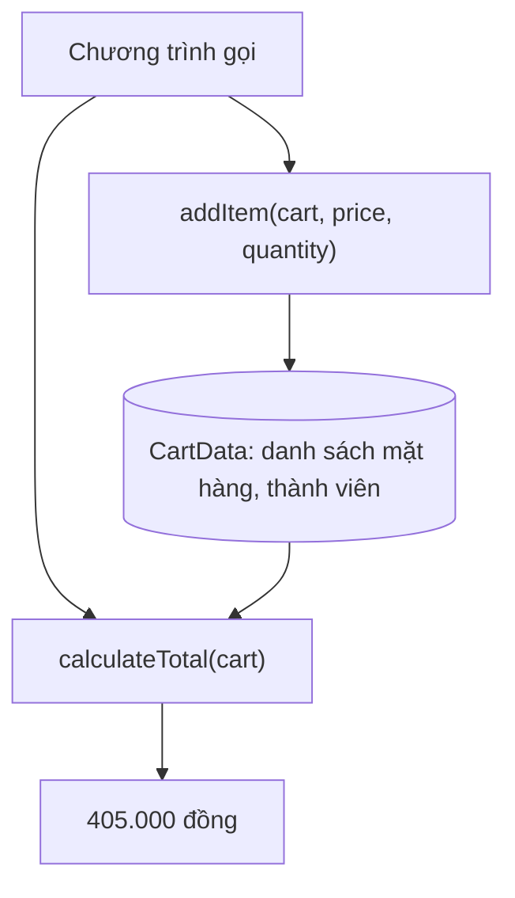
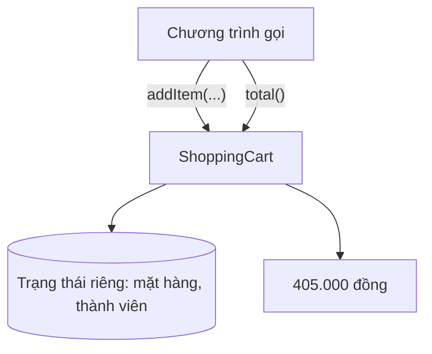
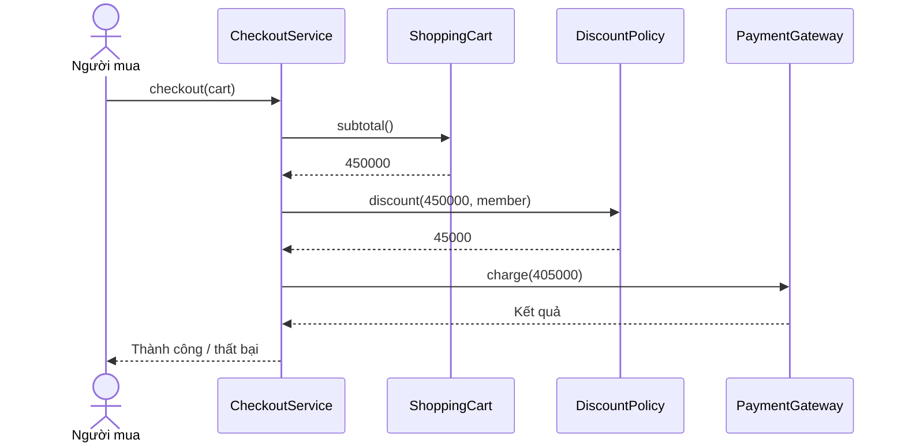

# OOP và lập trình thủ tục: cách phân chia bài toán

Giả sử bạn nhận yêu cầu: **“Xây dựng chức năng giỏ hàng, cho phép thêm sản phẩm và tính số tiền phải thanh toán. Thành viên được giảm 10%.”**

Bạn sẽ bắt đầu thiết kế từ đâu?

- Có thể liệt kê **các bước cần thực hiện**: nhận dữ liệu → kiểm tra → thêm mặt hàng → cộng tiền → áp dụng giảm giá → trả kết quả.
- Cũng có thể xác định **những đối tượng chịu trách nhiệm**: giỏ hàng quản lý các mặt hàng của nó, chính sách giá quyết định mức giảm, dịch vụ thanh toán điều phối việc trả tiền.

Đó là hai hướng phân chia bài toán thường gặp trong **lập trình thủ tục (procedural programming)** và **lập trình hướng đối tượng (object-oriented programming, OOP)**. Cả hai đều có thể giải đúng một yêu cầu, dùng vòng lặp, điều kiện, hàm và cấu trúc dữ liệu. Điểm khác biệt đáng học là **ta tổ chức dữ liệu, thao tác và trách nhiệm ở đâu**, từ đó chương trình dễ đọc và dễ thay đổi theo hướng nào.

## 1. “Phân chia bài toán” thực chất là gì?

Một yêu cầu nghiệp vụ thường chứa nhiều việc nhỏ: kiểm tra đầu vào, lưu trạng thái, tính toán, thông báo kết quả, ghi dữ liệu hoặc gọi hệ thống khác. Việc phân chia bài toán là quyết định **mỗi phần của mã nguồn đảm nhận trách nhiệm nào**, các phần giao tiếp ra sao và khi yêu cầu thay đổi thì phải sửa ở đâu.

Chẳng hạn, với giỏ hàng:

1. Giỏ hàng phải giữ danh sách những mặt hàng đã thêm.
2. Số lượng của mỗi mặt hàng phải lớn hơn 0; đơn giá không âm.
3. Thành tiền của mặt hàng bằng đơn giá nhân số lượng.
4. Tổng trước giảm giá là tổng thành tiền của các mặt hàng.
5. Thành viên được giảm 10% trên tổng trước giảm giá.
6. Trả về số tiền cuối cùng, không âm.

Quy tắc tính tiền này **không đổi** giữa hai cách tổ chức. Ta thay đổi cách đặt mã và cách các thành phần phối hợp, từ đó thấy được tác dụng của thiết kế.

| Câu hỏi thiết kế | Hướng thủ tục thường hỏi | Hướng OOP thường hỏi |
| --- | --- | --- |
| Bắt đầu phân rã từ đâu? | “Cần những bước/hàm nào?” | “Có những thực thể nào? Ai chịu trách nhiệm cho việc gì?” |
| Dữ liệu đặt ở đâu? | Trong biến, cấu trúc dữ liệu hoặc bản ghi truyền qua các hàm | Trong trạng thái của đối tượng hoặc giá trị được đối tượng quản lý |
| Hành vi đặt ở đâu? | Trong các hàm/thủ tục hoạt động trên dữ liệu | Trong phương thức và các đối tượng cộng tác |
| Thành phần phối hợp thế nào? | Hàm gọi hàm, truyền và nhận dữ liệu | Đối tượng gửi lời gọi tới các đối tượng khác; một luồng điều phối vẫn có thể gọi nhiều phương thức |
| Đổi quy tắc nghiệp vụ thì sao? | Tìm các hàm xử lý quy tắc | Tìm đối tượng/chính sách sở hữu trách nhiệm tương ứng |

**Đây là xu hướng tổ chức, không phải ranh giới tuyệt đối.** Java dù viết theo hướng thủ tục vẫn dùng `class` để chứa mã; OOP vẫn dùng `if`, `for`, thuật toán và những hàm phục vụ tính toán. Một hệ thống thực tế thường kết hợp nhiều cách tiếp cận.

## 2. Cùng một yêu cầu, hai cách đặt trách nhiệm

### 2.1. Phân chia theo thủ tục: dữ liệu đi qua các bước xử lý

Trong hướng này, ta có thể nghĩ tới:

- `CartData`: chứa dữ liệu giỏ hàng.
- `addItem(cart, price, quantity)`: kiểm tra rồi thêm mặt hàng.
- `calculateTotal(cart)`: đọc dữ liệu giỏ hàng, cộng tiền và áp dụng giảm giá.
- `main`: gọi các bước theo thứ tự cần thiết.

Hình dung luồng:



Hàm nhận dữ liệu cần thiết qua tham số. Các hàm có thể trả kết quả hoặc cập nhật cấu trúc dữ liệu. Điều này thuận tiện khi ta đang giải một **quy trình tuần tự rõ ràng** hay thực hiện phép biến đổi dữ liệu từ đầu vào sang đầu ra.

Điểm cần để ý: nếu nhiều phần chương trình có quyền sửa trực tiếp `CartData`, chúng có thể đi vòng qua bước kiểm tra. Hướng thủ tục **vẫn có thể bảo vệ dữ liệu** bằng phạm vi truy cập, mô-đun, kiểu bất biến hoặc quy tắc chỉ sửa thông qua hàm; việc để dữ liệu công khai chỉ là một lựa chọn thiết kế.

### 2.2. Phân chia theo OOP: giao trách nhiệm cho đối tượng

Với OOP, ta có thể tạo một đối tượng `ShoppingCart` chịu trách nhiệm duy trì trạng thái giỏ hàng hợp lệ:

- `cart.addItem(price, quantity)`: giỏ hàng tự kiểm tra và thêm mặt hàng của chính nó.
- `cart.total()`: giỏ hàng tính số tiền dựa trên các mặt hàng và trạng thái thành viên của nó.
- Bên gọi không cần biết danh sách nội bộ được lưu bằng `ArrayList` hay dạng khác.



Ở đây, đối tượng vừa **quản lý trạng thái**, vừa **cung cấp những thao tác hợp lệ trên trạng thái đó**. Bên ngoài trao đổi qua phương thức của đối tượng, thay vì tự điều khiển mọi chi tiết bên trong.

Đừng hiểu là mỗi hành động phải nằm trong một đối tượng khổng lồ. Nếu tính chiết khấu có nhiều chiến lược, trách nhiệm đó có thể thuộc một `DiscountPolicy` riêng; `ShoppingCart` và chính sách giá sẽ cộng tác. Thiết kế OOP tốt phụ thuộc việc phân đúng trách nhiệm, không phụ thuộc số lượng lớp.

## 3. Ví dụ Java hoàn chỉnh: kết quả giống nhau, cấu trúc khác nhau

Đoạn mã dưới đây chứa **hai phương án độc lập để so sánh**, cùng tính hai mặt hàng: 2 sản phẩm giá 200.000 đồng và 1 sản phẩm giá 50.000 đồng; người mua là thành viên.

- Tổng trước giảm: `2 × 200.000 + 1 × 50.000 = 450.000` đồng.
- Giảm 10%: `45.000` đồng.
- Cần thanh toán: **405.000 đồng**.

Mã cố ý lặp lại cùng quy tắc nghiệp vụ trong hai phương án để bạn nhìn được khác biệt tổ chức. Trong sản phẩm thật, ta sẽ chỉ chọn một hướng thiết kế thích hợp cho phần đó.

```java
// Main.java — chạy với Java 11+
import java.util.ArrayList;
import java.util.List;

public class Main {

    // Chỉ giữ dữ liệu của một dòng sản phẩm.
    static final class ItemData {
        final long unitPrice;
        final int quantity;

        ItemData(long unitPrice, int quantity) {
            this.unitPrice = unitPrice;
            this.quantity = quantity;
        }
    }

    // PHƯƠNG ÁN A — THỦ TỤC
    // Dữ liệu và các thao tác xử lý được đặt ở hai nơi khác nhau.
    static final class CartData {
        final boolean member;
        final List<ItemData> items = new ArrayList<>();

        CartData(boolean member) {
            this.member = member;
        }
    }

    static final class CartProcedures {
        static void addItem(CartData cart, long price, int quantity) {
            if (price < 0 || quantity <= 0) {
                throw new IllegalArgumentException("Invalid item");
            }
            cart.items.add(new ItemData(price, quantity));
        }

        static long calculateTotal(CartData cart) {
            long subtotal = 0;
            for (ItemData item : cart.items) {
                long amount = Math.multiplyExact(
                    item.unitPrice, (long) item.quantity
                );
                subtotal = Math.addExact(subtotal, amount);
            }
            long discount = cart.member ? subtotal / 10 : 0;
            return subtotal - discount;
        }
    }

    // PHƯƠNG ÁN B — OOP
    // Giỏ hàng tự quản lý dữ liệu và những thao tác hợp lệ.
    static final class ShoppingCart {
        private final boolean member;
        private final List<ItemData> items = new ArrayList<>();

        ShoppingCart(boolean member) {
            this.member = member;
        }

        void addItem(long price, int quantity) {
            if (price < 0 || quantity <= 0) {
                throw new IllegalArgumentException("Invalid item");
            }
            items.add(new ItemData(price, quantity));
        }

        long total() {
            long subtotal = 0;
            for (ItemData item : items) {
                long amount = Math.multiplyExact(
                    item.unitPrice, (long) item.quantity
                );
                subtotal = Math.addExact(subtotal, amount);
            }
            long discount = member ? subtotal / 10 : 0;
            return subtotal - discount;
        }
    }

    public static void main(String[] args) {
        // A: truyền dữ liệu vào các hàm xử lý.
        CartData data = new CartData(true);
        CartProcedures.addItem(data, 200_000, 2);
        CartProcedures.addItem(data, 50_000, 1);
        System.out.println(CartProcedures.calculateTotal(data));
        // 405000

        // B: gửi yêu cầu tới chính đối tượng.
        ShoppingCart cart = new ShoppingCart(true);
        cart.addItem(200_000, 2);
        cart.addItem(50_000, 1);
        System.out.println(cart.total());
        // 405000
    }
}
```

Chạy bằng:

```bash
javac Main.java
java Main
```

Kết quả:

```text
405000
405000
```

Lựa chọn `long` giúp ví dụ biểu diễn số tiền nguyên; ứng dụng thực tế còn cần quy ước đơn vị tiền, làm tròn, thuế và những tình huống tràn số. `Math.multiplyExact`, `Math.addExact` được sử dụng để báo lỗi thay vì âm thầm tràn số khi tính toán.

### Đọc mã theo hai hướng suy nghĩ

**Hướng A:**

```java
CartProcedures.addItem(data, 200_000, 2);
long payable = CartProcedures.calculateTotal(data);
```

Câu hỏi chủ đạo là **gọi thủ tục nào, theo thứ tự nào và truyền dữ liệu nào**. `CartProcedures` tập hợp các hàm thao tác lên `CartData`; dữ liệu đi từ bước thêm mặt hàng sang bước tính tiền.

**Hướng B:**

```java
cart.addItem(200_000, 2);
long payable = cart.total();
```

Câu hỏi chủ đạo là **đối tượng nào sở hữu thông tin và có trách nhiệm thực hiện thao tác**. `ShoppingCart` giữ danh sách sản phẩm `private`, kiểm tra đầu vào khi thêm và tự tính tổng khi được yêu cầu.

Điều đáng chú ý là thuật toán cộng tiền **không hề khác**. Hai đoạn đều duyệt các mặt hàng, nhân giá với số lượng, cộng thành tiền và áp dụng mức giảm. Chuyển sang OOP không tự làm phép tính nhanh hơn, chính xác hơn hoặc ít dòng hơn. Lợi ích cần đánh giá nằm ở **ranh giới trách nhiệm**, khả năng giữ trạng thái hợp lệ và mức độ dễ thay đổi sau này.

## 4. Theo dõi khi yêu cầu thay đổi

Một thiết kế trở nên hữu ích khi có yêu cầu mới. Giả sử chủ cửa hàng bổ sung các chức năng:

| Yêu cầu mới | Khi tổ chức thiên về thủ tục | Khi tổ chức thiên về OOP |
| --- | --- | --- |
| Thêm chức năng in hóa đơn | Viết hàm `printReceipt(cart)` đọc dữ liệu | Viết thành phần `ReceiptPrinter` nhận thông tin giỏ hàng hoặc một bản tóm tắt; không nhất thiết đặt vào `ShoppingCart` |
| Thay đổi quy tắc giảm giá | Sửa hoặc bổ sung hàm tính chiết khấu | Có thể tách `DiscountPolicy` và giao việc tính giảm giá cho đối tượng chính sách |
| Thay đổi cách lưu danh sách mặt hàng | Rà soát những hàm trực tiếp truy cập cấu trúc dữ liệu | Nếu chi tiết được đóng gói tốt, thay cách lưu trong `ShoppingCart` mà ít ảnh hưởng mã bên gọi |
| Thêm quy tắc kiểm tra số lượng | Đưa kiểm tra vào các hàm thao tác với dữ liệu; đảm bảo các đường sửa đều tuân thủ | Đặt kiểm tra tại thao tác `addItem` hoặc một đối tượng chịu trách nhiệm xác thực |
| Thêm kiểu giảm giá mới | Có thể thêm hàm và nhánh lựa chọn quy tắc | Nếu có `DiscountPolicy`, có thể thêm một hiện thực chính sách khác |
| Xuất dữ liệu sang CSV | Hàm chuyển đổi nhận dữ liệu/DTO có thể rất tự nhiên | Có thể dùng một đối tượng xuất dữ liệu riêng; không nên nhét mọi thao tác xuất vào đối tượng nghiệp vụ |

Bảng này **không phải lời hứa** rằng OOP lúc nào cũng sửa ít tệp hơn. Nếu thiết kế OOP rải một quy tắc nhỏ qua quá nhiều lớp, thay đổi đơn giản có thể tốn công hơn. Ngược lại, thủ tục có mô-đun rõ ràng và dữ liệu được bảo vệ cũng có thể rất dễ bảo trì.

Vì thế hãy quan sát **kiểu thay đổi xảy ra thường xuyên**:

- Nếu bài toán chủ yếu thêm **các thao tác mới trên một tập dữ liệu ổn định**, tập hợp các hàm độc lập có thể rõ ràng, dễ kiểm tra.
- Nếu bài toán thường thêm **những biến thể đối tượng hoặc quy tắc hành xử khác nhau**, interface và đa hình của OOP có thể giúp giới hạn nơi phải sửa.
- Nếu bài toán có **trạng thái phải luôn hợp lệ**, đặt thao tác kiểm tra và thay đổi trạng thái sau một ranh giới rõ ràng sẽ có lợi; OOP hỗ trợ làm việc này nhưng không phải cách duy nhất.
- Nếu yêu cầu chỉ là **đọc dữ liệu → biến đổi → xuất kết quả**, một chuỗi hàm hoặc các phép biến đổi thuần túy thường đơn giản hơn việc dựng cả hệ thống đối tượng.

## 5. Khi OOP có nhiều đối tượng cộng tác

Ở ví dụ đầu, `ShoppingCart` tự tính giá và giảm giá để dễ đọc. Nhưng trong ứng dụng lớn hơn, giỏ hàng không nhất thiết phải biết mọi loại khuyến mãi. Có thể tách những trách nhiệm rõ ràng:

| Thành phần | Trách nhiệm | Không nên làm thay |
| --- | --- | --- |
| `ShoppingCart` | Duy trì các mặt hàng hợp lệ trong giỏ | Gửi email, trực tiếp truy vấn cổng thanh toán |
| `DiscountPolicy` | Đưa ra số tiền giảm theo các quy tắc hiện hành | Tự ý sửa danh sách mặt hàng |
| `CheckoutService` | Điều phối tính giá, xác nhận và thanh toán | Biến thành nơi chứa toàn bộ quy tắc nội bộ của mọi đối tượng |
| `PaymentGateway` | Giao tiếp với hệ thống thanh toán | Tự tính thành tiền, tự quyết định thành viên được giảm bao nhiêu |

Một luồng hợp lý có thể là:



**Lưu ý:** đây là sơ đồ thiết kế minh họa, chưa phải mã thanh toán hoàn chỉnh. Hệ thống thật phải giải quyết giao dịch, lỗi kết nối, thanh toán lặp, bảo mật và nhiều vấn đề khác.

Sơ đồ cho thấy OOP **không loại bỏ quy trình**. `CheckoutService` vẫn thực hiện những bước theo thứ tự. Khác biệt là các trách nhiệm chuyên biệt được giao cho những thành phần có giao diện rõ ràng, trong khi thành phần điều phối tập trung vào phối hợp.

Đối chiếu cùng ý tưởng ở hướng thủ tục, ta hoàn toàn có thể viết:

```text
subtotal = calculateSubtotal(cartData)
discount = calculateDiscount(subtotal, memberData)
result = chargePayment(subtotal - discount)
```

Hai hướng có thể mô tả **cùng một luồng nghiệp vụ**. Quyết định nằm ở việc dữ liệu và hành vi nào nên được nhóm chung, đâu là ranh giới độc lập và việc nhóm đó có tạo lợi ích thực tế hay không.

## 6. Bốn tiêu chí đánh giá cách phân chia

### 6.1. Tính gắn kết: các phần của một thành phần có cùng mục đích?

Một lớp `ShoppingCart` biết thêm/xóa mặt hàng và tính tổng thường có lý do tồn tại khá rõ. Nhưng nếu nó đồng thời gửi email, ghi log hệ thống, truy vấn database, hiển thị màn hình và gọi cổng thanh toán, trách nhiệm đã lan quá rộng.

Tương tự, một tệp `Utils` chứa 70 hàm không liên quan chỉ là “gom vào một chỗ”, chưa phải phân chia bài toán tốt. Thiết kế theo hàm cũng cần mô-đun có mục đích nhất quán.

### 6.2. Mức phụ thuộc: thay đổi một chỗ ảnh hưởng bao nhiêu chỗ khác?

Nếu mười hàm đọc trực tiếp `cart.items` và giả định nó là `ArrayList`, đổi cách lưu dữ liệu có thể kéo theo sửa nhiều hàm. Một API ổn định như `cart.addItem(...)` hoặc `calculateSubtotal(cart)` giúp giảm mức phụ thuộc nếu bên gọi không cần biết cách lưu bên trong.

**Ranh giới có ích khi nó che giấu những chi tiết có khả năng thay đổi**, không phải khi nó chỉ tăng số lượng lớp hoặc hàm chuyển tiếp.

### 6.3. Bất biến nghiệp vụ: ai đảm bảo trạng thái không sai?

Bất biến là điều kiện phải luôn đúng tại những thời điểm được xác định. Ví dụ đơn giản: số lượng mặt hàng trong giỏ luôn lớn hơn 0; đơn giá không âm.

Trong mô hình OOP, có thể thiết kế `ShoppingCart` sao cho cách sửa danh sách bên ngoài chỉ thông qua phương thức có kiểm tra. Trong thiết kế theo thủ tục, có thể giữ `CartData` chỉ đọc ở ngoài mô-đun và cung cấp các hàm cập nhật có kiểm tra. **Cả hai đều có thể bảo vệ bất biến** nếu quyền sửa dữ liệu được kiểm soát đầy đủ.

### 6.4. Chi phí hiểu và kiểm thử

Một hàm `calculateTotal(cart)` nhận đầu vào rõ ràng và trả về kết quả, không gây tác dụng phụ, thường rất dễ kiểm thử. Với OOP, một phương thức `cart.total()` cũng có thể dễ kiểm thử nếu trạng thái của `cart` được thiết lập rõ ràng.

Mặt khác, các đối tượng có phụ thuộc chằng chịt và trạng thái thay đổi ở nhiều nơi khiến việc tái hiện lỗi khó hơn. Hãy chọn một cấu trúc mà người mới vào dự án có thể lần theo **đầu vào, quy tắc, trạng thái thay đổi và đầu ra** một cách thuận tiện.

## 7. Những so sánh thường gây hiểu lầm

| Nhận định | Đánh giá chính xác hơn |
| --- | --- |
| “Thủ tục là code cũ, OOP là code hiện đại.” | Cả hai cách vẫn được dùng rộng rãi; bài toán và ràng buộc mới là điều cần đánh giá. |
| “Lập trình thủ tục không có cấu trúc hoặc không tái sử dụng được.” | Hàm và mô-đun là công cụ mạnh để tổ chức, tái sử dụng và kiểm thử. |
| “Dùng class là đã áp dụng OOP tốt.” | Việc gom các `static` utility vào class không tự tạo ranh giới trách nhiệm hay bảo vệ trạng thái. |
| “OOP nghĩa là mọi thứ đều phải có state và getter/setter.” | Đối tượng có thể bất biến, chỉ cung cấp hành vi có ý nghĩa; getter/setter tràn lan có thể làm lộ chi tiết nội bộ. |
| “OOP không dùng các bước tuần tự.” | Mọi chương trình thực thi thao tác theo một thứ tự nào đó; OOP vẫn điều phối luồng xử lý. |
| “Đóng gói chỉ OOP mới làm được.” | Mô-đun và phạm vi truy cập của các phong cách khác cũng có thể che giấu dữ liệu. |
| “Thủ tục luôn nhanh hơn OOP” hoặc ngược lại. | Hiệu năng phụ thuộc thuật toán, cấu trúc dữ liệu, cấp phát, JVM, I/O và tải thực tế; không thể kết luận chỉ từ nhãn phong cách. |
| “Chuyển mọi hàm thành method là đã thiết kế OOP.” | Cần xem method có thuộc đúng trách nhiệm đối tượng không, hay chỉ đổi vị trí cú pháp. |

**Một ví dụ gây tranh cãi:** `cart.getItems().add(...)` có thể làm lộ danh sách nội bộ, khiến mã bên ngoài bỏ qua bước kiểm tra. Nếu cần xuất danh sách để hiển thị, trả về bản xem chỉ đọc, bản sao hoặc kiểu dữ liệu phù hợp có thể tốt hơn. Tuy nhiên, không phải mọi getter đều sai; điều cần xét là nó làm lộ điều gì và bên ngoài có được phép thay đổi gì.

## 8. Khi nào nên bắt đầu từ thủ tục, khi nào nên nghĩ đến OOP?

Không cần áp dụng một nguyên tắc cứng cho tất cả dự án. Có thể dùng câu hỏi sau trước khi đặt tên class.

| Tình huống | Hướng thường phù hợp để bắt đầu | Vì sao |
| --- | --- | --- |
| Đọc một file CSV, lọc dữ liệu, tạo báo cáo | Các hàm/mô-đun và luồng biến đổi dữ liệu | Dễ biểu diễn thành những bước độc lập với đầu vào và đầu ra rõ ràng |
| Tính một công thức trên dữ liệu bất biến | Hàm thuần túy | Ít trạng thái phải quản lý, kiểm thử trực tiếp |
| Quản lý giỏ hàng/đơn hàng qua nhiều thao tác thay đổi trạng thái | Đối tượng nghiệp vụ có trách nhiệm rõ ràng | Giữ các quy tắc cập nhật gần dữ liệu chịu tác động |
| Nhiều loại phương thức vận chuyển có cách tính khác nhau | Interface và các hiện thực OOP, hoặc tập hàm chiến lược | Có thể thay biến thể tính toán qua cùng một hợp đồng |
| Một luồng nhiều bước tích hợp hệ thống | Thành phần điều phối cộng với các hàm/đối tượng chuyên trách | Phân biệt trách nhiệm thực hiện từng bước và trách nhiệm điều phối |
| Script nhỏ chạy một lần | Cấu trúc thủ tục đơn giản | Tránh chi phí khởi tạo nhiều kiểu và tầng trừu tượng không cần thiết |

Trong Java/Spring Boot, bạn có thể thấy một `@Service` điều phối tuần tự `validate → calculate → save → publish`, trong khi đối tượng miền nghiệp vụ chịu trách nhiệm duy trì trạng thái hợp lệ. Điều đó vẫn có thể là thiết kế OOP hợp lý. Ngược lại, tạo một class mới cho từng dòng mã thường không đem lại ranh giới đáng kể.

Một cách bắt đầu thiết thực:

1. Viết ra **đầu vào, đầu ra, quy tắc** bằng ngôn ngữ nghiệp vụ.
2. Liệt kê các **trạng thái phải duy trì hợp lệ** và những thao tác có quyền thay đổi chúng.
3. Chỉ ra các **bước xử lý**: kiểm tra, tính toán, lưu, gửi kết quả.
4. Xác định phần nào nên là hàm độc lập, phần nào cần đối tượng chịu trách nhiệm; đừng quên ai là người điều phối.
5. Xem lại yêu cầu nào có khả năng thay đổi. Thiết lập ranh giới ở những nơi thật sự cần cô lập thay đổi.
6. Kiểm tra bằng một tình huống thành công và một tình huống lỗi. Bạn có lần theo đường đi và chỉ ra nơi giữ đúng quy tắc không?

## 9. Tự kiểm tra tư duy thiết kế

**Bài 1 — Xuất báo cáo.** Hệ thống chỉ cần đọc danh sách giao dịch, lọc theo ngày, cộng doanh thu rồi xuất CSV. Bạn sẽ tạo một đối tượng `TransactionReport` có nhiều trạng thái, hay các hàm `filterByDate`, `sumRevenue`, `writeCsv`?

*Gợi ý:* Nếu từng bước là phép biến đổi rõ ràng trên dữ liệu, các hàm độc lập có thể dễ hiểu hơn. Có thể gom chúng thành mô-đun hoặc service nếu thực tế cần; không nhất thiết phải tạo đối tượng giữ trạng thái cho từng phép tính.

**Bài 2 — Bảo vệ giỏ hàng.** Mã bên ngoài có thể viết `cart.items.clear()` hoặc `cart.items.add(new ItemData(-100, -5))`. Nguy cơ là gì, và bạn muốn sửa ở ranh giới nào?

*Gợi ý:* Bên ngoài có thể sửa dữ liệu trái quy tắc. Hãy giới hạn quyền truy cập/ghi và buộc các cập nhật đi qua thao tác có kiểm tra, dù thao tác đó được tổ chức thành method của đối tượng hay hàm trong mô-đun.

**Bài 3 — Thêm khuyến mãi.** Sau này cần ba chính sách giảm giá: thành viên, mã giảm giá, giảm giá theo mùa. Có nên tạo `DiscountPolicy` cho mỗi biến thể?

*Gợi ý:* Nếu các biến thể được thêm và thay thế thường xuyên, cùng một hợp đồng (chẳng hạn `discount(subtotal, context)`) có thể làm việc mở rộng rõ ràng hơn. Nếu chỉ có một quy tắc ổn định, một hàm nhỏ vẫn có thể là lựa chọn tốt.

**Bài 4 — Nhận diện trách nhiệm.** Một `OrderService` vừa giữ danh sách mặt hàng, tính thuế, dựng HTML email, gọi ngân hàng và ghi SQL trực tiếp. Vấn đề nằm ở tên gọi hay cách phân chia?

*Gợi ý:* Đó là dấu hiệu một thành phần đang sở hữu quá nhiều trách nhiệm. Hãy tách các ranh giới có mục đích rõ ràng, còn service có thể giữ vai trò điều phối.

**Bài 5 — Giải thích bằng lời của bạn.** Nếu người khác hỏi “Hai đoạn mã tính ra 405.000 đồng như nhau, vậy OOP khác thủ tục ở điểm nào?”, hãy mô tả **ai sở hữu dữ liệu, ai chịu trách nhiệm áp dụng quy tắc và nơi bên gọi cần tương tác**. Đây là thước đo hiểu bài tốt hơn việc chỉ đếm số class hoặc method.

## Điều cần giữ khi áp dụng vào dự án

Lập trình thủ tục giúp ta nhìn bài toán như **chuỗi thao tác được tổ chức thành những hàm/mô-đun**. OOP giúp ta nhìn bài toán qua **những đối tượng có trách nhiệm, giao diện sử dụng và quan hệ cộng tác**. Không cách nào tự động bảo đảm phần mềm dễ bảo trì: điều quyết định là các trách nhiệm có được đặt đúng nơi, dữ liệu có được bảo vệ và thay đổi có được giới hạn hợp lý hay không.

Khi gặp một bài toán mới, hãy thử phác thảo cả **luồng xử lý** lẫn **các thực thể sở hữu trạng thái/quy tắc** trước khi viết mã. Bạn sẽ thấy phần nào nên được viết thành một hàm đơn giản, phần nào đáng trở thành một đối tượng và các thành phần nên phối hợp thế nào.