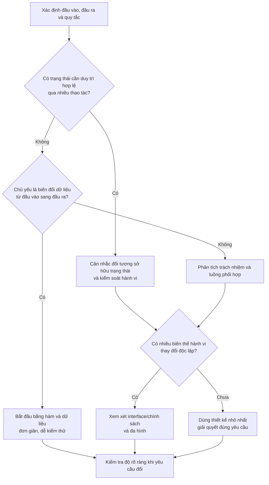

# Khi nên và không nên sử dụng OOP

**Có nên dùng lập trình hướng đối tượng (Object-Oriented Programming — OOP) cho mọi bài toán Java không?** Không. OOP là một cách tổ chức chương trình rất hữu ích khi cần quản lý trạng thái, trách nhiệm và sự cộng tác giữa các thành phần. Nhưng có những công việc chỉ cần vài hàm rõ ràng; dựng thêm nhiều lớp trong trường hợp ấy thường khiến mã khó đọc hơn.

Ví dụ, hai yêu cầu sau đều có thể triển khai bằng Java:

- **Yêu cầu A:** Đọc danh sách doanh thu trong ngày, kiểm tra dữ liệu, cộng tổng và xuất kết quả. Dữ liệu đi qua một phép biến đổi rồi kết thúc.
- **Yêu cầu B:** Quản lý một đơn hàng qua các trạng thái `DRAFT → SUBMITTED → PAID`. Không được sửa mặt hàng sau khi gửi đơn; không được đánh dấu thanh toán khi đơn chưa được gửi; nhiều thao tác khác nhau có thể tác động đến cùng một đơn.

Yêu cầu A có thể bắt đầu rất tốt bằng **các hàm thao tác trên dữ liệu**. Yêu cầu B thường phù hợp với một **đối tượng `Order` tự bảo vệ quy tắc trạng thái**. Cả hai cách có thể cùng tồn tại trong một ứng dụng.

Bài này đưa ra những dấu hiệu thực tế để quyết định **khi OOP đem lại lợi ích, khi OOP tạo thêm chi phí và cách xác định mức OOP vừa đủ**.

## 1. Trước tiên, hiểu “sử dụng OOP” nghĩa là gì

Trong Java, ta gần như luôn gặp `class`: kể cả một chương trình chỉ chứa `public static void main` cũng nằm trong class. Vì thế, **có class trong mã nguồn chưa đủ để kết luận thiết kế đang tận dụng OOP một cách có ý nghĩa**.

Khi nói “thiết kế theo OOP”, ta thường quan tâm ba ý:

1. **Trách nhiệm:** đối tượng nào có đủ thông tin và có lý do phù hợp để thực hiện một hành vi?
2. **Ranh giới:** bên ngoài được yêu cầu đối tượng làm gì, và những chi tiết nào đối tượng cần tự quản lý?
3. **Cộng tác:** các đối tượng tương tác qua hợp đồng nào để hoàn thành nghiệp vụ mà không cần biết toàn bộ chi tiết của nhau?

Một đối tượng tốt không bắt buộc phải thay đổi trạng thái. Ví dụ, đối tượng `Money` bất biến có thể chứa số tiền và đơn vị tiền, đồng thời cung cấp thao tác cộng có kiểm tra tiền tệ. Một interface không bắt buộc phải có nhiều hiện thực ngay ngày đầu. OOP là **cách đặt và bảo vệ trách nhiệm**, không phải cuộc thi tạo số lớp nhiều nhất.

Và **“không dùng OOP cho phần này”** cũng không có nghĩa từ bỏ Java hay mọi lớp. Ta vẫn có thể viết các hàm `static`, record, dữ liệu bất biến, các phép biến đổi `Stream` và những mô-đun đơn giản bên trong dự án dùng OOP ở phần khác.

## 2. Năm câu hỏi giúp quyết định

Trước khi thiết kế class hoặc interface, hãy trả lời theo thứ tự:

| Câu hỏi | Khi câu trả lời nghiêng về OOP | Khi câu trả lời nghiêng về hàm/quy trình đơn giản |
| --- | --- | --- |
| **Có trạng thái sống qua nhiều thao tác không?** | Một đơn hàng tồn tại, chuyển trạng thái, được nhiều chức năng thao tác trong suốt vòng đời | Nhận đầu vào, biến đổi, trả đầu ra, không cần nhớ quá trình trước đó |
| **Có quy tắc phải được bảo vệ ở mọi lần thay đổi không?** | Không được rút quá số dư, không được sửa đơn đã gửi, không được đổi trạng thái tùy ý | Quy tắc chỉ là kiểm tra đầu vào cho một phép tính độc lập |
| **Có những thực thể sở hữu trách nhiệm riêng và cộng tác không?** | `Order`, `Inventory`, `PaymentGateway` có các nghĩa vụ khác nhau | Một phép lọc, tính tổng, chuẩn hóa chuỗi, ánh xạ dữ liệu |
| **Có các biến thể hành vi cần thay thế/mở rộng không?** | Các chính sách giảm giá, thanh toán, vận chuyển thay đổi độc lập và dùng chung hợp đồng | Hai nhánh điều kiện rất ít thay đổi, chưa cần cơ chế mở rộng |
| **Lợi ích quản lý thay đổi có vượt chi phí thiết kế không?** | Code được dùng lâu dài, nhiều chỗ gọi, cần che giấu quyết định nội bộ | Script một lần, bài tính nhỏ, yêu cầu ổn định, tạo abstraction tốn công hơn chính bài toán |

Đây là **các tín hiệu để thảo luận**, không phải công thức “có ba dấu tích thì phải dùng OOP”. Quan trọng nhất là **kiểu thay đổi và rủi ro của chính phần mềm đang xây dựng**.

Một trình tự lựa chọn có thể hình dung như sau:



Sơ đồ là gợi ý tổ chức suy nghĩ. Ví dụ, một nghiệp vụ không có trạng thái vẫn có thể hưởng lợi từ interface nếu cần thay thế nhiều bộ tích hợp bên ngoài; ngược lại, trạng thái đơn giản không tự động đòi hỏi một hệ thống đối tượng phức tạp.

## 3. Khi OOP đặc biệt có ích: trạng thái và vòng đời nghiệp vụ

Xét một đơn hàng: lúc tạo, khách có thể thêm sản phẩm. Khi gửi đơn, danh sách mặt hàng phải đóng lại. Sau khi thanh toán thành công, hệ thống chuyển sang `PAID`.

Nếu mỗi chức năng tự đọc/sửa trường `status` và `items`, rất dễ sinh lỗi: phần cập nhật giỏ hàng có thể vô tình sửa đơn đã thanh toán, hoặc một đoạn mã nào đó trực tiếp gán `PAID` khi đơn còn `DRAFT`.

Ta có thể giao cho `Order` trách nhiệm **giữ các quy tắc đúng tại thời điểm chuyển trạng thái**:

```java
// File: OrderDemo.java — Java 17+
import java.util.ArrayList;
import java.util.List;

public class OrderDemo {
    enum Status { DRAFT, SUBMITTED, PAID }

    record Line(long unitPrice, int quantity) {
        Line {
            if (unitPrice < 0 || quantity <= 0) {
                throw new IllegalArgumentException("Invalid line");
            }
        }

        long amount() {
            return Math.multiplyExact(unitPrice, (long) quantity);
        }
    }

    static final class Order {
        private final String id;
        private final List<Line> lines = new ArrayList<>();
        private Status status = Status.DRAFT;

        Order(String id) {
            if (id == null || id.isBlank()) {
                throw new IllegalArgumentException("Invalid order id");
            }
            this.id = id;
        }

        void addLine(long price, int quantity) {
            require(Status.DRAFT);
            lines.add(new Line(price, quantity));
        }

        long total() {
            long result = 0;
            for (Line line : lines) {
                result = Math.addExact(result, line.amount());
            }
            return result;
        }

        void submit() {
            require(Status.DRAFT);
            if (lines.isEmpty()) {
                throw new IllegalStateException("Empty order");
            }
            status = Status.SUBMITTED;
        }

        // Chỉ gọi khi hệ thống thanh toán đã xác nhận thành công.
        void confirmPaid() {
            require(Status.SUBMITTED);
            status = Status.PAID;
        }

        Status status() {
            return status;
        }

        String id() {
            return id;
        }

        private void require(Status expected) {
            if (status != expected) {
                throw new IllegalStateException(
                    "Expected " + expected + ", actual " + status
                );
            }
        }
    }

    public static void main(String[] args) {
        Order order = new Order("ORD-001");

        order.addLine(100_000, 2);
        order.addLine(50_000, 1);
        System.out.println(order.total()); // 250000

        order.submit();
        System.out.println(order.status()); // SUBMITTED

        try {
            order.addLine(10_000, 1);
        } catch (IllegalStateException ex) {
            System.out.println("Rejected"); // Rejected
        }

        order.confirmPaid();
        System.out.println(order.status()); // PAID
    }
}
```

Chạy bằng `javac OrderDemo.java` rồi `java OrderDemo`.

### Điều gì khiến đối tượng có ích ở đây?

Đối tượng `order` có **danh tính** (`ORD-001`), **trạng thái riêng** (`DRAFT`, `SUBMITTED`, `PAID`) và **hành vi phù hợp với trạng thái**. Các phương thức `addLine`, `submit`, `confirmPaid` kiểm soát các chuyển đổi hợp lệ.

| Tình huống | Kết quả |
| --- | --- |
| Thêm mặt hàng khi đơn còn `DRAFT` | Hợp lệ, danh sách tăng |
| Gửi đơn rỗng | Từ chối |
| Gửi đơn có mặt hàng | Chuyển sang `SUBMITTED` |
| Thêm mặt hàng sau khi gửi | Từ chối |
| Xác nhận trả tiền khi còn `DRAFT` | Từ chối |
| Xác nhận trả tiền sau `SUBMITTED` | Chuyển sang `PAID` |

Nếu các trường `status` và `lines` được công khai để mọi nơi tự sửa, những kiểm tra này có thể bị bỏ qua. Với cách đặt trên, muốn đổi trạng thái phải thông qua các hành vi được cung cấp. **OOP giúp đặt quy tắc ngay cạnh trạng thái mà quy tắc bảo vệ.**

Đây chỉ là mô hình trong bộ nhớ dùng để giải thích trách nhiệm. Trong ứng dụng thực tế, dữ liệu có thể bị cập nhật đồng thời từ nhiều request hoặc nhiều instance dịch vụ. `private` **không giải quyết tranh chấp đồng thời**: có thể cần transaction, optimistic/pessimistic locking, kiểm tra trạng thái ở database và xử lý xác nhận thanh toán an toàn. Ngoài ra, `confirmPaid()` chỉ minh họa ranh giới; lớp `Order` không tự xác minh giao dịch ngân hàng.

Một điểm cũng đáng chú ý: `Line` được viết dưới dạng **record bất biến**. Hướng đối tượng không đồng nghĩa mọi trường đều được phép sửa.

## 4. Khi OOP có ích: nhiều biến thể hành vi chia sẻ một hợp đồng

Giả sử phí giao hàng có hai cách tính:

- Giao hàng tiêu chuẩn: luôn 30.000 đồng.
- Chương trình khuyến mãi: miễn phí nếu tổng hàng từ 200.000 đồng; nếu thấp hơn, phí 30.000 đồng.

Nếu quy tắc thay đổi thường xuyên hoặc nhiều luồng cần dùng, ta có thể đặt một hợp đồng `ShippingPolicy` và các cách tính riêng:

```java
// File: ShippingDemo.java — Java 17+
public class ShippingDemo {

    interface ShippingPolicy {
        long fee(long subtotal);
    }

    static final class FlatShipping implements ShippingPolicy {
        private final long amount;

        FlatShipping(long amount) {
            if (amount < 0) throw new IllegalArgumentException();
            this.amount = amount;
        }

        @Override
        public long fee(long subtotal) {
            if (subtotal < 0) throw new IllegalArgumentException();
            return amount;
        }
    }

    static final class FreeAboveThreshold implements ShippingPolicy {
        private final long threshold;
        private final long regularFee;

        FreeAboveThreshold(long threshold, long regularFee) {
            if (threshold < 0 || regularFee < 0) {
                throw new IllegalArgumentException();
            }
            this.threshold = threshold;
            this.regularFee = regularFee;
        }

        @Override
        public long fee(long subtotal) {
            if (subtotal < 0) throw new IllegalArgumentException();
            return subtotal >= threshold ? 0 : regularFee;
        }
    }

    static long finalAmount(long subtotal, ShippingPolicy policy) {
        return Math.addExact(subtotal, policy.fee(subtotal));
    }

    public static void main(String[] args) {
        ShippingPolicy standard = new FlatShipping(30_000);
        ShippingPolicy promotion =
            new FreeAboveThreshold(200_000, 30_000);

        System.out.println(finalAmount(250_000, standard));  // 280000
        System.out.println(finalAmount(250_000, promotion)); // 250000
        System.out.println(finalAmount(100_000, promotion)); // 130000
    }
}
```

Hàm `finalAmount` chỉ cần biết **hợp đồng `ShippingPolicy`**, không cần biết chính sách cụ thể thuộc lớp nào. Ta có thể cung cấp các cách tính khác nhau qua cùng tham số. Đây là lợi ích của **đa hình** khi phần thay đổi nằm sau một giao diện ổn định.

Tuy vậy, nếu ứng dụng chỉ có đúng một quy tắc phí cố định, viết một hàm `calculateShippingFee(subtotal)` có thể vừa đủ. Interface và các lớp hiện thực chỉ đáng thêm khi chúng làm giảm sự phụ thuộc hoặc đáp ứng nhu cầu mở rộng **có thật**.

Ngay cả khi cần thay một hành vi, Java cũng có thể dùng **functional interface, lambda hoặc truyền hàm** thay vì tạo nhiều class, nhất là khi hành vi chỉ là một phép tính ngắn:

```java
import java.util.function.LongUnaryOperator;

LongUnaryOperator shippingFee =
    subtotal -> subtotal >= 200_000 ? 0 : 30_000;

long amount = Math.addExact(250_000, shippingFee.applyAsLong(250_000));
// amount == 250000
```

Đoạn trên là các câu lệnh dùng trong một phương thức Java (ví dụ `main`). Hai lựa chọn có cùng ý nghĩa tính toán; kiểu giao diện tự thiết kế phù hợp khi cần tên nghiệp vụ, hợp đồng rõ ràng hoặc nhiều phương thức, còn lambda thường gọn cho một hành vi đơn.

## 5. Khi **không nên cố áp dụng OOP**: phép biến đổi dữ liệu ngắn, độc lập

Nhiều bài toán có dạng **đầu vào → kiểm tra → biến đổi → đầu ra**, không có thực thể cần quản lý suốt nhiều giai đoạn. Chẳng hạn: nhận danh sách dòng doanh thu hợp lệ rồi tính tổng.

Một hàm độc lập có thể biểu diễn rất rõ:

```java
// File: RevenueDemo.java — Java 17+
import java.util.List;

public class RevenueDemo {
    record Sale(long unitPrice, int quantity) {
        Sale {
            if (unitPrice < 0 || quantity <= 0) {
                throw new IllegalArgumentException("Invalid sale");
            }
        }
    }

    static long totalRevenue(List<Sale> sales) {
        long total = 0;
        for (Sale sale : sales) {
            long line = Math.multiplyExact(
                sale.unitPrice(), (long) sale.quantity()
            );
            total = Math.addExact(total, line);
        }
        return total;
    }

    public static void main(String[] args) {
        List<Sale> sales = List.of(
            new Sale(100_000, 2),
            new Sale(50_000, 1)
        );
        System.out.println(totalRevenue(sales)); // 250000
    }
}
```

Hàm `totalRevenue` nhận dữ liệu, tính toán và trả về một kết quả. Nó không lưu tổng vào một đối tượng có trạng thái, không làm thay đổi danh sách đầu vào. Vì thế kết quả rất dễ kiểm tra: **cùng dữ liệu đầu vào thì cho cùng đầu ra**, miễn không có lỗi số học.

Có thể viết một class `RevenueCalculator` với phương thức `calculate`, nhưng nếu class chỉ chuyển tiếp một phép cộng và không mang thêm trách nhiệm gì, cần hỏi: **sự trừu tượng ấy đang che giấu điều gì có ích?**

Đừng thiết kế sớm kiểu:

```java
// Ví dụ về sự phức tạp chưa cần thiết:
RevenueCalculatorFactory factory = ...;
RevenueCalculator calculator = factory.create();
RevenueResult result = calculator.execute(request);
```

cho một bài toán vốn được diễn đạt rõ bằng `long total = totalRevenue(sales);`. Đoạn minh họa này là **pseudocode** cho một thiết kế có nhiều lớp không cần thiết, không phải mã hoàn chỉnh để biên dịch.

### Những tình huống thường phù hợp với hàm/quy trình hơn

- Script xử lý file một lần: đọc CSV, bỏ bản ghi lỗi, chuẩn hóa cột, xuất CSV khác.
- Bộ chuyển đổi thuần túy: parse chuỗi, định dạng ngày, tính công thức độc lập.
- Pipeline dữ liệu có các bước được đặt tên rõ ràng: `parse → validate → transform → export`.
- Thuật toán tính toán hoặc xử lý mảng có đầu vào/đầu ra cụ thể.
- Bản thử nghiệm nhỏ để kiểm chứng thuật toán, khi chưa có quy tắc miền nghiệp vụ phức tạp.

Ta vẫn có thể nhóm các hàm trong mô-đun/class để quản lý tên và phạm vi, thậm chí dùng record để đại diện dữ liệu. Câu hỏi không phải “có class hay không”, mà là “**có cần nhiều đối tượng có vòng đời và tương tác không?**”.

## 6. Một số lựa chọn thường gặp trong dự án Java/Spring Boot

| Bài toán | Cách bắt đầu hợp lý | Khi nào cân nhắc thêm OOP |
| --- | --- | --- |
| Validate email theo một quy tắc đơn giản | Hàm kiểm tra hoặc thành phần validate nhỏ | Khi có nhiều quy tắc cấu hình, nhiều chiến lược, nhu cầu gắn hành vi với giá trị |
| Tổng hợp log mỗi đêm thành báo cáo | Pipeline các hàm/step độc lập | Khi nguồn dữ liệu, định dạng báo cáo và các xử lý cần thay thế độc lập |
| Tài khoản ngân hàng có nạp, rút, đóng băng | Đối tượng tài khoản bảo vệ trạng thái, service điều phối | Thường đã có động lực dùng đối tượng từ đầu; phải bổ sung bảo vệ cạnh tranh dữ liệu |
| Đơn hàng đi qua nhiều trạng thái | Đối tượng miền nghiệp vụ với thao tác chuyển trạng thái hợp lệ | Khi quy tắc phức tạp lên, cân nhắc tách chính sách và thành phần cộng tác |
| Gọi một REST API cố định để lấy dữ liệu | Một client hoặc hàm dịch vụ được đặt tên rõ | Khi có nhiều nhà cung cấp, hợp đồng client + các hiện thực có thể hữu ích |
| Gửi thông báo qua email, SMS, push | Một thành phần gửi thông báo có trách nhiệm rõ | Khi nhiều kênh thật sự tồn tại, interface và nhiều hiện thực có thể giảm phụ thuộc |
| Quy tắc tính thuế cố định, một biểu thức | Một hàm tên rõ, dữ liệu đầu vào rõ | Khi có nhiều quốc gia/kịch bản, cần version hoặc thay chính sách độc lập |
| Truy vấn DB bằng Spring Data JPA | Repository theo abstraction của framework | Không cần bọc mỗi phương thức `findById` trong một tầng chỉ chuyển tiếp |

Đặc biệt trong Spring Boot, `@Service`, `@Component` và `@Repository` là những công cụ tổ chức và quản lý thành phần, nhưng **số lượng annotation hoặc số tầng không đo chất lượng OOP**.

Ví dụ, một `OrderService` có thể điều phối việc tải đơn, gọi thao tác nghiệp vụ trên `Order` rồi lưu lại. Nếu toàn bộ quy tắc “đơn ở trạng thái nào mới được sửa” bị sao chép ở năm controller và service, ranh giới nghiệp vụ đang yếu đi. Ngược lại, đừng ép một entity JPA tự gọi HTTP hoặc tự quản lý transaction chỉ vì muốn “mọi hành vi phải nằm trong object”.

## 7. Vì sao lạm dụng OOP có thể phản tác dụng?

### 7.1. Có quá nhiều lớp chỉ để chuyển tiếp lời gọi

Ví dụ:

```text
Controller
  → RequestHandler
    → Manager
      → Facade
        → Coordinator
          → Service
            → Calculator
```

Nếu mỗi tầng chỉ gọi tiếp `return next.calculate(input);` mà không thêm trách nhiệm, ranh giới, xử lý lỗi hay khả năng thay thế nào, việc đọc lỗi sẽ phải đi qua nhiều file. **Abstraction phải giải quyết một vấn đề cụ thể**, không chỉ tạo cảm giác “kiến trúc nhiều lớp”.

### 7.2. Class “chứa dữ liệu” bị tách rời hoàn toàn khỏi quy tắc

Ví dụ `Order` có `getStatus()` và `setStatus(...)` công khai, còn mọi quy tắc nằm rải rác ở service. Bất kỳ nơi nào cũng có thể gán `PAID` trước khi submit. Đây là dấu hiệu mô hình dữ liệu nghèo hành vi (*anemic domain model*) **khi bài toán thực sự cần bảo vệ trạng thái**.

Tuy nhiên, DTO dùng để vận chuyển dữ liệu từ API sang service có thể rất phù hợp khi chỉ chứa giá trị. Không cần ép một DTO trở thành đối tượng nghiệp vụ giàu hành vi.

### 7.3. Tạo interface khi chỉ có một implementation và không có ranh giới có ích

`UserService` và `UserServiceImpl` đôi khi có ý nghĩa nếu interface là hợp đồng được dùng ở nhiều mô-đun hoặc để thay thế nhà cung cấp. Nếu toàn bộ hệ thống chỉ có một hiện thực, không có yêu cầu thay thế hay phụ thuộc cần đảo chiều, interface đó có thể làm phát sinh một file phải mở thêm mà chưa tạo lợi ích.

**Một implementation vẫn có thể xứng đáng với interface** khi hợp đồng là ranh giới kỹ thuật quan trọng; số lượng implementation hiện tại chỉ là một tín hiệu, không phải quy tắc cấm.

### 7.4. Lạm dụng kế thừa

Nếu một hệ thống có chuỗi `BaseService → AbstractBaseService → AbstractConfiguredService → ConcreteService`, mỗi thay đổi phải hiểu nhiều lớp cha và hành vi có thể bị chi phối bởi override khó lần theo.

Chỉ kế thừa khi quan hệ “là một” (*is-a*) đúng về mặt hành vi và hợp đồng. Trong nhiều trường hợp, **composition** — đối tượng giữ một thành phần khác và ủy quyền đúng trách nhiệm — dễ sửa hơn cấu trúc thừa kế sâu.

### 7.5. Dự đoán quá nhiều nhu cầu chưa có

Dựng sẵn mười `Strategy`, ba `Factory`, bộ đăng ký plugin và cấu hình lựa chọn cho một bài toán chỉ có một chính sách khiến chi phí bảo trì xuất hiện ngay hôm nay, trong khi lợi ích có thể không bao giờ đến. Hãy để yêu cầu hiện tại và các thay đổi có cơ sở dẫn dắt thiết kế.

## 8. OOP có làm chương trình chạy chậm hơn không?

Không có đáp án đúng cho mọi chương trình. Một phần thiết kế OOP có thể tạo thêm đối tượng, phân bổ bộ nhớ và thêm lời gọi qua interface. Nhưng JVM có các tối ưu như JIT inlining, escape analysis và tối ưu việc cấp phát trong những tình huống phù hợp. Ngược lại, một vòng lặp viết theo kiểu thủ tục với thuật toán kém có thể chậm hơn hẳn một thiết kế OOP hợp lý.

**Hãy phân biệt ba vấn đề:**

| Vấn đề | Cách đánh giá |
| --- | --- |
| Đúng nghiệp vụ | Xác minh bất biến, kết quả và các trường hợp lỗi |
| Dễ bảo trì | Xem một yêu cầu thay đổi ảnh hưởng bao nhiêu nơi; người đọc có hiểu trách nhiệm không |
| Hiệu năng | Đo với dữ liệu và tải thật; benchmark trước khi tối ưu |

Ví dụ, trong một vòng lặp tính toán hàng triệu phần tử, có thể cần giảm số đối tượng trung gian để tiết kiệm bộ nhớ. Nhưng trong request gọi database mất hàng chục mili giây, chi phí một vài lời gọi phương thức thường không phải nút thắt chính. Đánh giá bằng profiler/benchmark thay vì suy luận từ việc mã dùng OOP.

Với code Java, benchmark vi mô nên dùng cách đo phù hợp (thường là JMH) để tránh các sai lệch do JVM warmup, tối ưu biên dịch và GC.

## 9. OOP có tự giải quyết đồng thời, microservice hoặc thay đổi nghiệp vụ không?

**Không.** Đây là ba vấn đề liên quan đến thiết kế rộng hơn:

- **Đồng thời:** Một đối tượng có trường `private int balance` vẫn có race condition nếu nhiều thread cập nhật mà không có cơ chế đồng bộ phù hợp. Đóng gói giúp kiểm soát điểm cập nhật, nhưng không tự đảm bảo thread safety.
- **Microservice:** Mỗi service có thể viết bằng OOP, nhưng ranh giới mạng, timeout, dữ liệu phân tán, transaction và idempotency vẫn cần được xử lý riêng. Chia thành nhiều class không tương đương với chia microservice.
- **Thay đổi nghiệp vụ:** Interface giúp thay đổi một loại hành vi khi ranh giới được thiết kế tốt, nhưng nếu yêu cầu thay đổi quy tắc nền tảng của toàn hệ thống thì vẫn có thể phải sửa nhiều thành phần.

Chọn OOP phù hợp giải quyết **khả năng tổ chức và bảo vệ trách nhiệm trong mã nguồn**. Nó không thể thay thế các biện pháp đảm bảo tính đúng đắn và vận hành của toàn hệ thống.

## 10. Đánh giá tình huống qua hai hướng triển khai

Giả sử bạn được giao “tính điểm thưởng cho khách hàng”. Hãy so sánh hai phiên bản yêu cầu:

**Phiên bản 1 — tính một lần.** Mỗi giao dịch có `amount`. Điểm thưởng bằng số tiền chia nguyên cho 10.000. Chương trình nhận danh sách giao dịch, cộng điểm rồi xuất kết quả. Quy tắc cố định, không quản lý ví điểm trong thời gian dài.

Có thể bắt đầu bằng:

```java
static long pointsFor(long amount) {
    if (amount < 0) throw new IllegalArgumentException();
    return amount / 10_000;
}
```

Đây là một hàm đơn giản, dễ kiểm thử. Dựng `PointContext`, `PointCalculatorFactory`, `AbstractPointStrategy` từ đầu không chắc tạo thêm giá trị.

**Phiên bản 2 — tài khoản điểm có vòng đời.** Điểm có thể được cộng sau giao dịch, dùng để đổi quà, bị hết hạn, có lịch sử, có giới hạn dùng và không được âm. Nhiều thao tác có thể làm thay đổi cùng một tài khoản điểm.

Lúc này một đối tượng `LoyaltyAccount` với các thao tác `earn(...)`, `redeem(...)` và quy tắc bảo vệ trạng thái có thể là ranh giới tốt. Tuy nhiên giao dịch điểm thật vẫn cần cơ chế nhất quán tại tầng lưu trữ, kiểm soát đồng thời và chống xử lý lặp.

**Bài học:** Tên miền nghiệp vụ giống nhau không quyết định phong cách thiết kế. **Độ phức tạp của trạng thái, số tương tác và kiểu thay đổi** mới làm thay đổi quyết định.

## 11. Checklist trước khi tạo thêm một class hoặc interface

Thay vì hỏi “đã đủ OOP chưa?”, hãy tự trả lời:

1. **Tôi có thể mô tả trách nhiệm của class trong một câu rõ ràng không?** Ví dụ: “`Order` kiểm soát các thao tác hợp lệ theo trạng thái đơn hàng.”
2. **Dữ liệu nào thuộc trách nhiệm ấy?** Ai được phép cập nhật dữ liệu? Quy tắc nào phải luôn đúng?
3. **Bên sử dụng thực sự cần biết gì?** Có thể che giấu cấu trúc nội bộ và cung cấp thao tác có ý nghĩa hơn getter/setter không?
4. **Tại sao cần interface?** Có nhiều cách thực hiện, ranh giới module, hợp đồng tích hợp hoặc yêu cầu thay thế có thật không?
5. **Nếu đổi yêu cầu tuần sau, tôi cần sửa bao nhiêu chỗ?** Class mới có giúp cô lập thay đổi, hay chỉ kéo dài chuỗi lời gọi?
6. **Một hàm thuần túy có giải quyết rõ hơn không?** Nếu có, dùng hàm là một lựa chọn thiết kế hợp lệ ngay cả trong dự án OOP.
7. **Tôi kiểm thử ở đâu?** Có thể tạo trạng thái ban đầu, thực hiện hành vi rồi xác nhận kết quả/điều kiện lỗi mà không cần chạy cả ứng dụng không?

Nếu chưa trả lời được những câu này, hãy bắt đầu từ cấu trúc nhỏ rõ ràng, quan sát các điểm thường thay đổi rồi tách trách nhiệm khi cần. Việc refactor dựa trên bằng chứng thường hiệu quả hơn dựng trước một tầng trừu tượng chưa có người sử dụng.

## 12. Câu hỏi tự kiểm tra

**Câu 1.** Bạn viết một chương trình CLI chỉ đọc file, chuẩn hóa số điện thoại rồi ghi file mới. Có cần class `PhoneNumberNormalizationManagerFactory` và nhiều tầng interface không?

**Gợi ý:** Chưa có nhu cầu rõ ràng. Một hàm chuẩn hóa và một hàm xử lý luồng file thường đủ tốt, miễn có kiểm tra lỗi và test trường hợp biên.

**Câu 2.** Một đối tượng `BankAccount` có `deposit` và `withdraw` nhưng đồng thời công khai `setBalance`. Dùng class ở đây đã đủ bảo vệ nghiệp vụ chưa?

**Gợi ý:** Chưa. `setBalance` có thể bỏ qua các kiểm tra nạp/rút, khiến bất biến bị vi phạm. Thiết kế cần kiểm soát mọi đường cập nhật trạng thái.

**Câu 3.** Mọi báo cáo hiện tại chỉ xuất CSV nhưng đội ngũ chắc chắn sẽ triển khai PDF và Excel trong cùng quý. Có thể cân nhắc interface `ReportExporter` không?

**Gợi ý:** Có cơ sở vì các cách xuất khác nhau dùng chung mục tiêu, nhưng hãy xác định hợp đồng và các khác biệt thực tế trước khi thêm các lớp.

**Câu 4.** Một đồng nghiệp nói “Tách một hàm tính tiền thành bốn class chắc chắn sẽ nâng hiệu năng.” Bạn phản biện thế nào?

**Gợi ý:** Số class không bảo đảm hiệu năng. Phải xem thuật toán, I/O, cấp phát và đo trong điều kiện đại diện. Lợi ích bảo trì và hiệu năng là hai tiêu chí khác nhau.

**Câu 5.** Đơn hàng cần `addItem`, `submit` và `cancel`; quy tắc hủy phụ thuộc trạng thái. Bạn sẽ đặt quy tắc ở controller, trong một loạt hàm rời rạc hay trong ranh giới chịu trách nhiệm về trạng thái đơn? Vì sao?

**Gợi ý:** Ưu tiên tập trung quy tắc ở một ranh giới kiểm soát trạng thái nhất quán; đối tượng `Order` là lựa chọn tự nhiên, còn service có thể điều phối lưu trữ và tích hợp. Các hệ thống khác nhau vẫn có thể có ranh giới phù hợp khác nhau.

---

**Nguyên tắc thực hành:** Hãy chọn cấu trúc đơn giản nhất thể hiện được trách nhiệm, bảo vệ quy tắc và chịu được những thay đổi có cơ sở. **Dùng OOP khi đối tượng và hợp đồng giúp hiểu bài toán rõ hơn; dùng hàm và quy trình khi chúng diễn đạt bài toán trực tiếp hơn.** Trong một ứng dụng Java tốt, hai cách thường hỗ trợ nhau.