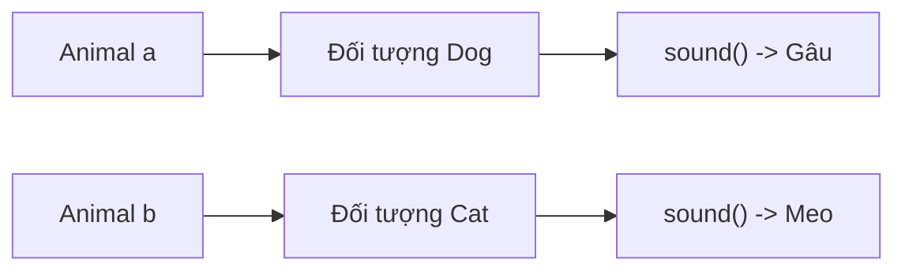
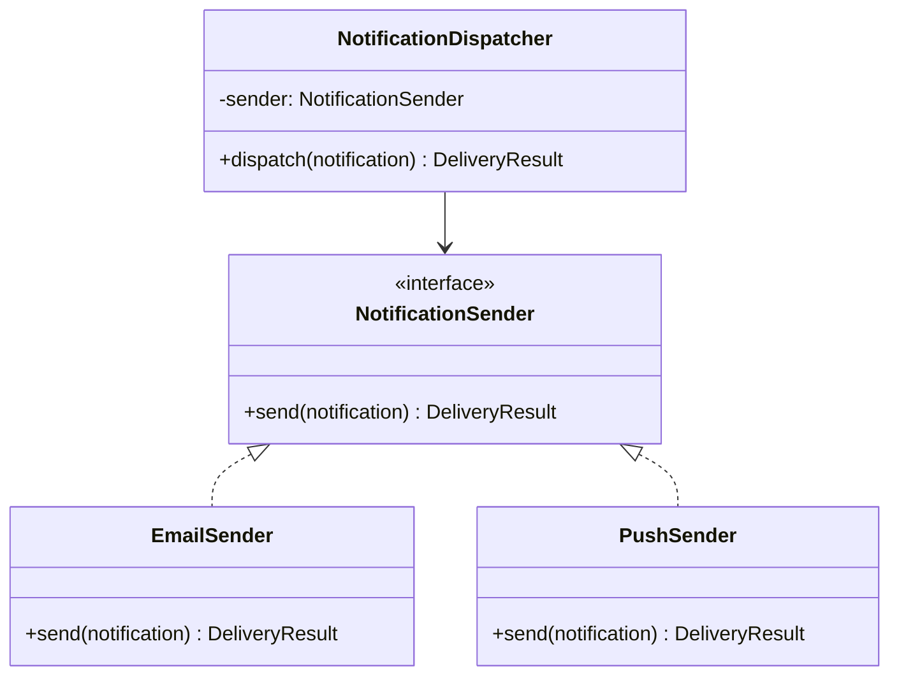
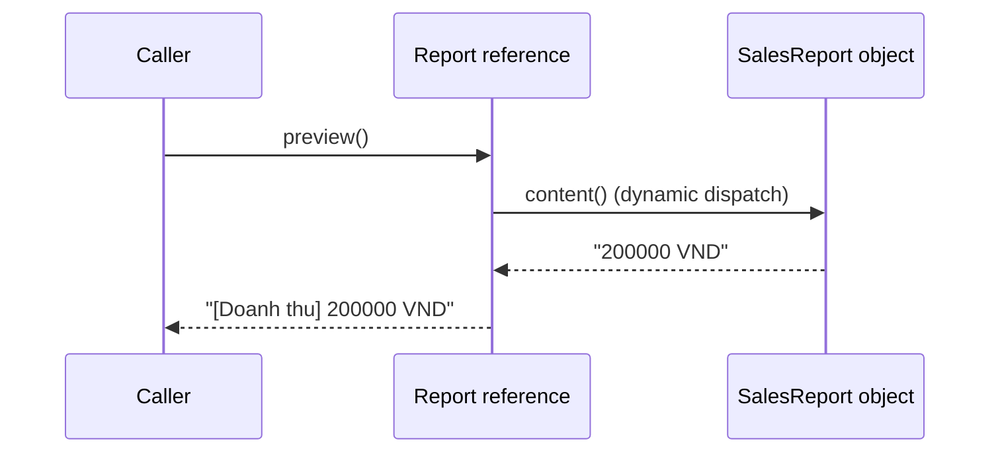

# Đa hình kiểu con qua giao diện hoặc lớp cha trong Java

**Đa hình kiểu con (subtype polymorphism)** là khả năng sử dụng nhiều đối tượng thuộc **các kiểu con khác nhau** thông qua **cùng một kiểu cha hoặc giao diện**, trong khi hành vi thực thi có thể khác nhau tùy đối tượng thực tế.

Ví dụ, một hệ thống gửi thông báo có thể dùng Email, Push Notification hoặc một kênh khác. Nơi điều phối thông báo chỉ cần yêu cầu “gửi nội dung này” theo một hợp đồng chung, không phải tự viết `if/else` để gọi từng lớp cụ thể.

Trong Java, đa hình kiểu con thường dựa trên hai quan hệ:

- **Implement interface**: `EmailSender implements NotificationSender`.
- **Kế thừa lớp cha**: `SalesReport extends Report`.

Điểm quan trọng nhất là phân biệt **kiểu khai báo của biến** với **kiểu thực tế của đối tượng**, từ đó hiểu Java kiểm tra lời gọi nào tại thời điểm biên dịch và lựa chọn implementation nào khi chạy.

## 1. Biến kiểu cha có thể giữ tham chiếu đến đối tượng kiểu con

```java
interface Animal {
    String sound();
}

class Dog implements Animal {
    @Override
    public String sound() {
        return "Gâu";
    }
}

class Cat implements Animal {
    @Override
    public String sound() {
        return "Meo";
    }
}
```

Cùng một kiểu khai báo `Animal` có thể tham chiếu đến hai đối tượng khác nhau:

```java
Animal a = new Dog();
Animal b = new Cat();

System.out.println(a.sound()); // Gâu
System.out.println(b.sound()); // Meo
```

Ở đây:

| Biến | Kiểu khai báo (*compile-time type*) | Kiểu đối tượng thực tế (*runtime class*) | Phương thức được thực thi |
|---|---|---|---|
| `a` | `Animal` | `Dog` | `Dog.sound()` |
| `b` | `Animal` | `Cat` | `Cat.sound()` |

Compiler xác nhận cả hai lời gọi `sound()` hợp lệ vì `Animal` khai báo hành vi này. Khi chạy, Java dùng **dynamic dispatch** cho phương thức instance có thể override để chọn implementation tương ứng với đối tượng thực tế.

Đây không phải việc biến `a` tự biến thành kiểu `Dog`. Biến vẫn mang kiểu khai báo `Animal`; nó chỉ đang giữ tham chiếu tới một đối tượng `Dog`.



Nếu thay `new Dog()` bằng `new Cat()` thì cùng một lời gọi `a.sound()` sẽ cho kết quả khác, miễn là code điều khiển cho phép gán lại biến.

## 2. Ví dụ thực tế: giao diện để thay thế các kênh gửi thông báo

Giả sử hệ thống cần gửi thông báo tới khách hàng qua Email và Push Notification. Để tập trung vào OOP, ví dụ dưới đây **mô phỏng kết quả gửi**, không thực sự kết nối SMTP hay dịch vụ Push.

Hợp đồng đặt ra:

- Caller cung cấp một `Notification` hợp lệ, chứa mã khách hàng và nội dung.
- Mọi implementation của `NotificationSender` đều hỗ trợ `send(notification)` và trả về `DeliveryResult`.
- Code điều phối không cần biết cách từng kênh hoạt động.

File `NotificationPolymorphismDemo.java` (Java 17+):

```java
import java.util.List;
import java.util.Objects;

public class NotificationPolymorphismDemo {

    record Notification(String customerId, String message) {
        Notification {
            if (customerId == null || customerId.isBlank()) {
                throw new IllegalArgumentException("Thiếu customerId");
            }
            if (message == null || message.isBlank()) {
                throw new IllegalArgumentException("Nội dung rỗng");
            }
        }
    }

    record DeliveryResult(String channel, String status) {}

    // Hợp đồng chung cho mọi kênh gửi.
    interface NotificationSender {
        DeliveryResult send(Notification notification);
    }

    static final class EmailSender implements NotificationSender {
        @Override
        public DeliveryResult send(Notification notification) {
            Objects.requireNonNull(notification, "notification");

            System.out.println(
                "EMAIL -> " + notification.customerId()
            );
            return new DeliveryResult("EMAIL", "SIMULATED");
        }
    }

    static final class PushSender implements NotificationSender {
        @Override
        public DeliveryResult send(Notification notification) {
            Objects.requireNonNull(notification, "notification");

            System.out.println(
                "PUSH -> " + notification.customerId()
            );
            return new DeliveryResult("PUSH", "SIMULATED");
        }
    }

    static final class NotificationDispatcher {
        private final NotificationSender sender;

        NotificationDispatcher(NotificationSender sender) {
            this.sender = Objects.requireNonNull(sender, "sender");
        }

        DeliveryResult dispatch(Notification notification) {
            return sender.send(notification);
        }
    }

    public static void main(String[] args) {
        Notification notification =
            new Notification("CUS-01", "Đơn hàng đã sẵn sàng");

        List<NotificationSender> senders =
            List.of(new EmailSender(), new PushSender());

        for (NotificationSender sender : senders) {
            NotificationDispatcher dispatcher =
                new NotificationDispatcher(sender);

            DeliveryResult result =
                dispatcher.dispatch(notification);

            System.out.println(
                "Result: " + result.channel() + "/"
                    + result.status()
            );
        }
    }
}
```

Chạy:

```bash
javac NotificationPolymorphismDemo.java
java NotificationPolymorphismDemo
```

Kết quả:

```text
EMAIL -> CUS-01
Result: EMAIL/SIMULATED
PUSH -> CUS-01
Result: PUSH/SIMULATED
```

Để ý ba vị trí thể hiện đa hình:

1. `List<NotificationSender>` chứa đối tượng `EmailSender` và `PushSender` khác nhau.
2. `NotificationDispatcher` nhận một `NotificationSender` qua constructor. Nó **phụ thuộc vào hợp đồng**, không phụ thuộc trực tiếp lớp Email hay Push.
3. Khi `sender.send(notification)` chạy, implementation phù hợp được chọn theo đối tượng đang được giữ bởi `sender`.

Nếu thêm `SmsSender implements NotificationSender`, ta có thể truyền nó cho `NotificationDispatcher` mà không cần thay đổi mã nguồn của dispatcher, **nếu** implementation mới thực sự tuân theo hợp đồng `send`.

### Sơ đồ phụ thuộc



**Lợi ích thiết kế:** logic chọn kênh được đặt ở nơi cấu hình/khởi tạo đối tượng; dispatcher chỉ cần biết hợp đồng gửi. Thay implementation không buộc dispatcher chứa các nhánh `if (sender instanceof EmailSender)`.

Trong hệ thống thực, hợp đồng còn phải quy định rõ hành vi khi lỗi, timeout, retry, trạng thái gửi thành công hay mới được chấp nhận. Các implementation không nên tự ý dùng cùng một từ `SUCCESS` với những ý nghĩa khác nhau.

## 3. Đa hình qua lớp cha: kế thừa hành vi và ghi đè

Interface không phải con đường duy nhất. Một biến kiểu superclass cũng có thể tham chiếu đến các đối tượng subclass.

Ví dụ một hệ thống hiển thị báo cáo. Mọi báo cáo có tiêu đề và cùng cách tạo phần preview, nhưng nội dung preview khác nhau.

File `ReportPolymorphismDemo.java`:

```java
public class ReportPolymorphismDemo {

    static abstract class Report {
        private final String title;

        protected Report(String title) {
            if (title == null || title.isBlank()) {
                throw new IllegalArgumentException("Tiêu đề rỗng");
            }
            this.title = title;
        }

        // Thuật toán chung cố định ở lớp cha.
        public final String preview() {
            return "[" + title + "] " + content();
        }

        // Điểm mở rộng mà lớp con phải triển khai.
        protected abstract String content();
    }

    static final class SalesReport extends Report {
        private final long revenueVnd;

        SalesReport(long revenueVnd) {
            super("Doanh thu");
            if (revenueVnd < 0) {
                throw new IllegalArgumentException("Doanh thu âm");
            }
            this.revenueVnd = revenueVnd;
        }

        @Override
        protected String content() {
            return revenueVnd + " VND";
        }
    }

    static final class AuditReport extends Report {
        private final int eventCount;

        AuditReport(int eventCount) {
            super("Kiểm toán");
            if (eventCount < 0) {
                throw new IllegalArgumentException("Số sự kiện âm");
            }
            this.eventCount = eventCount;
        }

        @Override
        protected String content() {
            return eventCount + " sự kiện";
        }
    }

    static void display(Report report) {
        System.out.println(report.preview());
    }

    public static void main(String[] args) {
        Report sales = new SalesReport(200_000L);
        Report audit = new AuditReport(3);

        display(sales);
        display(audit);
    }
}
```

Kết quả:

```text
[Doanh thu] 200000 VND
[Kiểm toán] 3 sự kiện
```

Trong ví dụ này:

- `Report` là kiểu cha và giữ trạng thái chung `title`.
- `SalesReport` và `AuditReport` là hai kiểu con.
- `Report.preview()` chứa phần xử lý giống nhau, nhưng gọi `content()` là phương thức được override.
- Khi `preview()` đang chạy trên một đối tượng `SalesReport`, lời gọi `content()` sẽ chuyển tới `SalesReport.content()`; tương tự với `AuditReport`.

Điều đó cho thấy **mã được thực thi trong lớp cha vẫn có thể kích hoạt hành vi đặc thù của đối tượng lớp con**.



Sơ đồ mô tả thứ tự lời gọi theo góc nhìn logic. `Report` và `SalesReport` trong trường hợp này là **một đối tượng runtime**, không phải hai đối tượng độc lập giao tiếp qua mạng.

### Vì sao không override mọi phương thức?

`preview()` được đánh dấu `final` để các lớp con không thay đổi khung preview; lớp con chỉ tùy biến `content()`. Đây là một lựa chọn thiết kế nhằm bảo vệ quy tắc chung. Không phải mọi phương thức superclass đều cần cho phép override.

Cũng cần tránh gọi phương thức có thể override từ constructor lớp cha, bởi trạng thái của lớp con có thể chưa hoàn tất khởi tạo tại thời điểm ấy.

## 4. Upcasting: từ kiểu con lên kiểu cha

**Upcasting** là nhìn một đối tượng kiểu con thông qua tham chiếu có kiểu cha hoặc một interface mà nó thực hiện. Đây là chuyển đổi kiểu hợp lệ và thường được compiler thực hiện ngầm định.

```java
class Device {}

class Printer extends Device {
    void printPage() {
        System.out.println("Printing...");
    }
}

Printer printer = new Printer();
Device device = printer; // Upcasting ngầm định
```

`device` và `printer` trỏ đến **cùng một đối tượng Printer**, không tạo bản sao đối tượng.

Vì `device` có kiểu khai báo `Device`, nó không thể gọi phương thức chỉ xuất hiện trong `Printer`:

```java
printer.printPage(); // Hợp lệ
// device.printPage(); // Lỗi biên dịch
```

Điều này không mâu thuẫn với đa hình. Java thực hiện **hai công việc khác nhau**:

1. **Kiểm tra lời gọi có hợp lệ không:** dựa vào kiểu khai báo và những thành viên mà kiểu đó cung cấp, cùng những quy tắc truy cập/overload của Java.
2. **Chọn phần thực thi cho lời gọi instance có thể override:** dựa vào kiểu thực tế của đối tượng lúc chạy.

Nếu `Device` khai báo `public void start()` và `Printer` override, thì `device.start()` sẽ chạy phiên bản `Printer`. Nhưng `device.printPage()` không hợp lệ nếu `Device` không có `printPage()`.

## 5. Downcasting và instanceof: chỉ dùng khi thực sự cần

**Downcasting** là ép tham chiếu kiểu cha về một kiểu con cụ thể. Vì không phải mọi `Device` đều là `Printer`, Java yêu cầu ép kiểu tường minh và có kiểm tra runtime.

```java
class Device {}

class Printer extends Device {
    void printPage() {
        System.out.println("Printing...");
    }
}

class Scanner extends Device {}

Device first = new Printer();
Printer printer = (Printer) first; // Hợp lệ lúc chạy
printer.printPage();

// Device second = new Scanner();
// Printer wrong = (Printer) second; // ClassCastException
```

Nếu kiểu runtime không tương thích với kiểu ép, Java ném `ClassCastException`.

Java 16+ hỗ trợ pattern matching với `instanceof`; ví dụ dùng Java 17:

```java
static void tryPrinting(Device device) {
    if (device instanceof Printer printer) {
        printer.printPage();
    } else {
        System.out.println("Thiết bị không hỗ trợ in");
    }
}
```

Mẫu trên hợp lý khi **thao tác thực sự chỉ thuộc một subtype**. Tuy nhiên, nếu logic ứng dụng liên tục có dạng:

```java
if (sender instanceof EmailSender) {
    // Gửi email
} else if (sender instanceof PushSender) {
    // Gửi push
}
```

thì nên xem xét: hành vi chung có nên được đưa vào `NotificationSender` để caller chỉ gọi `send(...)` hay không? Khi có khả năng biểu diễn bằng một hợp đồng chung rõ ràng, **đa hình thường tốt hơn chuỗi kiểm tra kiểu cụ thể**.

## 6. Những thành viên không đi theo dynamic dispatch của subtype

`Animal a = new Dog()` cho phép gọi `a.sound()` đa hình **khi đó là instance method có thể override**. Điều này không tự áp dụng cho mọi thành viên. Xét các đoạn minh họa sau; đặt các câu lệnh gọi trong một phương thức Java như `main`:

~~~java
class Parent {
    String field = "Parent field";
    String who() { return "Parent method"; }
    static String category() { return "Parent static"; }
}
class Child extends Parent {
    String field = "Child field";
    @Override String who() { return "Child method"; }
    static String category() { return "Child static"; }
}
Parent value = new Child();
System.out.println(value.who());       // Child method
System.out.println(value.field);       // Parent field
System.out.println(Parent.category()); // Parent static
~~~

| Thành viên | Quy tắc khi gọi qua kiểu cha |
|---|---|
| Instance method được override | Chọn implementation theo object runtime |
| Field cùng tên ở cha/con | Chọn field theo kiểu tĩnh của biểu thức |
| Static method cùng chữ ký | Hiding, chọn bằng tên lớp/kiểu tĩnh |
| Private/final instance method | Không có override ở class con |
| Nhiều overload cùng tên | Compiler chọn chữ ký theo kiểu tĩnh; nếu có override, runtime chọn phần thân cho chữ ký ấy |

Phân biệt chi tiết **compile-time overload vs runtime override** nằm ở bài *Phân giải phương thức tĩnh và phân giải động*. Ví dụ đi sâu vào field hiding, static hiding và getter nằm ở hai bài *Phân biệt che khuất thành viên với ghi đè* và *Phạm vi đa hình của phương thức và thuộc tính*.

## 7. Đa hình qua interface và qua lớp cha khác nhau ở đâu?

| Tiêu chí | Qua interface | Qua superclass |
|---|---|---|
| Quan hệ kiểu | Lớp `implements` interface | Lớp `extends` superclass |
| Phần mà caller dựa vào | Hợp đồng hành vi do interface công bố | API chung của superclass |
| Trạng thái instance kế thừa từ kiểu chung | Interface không cung cấp instance field | Superclass có thể quản lý field chung |
| Constructor chung | Interface không có constructor | Superclass có thể có constructor cho lớp con gọi |
| Số quan hệ trực tiếp | Class có thể implement nhiều interface | Class chỉ extends trực tiếp một superclass |
| Mức ràng buộc với implementation | Thường phù hợp cho các kiểu không cùng họ kế thừa | Phù hợp khi có quan hệ is-a và muốn dùng lại cấu trúc/hành vi |
| Điểm chung | Đều cho phép tham chiếu kiểu chung giữ đối tượng subtype và gọi phương thức override phù hợp | Cùng cơ chế đa hình qua subtype |

Một lớp có thể **vừa kế thừa superclass vừa implement interface**, nên đây không phải hai lựa chọn loại trừ nhau.

Ví dụ:

```java
interface Identifiable {
    String id();
}

abstract class BaseEntity implements Identifiable {
    private final String id;

    protected BaseEntity(String id) {
        this.id = java.util.Objects.requireNonNull(id);
    }

    @Override
    public final String id() {
        return id;
    }
}

final class Customer extends BaseEntity {
    Customer(String id) {
        super(id);
    }
}

Identifiable a = new Customer("C01");
BaseEntity b = new Customer("C02");

System.out.println(a.id()); // C01
System.out.println(b.id()); // C02
```

`Customer` có quan hệ subtype với cả `BaseEntity` và `Identifiable`. Hai kiểu tham chiếu chung này cho các caller khác nhau biết những phần API khác nhau, tùy nhu cầu.

## 8. Hợp đồng chung phải thực sự thay thế được

Chỉ cùng chữ ký phương thức là chưa đủ để đa hình có ích. Khi caller sử dụng kiểu cha, các subtype phải giữ đúng **kỳ vọng từ hợp đồng kiểu cha** (*substitutability*, thường liên hệ tới nguyên tắc Liskov Substitution).

Ví dụ, nếu `NotificationSender.send(notification)` quy định:

- `notification` không được `null`.
- Kết quả trả về không được `null`.
- `DeliveryResult.status` có ý nghĩa thống nhất.
- Nếu thất bại, sử dụng quy ước báo lỗi mà các caller có thể xử lý.

thì một implementation không nên tự ý trả `null` trong khi các implementation khác luôn trả một đối tượng hợp lệ; cũng không nên dùng `"SIMULATED"` để chỉ vừa gửi yêu cầu ở nơi này nhưng lại chỉ “đã đọc bởi người nhận” ở nơi khác.

### Ví dụ phá vỡ kỳ vọng

```java
interface DiscountPolicy {
    // Hợp đồng: trả phần trăm trong khoảng 0..100.
    int discountPercent();
}

class StandardDiscount implements DiscountPolicy {
    public int discountPercent() {
        return 10;
    }
}

class InvalidDiscount implements DiscountPolicy {
    public int discountPercent() {
        return 250; // Phá vỡ hợp đồng về khoảng giá trị
    }
}
```

Compiler chấp nhận vì `InvalidDiscount` có phương thức đúng chữ ký. Nhưng caller dùng `DiscountPolicy` để tính tiền có thể cho kết quả vô nghĩa.

Do đó phải kiểm tra cả **ý nghĩa đầu vào/đầu ra, ràng buộc trạng thái và hành vi lỗi**, không chỉ nhìn `implements` hay `extends`.

### Đa hình không tự động làm code dễ mở rộng

Thêm interface để thay cho một lớp chỉ có một implementation không phải lúc nào cũng hữu ích. Nên dùng đa hình qua subtype khi có **khả năng thay thế implementation thực tế**, một hợp đồng có ích với nhiều loại đối tượng, hoặc API cho thành phần khác cần tránh phụ thuộc lớp cụ thể.

Ngược lại, một abstract class chia sẻ thuật toán ổn định giữa các subtype có thể phù hợp, nhưng kế thừa gây liên kết với API và quá trình thay đổi của lớp cha. Nếu chỉ muốn kết hợp nhiều chức năng độc lập, **composition** thường ít ràng buộc hơn.

## 9. Bộ sưu tập đa hình và lưu ý về generics

Nhờ một kiểu chung, có thể xử lý các đối tượng khác nhau trong cùng danh sách:

```java
List<NotificationSender> senders = List.of(
    new EmailSender(),
    new PushSender()
);

for (NotificationSender sender : senders) {
    sender.send(notification);
}
```

Trong đoạn này, `EmailSender` và `PushSender` là các class từ ví dụ hoàn chỉnh phía trên. Mỗi vòng lặp giữ một biến `NotificationSender` nhưng dispatch tới implementation tương ứng.

Tuy nhiên, cần lưu ý:

```java
List<EmailSender> emailSenders = new ArrayList<>();

// List<NotificationSender> all = emailSenders; // Không hợp lệ.
```

Java generic **bất biến theo kiểu tham số** (*invariant*): dù `EmailSender` là subtype của `NotificationSender`, `List<EmailSender>` không phải subtype của `List<NotificationSender>`.

Nếu chỉ cần đọc danh sách theo hợp đồng, có thể dùng wildcard:

```java
static void runAll(
        List<? extends NotificationSender> senders,
        Notification notification) {

    for (NotificationSender sender : senders) {
        sender.send(notification);
    }
}
```

`List<? extends NotificationSender>` chấp nhận danh sách phần tử thuộc một subtype nào đó của `NotificationSender`. Đổi lại, không thể tùy tiện thêm `new EmailSender()` vào danh sách này vì không biết kiểu tham số cụ thể của list.

**Subtype polymorphism của đối tượng** và **quy tắc variance của generic collection** là hai khái niệm liên quan nhưng không đồng nhất.

## 10. Những lỗi thiết kế dễ gặp

| Biểu hiện | Nguyên nhân | Hướng xử lý |
|---|---|---|
| Tưởng biến `Animal a = new Dog()` có thể gọi mọi phương thức riêng của `Dog` | Kiểu khai báo giới hạn API nhìn thấy ở compile time | Công khai hợp đồng chung hoặc kiểm tra/cast khi thật cần |
| Viết nhiều `if (obj instanceof X)` để tự gọi hành vi từng subtype | Caller phụ thuộc các class cụ thể | Đưa hành vi chung vào interface/superclass và dùng override |
| Mong field được dispatch như method override | Field hiding và method overriding khác nhau | Giữ field private, biểu diễn hành vi qua method có hợp đồng |
| Nghĩ overload được chọn theo kiểu runtime của tham số | Overload resolution chủ yếu ở compile time | Phân biệt overload với override |
| Ép kiểu con vô điều kiện | Không phải đối tượng cha nào cũng là subtype đó | Tránh ép kiểu hoặc dùng `instanceof` khi có lý do |
| Subtype trả kết quả trái hợp đồng chung | Chỉ đúng chữ ký, sai ngữ nghĩa | Quy định và test contract cho mọi implementation |
| Tưởng `List<Dog>` là `List<Animal>` | Generic invariant | Dùng wildcard phù hợp hoặc tập hợp khai báo bằng kiểu chung |
| Đặt thuật toán tùy biến trong constructor superclass | Dynamic dispatch có thể gọi subclass chưa khởi tạo xong | Tránh gọi method override được trong constructor |

## 11. Bài tập tự kiểm tra

### Bài 1 — Dự đoán kết quả đa hình

```java
interface Shape {
    int area();
}

class Square implements Shape {
    private final int side;

    Square(int side) {
        this.side = side;
    }

    public int area() {
        return side * side;
    }
}

class Rectangle implements Shape {
    public int area() {
        return 12;
    }
}

Shape first = new Square(3);
Shape second = new Rectangle();

System.out.println(first.area());
System.out.println(second.area());
```

**Đáp án:**

```text
9
12
```

Hai biến có cùng kiểu khai báo `Shape`. Lời gọi `area()` chạy implementation của kiểu thực tế. Phần `Rectangle` chỉ trả giá trị cố định để giữ bài tập ngắn, không phải một mô hình hình học hoàn chỉnh.

### Bài 2 — Gọi phương thức chỉ có ở subtype

```java
class Vehicle {
    void move() {
        System.out.println("Moving");
    }
}

class Bike extends Vehicle {
    void ringBell() {
        System.out.println("Ring!");
    }
}

Vehicle v = new Bike();
v.move();
// v.ringBell(); // Có biên dịch không?
```

**Đáp án:** `v.ringBell()` không biên dịch vì `Vehicle` không khai báo `ringBell()`. Khi thật sự cần một chức năng chỉ dành cho `Bike`, có thể dùng `if (v instanceof Bike bike) { bike.ringBell(); }` trong Java 17.

### Bài 3 — Kiểu khai báo hay kiểu runtime?

```java
class Parent {
    String value(Object x) {
        return "Parent/Object";
    }

    String value(String x) {
        return "Parent/String";
    }
}

class Child extends Parent {
    @Override
    String value(Object x) {
        return "Child/Object";
    }
}

Parent p = new Child();
Object item = "hello";

System.out.println(p.value(item));
System.out.println(p.value("hello"));
```

**Đáp án:**

```text
Child/Object
Parent/String
```

Ở lời gọi đầu, overload `value(Object)` được chọn vì `item` khai báo là `Object`, sau đó implementation được dispatch tới `Child.value(Object)`. Ở lời gọi thứ hai, overload `value(String)` được chọn và không bị `Child` override nên thực thi implementation của `Parent`.

### Bài 4 — Tự thiết kế

Một hệ thống thanh toán có `CardPayment` và `BankTransferPayment`. Hãy thiết kế:

1. Interface `PaymentMethod` với `PaymentReceipt pay(long amountVnd)`.
2. Hai class triển khai, cùng từ chối `amountVnd <= 0`, trả kết quả theo một hợp đồng thống nhất.
3. Class `Checkout` nhận `PaymentMethod` trong constructor và gọi `pay` mà không kiểm tra class cụ thể.
4. Tạo hai đối tượng `Checkout` với implementation khác nhau rồi xác nhận cùng lời gọi `checkout(...)` hoạt động.

Để bài giải vững hơn, hãy xác định thế nào là thành công/thất bại, cách phản ánh giao dịch bất đồng bộ và có hay không nghiệp vụ cần idempotency. Đó là **phần hợp đồng** mà đa hình phải giữ nhất quán; chỉ viết chung tên `pay` là chưa đủ.

---

**Ghi nhớ:** Đa hình kiểu con cho phép **một tham chiếu interface hoặc lớp cha làm việc với nhiều kiểu đối tượng con**. Compiler kiểm tra lời gọi qua API của **kiểu khai báo**; với phương thức instance override được, JVM lựa chọn implementation theo **kiểu runtime**. Hãy dùng cơ chế này để caller phụ thuộc hợp đồng thay vì biết từng class cụ thể, đồng thời bảo đảm mỗi subtype thực sự giữ đúng hợp đồng chung.