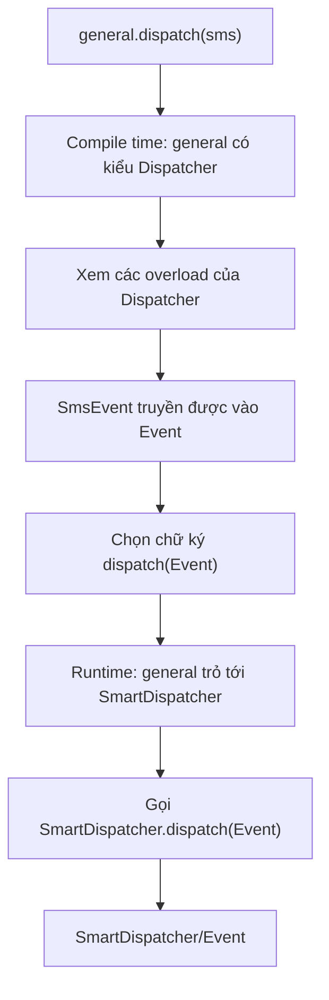

# Phân giải phương thức tĩnh và phân giải động trong Java

Một trong những điểm quan trọng nhất để hiểu **đa hình (polymorphism)** của Java là phân biệt **phương thức nào được chọn khi biên dịch** và **cách triển khai nào được gọi khi chạy**.

Trong một biểu thức gọi phương thức, hai câu hỏi này không luôn có cùng đáp án:

1. **Phân giải tĩnh (*compile-time method resolution*):** dựa vào **kiểu mà trình biên dịch biết**, tên phương thức, số lượng/kiểu đối số, phạm vi truy cập… để xác định một chữ ký phương thức hợp lệ. Đây là bước đặc biệt quan trọng với **overloading**.
2. **Phân giải động (*runtime method dispatch*):** sau khi chữ ký đã được chọn, đối với **phương thức thể hiện có thể ghi đè**, JVM chọn cách triển khai (*override*) tương ứng với **lớp thực tế của đối tượng nhận lời gọi**.

Vì vậy, không nên hiểu “Java luôn chọn phương thức khi biên dịch” hoặc “Java luôn chọn phương thức theo đối tượng lúc chạy”. **Một lời gọi có thể trải qua cả hai bước**, tùy loại phương thức.

## 1. Hai khái niệm qua một ví dụ ngắn

```java
class Animal {}

class Dog extends Animal {}

class Handler {
    String process(Animal value) {
        return "Handler/Animal";
    }

    String process(Dog value) {
        return "Handler/Dog";
    }
}

class SpecialHandler extends Handler {
    @Override
    String process(Animal value) {
        return "SpecialHandler/Animal";
    }

    @Override
    String process(Dog value) {
        return "SpecialHandler/Dog";
    }
}
```

Giờ xét:

```java
Handler handler = new SpecialHandler();
Animal animal = new Dog();

System.out.println(handler.process(animal));
```

Kết quả là:

```text
SpecialHandler/Animal
```

**Vì sao không phải `SpecialHandler/Dog`?**

- **Khi biên dịch:** biến `animal` có kiểu khai báo là `Animal`. Trình biên dịch chọn overload **`process(Animal)`** chứ không chọn `process(Dog)`, dù đối tượng thực tế là `Dog`.
- **Khi chạy:** biến `handler` đang trỏ tới đối tượng `SpecialHandler`. JVM gọi bản override **`SpecialHandler.process(Animal)`**.

Đây là điểm mấu chốt:

> **Overloading chọn chữ ký theo thông tin kiểu lúc biên dịch; overriding chọn cách triển khai của chữ ký đó theo đối tượng nhận lời gọi lúc chạy.**

## 2. Ví dụ Java hoàn chỉnh: kết hợp overload và override

Lưu toàn bộ đoạn sau thành **`Main.java`**. Ví dụ chạy được trên Java 17 hoặc Java 21, không cần thư viện ngoài.

```java
class Event {}

class EmailEvent extends Event {}

class SmsEvent extends Event {}

class Dispatcher {
    String dispatch(Event event) {
        return "Dispatcher/Event";
    }

    String dispatch(EmailEvent event) {
        return "Dispatcher/EmailEvent";
    }

    static String source() {
        return "Dispatcher/static";
    }
}

class SmartDispatcher extends Dispatcher {
    @Override
    String dispatch(Event event) {
        return "SmartDispatcher/Event";
    }

    @Override
    String dispatch(EmailEvent event) {
        return "SmartDispatcher/EmailEvent";
    }

    // Overload mới chỉ có trên SmartDispatcher.
    String dispatch(SmsEvent event) {
        return "SmartDispatcher/SmsEvent";
    }

    // Đây là static method hiding, không phải overriding.
    static String source() {
        return "SmartDispatcher/static";
    }
}

public class Main {
    public static void main(String[] args) {
        Dispatcher general = new SmartDispatcher();
        SmartDispatcher specific = new SmartDispatcher();

        Event emailAsEvent = new EmailEvent();
        EmailEvent email = new EmailEvent();
        SmsEvent sms = new SmsEvent();

        System.out.println(general.dispatch(emailAsEvent));
        System.out.println(general.dispatch(email));
        System.out.println(general.dispatch(sms));
        System.out.println(specific.dispatch(sms));
        System.out.println(((Dispatcher) specific).dispatch(sms));

        System.out.println(Dispatcher.source());
        System.out.println(SmartDispatcher.source());
        System.out.println(general.getClass().getSimpleName());
    }
}
```

Biên dịch và chạy:

```bash
javac Main.java
java Main
```

Kết quả chính xác:

```text
SmartDispatcher/Event
SmartDispatcher/EmailEvent
SmartDispatcher/Event
SmartDispatcher/SmsEvent
SmartDispatcher/Event
Dispatcher/static
SmartDispatcher/static
SmartDispatcher
```

### Phân tích từng lời gọi

| Lời gọi | Overload được chọn **khi biên dịch** | Implementation chạy **lúc runtime** |
| --- | --- | --- |
| `general.dispatch(emailAsEvent)` | `dispatch(Event)` | `SmartDispatcher.dispatch(Event)` |
| `general.dispatch(email)` | `dispatch(EmailEvent)` | `SmartDispatcher.dispatch(EmailEvent)` |
| `general.dispatch(sms)` | `dispatch(Event)` vì kiểu `Dispatcher` không công bố overload `SmsEvent` | `SmartDispatcher.dispatch(Event)` |
| `specific.dispatch(sms)` | `dispatch(SmsEvent)` | `SmartDispatcher.dispatch(SmsEvent)` |
| `((Dispatcher) specific).dispatch(sms)` | `dispatch(Event)` vì kiểu biểu thức sau cast là `Dispatcher` | `SmartDispatcher.dispatch(Event)` |

Hãy lưu ý cặp lời gọi này:

```java
specific.dispatch(sms);                 // SmartDispatcher/SmsEvent
((Dispatcher) specific).dispatch(sms); // SmartDispatcher/Event
```

**Vẫn là cùng một đối tượng `specific` và cùng một đối số `sms`**. Điều thay đổi là **kiểu tham chiếu của biểu thức nhận lời gọi lúc biên dịch**, nên trình biên dịch nhìn thấy tập overload khác nhau. Sau đó, ở mỗi chữ ký đã được chọn, cơ chế dispatch động mới chọn phần triển khai theo đối tượng thực tế.



## 3. Phân giải tĩnh: Java chọn overload ra sao?

**Overloading** là nhiều phương thức cùng tên nhưng có **danh sách tham số khác nhau** (khác số lượng hoặc kiểu tham số):

```java
class Formatter {
    String format(Object value) {
        return "Object";
    }

    String format(Number value) {
        return "Number";
    }

    String format(Integer value) {
        return "Integer";
    }
}
```

Với đoạn mã:

```java
Formatter formatter = new Formatter();
Integer integer = 10;
Number number = integer;
Object object = integer;

System.out.println(formatter.format(integer)); // Integer
System.out.println(formatter.format(number));  // Number
System.out.println(formatter.format(object));  // Object
```

Dù cả ba biến có thể cùng tham chiếu đến một đối tượng `Integer`, kiểu khai báo của biểu thức đối số khác nhau. Trình biên dịch dùng các kiểu đó để tìm phương thức **áp dụng được và phù hợp nhất** theo quy tắc của Java.

### Không đơn thuần là “chọn tham số có tên giống nhất”

Java có các quy tắc chi tiết cho phương thức áp dụng được, chuyển đổi kiểu nguyên thủy, boxing/unboxing và varargs. Một ví dụ đáng nhớ:

```java
class Choice {
    void choose(long value) {
        System.out.println("long");
    }

    void choose(Integer value) {
        System.out.println("Integer");
    }

    void choose(int... values) {
        System.out.println("varargs");
    }
}

new Choice().choose(5); // long
```

Với đối số literal `5` kiểu `int`, overload `choose(long)` phù hợp nhờ **widening primitive conversion** ngay ở pha tìm kiếm phương thức không boxing. Java không mặc định chọn `choose(Integer)` hay `choose(int...)` chỉ vì chúng cũng nhận được giá trị sau các phép chuyển đổi khác.

Có thể ghi nhớ thứ tự xét ở mức khái quát: Java ưu tiên tìm overload không cần boxing/varargs, tiếp đến những trường hợp dùng boxing/unboxing, và cuối cùng mới xét lời gọi theo kiểu varargs nếu chưa chọn được phương thức ở các pha trước. Việc chọn phương thức cụ thể vẫn tuân thủ các quy tắc “most specific”; không phải một bảng ưu tiên duy nhất đúng cho mọi cặp kiểu.

### Overload có thể mơ hồ

```java
class Ambiguous {
    void send(String message) {}
    void send(Integer code) {}
}

// new Ambiguous().send(null); // Lỗi biên dịch: ambiguous
```

`null` có thể gán cho cả `String` và `Integer`; không kiểu nào là subtype của kiểu kia, nên compiler không thể chọn một overload duy nhất.

Có thể chỉ rõ ý định:

```java
new Ambiguous().send((String) null);
```

**Lưu ý:** dòng ép kiểu giải quyết vấn đề chọn overload, không có nghĩa phương thức bên trong sẽ xử lý `null` an toàn. Hợp đồng của từng phương thức vẫn phải kiểm tra khi cần.

## 4. Phân giải động: ghi đè phương thức theo kiểu đối tượng

**Overriding** xảy ra khi lớp con cung cấp cách triển khai mới cho một **phương thức thể hiện có thể ghi đè** được kế thừa từ lớp cha hoặc hợp đồng interface.

```java
class Payment {
    String status() {
        return "Payment";
    }
}

class CardPayment extends Payment {
    @Override
    String status() {
        return "CardPayment";
    }
}

Payment p = new CardPayment();
System.out.println(p.status()); // CardPayment
```

Trình biên dịch kiểm tra biến `p` kiểu `Payment` có phương thức `status()`. Đến runtime, JVM biết đối tượng thực tế là `CardPayment` nên chạy `CardPayment.status()`.

Khả năng này cho phép viết logic nhận kiểu cha:

```java
static void printStatus(Payment payment) {
    System.out.println(payment.status());
}
```

Truyền `new Payment()`, `new CardPayment()` hoặc một subtype khác vào `printStatus` mà không cần kiểm tra `instanceof` cho từng loại. Đây chính là **runtime polymorphism**.

### Lời gọi qua interface cũng có thể dispatch động

```java
interface Notifier {
    void notifyUser();
}

class EmailNotifier implements Notifier {
    @Override
    public void notifyUser() {
        System.out.println("Email");
    }
}

class SmsNotifier implements Notifier {
    @Override
    public void notifyUser() {
        System.out.println("SMS");
    }
}

Notifier n = new EmailNotifier();
n.notifyUser(); // Email
n = new SmsNotifier();
n.notifyUser(); // SMS
```

`Notifier` xác định **khả năng cần gọi**. Đối tượng `EmailNotifier` hay `SmsNotifier` xác định **phần triển khai thực sự**. Việc chọn một interface ở mức thiết kế không xóa các bước kiểm tra kiểu lúc biên dịch: `n` vẫn chỉ được gọi những phương thức công bố phù hợp qua `Notifier` và `Object`.

## 5. `static` method: hiding, không phải overriding

Một nguồn nhầm lẫn lớn là phương thức được khai báo bằng `static`. Trong Java, phương thức tĩnh **thuộc lớp**, không được ghi đè bằng cơ chế đa hình instance. Khi lớp con khai báo một static method tương ứng, hiện tượng đó gọi là **method hiding**.

```java
class Parent {
    static String typeName() {
        return "Parent";
    }
}

class Child extends Parent {
    static String typeName() {
        return "Child";
    }
}

Parent ref = new Child();
System.out.println(Parent.typeName()); // Parent
System.out.println(Child.typeName());  // Child

// System.out.println(ref.typeName()); // Nếu viết sẽ trả Parent,
// nhưng nên tránh gọi static qua biến tham chiếu.
```

Nếu gọi `ref.typeName()` (Java cho phép cú pháp này nhưng thường có cảnh báo IDE), phương thức được xác định theo **kiểu biểu thức tham chiếu `Parent`**, không theo lớp thực tế `Child`.

Bởi vậy hãy gọi `Parent.typeName()` hoặc `Child.typeName()` khi cần static method, để người đọc không nhầm với dispatch động.

| Loại phương thức | Có đa hình override theo runtime object? | Ghi chú |
| --- | --- | --- |
| Instance method có thể override | **Có** | Lớp con có thể thay implementation |
| Instance method `final` | **Không thể override** | Phương thức được chọn không có bản override hợp lệ ở lớp con |
| Instance method `private` | **Không thể override** | Không được kế thừa theo cơ chế override thông thường |
| `static` method | **Không** | Có thể bị *hide* bởi static method tương ứng |
| Constructor | **Không** | Không được kế thừa/override |
| Lời gọi `super.method()` | Gọi triển khai được chỉ định từ lớp cha | Không chọn bản override của chính lớp con cho lời gọi này |

**Không nên hiểu rằng “`final` luôn biên dịch thành một loại bytecode gọi tĩnh”.** Ở mức ngôn ngữ, `final` ngăn override; JVM/JIT có thể tối ưu lời gọi phù hợp. Đây là câu chuyện khác với cách Java phân giải overload ở compile time.

## 6. Truy cập trường không giống gọi instance method

Đa hình áp dụng cho phương thức instance được override, **không áp dụng cho trường theo cách tương tự**.

```java
class Base {
    String name = "Base";

    String getName() {
        return name;
    }
}

class Derived extends Base {
    String name = "Derived";

    @Override
    String getName() {
        return name;
    }
}

Base ref = new Derived();

System.out.println(ref.name);      // Base
System.out.println(ref.getName()); // Derived
```

`ref.name` sử dụng cách truy cập trường được chọn theo **kiểu tham chiếu `Base`**, còn `ref.getName()` gọi override của `Derived` theo đối tượng thực tế.

Đây là một lý do nên tránh khai báo lại trường cùng tên giữa cha và con (*field hiding*). Ưu tiên đóng gói trường bằng `private` rồi công bố hành vi/giá trị qua phương thức có hợp đồng rõ ràng.

## 7. Overload được chọn rồi, override vẫn có thể thực thi

Đặt hai giai đoạn cạnh nhau để tránh nhầm:

```java
class Converter {
    String convert(Object x) {
        return "Converter/Object";
    }

    String convert(String x) {
        return "Converter/String";
    }
}

class LoggingConverter extends Converter {
    @Override
    String convert(Object x) {
        return "LoggingConverter/Object";
    }

    @Override
    String convert(String x) {
        return "LoggingConverter/String";
    }
}
```

Với:

```java
Converter converter = new LoggingConverter();
Object textAsObject = "hello";

System.out.println(converter.convert(textAsObject));
// LoggingConverter/Object

System.out.println(converter.convert("hello"));
// LoggingConverter/String
```

**Lời gọi thứ nhất:** tham số có kiểu `Object` nên chọn chữ ký `convert(Object)`; đối tượng nhận lời gọi là `LoggingConverter` nên thực thi override `LoggingConverter.convert(Object)`.

**Lời gọi thứ hai:** literal `"hello"` có kiểu `String` nên chọn chữ ký `convert(String)`; runtime thực thi bản override `LoggingConverter.convert(String)`.

Java chủ yếu sử dụng **single dispatch** cho phương thức instance: dispatch động dựa trên đối tượng nhận lời gọi, **không** tự chọn overload mới theo lớp runtime của từng đối số. Nếu thật sự cần hành vi phụ thuộc đồng thời vào nhiều kiểu runtime, có thể xem xét Visitor/double dispatch, pattern matching hoặc bảng xử lý theo loại dữ liệu tùy bài toán — nhưng đó là quyết định thiết kế khác, không phải cơ chế overload mặc định.

## 8. Mối liên hệ với `this`, `super` và lời gọi từ lớp cha

Khi bên trong một phương thức instance dùng:

```java
this.run();
```

Lời gọi `run()` bình thường vẫn có thể sử dụng dynamic dispatch, vì `this` là đối tượng thực tế đang nhận lời gọi. Nếu đối tượng đó thuộc lớp con có override `run()`, phiên bản lớp con có thể được thực thi.

Ngược lại:

```java
super.run();
```

được dùng trong lớp con để gọi cách thực hiện tương ứng được truy cập từ lớp cha, thay vì gọi lại chính override của lớp con.

Ví dụ:

```java
class Parent {
    void greet() {
        System.out.println("Xin chào");
    }
}

class Child extends Parent {
    @Override
    void greet() {
        super.greet();
        System.out.println("Từ lớp con");
    }
}

Parent value = new Child();
value.greet();
```

Kết quả:

```text
Xin chào
Từ lớp con
```

Cơ chế gồm: lời gọi `value.greet()` được dispatch vào `Child.greet()`; sau đó `super.greet()` gọi phần thực hiện của `Parent` trước khi tiếp tục thân `Child.greet()`.

**Cạm bẫy constructor:** không nên gọi phương thức có thể override từ constructor lớp cha, vì nó có thể dispatch vào lớp con **trước khi các trường của lớp con khởi tạo xong**. Dynamic dispatch vẫn tồn tại khi khởi tạo, và đó có thể là nguyên nhân của lỗi `null` hoặc trạng thái chưa hoàn chỉnh.

## 9. Liên hệ với JVM bytecode (hiểu đúng ở mức vừa đủ)

Java Virtual Machine có các chỉ thị gọi phương thức với ngữ nghĩa khác nhau. Ở mức khái quát:

| Chỉ thị JVM | Nhóm lời gọi thường gặp |
| --- | --- |
| `invokestatic` | Gọi phương thức `static` |
| `invokevirtual` | Gọi phương thức instance thông thường trên đối tượng |
| `invokeinterface` | Gọi phương thức instance qua hợp đồng interface |
| `invokespecial` | Một số lời gọi đặc biệt như constructor, `super.method()` và private method |
| `invokedynamic` | Cơ chế liên kết lời gọi động ở cấp JVM, như một số cách triển khai lambda hoặc string concatenation |

**Cẩn thận với tên gọi:** `invokedynamic` trong bytecode **không đồng nghĩa** với dynamic dispatch OOP của một lời gọi override thông thường. Dynamic dispatch của instance method chủ yếu liên quan các cơ chế như `invokevirtual` hoặc `invokeinterface`; `invokedynamic` phục vụ các điểm liên kết lời gọi có *bootstrap method*.

Phương pháp đơn giản để khám phá sau khi biên dịch ví dụ:

```bash
javac Main.java
javap -c Main
```

Lệnh `javap -c` hiển thị bytecode của lớp được yêu cầu. Nếu muốn xem phương thức trong các lớp khác của ví dụ, có thể chỉ định đúng tên lớp tương ứng. Bytecode giúp quan sát cơ chế, nhưng để học và thiết kế OOP, trước tiên hãy nắm vững **chữ ký được chọn lúc biên dịch** và **implementation được gọi lúc chạy**.

## 10. Những sai lầm phổ biến

| Nhận định/đoạn mã dễ sai | Vì sao sai? | Điều cần nhớ |
| --- | --- | --- |
| “Đối số runtime là `EmailEvent` thì chắc gọi overload `dispatch(EmailEvent)`” | Overload được chọn từ kiểu biểu thức lúc biên dịch | Biến `Event` chọn overload `Event` |
| “Kiểu biến là `Dispatcher` nên luôn chạy code `Dispatcher`” | Override chạy theo lớp đối tượng thực tế | `new SmartDispatcher()` có thể chạy override |
| “Static method ở lớp con override static ở lớp cha” | Đó là method hiding | Gọi static qua tên lớp |
| “Field `name` cũng được dispatch động” | Trường được phân giải theo kiểu tham chiếu | Phân biệt `ref.name` với `ref.getName()` |
| “Một cast receiver không ảnh hưởng overload” | Kiểu biểu thức receiver có thể thay đổi tập overload nhìn thấy | So sánh `specific.dispatch(sms)` với `((Dispatcher)specific).dispatch(sms)` |
| “Dùng `@Override` với phương thức khác tham số vẫn được” | Khác danh sách tham số có thể là overload | Thêm `@Override` để trình biên dịch phát hiện |
| “`send(null)` sẽ tự chọn overload nào cũng được” | Các overload kiểu tham chiếu không liên quan có thể mơ hồ | Cast tường minh khi thật sự cần |
| “`invokedynamic` chính là override” | Đây là hai khái niệm khác ở mức JVM | Đừng suy luận theo tên opcode |
| “Phương thức `final` có thể override nhưng không được gọi” | `final` chặn override, không chặn lời gọi thông thường | Dùng `final` để cố định hành vi khi có lý do |

## 11. Khi nào sự phân biệt này có ích?

- **Thiết kế API:** khi có nhiều overload, hãy làm rõ kiểu tham số để caller không vô tình chọn nhầm hàm chỉ vì khai báo biến là supertype.
- **Debug:** nếu kết quả khác kỳ vọng, xác định trước **chữ ký nào đã được compiler chọn**, sau đó mới kiểm tra **override nào được chạy**.
- **Dependency injection:** biến kiểu interface vẫn gọi đúng cách triển khai ở runtime; đây là nền tảng của đa hình ở tầng service/adapter.
- **Refactor:** thêm một overload mới có thể thay đổi việc chọn phương thức tại chỗ gọi khi biên dịch lại, ngay cả khi các bản override cũ không thay đổi.
- **Kiểm thử:** nên có test cho các tổ hợp kiểu biến, kiểu đối số và lớp thực tế nếu API dùng nhiều overload kết hợp kế thừa.
- **Performance:** JVM có thể inlining, devirtualization và tối ưu lời gọi phù hợp; đừng cho rằng mọi lời gọi đa hình đều chậm theo một mức cố định. Đo bằng profiling/benchmark nếu hiệu năng là yêu cầu thật.

## 12. Tự kiểm tra

**Câu 1.** Kết quả của đoạn sau là gì?

```java
Dispatcher dispatcher = new SmartDispatcher();
Event event = new EmailEvent();
System.out.println(dispatcher.dispatch(event));
```

**Đáp án:** `SmartDispatcher/Event`. Compiler chọn `dispatch(Event)`, runtime chạy override của `SmartDispatcher`.

**Câu 2.** Vì sao `specific.dispatch(sms)` khác `((Dispatcher) specific).dispatch(sms)`?

**Đáp án:** Kiểu tham chiếu lúc biên dịch khác nhau. `SmartDispatcher` nhìn thấy overload `dispatch(SmsEvent)`; `Dispatcher` chỉ thấy `dispatch(Event)` và `dispatch(EmailEvent)`, nên với `SmsEvent` sẽ chọn `Event`.

**Câu 3.** `Parent ref = new Child();` rồi gọi `ref.typeName()` với cả hai lớp khai báo phương thức `static` cùng tên thì phương thức nào được dùng?

**Đáp án:** Phương thức static theo kiểu `Parent`. Tuy nhiên nên viết `Parent.typeName()` để tránh gây hiểu nhầm.

**Câu 4.** Tại sao `format(number)` chọn `format(Number)` khi `number` có kiểu `Number` nhưng đang trỏ tới `Integer`?

**Đáp án:** Overload resolution sử dụng kiểu biểu thức lúc biên dịch, không tự chọn overload theo runtime class của đối số.

**Câu 5.** Nếu lớp con override `greet()`, lời gọi `super.greet()` trong override có gọi lại chính override của lớp con không?

**Đáp án:** Không. Nó gọi cách thực hiện tương ứng từ lớp cha theo ngữ nghĩa của `super`, giúp lớp con tái sử dụng hành vi cha.

**Câu 6.** `List<Payment>` chứa `new CardPayment()`; gọi `payment.status()` trong vòng lặp sẽ chọn bản nào?

**Đáp án:** Với một phần tử là `CardPayment`, nếu `status()` được override, bản `CardPayment.status()` sẽ chạy; kiểu phần tử khai báo `Payment` chỉ quyết định hợp đồng có thể gọi.

**Ghi nhớ:** Để xác định kết quả lời gọi phương thức Java, hãy đặt hai câu hỏi theo thứ tự: **“Compiler chọn chữ ký nào từ các kiểu đang nhìn thấy?”** và **“Đối tượng thực tế có override chữ ký đó không?”**. Overloading nghiêng về phân giải tĩnh, overriding sử dụng phân giải động; phương thức `static`, trường, constructor và lời gọi `super` có quy tắc riêng. Nắm được ranh giới này giúp hiểu đúng đa hình và tránh những lỗi rất khó phát hiện khi dùng kế thừa.