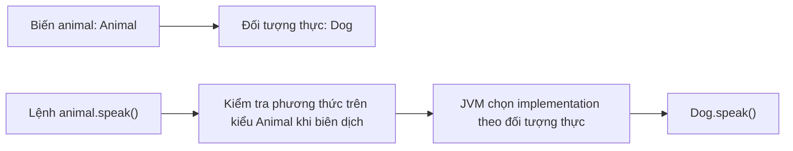
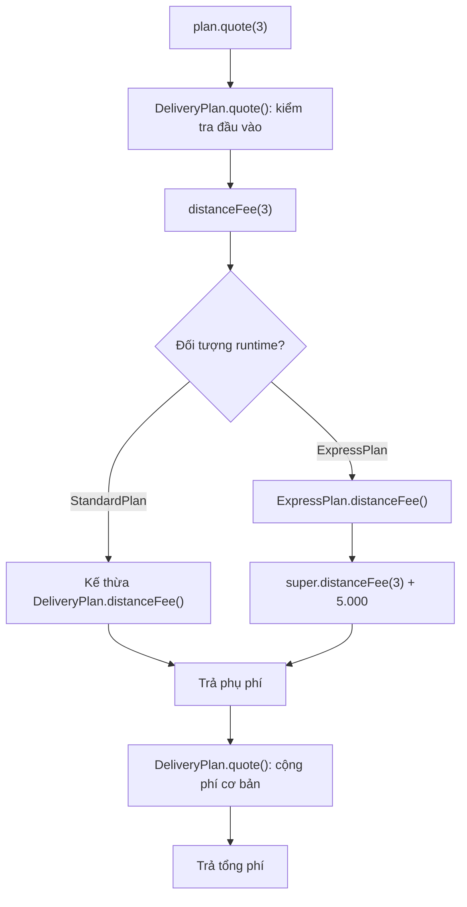

# Ghi đè và lựa chọn phương thức khi chạy trong Java

> **OOP → Đa hình (Polymorphism).** Khi một biến có kiểu lớp cha nhưng đang tham chiếu tới đối tượng lớp con, lời gọi một **phương thức instance có thể ghi đè** sẽ chạy implementation phù hợp với **kiểu thực tế của đối tượng**. Cơ chế này gọi là **dynamic dispatch** (lựa chọn phương thức lúc chạy). Nó là nền tảng để cùng một đoạn mã làm việc với nhiều loại đối tượng mà không phải viết `if/else` để nhận diện từng lớp.

## 1. Hai kiểu cần phân biệt trong một lời gọi

```java
Animal animal = new Dog();
animal.speak();
```

Dòng đầu chứa **hai kiểu khác nhau**:

- **Kiểu khai báo (compile-time type):** `Animal`. Trình biên dịch dùng kiểu này để kiểm tra những phương thức nào được phép gọi và cách chọn lời gọi hợp lệ.
- **Kiểu thực tế (runtime class):** `Dog`. Khi `Dog` ghi đè `speak()`, JVM gọi implementation của `Dog` cho phương thức instance đó.

Ví dụ ngắn:

```java
class Animal {
    void speak() {
        System.out.println("Âm thanh động vật");
    }
}

class Dog extends Animal {
    @Override
    void speak() {
        System.out.println("Gâu gâu");
    }
}

// Đặt trong một phương thức như main():
Animal animal = new Dog();
animal.speak(); // Gâu gâu
```

Tuy biến được khai báo là `Animal`, đối tượng thực vẫn là `Dog`. Phương thức `speak()` ở `Dog` **ghi đè (override)** `speak()` được kế thừa từ `Animal`, nên phiên bản `Dog` được chọn lúc chạy.



**Điểm cốt lõi:** không phải cứ thấy `new Dog()` là trình biên dịch tự thay mọi lời gọi thành lời gọi của `Dog`. Việc chọn **chữ ký** và kiểm tra **quyền truy cập** vẫn diễn ra từ thông tin kiểu tại thời điểm biên dịch. Chỉ những lời gọi phương thức instance đủ điều kiện dispatch động mới chọn implementation theo đối tượng runtime.

## 2. Ví dụ hoàn chỉnh: nhiều kế hoạch giao hàng, một lời gọi `quote()`

Một hệ thống vận chuyển có hai kế hoạch: thông thường và hỏa tốc. Mỗi kế hoạch đều phải tính tổng phí sau khi kiểm tra khoảng cách, nhưng phần phụ phí khoảng cách có thể khác nhau.

Lưu toàn bộ mã thành `RuntimeDispatchDemo.java` (**Java 17+**):

```java
import java.util.List;

public class RuntimeDispatchDemo {

    static class DeliveryPlan {
        private final long baseFeeVnd;

        protected DeliveryPlan(long baseFeeVnd) {
            if (baseFeeVnd < 0) {
                throw new IllegalArgumentException("Phí cơ bản không thể âm");
            }
            this.baseFeeVnd = baseFeeVnd;
        }

        public String name() {
            return "Gói giao hàng";
        }

        protected long distanceFee(int distanceKm) {
            return Math.multiplyExact(2_000L, distanceKm);
        }

        // Quy trình chung: lớp con không được ghi đè toàn bộ quy trình này.
        public final long quote(int distanceKm) {
            if (distanceKm <= 0) {
                throw new IllegalArgumentException("Khoảng cách phải dương");
            }

            long extra = distanceFee(distanceKm);
            if (extra < 0) {
                throw new IllegalStateException("Phụ phí không thể âm");
            }

            return Math.addExact(baseFeeVnd, extra);
        }
    }

    static final class StandardPlan extends DeliveryPlan {
        StandardPlan() {
            super(10_000L);
        }

        @Override
        public String name() {
            return "Thông thường";
        }
        // Giữ nguyên distanceFee() do lớp cha định nghĩa.
    }

    static final class ExpressPlan extends DeliveryPlan {
        ExpressPlan() {
            super(15_000L);
        }

        @Override
        public String name() {
            return "Hỏa tốc";
        }

        @Override
        protected long distanceFee(int distanceKm) {
            long normalDistanceFee = super.distanceFee(distanceKm);
            return Math.addExact(normalDistanceFee, 5_000L);
        }
    }

    public static void main(String[] args) {
        List<DeliveryPlan> plans = List.of(
            new StandardPlan(),
            new ExpressPlan()
        );

        for (DeliveryPlan plan : plans) {
            System.out.println(plan.name() + ": "
                    + plan.quote(3) + " VND");
        }

        DeliveryPlan selected = new ExpressPlan();
        System.out.println("Đối tượng thực: "
                + selected.getClass().getSimpleName());
    }
}
```

Biên dịch và chạy:

```bash
javac RuntimeDispatchDemo.java
java RuntimeDispatchDemo
```

Kết quả:

```text
Thông thường: 16000 VND
Hỏa tốc: 26000 VND
Đối tượng thực: ExpressPlan
```

Cách tính với 3 km:

| Loại đối tượng thực | Phí cơ bản | Phụ phí | Tổng |
|---|---:|---:|---:|
| `StandardPlan` | 10.000 VND | 3 × 2.000 = 6.000 VND | **16.000 VND** |
| `ExpressPlan` | 15.000 VND | 3 × 2.000 + 5.000 = 11.000 VND | **26.000 VND** |

Cùng lời gọi `plan.name()` hoặc `plan.quote(3)` nhưng hành vi được quyết định bởi đối tượng mà `plan` đang giữ:

- `StandardPlan` **ghi đè `name()`**, không ghi đè `distanceFee()`, nên dùng công thức phụ phí của lớp cha.
- `ExpressPlan` **ghi đè cả `name()` và `distanceFee()`**. Bên trong `distanceFee()`, lời gọi `super.distanceFee(...)` dùng công thức của lớp cha rồi cộng 5.000 VND.
- `quote()` có `final`, vì thế lớp con không thể override nó. Tuy nhiên, bên trong `quote()` có lời gọi **instance method** `distanceFee()`; lời gọi này **vẫn được dispatch động** đến implementation phù hợp.
- `getClass()` phản ánh lớp runtime của đối tượng, không phải kiểu khai báo của biến.

Đoạn `for` không cần biết tên lớp con để tính phí. Điều này cho phép thêm một lớp kế hoạch mới khi cần mà ít sửa mã gọi chung.

### Phân tích đường gọi



Đây là sự kết hợp giữa **ghi đè**, **đa hình** và **phương thức chung**. Không bắt buộc `DeliveryPlan` phải là lớp `abstract` để overriding hoạt động: một lớp concrete vẫn có thể có các phương thức instance được ghi đè.

## 3. Ghi đè (overriding) cần thỏa điều kiện gì?

Hai phương thức có tên giống nhau **chưa chắc** tạo thành overriding.

```java
class Parent {
    public Number value() {
        return 10;
    }
}

class Child extends Parent {
    @Override
    public Integer value() {
        return 20;
    }
}
```

Đây là ghi đè hợp lệ. `Integer` là kiểu trả về **hiệp biến** so với `Number`: nó là subtype của `Number`. Nếu biến kiểu `Parent` đang giữ `Child`, `value()` vẫn trả về object do implementation `Child` tạo.

Các nguyên tắc chính:

| Khía cạnh | Quy tắc |
|---|---|
| Tên và tham số | Phải là chữ ký phù hợp để override; chỉ đổi tham số thường thành **overload** |
| Kiểu trả về | Giữ tương thích; với reference type có thể dùng kiểu con (covariant return) |
| Phạm vi truy cập | Không được thu hẹp quyền truy cập, ví dụ `public` thành `protected` |
| Checked exceptions | Không được mở rộng loại checked exception vượt quá hợp đồng phương thức cha |
| `final` instance method | Không thể override |
| `private` method | Không được kế thừa theo cách để override |
| `static` method | Có thể bị **ẩn (method hiding)**, không được override động |
| Constructor | Không được kế thừa hoặc override |
| `@Override` | Nên dùng: trình biên dịch xác nhận lời khai báo thật sự ghi đè/triển khai một phương thức hợp lệ |

Ví dụ sai dễ gặp:

```java
class Parent {
    public void execute(String task) {}
}

class Child extends Parent {
    // @Override // Nếu thêm @Override, trình biên dịch sẽ báo lỗi.
    public void execute(int task) {}
}
```

`execute(int)` không override `execute(String)`: danh sách tham số khác nhau nên đây là một phương thức **overload**. Khi người dùng gọi `execute("task")`, phương thức `Parent.execute(String)` vẫn được dùng nếu `Child` không ghi đè chữ ký đó.

Trong thiết kế API, một phương thức abstract hoặc interface method cũng có thể được lớp triển khai override. Không phải chỉ các phương thức cụ thể trong lớp cha mới có thể được ghi đè.

## 4. Runtime chỉ chọn implementation **sau khi** compiler chọn chữ ký

Nếu class cha có `process(Object)`, class con override phương thức đó và bổ sung overload `process(String)`, hai cách gọi sau có thể khác nhau:

~~~java
class Parent {
    String process(Object value) { return "Parent/Object"; }
}
class Child extends Parent {
    @Override String process(Object value) { return "Child/Object"; }
    String process(String value) { return "Child/String"; }
}

Parent parentView = new Child();
Child childView = new Child();

System.out.println(parentView.process("hi")); // Child/Object
System.out.println(childView.process("hi"));  // Child/String
~~~

Trong lời gọi đầu, compiler chỉ thấy `process(Object)` qua kiểu `Parent`, sau đó dispatch tới `Child.process(Object)`. Ở lời gọi sau, compiler thấy overload `process(String)` trên `Child` và chọn chữ ký cụ thể hơn. **Overload dựa vào kiểu tĩnh; override dựa vào receiver runtime**. Cách phân tích chi tiết và các trường hợp `null`/boxing/varargs được đặt ở bài *Phân biệt ghi đè với nạp chồng*.

## 5. `static`, `private`, `final` và field có ranh giới khác override

| Thành viên | Điều cần nhớ |
|---|---|
| Static method | Cùng chữ ký ở lớp con là *hiding*; gọi bằng tên class để rõ ý |
| Field | Không override; truy cập theo kiểu tĩnh của biểu thức |
| Private method | Không được kế thừa để override |
| Final instance method | Không thể override, nhưng **bản thân nó vẫn có thể gọi một hook overridable** |
| Constructor | Có thể overload; không thể override |

Đây là lý do `DeliveryPlan.quote()` được `final` mà `distanceFee()` bên trong vẫn dispatch theo subtype. Nếu cần xem kết quả chính xác của field hiding, static hiding và getter, hãy đọc bài *Phân biệt che khuất thành viên với ghi đè* hoặc *Phạm vi đa hình của phương thức và thuộc tính*.

## 6. `super.method()` có ý nghĩa gì?

Trong lớp con, `super.method()` là cách gọi implementation được kế thừa từ lớp cha theo quy tắc Java, **không phải** cách “đổi object thành lớp cha”.

Ví dụ trong `ExpressPlan.distanceFee()`:

```java
@Override
protected long distanceFee(int distanceKm) {
    long base = super.distanceFee(distanceKm);
    return Math.addExact(base, 5_000L);
}
```

`super.distanceFee(...)` gọi cách tính của `DeliveryPlan`, sau đó lớp con thêm phụ phí. Tham chiếu `this` vẫn là **cùng object `ExpressPlan`**.

Nếu không gọi `super`, lớp con có thể thay thế hoàn toàn hành vi:

```java
@Override
protected long distanceFee(int distanceKm) {
    return Math.multiplyExact(4_000L, distanceKm);
}
```

Chọn mở rộng hay thay thế phải dựa trên hợp đồng lớp cha. Gọi `super` mù quáng có thể lặp tác động phụ; không gọi `super` khi lớp cha đòi duy trì invariant cũng có thể gây lỗi. Vì vậy lớp nền nên nêu rõ hook nào cho phép override và những điều kiện bắt buộc khi override.

## 7. Kiểm soát rủi ro của dynamic dispatch trong constructor

Một bẫy thường gặp: constructor lớp cha gọi một phương thức bị lớp con ghi đè.

```java
public class ConstructorDispatchTrap {
    static class Parent {
        Parent() {
            System.out.println("Trong Parent(): " + describe());
        }

        String describe() {
            return "Parent";
        }
    }

    static final class Child extends Parent {
        private String name = "Sẵn sàng";

        @Override
        String describe() {
            return name;
        }
    }

    public static void main(String[] args) {
        Child child = new Child();
        System.out.println("Sau khi tạo: " + child.describe());
    }
}
```

Kết quả:

```text
Trong Parent(): null
Sau khi tạo: Sẵn sàng
```

Lúc constructor `Parent` chạy, trường instance riêng `name` của `Child` chưa chạy initializer `"Sẵn sàng"`. Dù vậy, Java vẫn dispatch lời gọi `describe()` đến `Child.describe()`. Vì thế phương thức của lớp con quan sát `name == null`.

**Không nên gọi phương thức có thể override từ constructor**, đặc biệt nếu lớp con cần các trường được khởi tạo đầy đủ. Có thể dùng helper `private` hoặc `final` trong constructor nếu phù hợp, hoặc chuyển các hook mở rộng ra sau khi object khởi tạo xong. Rủi ro không nằm ở cú pháp `@Override`, mà ở thời điểm đối tượng còn đang khởi tạo.

## 8. Khi nào ghi đè là một thiết kế tốt?

Lớp con nên giữ đúng **hợp đồng** của lớp cha. Ví dụ tất cả `DeliveryPlan.quote(km)` đều phải trả phí không âm cho khoảng cách dương; một subclass không nên phá quy tắc bằng cách âm thầm trả giá trị âm hoặc thay ý nghĩa của đơn vị `km`.

Gợi ý:

| Tình huống | Lựa chọn |
|---|---|
| Các đối tượng thực sự là những biến thể của cùng một loại | Kế thừa + overriding có thể phù hợp |
| Có quy trình chung bắt buộc, chỉ một bước thay đổi | Lớp nền giữ phương thức `final`, gọi một hook có thể override |
| Các kiểu không cùng quan hệ is-a nhưng có cùng khả năng | Interface + nhiều implementation |
| Cần kết hợp nhiều quy tắc độc lập (phụ phí, giảm giá...) | Composition/strategy thường dễ mở rộng hơn cây kế thừa sâu |
| Lớp con không thể giữ hợp đồng lớp cha | Xem lại quan hệ kế thừa |

Để bảo vệ quy trình chung, `quote()` trong ví dụ được đánh dấu `final`, còn `distanceFee()` là extension point. Thiết kế này giữ bước kiểm tra khoảng cách và xử lý overflow ở lớp nền, cho phép các lớp con thay đổi cách tính phụ phí.

**Một lưu ý hiệu năng:** dynamic dispatch không tự động có nghĩa “mỗi lần gọi đều rất chậm”. JVM/JIT có thể tối ưu và inline nhiều lời gọi ảo khi đủ thông tin. Chi phí thực tế cần đo bằng profiler/benchmark; nên ưu tiên tính đúng đắn và khả năng bảo trì trước khi tối ưu vi mô.

## 9. Những lỗi dễ mắc khi thiết kế hook được override

- **Gõ sai chữ ký** rồi tưởng subclass đã thay hành vi: thêm `@Override` để compiler phát hiện, kiểm tra tên và kiểu tham số.
- **Đặt `static` vào điểm mở rộng** rồi mong đa hình động: dùng instance method với hợp đồng rõ.
- **Mở hook overridable trong constructor** khi subclass chưa hoàn tất khởi tạo: chỉ dùng phương thức không override được trong giai đoạn thiết lập hoặc tách giai đoạn kích hoạt sau construction.
- **Cho subclass phá invariant**: nếu `quote(km)` đòi khoảng cách dương và phí không âm, hook `distanceFee(km)` của lớp con phải tuân thủ yêu cầu ấy.
- **Lạm dụng `super`**: gọi phần triển khai lớp cha chỉ khi hợp đồng cho phép kết hợp, tránh thực hiện trùng side effect.

Với Template Method, nên giữ quy trình bất biến trong method `final` và chỉ công khai hook nhỏ nhất cần thay đổi. Cách này giảm rủi ro so với để mọi subclass ghi đè toàn bộ chuỗi kiểm tra và tính phí.

## 10. Tự kiểm tra

### Bài tập 1: dự đoán đầu ra

```java
class A {
    String message() { return "A"; }
}
class B extends A {
    @Override String message() { return "B"; }
}
class C extends B {
    @Override String message() { return "C"; }
}

// Trong main():
A x = new C();
B y = new C();
System.out.println(x.message());
System.out.println(y.message());
```

**Đáp án:** hai dòng đều là `C`. Kiểu khai báo của biến khác nhau nhưng đối tượng thực cùng thuộc `C`, và phương thức instance có implementation cuối cùng ở `C`.

### Bài tập 2: phân biệt hai giai đoạn

```java
class Base {
    String send(Object value) { return "Base:Object"; }
}
class Derived extends Base {
    @Override
    String send(Object value) { return "Derived:Object"; }

    String send(String value) { return "Derived:String"; }
}

Base base = new Derived();
Derived derived = new Derived();
Object text = "Java";

System.out.println(base.send("Java"));
System.out.println(derived.send("Java"));
System.out.println(derived.send(text));
```

**Đáp án:** `Derived:Object`, `Derived:String`, `Derived:Object`. Hãy chỉ ra chữ ký nào được trình biên dịch chọn trong từng lời gọi và lớp runtime nào cung cấp implementation.

### Bài tập 3: bổ sung loại giao hàng

Từ `RuntimeDispatchDemo`, thêm `SameDayPlan extends DeliveryPlan` với phí cơ bản 20.000 VND, phụ phí 4.000 VND mỗi km. Thêm instance vào `List<DeliveryPlan>`. Kiểm tra rằng vòng lặp trong `main` không cần sửa cấu trúc để gọi `name()` và `quote()`.

### Bài tập 4: kiểm tra ranh giới

Thử thêm một `@Override` trước phương thức `quote(int)` của lớp con. Vì sao trình biên dịch từ chối? Giải thích ý nghĩa của `final` trong thiết kế lớp nền.

### Bài tập 5: phương thức static

Với `StaticHidingDemo`, thay `Parent reference = new Child()` bằng `Child reference = new Child()`. Dự đoán `reference.type()` và `reference.describe()`. Giải thích sự khác biệt giữa method hiding và dynamic dispatch.

---

**Ghi nhớ:** Trong Java, **overloading quyết định chữ ký tại thời điểm biên dịch**, còn **overriding quyết định implementation của phương thức instance theo lớp thực tế của đối tượng khi chạy**. Kiểu khai báo xác định phương thức có thể gọi; kiểu runtime xác định phiên bản ghi đè được thực thi. Nắm rõ ranh giới này giúp đọc đúng mã đa hình và tránh nhầm `static`, field, constructor với phương thức instance.