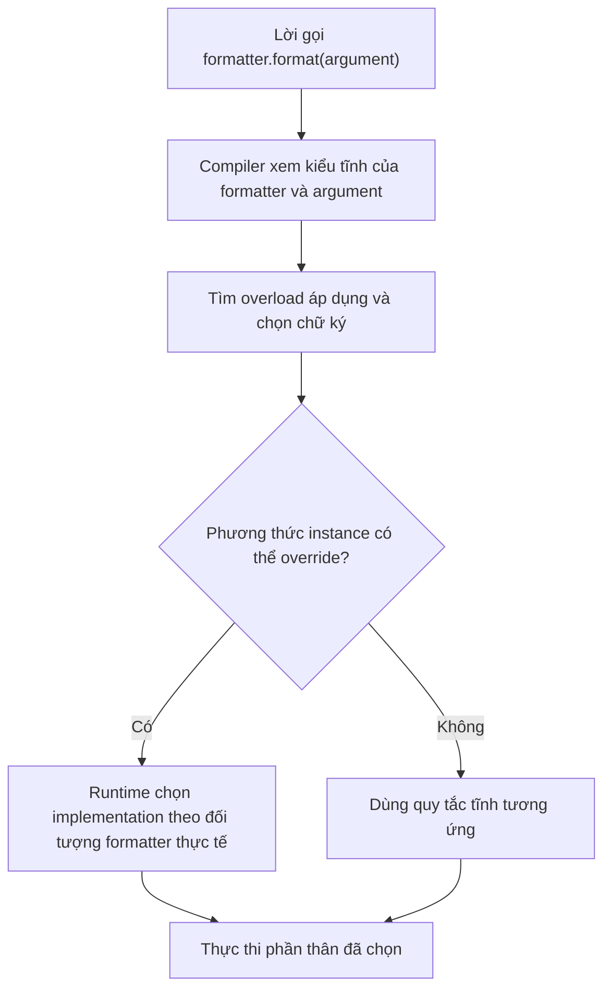

# Phân biệt ghi đè (overriding) với nạp chồng (overloading) trong Java

**Ghi đè phương thức (method overriding)** và **nạp chồng phương thức (method overloading)** đều cho phép xuất hiện nhiều phương thức cùng tên, nhưng chúng là **hai cơ chế khác nhau**. Phân biệt đúng hai cơ chế là nền tảng để hiểu đa hình trong Java: *trình biên dịch chọn phương thức nào*, *JVM thực thi phần thân nào*, và *kiểu của biến tham chiếu ảnh hưởng ra sao*.

Một quy tắc ghi nhớ hữu ích:

- **Overloading:** *Cùng tên, khác danh sách tham số*. Trình biên dịch chọn một chữ ký thích hợp dựa trên **kiểu đối số tại điểm gọi**.
- **Overriding:** *Lớp con định nghĩa lại một phương thức instance được kế thừa, có chữ ký phù hợp*. Khi gọi, JVM chọn **phần triển khai của đối tượng thực tế**.

Hai cơ chế có thể xuất hiện **đồng thời trong một lời gọi**, nên việc “nhìn tên phương thức” không đủ để dự đoán kết quả.

## 1. So sánh nhanh

| Đặc điểm | Overloading — nạp chồng | Overriding — ghi đè |
| --- | --- | --- |
| Mục đích | Cung cấp nhiều cách gọi cùng tên, với dữ liệu vào khác nhau | Cho phép lớp con thay đổi cách triển khai một hành vi được kế thừa |
| Quan hệ kế thừa | Không bắt buộc; có thể ngay trong một lớp | Liên quan đến kế thừa hoặc thực hiện hợp đồng phương thức của supertype |
| Tên phương thức | Giống nhau | Giống nhau |
| Danh sách tham số | **Phải khác** về số lượng hoặc kiểu/thứ tự kiểu | Phải có chữ ký phù hợp để override |
| Kiểu trả về | Không thể là yếu tố duy nhất tạo overload | Phải tương thích; có thể trả kiểu tham chiếu cụ thể hơn (*covariant return*) |
| Thời điểm quyết định chủ yếu | **Biên dịch**: chọn chữ ký overload | **Runtime**: chọn implementation của phương thức instance đã được chọn |
| Vai trò của kiểu biến | Rất quan trọng khi chọn overload | Kiểu tĩnh quyết định method có thể gọi; kiểu runtime quyết định bản override |
| `@Override` | Không dùng để đánh dấu một overload thuần túy | Nên dùng để trình biên dịch xác minh |
| `static` | Có thể có các overload static | Static method **không override**; cùng chữ ký ở con là hiding |
| `private` | Có thể overload trong phạm vi truy cập | Private method không được kế thừa để override |
| `final` | Có thể overload một tên phương thức đã có final method với tham số khác | Final instance method không được override |

**Điểm chính:** Java không thực hiện “chọn overload theo kiểu runtime của đối số”. Nếu biến được khai báo là `Animal` nhưng đang giữ `Dog`, tại lời gọi overload thông thường, compiler vẫn nhìn thấy biểu thức có kiểu `Animal`.

## 2. Overloading: cùng tên, khác tham số

Ví dụ một lớp cung cấp hai thao tác tính tổng:

```java
public class Calculator {
    public int add(int a, int b) {
        return Math.addExact(a, b);
    }

    public double add(double a, double b) {
        return a + b;
    }

    public int add(int a, int b, int c) {
        return Math.addExact(Math.addExact(a, b), c);
    }
}
```

Dùng lớp:

```java
Calculator calculator = new Calculator();

System.out.println(calculator.add(2, 3));       // 5
System.out.println(calculator.add(1.5, 2.25));  // 3.75
System.out.println(calculator.add(2, 3, 4));    // 9
```

Các phương thức tên `add` được phân biệt bởi **danh sách tham số**:

- `add(int, int)`
- `add(double, double)`
- `add(int, int, int)`

Trong Java, *method signature* chủ yếu gồm tên và kiểu tham số, không gồm kiểu trả về. Vì vậy ví dụ sau **không hợp lệ**:

```java
class InvalidCalculator {
    int calculate(int a) {
        return a;
    }

    // LỖI biên dịch: chỉ đổi kiểu trả về không tạo overload.
    // double calculate(int a) {
    //     return a;
    // }
}
```

Tên biến tham số cũng không làm thay đổi chữ ký: `sum(int left)` và `sum(int right)` vẫn trùng chữ ký.

### Compiler chọn overload như thế nào?

Trình biên dịch dựa vào những lời gọi **có thể áp dụng** theo kiểu tại điểm gọi, các quy tắc chuyển kiểu (`widening`, boxing/unboxing, varargs...) và quy tắc chọn phương thức **cụ thể nhất** trong những ứng viên hợp lệ.

Ví dụ:

```java
class Printer {
    void print(int value) {
        System.out.println("int: " + value);
    }

    void print(long value) {
        System.out.println("long: " + value);
    }
}

Printer printer = new Printer();
printer.print(5);   // int: 5
printer.print(5L);  // long: 5
```

Lời gọi `print(5)` khớp chính xác với `print(int)`, còn `print(5L)` có kiểu `long`. Nếu chỉ còn `print(long)`, Java có thể mở rộng `int` sang `long` để gọi được.

Không nên học thuộc duy nhất một thứ tự ưu tiên đơn giản cho tất cả trường hợp: độ cụ thể, generic, boxing, varargs và kiểu tham số có thể tạo ra các trường hợp phức tạp hoặc **mơ hồ**.

## 3. Overriding: lớp con thay đổi implementation của lớp cha

Giả sử có lớp định nghĩa hành vi in thông báo:

```java
class MessageSender {
    public String send(String message) {
        return "Mặc định: " + message;
    }
}

class EmailSender extends MessageSender {
    @Override
    public String send(String message) {
        return "Email: " + message;
    }
}
```

Khi gọi:

```java
MessageSender sender = new EmailSender();
System.out.println(sender.send("Xin chào")); // Email: Xin chào
```

Tham chiếu `sender` có **kiểu khai báo** là `MessageSender` nhưng chứa đối tượng `EmailSender`. Phương thức `send(String)` được chọn vì kiểu tham chiếu cho phép gọi nó; sau đó JVM sử dụng bản override của `EmailSender`. Đây là **đa hình khi chạy (runtime polymorphism)**.

`@Override` rất có ích khi viết:

```java
@Override
public String send(String message) {
    return "Email: " + message;
}
```

Nếu vô tình đổi tham số thành `Object` hoặc gõ sai tên, annotation khiến trình biên dịch báo rằng method đó **không thực sự override** method mong muốn. Nó không thay đổi thuật toán dispatch lúc runtime.

### Điều kiện để override đúng

Một số quy tắc cơ bản:

1. Phương thức phải override được một phương thức instance kế thừa hoặc thực hiện một phương thức tương ứng từ supertype; không thể override constructor.
2. Chữ ký phải tương thích theo quy tắc Java; không chỉ khác tên tham số.
3. Không được thu hẹp mức truy cập, ví dụ method cha `public` thì method con cũng phải `public`.
4. Kiểu trả về phải tương thích. Với kiểu tham chiếu có thể **covariant**, như cha trả `Animal` và con trả `Dog`; với kiểu nguyên thủy không thể đổi tùy ý từ `int` sang `long`.
5. Checked exception được khai báo ở method con không được mở rộng trái quy tắc so với method cha.
6. Phương thức `final` không thể bị override; `static` và `private` không tham gia overriding thông thường.

Việc một class *extends* class khác không tự động đảm bảo mọi method trùng tên đều là override.

## 4. Ví dụ quan trọng nhất: overloading và overriding cùng xuất hiện

Tạo một tệp duy nhất **`DispatchDemo.java`**:

```java
public class DispatchDemo {

    static class Animal {
    }

    static class Dog extends Animal {
    }

    static class Formatter {
        public String format(Animal value) {
            return "Formatter: Animal";
        }

        public String format(Dog value) {
            return "Formatter: Dog";
        }
    }

    static class SpecialFormatter extends Formatter {
        @Override
        public String format(Animal value) {
            return "SpecialFormatter: Animal";
        }

        // Không override format(Dog), nên vẫn kế thừa bản cha.
    }

    public static void main(String[] args) {
        Dog dog = new Dog();
        Animal animalReference = dog;
        Formatter formatter = new SpecialFormatter();

        System.out.println(formatter.format(animalReference));
        System.out.println(formatter.format(dog));
        System.out.println(formatter.format((Animal) dog));
        System.out.println(formatter.format(new Animal()));

        Formatter base = new Formatter();
        System.out.println(base.format(dog));
    }
}
```

Biên dịch/chạy với JDK 11+:

```bash
javac DispatchDemo.java
java DispatchDemo
```

Kết quả **chính xác**:

```text
SpecialFormatter: Animal
Formatter: Dog
SpecialFormatter: Animal
SpecialFormatter: Animal
Formatter: Dog
```

### Phân tích từng lời gọi

| Lời gọi | Kiểu tĩnh của đối số | Overload được compiler chọn | Implementation chạy |
| --- | --- | --- | --- |
| `formatter.format(animalReference)` | `Animal` | `format(Animal)` | `SpecialFormatter.format(Animal)` |
| `formatter.format(dog)` | `Dog` | `format(Dog)` | `Formatter.format(Dog)` (được kế thừa) |
| `formatter.format((Animal) dog)` | `Animal` sau ép kiểu | `format(Animal)` | `SpecialFormatter.format(Animal)` |
| `formatter.format(new Animal())` | `Animal` | `format(Animal)` | `SpecialFormatter.format(Animal)` |
| `base.format(dog)` | `Dog` | `format(Dog)` | `Formatter.format(Dog)` |

Có hai bước liên tiếp:

1. **Chọn overload:** tên `format` cùng **kiểu tĩnh** của đối số (và tập method nhìn thấy từ kiểu tĩnh của receiver) giúp trình biên dịch chọn một chữ ký, ví dụ `format(Animal)`.
2. **Chọn override:** tại runtime, với chữ ký đã chọn, JVM xét **kiểu thực tế của đối tượng nhận lời gọi** `formatter`. Vì nó là `SpecialFormatter`, `format(Animal)` chạy bản override của lớp con. Nếu chữ ký được chọn là `format(Dog)` thì lớp con không override, nên sử dụng bản kế thừa từ `Formatter`.

Chính vì thế:

```java
Dog dog = new Dog();
Animal reference = dog;
```

Hai biến có thể tham chiếu **cùng một đối tượng Dog** nhưng `format(dog)` và `format(reference)` chọn **overload khác nhau**. Kiểu runtime của đối số `reference` không khiến compiler tự chuyển qua `format(Dog)`.

### Sơ đồ phân giải lời gọi



Sơ đồ này tóm tắt trường hợp gọi method thông thường; với `super.method()`, constructor invocation hay method static có các quy tắc riêng.

## 5. Kiểu của receiver và kiểu của đối số đều có vai trò

Không chỉ kiểu đối số, **kiểu tham chiếu của đối tượng nhận lời gọi** cũng ảnh hưởng đến những overload có thể nhìn thấy ở thời điểm biên dịch.

```java
class BaseHandler {
    void handle(Object value) {
        System.out.println("Base: Object");
    }
}

class ChildHandler extends BaseHandler {
    void handle(String value) {
        System.out.println("Child: String");
    }
}
```

Xét:

```java
BaseHandler baseRef = new ChildHandler();
ChildHandler childRef = new ChildHandler();

baseRef.handle("hi");   // Base: Object
childRef.handle("hi");  // Child: String
```

Với `baseRef`, trình biên dịch chỉ thấy `handle(Object)` theo API của `BaseHandler`; nó không tự phát hiện một overload mới `handle(String)` chỉ có trong `ChildHandler`. `ChildHandler` cũng **không override** `handle(Object)`, vì nó chỉ khai báo `handle(String)`.

Nếu một class con muốn biến đổi cách xử lý các lời gọi đã tồn tại qua `BaseHandler`, nó phải override đúng `handle(Object)`:

```java
class AnotherHandler extends BaseHandler {
    @Override
    void handle(Object value) {
        System.out.println("Another: Object");
    }
}
```

Đây là lý do overloading **không phải** một cách thay thế overriding khi cần đa hình qua lớp cha hoặc interface.

## 6. Overload resolution và trường hợp `null`

Một tình huống có thể gây nhầm lẫn:

```java
class NullExample {
    void show(Object value) {
        System.out.println("Object");
    }

    void show(String value) {
        System.out.println("String");
    }
}

new NullExample().show(null); // String
```

Cả `Object` lẫn `String` đều có thể nhận `null`, nhưng `String` là kiểu cụ thể hơn `Object`, nên overload `show(String)` được chọn.

Ngược lại:

```java
class AmbiguousExample {
    void show(String value) {
    }

    void show(Integer value) {
    }
}

// new AmbiguousExample().show(null); // LỖI: ambiguous
```

`String` và `Integer` không có quan hệ subtype với nhau, nên chỉ dùng `null` ở đây không đủ để xác định overload nào cụ thể hơn. Có thể ép kiểu để chỉ rõ ý định:

```java
new AmbiguousExample().show((String) null);
```

**Cẩn thận:** Java cho phép compiler chọn overload nhận `null`, nhưng phần thân method có thể ném `NullPointerException` nếu cố truy cập đối tượng. Lựa chọn overload và an toàn dữ liệu đầu vào là hai vấn đề khác nhau.

## 7. Overloading: widening, boxing và varargs

Ví dụ minh họa mức ưu tiên khi biên dịch:

```java
class NumberExample {
    void show(long value) {
        System.out.println("long");
    }

    void show(Integer value) {
        System.out.println("Integer");
    }

    void show(int... values) {
        System.out.println("varargs");
    }
}

NumberExample numbers = new NumberExample();
numbers.show(10);   // long
numbers.show(10L);  // long
```

Với `10` có kiểu `int`, phương thức `show(long)` khả dụng bằng **primitive widening**; compiler ưu tiên lựa chọn ở pha không cần boxing so với `show(Integer)`. `varargs` là một cơ chế khác có thể được xem xét khi các phương thức thích hợp ở pha trước không có.

Điều cần nhớ không phải là “`long` luôn thắng `Integer`” trong mọi chương trình, mà là:

- Overload được chọn theo **quy tắc tại thời điểm biên dịch**.
- Các phép chuyển kiểu hợp lệ ảnh hưởng đến ứng viên.
- Một nhóm overload thiết kế quá nhiều tham số na ná nhau dễ trở nên khó đọc hoặc mơ hồ.

**Gợi ý thiết kế:** nếu hai phương thức thực hiện các hành vi khác ý nghĩa, đặt tên khác nhau rõ ràng thường tốt hơn việc tạo overload chỉ để giảm số lượng tên API.

## 8. `static`, `private`, `final`: đừng nhầm với override

### Static method hiding không phải overriding

```java
class Base {
    static String category() {
        return "Base";
    }
}

class Child extends Base {
    static String category() {
        return "Child";
    }
}

Base value = new Child();
System.out.println(Base.category());  // Base
System.out.println(Child.category()); // Child
```

`static` method thuộc lớp; khai báo cùng chữ ký ở lớp con là **method hiding**, không phải dynamic dispatch. Nên gọi chúng qua **tên lớp** để tránh hiểu lầm. Không được gắn `@Override` lên `static` method với mục đích ghi đè.

### Private method không được kế thừa để override

```java
class Base {
    private String internal() {
        return "base internal";
    }

    public String run() {
        return internal();
    }
}

class Child extends Base {
    public String internal() {
        return "child internal";
    }
}

System.out.println(new Child().run()); // base internal
```

`Child.internal()` là method riêng của lớp con, không override `Base.internal()` do phương thức cha là `private`. Lời gọi trong `Base.run()` vẫn đến `Base.internal()`.

### Final method không thể bị ghi đè

```java
class Base {
    public final void validate() {
        System.out.println("Kiểm tra chung");
    }
}

class Child extends Base {
    // @Override
    // public void validate() { } // LỖI: final
}
```

Tuy nhiên, lớp con vẫn có thể khai báo một overload `validate(String context)`, vì đó là **chữ ký khác**, không thay đổi bản `validate()` final của cha.

### Constructor có thể overload nhưng không override

```java
class Account {
    Account() {
        this("DEFAULT");
    }

    Account(String id) {
        System.out.println(id);
    }
}
```

`Account()` và `Account(String)` là hai **constructor overload**. Constructor không được kế thừa như phương thức bình thường, vì vậy không có “override constructor” trong Java. `this(...)` chọn một constructor khác của cùng lớp; `super(...)` gọi constructor cha, không phải override.

## 9. `@Override` và các quy tắc tương thích

Gắn `@Override` khi **thực sự triển khai/ghi đè hợp đồng**:

```java
interface Describable {
    String describe();
}

class Product implements Describable {
    @Override
    public String describe() {
        return "Sản phẩm";
    }

    public String describe(String language) {
        return "vi".equals(language)
                ? "Sản phẩm"
                : "Product";
    }
}
```

`describe()` triển khai method interface; `describe(String)` là overload trong cùng lớp. Cả hai đều hợp lệ và có thể tồn tại đồng thời.

### Kiểu trả về covariant trong overriding

```java
class Animal {
}

class Cat extends Animal {
}

class Shelter {
    Animal adopt() {
        return new Animal();
    }
}

class CatShelter extends Shelter {
    @Override
    Cat adopt() {
        return new Cat();
    }
}
```

Method con `adopt()` trả kiểu `Cat` là subtype của `Animal`, nên hợp lệ. Trong khi đó, **chỉ khác kiểu trả về** không bao giờ là đủ để tạo overload mới trong cùng phạm vi chữ ký.

### Quy tắc exception và truy cập

- Nếu method lớp cha là `public`, override ở con không thể thành `protected` hoặc package-private.
- Nếu method cha khai báo checked exception `IOException`, override có thể khai báo `FileNotFoundException` (một subtype của `IOException`), hoặc không khai báo checked exception; nó không được tự ý mở rộng thành checked exception không phù hợp.
- Unchecked exceptions có quy tắc khai báo khác, nhưng subtype vẫn cần giữ hợp đồng hành vi mà caller đã dựa vào.
- Method trả về `void` không thể override bằng method trả về `String` dù tên và tham số giống nhau.

Trình biên dịch kiểm tra tương thích cú pháp/kiểu; hợp đồng nghiệp vụ vẫn cần kiểm thử riêng.

## 10. Overriding và nguyên lý thay thế Liskov

Ghi đè thường được sử dụng khi mã client giữ tham chiếu kiểu cha:

```java
AnimalHandler handler = new DogHandler();
handler.handle();
```

Nếu hai kiểu có quan hệ subtype, việc override cần giữ những cam kết của API cha: không siết chặt tiền điều kiện hợp lệ, không làm yếu hậu điều kiện, không phá bất biến và không thêm side effect trái hợp đồng.

Ví dụ, nếu interface `PaymentCalculator` hứa phí không âm cho số tiền hợp lệ, lớp con override `calculate` trả phí âm là vi phạm hành vi dù chữ ký biên dịch được.

Nạp chồng lại là quyết định **cung cấp thêm cách gọi**, không tự tạo bảo đảm đa hình. Nếu client chỉ biết method `calculate(int)` của lớp cha, việc con thêm `calculate(String)` không khiến lời gọi `calculate(int)` đột nhiên sử dụng phần thân mới.

Do đó khi cần thực sự thay đổi hành vi qua một trừu tượng, hãy ưu tiên override đúng method đã được công bố. Nếu muốn hỗ trợ thêm dạng tham số, overload có thể thích hợp, nhưng cần định nghĩa hành vi từng overload sao cho người dùng không gặp kết quả khó đoán.

## 11. Kiểm thử thực tế: phân biệt hai pha phân giải

Tạo thêm tệp độc lập **`DispatchContractCheck.java`**:

```java
public class DispatchContractCheck {
    static class Parent {
        String call(Object value) {
            return "Parent:Object";
        }

        String call(String value) {
            return "Parent:String";
        }
    }

    static class Child extends Parent {
        @Override
        String call(Object value) {
            return "Child:Object";
        }
    }

    public static void main(String[] args) {
        Parent receiver = new Child();

        Object stringAsObject = "Java";
        String stringAsString = "Java";

        check("Child:Object".equals(receiver.call(stringAsObject)));
        check("Parent:String".equals(receiver.call(stringAsString)));
        check("Child:Object".equals(receiver.call((Object) stringAsString)));

        System.out.println("PASS: overload và override được phân biệt");
    }

    static void check(boolean ok) {
        if (!ok) {
            throw new AssertionError("Sai quy tắc phân giải method");
        }
    }
}
```

Biên dịch/chạy:

```bash
javac DispatchContractCheck.java
java DispatchContractCheck
```

Kết quả:

```text
PASS: overload và override được phân biệt
```

**Lý do:**

- `stringAsObject` có kiểu tĩnh `Object` nên compiler chọn `call(Object)`; đối tượng receiver thật là `Child` nên chạy `Child.call(Object)`.
- `stringAsString` có kiểu tĩnh `String` nên compiler chọn `call(String)`; `Child` không override phương thức này, vì vậy chạy bản kế thừa từ `Parent`.
- Ép `(Object) stringAsString` thay đổi kiểu biểu thức tại điểm gọi, nên chọn lại overload `call(Object)`, dù đối tượng chuỗi thực tế không đổi.

Đây là phép kiểm tra dễ nhớ nhất cho quy tắc “**overload trước, override sau**”.

## 12. Bài tập tự luyện

**Bài tập 1 — đoán kết quả**

```java
class Parent {
    String test(Number n) { return "Parent-Number"; }
    String test(Integer n) { return "Parent-Integer"; }
}
class Child extends Parent {
    @Override
    String test(Number n) { return "Child-Number"; }
}

Parent p = new Child();
Number n = Integer.valueOf(7);
Integer i = Integer.valueOf(7);

System.out.println(p.test(n)); // ?
System.out.println(p.test(i)); // ?
```

**Đáp án:** `Child-Number` và `Parent-Integer`. Overload chọn theo kiểu tĩnh của `n`/`i`; runtime dispatch tới override nếu chữ ký đó đã được override.

**Bài tập 2 — chỉ đổi kiểu trả về**

Hai method `int calculate(int x)` và `double calculate(int x)` đặt cùng một lớp có hợp lệ không? **Không.** Chúng có cùng chữ ký; kiểu trả về không phân biệt overload.

**Bài tập 3 — giải thích một lỗi `@Override`**

```java
class Base {
    void process(String s) { }
}

class Sub extends Base {
    // @Override
    void process(Object o) { }
}
```

Vì sao không dùng được `@Override`? `process(Object)` là overload mới, không phải override `process(String)`. Muốn override phải khai báo `void process(String s)`.

**Bài tập 4 — static và instance**

Viết hai class cha/con có cùng `static String type()` và một phương thức instance `String describe()` được override. Dùng biến kiểu cha giữ đối tượng con. Dự đoán kết quả của gọi static bằng **tên lớp** và gọi instance qua biến.

**Bài tập 5 — thiết kế API**

Bạn có `NotificationSender.send(String text)` và muốn hỗ trợ gửi đến nhiều người nhận:

- Nếu thêm `send(String text, String recipient)`, đó là **overload** — mở thêm một chữ ký.
- Nếu `EmailSender` thay đổi phần gửi của `send(String text)` đã được lớp cha định nghĩa, đó là **override** — thay cách thực hiện hành vi chung.

Hãy thử lập bảng cho mỗi phương án: kiểu client nhìn thấy, chữ ký được chọn, phần thân được chạy và kỳ vọng hành vi cần giữ.

## Những lỗi hay gặp

| Nhầm lẫn | Cách hiểu đúng |
| --- | --- |
| “Overloading chỉ xuất hiện giữa các class kế thừa” | Overload có thể xuất hiện trong cùng một class |
| “Overriding chỉ cần cùng tên” | Phải có chữ ký và các điều kiện override tương thích |
| “Khác kiểu trả về là overload” | Sai; không thể chỉ đổi kiểu trả về |
| “Java tự chọn overload theo lớp runtime của argument” | Sai; chọn theo kiểu tĩnh và quy tắc overload resolution |
| “Compiler chọn luôn phần thân override cuối cùng” | Compiler chọn chữ ký; dispatch method instance xảy ra lúc chạy |
| “Method static của con override static cha” | Đó là method hiding |
| “Private method của cha có thể bị override” | Private method không được kế thừa để override |
| “`@Override` bắt buộc để JVM dispatch” | Không; annotation hỗ trợ kiểm tra lỗi biên dịch |
| “Thêm overload ở lớp con làm mọi lời gọi qua biến cha chọn overload mới” | Không; kiểu tĩnh receiver xác định API nhìn thấy |
| “Constructor override được” | Constructor có thể overload, không override |

**Kết luận:** Để giải một lời gọi Java có nhiều phương thức cùng tên, trước hết hãy hỏi **compiler nhìn thấy những overload nào và chọn chữ ký nào dựa vào kiểu tĩnh**. Sau đó, nếu là phương thức instance có khả năng override, hãy hỏi **đối tượng receiver thực sự thuộc lớp nào** để xác định phần thân chạy. Làm theo hai bước này sẽ tránh được phần lớn nhầm lẫn về đa hình giữa **overloading** và **overriding**.