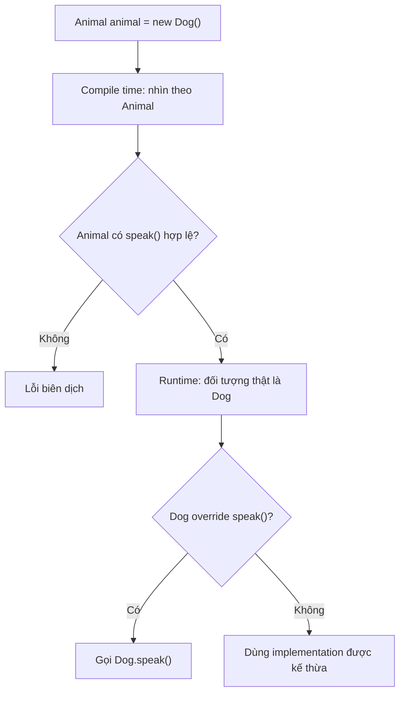

# Phạm vi đa hình của phương thức và thuộc tính trong Java

Khi viết:

```java
Parent value = new Child();
```

biến `value` có **kiểu khai báo** `Parent` nhưng đang tham chiếu một đối tượng có **kiểu thực tế** `Child`. Nếu lớp `Child` ghi đè (*override*) một phương thức instance hợp lệ, lời gọi qua `value` có thể chạy implementation của `Child`. Đây là **đa hình động (runtime polymorphism)**.

Tuy nhiên, không phải mọi thành viên của Java đều hoạt động như vậy. **Field (thuộc tính dữ liệu) không được override; static method có thể bị che khuất (*hiding*) nhưng không được dispatch động; overload được lựa chọn theo kiểu tại thời điểm biên dịch.**

Bài này xác định chính xác **đa hình tác động đến thành viên nào**, cách trình biên dịch/JVM chọn hành vi và các bẫy thường gặp khi làm việc với superclass, subclass và interface.

## 1. Hai thời điểm, hai quyết định

Xem ví dụ:

```java
Animal animal = new Dog();
animal.speak();
```

Java cần xử lý hai vấn đề khác nhau:

1. **Tại thời điểm biên dịch:** Với kiểu của biểu thức `animal` là `Animal`, phương thức `speak()` có được phép gọi không? Nếu có nhiều overload, chữ ký nào phù hợp?
2. **Tại thời điểm chạy:** Với một phương thức instance có khả năng override, đối tượng thực tế là `Dog` nên implementation được chọn có thể là `Dog.speak()`.

Nói cách khác: **kiểu khai báo giới hạn những thành viên được phép sử dụng; kiểu thực tế quyết định implementation của phương thức instance được dispatch động.**



Sơ đồ áp dụng cho **phương thức instance có thể ghi đè**, không phải quy tắc chung cho mọi field hoặc static method.

## 2. Ví dụ Java hoàn chỉnh: cùng đối tượng, kết quả khác nhau

File `PolymorphismScopeDemo.java`:

```java
public class PolymorphismScopeDemo {

    static class Ticket {
        // Field: thuộc tính dữ liệu, không hỗ trợ override.
        public String label = "Ticket-field";

        // Instance method: có thể được subclass override.
        public String display() {
            return "Ticket-method";
        }

        // final instance method: subclass không thể override.
        public final String code() {
            return "T-001";
        }

        // Static method: có thể bị hiding, không dynamic dispatch.
        public static String category() {
            return "Ticket-static";
        }

        // Private method: không được override ở subclass.
        private String internalNote() {
            return "Ticket-private";
        }

        public String showInternalNote() {
            return internalNote();
        }

        // Đọc field thuộc lớp khai báo phương thức này.
        public String showField() {
            return "Ticket.showField: " + label;
        }
    }

    static final class VipTicket extends Ticket {
        // Field khác, che khuất Ticket.label.
        public String label = "VIP-field";

        @Override
        public String display() {
            return "VIP-method";
        }

        // Đây là static method hiding, không phải override.
        public static String category() {
            return "VIP-static";
        }

        // Cùng tên nhưng không override private method của cha.
        private String internalNote() {
            return "VIP-private";
        }

        public String vipOnly() {
            return "Chức năng riêng của VIP";
        }

        public String bothFields() {
            return super.label + " / " + this.label;
        }
    }

    public static void main(String[] args) {
        Ticket ticket = new VipTicket();

        System.out.println(ticket.display());
        System.out.println(ticket.label);
        System.out.println(((VipTicket) ticket).label);
        System.out.println(ticket.code());

        System.out.println(Ticket.category());
        System.out.println(VipTicket.category());

        // Tránh viết ticket.category() trong code thực tế:
        // Cú pháp được Java cho phép nhưng dễ gây hiểu nhầm.
        System.out.println(ticket.category());

        System.out.println(ticket.showInternalNote());
        System.out.println(ticket.showField());

        VipTicket vip = (VipTicket) ticket;
        System.out.println(vip.bothFields());
        System.out.println(vip.vipOnly());
    }
}
```

Chạy:

```bash
javac PolymorphismScopeDemo.java
java PolymorphismScopeDemo
```

Kết quả:

```text
VIP-method
Ticket-field
VIP-field
T-001
Ticket-static
VIP-static
Ticket-static
Ticket-private
Ticket.showField: Ticket-field
Ticket-field / VIP-field
Chức năng riêng của VIP
```

Cùng một đối tượng `VipTicket`, tại sao kết quả khác nhau?

| Biểu thức | Kết quả | Cơ chế |
|---|---|---|
| `ticket.display()` | `VIP-method` | **Override + dynamic dispatch** |
| `ticket.label` | `Ticket-field` | Field resolution theo kiểu tĩnh `Ticket` |
| `((VipTicket) ticket).label` | `VIP-field` | Kiểu tĩnh của biểu thức ép kiểu là `VipTicket` |
| `ticket.code()` | `T-001` | Phương thức instance `final`, không được override |
| `Ticket.category()` | `Ticket-static` | Gọi static method của lớp được chỉ rõ |
| `VipTicket.category()` | `VIP-static` | Gọi static method khác, che khuất phương thức cha |
| `ticket.category()` | `Ticket-static` | Static method được chọn theo kiểu tĩnh của biểu thức `ticket` |
| `ticket.showInternalNote()` | `Ticket-private` | Phương thức của `Ticket` gọi private method của chính `Ticket` |
| `ticket.showField()` | `Ticket.showField: Ticket-field` | Implementation `Ticket` truy cập `Ticket.label` |
| `vip.bothFields()` | `Ticket-field / VIP-field` | `super.label` và `this.label` chỉ hai field riêng |
| `vip.vipOnly()` | Chức năng riêng | Biểu thức kiểu `VipTicket` gọi được phương thức chỉ có ở lớp con |

**Quan sát quan trọng:** `Ticket.label` và `VipTicket.label` là **hai field riêng biệt cùng tồn tại trên một đối tượng lớp con**. Việc lớp con đặt field trùng tên không thay đổi cách truy cập field trong mã của lớp cha và không tạo đa hình cho field.

Trong thiết kế thực tế, tránh khai báo các field công khai hoặc field trùng tên như ví dụ. Chúng được cố tình dùng ở đây để phơi bày quy tắc ngôn ngữ.

## 3. Field không override: thay kiểu tham chiếu có thể thay kết quả đọc

~~~java
class Base {
    String value = "base";
}
class Derived extends Base {
    String value = "derived";
}
Base ref = new Derived();
System.out.println(ref.value);             // base
System.out.println(((Derived) ref).value); // derived
~~~

Một instance `Derived` có **hai field khác nhau**, một thuộc phần `Base`, một thuộc phần `Derived`. Cast hợp lệ chỉ đổi kiểu tĩnh của biểu thức; nó không đổi đối tượng hoặc sao chép giá trị. Vì field không có runtime dispatch, thay `Base` bằng `Derived` ở kiểu biến có thể làm đổi member được chọn dù instance thật vẫn như cũ.

Đây là lý do quan trọng để hạn chế public/protected field trùng tên và ưu tiên đóng gói trạng thái. Bài *Phân biệt che khuất thành viên với ghi đè* đi sâu vào field hiding, `super.field`, static hiding và quy tắc truy cập; bài này sẽ tập trung tiếp vào **getter như API đa hình**.

## 4. Getter là phương thức: có thể đa hình dù dữ liệu không đa hình

Trong Java, “thuộc tính” đôi khi được gọi theo nghĩa dữ liệu (field), nhưng nhiều framework hoặc thư viện dùng **JavaBean property** thông qua các phương thức `getXxx()`/`setXxx()`. Cần phân biệt:

- `obj.value`: truy cập **field** — không có dynamic dispatch.
- `obj.getValue()`: gọi **phương thức** — có thể được override và dispatch động.

Ví dụ:

```java
class Person {
    private final String name;

    Person(String name) {
        this.name = name;
    }

    public String getDisplayName() {
        return name;
    }
}

class Employee extends Person {
    private final String department;

    Employee(String name, String department) {
        super(name);
        this.department = department;
    }

    @Override
    public String getDisplayName() {
        return super.getDisplayName() + " (" + department + ")";
    }
}

Person person = new Employee("An", "Backend");

System.out.println(person.getDisplayName()); // An (Backend)
```

Biến `person` chỉ biết hợp đồng `Person`, nhưng `getDisplayName()` trả kết quả theo implementation của `Employee`.

Điều này **không có nghĩa field `name` bị override**: `name` vẫn là dữ liệu private do `Person` quản lý. Hành vi getter được ghi đè, không phải field.

### Nên chọn thiết kế nào?

Nếu trạng thái phải tuân thủ invariant, ưu tiên field `private` và expose **hành vi có ý nghĩa** hoặc phương thức truy cập được kiểm soát. Nếu subclass cần thay đổi cách trình bày, override một phương thức như `getDisplayName()` thường rõ ràng hơn việc khai báo thêm field `name` cùng tên ở subclass.

Tuy vậy, nếu một phương thức getter được đánh dấu `final`, subclass không thể override nó. Đa hình không yêu cầu mọi getter đều phải cho phép override.

## 5. Phạm vi đa hình của các loại phương thức

| Loại thành viên | Có dispatch động theo runtime object không? | Diễn giải |
|---|---|---|
| Phương thức instance có thể override | **Có** | Implementation subclass được chọn khi override đúng hợp đồng |
| Phương thức `abstract` được implement trong subclass | **Có** | Lời gọi qua kiểu trừu tượng thực thi implementation cụ thể |
| Phương thức interface được lớp implement | **Có** | Lời gọi qua biến interface chọn implementation phù hợp |
| Interface `default method` | **Có thể** | Có thể kế thừa, override; phải xử lý xung đột đúng quy tắc |
| Phương thức instance `final` | Không thể bị subclass override | Không có biến thể implementation do override ở subclass |
| Phương thức `private` | Không override | Cùng tên ở subclass là phương thức khác |
| Phương thức `static` | **Không** | Có thể bị hiding; lời gọi được phân giải theo kiểu tĩnh/tên lớp |
| Constructor | **Không** | Không được kế thừa hay override |
| Phương thức overload | Chọn overload tại compile time | Sau khi chọn chữ ký, nếu đó là instance method thì implementation vẫn có thể dispatch động |
| Field instance | **Không** | Field hiding/phân giải theo kiểu tĩnh |
| Field `static` | **Không** | Là trạng thái của lớp; không có field polymorphism |

Lưu ý: `final`, `private` và `static` không phải là “không có hành vi”. Chúng vẫn có thể thực thi mã bình thường. Điểm khác biệt là **chúng không tạo ra lựa chọn runtime giữa nhiều implementation do instance overriding**.

## 6. Đa hình có phạm vi theo **chữ ký phương thức đã chọn**

~~~java
class Speaker {
    String speak(Object value) { return "Speaker/Object"; }
}
class DogSpeaker extends Speaker {
    @Override String speak(Object value) { return "DogSpeaker/Object"; }
    String speak(String value) { return "DogSpeaker/String"; }
}
Speaker caller = new DogSpeaker();
System.out.println(caller.speak("Gâu")); // DogSpeaker/Object
~~~

Compiler chỉ nhìn thấy overload `speak(Object)` từ kiểu `Speaker`; sau khi chữ ký được chọn, JVM dispatch đến override `DogSpeaker.speak(Object)`. Overload `speak(String)` chỉ xuất hiện ở class con và không trở thành một phương thức mới trong API tĩnh của biến `caller`.

Bài này cần ghi nhớ phạm vi: **kiểu của receiver xác định những lời gọi hợp lệ; object thực tế chỉ chọn phần triển khai cho lời gọi instance thích hợp**. Phân tích chi tiết overload/override, `null`, boxing và varargs đã có ở hai bài chuyên biệt trước.

## 7. Static và private không cho một điểm mở rộng runtime tương tự

`Base ref = new Derived()` không khiến `ref.staticMethod()` chọn một phương thức static của `Derived`: static method thuộc **class**, nên gọi bằng `Base.staticMethod()` hoặc `Derived.staticMethod()` sẽ rõ nghĩa hơn. Một static method cùng chữ ký ở subclass là **method hiding**.

Tương tự, private method của superclass không được kế thừa để override; phương thức trùng tên của subclass không thay implementation mà mã của superclass đang gọi riêng. Hai quy tắc này đã được minh họa bằng chương trình chạy được trong bài về *Che khuất thành viên với ghi đè*. Chúng giới hạn phạm vi đa hình ở **những instance method thực sự có khả năng override**.

## 8. final method, abstract method và interface

### 8.1. final instance method

```java
class BasePolicy {
    public final boolean isEnabled() {
        return true;
    }
}

class SpecialPolicy extends BasePolicy {
    // public boolean isEnabled() { return false; }
    // Lỗi biên dịch vì isEnabled() là final.
}
```

Một biến `BasePolicy p = new SpecialPolicy();` vẫn gọi được `p.isEnabled()`. Nhưng vì lớp con không thể override, không có implementation chuyên biệt được chọn theo lớp con cho phương thức này. `final` hữu ích khi muốn bảo vệ một quy tắc hoặc bước thuật toán không được thay đổi.

### 8.2. abstract method và interface đều hỗ trợ dispatch động

```java
abstract class Shape {
    abstract double area();
}

final class Circle extends Shape {
    private final double radius;

    Circle(double radius) {
        if (radius <= 0) {
            throw new IllegalArgumentException("Bán kính phải dương");
        }
        this.radius = radius;
    }

    @Override
    double area() {
        return Math.PI * radius * radius;
    }
}

Shape shape = new Circle(2);
System.out.println(shape.area()); // Khoảng 12.56637
```

`Shape.area()` không có implementation ở lớp trừu tượng, nhưng biến kiểu `Shape` vẫn gọi được phương thức đó. Runtime sẽ dùng `Circle.area()`.

Tương tự, khi một class implement phương thức của interface, lời gọi qua biến interface dùng implementation phù hợp:

```java
interface Formatter {
    String format(String text);
}

final class UpperFormatter implements Formatter {
    @Override
    public String format(String text) {
        return text.toUpperCase(java.util.Locale.ROOT);
    }
}

Formatter formatter = new UpperFormatter();
System.out.println(formatter.format("java")); // JAVA
```

### 8.3. Interface default method có thể tham gia đa hình

```java
interface Greeter {
    default String hello() {
        return "Hello";
    }
}

class FriendlyGreeter implements Greeter {
    @Override
    public String hello() {
        return "Xin chào";
    }
}

Greeter greeter = new FriendlyGreeter();
System.out.println(greeter.hello()); // Xin chào
```

`default` cung cấp implementation dùng được nếu lớp không cung cấp phiên bản phù hợp. Khi class override, lời gọi qua kiểu interface vẫn chạy implementation class. Với nhiều default method xung đột, Java có quy tắc ưu tiên phương thức từ class, interface cụ thể hơn, và một số trường hợp yêu cầu override để giải quyết mơ hồ.

Ngược lại, **static method của interface không được kế thừa thành phương thức instance** và được gọi bằng tên interface:

```java
interface Normalizer {
    static String normalize(String value) {
        return value.strip();
    }
}

System.out.println(Normalizer.normalize(" A ")); // A
```

## 9. `super` không làm xuất hiện một object khác

Nếu `MonthlyReport extends Report`, lời gọi `super.header()` trong subclass yêu cầu implementation của superclass phù hợp, còn `this.header()` là một lời gọi instance thông thường có thể dispatch tới override.

~~~java
class Report {
    String header() { return "Báo cáo"; }
    String render() { return "[" + header() + "]"; }
}
class MonthlyReport extends Report {
    @Override String header() { return "Báo cáo tháng"; }
    String parentHeader() { return super.header(); }
}
Report report = new MonthlyReport();
System.out.println(report.render()); // [Báo cáo tháng]
~~~

Ngay cả khi `render()` chạy trong mã lớp cha, nó đang làm việc trên một instance `MonthlyReport`, nên lời gọi `header()` có thể dispatch động. `super` chỉ thay cách chọn implementation ở lời gọi cụ thể, không tạo `Report` riêng. Trong constructor cha, một lời gọi tới method overridable có thể chạm trạng thái subclass chưa khởi tạo xong, nên tránh thiết kế như vậy.

## 10. Ép kiểu và instanceof có biến field thành đa hình không?

Không. Ép kiểu ảnh hưởng **kiểu tĩnh của biểu thức** và khả năng compiler cho phép truy cập thành viên, chứ không sửa lớp runtime của đối tượng.

```java
class Base {
    public String code = "BASE";
    public String code() {
        return "Base-method";
    }
}

class Child extends Base {
    public String code = "CHILD";

    @Override
    public String code() {
        return "Child-method";
    }

    public String childOnly() {
        return "extra";
    }
}

Base ref = new Child();

System.out.println(ref.code);          // BASE
System.out.println(ref.code());        // Child-method
System.out.println(((Child) ref).code); // CHILD
```

Bản thân đối tượng không thay đổi; chỉ cách **truy cập field** thay đổi do kiểu tĩnh của biểu thức ép kiểu.

Với một biến có thể tham chiếu nhiều subclass, có thể kiểm tra trước:

```java
if (ref instanceof Child child) {
    System.out.println(child.childOnly()); // extra
}
```

Đây là pattern matching for `instanceof` (Java 16+, chạy ở Java 17). Nếu cast không hợp lệ, ép kiểu xuống thông thường có thể ném `ClassCastException`. Đặc biệt, biến `Parent` trỏ vào `Child` **không khiến mọi phương thức riêng của `Child` xuất hiện trong API của kiểu `Parent`**.

## 11. Đa hình trong code thực tế: ưu tiên hành vi hơn field

Một ví dụ thiết kế chưa tốt:

```java
class Discount {
    public double percent;
}

class VipDiscount extends Discount {
    public double percent; // Field hiding gây nhầm lẫn
}
```

Nếu nơi gọi viết `Discount d = new VipDiscount();` rồi đọc `d.percent`, nó nhận field của `Discount` — không phải “tỷ lệ VIP” một cách tự động.

Cách thiết kế rõ hơn là mô tả khả năng tính giá bằng hành vi:

```java
interface DiscountPolicy {
    long apply(long originalPriceVnd);
}

final class NoDiscount implements DiscountPolicy {
    @Override
    public long apply(long originalPriceVnd) {
        if (originalPriceVnd < 0) {
            throw new IllegalArgumentException("Giá không được âm");
        }
        return originalPriceVnd;
    }
}

final class TenPercentDiscount implements DiscountPolicy {
    @Override
    public long apply(long originalPriceVnd) {
        if (originalPriceVnd < 0) {
            throw new IllegalArgumentException("Giá không được âm");
        }
        // Quy tắc ví dụ: giảm 10%, làm tròn xuống VND nguyên.
        return originalPriceVnd - originalPriceVnd / 10;
    }
}
```

Nơi gọi không cần đọc một field `percent` có thể bị hiding:

```java
DiscountPolicy policy = new TenPercentDiscount();
System.out.println(policy.apply(100_000)); // 90000

policy = new NoDiscount();
System.out.println(policy.apply(100_000)); // 100000
```

Mỗi implementation kiểm soát quy tắc áp dụng của mình, trong khi caller phụ thuộc vào hợp đồng chung `DiscountPolicy.apply(...)`. Đây là cách sử dụng đa hình thường dễ mở rộng và an toàn hơn việc phụ thuộc vào public field.

## 12. Những hiểu lầm thường gặp

| Nhận định | Đánh giá | Giải thích |
|---|---|---|
| `Parent p = new Child()` rồi `p.method()` luôn chạy phương thức cha | Sai | Với instance method được override, có thể chạy implementation của `Child` |
| `Parent p = new Child()` rồi `p.field` tự đọc field ở `Child` | Sai | Field được phân giải theo kiểu tĩnh |
| Khai báo field cùng tên trong subclass là override | Sai | Đó là **field hiding** |
| Getter có thể override nên nội dung trả về đa hình | Đúng, nếu getter là overridable instance method | Field bên trong vẫn không tự đa hình |
| Static method được chọn theo kiểu runtime | Sai | Static method hiding, phân giải tĩnh |
| Private method có thể override | Sai | Phương thức cùng tên ở subclass là thành viên riêng |
| Final method bị override nếu ép biến sang subclass | Sai | `final` ngăn override |
| Chọn overload dựa vào runtime class của đối số | Sai | Overload resolution xét kiểu compile-time và quy tắc chuyển đổi |
| Interface method có thể dispatch tới implementation của class | Đúng | Đây là đa hình qua interface |
| `super.method()` là gọi trên một đối tượng cha tách biệt | Sai | Vẫn là cùng đối tượng, nhưng chọn implementation của superclass phù hợp |
| Cast biến khiến kiểu runtime của object thay đổi | Sai | Chỉ thay kiểu tĩnh của biểu thức và có thể kiểm tra runtime type |

## 13. Bài tập tự kiểm tra

### Bài 1 — Dự đoán ba kết quả

```java
class A {
    int number = 1;
    String name() {
        return "A";
    }
    static String type() {
        return "A-static";
    }
}

class B extends A {
    int number = 2;
    @Override
    String name() {
        return "B";
    }
    static String type() {
        return "B-static";
    }
}

A value = new B();

System.out.println(value.number);
System.out.println(value.name());
System.out.println(value.type());
```

**Đáp án:** `1`, `B`, `A-static`. Field và static method theo kiểu tĩnh `A`; phương thức instance `name()` dispatch tới override của `B`. Trong code thực tế, nên dùng `A.type()` thay vì gọi static method qua biến.

### Bài 2 — Overload có đi theo runtime object không?

```java
class Animal {}
class Dog extends Animal {}

void examine(Animal a) {
    System.out.println("Animal");
}
void examine(Dog d) {
    System.out.println("Dog");
}

Animal argument = new Dog();
examine(argument);
```

**Đáp án:** `Animal`. Lựa chọn overload dựa trên kiểu tĩnh của biến `argument`. Nếu ép kiểu `examine((Dog) argument)`, compiler sẽ chọn overload `Dog` (giả sử cast tương thích tại runtime).

### Bài 3 — Getter hay field?

```java
class Parent {
    String title = "Parent-field";
    String getTitle() {
        return "Parent-method";
    }
}

class Child extends Parent {
    String title = "Child-field";
    @Override
    String getTitle() {
        return "Child-method";
    }
}

Parent obj = new Child();
```

**Câu hỏi:** `obj.title` và `obj.getTitle()` có kết quả gì?

**Đáp án:** `Parent-field` và `Child-method`. Field không override; getter được override.

### Bài 4 — Thiết kế lại API

Một thư viện dùng `class Notification` có field `public String messageType`. Các subclass `EmailNotification` và `SmsNotification` cùng khai báo lại `messageType`, khiến code dùng kiểu `Notification` đọc sai loại thông báo.

Hãy thử refactor:

1. Giữ trạng thái cần thiết ở field `private`.
2. Khai báo `String channel()` trên lớp cha hoặc một interface `Notification`.
3. Mỗi implementation cung cấp hành vi `channel()` phù hợp.
4. Viết `List<Notification>` chứa nhiều subtype và gọi `channel()` mà không truy cập field trực tiếp.
5. Giải thích vì sao phép gọi phương thức giữ được đa hình, còn field cùng tên không làm được.

---

**Ghi nhớ:** **Đa hình động của Java chủ yếu áp dụng cho phương thức instance có thể override** — kể cả method từ abstract class và interface. **Field, static method và lựa chọn overload không được phân giải theo runtime object theo cách đó**. Phân biệt **field hiding**, **static method hiding**, **overriding** và **overloading** giúp dự đoán chính xác kết quả và thiết kế API dùng hành vi thay vì truy cập trực tiếp trạng thái.