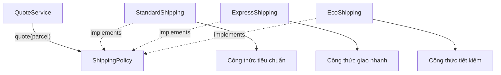

# Đa hình thay cho điều kiện kiểm tra từng loại trong Java

Khi một chương trình hỗ trợ nhiều loại đối tượng, cách viết dễ nghĩ đến đầu tiên là liên tục hỏi: **“Đây là loại nào?”**, rồi dùng `if/else`, `switch` hoặc `instanceof` để chọn hành vi.

```java
if (shippingType.equals("STANDARD")) {
    // Tính phí giao tiêu chuẩn
} else if (shippingType.equals("EXPRESS")) {
    // Tính phí giao nhanh
} else if (shippingType.equals("ECO")) {
    // Tính phí giao tiết kiệm
}
```

Một vài nhánh ở ranh giới nhận dữ liệu là bình thường. Vấn đề xuất hiện khi **cùng một chuỗi kiểm tra loại** bị lặp lại trong nhiều phần của hệ thống: tính phí, mô tả dịch vụ, tính thời gian dự kiến, xuất hóa đơn... Mỗi khi xuất hiện loại mới, nhiều nơi phải sửa; rất dễ quên một nhánh hoặc tạo ra hành vi không nhất quán.

**Đa hình (polymorphism)** đưa hành vi thay đổi theo loại vào chính các lớp cung cấp hành vi đó. Thay vì hỏi *“đối tượng thuộc loại gì?”*, mã sử dụng gọi *“hãy thực hiện việc này theo hợp đồng chung”*.

> Mục tiêu không phải xóa sạch mọi câu lệnh `if` và `switch`. Mục tiêu là tránh dùng **kiểm tra loại đối tượng để điều khiển cùng một nhóm hành vi nghiệp vụ ở nhiều nơi** khi hành vi ấy có thể được biểu diễn tự nhiên bằng phương thức đa hình.

## 1. Dấu hiệu một chuỗi điều kiện đang thay thế đa hình

Giả sử có ba phương án vận chuyển: `STANDARD`, `EXPRESS`, `ECO`. Cách triển khai ban đầu:

```java
final class ShippingCalculator {
    static long calculate(String type, long baseFee, long distanceFee) {
        if ("STANDARD".equals(type)) {
            return baseFee + distanceFee;
        } else if ("EXPRESS".equals(type)) {
            return baseFee + distanceFee + 25_000;
        } else if ("ECO".equals(type)) {
            return baseFee + distanceFee - 3_000;
        }
        throw new IllegalArgumentException("Loại giao hàng không hợp lệ");
    }
}
```

Đoạn mã có thể phù hợp khi bài toán thật sự nhỏ và số lựa chọn cố định. Nhưng hãy để ý những thay đổi trong tương lai:

- Thêm dịch vụ `SAME_DAY`: sửa `calculate` và mọi `if/switch` tương tự.
- Loại `EXPRESS` có công thức theo trọng lượng riêng: nhánh dài thêm.
- Một module khác muốn hiển thị tên phương án: lại kiểm tra `type`.
- Gõ nhầm `"EXPREES"`: lỗi chỉ xuất hiện khi chạy.
- Nếu nhánh mặc định trả `0` thay vì báo lỗi, phần mềm có thể âm thầm tính sai phí.

Nếu hành vi theo từng loại **có thể thay đổi độc lập**, đây là dấu hiệu cần cân nhắc một hợp đồng chung và các implementation chuyên trách.

## 2. Ý tưởng: gọi hành vi chung, để đối tượng quyết định cách thực hiện

Ta chuyển từ:

```java
long fee;

if (type == STANDARD) {
    fee = calculateStandard(parcel);
} else if (type == EXPRESS) {
    fee = calculateExpress(parcel);
} else {
    fee = calculateEco(parcel);
}
```

sang:

```java
ShippingPolicy policy = ...; // Một implementation phù hợp
long fee = policy.quote(parcel);
```

Trong đó:

```java
interface ShippingPolicy {
    String label();
    long quote(Parcel parcel);
}
```

Mỗi loại giao hàng triển khai `quote()` theo quy tắc của nó. Mã gọi chỉ phụ thuộc vào **`ShippingPolicy`**, không cần chuỗi điều kiện phân biệt lớp cụ thể.



Đa hình nằm ở việc `policy.quote(parcel)` có **cùng chữ ký phương thức** nhưng thực thi **cách cài đặt khác nhau**, tùy đối tượng mà `policy` đang tham chiếu.

## 3. Ví dụ Java hoàn chỉnh: chuyển từ phân nhánh sang đa hình

Đặt toàn bộ đoạn mã sau trong file **`Main.java`**. Ví dụ chạy bằng Java 17 hoặc Java 21, không cần thư viện bên ngoài.

```java
import java.util.List;
import java.util.Objects;

record Parcel(int weightGrams, int distanceKm) {
    Parcel {
        if (weightGrams <= 0) {
            throw new IllegalArgumentException(
                    "Khối lượng phải lớn hơn 0");
        }
        if (distanceKm <= 0) {
            throw new IllegalArgumentException(
                    "Khoảng cách phải lớn hơn 0");
        }
    }

    // Tính mỗi 1.000 gram bắt đầu là một kilogram tính cước.
    long billedKilograms() {
        return ((long) weightGrams + 999) / 1_000;
    }
}

interface ShippingPolicy {
    String label();
    long quote(Parcel parcel);
}

final class StandardShipping implements ShippingPolicy {
    @Override
    public String label() {
        return "STANDARD";
    }

    @Override
    public long quote(Parcel parcel) {
        Objects.requireNonNull(parcel, "parcel");
        long fee = 10_000;
        fee = Math.addExact(fee,
                Math.multiplyExact(2_000L, parcel.distanceKm()));
        fee = Math.addExact(fee,
                Math.multiplyExact(1_000L, parcel.billedKilograms()));
        return fee;
    }
}

final class ExpressShipping implements ShippingPolicy {
    @Override
    public String label() {
        return "EXPRESS";
    }

    @Override
    public long quote(Parcel parcel) {
        Objects.requireNonNull(parcel, "parcel");
        long fee = 25_000;
        fee = Math.addExact(fee,
                Math.multiplyExact(4_000L, parcel.distanceKm()));
        fee = Math.addExact(fee,
                Math.multiplyExact(2_000L, parcel.billedKilograms()));
        return fee;
    }
}

final class EcoShipping implements ShippingPolicy {
    @Override
    public String label() {
        return "ECO";
    }

    @Override
    public long quote(Parcel parcel) {
        Objects.requireNonNull(parcel, "parcel");
        long fee = 7_000;
        fee = Math.addExact(fee,
                Math.multiplyExact(1_500L, parcel.distanceKm()));
        fee = Math.addExact(fee,
                Math.multiplyExact(500L, parcel.billedKilograms()));
        return fee;
    }
}

// Service chỉ biết hợp đồng; không biết ba lớp cụ thể.
final class QuoteService {
    private final ShippingPolicy policy;

    QuoteService(ShippingPolicy policy) {
        this.policy = Objects.requireNonNull(policy, "policy");
    }

    long calculate(Parcel parcel) {
        return policy.quote(parcel);
    }
}

public class Main {
    public static void main(String[] args) {
        Parcel parcel = new Parcel(1_500, 3);

        List<ShippingPolicy> policies = List.of(
                new StandardShipping(),
                new ExpressShipping(),
                new EcoShipping()
        );

        for (ShippingPolicy policy : policies) {
            long fee = new QuoteService(policy).calculate(parcel);
            System.out.println(policy.label() + ": " + fee + " VND");
        }

        ShippingPolicy selected = new ExpressShipping();
        QuoteService service = new QuoteService(selected);
        System.out.println("Đã chọn: " + service.calculate(parcel) + " VND");
    }
}
```

Biên dịch và chạy:

```bash
javac Main.java
java Main
```

Kết quả:

```text
STANDARD: 18000 VND
EXPRESS: 41000 VND
ECO: 12500 VND
Đã chọn: 41000 VND
```

### Giải thích kết quả

Kiện hàng có trọng lượng 1.500 gram, được tính cước **2 kg**, quãng đường **3 km**:

| Policy | Phí cố định | Theo quãng đường | Theo kg tính cước | Tổng |
| --- | ---: | ---: | ---: | ---: |
| `STANDARD` | 10.000 | 2.000 × 3 = 6.000 | 1.000 × 2 = 2.000 | **18.000 VND** |
| `EXPRESS` | 25.000 | 4.000 × 3 = 12.000 | 2.000 × 2 = 4.000 | **41.000 VND** |
| `ECO` | 7.000 | 1.500 × 3 = 4.500 | 500 × 2 = 1.000 | **12.500 VND** |

Điểm quan trọng không nằm ở công thức mà nằm ở **mối quan hệ phụ thuộc**:

- `QuoteService` chỉ khai báo trường `ShippingPolicy`.
- `Main` có thể cung cấp bất kỳ đối tượng nào thực hiện interface ấy.
- Khi gọi `policy.quote(parcel)`, phương thức tương ứng của `StandardShipping`, `ExpressShipping` hay `EcoShipping` được thực thi.
- Thêm một loại vận chuyển không nhất thiết yêu cầu sửa `QuoteService`; ta tạo implementation mới và đăng ký nó ở nơi lựa chọn policy.
- `Parcel` bảo vệ điều kiện đầu vào chung. `Math.addExact`/`Math.multiplyExact` giúp báo tràn số thay vì âm thầm tạo kết quả không đúng.

**Đây là ví dụ công thức minh họa, không phải bảng giá của nhà vận chuyển thực tế.**

## 4. Vì sao đây là đa hình ở thời điểm chạy?

Xét:

```java
ShippingPolicy policy = new ExpressShipping();
long fee = policy.quote(new Parcel(1_500, 3));
```

Có hai góc nhìn về cùng biến:

| Thành phần | Giá trị |
| --- | --- |
| **Kiểu khai báo** của biến `policy` | `ShippingPolicy` |
| **Đối tượng thực tế** | `ExpressShipping` |
| Phương thức mà trình biên dịch cho phép gọi | `quote(Parcel)` thuộc hợp đồng `ShippingPolicy` |
| Cách thực hiện được chọn lúc chạy | `ExpressShipping.quote(Parcel)` |

Trong Java, một lời gọi phương thức **instance** được ghi đè qua interface hoặc lớp cha thường được dispatch theo đối tượng thực tế. Đó là cơ sở để `QuoteService` dùng một phương thức chung mà không phải kiểm tra `instanceof ExpressShipping`.

Điều này khác với overload:

```java
void print(Object value) {}
void print(String value) {}
```

Việc chọn `print(Object)` hay `print(String)` chủ yếu dựa vào **kiểu đối số được trình biên dịch nhìn thấy**, không tự kiểm tra runtime class để chọn overload. Bài toán loại bỏ `if/else` ở đây dựa vào **overriding / dynamic dispatch**, không phải chỉ tạo thêm nhiều phương thức overload.

## 5. Vấn đề rõ nhất: `instanceof` lặp đi lặp lại

Giả sử code cũ nhận một đối tượng:

```java
static long fee(Object strategy, Parcel parcel) {
    if (strategy instanceof StandardShipping) {
        // Công thức Standard
    } else if (strategy instanceof ExpressShipping) {
        // Công thức Express
    } else if (strategy instanceof EcoShipping) {
        // Công thức Eco
    }
    throw new IllegalArgumentException("Loại không hỗ trợ");
}
```

Ví dụ trên chỉ minh họa khung điều kiện, không phải một phương thức hoàn chỉnh có thể biên dịch, vì các nhánh chưa có lệnh `return`.

Nếu thay bằng:

```java
static long fee(ShippingPolicy strategy, Parcel parcel) {
    return strategy.quote(parcel);
}
```

ta nhận được những cải thiện sau:

| Khi dùng kiểm tra từng loại | Khi dùng đa hình |
| --- | --- |
| Mã gọi phải biết `StandardShipping`, `ExpressShipping`, `EcoShipping` | Mã gọi chỉ cần biết `ShippingPolicy` |
| Loại mới thường phải thêm nhánh tại mọi nơi xử lý loại | Loại mới bổ sung implementation có cùng hợp đồng |
| Rủi ro bỏ sót nhánh hoặc `else` mặc định nguy hiểm | Trình biên dịch bắt implementation cụ thể phải có phương thức bắt buộc |
| Công thức của các loại nằm xen kẽ trong một khối dài | Mỗi implementation giữ quy tắc riêng |
| Mock/fake khó nếu logic gắn chặt với kiểm tra lớp cụ thể | Có thể đưa vào một implementation dùng riêng trong kiểm thử |

Tuy nhiên, **interface không bảo đảm mọi implementation đều đúng nghiệp vụ**. Ví dụ một implementation `quote()` trả phí âm vẫn biên dịch. Cần định nghĩa hợp đồng rõ và có kiểm thử để các implementation tuân thủ cùng ngữ nghĩa.

## 6. Vậy việc chọn loại ban đầu vẫn cần `switch` thì sao?

Đa hình không làm biến mất nhu cầu chọn phương án từ dữ liệu ngoài: người dùng có thể gửi chuỗi `"express"`, cấu hình có thể ghi mã `"eco"`, hoặc ứng dụng có danh sách tùy chọn.

Một nhánh ở **ranh giới tạo đối tượng** vẫn hoàn toàn hợp lý:

```java
static ShippingPolicy selectPolicy(String code) {
    if (code == null) {
        throw new IllegalArgumentException("Thiếu mã dịch vụ");
    }

    return switch (code.toLowerCase(java.util.Locale.ROOT)) {
        case "standard" -> new StandardShipping();
        case "express" -> new ExpressShipping();
        case "eco" -> new EcoShipping();
        default -> throw new IllegalArgumentException(
                "Không hỗ trợ dịch vụ: " + code);
    };
}
```

Đoạn trên có thể đặt làm phương thức `static` trong `Main` của ví dụ. Với Java 17, cú pháp **switch expression** này hợp lệ.

Sự khác biệt là **điều kiện chỉ tập trung ở bước lựa chọn**; sau đó mọi luồng xử lý qua `ShippingPolicy`. Khi thêm loại mới, có thể phải cập nhật factory/registry này, nhưng không phải sửa tất cả service gọi `quote()`.

Nếu số implementation lớn hoặc được nạp qua dependency injection/plugin, một **registry** như `Map<String, ShippingPolicy>` có thể thay factory có `switch`. Tuy nhiên, registry không phải lúc nào cũng tốt hơn: nếu có đúng hai lựa chọn ổn định, một `switch` rõ ràng có thể đơn giản và dễ bảo trì.

## 7. Thêm loại mới mà không sửa service

Giả sử xuất hiện `SameDayShipping`, tính phí cố định 40.000 VND cộng 6.000 VND mỗi km. Ta chỉ cần triển khai cùng hợp đồng:

```java
final class SameDayShipping implements ShippingPolicy {
    @Override
    public String label() {
        return "SAME_DAY";
    }

    @Override
    public long quote(Parcel parcel) {
        java.util.Objects.requireNonNull(parcel, "parcel");
        return Math.addExact(
                40_000L,
                Math.multiplyExact(6_000L, parcel.distanceKm())
        );
    }
}
```

Đặt lớp này cùng các lớp trong ví dụ chính, sau đó:

```java
QuoteService service = new QuoteService(new SameDayShipping());
System.out.println(service.calculate(new Parcel(1_500, 3)));
// 58000
```

**`QuoteService` không thay đổi.** Điều có thể cần sửa là màn hình hoặc thành phần chọn lựa để hiển thị `SAME_DAY`, cùng kiểm thử và cấu hình liên quan. Đây là ý nghĩa thực tế của việc “mở rộng mà hạn chế sửa code đang dùng”, không phải cam kết rằng việc thêm tính năng sẽ không cần sửa bất kỳ dòng nào trong toàn hệ thống.

## 8. Quy tắc chung phải thuộc về đâu?

Một rủi ro khi đưa hành vi vào từng lớp là **lặp lại hoặc làm lệch quy tắc chung**.

Trong ví dụ:

- `Parcel` kiểm tra `weightGrams > 0` và `distanceKm > 0`.
- Mỗi `ShippingPolicy` chọn **công thức riêng**.
- `QuoteService` chỉ phối hợp lời gọi và không hiểu công thức.
- Phần chọn policy chịu trách nhiệm chuyển mã dịch vụ thành implementation.

Nếu mọi policy phải có kết quả không âm, có thể diễn đạt trong hợp đồng và kiểm tra tại ranh giới trả kết quả:

```java
static long validatedQuote(ShippingPolicy policy, Parcel parcel) {
    long fee = policy.quote(parcel);
    if (fee < 0) {
        throw new IllegalStateException("Phí vận chuyển không hợp lệ");
    }
    return fee;
}
```

Điều này không có nghĩa mọi service phải lặp lại kiểm tra. Tùy yêu cầu hệ thống, ta có thể dùng một decorator, một giá trị `Money` bất biến, hoặc một service điều phối chung để đảm bảo invariant.

**Cẩn trọng với kế thừa lớp cha dùng Template Method:** nó cũng có thể gom kiểm tra chung và để lớp con override công thức, nhưng sẽ tạo một cây kế thừa mà Java chỉ cho một lớp cha. Khi chỉ cần một khả năng có thể thay thế, interface + composition thường linh hoạt hơn.

## 9. Khi nào nên — và không nên — thay điều kiện bằng đa hình?

| Tình huống | Cách tiếp cận thường hợp lý |
| --- | --- |
| Nhiều loại đối tượng có cùng khả năng nhưng thuật toán khác nhau | Interface/abstract class với override |
| Nhiều service đều có `if (x instanceof TypeA)` / `TypeB` để quyết định cùng một nhóm hành vi | Xem xét chuyển hành vi vào kiểu hoặc strategy |
| Loại dịch vụ được chọn từ request/config | Factory, `switch`, registry hoặc DI ở ranh giới |
| Một điều kiện nghiệp vụ đơn giản, không phụ thuộc kiểu đối tượng | `if` trực tiếp thường rõ ràng hơn |
| Trạng thái đơn giản như `active`, `expired` | Dùng điều kiện khi nó phản ánh trạng thái, không cần tạo lớp con cho mỗi trạng thái |
| Một tập biến thể nhỏ, cố định và cần xử lý đầy đủ theo từng loại | `enum` hoặc `sealed` hierarchy cùng pattern matching có thể phù hợp |
| Cần thêm hành vi mà loại không nên tự biết (ví dụ serialize sang rất nhiều định dạng bên ngoài) | Cân nhắc Visitor/adapter/service riêng thay vì nhồi tất cả vào domain object |
| Hành vi cần phụ thuộc nhiều yếu tố độc lập (phương thức thanh toán, quốc gia, khuyến mãi…) | Composition/Strategy có thể tránh bùng nổ số lớp con theo tổ hợp |

### Ví dụ `instanceof` không phải lúc nào cũng sai

Một `instanceof` duy nhất khi nhận dữ liệu chưa được phân loại hoặc khi tích hợp thư viện có sẵn **không nhất thiết là thiết kế kém**. Trên Java 17, pattern matching giúp viết rõ hơn:

```java
static String describe(Object value) {
    if (value instanceof String text) {
        return "Chuỗi có độ dài " + text.length();
    }
    if (value instanceof Integer number) {
        return "Số nguyên " + number;
    }
    return "Loại khác";
}
```

Đoạn mã này có thể thích hợp ở một ranh giới xử lý dữ liệu hỗn hợp. Nhưng nếu nghiệp vụ liên tục phân loại các lớp `ShippingPolicy` bằng `instanceof` để tính phí, dù tất cả có thể cung cấp `quote()`, đa hình là thiết kế đáng cân nhắc hơn.

Cũng cần ghi nhớ: trong Java 21, `switch` có pattern matching cho kiểu đối tượng; nó giúp biểu đạt nhánh rõ ràng, nhưng **không tự giải quyết vấn đề phụ thuộc vào danh sách loại cụ thể**. Nếu bài toán vốn là duyệt đầy đủ một tập loại đóng (*closed set*), `sealed` class/interface và `switch` exhaustive có thể là chủ ý hợp lý.

## 10. Đa hình và nguyên lý thiết kế

### Open/Closed Principle (OCP)

Một module nên có khả năng **mở rộng hành vi mới** mà hạn chế thay đổi phần logic ổn định đang sử dụng. `QuoteService` đáp ứng điều này ở phạm vi thiết kế của nó: nhận `ShippingPolicy` và gọi `quote()` mà không liệt kê từng loại.

### Dependency Inversion Principle (DIP)

`QuoteService` phụ thuộc vào hợp đồng `ShippingPolicy`, không phụ thuộc trực tiếp vào `StandardShipping` hay `ExpressShipping`. Một thành phần bên ngoài cung cấp implementation cụ thể khi tạo service — đó là **dependency injection qua constructor**.

### Liskov Substitution Principle (LSP)

Mọi implementation phải tuân thủ hợp đồng: dữ liệu hợp lệ được nhận, kết quả có ý nghĩa đúng, ngoại lệ có chính sách nhất quán. Nếu một implementation tự ý đổi đơn vị từ VND sang USD hoặc trả phí âm không được định nghĩa, việc thay thế có thể gây lỗi dù interface giống hệt.

### Single Responsibility Principle (SRP)

Mỗi policy tập trung vào công thức riêng; `QuoteService` tập trung vào điều phối; factory tập trung vào chọn implementation. Việc chia trách nhiệm này giảm các khối điều kiện dài và phân tán.

Các nguyên lý trên hỗ trợ việc dùng đa hình, nhưng **không có nghĩa luôn phải tạo nhiều interface/lớp**. Mức trừu tượng nên tương xứng với nhu cầu thay đổi của hệ thống.

## 11. Cách refactor chuỗi `if/else` đang có

Với hệ thống thực tế, nên chuyển từng bước để tránh thay đổi kết quả ngoài ý muốn:

1. **Đánh dấu những nhánh thay đổi theo loại.** Xác định đúng nhóm hành vi đang bị phân tán, ví dụ tính phí, tính khuyến mãi, kiểm tra điều kiện.
2. **Viết kiểm thử hiện trạng.** Đầu vào hợp lệ, không hợp lệ, trường hợp biên, loại chưa biết và công thức từng loại phải có expected result.
3. **Thiết kế hợp đồng chung.** Ví dụ `ShippingPolicy.quote(Parcel)` với quy tắc về đơn vị tiền, phí không âm và ngoại lệ.
4. **Chuyển từng nhánh sang implementation.** Giữ nguyên công thức và so sánh kết quả trước/sau refactor.
5. **Tập trung việc chọn implementation.** Factory hoặc registry tạo/trả đối tượng phù hợp từ mã cấu hình, thay vì để mỗi service tự chọn.
6. **Thay điều kiện ở client bằng một lời gọi đa hình.** Client dùng `ShippingPolicy`; xóa nhánh cũ khi xác nhận tương đương.
7. **Bổ sung test hợp đồng cho mọi implementation.** Các lớp mới có thể khác công thức nhưng vẫn phải đáp ứng các điều kiện chung.

Tránh refactor “đại trà” toàn hệ thống trong một lần khi có logic tài chính hoặc giao dịch: giữ các phép tính, chính sách làm tròn, lỗi và thứ tự tác động được kiểm chứng trước khi thay cấu trúc.

## 12. Kiểm thử hành vi chung và hành vi đặc thù

Có thể kiểm tra kết quả của từng policy theo dạng bảng:

| Input `Parcel(1500, 3)` | Expected `quote()` |
| --- | ---: |
| `new StandardShipping()` | `18000` |
| `new ExpressShipping()` | `41000` |
| `new EcoShipping()` | `12500` |

Một phép kiểm thử đơn giản không cần framework, đặt trong một phương thức của lớp `Main` khi các lớp trên đã tồn tại:

```java
static void assertFee(ShippingPolicy policy, Parcel parcel, long expected) {
    long actual = policy.quote(parcel);
    if (actual != expected) {
        throw new AssertionError(
                policy.label() + ": expected=" + expected
                        + ", actual=" + actual);
    }
}
```

Gọi:

```java
Parcel input = new Parcel(1_500, 3);
assertFee(new StandardShipping(), input, 18_000);
assertFee(new ExpressShipping(), input, 41_000);
assertFee(new EcoShipping(), input, 12_500);
```

Trong dự án, dùng JUnit có thể tổ chức bài test dạng tham số và test riêng các trường hợp lỗi. Việc các implementation cùng tuân thủ một hợp đồng giúp tạo **bộ kiểm thử chung**; tuy nhiên mỗi chính sách có thêm quy tắc đặc thù cũng cần test riêng.

## 13. Lỗi thường gặp khi áp dụng đa hình

| Sai lầm | Hệ quả | Cách sửa |
| --- | --- | --- |
| Thay `if/else` bằng interface nhưng service vẫn dùng `instanceof` | Vẫn phụ thuộc lớp cụ thể, mất lợi ích đa hình | Đặt hành vi biến thiên vào phương thức hợp đồng |
| Mỗi lựa chọn đều tạo một lớp dù logic chỉ là điều kiện nhỏ ổn định | Nhiều file/lớp không mang lại giá trị | Giữ `if` hoặc `enum` nếu đơn giản hơn |
| Interface quá lớn, mọi lớp phải implement phương thức không hỗ trợ | Nhiều `UnsupportedOperationException` | Phân tách interface theo vai trò |
| Mỗi implementation tự đặt đơn vị đo và lỗi khác nhau | Vi phạm hợp đồng thay thế | Ghi rõ invariant và test chung |
| Tạo factory `switch` rồi sao chép cùng switch vào các service | Các điểm sửa vẫn phân tán | Tập trung lựa chọn tại ranh giới; xử lý qua interface |
| Dùng kế thừa nhiều tầng chỉ để tái sử dụng vài dòng | Cây lớp phức tạp, dễ ảnh hưởng lẫn nhau | Cân nhắc composition/delegation |
| Bỏ hết kiểm tra đầu vào vì nghĩ đa hình tự bảo vệ dữ liệu | Runtime có thể cho kết quả không hợp lệ | Kiểm tra ở value object/service và từng policy theo hợp đồng |
| Dùng đối tượng có trạng thái chung giữa nhiều luồng mà không đồng bộ | Race condition dù có interface | Quản lý tính đồng thời riêng; đa hình không phải cơ chế khóa |

## 14. Bài tập tự kiểm tra

**Câu 1.** Tại sao `QuoteService` vẫn tính được phí `SameDayShipping` mà không cần biết tên lớp ấy?

**Đáp án:** `SameDayShipping` thực hiện `ShippingPolicy`. `QuoteService` chỉ gọi `policy.quote(parcel)`; dynamic dispatch chọn phần triển khai của đối tượng cụ thể.

**Câu 2.** Có phải đoạn `switch (serviceCode)` ở factory là dấu hiệu vi phạm đa hình?

**Đáp án:** Không. Factory cần đổi mã đầu vào thành một implementation. Vấn đề là lặp `switch` theo từng loại trong nhiều nơi xử lý hành vi mà mỗi implementation có thể tự cung cấp.

**Câu 3.** Một lớp `ExpressShipping` implements `ShippingPolicy` nhưng luôn trả `-100`. Nó có tuân thủ hợp đồng không?

**Đáp án:** Không nếu hợp đồng quy định phí không âm. `implements` chỉ bảo đảm tương thích chữ ký, không tự bảo đảm đúng nghiệp vụ.

**Câu 4.** Nếu một yêu cầu chỉ có trạng thái `isGift = true/false` và một dòng điều kiện nhỏ, có cần hai lớp `GiftOrder` và `RegularOrder` không?

**Đáp án:** Không nhất thiết. Một điều kiện trực tiếp có thể đơn giản hơn. Chỉ tách chiến lược khi thực sự có **hành vi biến thiên có ý nghĩa** và nhu cầu mở rộng/kiểm thử độc lập.

**Câu 5.** Dùng `instanceof` để phân biệt đối tượng dữ liệu hỗn hợp khi parse đầu vào có luôn sai không?

**Đáp án:** Không. Đây có thể là lựa chọn hợp lý tại ranh giới xử lý dữ liệu. Nên xem liệu hành vi đang được phân nhánh có thể và nên chuyển về chính kiểu đối tượng hay không.

**Câu 6.** Vì sao phải test tất cả implementation sau khi thay chuỗi `if/else`?

**Đáp án:** Refactor cấu trúc không được làm thay đổi các kết quả vốn được yêu cầu. Hợp đồng chung vẫn cần được bảo đảm; từng loại còn có công thức và điều kiện biên riêng.

**Ghi nhớ:** Khi cùng một loại đối tượng bị kiểm tra lặp đi lặp lại để lựa chọn *cách thực hiện một hành vi*, hãy cân nhắc **đưa hành vi đó vào hợp đồng chung và để các implementation trả lời bằng đa hình**. Câu lệnh điều kiện vẫn có chỗ đứng ở ranh giới lựa chọn, kiểm tra trạng thái và các tập loại đóng; mục tiêu là giảm phụ thuộc vào danh sách lớp cụ thể ở mã nghiệp vụ.