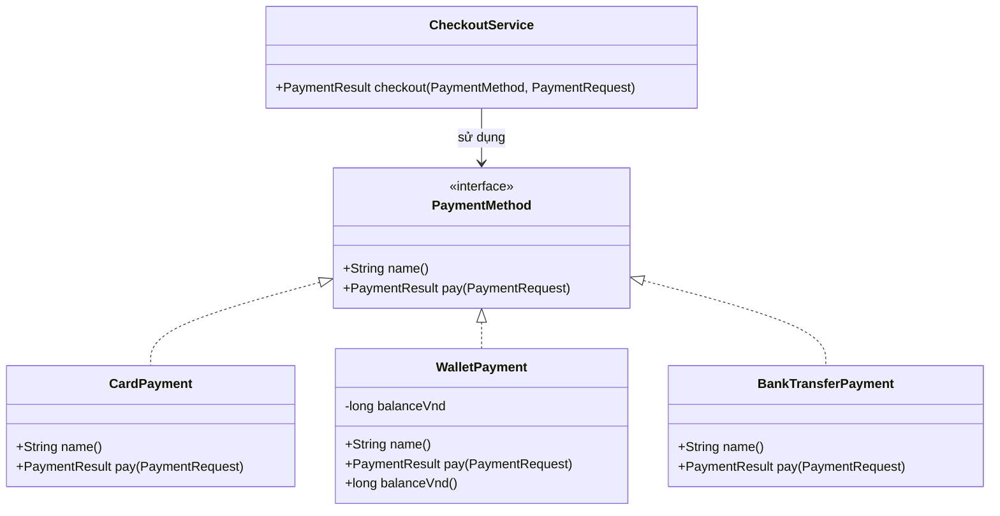
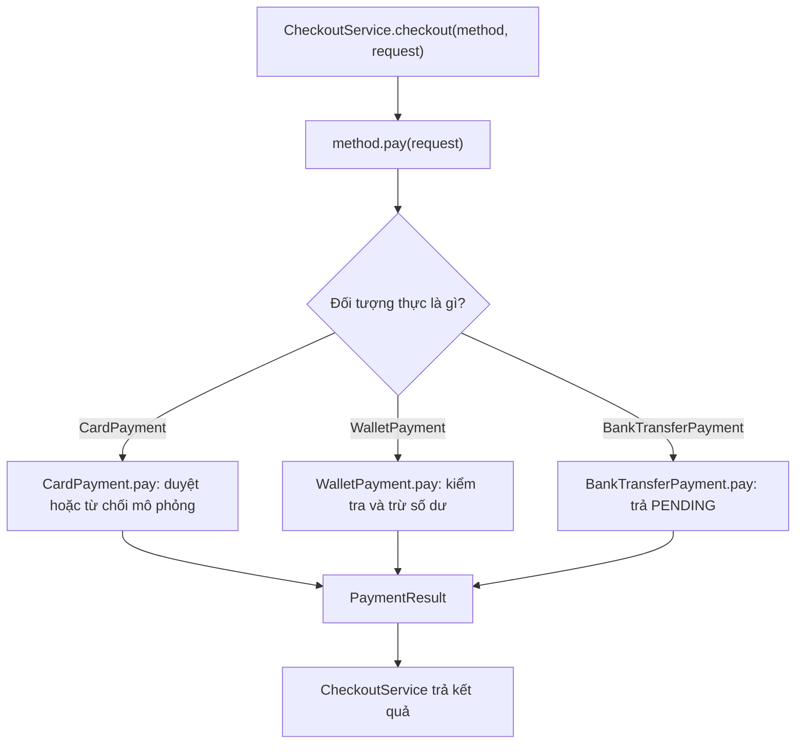

# Ví dụ nhiều phương thức thanh toán bằng đa hình trong Java

> **Chủ đề:** OOP → Đa hình (Polymorphism) → Ví dụ nhiều phương thức thanh toán.
>
> Một hệ thống bán hàng có thể cho khách chọn **thẻ**, **ví điện tử** hoặc **chuyển khoản**. Mỗi phương thức có cách xử lý riêng, nhưng phần thanh toán của ứng dụng nên gọi chúng qua **một hợp đồng chung**. Đây là ứng dụng điển hình của đa hình: **cùng lời gọi, các đối tượng khác loại thực hiện hành vi khác nhau**.

## 1. Vấn đề nếu kiểm tra từng loại bằng `if/else`

Giả sử mã thanh toán được viết như sau:

```java
// Minh họa cách thiết kế khó mở rộng, không phải API hoàn chỉnh.
if ("CARD".equals(method)) {
    // Xử lý thẻ
} else if ("WALLET".equals(method)) {
    // Xử lý ví
} else if ("BANK".equals(method)) {
    // Xử lý chuyển khoản
} else {
    throw new IllegalArgumentException("Phương thức không hỗ trợ");
}
```

Khi thêm một phương thức mới, bạn phải sửa chuỗi điều kiện trong mã điều phối. Nếu logic này nằm rải rác ở nhiều service, càng dễ xuất hiện những nơi bị bỏ quên. Bên cạnh đó, thanh toán thẻ, trừ tiền ví và chờ chuyển khoản có vòng đời rất khác nhau; dồn hết vào một phương thức lớn khiến việc kiểm thử và sửa lỗi khó hơn.

Giải pháp OOP là thống nhất **đầu vào và đầu ra**, nhưng để từng lớp tự định nghĩa **cách thực hiện**.



Trong sơ đồ, `CheckoutService` chỉ phụ thuộc vào `PaymentMethod`, còn ba lớp cụ thể **implements** giao diện đó.

## 2. Hợp đồng chung gồm những gì?

Một hợp đồng gọn cho ví dụ:

```java
interface PaymentMethod {
    String name();
    PaymentResult pay(PaymentRequest request);
}
```

Ở đây:

- `name()`: tên hiển thị của phương thức thanh toán.
- `pay(request)`: nhận yêu cầu thanh toán và trả một kết quả có cấu trúc.
- Mỗi lớp triển khai phải cung cấp hai phương thức trên theo đúng chữ ký và hợp đồng.
- Người sử dụng interface không cần biết lớp triển khai dùng thẻ, ví hay chuyển khoản.

Ta định nghĩa ba trạng thái kết quả:

| Trạng thái | Ý nghĩa trong ví dụ | Có thể coi đơn hàng đã thanh toán? |
|---|---|---|
| `PAID` | Phương thức mô phỏng đã xác nhận thành công | Có, **trong phạm vi mô phỏng** |
| `DECLINED` | Yêu cầu bị từ chối | Không |
| `PENDING` | Đã tạo hướng dẫn hoặc yêu cầu, đang đợi xác nhận | **Không** |

**Quan trọng:** `PENDING` không phải `PAID`. Ví dụ chuyển khoản chỉ trả hướng dẫn chuyển tiền, không được tự ghi nhận rằng ngân hàng đã nhận được tiền.

## 3. Mã Java hoàn chỉnh: ba phương thức, một CheckoutService

Lưu toàn bộ mã dưới đây thành **`MultiPaymentDemo.java`**. Ví dụ chạy bằng **Java 17+**, không cần thư viện bên ngoài, không xử lý tiền thật và không lưu thông tin thẻ nhạy cảm.

```java
import java.util.List;
import java.util.Objects;

public class MultiPaymentDemo {

    enum PaymentStatus {
        PAID, DECLINED, PENDING
    }

    record PaymentRequest(String orderId, long amountVnd) {
        PaymentRequest {
            if (orderId == null || orderId.isBlank()) {
                throw new IllegalArgumentException("Mã đơn hàng không hợp lệ");
            }
            if (amountVnd <= 0) {
                throw new IllegalArgumentException("Số tiền phải dương");
            }
        }
    }

    record PaymentResult(PaymentStatus status, String message) {
        PaymentResult {
            Objects.requireNonNull(status, "status");
            Objects.requireNonNull(message, "message");
        }
    }

    interface PaymentMethod {
        String name();
        PaymentResult pay(PaymentRequest request);
    }

    // 1. Thẻ: mô phỏng việc duyệt hoặc từ chối theo hạn mức.
    static final class CardPayment implements PaymentMethod {
        private final String lastFourDigits;

        CardPayment(String lastFourDigits) {
            if (lastFourDigits == null
                    || !lastFourDigits.matches("[0-9]{4}")) {
                throw new IllegalArgumentException(
                    "Chỉ nhập 4 chữ số cuối để minh họa"
                );
            }
            this.lastFourDigits = lastFourDigits;
        }

        @Override
        public String name() {
            return "Thẻ **** " + lastFourDigits;
        }

        @Override
        public PaymentResult pay(PaymentRequest request) {
            Objects.requireNonNull(request, "request");

            // Quy tắc mô phỏng, KHÔNG phải hạn mức thẻ thực tế.
            if (request.amountVnd() > 200_000) {
                return new PaymentResult(
                    PaymentStatus.DECLINED,
                    "Vượt hạn mức mô phỏng của thẻ"
                );
            }
            return new PaymentResult(
                PaymentStatus.PAID,
                "Thẻ mô phỏng đã được duyệt"
            );
        }
    }

    // 2. Ví: giữ số dư của instance, chỉ trừ khi đủ tiền.
    static final class WalletPayment implements PaymentMethod {
        private long balanceVnd;

        WalletPayment(long openingBalanceVnd) {
            if (openingBalanceVnd < 0) {
                throw new IllegalArgumentException("Số dư không thể âm");
            }
            this.balanceVnd = openingBalanceVnd;
        }

        @Override
        public String name() {
            return "Ví điện tử";
        }

        @Override
        public synchronized PaymentResult pay(PaymentRequest request) {
            Objects.requireNonNull(request, "request");

            if (request.amountVnd() > balanceVnd) {
                return new PaymentResult(
                    PaymentStatus.DECLINED,
                    "Ví không đủ số dư"
                );
            }

            balanceVnd -= request.amountVnd();
            return new PaymentResult(
                PaymentStatus.PAID,
                "Đã trừ " + request.amountVnd() + " VND từ ví mô phỏng"
            );
        }

        synchronized long balanceVnd() {
            return balanceVnd;
        }
    }

    // 3. Chuyển khoản: chỉ tạo thông tin, chờ ngân hàng xác nhận.
    static final class BankTransferPayment implements PaymentMethod {
        private final String bankAccount;

        BankTransferPayment(String bankAccount) {
            if (bankAccount == null || bankAccount.isBlank()) {
                throw new IllegalArgumentException("Tài khoản không hợp lệ");
            }
            this.bankAccount = bankAccount;
        }

        @Override
        public String name() {
            return "Chuyển khoản";
        }

        @Override
        public PaymentResult pay(PaymentRequest request) {
            Objects.requireNonNull(request, "request");

            return new PaymentResult(
                PaymentStatus.PENDING,
                "Chờ chuyển " + request.amountVnd()
                    + " VND tới " + bankAccount
                    + ", nội dung " + request.orderId()
            );
        }
    }

    // Service chỉ gọi hợp đồng chung, không kiểm tra instanceof.
    static final class CheckoutService {
        PaymentResult checkout(
                PaymentMethod method,
                PaymentRequest request) {

            Objects.requireNonNull(method, "method");
            Objects.requireNonNull(request, "request");

            return Objects.requireNonNull(
                method.pay(request),
                "Phương thức thanh toán không được trả null"
            );
        }
    }

    public static void main(String[] args) {
        WalletPayment wallet = new WalletPayment(150_000);

        List<PaymentMethod> methods = List.of(
            new CardPayment("4242"),
            wallet,
            new BankTransferPayment("DEMO-ACCOUNT")
        );

        CheckoutService checkout = new CheckoutService();

        // Mỗi lần là một đơn hàng KHÁC NHAU để minh họa từng lựa chọn.
        for (int i = 0; i < methods.size(); i++) {
            PaymentMethod method = methods.get(i);
            PaymentRequest request =
                new PaymentRequest("ORD-" + (i + 1), 120_000);

            PaymentResult result = checkout.checkout(method, request);

            System.out.println(method.name() + " -> "
                    + result.status());
            System.out.println("  " + result.message());
        }

        System.out.println("Số dư ví còn: " + wallet.balanceVnd());

        PaymentResult notEnough = checkout.checkout(
            wallet,
            new PaymentRequest("ORD-4", 40_000)
        );
        System.out.println("Ví thanh toán lần nữa -> "
                + notEnough.status());
        System.out.println("Số dư ví cuối: " + wallet.balanceVnd());
    }
}
```

Biên dịch và chạy trong thư mục chứa tệp:

```bash
javac MultiPaymentDemo.java
java MultiPaymentDemo
```

Kết quả mong đợi:

```text
Thẻ **** 4242 -> PAID
  Thẻ mô phỏng đã được duyệt
Ví điện tử -> PAID
  Đã trừ 120000 VND từ ví mô phỏng
Chuyển khoản -> PENDING
  Chờ chuyển 120000 VND tới DEMO-ACCOUNT, nội dung ORD-3
Số dư ví còn: 30000
Ví thanh toán lần nữa -> DECLINED
Số dư ví cuối: 30000
```

Ba lần lặp ban đầu tương ứng **ba đơn hàng khác nhau** (`ORD-1`, `ORD-2`, `ORD-3`) để thể hiện ba implementation. Trong quy trình mua hàng thật, **khách chọn một phương thức cho một lần thanh toán**; không được tự động gọi tất cả phương thức để thu tiền cùng một đơn.

## 4. Đa hình diễn ra ở dòng nào?

Trọng tâm là:

```java
PaymentMethod method = methods.get(i);
PaymentResult result = checkout.checkout(method, request);
```

Và trong `CheckoutService`:

```java
return method.pay(request);
```

Mã nguồn của service chỉ có một lời gọi `pay`. Tuy nhiên, kết quả khác nhau theo đối tượng được cung cấp:



Đó là **runtime polymorphism** hay đa hình lúc chạy.

| Đặc điểm | Ở mã sử dụng | Ở đối tượng thực |
|---|---|---|
| Kiểu biến `method` | `PaymentMethod` | Có thể là bất kỳ lớp implements hợp đồng |
| Phương thức được phép gọi | `name()`, `pay(...)` từ interface | Implementation có thể có thêm API riêng |
| Chữ ký `pay` | Được kiểm tra khi biên dịch | Phải được lớp triển khai tuân thủ |
| Thân `pay` chạy | Không cố định trong service | Chọn theo lớp runtime |
| Kết quả | Cùng kiểu `PaymentResult` | Có thể là PAID, DECLINED hoặc PENDING |

**Đối tượng runtime quyết định implementation**, không phải chuỗi trả về từ `name()`, không phải tên biến và cũng không phải một phép ép kiểu trong `CheckoutService`.

Lưu ý: `PaymentMethod` là interface, không thể viết `new PaymentMethod()`. Có thể khai báo **biến có kiểu interface** và gán một instance của lớp triển khai:

```java
PaymentMethod selected = new WalletPayment(100_000);
PaymentResult result = selected.pay(
    new PaymentRequest("ORD-5", 60_000)
);
System.out.println(result.status()); // PAID
```

## 5. `@Override`, chữ ký và giới hạn của interface

Khi một class `implements PaymentMethod`, các phương thức instance được khai báo trong interface phải được triển khai với phạm vi truy cập phù hợp:

```java
@Override
public PaymentResult pay(PaymentRequest request) {
    // ...
}
```

Vì `pay` trong interface là `public`, triển khai không được thu hẹp thành `protected`, package-private hoặc `private`.

Một lỗi dễ mắc:

```java
class IncorrectPayment implements PaymentMethod {
    @Override
    public PaymentResult pay(long amount) {
        // Sai: pay(long) không phải pay(PaymentRequest).
        return null;
    }

    @Override
    public String name() {
        return "Sai chữ ký";
    }
}
```

Lớp trên không biên dịch: `pay(long)` có tham số khác, không triển khai `pay(PaymentRequest)`; `@Override` giúp phát hiện ngay.

**Đừng nhầm overriding với overloading:**

- `pay(PaymentRequest)` trong các lớp triển khai là **override** một hợp đồng có cùng chữ ký; implementation được chọn động.
- Nếu thêm `pay(String orderId, long amount)` bên cạnh `pay(PaymentRequest)`, đó là **overload** (cùng tên, khác tham số). Chữ ký overload được chọn dựa trên kiểu tại thời điểm biên dịch; bản thân nó không phải ví dụ về chọn lớp thanh toán theo runtime.

`static` method cũng không được dispatch động giống instance method; không nên đặt xử lý nhiều phương thức thanh toán dưới dạng các phương thức static cùng tên và kỳ vọng JVM chọn theo object.

## 6. Thêm cách thanh toán mới mà không sửa CheckoutService

Giả sử bổ sung **thanh toán khi nhận hàng (COD)**. Ta tạo thêm một lớp `implements PaymentMethod`:

```java
// Thêm vào bên trong MultiPaymentDemo nếu muốn chạy cùng ví dụ:
static final class CashOnDeliveryPayment implements PaymentMethod {
    @Override
    public String name() {
        return "Thanh toán khi nhận hàng";
    }

    @Override
    public PaymentResult pay(PaymentRequest request) {
        Objects.requireNonNull(request, "request");
        return new PaymentResult(
            PaymentStatus.PENDING,
            "Chỉ thu tiền khi giao đơn " + request.orderId()
        );
    }
}
```

Sau đó dùng trực tiếp với service đã có:

```java
PaymentMethod cod = new CashOnDeliveryPayment();
PaymentResult result = new CheckoutService().checkout(
    cod,
    new PaymentRequest("ORD-COD", 80_000)
);
System.out.println(result.status()); // PENDING
```

`CheckoutService` không phải thêm nhánh `if ("COD")` hay `instanceof CashOnDeliveryPayment`. Đây là lợi ích rõ ràng của tính mở rộng dựa trên hợp đồng.

Tuy nhiên, có thể vẫn cần cập nhật phần **giao diện người dùng hoặc cấu hình đăng ký phương thức** để cho phép chọn COD. “Không sửa `CheckoutService`” không có nghĩa không sửa bất kỳ mã nào trong toàn hệ thống.

## 7. Kết quả trả về có ý nghĩa hơn một `boolean`

Nếu `pay` chỉ trả `boolean`, ta khó phân biệt:

- Thanh toán bị từ chối.
- Khách chưa hoàn tất chuyển khoản.
- Nhà cung cấp phản hồi chậm.
- Đã thu tiền thành công.

Một kiểu trả về như `PaymentResult` với `PaymentStatus` làm các trạng thái rõ ràng hơn. Ví dụ phần nghiệp vụ sau thanh toán có thể phân nhánh **trên kết quả nghiệp vụ**, thay vì phân nhánh **trên lớp implementation**:

```java
PaymentResult result = checkout.checkout(selected, request);

switch (result.status()) {
    case PAID -> System.out.println("Có thể ghi nhận đã thanh toán");
    case DECLINED -> System.out.println("Báo khách chọn cách thanh toán khác");
    case PENDING -> System.out.println("Chờ xác nhận trước khi hoàn tất");
}
```

Đây là sự phân nhánh **hợp lý**: trạng thái thanh toán là thông tin mà mọi implementation công khai qua hợp đồng. Điều nên tránh là hỏi `selected instanceof CardPayment` rồi sao chép lại logic riêng của thẻ vào service.

Trong ứng dụng thật, nên có thêm trạng thái hoặc dữ liệu cho tình huống **không biết thanh toán đã thành công hay chưa**. Không được coi timeout mạng đồng nghĩa chắc chắn chưa bị trừ tiền. Mô hình ba trạng thái của bài chỉ nhằm minh họa đa hình, chưa đầy đủ cho một payment system thực tế.

## 8. Kiểm thử đa hình bằng một phương thức thanh toán giả

Có thể kiểm tra rằng `CheckoutService` thực sự gọi `PaymentMethod.pay` và chuyển kết quả cho người gọi mà không kết nối dịch vụ thanh toán.

Bổ sung lớp sau **bên trong** `MultiPaymentDemo`:

```java
static final class RecordingPayment implements PaymentMethod {
    int calls;
    PaymentRequest lastRequest;

    @Override
    public String name() {
        return "Fake cho kiểm thử";
    }

    @Override
    public PaymentResult pay(PaymentRequest request) {
        calls++;
        lastRequest = request;
        return new PaymentResult(PaymentStatus.PAID, "fake-ok");
    }
}
```

Một đoạn kiểm tra có thể đặt trong `main`:

```java
RecordingPayment fake = new RecordingPayment();
CheckoutService service = new CheckoutService();
PaymentRequest testRequest = new PaymentRequest("TEST-1", 10_000);

PaymentResult actual = service.checkout(fake, testRequest);

if (fake.calls != 1
        || fake.lastRequest != testRequest
        || actual.status() != PaymentStatus.PAID) {
    throw new AssertionError("CheckoutService gọi sai PaymentMethod");
}
System.out.println("PASS");
```

Fake cho phép xác định **đúng implementation được gọi** và **đúng request được truyền**, không phụ thuộc ngân hàng hoặc ví điện tử. Kiểm thử này không chứng minh một cổng thanh toán thật an toàn: mỗi adapter tích hợp thật vẫn phải được kiểm thử theo hợp đồng tương ứng.

## 9. Lợi ích và giới hạn của cách thiết kế

| Lợi ích | Biểu hiện trong ví dụ |
|---|---|
| Đa hình | Một lời gọi `pay` chạy ba implementation khác nhau |
| Mở rộng | Thêm `CashOnDeliveryPayment` không phải đổi mã checkout |
| Tách trách nhiệm | Mỗi class chỉ quản lý cách thanh toán của mình |
| Dễ kiểm thử | Dùng `RecordingPayment` thay dịch vụ thật |
| Giảm phụ thuộc | `CheckoutService` chỉ biết `PaymentMethod` |
| Bảo trì thuận tiện | Chỉnh quy tắc ví không cần chỉnh quy tắc thẻ |

Nhưng đa hình **không tự giải quyết** các vấn đề vận hành của thanh toán thật:

1. **Gọi lặp/idempotency:** nếu khách gửi lại cùng yêu cầu do mạng lỗi, không được thu tiền hai lần. Cần ID giao dịch và hợp đồng chống trùng ở hệ thống thực hiện thanh toán.
2. **Dữ liệu bền vững:** ví trong ví dụ chỉ lưu số dư ở RAM. Khởi động lại chương trình là mất dữ liệu; hệ thống thật phải có lưu trữ và transaction thích hợp.
3. **Đồng thời:** `synchronized` trong `WalletPayment` bảo vệ một instance trong một JVM, không điều phối được nhiều instance hay nhiều máy cùng truy cập một tài khoản.
4. **Bảo mật:** không lưu số thẻ đầy đủ, CVV hoặc khóa bí mật trong mã ví dụ/log; tích hợp thật phải tuân thủ yêu cầu của nhà cung cấp và quy định liên quan.
5. **Xử lý lỗi:** kết quả `PENDING` phải có luồng xác nhận riêng (webhook, truy vấn trạng thái, đối soát...) trước khi coi giao dịch hoàn tất.

Những vấn đề này là trách nhiệm của kiến trúc thanh toán và hợp đồng tích hợp, **không phải tính năng tự sinh ra khi dùng interface**.

## 10. Bài tập thực hành

**Bài 1 — Dự đoán kết quả.** Dùng `PaymentMethod method = new BankTransferPayment("DEMO-02")` rồi gọi `method.pay(new PaymentRequest("ORD-7", 90_000))`. Kết quả là `PAID` hay `PENDING`? Tại sao Java không cần xét tên lớp trong `CheckoutService`?

**Bài 2 — Thêm phương thức.** Triển khai `CashOnDeliveryPayment` từ mục 6, thêm instance vào danh sách lựa chọn và kiểm tra chương trình vẫn dùng `method.pay(...)` qua interface.

**Bài 3 — Kiểm thử từ chối.** Tạo `WalletPayment(20_000)`, yêu cầu trả `30_000` VND và khẳng định kết quả `DECLINED` cùng số dư còn `20_000`. Sau đó thử yêu cầu `10_000` và kiểm tra số dư mới.

**Bài 4 — Phân biệt trạng thái.** Giải thích tại sao với chuyển khoản và COD, `PENDING` đúng hơn `PAID` khi chưa nhận được xác nhận tiền đã được thu.

**Bài 5 — Xác định mức trừu tượng.** Nếu mỗi phương thức thanh toán có cách hiển thị hướng dẫn khác nhau, bạn nên mở rộng hợp đồng `PaymentResult`, bổ sung interface cho phần hiển thị, hay để UI tự quyết định? Hãy nêu những dữ liệu mà tầng nghiệp vụ thật sự cần và tránh để UI phụ thuộc vào `instanceof` của từng lớp thanh toán.

**Ghi nhớ:** Đa hình cho phép `CardPayment`, `WalletPayment` và `BankTransferPayment` **cùng tuân theo `PaymentMethod` nhưng xử lý `pay()` khác nhau**. Khi service phụ thuộc vào giao diện chung, Java chọn implementation theo **đối tượng thực tại runtime**, còn mã điều phối vẫn gọn, dễ mở rộng và dễ kiểm thử.