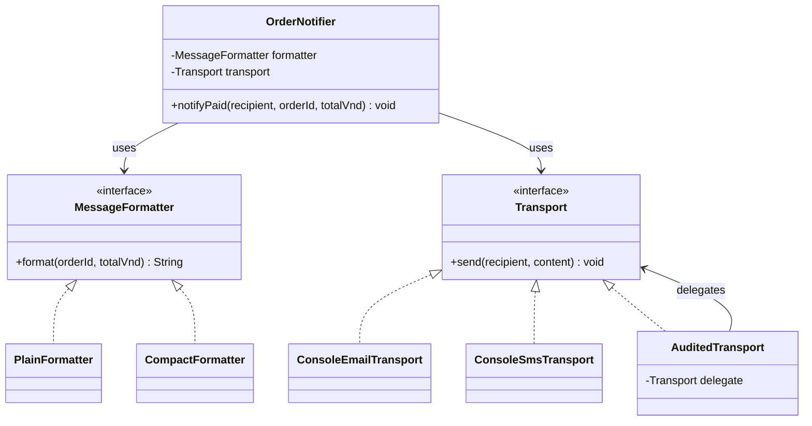
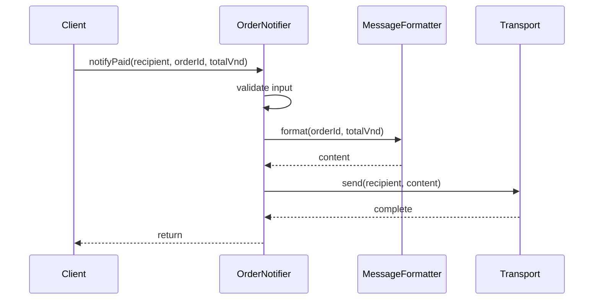

# Ghép đối tượng để xây dựng hành vi trong Java OOP

Một đối tượng không nhất thiết phải tự viết mọi chức năng mà nó cung cấp. Trong OOP, ta có thể **ghép nhiều đối tượng nhỏ, mỗi đối tượng có trách nhiệm riêng**, để tạo thành một hành vi lớn hơn. Cách tổ chức này thường gọi là **object composition** (kết hợp/ghép đối tượng), và khi đối tượng A chuyển một phần công việc cho đối tượng B thì đó là **delegation** (ủy quyền).

Ví dụ, chức năng “thông báo đơn hàng đã thanh toán” có thể hình thành từ ba phần:

1. Một đối tượng **định dạng nội dung** thông báo.
2. Một đối tượng **gửi** thông báo qua kênh được chọn.
3. Một đối tượng **điều phối** hai bước trên theo đúng thứ tự.

Mỗi phần làm một việc rõ ràng. Khi muốn đổi từ email sang SMS, hoặc đổi nội dung dài thành nội dung ngắn, ta **thay đối tượng thành phần** thay vì sửa toàn bộ lớp điều phối.

> Mục tiêu của bài: hiểu cách tạo hành vi bằng quan hệ “**có/sử dụng một đối tượng khác**” (*has-a / uses-a*), cách giao tiếp qua interface, cách chuyển trách nhiệm giữa các đối tượng và khi nào composition tốt hơn kế thừa (*inheritance*).

## 1. Một lớp làm hết mọi việc có vấn đề gì?

Xét thiết kế ban đầu:

```java
class OrderNotification {
    void notifyCustomer(
            String channel,
            String recipient,
            String orderId,
            long totalVnd) {

        String content = "Đơn " + orderId
                + " đã thanh toán: " + totalVnd + " VND";

        if ("email".equals(channel)) {
            System.out.println("[EMAIL] " + recipient + ": " + content);
        } else if ("sms".equals(channel)) {
            System.out.println("[SMS] " + recipient + ": " + content);
        } else {
            throw new IllegalArgumentException("Kênh không hỗ trợ");
        }
    }
}
```

Với ví dụ vài dòng, mã vẫn hoạt động. Nhưng nếu cần thêm Push Notification, đổi định dạng theo kênh, ghi nhật ký hay thử lại khi gửi thất bại, lớp này sẽ dần nhận quá nhiều trách nhiệm. Một thay đổi trong phần gửi email cũng có thể ảnh hưởng đến logic tạo nội dung SMS.

Thay vì một phương thức biết hết mọi chi tiết, ta tách thành các vai trò:

| Vai trò | Trách nhiệm | Không cần biết |
| --- | --- | --- |
| `MessageFormatter` | Biến dữ liệu đơn hàng thành chuỗi nội dung | Gửi qua kênh nào |
| `Transport` | Nhận người nhận và nội dung để thực hiện thao tác gửi | Nội dung được tạo từ quy tắc đơn hàng nào |
| `OrderNotifier` | Kiểm tra yêu cầu, gọi formatter rồi chuyển kết quả cho transport | Chi tiết định dạng và kỹ thuật gửi |
| `AuditedTransport` (tùy chọn) | Bọc một transport để thêm bước log sau khi gửi | Cách transport thực hiện gửi |

Như vậy, hành vi hoàn chỉnh không nằm trong một lớp khổng lồ mà hình thành từ **sự phối hợp có chủ đích giữa các đối tượng**.

## 2. Thiết kế quan hệ giữa các đối tượng

Ta bắt đầu từ hai interface nhỏ:

```java
interface MessageFormatter {
    String format(String orderId, long totalVnd);
}

interface Transport {
    void send(String recipient, String content);
}
```

Sau đó, `OrderNotifier` có hai field:

```java
private final MessageFormatter formatter;
private final Transport transport;
```

Đây là ví dụ điển hình của **“has-a”**: một `OrderNotifier` **có** (giữ tham chiếu tới) formatter và transport để nhờ chúng làm việc. Nó không cần `extends EmailTransport` hoặc `extends PlainFormatter`.



**Đọc sơ đồ:** mũi tên realization nét đứt từ một lớp về interface biểu thị `implements`; quan hệ `uses` biểu thị một đối tượng giữ và dùng tham chiếu tới đối tượng khác.

Trong UML, hình thoi đen (composition theo nghĩa quan hệ *whole–part* sở hữu vòng đời) còn mang ý nghĩa sở hữu mạnh hơn. Ví dụ bên dưới nhận dependency từ nơi tạo ứng dụng, nên ta dùng quan hệ tham chiếu/ủy quyền thay vì khẳng định `OrderNotifier` độc quyền sở hữu vòng đời của các thành phần. Trong thực tế lập trình, “composition over inheritance” thường nói rộng hơn về kỹ thuật **ghép hành vi qua đối tượng** như thiết kế này.

## 3. Ví dụ Java hoàn chỉnh: tạo một hành vi từ nhiều đối tượng

Tạo tệp **`CompositionDemo.java`**. Ví dụ không dùng framework và tương thích Java 11+.

```java
import java.util.Objects;

public class CompositionDemo {

    // 1) Hợp đồng định dạng.
    interface MessageFormatter {
        String format(String orderId, long totalVnd);
    }

    // 2) Hợp đồng gửi.
    interface Transport {
        void send(String recipient, String content);
    }

    // 3) Hai cách định dạng có thể thay thế.
    static final class PlainFormatter implements MessageFormatter {
        @Override
        public String format(String orderId, long totalVnd) {
            return "Đơn " + orderId
                    + " đã thanh toán: " + totalVnd + " VND";
        }
    }

    static final class CompactFormatter implements MessageFormatter {
        @Override
        public String format(String orderId, long totalVnd) {
            return orderId + " | PAID | " + totalVnd + " VND";
        }
    }

    // 4) Hai cách gửi có cùng interface.
    // Chỉ mô phỏng gửi bằng console, không gửi email/SMS thật.
    static final class ConsoleEmailTransport implements Transport {
        @Override
        public void send(String recipient, String content) {
            System.out.println(
                    "[EMAIL -> " + recipient + "] " + content);
        }
    }

    static final class ConsoleSmsTransport implements Transport {
        @Override
        public void send(String recipient, String content) {
            System.out.println(
                    "[SMS -> " + recipient + "] " + content);
        }
    }

    // 5) Một transport "bọc" transport khác để thêm hành vi.
    static final class AuditedTransport implements Transport {
        private final Transport delegate;

        AuditedTransport(Transport delegate) {
            this.delegate = Objects.requireNonNull(
                    delegate, "delegate");
        }

        @Override
        public void send(String recipient, String content) {
            delegate.send(recipient, content);
            System.out.println(
                    "[AUDIT] Đã thực hiện thao tác gửi tới " + recipient);
        }
    }

    // 6) Đối tượng cấp cao chỉ điều phối.
    static final class OrderNotifier {
        private final MessageFormatter formatter;
        private final Transport transport;

        OrderNotifier(MessageFormatter formatter, Transport transport) {
            this.formatter = Objects.requireNonNull(
                    formatter, "formatter");
            this.transport = Objects.requireNonNull(
                    transport, "transport");
        }

        void notifyPaid(
                String recipient,
                String orderId,
                long totalVnd) {

            requireText(recipient, "recipient");
            requireText(orderId, "orderId");

            if (totalVnd < 0) {
                throw new IllegalArgumentException(
                        "Tổng tiền không được âm");
            }

            String content = formatter.format(orderId, totalVnd);
            transport.send(recipient, content);
        }

        private static void requireText(String value, String field) {
            if (value == null || value.isBlank()) {
                throw new IllegalArgumentException(
                        field + " không được rỗng");
            }
        }
    }

    public static void main(String[] args) {
        // Tổ hợp A: nội dung đầy đủ, email và audit.
        OrderNotifier emailNotifier = new OrderNotifier(
                new PlainFormatter(),
                new AuditedTransport(new ConsoleEmailTransport())
        );

        // Tổ hợp B: nội dung ngắn, SMS và không audit.
        OrderNotifier smsNotifier = new OrderNotifier(
                new CompactFormatter(),
                new ConsoleSmsTransport()
        );

        emailNotifier.notifyPaid(
                "an@example.test", "ORD100", 150_000);

        smsNotifier.notifyPaid(
                "0900000000", "ORD101", 200_000);

        try {
            smsNotifier.notifyPaid("0900000000", "ORD102", -1);
        } catch (IllegalArgumentException ex) {
            System.out.println("Từ chối: " + ex.getMessage());
        }
    }
}
```

Chạy:

```bash
javac CompositionDemo.java
java CompositionDemo
```

Kết quả:

```text
[EMAIL -> an@example.test] Đơn ORD100 đã thanh toán: 150000 VND
[AUDIT] Đã thực hiện thao tác gửi tới an@example.test
[SMS -> 0900000000] ORD101 | PAID | 200000 VND
Từ chối: Tổng tiền không được âm
```

Từ một `OrderNotifier` duy nhất, ta tạo hai tổ hợp hành vi:

| Cấu hình | Formatter | Transport | Hành vi quan sát |
| --- | --- | --- | --- |
| Email có ghi log | `PlainFormatter` | `AuditedTransport(ConsoleEmailTransport)` | Tạo nội dung dài, “gửi” qua console email rồi in log |
| SMS ngắn | `CompactFormatter` | `ConsoleSmsTransport` | Tạo nội dung ngắn rồi “gửi” qua console SMS |
| Lời gọi tổng tiền âm | Bất kỳ | Bất kỳ | Bị từ chối trước khi gọi formatter và transport |

**Không cần sửa `OrderNotifier`** khi muốn đổi từ tổ hợp A sang B. Khác biệt nằm ở **các đối tượng thành phần được đưa vào constructor**.

Đây là tính linh hoạt cốt lõi của composition: từ vài đối tượng nhỏ, ta có thể tổ hợp thành nhiều hành vi tùy nhu cầu.

## 4. Ủy quyền (delegation): ai thực sự làm công việc?

Xem phương thức điều phối:

```java
void notifyPaid(String recipient, String orderId, long totalVnd) {
    requireText(recipient, "recipient");
    requireText(orderId, "orderId");

    if (totalVnd < 0) {
        throw new IllegalArgumentException(
                "Tổng tiền không được âm");
    }

    String content = formatter.format(orderId, totalVnd);
    transport.send(recipient, content);
}
```

`OrderNotifier` chịu trách nhiệm **điều phối**, nhưng:

- Nó **ủy quyền** phần tạo chuỗi cho `formatter`.
- Nó **ủy quyền** phần gửi cho `transport`.
- Nó chỉ tự kiểm tra những điều kiện đầu vào cơ bản thuộc lời gọi nghiệp vụ.
- Nó không cần biết formatter kết hợp chuỗi ra sao hoặc transport gửi bằng giao thức nào.

Luồng gọi:



Điều phối và ủy quyền giúp **phân chia trách nhiệm**, không có nghĩa chương trình đột nhiên trở thành bất đồng bộ. Các lời gọi trong ví dụ là đồng bộ và chạy lần lượt trên cùng luồng.

Trong ứng dụng thực, `Transport.send` có thể gây lỗi mạng, timeout hoặc có kết quả xử lý bất đồng bộ. Khi đó cần quy định hợp đồng cụ thể: liệu method chỉ nhận yêu cầu hay đã giao thành công, lỗi được báo thế nào, có retry/idempotency hay không. Ví dụ console chỉ mô phỏng hành vi gửi để tập trung vào thiết kế OOP.

## 5. Constructor injection: ghép ở nơi tạo đối tượng

Tại sao `OrderNotifier` nhận hai dependency trong constructor thay vì tự viết:

```java
// Cách gắn chặt vào chi tiết implementation:
private final Transport transport = new ConsoleEmailTransport();
```

Nếu làm vậy, mỗi đối tượng `OrderNotifier` tự chọn một loại vận chuyển cụ thể. Thay kênh gửi có thể đòi sửa class điều phối, hoặc tạo thêm nhánh điều kiện ở bên trong.

Constructor injection:

```java
OrderNotifier(MessageFormatter formatter, Transport transport) {
    this.formatter = Objects.requireNonNull(formatter);
    this.transport = Objects.requireNonNull(transport);
}
```

giúp:

1. **Tách việc lắp ráp khỏi việc thực thi:** `main` hoặc composition root quyết định dùng thành phần nào; `OrderNotifier` chỉ sử dụng.
2. **Tạo đối tượng ở trạng thái hợp lệ:** constructor từ chối dependency `null` ngay lúc tạo.
3. **Dễ thay thế khi kiểm thử:** truyền một transport giả (fake) để quan sát lời gọi, không cần gửi thật.
4. **Giảm phụ thuộc:** `OrderNotifier` chỉ biết hai interface nhỏ.
5. **Làm rõ nhu cầu bắt buộc:** một notifier không thể chạy đúng nếu thiếu formatter hay transport.

`final` trên các field nghĩa là không gán lại tham chiếu sau constructor. Nó **không làm các đối tượng được tham chiếu trở nên bất biến**. Đối với các dependency có trạng thái mutable hoặc được chia sẻ nhiều nơi, cần xem thêm ràng buộc về sở hữu và đồng thời.

Không cần Spring hay bất kỳ DI framework nào để viết constructor injection. Framework chỉ có thể tự động hóa việc tạo và nối các đối tượng.

## 6. Thay thành phần để mở rộng hành vi

Giả sử hệ thống có thêm yêu cầu **thêm mã chiến dịch** vào nội dung. Ta có thể tạo formatter mới thực hiện cùng hợp đồng:

```java
final class CampaignFormatter
        implements CompositionDemo.MessageFormatter {

    private final CompositionDemo.MessageFormatter base;
    private final String campaign;

    CampaignFormatter(
            CompositionDemo.MessageFormatter base,
            String campaign) {

        this.base = java.util.Objects.requireNonNull(base);
        this.campaign = java.util.Objects.requireNonNull(campaign);
    }

    @Override
    public String format(String orderId, long totalVnd) {
        return base.format(orderId, totalVnd)
                + " | Campaign: " + campaign;
    }
}
```

Ở đây một formatter **giữ formatter khác** để bổ sung chức năng. Đây cũng là composition; nó gần với mẫu **Decorator** vì đối tượng bọc vẫn triển khai cùng interface với đối tượng bên trong.

Ví dụ sử dụng trong cùng package:

```java
CompositionDemo.MessageFormatter format =
        new CampaignFormatter(
                new CompositionDemo.PlainFormatter(), "SALE");

CompositionDemo.OrderNotifier notifier =
        new CompositionDemo.OrderNotifier(
                format, new CompositionDemo.ConsoleEmailTransport());

notifier.notifyPaid("an@example.test", "ORD103", 300_000);
```

Kết quả:

```text
[EMAIL -> an@example.test] Đơn ORD103 đã thanh toán: 300000 VND | Campaign: SALE
```

Trong trường hợp thêm nhiều lớp bọc, nên cân nhắc thứ tự áp dụng chúng. Chẳng hạn “chuẩn hóa đầu vào trước khi định dạng” khác với “định dạng rồi lọc nội dung”. Composition tạo sự linh hoạt, nhưng vẫn phải **thiết kế hợp đồng và thứ tự phối hợp** một cách rõ ràng.

> Đoạn `CampaignFormatter` là phần mở rộng minh họa, đặt cạnh các lớp của ví dụ chính trong cùng package. Ví dụ thực tế có thể tổ chức mỗi lớp vào một tệp riêng và công bố mức truy cập phù hợp.

## 7. Strategy và Decorator: hai cách ghép hành vi quen thuộc

Hai cấu hình trong chương trình chính thể hiện hai ý tưởng rất phổ biến:

**Strategy:** `MessageFormatter` có nhiều implementation như `PlainFormatter` và `CompactFormatter`. `OrderNotifier` chọn hành vi qua đối tượng được cung cấp; không phải tự chứa `if/else` cho mọi cách định dạng.

**Decorator:** `AuditedTransport` cũng `implements Transport` và chứa một `Transport` khác. Nó làm thêm việc trước hoặc sau khi ủy quyền, trong khi bên dùng vẫn coi nó là `Transport`.

```java
Transport transport =
        new AuditedTransport(new ConsoleEmailTransport());
```

Ý nghĩa:

- `ConsoleEmailTransport` thực hiện thao tác nền.
- `AuditedTransport` bọc hành vi nền và ghi log sau khi lời gọi `delegate.send(...)` hoàn tất bình thường.
- `OrderNotifier` không biết transport hiện tại có được bọc hay không.

Cần tránh suy luận quá mức: câu log `[AUDIT]` trong ví dụ chỉ cho biết lời gọi console không báo lỗi. Nó **không phải nhật ký giao dịch được lưu bền vững** và không chứng minh email/SMS đã đến thiết bị của người nhận. Một audit thật cần quy định lưu trữ, bảo đảm chống mất/đúp, và xử lý thất bại của bản ghi.

Không phải mọi thiết kế composition đều phải biến thành “mẫu thiết kế” phức tạp. Nếu chỉ cần một helper rõ nghĩa, một field và một lời gọi ủy quyền có thể đã đủ.

## 8. Composition khác inheritance thế nào?

Có thể đặt cạnh hai hướng thiết kế:

**Hướng kế thừa:**

```java
class EmailSender {
    void sendEmail(String recipient, String content) {
        System.out.println(recipient + ": " + content);
    }
}

// Không nên kế thừa chỉ để mượn method sendEmail.
class OrderNotifierByInheritance extends EmailSender {
    void notifyPaid(String recipient, String content) {
        sendEmail(recipient, content);
    }
}
```

`OrderNotifierByInheritance extends EmailSender` làm chương trình hình thành quan hệ “notifier **là một loại** email sender”. Về mặt nghiệp vụ, điều đó thường không đúng: notifier **sử dụng** sender chứ không **là** sender.

**Hướng composition:**

```java
class OrderNotifierByComposition {
    private final EmailSender sender;

    OrderNotifierByComposition(EmailSender sender) {
        this.sender = sender;
    }

    void notifyPaid(String recipient, String content) {
        sender.sendEmail(recipient, content);
    }
}
```

Hướng thứ hai thể hiện đúng “notifier **có/sử dụng** sender”. Nếu tiếp tục thay field bằng interface `Transport`, ta còn có thể chuyển từ email sang SMS mà không làm đổi lớp notifier.

| Tiêu chí | Kế thừa (inheritance) | Ghép đối tượng (composition) |
| --- | --- | --- |
| Quan hệ chính | `is-a`: kiểu con là một trường hợp của kiểu cha | `has-a / uses-a`: đối tượng giữ và dùng đối tượng khác |
| Tái sử dụng | Kế thừa implementation và/hoặc hợp đồng của superclass | Gọi/ủy quyền qua đối tượng thành phần |
| Liên kết với chi tiết | Lớp con có thể phụ thuộc vào protected API, trình tự và bất biến cha | Có thể che giấu chi tiết qua interface nhỏ |
| Thay hành vi | Override trong những điểm mở rộng được phép | Thay dependency hoặc tổ hợp decorator/strategy |
| Thay khi runtime | Kiểu thực tế của object đã tạo không tự đổi | Có thể tạo tổ hợp mới hoặc có cơ chế cập nhật dependency được thiết kế rõ |
| Rủi ro | Kế thừa chỉ để mượn code, phá quan hệ kiểu con | Quá nhiều lớp trung gian, cấu hình phức tạp |
| Phù hợp khi | Có quan hệ subtype thực sự và hợp đồng của cha được giữ | Cần cộng tác hoặc tái sử dụng mà không muốn ràng buộc vào superclass |

Câu “**favor composition over inheritance**” là một **nguyên tắc cân nhắc**, không phải lệnh cấm `extends`. Nếu `ElectricCar` thật sự là một kiểu `Vehicle` với hợp đồng phù hợp, kế thừa vẫn có thể hợp lý. Nếu một đối tượng chỉ “cần dùng chức năng” của đối tượng khác thì composition thường mô tả rõ hơn.

## 9. Ghép đối tượng không đồng nghĩa độc quyền sở hữu

Đây là một khác biệt tinh tế nhưng quan trọng.

```java
Transport shared = new ConsoleEmailTransport();

OrderNotifier first =
        new OrderNotifier(new PlainFormatter(), shared);
OrderNotifier second =
        new OrderNotifier(new CompactFormatter(), shared);
```

`first` và `second` **cùng giữ tham chiếu** tới `shared`. Cả hai có thể dùng nó. Java không tự nhân bản transport, không tự đóng transport khi một notifier hết sử dụng và không đảm bảo mỗi notifier sở hữu độc quyền dependency.

Khi thành phần chứa trạng thái như cache, kết nối I/O hay hàng đợi:

- Xác định **ai tạo, ai đóng, ai được sửa** dependency.
- Quy định có cho phép dùng chung instance không.
- Nếu dùng chung giữa nhiều luồng, xem xét thread-safety.
- Nếu cần snapshot độc lập của dữ liệu mutable, dùng sao chép phòng vệ hoặc value object phù hợp.

Không phải cứ có `private final Transport transport` là một quan hệ composition sở hữu mạnh trong UML, cũng không có nghĩa dependency bất biến. **Field `final` chỉ giữ nguyên tham chiếu**; trạng thái bên trong đối tượng đích vẫn có thể thay đổi.

Khi một thành phần sở hữu vòng đời mạnh của đối tượng con, nên thể hiện rõ trong API và quy tắc đóng tài nguyên. Ví dụ một service tự tạo một bộ đệm nội bộ, không trao đối tượng đó ra ngoài, và chủ động giải phóng khi service đóng. Trong trường hợp như vậy, mô hình “whole–part” chặt hơn có thể phù hợp.

## 10. Kiểm thử tổ hợp mà không gửi thông báo thật

Một lợi ích thực tế của composition là thay đối tượng gửi thật bằng **test double** để quan sát hành vi của lớp điều phối.

Tạo tệp **`CompositionTest.java`** cùng thư mục với `CompositionDemo.java`:

```java
public class CompositionTest {

    static final class RecordingTransport
            implements CompositionDemo.Transport {

        int calls;
        String lastRecipient;
        String lastContent;

        @Override
        public void send(String recipient, String content) {
            calls++;
            lastRecipient = recipient;
            lastContent = content;
        }
    }

    public static void main(String[] args) {
        RecordingTransport transport = new RecordingTransport();

        CompositionDemo.OrderNotifier notifier =
                new CompositionDemo.OrderNotifier(
                        new CompositionDemo.PlainFormatter(),
                        transport);

        notifier.notifyPaid("lan@example.test", "ORD200", 75_000);

        check(transport.calls == 1,
                "Phải gọi transport đúng một lần");
        check("lan@example.test".equals(transport.lastRecipient),
                "Sai người nhận");
        check("Đơn ORD200 đã thanh toán: 75000 VND"
                .equals(transport.lastContent),
                "Sai nội dung đã định dạng");

        try {
            notifier.notifyPaid("lan@example.test", "ORD201", -5);
            throw new AssertionError("Phải từ chối tổng tiền âm");
        } catch (IllegalArgumentException expected) {
            // Đúng: không gọi Transport cho yêu cầu sai.
        }

        check(transport.calls == 1,
                "Lỗi validation không được tạo thêm lời gọi gửi");

        System.out.println("PASS: composition và delegation");
    }

    static void check(boolean condition, String message) {
        if (!condition) {
            throw new AssertionError(message);
        }
    }
}
```

Chạy:

```bash
javac CompositionDemo.java CompositionTest.java
java CompositionTest
```

Kết quả dự kiến:

```text
PASS: composition và delegation
```

Bài kiểm tra này không phụ thuộc email/SMS thật. Nó chứng minh:

1. `OrderNotifier` gọi đúng dependency đã tiêm vào.
2. Kết quả formatter được chuyển nguyên văn cho transport.
3. Input sai được chặn trước khi gây hiệu ứng gửi.
4. Ta có thể kiểm thử **hành vi của một đối tượng** mà không phải khởi động toàn bộ hạ tầng ngoài.

Trong ứng dụng có JUnit, `RecordingTransport` có thể được giữ làm fake hoặc thay bằng mock tùy mục tiêu. Không phải phép kiểm thử nào cũng cần mock framework.

### Kiểm tra trường hợp dependency thất bại

Giả sử `Transport.send(...)` ném ngoại lệ trong lúc gửi. Với hiện thực `OrderNotifier` đang dùng, ngoại lệ được truyền ra cho caller; không có xử lý retry, rollback hay đảm bảo giao dịch nào được ngầm tạo ra.

Nếu hệ thống cần “gửi chính xác một lần” hay “ít nhất một lần”, phải thiết kế thêm cơ chế xử lý idempotency, hàng đợi, lưu trạng thái yêu cầu và lỗi hạ tầng. **Ghép đối tượng chỉ tổ chức trách nhiệm**, không tự bảo đảm tính tin cậy phân tán.

## 11. Những sai lầm dễ gặp

| Sai lầm | Vì sao có vấn đề? | Hướng sửa |
| --- | --- | --- |
| Kế thừa `EmailSender` chỉ để mượn hàm gửi | Tạo quan hệ `is-a` sai nghĩa | Chứa một `Transport` và ủy quyền |
| Một `OrderNotifier` dùng `if`/`switch` cho mọi kênh và định dạng | Mỗi biến thể mới buộc sửa class điều phối | Tách implementation sau interface phù hợp |
| Dùng `new ConsoleEmailTransport()` bên trong service | Khó thay kênh và kiểm thử | Lắp dependency ở constructor/composition root |
| Trả tham chiếu mutable nội bộ một cách vô ý | Caller có thể thay đổi trạng thái ngoài kiểm soát | Xác định ownership, copy hoặc API giới hạn |
| Cho rằng `final` làm dependency bất biến | `final` chỉ cấm gán lại field | Kiểm tra mutability của đối tượng được tham chiếu |
| Chia ra hàng chục interface cho vài dòng logic | Khó đọc và khó bảo trì | Chỉ tách khi có trách nhiệm hoặc khả năng thay thế rõ |
| Decorator thay đổi ngữ nghĩa lỗi mà client không biết | Làm hợp đồng trở nên khó dự đoán | Ghi rõ và giữ hành vi lỗi đã công bố |
| Xem log console là audit giao dịch thực | Không có lưu bền vững hay đối soát | Thiết kế audit riêng khi nghiệp vụ đòi hỏi |
| Giả định mọi đối tượng ghép đều có vòng đời chung | Dependency có thể được dùng chung hoặc sở hữu bên ngoài | Quy định ai tạo, ai giữ và ai giải phóng |

## 12. Bài tập áp dụng

**Bài tập A — đổi cách định dạng mà không sửa notifier.** Viết `UppercaseFormatter implements MessageFormatter`, dùng một formatter khác ở bên trong rồi chuyển kết quả sang chữ hoa bằng `toUpperCase(Locale.ROOT)`. Hãy dùng nó với `ConsoleSmsTransport` và giải thích đây là cách bổ sung hành vi bằng composition/decorator.

**Bài tập B — thay kênh gửi.** Viết `ConsolePushTransport implements Transport` sao cho in `[PUSH -> recipient] content`. Ghép nó với `PlainFormatter`. Trong `OrderNotifier` có cần sửa dòng nào không? **Không**, miễn transport giữ đúng hợp đồng `send`.

**Bài tập C — thứ tự hành vi.** Viết một `PrefixFormatter` và một `SuffixFormatter` đều bọc `MessageFormatter`. So sánh kết quả của hai tổ hợp `Prefix(Suffix(base))` và `Suffix(Prefix(base))`, rồi phân tích khi nào thứ tự decorator có tác động.

**Bài tập D — kiểm tra lỗi.** Tạo `FailingTransport` luôn ném `IllegalStateException`. Dùng `RecordingTransport` hoặc test khác để xác minh lớp notifier **không che giấu ngoại lệ** trong ví dụ, và thảo luận hợp đồng retry nếu muốn tự khôi phục.

**Bài tập E — thiết kế cửa hàng.** Phác thảo `CheckoutService` gồm `DiscountPolicy`, `ShippingFeePolicy` và `PaymentGateway`. Xác định dữ liệu vào, kết quả, thứ tự gọi và bất biến tiền tệ. Thảo luận vì sao không nên xây chuỗi kế thừa như `CheckoutService extends PaymentGateway` chỉ để dùng lại phương thức thanh toán.

## Kết luận

**Ghép đối tượng để xây dựng hành vi** là cách để một đối tượng cấp cao làm việc thông qua các đối tượng thành phần có trách nhiệm rõ ràng. Các thành phần có thể được nối qua constructor, trao đổi qua interface và ủy quyền cho nhau, từ đó hình thành nhiều tổ hợp hành vi mà không cần đặt tất cả logic vào một lớp hoặc lạm dụng kế thừa.

Khi thiết kế, hãy xác định **mỗi thành phần làm gì**, **hợp đồng nào kết nối chúng**, **thứ tự phối hợp ra sao**, và **ai sở hữu vòng đời/trạng thái**. Một cấu trúc composition tốt không chỉ giảm phụ thuộc mà còn giúp thay thế và kiểm thử hành vi ở từng ranh giới.